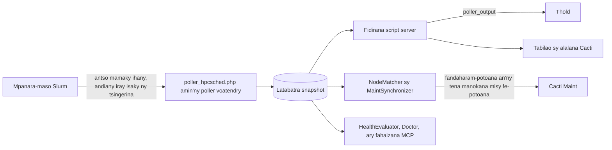

<!-- Source: README.md; SHA256: 938114d41dbd516f9dfcd94619c4fc73ef56b4da1dd693010588a93cce250534 -->

<!-- translations:start -->
[English](../../../README.md) | [简体中文](../zh-CN/README.md) | [हिन्दी](../hi-IN/README.md) | [Español (España)](../es-ES/README.md) | [Español (Latinoamérica)](../es-419/README.md) | [العربية (السعودية)](../ar-SA/README.md) | [Afrikaans](../af-ZA/README.md) | [አማርኛ](../am-ET/README.md) | [العربية (مصر)](../ar-EG/README.md) | [العربية (المغرب)](../ar-MA/README.md) | [বাংলা](../bn-BD/README.md) | [Bosanski](../bs-BA/README.md) | [Deutsch](../de-DE/README.md) | [فارسی](../fa-IR/README.md) | [Filipino](../fil-PH/README.md) | [Français](../fr-FR/README.md) | [Français (Maroc)](../fr-MA/README.md) | [Français (Sénégal)](../fr-SN/README.md) | [Hausa](../ha-NG/README.md) | [עברית](../he-IL/README.md) | [Hrvatski](../hr-HR/README.md) | [Bahasa Indonesia](../id-ID/README.md) | [Igbo](../ig-NG/README.md) | [Italiano](../it-IT/README.md) | [日本語](../ja-JP/README.md) | [한국어](../ko-KR/README.md) | [Malagasy](README.md) | [मराठी](../mr-IN/README.md) | [Bahasa Melayu](../ms-MY/README.md) | [Nederlands](../nl-NL/README.md) | [Polski](../pl-PL/README.md) | [Português (Brasil)](../pt-BR/README.md) | [Русский](../ru-RU/README.md) | [Kinyarwanda](../rw-RW/README.md) | [Soomaali](../so-SO/README.md) | [Српски](../sr-RS/README.md) | [Svenska](../sv-SE/README.md) | [Kiswahili](../sw-KE/README.md) | [தமிழ்](../ta-IN/README.md) | [తెలుగు](../te-IN/README.md) | [ไทย](../th-TH/README.md) | [Türkçe](../tr-TR/README.md) | [Українська](../uk-UA/README.md) | [اردو](../ur-PK/README.md) | [Tiếng Việt](../vi-VN/README.md) | [isiXhosa](../xh-ZA/README.md) | [Yorùbá](../yo-NG/README.md) | [繁體中文](../zh-TW/README.md) | [isiZulu](../zu-ZA/README.md)
<!-- translations:end -->

# plugin_hpcsched

Plugin Cacti 1.2 (`hpcsched`, dikan-teny `0.1.0-dev`) izay manao tabilao ny toetry ny mpanomana asa batch HPC miaraka amin'ireo fitaovana efa arahi-maso ao amin'ny Cacti: ny halalin'ny filaharana, ny asa miandry raha oharina amin'ny asa mandeha, ny antony iandrasan'ny asa, ny toetry ny node, ny fampiasana ny partition, ary ny fampiasana fair-share isaky ny kaonty. Slurm no backend voalohany tafapetraka. Mandefa fampitandremana eo amin'ireo loharanon-drakitra vokatr'izany ny Thold, ary ny mpanandrify Maint azo isafidianana (opt-in) dia mitarika ny fotoana fikojakojana Cacti Maint avy amin'ireo node Slurm voa-drain, maty (down), na voatokana ho an'ny fikojakojana.

> **Sata: mbola eo am-panamboarana, tsy mbola misy famoahana.** Ity sampana ity dia manatanteraka ny fototry ny plugin, ny tabilaon'ny cluster sy ny partition, ny fianakavian'ny antony iandrasana, ny fampifandraisana ny node Slurm amin'ny fitaovana Cacti, ny fampifanarahana fotoana Cacti Maint azo isafidianana, ny famintinana fair-share isaky ny kaonty, ny fandefasana sy fampitomboana ny mpanangona angona lavitra, ny CLI Configuration-as-Code (CasC) sy fampandehanana, ary ireo hook tontolo iainana Cacti (CasC, Doctor, ary MCP / Abilities API v2). Ny andiam-pitiliana dia mandrakotra baikon'ny Slurm namboarina sy valin'ny `slurmrestd`, ary ny CI dia manao fitiliana amin'ny cluster Slurm tena izy misy node enina ao anaty container. Mbola tsy nandeha tamin'ny cluster famokarana ilay mpamaky, ary mbola tsy ao amin'ny CI ny fitiliana famerenana Thold hatramin'ny farany.

Tetikasa mahaleo tena ity ary tsy misy fifandraisana amin'ny tetikasa Cacti.

## Ny zavatra efa vita

- **Tsingerin'aina sy schema (v3)**: fametrahana, fanavaozana tsy miova vokatra (idempotent), fanesorana (mitazona ny latabatra plugin araka ny mahazatra), ary fepetra PHP 8.2 farafahakeliny nefa mitazona ireo fidirana ho azo vakiana amin'ny PHP 8.0. Ny schema v3 dia manampy ny `plugin_hpcsched_node_map` sy `plugin_hpcsched_maint_link` miaraka amin'ireo latabatra cluster, run, section, isan'ny asa, isan'ny node, node, partition, reservation, ary share.
- **Fanangonana Slurm mamaky ihany amin'ny poller fototra sy lavitra**: `poller_bottom` dia manomboka ny `poller_hpcsched.php --cluster=N` any ambadika amin'ny poller tsirairay (`poller_id`) ho an'ireo cluster voatendry ho azy izay alefa. Ny fihazakazahana tsirairay dia manangona snapshot iray voatahiry isaky ny cluster amin'ny alalan'ny baikon'ny mpanjifa (`squeue`, `scontrol`, `sshare` miaraka amin'ny `--json`) na `slurmrestd` amin'ny HTTPS (ekena ny HTTP loopback miaraka amin'ny fampitandremana fahasalamana). `INFO` dia manambara `remote_collect:1, remote_poller:1`, ary `replicate_out` dia mandika ireo famaritana `plugin_hpcsched_cluster` tsy misy tsiambaratelo ho any amin'ny mpanangona lavitra (`poller_id >= 2`); tsy vakiana na adika mihitsy ny votoatin'ny rakitra token.
- **Môdely Cacti sy tabilaon'ny cluster**: mitondra môdely fitaovana, angona, ary tabilao (`templates/hpcsched-templates.xml`) sy ny fanontaniana angona script-server ho an'ny partition (`scripts/ss_hpcsched_cluster.php`, `scripts/ss_hpcsched_partitions.php`). Rehefa manamafy ny mpitantana, dia mamorona na mampifandray fitaovana Cacti iray isaky ny cluster miaraka amin'ny tabilao momba ny asa araka ny toetra, ny asa miandry araka ny fianakavian'ny antony, ny node araka ny toetra, ny CPU, ny fampiasana (ho an'ny cluster sy isaky ny partition), ary ny taonan'ny snapshot.
- **Fampifandraisana node Slurm amin'ny fitaovana sy fampifanarahana Cacti Maint**: mpanandrify manana ambaratonga efatra amin'ny fotoana mitovy (`NodeMatcher`) dia mampifandray ireo node Slurm amin'ny rakitra `host` Cacti efa misy (anarana host marina, adiresy marina, famaritana/solonanarana marina, na etikety DNS voalohany ho an'ny anarana tsy IP) ary manamarika ho `ambiguous` ireo fampifandraisana maro na fitakiana fitaovana miverimberina toy izay haminavina. `HostList::expand()` dia manitatra ny lisitry ny host famandrihana Slurm (hatramin'ny node 10.000). `MaintSynchronizer` dia mamorona, manavao, ary manala ny fandaharam-potoana Cacti Maint tokana an'ny plugin arahina ao amin'ny `plugin_hpcsched_maint_link` ho an'ireo node voafaritra ao amin'ny `DRAIN`, `DRAINING`, `DOWN`, na famandrihana `MAINT`/`MAINTENANCE` mavitrika nefa tsy manova ny fandaharam-potoana Maint noforonin'ny mpitantana.
- **Famintinana fair-share isaky ny kaonty**: rehefa alefa ny `collect_shares`, dia manangona andalana fifandraisan'ny kaonty Slurm ao amin'ny `plugin_hpcsched_share` (manaisotra ny andalan'ny mpampiasa araka ny [ADR 0010](../../decisions/0010-bound-series-cardinality.md)). `ShareSummary` sy `ShareRepository` dia manisa ny isan'ny kaonty/partition, ny fitambaran'ny fampiasana manta sy tena izy, ny anton-javatra fair-share kely indrindra/lehibe indrindra/salany, ary ireo kaonty ambony indrindra; ny isan'ny kaonty dia aseho ao amin'ny `hpcsched-get-queue-summary`.
- **CasC sy CLI fampandehanana (`cli/hpcsched.php`)**: fanondranana fandrindrana YAML/XML, fanamarinana, fanomanana fahasamihafana dry-run, fampiharana mila fanamafisana, valiny fahasalamana voarafitra, ary fampifanarahana Maint azo isafidianana (`sync-maint --dry-run` / `--apply`).
- **Hook tontolo iainana (`setup.php`)**: `casc_register_providers`, `doctor_register_checks`, ary `abilities_register`.

## Anjara asan'ny fidirana

| Faritra | Fidirana |
| --- | --- |
| HPC Scheduler View | Topi-maso cluster mamaky ihany sy antony iandrasana (`hpcsched.php`). |
| HPC Scheduler Operator | Fidirana View miampy ny pejy Operations (`hpcsched_operator.php`) sy ny fankatoavana fanavahana olana manokana. |
| HPC Scheduler Admin | Fidirana Operator miampy ny fitantanana cluster (`hpcsched_clusters.php`) sy ny pejy fahasalamana (`hpcsched_health.php`). |

Rehefa avy mandika ireo rakitra fanavaozana, sokafy amin'ny maha-mpitantana ny pejy Plugins mba hisoratra anarana ireo faritra sy hook vaovao. Omeo mazava ny faritra Operator eo ambanin'ny **Configuration > Users** na vondrona mpampiasa. Ny fanavaozana dia mitazona ny ID sy ny fanomezan-dalana efa misy ho an'ny faritra View sy Admin. Ny fidirana Admin dia mandova ny fidirana Operator, ary ny fidirana Operator dia mandova ny fidirana View amin'ny fangatahana tsirairay; tsy manampy fanomezan-dalana voatahiry ho an'ny mpampiasa na vondrona izany. Ny fikirana plugin koa dia mitaky fidirana HPC Scheduler Admin ankoatra ny alalana Settings an'ny Cacti.

Ny alalana momba ny fitaovana an'ny Cacti dia mametra ny andalana sy ny hetsika azon'ny mpampiasa tsirairay atao. Ny cluster iray mifandray amin'ny fitaovana Cacti dia aseho, aondrana, ary ovaina ho an'ireo mpampiasa avelan'ny Cacti hiditra amin'izany fitaovana izany ihany; ny fampifandraisana fitaovana koa dia mitaky alalana ho an'ny fitaovana kendrena. Ny cluster iray tsy misy fitaovana dia voatanisa ao amin'ny pejy fitantanana ho an'ireo mpampiasa manana ny faritry ny plugin, fa tsy ao amin'ny fijerena ho an'ny mpikirakira, izay mitanisa ireo cluster mifandray amin'ny fitaovana ihany. Ny cluster izay voafafa ny fitaovana nifandray taminy raha mbola tsy nalefa ny plugin dia aseho amin'ireo mpampiasa manana fidirana HPC Scheduler Admin ihany. Ny fankatoavana dia maharitra mandritra ny fotoam-pivoriana ankehitriny an'ny mpampiasa ihany, mandritra ny adiny iray fara-fahabetsany ary raha mbola vaovao ny fandinihana mitovy. Ny fandinihana vaovao na niova dia manafoana azy ireo. Tsy manamarika fandrefesana tsy nahomby ho salama na manafoana fampitandremana mihitsy izy ireo.

## Fanamarihana ho an'ny mpikirakira

### Fiarovana, tombontsoa faran'izay kely, ary rakitra token

Mamaky ihany ny plugin. Omeo mpampiasa Slurm natokana tsy manana anjara asan'ny mpitantana na mpikirakira (`AdminLevel=None` ao amin'ny `sacctmgr`) izy. Raha misy `PrivateData=jobs` (na `nodes`, `reservations`, `usage`) ao amin'ny `slurm.conf`, dia ny rakitra azy manokana ihany no hitan'io mpampiasa io, ka lasa tsy feno ny isa ary tsy hain'ny plugin ny mamantatra izany. Ny fanesorana izany ho an'ny kaonty dia mitaky ambaratonga mpikirakira na mpitantana, izay mamela fanovana ihany koa; anjaran'ny toerana ny manapa-kevitra amin'izany fifanakalozana izany.

Ho an'ny baikon'ny mpanjifa, ny mpampiasa poller Cacti dia mila ny rakitra mpanjifa Slurm (`squeue`, `scontrol`, ary raha ilaina `sshare`) sy `slurm.conf` iray mahatratra ny mpanara-maso; ny lalan'ny rakitra dia fikirana lalana feno eo ambanin'ny **Configuration > Settings > HPC Scheduler**.

Ho an'ny `slurmrestd`, ny URL dia tsy maintsy `https://`, na `http://` amin'ny adiresy loopback ihany. Hamarinina ny taratasy fanamarinana TLS ary tsy arahina ny fanodinana (redirects). Ny lisitry ny host `slurmrestd` azo isafidianana eo ambanin'ny **Configuration > Settings > HPC Scheduler** dia mametra izay host sy seranana azon'ny cluster tononina.

Ny cluster `slurmrestd` dia manondro rakitra token; ny token tenany dia tsy tahirizina ao amin'ny tahiry angona, tsy aseho amin'ny pejy, tsy aondran'ny CasC, ary tsy soratana ao amin'ny log mihitsy. Ny rakitra dia tsy maintsy ao anatin'ny iray amin'ireo Token File Directories voafaritra eo ambanin'ny **Configuration > Settings > HPC Scheduler**, azo tratrarina tsy misy rohy marika (symbolic link), ary rakitra mahazatra an'ny mpampiasa poller izay io mpampiasa io ihany no afaka manoratra ao, mitahiry andalana iray: ny token na `SLURM_JWT=<token>` araka ny avoakan'ny `scontrol token`. Raha tsy misy lahatahiry token voafaritra, dia tsy misy cluster afaka mampiasa `slurmrestd`. Tazomy ho root sy ny mpampiasa poller ihany no afaka manoratra ao amin'ny lahatahiry token tsirairay. Mbola ampiasaina ny rakitra azo vakian'ny vondrona na mpampiasa hafa, ary mampitandrina ny pejy fahasalamana; mampitandrina ihany koa izy rehefa ho lany daty ao anatin'ny fe-potoana fampitandremana voafaritra ny token.

Mba hanoloana token tsy misy fiatoana (atomically):

```sh
dir=/etc/cacti/hpcsched
tmp=$(mktemp "$dir/.token.XXXXXX")
scontrol token username=cactiread lifespan=2592000 > "$tmp"
chown cacti:cacti "$tmp"
chmod 0600 "$tmp"
mv -f "$tmp" "$dir/cluster1.token"
```

Ny fanangonana manaraka no mamaky ilay rakitra vaovao. Ny famoronana token amin'ny `scontrol token` dia mitaky mpitantana Slurm; alefaso any amin'izay ahazoana alalana izany ary adikao any amin'ny poller ilay rakitra.

### Mpanangona angona lavitra

`INFO` dia manambara `remote_collect:1, remote_poller:1`. `hpcsched_poller_bottom()` dia mandefa `poller_hpcsched.php` amin'ny poller tsirairay ho an'ireo cluster alefa voatendry amin'izany `poller_id` izany, ary `hpcsched_replicate_out()` dia mandika ireo andalana `plugin_hpcsched_cluster` tsy misy tsiambaratelo ho any amin'ny poller lavitra (`poller_id >= 2`). Ny rakitra token sy ny baikon'ny mpanjifa Slurm dia tsy maintsy misy eo an-toerana ao amin'ny poller lavitra voatendry; tsy adika mihitsy ny votoatin'ny token.

### Fetran'ny fitadidiana

Ny fihazakazahana fanangonana tsirairay dia mamadika valin'ny mpanomana asa iray isaky ny mandeha, izay maka eo amin'ny 12 heny ny haben'ny valiny ao amin'ny fitadidiana PHP (refesina ho eo amin'ny 10 heny ho an'ny rakitra asa mitovy endrika amin'ny an'ny Slurm, miampy ny lahatsoratra tenany). Ny mpamaky dia mampiakatra ny fetran'ny fitadidiana PHP ho amin'ny fikirana Collection Memory (1024 MiB araka ny mahazatra) ary mamela valiny hatramin'ny `(Collection Memory - 64) / 12` MiB (80 MiB araka ny mahazatra), na dia ambony kokoa aza ny fikirana Maximum Answer Size; mampitandrina ny pejy fahasalamana rehefa mihoatra io fetra mifanaraka io ny Maximum Answer Size. Ny valiny lehibe kokoa dia mampandiso ny fizarana misy azy ho lehibe loatra, ary ny fihazakazahana mbola lany fitadidiana dia manoratra tsy fahombiazan'ny fitadidiana ary manafaka ny lease sy ny toerana fizotrany amin'ny alalan'ny mpikirakira fanakatonana (shutdown handler). Ny cluster lehibe dia mety mila fampiakarana ireo fikirana roa ireo; mbola tsy voarefy ny rakitra asa tena izy 100.000.

### Môdely, fitaovana cluster, ary fanisana tabilao

Ny fametrahana sy ny fanavaozana dia manafatra ny môdely fitaovana, angona, ary tabilao HPC Scheduler ary mandika ny fanontaniana angona partition ao amin'ny lahatahiry `resource/script_server/` an'ny Cacti. Raha tsy azo soratana io lahatahiry io, raha misy rakitra hafa mitovy anarana ao, na raha rohy marika ny lasibatra, dia mijanona ny fanafarana, tsy mikasika ilay rakitra, ary mitatitra ny toe-javatra eo amin'ny pejy fahasalamana izay anandraman'ny **Install Templates** indray. Ny fanesorana dia manala ny rakitra fanontaniana raha ny plugin ihany no nanoratra azy ary tsy niova izy, ary mitazona ny môdely, ny fitaovana, ary ny tabilao.

**HPC Clusters > Device** dia mampiseho mialoha ny tabilao, loharanon-drakitra, rakitra RRD, ary fiantsoana script server isaky ny polling alohan'ny hamoronana na inona na inona. **Create Device** dia mamorona fitaovana manana anarana host ao amin'ny sehatra voatokana `.invalid` ary tsy misy fanamarinana fahafahana miasa; **Map Device** dia mametaka ny tabilao amin'ny fitaovana efa misy nefa tsy manova ny fikirany. Ny tabilao cluster sy tabilao partition tsirairay dia samy manana ny loharanon-drakiny avy: enina ho an'ny cluster ary dimy isaky ny partition. Ny partition ampiana aty aoriana dia averina ampidirina ho azy amin'ny tondro rehefa mahita fiovana ny mpamaky; ny partition nesorina dia mitsahatra tsy angonina intsony ary mitazona ny tabilaony. Ny famafana fitaovana dia manala ny fampifandraisana ny cluster (sy mamafa izay andalana `plugin_hpcsched_node_map` mifanaraka) nefa mitazona ny rakitra cluster.

Ny Pending dia tsy ahitana asa voatazona (held), izay manana ny andian-drakitra azy manokana. Ny job array miandry dia manisa ny asa sisa tavela ao aminy. Ny asa na node ao amin'ny partition maro dia isaina indray mandeha ao amin'ny tabilaon'ny cluster ary indray mandeha ao amin'ny partition tsirairay, ka tsy voatery hitovy amin'ny fitambaran'ny cluster ny fitambaran'ny partition. Ny antony iandrasana dia atambatra ho fianakaviana iraika ambin'ny folo ([ADR 0011](../../decisions/0011-pending-reason-families-and-counting.md)); ny fijerena antony iandrasana dia mitanisa ireo antony manta anisan'izany ireo ao amin'ny `Other`. Ny mpizara amin'ny fampiasana dia ahitana ny node voa-drain, maty, ary node hafa tsy azo ampiasaina. Ny angona lany andro na tsy nahomby dia taterina ho `U`, tsy aotra mihitsy; mijanona ho isa ny `age`.

Ho an'ny fampitandremana, amboary ny Thold amin'ny iray amin'ireo loharanon-drakitra cluster na partition miaraka amin'ny faharetana farafahakeliny elanelam-potoana fanangonana iray, ary mandefasa fampitandremana amin'ny `age` mba hamantarana mpamaky nijanona.

## CLI sy hook tontolo iainana

### Fidirana ho an'ny mpamaky

`hpcsched_poller_bottom()` dia manomboka ho azy ny `poller_hpcsched.php`; azo alefa tanana ao amin'ny poller voatendry ho an'ny cluster ihany koa izy:

```sh
php /path/to/cacti/plugins/hpcsched/poller_hpcsched.php --cluster=N [--force] [--debug]
```

`--force` dia mandeha na dia tsy alefa aza ny plugin, ho an'ny fitiliana amin'ny alalan'ny baikon'ny tsipika.

### Configuration-as-Code, fahasalamana, ary CLI fampifanarahana Maint

```sh
php /path/to/cacti/plugins/hpcsched/cli/hpcsched.php export [--format=yaml|xml] [--file=PATH]
php /path/to/cacti/plugins/hpcsched/cli/hpcsched.php validate --file=PATH [--format=yaml|xml]
php /path/to/cacti/plugins/hpcsched/cli/hpcsched.php plan --file=PATH [--format=yaml|xml]
php /path/to/cacti/plugins/hpcsched/cli/hpcsched.php apply --file=PATH --confirm=PLAN_HASH [--format=yaml|xml]
php /path/to/cacti/plugins/hpcsched/cli/hpcsched.php health [--format=text|json]
php /path/to/cacti/plugins/hpcsched/cli/hpcsched.php sync-maint [--dry-run | --apply] [--cluster=ID] [--format=text|json]
```

- `export` dia manoratra rakitra vaovao amin'ny maody `0600` (na stdout) ary manolo ny lalana `token_file` voafaritra ho `[REDACTED]`. `plan` sy `apply` dia mandà ny saha `jwt`, `secret`, ary `password` mivantana ao anaty rakitra, ary mitazona ny lalana `token_file` eo an-toerana efa misy rehefa omena ny `[REDACTED]`. `apply` dia mitaky ny `--confirm=PLAN_HASH` marina navoakan'ny `plan`.
- `health` dia manombana ny fahafenoan'ny schema, ny fahavaozan'ny cluster, ny vokatra fihazakazahana, ny fisian'ny Maint, ary ny fampitandremana nefa tsy mifandray amin'ny mpanomana asa na mamaky rakitra token.
- `sync-maint` dia manao `--dry-run` araka ny mahazatra ary mampiseho mialoha na mampihatra fandaharam-potoana Cacti Maint ho an'ny node Slurm voafaritra ao amin'ny `DRAIN`, `DRAINING`, `DOWN`, na famandrihana `MAINT`/`MAINTENANCE` mavitrika (fe-potoana mahazatra drain/down 3600s, sisim-panavaozana 600s). Mandà ny `--apply` izy raha tsy misy ny `plugin_maint_schedules` sy `plugin_maint_hosts`, ary manavao na manala ireo fandaharam-potoana voasoratra ao amin'ny `plugin_hpcsched_maint_link` ihany.

### Hook tontolo iainana

Rehefa misy ireo plugin Cacti mifandraika na fampidirana host, `setup.php` dia manoratra:

- `casc_register_providers`: manondrana, manamarina, manomana, ary mampihatra miaraka amin'ny fanamafisana ny fandrindrana `hpcsched` (`yaml` sy `xml`, schema v1) misy fanafenana tsiambaratelo.
- `doctor_register_checks`: manome fanamarinana fitiliana mamaky ihany efatra (`hpcsched.schema`, `hpcsched.cluster_freshness`, `hpcsched.token_health`, `hpcsched.maint_sync`).
- `abilities_register`: manoratra fahaizana telo mamaky ihany, tsy manimba, tsy miova vokatra eo ambanin'ny sokajy `hpcsched`, voafehin'ny faritra HPC Scheduler View (sy ny alalana fitaovana ho an'ny famintinana cluster): `hpcsched-list-clusters`, `hpcsched-get-queue-summary`, ary `hpcsched-get-health`.

## Nahoana

Ireo mpikirakira mampiasa Cacti dia efa manao tabilao ny node kajy ao aminy. Tsy hita ao amin'ireo tabilao ireo ny fomba fijerin'ny mpanomana asa, ka mamela banga roa:

- **Tsy misy hoe "nahoana no tsy manomboka ny asa".** Slurm dia mitahiry antony ho an'ny asa miandry tsirairay. Ny filaharana feno eo akaikin'ny tabilaon'ny node tsy miasa dia tsy milaza raha ny laharam-pahamehana, ny fetran'ny loharano, ny fihazonana, ny fiankinan-doha, na ny node voa-drain no antony.
- **Tsy misy fifandraisana eo amin'ny toetry ny mpanomana asa sy ny fampitandremana.** Thold dia mandefa fampitandremana amin'ny fitaovana iray efa nahenan'ny mpitantana, ary ny mpitantana no mamorona tanana ny fandaharam-potoana Maint.

Ny plugin dia manangona snapshot iray voatahiry isaky ny cluster, mamoaka izany ho loharanon-drakitra sy tabilao mahazatra ao amin'ny Cacti, mampifandray ireo node mpanomana asa amin'ny fitaovana Cacti efa misy, ary mampifanaraka ireo fotoana Maint manana fe-potoana an'ny plugin ho an'ireo node voa-drain, maty, na voatokana ho an'ny fikojakojana. Mampiasa indray ny alalan'ny Cacti, ny mpanangona angona lavitra, ny Thold, ary ny Maint izy, ary mijanona ho mamaky ihany tanteraka manoloana ny mpanomana asa.

## Faritra sy fetra

Ivelan'ny faritra: izay lalana fanoratana amin'ny mpanomana asa (fandefasana, fanafoanana, fihazonana, drain, famelomana indray), motera fampitandremana an'ny plugin manokana, motera tatitra na fampandoavam-bola, ary andian-drakitra isaky ny mpampiasa na isaky ny asa. Ny backend PBS Pro, OpenPBS, ary LSF dia natao ho an'ny fikarohana ihany.

## Fepetra sy fifanarahana

| Singa | Lasibatra |
|---|---|
| Cacti | 1.2.31 na vaovao kokoa (`compat = 1.2.31`), tsy misy fanovana fototra |
| PHP | 8.2 na vaovao kokoa; mijanona ho azo vakiana amin'ny 8.0 ireo fidirana ary mandà ny fampavitrihana amin'ny 8.1 mba hahazoan'ny runtime tsy tohanana fandavana fa tsy interface Cacti simba |
| Slurm | 25.05, 25.11, ary 26.05 ([ADR 0013](../../decisions/0013-three-latest-slurm-releases.md)); 26.05.5 dia tiliana ao amin'ny CI isaky ny fiovana amin'ny cluster container misy node enina, 25.11.8 ao amin'ny `main`, isan-kerinandro, ary raha angatahina, ary 25.05 amin'ny fixtures ihany. Ny baikon'ny mpanjifa dia mampiasa ny mpanadihady angona `v0.0.43` araka ny mahazatra (azo isafidianana ny `v0.0.44` sy `v0.0.45`); ny cluster `slurmrestd` dia mahita ny mpanadihady vaovao indrindra atolotry ny daemon |
| Thold, Maint | Tsy mila fanovana amin'ny Thold; `sync-maint` dia miray amin'ny latabatra `plugin_maint_schedules` sy `plugin_maint_hosts` an'ny Cacti Maint amin'ny alalan'ny latabatra rohy an'ny plugin (`plugin_hpcsched_maint_link`) |

## Fampandrosoana sy fitiliana

Ny workflow CI (`.github/workflows/plugin-ci-workflow.yml`) dia manao fitiliana PHP 8.2 hatramin'ny 8.5 amin'ny Cacti `release/1.2.31` sy `1.2.x`, fanamarinana endrika fidirana PHP 8.0, fandavana PHP 8.1, PHPStan, fanamarinana gettext/dikanteny, fahazoan-dalana REUSE, fanamarinana workflow, fizahana fikorianan'ny fitaovana cluster sy fivilian'ny fanondranana môdely, ary cluster Slurm tena izy misy node enina (`slurm-live`).

Miaraka amin'ny fitaovana fitiliana Pest iraisana voahidy an'ny Cacti (`CACTI_PEST_BIN`) sy tahiry angona Cacti azo ariana:

```sh
# Unit tests
"$CACTI_PEST_BIN" --configuration=phpunit.xml

# Lifecycle integration tests (disposable database only)
CACTI_PATH=/path/to/cacti HPCSCHED_TEST_DATABASE=disposable "$CACTI_PEST_BIN" --configuration=phpunit-integration.xml

# Static analysis (against Cacti 1.2.31)
CACTI_PATH=/path/to/cacti phpstan analyse -c phpstan.neon --no-progress

# Translation template, catalogs, and localized README checks
sh locales/build_gettext.sh --check
```

## Famolavolana

- [docs/PLAN.md](../../PLAN.md) no drafitra momba ny maritrano sy famolavolana: zava-misy upstream misy loharano, fampifandraisana node, môdely toetra, fetran'ny fiarovana, kajy fahombiazana, fitiliana, ary risika.
- [docs/decisions/](../../decisions/) dia mitahiry ny firaketana fanapahan-kevitra momba ny maritrano.
- [docs/REQUIREMENTS.md](../../REQUIREMENTS.md) dia mampifandray ny ID fepetra tsirairay amin'ny issue mifanandrify aminy.



## Fomba fanarahana ny asa

- **Dingana (Milestones)** dia manaraka ny dingan'ny drafitra. Ny tsirairay dia manana issue lehibe (epic) mitanisa ny zana-issue sy ny porofo famaranana.
- **Issues** dia sokajiana amin'ny etikety: `type: requirement`, `type: research`, `type: decision`, `type: epic`. Ny issue fepetra dia milaza fepetra misy laharana sy azo tiliana (`REQ-AREA-NNN`) ary fepetra fanekena.
- **Etikety** koa dia mitondra `area:`, `phase:`, `priority:`, ary `status:`. Jereo [CONTRIBUTING.md](../../../CONTRIBUTING.md#labels).
- Ny [tabilaon'ny tetikasa](https://github.com/users/somethingwithproof/projects/10) dia mampiseho ny issue rehetra amin'ny dingana rehetra.

## Fandraisana anjara

Vakio ny [CONTRIBUTING.md](../../../CONTRIBUTING.md). Ny commit dia mila sonia DCO (`git commit -s`). Ny fifanakalozan-kevitra momba ny famolavolana dia atao ao amin'ny issues; ny fanapahan-kevitra mbola misokatra dia mitondra ny etikety `type: decision`.

## Fiarovana

Tatitrao mitokana ny lesoka fiarovana; jereo [SECURITY.md](../../../SECURITY.md).

## Fahazoan-dalana

GNU General Public License v2.0, mitovy amin'ny fahazoan-dalana an'ny Cacti sy ireo plugin-ny. Jereo [LICENSE](../../../LICENSE).
