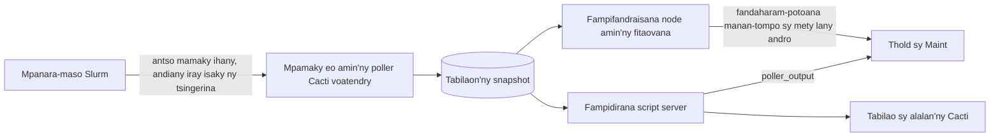

<!-- Source: README.md; SHA256: 16caa3e34c4d150a7fb1018f637e200a7580330f033b485047d8413bce09abba -->

<!-- translations:start -->
[English](../../../README.md) | [简体中文](../zh-CN/README.md) | [हिन्दी](../hi-IN/README.md) | [Español (España)](../es-ES/README.md) | [Español (Latinoamérica)](../es-419/README.md) | [العربية (السعودية)](../ar-SA/README.md) | [Afrikaans](../af-ZA/README.md) | [አማርኛ](../am-ET/README.md) | [العربية (مصر)](../ar-EG/README.md) | [العربية (المغرب)](../ar-MA/README.md) | [বাংলা](../bn-BD/README.md) | [Bosanski](../bs-BA/README.md) | [Deutsch](../de-DE/README.md) | [فارسی](../fa-IR/README.md) | [Filipino](../fil-PH/README.md) | [Français](../fr-FR/README.md) | [Français (Maroc)](../fr-MA/README.md) | [Français (Sénégal)](../fr-SN/README.md) | [Hausa](../ha-NG/README.md) | [עברית](../he-IL/README.md) | [Hrvatski](../hr-HR/README.md) | [Bahasa Indonesia](../id-ID/README.md) | [Igbo](../ig-NG/README.md) | [Italiano](../it-IT/README.md) | [日本語](../ja-JP/README.md) | [한국어](../ko-KR/README.md) | [Malagasy](README.md) | [मराठी](../mr-IN/README.md) | [Bahasa Melayu](../ms-MY/README.md) | [Nederlands](../nl-NL/README.md) | [Polski](../pl-PL/README.md) | [Português (Brasil)](../pt-BR/README.md) | [Русский](../ru-RU/README.md) | [Kinyarwanda](../rw-RW/README.md) | [Soomaali](../so-SO/README.md) | [Српски](../sr-RS/README.md) | [Svenska](../sv-SE/README.md) | [Kiswahili](../sw-KE/README.md) | [தமிழ்](../ta-IN/README.md) | [తెలుగు](../te-IN/README.md) | [ไทย](../th-TH/README.md) | [Türkçe](../tr-TR/README.md) | [Українська](../uk-UA/README.md) | [اردو](../ur-PK/README.md) | [Tiếng Việt](../vi-VN/README.md) | [isiXhosa](../xh-ZA/README.md) | [Yorùbá](../yo-NG/README.md) | [繁體中文](../zh-TW/README.md) | [isiZulu](../zu-ZA/README.md)
<!-- translations:end -->

# plugin_hpcsched

Plugin Cacti 1.2 izay manao tabilao momba ny toetry ny mpanomana asa batch HPC miaraka amin'ireo fitaovana efa arahi-maso ao amin'ny Cacti: ny halalin'ny filaharana, ny asa miandry raha oharina amin'ny asa mandeha, ny antony iandrasan'ny asa, ny toetry ny node, ary ny fampiasana ny partition. Slurm no backend voalohany. Afaka mandefa fampitandremana eo amin'ireo loharanon-drakitra vokatr'izany ny Thold, ary azo tarihina amin'ny alalan'ny node nahena sy ny famandrihana fikojakojana ny Maint.

> **Sata: mbola eo am-panamboarana, tsy mbola misy famoahana.** Efa natambatra ao amin'ny `main` ny dingana faha-2 (fototra), ary ity sampana ity dia manampy ny dingana faha-3 (tabilaon'ny cluster sy ny antony iandrasana). Apetraka, havaozina, ary esorina amin'ny alalan'ny API plugin an'ny Cacti ny kaody ary mandà ny PHP latsaky ny 8.2. Mitahiry rejisitry ny cluster Slurm izy, ka samy voatendry amin'ny poller Cacti iray avy ny tsirairay. Misy mpamaky mandeha any ambadika ao amin'ny poller fototra manangona snapshot iray isaky ny cluster isaky ny elanelam-potoana, amin'ny alalan'ny fandefasana `squeue`, `scontrol`, ary `sshare` miaraka amin'ny `--json` na amin'ny alalan'ny famakiana ny `slurmrestd` amin'ny HTTPS, ary mitahiry ny isan'ny asa araka ny toetra sy ny antony iandrasana, ny toetry ny node, ny partition, ny famandrihana, ary ny fampiasana fair-share miaraka amin'ny fahatomombanany ara-potoana. Mitondra môdely Cacti ny plugin, ary rehefa manamafy ny mpitantana, dia mamorona na mampifandray fitaovana Cacti iray isaky ny cluster miaraka amin'ny tabilao momba ny asa araka ny toetra, ny asa miandry araka ny fianakavian'ny antony, ny node araka ny toetra, ny CPU, ary ny fampiasana, ho an'ny cluster sy ho an'ny partition tsirairay, miampy ny taonan'ny snapshot. Ny pejy fijerena ankapobeny mamaky ihany dia mampiseho ny isa isaky ny cluster miaraka amin'ny fahatomombanany sy ny fijerena ny antony iandrasana isaky ny cluster, ary ny pejy fahasalamana ho an'ny mpitantana ihany dia mampiseho izay naverin'ny fanangonana tsirairay sy raha voapetraka ny môdely. Manaraka ny alalana momba ny fitaovana an'ny Cacti ny pejy sy ny hetsika rehetra. Afaka mampitandrina eo amin'ireo loharanon-drakitra ireo ny Thold, saingy mbola tsy nisy fitiliana natao momba ny fampidirana ny Thold na ny Maint; izany dia ao amin'ny dingana faha-4 sy ny manaraka. Ny andiam-pitiliana dia mandrakotra baikon'ny Slurm namboarina sy valin'ny `slurmrestd`, ary ny CI dia manao fitiliana ihany koa eo amin'ny cluster Slurm tena izy misy node enina ao anaty container araka ny voalaza etsy ambany. Mbola tsy nandeha tamin'ny cluster famokarana ilay mpamaky. Eo ambanin'ny fanamarihana ho an'ny mpikirakira, ity README ity dia mamaritra ny famolavolana, fa tsy fihetsika efa navoaka.

Tetikasa mahaleo tena ity ary tsy misy fifandraisana amin'ny tetikasa Cacti.

## Anjara asan'ny fidirana

| Faritra | Fidirana |
| --- | --- |
| HPC Scheduler View | Ireo pejy fanaraha-maso efa misy. |
| HPC Scheduler Operator | Fanaraha-maso miampy ny pejy Operations sy ny fankatoavana fanavahana olana manokana. |
| HPC Scheduler Admin | Fidiran'ny Operator miampy ny fanamboarana sy ny hetsika fitantanana efa misy. |

Aorian'ny fandikana ireo rakitra fanavaozana, sokafy amin'ny maha-mpitantana ny pejy Plugins mba hisoratana ny faritra vaovao. Omeo mazava ny faritra Operator ao amin'ny **Configuration > Users** na ireo vondron'ny mpampiasa. Mitazona ireo ID sy fanomezana alalana ho an'ny faritra View sy Admin efa misy ny fanavaozana. Mandova ny fidiran'ny Operator ny fidiran'ny Admin, ary mandova ny fidiran'ny View ny fidiran'ny Operator isaky ny fangatahana; tsy manampy fanomezana alalana voatahiry ho an'ny mpampiasa na vondrona izany. Mitaky fidirana HPC Scheduler Admin miampy ny alalana Settings an'ny Cacti ihany koa ny fametrahana an'ny plugin.

Mbola mametra ireo andalana sy hetsika azon'ny mpampiasa tsirairay atao ihany koa ny alalana momba ny fitaovana an'ny Cacti; ny cluster tsy manana fitaovana dia voatanisa ao amin'ny pejy fitantanana ho an'ny mpampiasa rehetra manana ny faritry ny plugin, saingy tsy ao amin'ny fijerena ho an'ny mpikirakira, izay tsy mitanisa afa-tsy ireo cluster mifandray amin'ny fitaovana iray. Mijanona ao amin'ny pejy fitantanana ny fahazoan-dàlana, ny fanamboarana, ny fampifandraisana, ny famafana, ary ny fanovana fitantanana hafa. Tsy maharitra afa-tsy ao amin'ny fotoam-pivoriana an'ny mpampiasa ankehitriny ny fankatoavana, mandritra ny adiny iray raha be indrindra ary raha mbola vaovao ny fanamarihana mitovy. Ny fanamarihana vaovao na niova dia manafoana azy ireo. Tsy manamarika na oviana na oviana ny fandrefesana tsy nahomby ho salama na manafoana fampitandremana izy ireo.

## Fanamarihana ho an'ny mpikirakira ho an'ny dingana faha-2

**Alalana kely indrindra.** Tsy manao afa-tsy famakiana ity plugin ity. Omeo mpampiasa Slurm natokana ho azy tsy manana anjara asan'ny mpitantana na mpikirakira (`AdminLevel=None` ao amin'ny `sacctmgr`) izy. Raha misy `PrivateData=jobs` (na `nodes`, `reservations`, `usage`) ao amin'ny `slurm.conf`, dia ny firaketany manokana ihany no hitan'izany mpampiasa izany, ka tsy feno ny isa ary tsy hain'ny plugin ny mamantatra izany. Ny fanafoanana izany ho an'ilay kaonty dia midika hoe ambaratonga mpikirakira na mpitantana, izay ahafahana manao fanovana ihany koa; anjaran'ny toerana ny manapa-kevitra momba izany fifanakalozana izany. Ho an'ny baikon'ny mpanjifa, mila ny rakitra executable mpanjifa Slurm sy ny `slurm.conf` mahazo ny mpanara-maso ny mpampiasa poller Cacti; ny lalan'ny rakitra executable dia fametrahana feno ao amin'ny Configuration > Settings > HPC Scheduler. Ho an'ny `slurmrestd`, ny URL dia tsy maintsy `https://`, na `http://` eo amin'ny adiresy loopback ihany. Hamarinina ny taratasy fanamarinana TLS ary tsy arahina ny redirection. Ny lisitra mpampiantrano slurmrestd azo isafidianana ao amin'ny Configuration > Settings > HPC Scheduler dia mametra ireo mpampiantrano sy port azon'ny cluster tononina.

**Poller lavitra.** Tsy manangona afa-tsy eo amin'ny poller fototra Cacti ity famoahana ity. Tsy angonina ny cluster voatendry amin'ny mpanangona angona lavitra: mandà miaraka amin'ny antony voasoratra anaty log ny mpamaky any ary manonona ny anaran'ny cluster ny pejy fahasalamana. Ao amin'ny dingana faha-3 ny fanangonana lavitra.

**Fitadidiana.** Ny fanangonana tsirairay dia mamaky valin'ny mpanomana asa iray isaky ny mandeha, izay maka eo amin'ny 12 heny amin'ny haben'ny valiny ao amin'ny fitadidiana PHP (voarefy eo amin'ny 10 heny ho an'ny firaketana asa mitovy endrika amin'ny an'ny Slurm, miampy ny lahatsoratra mihitsy). Mampiakatra ny fetran'ny fitadidiana PHP ho amin'ny fametrahana Collection Memory (1024 MiB amin'ny alalan'ny default) ny fandefasana ary mamela valiny hatramin'ny (Collection Memory - 64) / 12 MiB, 80 MiB amin'ny alalan'ny default, na dia napetraka ambony kokoa aza ny Maximum Answer Size; mampitandrina ny pejy fahasalamana rehefa izany no mitranga. Ny valiny lehibe kokoa dia mampandiso ny fizarany ho lehibe loatra, ary ny fandefasana izay mbola lany fitadidiana dia voarakitra ho tsy nahomby. Mety mila fampiakarana ireo fametrahana roa ireo ny cluster lehibe; mbola tsy voarefy ny firaketana asa tena izy miisa 100.000.

**Rakitra token.** Ny cluster `slurmrestd` dia manonona rakitra token; tsy tehirizina ao amin'ny tahiry angona, tsy aseho eo amin'ny pejy, ary tsy soratana ao amin'ny log na oviana na oviana ny token mihitsy. Ny rakitra dia tsy maintsy ao anatin'ny iray amin'ireo lahatahiry rakitra token napetraka ao amin'ny Configuration > Settings > HPC Scheduler, azo idirana tsy misy rohy marika, ary rakitra mahazatra an'ny mpampiasa poller izay io mpampiasa io ihany no afaka manoratra ao anatiny, mitahiry andalana iray: ny token, na `SLURM_JWT=<token>` araka izay avoakan'ny `scontrol token`. Raha tsy misy lahatahiry token napetraka, dia tsy misy cluster afaka mampiasa `slurmrestd`. Ireo fametrahana roa ireo dia eo amin'ny pejy Settings an'ny Cacti, ka tsy ny faritra Admin an'ny plugin irery no afaka manova azy; tazomy mba tsy ho azon'iza na iza soratana afa-tsy ny root sy ny mpampiasa poller ny lahatahiry token tsirairay. Mbola ampiasaina ihany ny rakitra azon'ny vondrona na mpampiasa hafa vakiana, ary mampitandrina ny pejy fahasalamana. Mampitandrina ihany koa ny pejy fahasalamana rehefa ho tapitra ao anatin'ny fotoana fampitandremana voafaritra ny token.

Mba hanovana token tsy misy fotoana ahitan'ny mpamaky rakitra tsy feno, soraty eo akaikin'ilay taloha ny token vaovao ary ovay anarana eo amin'ny toerany:

```sh
dir=/etc/cacti/hpcsched
tmp=$(mktemp "$dir/.token.XXXXXX")
scontrol token username=cactiread lifespan=2592000 > "$tmp"
chown cacti:cacti "$tmp"
chmod 0600 "$tmp"
mv -f "$tmp" "$dir/cluster1.token"
```

Ny fanangonana manaraka dia mamaky ny rakitra vaovao. Mitaky mpitantana Slurm ny famoronana token amin'ny alalan'ny `scontrol token`; alefaso any amin'ny toerana ahafahana manao izany ary adika any amin'ny poller ny rakitra.

## Fanamarihana ho an'ny mpikirakira ho an'ny dingana faha-3

**Môdely.** Ny fametrahana sy ny fanavaozana dia manafatra ny môdelin'ny fitaovana, ny angona, ary ny tabilao HPC Scheduler ary mandika ny fanontaniana angona momba ny partition ao amin'ny lahatahiry `resource/script_server/` an'ny Cacti. Raha tsy azon'ny mpampiasa mametraka ny plugin soratana io lahatahiry io, na efa misy rakitra hafa mitovy anarana ao nefa tsy nosoratan'ny plugin, na rohy marika ilay anarana, dia mijanona ny fanafarana, avela amin'izao ny rakitra, ary milaza izay tokony hatao ny pejy fahasalamana; manandrana indray ny Install Templates eo amin'ny pejy fahasalamana. Ampiasaina ny dika mitovy vita tanana nefa mijanona ho anao. Tsy manala ny rakitra fanontaniana afa-tsy raha ny plugin no nanoratra azy ary tsy niova izy io ny fanesorana, ary mitazona ny môdely, ny fitaovana, ary ny tabilao.

**Fitaovana cluster.** Mampiseho izay hampian'ny fitaovana iray (tabilao, loharanon-drakitra, rakitra RRD, ary antso script server isaky ny poll) ny HPC Clusters > Device alohan'ny hamoronana na inona na inona. Ny Create Device dia mamorona fitaovana miaraka amin'ny anaran'ny mpampiantrano ao amin'ny sehatra natokana `.invalid` ary tsy misy fanamarinana fahafahana mifandray; ny Map Device kosa dia mampifandray ny tabilao amin'ny fitaovana efa misy ary mamela ny fametrahany amin'izao. Ny tabilao cluster tsirairay sy ny tabilao partition tsirairay dia samy manana ny loharanon-drakitrany manokana: enina ho an'ny cluster ary dimy isaky ny partition, antso script server iray isaky ny loharanon-drakitry ny cluster ary iray isaky ny sandan'ny partition (32) isaky ny poll. Ny partition ampiana aty aoriana dia voasokajy rehefa hitan'ny mpamaky ary mahazo tabilao avy ao amin'ny pejy New Graphs an'ny Cacti; ny partition nesorina dia mijanona tsy ho polled intsony ary mitazona ny tabiaony. Ny famafana ny fitaovana dia manaisotra ny fampifandraisana amin'ny cluster ary mitazona azy.

**Izay isain'ny tabilao.** Tsy ahitana ny asa voatazona, izay manana ny andian-drakitrany manokana, ny asa miandry. Ny andiana asa miandry dia manisa ireo asa sisa tavela aminy. Ny asa na node iray ao anaty partition maromaro dia isaina indray mandeha ao amin'ny tabilaon'ny cluster ary indray mandeha ao amin'ny partition tsirairay, ka tsy voatery hitovy amin'ny an'ny cluster ny fitambaran'ny tabilaon'ny partition. Voasokajy ho fianakaviana iraika ambin'ny folo ny antony iandrasana ([ADR 0011](../../decisions/0011-pending-reason-families-and-counting.md)); ny fijerena ny antony iandrasana dia mitanisa ireo antony manta, ao anatin'izany ireo ao amin'ny Other. Ny asa tsirairay dia tsy mitatitra afa-tsy ny antony farany nojeren'ny mpanomana asa. Ny mpanisa amin'ny fampiasana dia ahitana ny node nahena, maty, ary ny node tsy azo ampiasaina hafa. `U` ny angona efa lany andro na tsy nahomby, fa tsy aotra na oviana na oviana; mijanona ho isa ny `age`.

**Fampitandremana.** Afaka mandefa fampitandremana eo amin'izay rehetra loharanon-drakitra amin'ireo ny Thold; apetraho ho farafahakeliny elanelam-potoana fanangonana iray ny faharetan'ny Thold, ary manaova fampitandremana eo amin'ny `age` mba hahitana mpamaky nijanona. Ao amin'ny dingana faha-4 ny fanamarinana Thold manontolo.

**Voatily tamin'ny vokatra Slurm tena izy.** Manomboka cluster Slurm misy node enina ao anaty container ny CI (26.05.5 isaky ny fanovana, 25.11.8 amboarina avy amin'ny loharanon-kaody isaky ny fanosehana mankany amin'ny `main`, isan-kerinandro, ary araka ny fangatahana) ary manamarina ny toetry ny node, ny famandrihana fikojakojana, ny antony iandrasana, ary ny arrays araka ny fandikàn'ny plugin azy ireo, avy eo manangona avy amin'io cluster io miaraka amin'ny baiko sy ny fitaterana `slurmrestd` an'ny plugin mihitsy. Ny famoahana taloha dia tsy voarakotra afa-tsy amin'ny alalan'ny santionany namboarina. Mbola tsy nandeha tamin'ny cluster famokarana ilay mpamaky.

**Alalana.** Ny cluster eo amin'ny fitaovana iray dia tsy aseho, aondrana, ary ovaina afa-tsy ho an'ireo mpampiasa avelan'ny Cacti hampiasa io fitaovana io, eo amin'ny pejy rehetra an'ny plugin; mila alalana ho an'ny fitaovana kendrena ihany koa ny fampifandraisana fitaovana. Ny cluster tsy misy fitaovana dia hitan'ny olona rehetra manana ny faritry ny plugin. Ny cluster mbola mifandray amin'ny fitaovana iray izay voafafa raha mbola nakatona ny plugin dia tsy aseho afa-tsy amin'ireo mpampiasa manana ny faritra HPC Scheduler Admin, izay afaka mamorona na mampifandray fitaovana ho azy. An'ny Cacti manokana ny fidirana amin'ny tabilao.

## Nahoana

Ireo mpikirakira mampiasa Cacti dia efa manao tabilao momba ny node kajy ananan'izy ireo. Tsy hita ao amin'ireo tabilao ireo ny fijerin'ny mpanomana asa, izay mamela banga roa:

- **Tsy misy hoe "nahoana no tsy manomboka ny asa".** Mirakitra antony iray ho an'ny asa miandry tsirairay ny Slurm. Ny filaharana feno eo anilan'ny tabilaon'ny node tsy manao na inona na inona dia tsy milaza raha laharam-pahamehana, fetran'ny loharanon-karena, fitazonana, fiankinan-doha, na node nahena no antony.
- **Tsy misy rohy eo amin'ny toetry ny mpanomana asa sy ny fampitandremana.** Mandefa fampitandremana eo amin'ny fitaovana iray efa nahenan'ny mpitantana ny Thold, ary mamorona fandaharam-potoana Maint amin'ny tanana ny mpitantana.

Manangona snapshot iray voatahiry anaty cache isaky ny cluster ny plugin, mamoaka azy ho loharanon-drakitra sy tabilao Cacti mahazatra, mampifandray ny node an'ny mpanomana asa amin'ireo fitaovana Cacti efa misy, ary afaka mametraka node nahena sy famandrihana fikojakojana ao amin'ny Maint. Mampiasa indray ny alalan'ny Cacti, ny mpanangona angona lavitra, ny Thold, ary ny Maint izy, ary mamaky ihany mankany amin'ny mpanomana asa.

## Faritra nokasaina

| Dingana | Faritra | Dingan-dalana |
|---|---|---|
| 0, fikarohana | Tabilaon'ny famoahana Slurm, fanamafisana ny fihetsika upstream, vesatry ny mpanara-maso, santionany fanomezana anarana node | [M1](https://github.com/somethingwithproof/plugin_hpcsched/milestone/1) |
| 1, tabilaon'ny cluster | Halalin'ny filaharana, asa miandry sy mandeha, antony iandrasana, toetry ny node, fampiasana ny partition, fampitandremana Thold, pejy fahasalamana, famoahana | [M2](https://github.com/somethingwithproof/plugin_hpcsched/milestone/2), [M3](https://github.com/somethingwithproof/plugin_hpcsched/milestone/3), [M4](https://github.com/somethingwithproof/plugin_hpcsched/milestone/4) |
| 2, node sy fikojakojana | Fampifandraisana node amin'ny fitaovana, toetry ny node tsirairay, varavarankely Maint mandeha ho azy ho an'ny node nahena sy famandrihana fikojakojana | [M5](https://github.com/somethingwithproof/plugin_hpcsched/milestone/5) |
| 3, fitantanam-bola | Fampiasana fair-share, antontan'isa fitantanam-bola voafetra, mpanangona angona lavitra | [M6](https://github.com/somethingwithproof/plugin_hpcsched/milestone/6) |

Tsy tafiditra ao anatiny: izay rehetra lalana fanoratana mankany amin'ny mpanomana asa (mandefa, manafoana, mitazona, mampihena, mamerina), milina fampitandremana an'ny plugin manokana, milina tatitra na fandoavam-bola, andian-drakitra isaky ny mpampiasa sy isaky ny asa. Eo am-pikarohana ny backend PBS Pro, OpenPBS, ary LSF.

## Tanjona mifanaraka

| Singa | Tanjona |
|---|---|
| Cacti | 1.2.31 na vaovao kokoa, tsy misy fanovana ny fototra |
| PHP | 8.2 na vaovao kokoa; mijanona ho azo vakiana eo amin'ny 8.0 ny `setup.php` mba hahazoan'ny tontolo tsy tohanana fandavana fa tsy interface Cacti simba |
| Slurm | 25.05, 25.11, ary 26.05, ireo famoahana telo farany ([ADR 0013](../../decisions/0013-three-latest-slurm-releases.md)); ny 25.11 sy 26.05 dia voatily tamin'ny cluster mivantana, ny 25.05 tamin'ny santionany ihany. Ny baikon'ny mpanjifa no fitaterana default ([ADR 0012](../../decisions/0012-client-commands-default-transport.md)) ary mampiasa ny fametrahana mpandika angona: v0.0.43 amin'ny alalan'ny default, izay esorin'ny SchedMD amin'ny 27.05, na v0.0.44 na v0.0.45 eo amin'ireo famoahana manana azy ireo. Ny cluster slurmrestd dia mahita ny mpandika vaovao indrindra aroson'ny daemon |
| Thold, Maint | Tsy misy fanovana ny Thold; tolo-kevitra mila fankatoavan'ny mpitazona ny Maint ny fampidirana ny Maint |

## Famolavolana

- [docs/PLAN.md](../../PLAN.md) no drafitra feno: rafitra, zava-misy upstream iankinany (miaraka amin'ny loharano sy lisitra mazava momba ireo vinavina tsy voamarina), fampifandraisana node, môdelin'ny toetra, sisin-tany fiarovana, kajy fahombiazana, fitiliana, ary risika.
- [docs/decisions/](../../decisions) no mitahiry ny firaketana fanapahan-kevitra ara-drafitra.
- [docs/REQUIREMENTS.md](../../REQUIREMENTS.md) no mampifandray ny ID fepetra takiana tsirairay amin'ny issue mifandraika aminy.



## Ny fanaraha-maso ny asa

- **Dingan-dalana** dia manaraka ny dingan-dalan'ny drafitra. Ny tsirairay dia manana issue epic mitanisa ireo zana-issue sy ny porofon'ny fivoahana.
- **Issues** dia voasokajy amin'ny alalan'ny marika: `type: requirement`, `type: research`, `type: decision`, `type: epic`. Ny issue momba ny fepetra takiana dia milaza fepetra misy laharana sy azo tiliana (`REQ-AREA-NNN`) ary fepetra fankatoavana.
- **Marika** dia mitondra koa ny `area:`, `phase:`, `priority:`, ary `status:`. Jereo ny [CONTRIBUTING.md](../../../CONTRIBUTING.md#labels).
- Ny [tabilaon'ny tetikasa](https://github.com/users/somethingwithproof/projects/10) dia mampiseho ny issue rehetra manerana ny dingan-dalana.

## Fandraisana anjara

Vakio ny [CONTRIBUTING.md](../../../CONTRIBUTING.md). Mila sonia DCO ny commits. Eo amin'ny issues no atao ny adihevitra momba ny famolavolana; mitondra ny marika `type: decision` ny fanapahan-kevitra mbola misokatra.

## Fiarovana

Tatitrao mitokana ny lesoka ara-piarovana; jereo ny [SECURITY.md](../../../SECURITY.md).

## Fahazoan-dalana

GNU General Public License v2.0, mitovy amin'ny fahazoan-dalana an'ny Cacti sy ny plugin-ny. Jereo ny [LICENSE](../../../LICENSE).
