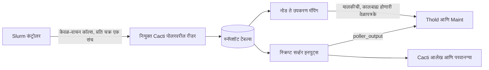

<!-- Source: README.md; SHA256: 16caa3e34c4d150a7fb1018f637e200a7580330f033b485047d8413bce09abba -->

<!-- translations:start -->
[English](../../../README.md) | [简体中文](../zh-CN/README.md) | [हिन्दी](../hi-IN/README.md) | [Español (España)](../es-ES/README.md) | [Español (Latinoamérica)](../es-419/README.md) | [العربية (السعودية)](../ar-SA/README.md) | [Afrikaans](../af-ZA/README.md) | [አማርኛ](../am-ET/README.md) | [العربية (مصر)](../ar-EG/README.md) | [العربية (المغرب)](../ar-MA/README.md) | [বাংলা](../bn-BD/README.md) | [Deutsch](../de-DE/README.md) | [فارسی](../fa-IR/README.md) | [Filipino](../fil-PH/README.md) | [Français](../fr-FR/README.md) | [Français (Maroc)](../fr-MA/README.md) | [Français (Sénégal)](../fr-SN/README.md) | [Hausa](../ha-NG/README.md) | [עברית](../he-IL/README.md) | [Bahasa Indonesia](../id-ID/README.md) | [Igbo](../ig-NG/README.md) | [Italiano](../it-IT/README.md) | [日本語](../ja-JP/README.md) | [한국어](../ko-KR/README.md) | [Malagasy](../mg-MG/README.md) | [मराठी](README.md) | [Bahasa Melayu](../ms-MY/README.md) | [Nederlands](../nl-NL/README.md) | [Polski](../pl-PL/README.md) | [Português (Brasil)](../pt-BR/README.md) | [Русский](../ru-RU/README.md) | [Kinyarwanda](../rw-RW/README.md) | [Soomaali](../so-SO/README.md) | [Svenska](../sv-SE/README.md) | [Kiswahili](../sw-KE/README.md) | [தமிழ்](../ta-IN/README.md) | [తెలుగు](../te-IN/README.md) | [ไทย](../th-TH/README.md) | [Türkçe](../tr-TR/README.md) | [Українська](../uk-UA/README.md) | [اردو](../ur-PK/README.md) | [Tiếng Việt](../vi-VN/README.md) | [isiXhosa](../xh-ZA/README.md) | [Yorùbá](../yo-NG/README.md) | [繁體中文](../zh-TW/README.md) | [isiZulu](../zu-ZA/README.md)
<!-- translations:end -->

# plugin_hpcsched

एक Cacti 1.2 प्लगइन जे Cacti आधीपासून मॉनिटर करत असलेल्या उपकरणांशेजारी HPC बॅच शेड्यूलरची स्थिती आलेखित करते: रांगेची खोली, प्रलंबित विरुद्ध चालू असलेली कामे, कामे का प्रलंबित आहेत, नोड स्थिती, आणि पार्टीशन वापर. Slurm हा पहिला बॅकएंड आहे. यातून तयार होणाऱ्या डेटा स्रोतांवर Thold अलर्ट देते, आणि ड्रेन केलेले नोड्स व देखभाल आरक्षणांनुसार Maint चालवता येते.

> **स्थिती: विकासाधीन, अद्याप कोणतेही प्रकाशन नाही.** माइलस्टोन 2 (पायाभूत सुविधा) `main` वर विलीन केले आहे, आणि ही शाखा माइलस्टोन 3 (क्लस्टर आलेख आणि प्रलंबित कारणे) जोडते. हा कोड Cacti च्या प्लगइन API द्वारे इन्स्टॉल, अपग्रेड आणि अनइन्स्टॉल होतो आणि 8.2 पेक्षा कमी PHP आवृत्ती नाकारतो. हे Slurm क्लस्टर्सची नोंदणी ठेवते, जिथे प्रत्येक क्लस्टर एका Cacti पोलरला नियुक्त केलेला असतो. मुख्य पोलरवरील पार्श्वभूमी रीडर प्रत्येक अंतराने प्रति क्लस्टर एक स्नॅपशॉट गोळा करतो—एकतर `--json` सह `squeue`, `scontrol`, आणि `sshare` चालवून किंवा HTTPS वरून `slurmrestd` वाचून—आणि स्थिती व प्रलंबित कारणांनुसार कामांची संख्या, नोड स्थिती, पार्टीशन्स, आरक्षणे, आणि फेअर-शेअर वापर त्यांच्या ताजेपणासह संग्रहित करतो. हे प्लगइन Cacti टेम्प्लेट्स पुरवते आणि प्रशासकाच्या पुष्टीनंतर, क्लस्टरसाठी व प्रत्येक पार्टीशनसाठी स्थितीनुसार कामे, कारण कुटुंबानुसार प्रलंबित कामे, स्थितीनुसार नोड्स, CPUs, आणि वापर यांचे आलेख तसेच स्नॅपशॉट वयासह प्रति क्लस्टर एक Cacti उपकरण तयार किंवा मॅप करते. केवळ-वाचन विहंगावलोकन पृष्ठ प्रत्येक क्लस्टरची संख्या त्यांच्या ताजेपणासह आणि प्रत्येक क्लस्टरसाठी प्रलंबित कारणांचे दृश्य दाखवते, तर केवळ प्रशासकासाठी असलेले आरोग्य पृष्ठ प्रत्येक संकलनाने काय परत केले आणि टेम्प्लेट्स इन्स्टॉल आहेत का ते दर्शवते. प्रत्येक पृष्ठ आणि कृती Cacti च्या उपकरण परवानग्यांचे पालन करते. डेटा स्रोत असे आहेत ज्यांवर Thold अलर्ट देऊ शकते, परंतु अद्याप कोणत्याही Thold किंवा Maint एकत्रीकरणाची चाचणी केलेली नाही; ते माइलस्टोन 4 आणि त्यानंतरचे काम आहे. चाचणी संच कृत्रिम Slurm कमांड्स आणि `slurmrestd` प्रतिसादांना कव्हर करतो, आणि खाली वर्णन केल्याप्रमाणे CI कंटेनर्समध्ये वास्तविक सहा-नोड Slurm क्लस्टरवर देखील चाचणी करते. रीडर अद्याप उत्पादन क्लस्टरवर चालवलेला नाही. ऑपरेटर टिपांच्या खाली, हा README पाठवलेल्या वर्तनाचे नव्हे तर डिझाइनचे वर्णन करतो.

हा एक स्वतंत्र प्रकल्प आहे आणि Cacti प्रकल्पाशी संलग्न नाही.

## प्रवेश भूमिका

| रेल्म | प्रवेश |
| --- | --- |
| HPC Scheduler View | विद्यमान मॉनिटरिंग पृष्ठे. |
| HPC Scheduler Operator | मॉनिटरिंग तसेच Operations पृष्ठ आणि वैयक्तिक ट्रायज पोचपावत्या. |
| HPC Scheduler Admin | Operator प्रवेश तसेच विद्यमान कॉन्फिगरेशन आणि प्रशासकीय कृती. |

अपग्रेड फाइल्स कॉपी केल्यानंतर, नवीन रेल्म नोंदणीकृत करण्यासाठी प्रशासक म्हणून Plugins पृष्ठ उघडा.
**Configuration > Users** किंवा वापरकर्ता गटांखाली Operator रेल्म स्पष्टपणे नियुक्त करा.
अपग्रेडमध्ये विद्यमान View आणि Admin रेल्म IDs आणि परवानग्या कायम राहतात. प्रत्येक विनंतीवर Admin प्रवेशाला
Operator प्रवेश वारशाने मिळतो, आणि Operator प्रवेशाला View प्रवेश वारशाने मिळतो;
हे वापरकर्ते किंवा गटांना संग्रहित परवानग्या जोडत नाही. प्लगइन सेटिंग्जसाठी
Cacti च्या Settings परवानगीव्यतिरिक्त HPC Scheduler Admin प्रवेश देखील आवश्यक आहे.

Cacti उपकरण परवानग्या अजूनही प्रत्येक वापरकर्त्यासाठी उपलब्ध असलेल्या ओळी आणि कृती मर्यादित करतात; उपकरणाशिवाय असलेला क्लस्टर प्लगइन रेल्म असलेल्या प्रत्येक वापरकर्त्यासाठी प्रशासकीय पृष्ठांवर सूचीबद्ध केला जातो, परंतु ऑपरेटर दृश्यांमध्ये नाही, ज्यामध्ये फक्त उपकरणाशी मॅप केलेले क्लस्टर्स सूचीबद्ध असतात.
क्रेडेन्शियल्स, कॉन्फिगरेशन, मॅपिंग, हटवणे आणि इतर प्रशासकीय बदल
प्रशासकीय पृष्ठांवरच राहतात. पोचपावत्या फक्त सध्याच्या
वापरकर्त्याच्या सत्रात, जास्तीत जास्त एक तासासाठी आणि फक्त तेच निरीक्षण ताजे असेपर्यंत
टिकतात. नवीन किंवा बदललेली निरीक्षणे त्यांना अवैध ठरवतात. त्या कधीही अयशस्वी
मोजमापाला निरोगी मानत नाहीत किंवा अलर्ट्स दाबत नाहीत.

## माइलस्टोन 2 साठी ऑपरेटर टिपा

**किमान विशेषाधिकार.** हे प्लगइन फक्त वाचन करते. याला प्रशासक किंवा ऑपरेटर भूमिका नसलेला समर्पित Slurm वापरकर्ता द्या (`sacctmgr` मध्ये `AdminLevel=None`). `slurm.conf` मध्ये `PrivateData=jobs` (किंवा `nodes`, `reservations`, `usage`) असल्यास, त्या वापरकर्त्याला फक्त स्वतःच्या नोंदी दिसतात, त्यामुळे संख्या अपूर्ण राहतात आणि प्लगइन ते शोधू शकत नाही. खात्यासाठी ती मर्यादा काढणे म्हणजे ऑपरेटर किंवा प्रशासक स्तर देणे, ज्यामुळे बदल करण्याची परवानगी देखील मिळते; तो निर्णय साइटच्या निवडीवर अवलंबून आहे. क्लायंट कमांड्ससाठी, Cacti पोलर वापरकर्त्याला Slurm क्लायंट बायनरी आणि कंट्रोलरपर्यंत पोहोचणारी `slurm.conf` फाइल आवश्यक आहे; बायनरी मार्ग हे Configuration > Settings > HPC Scheduler अंतर्गत निरपेक्ष सेटिंग्ज आहेत. `slurmrestd` साठी, URL `https://` असणे आवश्यक आहे, किंवा फक्त लूपबॅक पत्त्यावर `http://` असू शकते. TLS प्रमाणपत्रांची पडताळणी केली जाते आणि रीडायरेक्ट्सचे अनुसरण केले जात नाही. Configuration > Settings > HPC Scheduler अंतर्गत पर्यायी slurmrestd होस्ट सूची क्लस्टर ज्या होस्ट्स आणि पोर्ट्सचे नाव देऊ शकतो त्यांना मर्यादित करते.

**रिमोट पोलर्स.** हे प्रकाशन फक्त मुख्य Cacti पोलरवर संकलन करते. रिमोट डेटा कलेक्टरला नियुक्त केलेला क्लस्टर संकलित केला जात नाही: तेथील रीडर लॉग केलेल्या कारणासह नकार देतो आणि आरोग्य पृष्ठ क्लस्टरचे नाव दाखवते. रिमोट संकलन हा टप्पा 3 आहे.

**मेमरी.** प्रत्येक संकलन रन एका वेळी एका शेड्यूलर उत्तराचा डीकोड करतो, ज्याला PHP मेमरीमध्ये उत्तराच्या आकाराच्या सुमारे 12 पट मेमरी लागते (Slurm च्या कामांच्या नोंदींसारख्या आकारासाठी सुमारे 10 पट मोजली गेली, अधिक स्वतःचा मजकूर). रन त्याची PHP मेमरी मर्यादा Collection Memory सेटिंगपर्यंत (डीफॉल्टनुसार 1024 MiB) वाढवतो आणि Maximum Answer Size अधिक सेट केलेले असले तरीही (Collection Memory - 64) / 12 MiB पर्यंतची उत्तरे, म्हणजेच डीफॉल्टनुसार 80 MiB पर्यंतची उत्तरे अनुमत करतो; जेव्हा ते अधिक असते तेव्हा आरोग्य पृष्ठ चेतावणी देते. मोठे उत्तर त्याचा विभाग खूप मोठा असल्याचे कारण देऊन अयशस्वी होते, आणि तरीही मेमरी संपलेला रन अयशस्वी म्हणून नोंदवला जातो. मोठ्या क्लस्टरसाठी दोन्ही सेटिंग्ज वाढवाव्या लागू शकतात; 100,000 वास्तविक कामांच्या नोंदी मोजल्या गेलेल्या नाहीत.

**टोकन फाइल्स.** `slurmrestd` क्लस्टर टोकन फाइलचे नाव देतो; टोकन स्वतः कधीही डेटाबेसमध्ये संग्रहित केले जात नाही, पृष्ठावर दाखवले जात नाही किंवा लॉगमध्ये लिहिले जात नाही. फाइल Configuration > Settings > HPC Scheduler अंतर्गत सेट केलेल्या टोकन फाइल डिरेक्टरीजपैकी एकात असली पाहिजे, सिम्बॉलिक लिंकशिवाय तिथपर्यंत पोहोचता आली पाहिजे, आणि ती पोलर वापरकर्त्याच्या मालकीची एक नियमित फाइल असावी जी फक्त तो वापरकर्ता लिहू शकतो, ज्यामध्ये एक ओळ असेल: टोकन, किंवा `scontrol token` प्रिंट करते तसे `SLURM_JWT=<token>`. कोणतीही टोकन डिरेक्टरी सेट केलेली नसल्यास, कोणताही क्लस्टर `slurmrestd` वापरू शकत नाही. या दोन्ही सेटिंग्ज Cacti च्या Settings पृष्ठावर आहेत, त्यामुळे एकट्या प्लगइनचा Admin रेल्म त्या बदलू शकत नाही; प्रत्येक टोकन डिरेक्टरी फक्त root आणि पोलर वापरकर्त्याद्वारे लिहिण्यायोग्य ठेवा. गट किंवा इतर वापरकर्ते वाचू शकत असलेली फाइल तरीही वापरली जाते, आणि आरोग्य पृष्ठ चेतावणी देते. कॉन्फिगर केलेल्या चेतावणी वेळेच्या आत टोकन कालबाह्य होत असताना आरोग्य पृष्ठ देखील चेतावणी देते.

रीडरला अर्धवट फाइल दिसण्याची शक्यता न ठेवता टोकन बदलण्यासाठी, जुन्या टोकनशेजारी नवीन टोकन लिहा आणि त्याचे नाव बदलून जुन्याच्या जागी ठेवा:

```sh
dir=/etc/cacti/hpcsched
tmp=$(mktemp "$dir/.token.XXXXXX")
scontrol token username=cactiread lifespan=2592000 > "$tmp"
chown cacti:cacti "$tmp"
chmod 0600 "$tmp"
mv -f "$tmp" "$dir/cluster1.token"
```

पुढील संकलन नवीन फाइल वाचते. `scontrol token` सह टोकन तयार करण्यासाठी Slurm प्रशासकाची आवश्यकता असते; जिथे ते अनुमत आहे तिथे ते चालवा आणि फाइल पोलरवर कॉपी करा.

## माइलस्टोन 3 साठी ऑपरेटर टिपा

**टेम्प्लेट्स.** इन्स्टॉल आणि अपग्रेड HPC Scheduler उपकरण, डेटा आणि आलेख टेम्प्लेट्स इम्पोर्ट करतात आणि पार्टीशन डेटा क्वेरी Cacti च्या `resource/script_server/` डिरेक्टरीमध्ये कॉपी करतात. जर ती डिरेक्टरी प्लगइन इन्स्टॉल करणाऱ्या वापरकर्त्याद्वारे लिहिण्यायोग्य नसेल, त्याच नावाची एक वेगळी फाइल आधीपासून तिथे असेल आणि ती प्लगइनने लिहिलेली नसेल, किंवा ते नाव सिम्बॉलिक लिंक असेल, तर इम्पोर्ट थांबतो, फाइल तशीच ठेवली जाते, आणि आरोग्य पृष्ठ काय करावे ते सांगते; आरोग्य पृष्ठावरील Install Templates पुन्हा प्रयत्न करते. हाताने बनवलेली एकसारखी प्रत वापरली जाते परंतु ती तुमचीच राहते. अनइन्स्टॉल क्वेरी फाइल फक्त तेव्हाच काढून टाकते जेव्हा ती प्लगइनने लिहिलेली असेल आणि ती बदललेली नसेल, आणि टेम्प्लेट्स, उपकरणे आणि आलेख तसेच ठेवते.

**क्लस्टर उपकरणे.** कोणतीही गोष्ट तयार होण्यापूर्वी उपकरण काय जोडेल (आलेख, डेटा स्रोत, RRD फाइल्स आणि प्रति पोल स्क्रिप्ट सर्व्हर कॉल्स) ते HPC Clusters > Device दाखवते. Create Device राखीव `.invalid` डोमेनमध्ये होस्ट नाव असलेले आणि उपलब्धता तपासणी नसलेले उपकरण बनवते; त्याऐवजी Map Device विद्यमान उपकरणाला आलेख जोडते आणि त्याच्या सेटिंग्ज तशाच ठेवते. प्रत्येक क्लस्टर आलेख आणि प्रत्येक पार्टीशन आलेखाचा स्वतःचा डेटा स्रोत असतो: क्लस्टरसाठी सहा आणि प्रति पार्टीशन पाच, प्रति क्लस्टर डेटा स्रोत एक स्क्रिप्ट सर्व्हर कॉल आणि प्रति पोल पार्टीशनच्या प्रति मूल्यामागे एक (32) कॉल. नंतर जोडलेली पार्टीशन्स रीडरला दिसल्यावर अनुक्रमित केली जातात आणि Cacti च्या New Graphs पृष्ठावरून त्यांना आलेख मिळतात; काढून टाकलेल्या पार्टीशनचे पोलिंग थांबते आणि त्याचे आलेख तसेच राहतात. उपकरण हटवल्यास क्लस्टर अनमॅप होतो आणि तो कायम राहतो.

**आलेख काय मोजतात.** प्रलंबित मध्ये रोखलेली कामे वगळली जातात, ज्यांची स्वतःची मालिका असते. प्रलंबित अ‍ॅरे त्याची उर्वरित कार्ये मोजतो. अनेक पार्टीशन्समधील काम किंवा नोड क्लस्टर आलेखांमध्ये एकदा आणि प्रत्येक पार्टीशनमध्ये एकदा मोजला जातो, त्यामुळे पार्टीशन आलेखांची बेरीज क्लस्टरच्या बेरजेइतकी असणे आवश्यक नाही. प्रलंबित कारणे अकरा कुटुंबांमध्ये गटबद्ध केली आहेत ([ADR 0011](../../decisions/0011-pending-reason-families-and-counting.md)); प्रलंबित कारणे दृश्य Other मधील कारणांसह कच्ची कारणे सूचीबद्ध करते. प्रत्येक काम शेड्यूलरने तपासलेले फक्त शेवटचे कारण नोंदवते. वापर हरकतीच्या छेदामध्ये ड्रेन केलेले, बंद आणि इतर अनुपलब्ध नोड्स समाविष्ट असतात. जुना किंवा अयशस्वी डेटा `U` असतो, कधीही शून्य नसतो; `age` संख्यात्मक राहते.

**अलर्टिंग.** Thold यापैकी कोणत्याही डेटा स्रोतावर अलर्ट देऊ शकते; Thold कालावधी किमान एका संकलन अंतराइतका सेट करा, आणि थांबलेला रीडर पकडण्यासाठी `age` वर अलर्ट करा. एंड-टू-एंड Thold तपासणी माइलस्टोन 4 आहे.

**वास्तविक Slurm आउटपुटवर चाचणी केलेले.** CI कंटेनर्समध्ये सहा-नोड Slurm क्लस्टर सुरू करते (प्रत्येक बदलावर 26.05.5, आणि `main` वर पुश करताना, साप्ताहिक आणि विनंतीनुसार स्रोतावरून तयार केलेले 25.11.8) आणि प्लगइनच्या पार्सिंगनुसार नोड स्थिती, देखभाल आरक्षण, प्रलंबित कारणे आणि अ‍ॅरे तपासते, त्यानंतर प्लगइनच्या स्वतःच्या कमांड आणि `slurmrestd` ट्रान्सपोर्ट्ससह त्या क्लस्टरमधून संकलन करते. जुन्या प्रकाशनांची चाचणी फक्त कृत्रिम फिक्स्चरवर केली जाते. रीडर अद्याप उत्पादन क्लस्टरवर चालवलेला नाही.

**परवानग्या.** उपकरणावरील क्लस्टर प्रत्येक प्लगइन पृष्ठावर फक्त अशाच वापरकर्त्यांसाठी दर्शवला, निर्यात केला आणि बदलला जातो ज्यांना Cacti ने त्या उपकरणाची परवानगी दिली आहे; उपकरण मॅप करण्यासाठी लक्ष्य उपकरणाची परवानगी देखील आवश्यक असते. उपकरणाशिवाय असलेला क्लस्टर प्लगइन रेल्म असलेल्या प्रत्येकाला दिसतो. प्लगइन अक्षम असताना हटवलेल्या उपकरणाशी अद्याप मॅप केलेला क्लस्टर फक्त HPC Scheduler Admin रेल्म असलेल्या वापरकर्त्यांना दिसतो, जे त्यासाठी उपकरण तयार किंवा मॅप करू शकतात. आलेख प्रवेश Cacti चा स्वतःचा आहे.

## का

जे ऑपरेटर Cacti चालवतात ते आधीपासूनच त्यांच्या कॉम्प्युट नोड्सचे आलेख काढतात. त्या आलेखांमधून शेड्यूलरचा दृष्टिकोन गहाळ आहे, ज्यामुळे दोन उणिवा राहतात:

- **"काम का सुरू होत नाहीये" याची माहिती नाही.** Slurm प्रत्येक प्रलंबित कामासाठी एक कारण नोंदवते. निष्क्रिय नोड आलेखांशेजारी भरलेली रांग हे सांगत नाही की कारण प्राधान्यक्रम, संसाधन मर्यादा, होल्ड्स, अवलंबित्व, किंवा ड्रेन केलेले नोड्स आहे.
- **शेड्यूलर स्थिती आणि अलर्टिंग यांच्यात कोणताही दुवा नाही.** प्रशासकाने आधीच ड्रेन केलेल्या उपकरणावर Thold अलर्ट देते, आणि प्रशासक हाताने Maint वेळापत्रक तयार करतात.

हे प्लगइन प्रति क्लस्टर एक कॅश केलेला स्नॅपशॉट गोळा करते, तो सामान्य Cacti डेटा स्रोत आणि आलेख म्हणून प्रकाशित करते, शेड्यूलर नोड्स विद्यमान Cacti उपकरणांवर मॅप करते, आणि ड्रेन केलेले नोड्स व देखभाल आरक्षणे Maint मध्ये ठेवू शकते. हे Cacti च्या परवानग्या, रिमोट डेटा कलेक्टर्स, Thold, आणि Maint यांचा पुनर्वापर करते, आणि ते शेड्यूलरसाठी केवळ-वाचन आहे.

## नियोजित व्याप्ती

| टप्पा | व्याप्ती | माइलस्टोन्स |
|---|---|---|
| 0, संशोधन | Slurm प्रकाशन मॅट्रिक्स, अपस्ट्रीम वर्तन पुष्टीकरण, कंट्रोलर लोड, नोड नामकरण फिक्स्चर | [M1](https://github.com/somethingwithproof/plugin_hpcsched/milestone/1) |
| 1, क्लस्टर आलेख | रांगेची खोली, प्रलंबित आणि चालू असलेली कामे, प्रलंबित कारणे, नोड स्थिती, पार्टीशन वापर, Thold अलर्टिंग, आरोग्य पृष्ठ, प्रकाशन | [M2](https://github.com/somethingwithproof/plugin_hpcsched/milestone/2), [M3](https://github.com/somethingwithproof/plugin_hpcsched/milestone/3), [M4](https://github.com/somethingwithproof/plugin_hpcsched/milestone/4) |
| 2, नोड्स आणि देखभाल | नोड-ते-उपकरण मॅपिंग, प्रति-नोड स्थिती, ड्रेन केलेले नोड्स आणि देखभाल आरक्षणांसाठी स्वयंचलित Maint विंडो | [M5](https://github.com/somethingwithproof/plugin_hpcsched/milestone/5) |
| 3, लेखाजोखा | फेअर-शेअर वापर, मर्यादित लेखाजोखा आकडेवारी, रिमोट डेटा कलेक्टर्स | [M6](https://github.com/somethingwithproof/plugin_hpcsched/milestone/6) |

व्याप्तीच्या बाहेर: कोणताही शेड्यूलर लेखन मार्ग (submit, cancel, hold, drain, resume), प्लगइन-मालकीचे अलर्टिंग इंजिन, अहवाल किंवा चार्जबॅक इंजिन, प्रति-वापरकर्ता आणि प्रति-काम मालिका. PBS Pro, OpenPBS, आणि LSF बॅकएंड हे संशोधनाच्या टप्प्यात आहेत.

## सुसंगतता लक्ष्ये

| घटक | लक्ष्य |
|---|---|
| Cacti | 1.2.31 किंवा त्यापुढील, कोणतेही कोर पॅचेस नाहीत |
| PHP | 8.2 किंवा त्यापुढील; `setup.php` 8.0 वर पार्स करण्यायोग्य राहते जेणेकरून असमर्थित रनटाइमला तुटलेल्या Cacti UI ऐवजी नकार मिळेल |
| Slurm | 25.05, 25.11, आणि 26.05, ही तीन नवीनतम प्रकाशने ([ADR 0013](../../decisions/0013-three-latest-slurm-releases.md)); 25.11 आणि 26.05 ची चाचणी थेट क्लस्टरवर केली जाते, तर 25.05 ची फक्त फिक्स्चरवर. क्लायंट कमांड्स हा डीफॉल्ट ट्रान्सपोर्ट आहे ([ADR 0012](../../decisions/0012-client-commands-default-transport.md)) आणि डेटा पार्सर सेटिंग वापरतात: डीफॉल्टनुसार v0.0.43, जे SchedMD 27.05 मध्ये काढून टाकते, किंवा ती पुरवणाऱ्या प्रकाशनांवर v0.0.44 किंवा v0.0.45. slurmrestd क्लस्टर्स डेमन सर्व्ह करत असलेला सर्वात नवीन पार्सर शोधतात |
| Thold, Maint | Thold मध्ये कोणताही बदल नाही; Maint एकत्रीकरण हा एक प्रस्ताव आहे ज्यासाठी Maint देखभालकर्त्यांची सहमती आवश्यक आहे |

## डिझाइन

- [docs/PLAN.md](../../PLAN.md) ही संपूर्ण योजना आहे: आर्किटेक्चर, ती अवलंबून असलेली अपस्ट्रीम तथ्ये (स्रोतांसह आणि अपुष्ट गृहीतकांच्या स्पष्ट सूचीसह), नोड मॅपिंग, स्थिती मॉडेल, सुरक्षा सीमा, कार्यप्रदर्शन गणित, चाचणी आणि जोखीम.
- [docs/decisions/](../../decisions) मध्ये आर्किटेक्चर निर्णय नोंदी आहेत.
- [docs/REQUIREMENTS.md](../../REQUIREMENTS.md) प्रत्येक आवश्यकता ID ला त्याच्या इश्यूशी मॅप करते.



## कामाचा मागोवा कसा ठेवला जातो

- **माइलस्टोन्स** योजनेच्या माइलस्टोन्सचे अनुसरण करतात. प्रत्येकाकडे एक एपिक इश्यू आहे ज्यामध्ये त्याचे उप-इश्यूज आणि निर्गमन पुरावे सूचीबद्ध आहेत.
- **इश्यूज** लेबलनुसार वर्गीकृत केले जातात: `type: requirement`, `type: research`, `type: decision`, `type: epic`. आवश्यकता इश्यूज क्रमांकित, चाचणीयोग्य आवश्यकता (`REQ-AREA-NNN`) आणि स्वीकृती निकष नमूद करतात.
- **लेबल्स** मध्ये `area:`, `phase:`, `priority:`, आणि `status:` देखील असतात. [CONTRIBUTING.md](../../../CONTRIBUTING.md#labels) पहा.
- [प्रकल्प बोर्ड](https://github.com/users/somethingwithproof/projects/10) सर्व माइलस्टोन्समधील सर्व इश्यूज दाखवतो.

## योगदान

[CONTRIBUTING.md](../../../CONTRIBUTING.md) वाचा. कमिट्सना DCO साइन-ऑफ आवश्यक आहे. डिझाइन चर्चा इश्यूजवर होते; खुल्या निर्णयांवर `type: decision` लेबल असते.

## सुरक्षा

भेद्यता खाजगीरीत्या कळवा; [SECURITY.md](../../../SECURITY.md) पहा.

## परवाना

GNU General Public License v2.0, Cacti आणि त्याच्या प्लगइन्ससारखाच परवाना. [LICENSE](../../../LICENSE) पहा.
