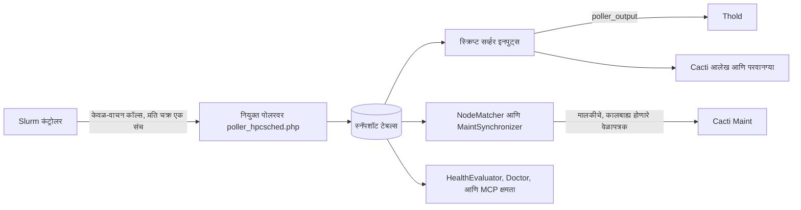

<!-- Source: README.md; SHA256: 938114d41dbd516f9dfcd94619c4fc73ef56b4da1dd693010588a93cce250534 -->

<!-- translations:start -->
[English](../../../README.md) | [简体中文](../zh-CN/README.md) | [हिन्दी](../hi-IN/README.md) | [Español (España)](../es-ES/README.md) | [Español (Latinoamérica)](../es-419/README.md) | [العربية (السعودية)](../ar-SA/README.md) | [Afrikaans](../af-ZA/README.md) | [አማርኛ](../am-ET/README.md) | [العربية (مصر)](../ar-EG/README.md) | [العربية (المغرب)](../ar-MA/README.md) | [বাংলা](../bn-BD/README.md) | [Bosanski](../bs-BA/README.md) | [Deutsch](../de-DE/README.md) | [فارسی](../fa-IR/README.md) | [Filipino](../fil-PH/README.md) | [Français](../fr-FR/README.md) | [Français (Maroc)](../fr-MA/README.md) | [Français (Sénégal)](../fr-SN/README.md) | [Hausa](../ha-NG/README.md) | [עברית](../he-IL/README.md) | [Hrvatski](../hr-HR/README.md) | [Bahasa Indonesia](../id-ID/README.md) | [Igbo](../ig-NG/README.md) | [Italiano](../it-IT/README.md) | [日本語](../ja-JP/README.md) | [한국어](../ko-KR/README.md) | [Malagasy](../mg-MG/README.md) | [मराठी](README.md) | [Bahasa Melayu](../ms-MY/README.md) | [Nederlands](../nl-NL/README.md) | [Polski](../pl-PL/README.md) | [Português (Brasil)](../pt-BR/README.md) | [Русский](../ru-RU/README.md) | [Kinyarwanda](../rw-RW/README.md) | [Soomaali](../so-SO/README.md) | [Српски](../sr-RS/README.md) | [Svenska](../sv-SE/README.md) | [Kiswahili](../sw-KE/README.md) | [தமிழ்](../ta-IN/README.md) | [తెలుగు](../te-IN/README.md) | [ไทย](../th-TH/README.md) | [Türkçe](../tr-TR/README.md) | [Українська](../uk-UA/README.md) | [اردو](../ur-PK/README.md) | [Tiếng Việt](../vi-VN/README.md) | [isiXhosa](../xh-ZA/README.md) | [Yorùbá](../yo-NG/README.md) | [繁體中文](../zh-TW/README.md) | [isiZulu](../zu-ZA/README.md)
<!-- translations:end -->

# plugin_hpcsched

एक Cacti 1.2 प्लगइन (`hpcsched`, आवृत्ती `0.1.0-dev`) जे Cacti आधीपासून मॉनिटर करत असलेल्या उपकरणांशेजारी HPC बॅच शेड्यूलरची स्थिती आलेखित करते: रांगेची खोली, प्रलंबित विरुद्ध चालू असलेली कामे, कामे का प्रलंबित आहेत, नोड स्थिती, पार्टीशन वापर, आणि खाते-स्तरीय फेअर-शेअर वापर. Slurm हा कार्यान्वित केलेला बॅकएंड आहे. यातून तयार होणाऱ्या डेटा स्रोतांवर Thold अलर्ट देते, आणि पर्यायी (opt-in) Maint सिंक्रोनायझर ड्रेन केलेल्या, डाउन, आणि देखभाल-आरक्षित Slurm संगणक नोड्सवरून Cacti Maint कालावधी चालवतो.

> **स्थिती: विकासाधीन, अद्याप कोणतेही प्रकाशन नाही.** ही शाखा प्लगइन पाया, क्लस्टर आणि पार्टीशन आलेख, प्रलंबित कारण कुटुंबे, Slurm संगणक-नोड ते Cacti-उपकरण जुळणी, पर्यायी Cacti Maint कालावधी समक्रमण, खाते-स्तरीय फेअर-शेअर सारांश, दूरस्थ डेटा संकलक अंमलबजावणी व प्रतिकृती, Configuration-as-Code (CasC) आणि ऑपरेशन्स CLI, आणि Cacti इकोसिस्टम हुक्स (CasC, Doctor, आणि MCP / Abilities API v2) कार्यान्वित करते. चाचणी संच कृत्रिम Slurm कमांड्स आणि `slurmrestd` प्रतिसादांना कव्हर करतो, आणि CI कंटेनर्समध्ये वास्तविक सहा-नोड Slurm क्लस्टरवर चाचणी करते. रीडर अद्याप उत्पादन क्लस्टरवर चालवलेला नाही, आणि एंड-टू-एंड Thold रीप्ले चाचणी अद्याप CI मध्ये नाही.

हा एक स्वतंत्र प्रकल्प आहे आणि Cacti प्रकल्पाशी संलग्न नाही.

## काय कार्यान्वित केले आहे

- **जीवनचक्र आणि स्कीमा (v3)**: इन्स्टॉल, आयडेम्पोटंट अपग्रेड, अनइन्स्टॉल (डीफॉल्टनुसार प्लगइन टेबल्स जतन करून), आणि एंट्री पॉइंट्स PHP 8.0 वर पार्स करण्यायोग्य ठेवून PHP 8.2 ची किमान आवश्यकता. स्कीमा v3 क्लस्टर, रन, विभाग, काम-संख्या, नोड-संख्या, नोड, पार्टीशन, आरक्षण, आणि शेअर टेबल्ससोबत `plugin_hpcsched_node_map` आणि `plugin_hpcsched_maint_link` जोडते.
- **मुख्य आणि दूरस्थ पोलर्सवर केवळ-वाचन Slurm संकलन**: `poller_bottom` प्रत्येक पोलरवर (`poller_id`) त्यास नियुक्त केलेल्या सक्षम क्लस्टर्ससाठी पार्श्वभूमीत `poller_hpcsched.php --cluster=N` सुरू करते. प्रत्येक रन क्लायंट कमांड्सद्वारे (`--json` सह `squeue`, `scontrol`, `sshare`) किंवा HTTPS वरून `slurmrestd` द्वारे (आरोग्य चेतावणीसह लूपबॅक HTTP ला परवानगी आहे) प्रति क्लस्टर एक कॅश केलेला स्नॅपशॉट गोळा करते. `INFO` हे `remote_collect:1, remote_poller:1` घोषित करते, आणि `replicate_out` गोपनीय नसलेल्या `plugin_hpcsched_cluster` व्याख्या दूरस्थ संकलकांवर (`poller_id >= 2`) प्रतिकृत करते; टोकन फाइलची सामग्री कधीही वाचली किंवा प्रतिकृत केली जात नाही.
- **Cacti टेम्प्लेट्स आणि क्लस्टर आलेख**: डिव्हाइस, डेटा, आणि आलेख टेम्प्लेट्स (`templates/hpcsched-templates.xml`) तसेच पार्टीशन स्क्रिप्ट-सर्व्हर डेटा क्वेरी (`scripts/ss_hpcsched_cluster.php`, `scripts/ss_hpcsched_partitions.php`) पुरवते. प्रशासकाच्या पुष्टीनंतर, स्थितीनुसार कामे, कारण कुटुंबानुसार प्रलंबित कामे, स्थितीनुसार नोड्स, CPUs, वापर (क्लस्टर आणि प्रति पार्टीशन), आणि स्नॅपशॉट वय यांच्या आलेखांसह प्रति क्लस्टर एक Cacti डिव्हाइस तयार किंवा मॅप करते.
- **Slurm नोड-ते-डिव्हाइस जुळणी आणि Cacti Maint समक्रमण**: चार-स्तरीय रेषीय-वेळ मॅचर (`NodeMatcher`) Slurm संगणक नोड्सना विद्यमान Cacti `host` नोंदींशी (तंतोतंत होस्टनाव, तंतोतंत पत्ता, तंतोतंत वर्णन/उपनाव, किंवा गैर-IP नावांसाठी पहिले DNS लेबल) मॅप करतो आणि अंदाज बांधण्याऐवजी एकापेक्षा जास्त जुळण्या किंवा डुप्लिकेट डिव्हाइस दावे `ambiguous` म्हणून चिन्हांकित करतो. `HostList::expand()` Slurm आरक्षण होस्टलिस्ट्स (10,000 नोड्सपर्यंत) विस्तारित करते. `MaintSynchronizer` प्रशासकाने तयार केलेले Maint वेळापत्रक न बदलता `DRAIN`, `DRAINING`, `DOWN`, किंवा सक्रिय `MAINT`/`MAINTENANCE` आरक्षणांमध्ये असलेल्या मॅप केलेल्या नोड्ससाठी `plugin_hpcsched_maint_link` मध्ये ट्रॅक केलेले प्लगइन-मालकीचे एक-वेळचे Cacti Maint वेळापत्रक तयार करते, नूतनीकरण करते, आणि काढून टाकते.
- **खाते-स्तरीय फेअर-शेअर सारांश**: `collect_shares` सक्षम असताना, Slurm खाते असोसिएशन ओळी `plugin_hpcsched_share` मध्ये संकलित करते ([ADR 0010](../../decisions/0010-bound-series-cardinality.md) नुसार वापरकर्ता ओळी वगळून). `ShareSummary` आणि `ShareRepository` खाते/पार्टीशन संख्या, कच्चा आणि प्रभावी वापर एकूण, किमान/कमाल/सरासरी फेअर-शेअर घटक, आणि शीर्ष खाती मोजतात; खाते संख्या `hpcsched-get-queue-summary` मध्ये दर्शविली जाते.
- **CasC आणि ऑपरेशन्स CLI (`cli/hpcsched.php`)**: YAML/XML कॉन्फिगरेशन निर्यात, प्रमाणीकरण, ड्राय-रन फरक नियोजन, पुष्टी-आधारित लागू करणे, संरचित आरोग्य आउटपुट, आणि पर्यायी Maint समक्रमण (`sync-maint --dry-run` / `--apply`).
- **इकोसिस्टम हुक्स (`setup.php`)**: `casc_register_providers`, `doctor_register_checks`, आणि `abilities_register`.

## प्रवेश भूमिका

| रेल्म | प्रवेश |
| --- | --- |
| HPC Scheduler View | केवळ-वाचन क्लस्टर विहंगावलोकन आणि प्रलंबित कारणे (`hpcsched.php`). |
| HPC Scheduler Operator | View प्रवेशासह Operations पृष्ठ (`hpcsched_operator.php`) आणि वैयक्तिक ट्रायज पोचपावत्या. |
| HPC Scheduler Admin | Operator प्रवेशासह क्लस्टर प्रशासन (`hpcsched_clusters.php`) आणि आरोग्य पृष्ठ (`hpcsched_health.php`). |

अपग्रेड फाइल्स कॉपी केल्यानंतर, नवीन रेल्म्स आणि हुक्स नोंदवण्यासाठी प्रशासक म्हणून Plugins पृष्ठ उघडा. **Configuration > Users** किंवा वापरकर्ता गटांखाली Operator रेल्म स्पष्टपणे नियुक्त करा. अपग्रेड्स विद्यमान View आणि Admin रेल्म IDs व अनुदाने जतन ठेवतात. प्रत्येक विनंतीवर Admin प्रवेशाला Operator प्रवेशाचा वारसा मिळतो, आणि Operator प्रवेशाला View प्रवेशाचा वारसा मिळतो; यामुळे वापरकर्ते किंवा गटांना साठवलेली अनुदाने जोडली जात नाहीत. प्लगइन सेटिंग्जसाठी Cacti च्या Settings परवानगीव्यतिरिक्त HPC Scheduler Admin प्रवेश देखील आवश्यक आहे.

Cacti उपकरण परवानग्या प्रत्येक वापरकर्त्यासाठी उपलब्ध ओळी आणि कृती मर्यादित करतात. Cacti उपकरणाशी मॅप केलेला क्लस्टर केवळ त्याच वापरकर्त्यांसाठी दर्शवला, निर्यात केला आणि बदलला जातो ज्यांना Cacti ते उपकरण वापरण्याची परवानगी देते; उपकरण मॅप करण्यासाठी लक्ष्य उपकरणाची परवानगी देखील आवश्यक असते. उपकरण नसलेला क्लस्टर प्लगइन रेल्म असलेल्या वापरकर्त्यांसाठी प्रशासकीय पृष्ठांवर सूचीबद्ध केला जातो, परंतु केवळ उपकरणाशी मॅप केलेले क्लस्टर दाखवणाऱ्या ऑपरेटर दृश्यांमध्ये नाही. प्लगइन अक्षम असताना ज्याचे मॅप केलेले उपकरण हटवले गेले असा क्लस्टर केवळ HPC Scheduler Admin प्रवेश असलेल्या वापरकर्त्यांनाच दाखवला जातो. पोचपावत्या केवळ वापरकर्त्याच्या सध्याच्या सत्रात, जास्तीत जास्त एक तासासाठी आणि तेच निरीक्षण ताजे असेपर्यंतच टिकतात. नवीन किंवा बदललेली निरीक्षणे त्यांना अवैध ठरवतात. त्या कधीही अयशस्वी मोजमापाला निरोगी मानत नाहीत किंवा अलर्ट दाबत नाहीत.

## ऑपरेटर टिपा

### सुरक्षा, किमान विशेषाधिकार, आणि टोकन फाइल्स

हे प्लगइन केवळ वाचन करते. याला प्रशासक किंवा ऑपरेटर भूमिका नसलेला समर्पित Slurm वापरकर्ता (`sacctmgr` मध्ये `AdminLevel=None`) द्या. `slurm.conf` मध्ये `PrivateData=jobs` (किंवा `nodes`, `reservations`, `usage`) असल्यास, तो वापरकर्ता केवळ स्वतःच्या नोंदी पाहतो, ज्यामुळे संख्या अपूर्ण राहते आणि प्लगइन ते ओळखू शकत नाही. खात्यासाठी ती मर्यादा काढण्यासाठी ऑपरेटर किंवा प्रशासक स्तर आवश्यक असतो, ज्यामुळे बदल करण्याचीही परवानगी मिळते; हा समतोल साईटने ठरवायचा आहे.

क्लायंट कमांड्ससाठी, Cacti पोलर वापरकर्त्याला Slurm क्लायंट बायनरीज (`squeue`, `scontrol`, आणि पर्यायी `sshare`) आणि कंट्रोलरपर्यंत पोहोचणारी `slurm.conf` फाइल आवश्यक आहे; बायनरी मार्ग हे **Configuration > Settings > HPC Scheduler** अंतर्गत पूर्ण मार्ग सेटिंग्ज आहेत.

`slurmrestd` साठी, URL `https://` असणे आवश्यक आहे, किंवा केवळ लूपबॅक पत्त्यावर `http://` असू शकते. TLS प्रमाणपत्रे तपासली जातात आणि पुनर्निर्देशनांचे (redirects) अनुसरण केले जात नाही. **Configuration > Settings > HPC Scheduler** अंतर्गत पर्यायी `slurmrestd` होस्ट सूची क्लस्टर कोणते होस्ट्स आणि पोर्ट्स निर्दिष्ट करू शकतो हे मर्यादित करते.

`slurmrestd` क्लस्टर टोकन फाइलचे नाव निर्दिष्ट करतो; टोकन स्वतः कधीही डेटाबेसमध्ये साठवले जात नाही, पृष्ठावर दाखवले जात नाही, CasC द्वारे निर्यात केले जात नाही किंवा लॉगमध्ये लिहिले जात नाही. ही फाइल **Configuration > Settings > HPC Scheduler** अंतर्गत कॉन्फिगर केलेल्या Token File Directories पैकी एकामध्ये असणे आवश्यक आहे, सिम्बॉलिक लिंकशिवाय पोहोचण्यायोग्य असावी, आणि पोलर वापरकर्त्याच्या मालकीची अशी नियमित फाइल असावी जिच्यात फक्त तोच वापरकर्ता लिहू शकतो आणि जिच्यात एक ओळ असते: टोकन किंवा `scontrol token` प्रिंट करत असलेले `SLURM_JWT=<token>`. कोणतीही टोकन डिरेक्टरी सेट नसल्यास कोणताही क्लस्टर `slurmrestd` वापरू शकत नाही. प्रत्येक टोकन डिरेक्टरी केवळ root आणि पोलर वापरकर्त्यासाठीच लेखनीय ठेवा. गट किंवा इतर वापरकर्त्यांना वाचण्यायोग्य असलेली फाइल देखील वापरली जाते, आणि आरोग्य पृष्ठ चेतावणी देते; तसेच टोकन कॉन्फिगर केलेल्या चेतावणी कालावधीत कालबाह्य होत असल्यासही ते चेतावणी देते.

टोकन अखंडपणे (atomically) बदलण्यासाठी:

```sh
dir=/etc/cacti/hpcsched
tmp=$(mktemp "$dir/.token.XXXXXX")
scontrol token username=cactiread lifespan=2592000 > "$tmp"
chown cacti:cacti "$tmp"
chmod 0600 "$tmp"
mv -f "$tmp" "$dir/cluster1.token"
```

पुढील संकलन नवीन फाइल वाचते. `scontrol token` ने टोकन तयार करण्यासाठी Slurm प्रशासकाची आवश्यकता असते; जिथे परवानगी असेल तिथे ते चालवा आणि फाइल पोलरवर कॉपी करा.

### दूरस्थ डेटा संकलक

`INFO` हे `remote_collect:1, remote_poller:1` घोषित करते. `hpcsched_poller_bottom()` प्रत्येक पोलरवर त्या `poller_id` ला नियुक्त केलेल्या सक्षम क्लस्टर्ससाठी `poller_hpcsched.php` सुरू करते, आणि `hpcsched_replicate_out()` गोपनीय नसलेल्या `plugin_hpcsched_cluster` ओळी दूरस्थ पोलर्सवर (`poller_id >= 2`) प्रतिकृत करते. टोकन फाइल्स आणि Slurm क्लायंट बायनरीज नियुक्त केलेल्या दूरस्थ पोलरवर स्थानिक पातळीवर असणे आवश्यक आहे; टोकन सामग्री कधीही प्रतिकृत केली जात नाही.

### मेमरी मर्यादा

प्रत्येक संकलन रन एका वेळी एका शेड्यूलर प्रतिसादाला डीकोड करते, ज्याला PHP मेमरीमध्ये प्रतिसादाच्या आकाराच्या सुमारे 12 पट मेमरी लागते (Slurm सारख्या काम नोंदींसाठी मजकुरासह सुमारे 10 पट मोजली गेली आहे). रीडर आपली PHP मेमरी मर्यादा Collection Memory सेटिंगपर्यंत (डीफॉल्टनुसार 1024 MiB) वाढवतो आणि Maximum Answer Size अधिक सेट केलेला असला तरी `(Collection Memory - 64) / 12` MiB पर्यंतच्या (डीफॉल्टनुसार 80 MiB) प्रतिसादांना परवानगी देतो; Maximum Answer Size या मर्यादेपेक्षा जास्त असल्यास आरोग्य पृष्ठ चेतावणी देते. त्याहून मोठा प्रतिसाद आपला विभाग खूप मोठा म्हणून अयशस्वी करतो, आणि तरीही मेमरी संपलेला रन शटडाउन हँडलरद्वारे मेमरी अपयश नोंदवतो आणि आपली लीज व प्रक्रिया स्लॉट मुक्त करतो. मोठ्या क्लस्टर्ससाठी दोन्ही सेटिंग्ज वाढवाव्या लागू शकतात; 100,000 वास्तविक काम नोंदी अद्याप मोजलेल्या नाहीत.

### टेम्प्लेट्स, क्लस्टर उपकरणे, आणि आलेख मोजणी

इन्स्टॉल आणि अपग्रेड HPC Scheduler उपकरण, डेटा, आणि आलेख टेम्प्लेट्स आयात करतात आणि पार्टीशन डेटा क्वेरी Cacti च्या `resource/script_server/` डिरेक्टरीमध्ये कॉपी करतात. ती डिरेक्टरी लेखनीय नसल्यास, त्याच नावाची वेगळी फाइल तिथे अस्तित्वात असल्यास, किंवा लक्ष्य सिम्बॉलिक लिंक असल्यास, आयात थांबते, फाइलला स्पर्श न करता तसेच ठेवले जाते आणि आरोग्य पृष्ठावर स्थिती नोंदवली जाते जिथे **Install Templates** पुन्हा प्रयत्न करते. अनइन्स्टॉल क्वेरी फाइल केवळ प्लगइनने ती लिहिली असल्यास आणि ती बदललेली नसल्यास काढून टाकते, आणि टेम्प्लेट्स, उपकरणे व आलेख जतन ठेवते.

**HPC Clusters > Device** काहीही तयार करण्यापूर्वी प्रति पोल आलेख, डेटा स्रोत, RRD फाइल्स, आणि स्क्रिप्ट सर्व्हर कॉल्सचे पूर्वावलोकन दाखवते. **Create Device** आरक्षित `.invalid` डोमेनमध्ये होस्टनाव असलेले आणि उपलब्धता तपासणी नसलेले उपकरण तयार करते; **Map Device** विद्यमान उपकरणाच्या सेटिंग्ज न बदलता आलेख जोडते. प्रत्येक क्लस्टर आलेख आणि पार्टीशन आलेखाचा स्वतःचा डेटा स्रोत असतो: क्लस्टरसाठी सहा आणि प्रति पार्टीशन पाच. नंतर जोडलेल्या पार्टीशन्सचे रीडरला बदल आढळल्यावर आपोआप पुनर्निर्देशांकन (reindex) होते; काढून टाकलेल्या पार्टीशन्सचे पोलिंग थांबते आणि त्यांचे आलेख कायम राहतात. उपकरण हटविल्यास क्लस्टर अनमॅप होतो (आणि जुळणाऱ्या कोणत्याही `plugin_hpcsched_node_map` ओळी साफ होतात) तर क्लस्टर नोंद कायम राहते.

प्रलंबित (Pending) मध्ये रोखलेली (held) कामे वगळली जातात, ज्यांची स्वतःची मालिका असते. प्रलंबित जॉब अ‍ॅरे त्याची उर्वरित कार्ये मोजतो. अनेक पार्टीशन्समध्ये असलेले काम किंवा नोड क्लस्टर आलेखांमध्ये एकदा आणि प्रत्येक पार्टीशनमध्ये एकदा मोजले जाते, त्यामुळे पार्टीशन बेरीज क्लस्टर बेरजेइतकी असणे आवश्यक नसते. प्रलंबित कारणे अकरा कुटुंबांमध्ये गटबद्ध केली जातात ([ADR 0011](../../decisions/0011-pending-reason-families-and-counting.md)); प्रलंबित कारणे दृश्य `Other` मधील कारणांसह कच्ची कारणे सूचीबद्ध करते. वापर छेदामध्ये (denominator) ड्रेन केलेले, डाउन आणि इतर अनुपलब्ध नोड्स समाविष्ट असतात. शिळा किंवा अयशस्वी डेटा शून्य न दाखवता `U` म्हणून नोंदवला जातो; `age` संख्यात्मक राहते.

अलर्टिंगसाठी, किमान एका संकलन अंतराच्या कालावधीसह कोणत्याही क्लस्टर किंवा पार्टीशन डेटा स्रोतावर Thold कॉन्फिगर करा, आणि थांबलेला रीडर शोधण्यासाठी `age` वर अलर्ट लावा.

## CLI आणि इकोसिस्टम हुक्स

### रीडर एंट्री पॉइंट

`hpcsched_poller_bottom()` स्वयंचलितपणे `poller_hpcsched.php` सुरू करते; क्लस्टरला नियुक्त केलेल्या पोलरवर ते व्यक्तिचलितपणे देखील चालवता येते:

```sh
php /path/to/cacti/plugins/hpcsched/poller_hpcsched.php --cluster=N [--force] [--debug]
```

`--force` कमांड-लाइन निदानासाठी प्लगइन अक्षम असतानाही चालते.

### Configuration-as-Code, आरोग्य, आणि Maint समक्रमण CLI

```sh
php /path/to/cacti/plugins/hpcsched/cli/hpcsched.php export [--format=yaml|xml] [--file=PATH]
php /path/to/cacti/plugins/hpcsched/cli/hpcsched.php validate --file=PATH [--format=yaml|xml]
php /path/to/cacti/plugins/hpcsched/cli/hpcsched.php plan --file=PATH [--format=yaml|xml]
php /path/to/cacti/plugins/hpcsched/cli/hpcsched.php apply --file=PATH --confirm=PLAN_HASH [--format=yaml|xml]
php /path/to/cacti/plugins/hpcsched/cli/hpcsched.php health [--format=text|json]
php /path/to/cacti/plugins/hpcsched/cli/hpcsched.php sync-maint [--dry-run | --apply] [--cluster=ID] [--format=text|json]
```

- `export` नवीन फाइल्स `0600` मोडने लिहिते (किंवा stdout वर) आणि कॉन्फिगर केलेले `token_file` मार्ग `[REDACTED]` ने बदलते. `plan` आणि `apply` इनलाइन `jwt`, `secret`, आणि `password` फील्ड्स नाकारतात, आणि `[REDACTED]` पुरवल्यास विद्यमान स्थानिक `token_file` मार्ग जतन ठेवतात. `apply` साठी `plan` ने प्रिंट केलेला अचूक `--confirm=PLAN_HASH` आवश्यक असतो.
- `health` शेड्यूलर्सशी संपर्क न साधता किंवा टोकन फाइल्स न वाचता स्कीमा अद्ययावतता, क्लस्टर ताजेपणा, रन परिणाम, Maint उपलब्धता, आणि चेतावण्यांचे मूल्यांकन करते.
- `sync-maint` डीफॉल्टनुसार `--dry-run` वर चालते आणि `DRAIN`, `DRAINING`, `DOWN`, किंवा सक्रिय `MAINT`/`MAINTENANCE` आरक्षणांमध्ये असलेल्या मॅप केलेल्या Slurm नोड्ससाठी Cacti Maint वेळापत्रकांचे पूर्वावलोकन करते किंवा ते लागू करते (डीफॉल्ट ड्रेन/डाउन मर्यादा 3600s, नूतनीकरण फरक 600s). `plugin_maint_schedules` आणि `plugin_maint_hosts` नसल्यास ते `--apply` नाकारते, आणि केवळ `plugin_hpcsched_maint_link` मध्ये नोंदवलेले वेळापत्रकच अद्ययावत करते किंवा काढून टाकते.

### इकोसिस्टम हुक्स

संबंधित Cacti प्लगइन्स किंवा होस्ट एकत्रीकरणे अस्तित्वात असल्यास, `setup.php` खालील नोंदणी करते:

- `casc_register_providers`: गुप्त माहिती लपवून (redaction) `hpcsched` कॉन्फिगरेशन (`yaml` आणि `xml`, स्कीमा v1) निर्यात, प्रमाणीकरण, नियोजन, आणि पुष्टी-आधारित लागू करते.
- `doctor_register_checks`: चार केवळ-वाचन निदान तपासण्या (`hpcsched.schema`, `hpcsched.cluster_freshness`, `hpcsched.token_health`, `hpcsched.maint_sync`) पुरवते.
- `abilities_register`: `hpcsched` श्रेणीअंतर्गत, HPC Scheduler View रेल्मद्वारे (आणि क्लस्टर सारांशासाठी उपकरण परवानग्यांद्वारे) नियंत्रित केलेल्या तीन केवळ-वाचन, अ-विनाशकारी, आयडेम्पोटंट क्षमता (`hpcsched-list-clusters`, `hpcsched-get-queue-summary`, आणि `hpcsched-get-health`) नोंदवते.

## का

Cacti चालवणारे ऑपरेटर्स आधीच त्यांच्या संगणक नोड्सचे आलेख काढत असतात. त्या आलेखांमध्ये शेड्यूलरचा दृष्टिकोन नसल्याने दोन पोकळ्या राहतात:

- **"काम का सुरू होत नाही आहे" याची माहिती नसणे.** Slurm प्रत्येक प्रलंबित कामासाठी एक कारण नोंदवते. निष्क्रिय नोड आलेखांशेजारी भरलेली रांग पाहून याचे कारण प्राधान्यक्रम, संसाधन मर्यादा, होल्ड्स, अवलंबित्व किंवा ड्रेन केलेले नोड्स आहे हे समजत नाही.
- **शेड्यूलर स्थिती आणि अलर्टिंग यांच्यात कोणताही दुवा नसणे.** प्रशासकाने आधीच ड्रेन केलेल्या उपकरणावर Thold अलर्ट देते, आणि प्रशासक Maint वेळापत्रक स्वतः हाताने तयार करतात.

हे प्लगइन प्रति क्लस्टर एक कॅश केलेला स्नॅपशॉट गोळा करते, सामान्य Cacti डेटा स्रोत आणि आलेख म्हणून प्रकाशित करते, शेड्यूलर नोड्स विद्यमान Cacti उपकरणांवर मॅप करते, आणि ड्रेन केलेले, डाउन व देखभाल-आरक्षित नोड्ससाठी प्लगइन-मालकीचे कालबाह्य होणारे Maint कालावधी समक्रमित करते. ते Cacti च्या परवानग्या, दूरस्थ डेटा संकलक, Thold आणि Maint यांचा पुनर्वापर करते आणि शेड्यूलरच्या दिशेने काटेकोरपणे केवळ-वाचन राहते.

## व्याप्ती आणि मर्यादा

व्याप्तीबाहेर: कोणताही शेड्यूलर लेखन मार्ग (सबमिट, रद्द, होल्ड, ड्रेन, रिझ्यूम), प्लगइन-मालकीचे अलर्टिंग इंजिन, अहवाल किंवा चार्जबॅक इंजिन, आणि प्रति-वापरकर्ता किंवा प्रति-काम मालिका. PBS Pro, OpenPBS, आणि LSF बॅकएंड्स केवळ संशोधनासाठी आहेत.

## आवश्यकता आणि सुसंगतता

| घटक | लक्ष्य |
|---|---|
| Cacti | 1.2.31 किंवा नंतरची आवृत्ती (`compat = 1.2.31`), कोर पॅचेस नाहीत |
| PHP | 8.2 किंवा नंतरची आवृत्ती; एंट्री पॉइंट्स 8.0 वर पार्स करण्यायोग्य राहतात आणि 8.1 वर सक्रियकरण नाकारतात जेणेकरून असमर्थित रनटाइमला तुटलेल्या Cacti UI ऐवजी नकार मिळावा |
| Slurm | 25.05, 25.11, आणि 26.05 ([ADR 0013](../../decisions/0013-three-latest-slurm-releases.md)); 26.05.5 ची CI मध्ये प्रत्येक बदलावर सहा-नोड कंटेनर क्लस्टरवर चाचणी केली जाते, 25.11.8 ची `main` वर, साप्ताहिक आणि विनंतीनुसार, आणि 25.05 ची केवळ फिक्स्चरवर चाचणी केली जाते. क्लायंट कमांड्स डीफॉल्टनुसार डेटा पार्सर `v0.0.43` वापरतात (`v0.0.44` आणि `v0.0.45` निवडता येतात); `slurmrestd` क्लस्टर्स डेमन देत असलेला सर्वात नवीन पार्सर शोधतात |
| Thold, Maint | कोणत्याही Thold बदलांची आवश्यकता नाही; `sync-maint` हे प्लगइन-मालकीच्या लिंक टेबलचा (`plugin_hpcsched_maint_link`) वापर करून Cacti Maint च्या `plugin_maint_schedules` आणि `plugin_maint_hosts` टेबल्सशी एकत्रीकरण करते |

## विकास आणि चाचणी

CI वर्कफ्लो (`.github/workflows/plugin-ci-workflow.yml`) Cacti `release/1.2.31` आणि `1.2.x` वर PHP 8.2 ते 8.5, PHP 8.0 एंट्री-पॉइंट लिंटिंग, PHP 8.1 नकार, PHPStan, gettext/भाषांतर पडताळणी, REUSE परवाना, वर्कफ्लो लिंटिंग, क्लस्टर डिव्हाइस प्रवाह व टेम्प्लेट निर्यात ड्रिफ्ट तपासण्या, आणि लाइव्ह सहा-नोड Slurm क्लस्टर (`slurm-live`) यांची चाचणी करते.

Cacti च्या लॉक केलेल्या शेअर्ड Pest प्लगइन हार्नेस (`CACTI_PEST_BIN`) आणि डिस्पोजेबल Cacti डेटाबेससह:

```sh
# Unit tests
"$CACTI_PEST_BIN" --configuration=phpunit.xml

# Lifecycle integration tests (disposable database only)
CACTI_PATH=/path/to/cacti HPCSCHED_TEST_DATABASE=disposable "$CACTI_PEST_BIN" --configuration=phpunit-integration.xml

# Static analysis (against Cacti 1.2.31)
CACTI_PATH=/path/to/cacti phpstan analyse -c phpstan.neon --no-progress

# Translation template, catalogs, and localized README checks
sh locales/build_gettext.sh --check
```

## डिझाइन

- [docs/PLAN.md](../../PLAN.md) ही आर्किटेक्चर आणि डिझाइन योजना आहे: स्रोतांसह अपस्ट्रीम तथ्ये, नोड मॅपिंग, स्थिती मॉडेल, सुरक्षा सीमा, कार्यप्रदर्शन गणित, चाचणी, आणि जोखीम.
- [docs/decisions/](../../decisions/) मध्ये आर्किटेक्चर निर्णय नोंदी आहेत.
- [docs/REQUIREMENTS.md](../../REQUIREMENTS.md) प्रत्येक आवश्यकता ID ला त्याच्या इश्यूशी मॅप करते.



## कामाचा मागोवा कसा घेतला जातो

- **माइलस्टोन्स** योजनेतील माइलस्टोन्सचे अनुसरण करतात. प्रत्येकाकडे त्याचे उप-इश्यू आणि निर्गमन पुरावे सूचीबद्ध करणारा एक एपिक इश्यू असतो.
- **इश्यू** लेबलद्वारे वर्गीकृत केले जातात: `type: requirement`, `type: research`, `type: decision`, `type: epic`. आवश्यकता इश्यू क्रमांकित, चाचणीयोग्य आवश्यकता (`REQ-AREA-NNN`) आणि स्वीकृती निकष नमूद करतात.
- **लेबल्स** मध्ये `area:`, `phase:`, `priority:`, आणि `status:` देखील असतात. [CONTRIBUTING.md](../../../CONTRIBUTING.md#labels) पहा.
- [प्रकल्प बोर्ड](https://github.com/users/somethingwithproof/projects/10) सर्व माइलस्टोन्समधील सर्व इश्यू दाखवतो.

## योगदान

[CONTRIBUTING.md](../../../CONTRIBUTING.md) वाचा. कमिट्सना DCO साइन-ऑफ (`git commit -s`) आवश्यक आहे. डिझाइन चर्चा इश्यूजवर होतात; प्रलंबित निर्णयांवर `type: decision` लेबल असते.

## सुरक्षा

असुरक्षितता खाजगीरित्या कळवा; [SECURITY.md](../../../SECURITY.md) पहा.

## परवाना

GNU General Public License v2.0, Cacti आणि त्याच्या प्लगइन्ससारखाच परवाना. [LICENSE](../../../LICENSE) पहा.
