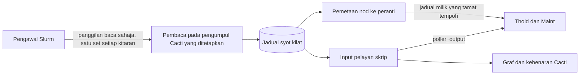

<!-- Source: README.md; SHA256: 16caa3e34c4d150a7fb1018f637e200a7580330f033b485047d8413bce09abba -->

<!-- translations:start -->
[English](../../../README.md) | [简体中文](../zh-CN/README.md) | [हिन्दी](../hi-IN/README.md) | [Español (España)](../es-ES/README.md) | [Español (Latinoamérica)](../es-419/README.md) | [العربية (السعودية)](../ar-SA/README.md) | [Afrikaans](../af-ZA/README.md) | [አማርኛ](../am-ET/README.md) | [العربية (مصر)](../ar-EG/README.md) | [العربية (المغرب)](../ar-MA/README.md) | [বাংলা](../bn-BD/README.md) | [Deutsch](../de-DE/README.md) | [فارسی](../fa-IR/README.md) | [Filipino](../fil-PH/README.md) | [Français](../fr-FR/README.md) | [Français (Maroc)](../fr-MA/README.md) | [Français (Sénégal)](../fr-SN/README.md) | [Hausa](../ha-NG/README.md) | [עברית](../he-IL/README.md) | [Bahasa Indonesia](../id-ID/README.md) | [Igbo](../ig-NG/README.md) | [Italiano](../it-IT/README.md) | [日本語](../ja-JP/README.md) | [한국어](../ko-KR/README.md) | [Malagasy](../mg-MG/README.md) | [मराठी](../mr-IN/README.md) | [Bahasa Melayu](README.md) | [Nederlands](../nl-NL/README.md) | [Polski](../pl-PL/README.md) | [Português (Brasil)](../pt-BR/README.md) | [Русский](../ru-RU/README.md) | [Kinyarwanda](../rw-RW/README.md) | [Soomaali](../so-SO/README.md) | [Svenska](../sv-SE/README.md) | [Kiswahili](../sw-KE/README.md) | [தமிழ்](../ta-IN/README.md) | [తెలుగు](../te-IN/README.md) | [ไทย](../th-TH/README.md) | [Türkçe](../tr-TR/README.md) | [Українська](../uk-UA/README.md) | [اردو](../ur-PK/README.md) | [Tiếng Việt](../vi-VN/README.md) | [isiXhosa](../xh-ZA/README.md) | [Yorùbá](../yo-NG/README.md) | [繁體中文](../zh-TW/README.md) | [isiZulu](../zu-ZA/README.md)
<!-- translations:end -->

# plugin_hpcsched

Pemalam Cacti 1.2 yang memplotkan keadaan penjadual kelompok HPC bersebelahan dengan peranti yang sedia dipantau oleh Cacti: kedalaman baris gilir, kerja menunggu berbanding kerja berjalan, sebab kerja menunggu, keadaan nod, dan penggunaan partition. Slurm ialah bahagian belakang yang pertama. Thold memberikan amaran pada sumber data yang terhasil, dan Maint boleh dipacu oleh nod yang disalirkan serta tempahan penyelenggaraan.

> **Status: dalam pembangunan, belum ada keluaran.** Pencapaian 2 (asas) telah digabungkan pada `main`, dan cabang ini menambah pencapaian 3 (graf kluster dan sebab menunggu). Kod ini dipasang, dinaik taraf, dan dinyahpasang melalui API pemalam Cacti serta menolak PHP di bawah versi 8.2. Ia menyimpan daftar kluster Slurm, yang masing-masing ditetapkan kepada satu pengumpul Cacti. Pembaca latar belakang pada pengumpul utama mengumpul satu syot kilat bagi setiap kluster bagi setiap selang, sama ada dengan menjalankan `squeue`, `scontrol`, dan `sshare` bersama `--json` atau dengan membaca `slurmrestd` melalui HTTPS, lalu menyimpan kiraan kerja mengikut keadaan dan sebab menunggu, keadaan nod, partition, tempahan, dan penggunaan perkongsian saksama berserta kesegarannya. Pemalam ini menyertakan templat Cacti dan, atas pengesahan pentadbir, mencipta atau memetakan satu peranti Cacti bagi setiap kluster dengan graf kerja mengikut keadaan, kerja menunggu mengikut keluarga sebab, nod mengikut keadaan, CPU, dan penggunaan, untuk kluster dan bagi setiap partition, serta usia syot kilat. Halaman gambaran keseluruhan baca sahaja menunjukkan kiraan bagi setiap kluster berserta kesegarannya dan paparan sebab menunggu bagi setiap kluster, manakala halaman kesihatan khusus untuk pentadbir menunjukkan hasil yang dikembalikan oleh setiap pengumpulan dan sama ada templat telah dipasang. Setiap halaman dan tindakan mematuhi kebenaran peranti Cacti. Sumber data tersebut boleh diberikan amaran oleh Thold, tetapi tiada integrasi Thold atau Maint yang telah diuji setakat ini; itu merupakan pencapaian 4 dan seterusnya. Suit ujian merangkumi arahan Slurm sintetik dan respons `slurmrestd`, dan CI turut menguji kluster Slurm enam nod sebenar dalam kontena seperti yang diterangkan di bawah. Pembaca belum lagi dijalankan terhadap kluster pengeluaran. Di bawah nota pengendali, README ini menerangkan reka bentuk, bukan tingkah laku yang telah dikeluarkan.

Ini ialah projek bebas dan tidak bergabung dengan projek Cacti.

## Peranan akses

| Alam | Akses |
| --- | --- |
| HPC Scheduler View | Halaman pemantauan sedia ada. |
| HPC Scheduler Operator | Pemantauan berserta halaman Operations dan pengakuan triaj peribadi. |
| HPC Scheduler Admin | Akses Operator berserta konfigurasi sedia ada dan tindakan pentadbiran. |

Selepas menyalin fail naik taraf, buka halaman Plugins sebagai pentadbir untuk mendaftarkan
alam baharu tersebut. Tetapkan alam Operator secara eksplisit di bawah **Configuration > Users** atau kumpulan pengguna.
Naik taraf mengekalkan ID alam dan pemberian View serta Admin sedia ada. Akses Admin
mewarisi akses Operator, dan akses Operator mewarisi akses View pada setiap permintaan;
perkara ini tidak menambah pemberian tersimpan kepada pengguna atau kumpulan. Tetapan pemalam juga memerlukan
akses HPC Scheduler Admin di samping kebenaran Settings Cacti.

Kebenaran peranti Cacti masih mengehadkan baris dan tindakan yang tersedia bagi setiap pengguna; kluster tanpa peranti disenaraikan pada halaman pentadbiran untuk setiap pengguna dengan alam pemalam, tetapi tidak dalam paparan pengendali, yang hanya menyenaraikan kluster yang dipetakan kepada peranti.
Kelayakan, konfigurasi, pemetaan, pemadaman dan perubahan pentadbiran lain
kekal dalam halaman pentadbiran. Pengakuan hanya bertahan dalam sesi pengguna semasa,
paling lama selama satu jam dan hanya selagi pemerhatian yang sama kekal
segar. Pemerhatian baharu atau yang berubah akan membatalkannya. Ia tidak sekali-kali menandakan pengukuran yang gagal sebagai sihat atau menyekat amaran.

## Nota pengendali untuk pencapaian 2

**Keistimewaan minimum.** Pemalam ini hanya membaca. Berikannya pengguna Slurm khusus tanpa peranan pentadbir atau pengendali (`AdminLevel=None` dalam `sacctmgr`). Dengan `PrivateData=jobs` (atau `nodes`, `reservations`, `usage`) dalam `slurm.conf`, pengguna tersebut hanya melihat rekodnya sendiri, maka kiraan menjadi tidak lengkap dan pemalam tidak dapat mengesannya. Mengangkat sekatan itu untuk akaun tersebut bermakna tahap pengendali atau pentadbir, yang turut membenarkan perubahan; tukar ganti itu adalah keputusan tapak. Untuk arahan klien, pengguna pengumpul Cacti memerlukan binari klien Slurm dan `slurm.conf` yang dapat mencapai pengawal; laluan binari ialah tetapan mutlak di bawah Configuration > Settings > HPC Scheduler. Untuk `slurmrestd`, URL mestilah `https://`, atau `http://` pada alamat gelung balik sahaja. Sijil TLS disahkan dan ubah hala tidak diikuti. Senarai hos slurmrestd pilihan di bawah Configuration > Settings > HPC Scheduler mengehadkan hos dan port yang boleh dinamakan oleh kluster.

**Pengumpul jauh.** Keluaran ini hanya mengumpul pada pengumpul utama Cacti. Kluster yang ditetapkan kepada pengumpul data jauh tidak dikumpul: pembaca di sana menolak dengan sebab yang dilogkan dan halaman kesihatan menamakan kluster tersebut. Pengumpulan jauh ialah fasa 3.

**Memori.** Setiap larian pengumpulan menyahkod satu jawapan penjadual pada satu masa, yang mengambil kira-kira 12 kali saiz jawapan dalam memori PHP (diukur pada kira-kira 10 kali untuk rekod kerja berbentuk seperti Slurm, ditambah teks itu sendiri). Larian ini menaikkan had memori PHP kepada tetapan Collection Memory (1024 MiB secara lalai) dan membenarkan jawapan sehingga (Collection Memory - 64) / 12 MiB, iaitu 80 MiB secara lalai, walaupun apabila Maximum Answer Size ditetapkan lebih tinggi; halaman kesihatan akan memberi amaran apabila keadaan itu berlaku. Jawapan yang lebih besar menggagalkan bahagiannya sebagai terlalu besar, dan larian yang masih kehabisan memori direkodkan sebagai gagal. Kluster besar mungkin memerlukan kedua-dua tetapan dinaikkan; 100,000 rekod kerja sebenar belum lagi diukur.

**Fail token.** Kluster `slurmrestd` menamakan satu fail token; token itu sendiri tidak pernah disimpan dalam pangkalan data, ditunjukkan pada halaman, atau ditulis ke dalam log. Fail tersebut mestilah berada di dalam salah satu direktori fail token yang ditetapkan di bawah Configuration > Settings > HPC Scheduler, dicapai tanpa pautan simbolik, dan merupakan fail biasa milik pengguna pengumpul yang hanya boleh ditulis oleh pengguna itu, mengandungi satu baris: token tersebut, atau `SLURM_JWT=<token>` seperti yang dicetak oleh `scontrol token`. Tanpa direktori token yang ditetapkan, tiada kluster boleh menggunakan `slurmrestd`. Kedua-dua tetapan ini berada pada halaman Settings Cacti, jadi alam Admin pemalam semata-mata tidak dapat mengubahnya; pastikan setiap direktori token hanya boleh ditulis oleh root dan pengguna pengumpul. Fail yang boleh dibaca oleh kumpulan atau pengguna lain masih digunakan, dan halaman kesihatan akan memberi amaran. Halaman kesihatan juga memberi amaran apabila token tamat tempoh dalam masa amaran yang dikonfigurasikan.

Untuk menggilirkan token tanpa tempoh tetingkap yang menyebabkan pembaca melihat fail separa, tulis token baharu di sebelah token lama dan namakan semula ke tempatnya:

```sh
dir=/etc/cacti/hpcsched
tmp=$(mktemp "$dir/.token.XXXXXX")
scontrol token username=cactiread lifespan=2592000 > "$tmp"
chown cacti:cacti "$tmp"
chmod 0600 "$tmp"
mv -f "$tmp" "$dir/cluster1.token"
```

Pengumpulan seterusnya akan membaca fail baharu tersebut. Penjanaan token dengan `scontrol token` memerlukan pentadbir Slurm; jalankannya di tempat yang dibenarkan dan salin fail itu ke pengumpul.

## Nota pengendali untuk pencapaian 3

**Templat.** Pemasangan dan naik taraf mengimport templat peranti, data, dan graf HPC Scheduler serta menyalin pertanyaan data partition ke direktori `resource/script_server/` Cacti. Jika direktori tersebut tidak boleh ditulis oleh pengguna yang memasang pemalam, fail lain dengan nama yang sama sudah ada di situ dan bukan ditulis oleh pemalam, atau nama tersebut ialah pautan simbolik, import akan berhenti, fail itu dibiarkan, dan halaman kesihatan menyatakan tindakan yang perlu diambil; Install Templates pada halaman kesihatan mencuba semula. Salinan serupa yang dibuat secara manual akan digunakan tetapi kekal milik anda. Nyahpasang hanya membuang fail pertanyaan jika pemalam yang menulisnya dan ia tidak berubah, serta mengekalkan templat, peranti, dan graf.

**Peranti kluster.** HPC Clusters > Device menunjukkan perkara yang akan ditambah oleh peranti (graf, sumber data, fail RRD, dan panggilan pelayan skrip bagi setiap pengumpulan) sebelum apa-apa dicipta. Create Device mencipta peranti dengan nama hos dalam domain `.invalid` yang dikhaskan dan tanpa semakan ketersediaan; Map Device pula melampirkan graf kepada peranti sedia ada dan membiarkan tetapannya tidak berubah. Setiap graf kluster dan setiap graf partition mempunyai sumber datanya sendiri: enam untuk kluster dan lima bagi setiap partition, satu panggilan pelayan skrip bagi setiap sumber data kluster dan satu bagi setiap nilai partition (32) bagi setiap pengumpulan. Partition yang ditambah kemudian diindeks apabila pembaca melihatnya dan mendapat graf daripada halaman New Graphs Cacti; partition yang dibuang berhenti dikumpul dan mengekalkan grafnya. Memadam peranti akan menyahpeta kluster dan mengekalkannya.

**Apa yang dikira oleh graf.** Kerja menunggu tidak termasuk kerja yang ditahan, yang mempunyai siri tersendiri. Tatasusunan menunggu mengira baki tugasnya. Kerja atau nod dalam beberapa partition dikira sekali dalam graf kluster dan sekali dalam setiap partition, jadi graf partition tidak semestinya berjumlah sama dengan graf kluster. Sebab menunggu dikumpulkan kepada sebelas keluarga ([ADR 0011](../../decisions/0011-pending-reason-families-and-counting.md)); paparan sebab menunggu menyenaraikan sebab mentah, termasuk yang berada dalam Other. Setiap kerja hanya melaporkan sebab terakhir yang diperiksa oleh penjadual. Penyebut penggunaan merangkumi nod yang disalirkan, tidak aktif, dan nod lain yang tidak tersedia. Data yang lapuk atau gagal ialah `U`, bukan sifar; `age` kekal berangka.

**Pemakluman amaran.** Thold boleh memberikan amaran pada mana-mana sumber data ini; tetapkan tempoh Thold kepada sekurang-kurangnya satu selang pengumpulan, dan berikan amaran pada `age` untuk mengesan pembaca yang terhenti. Semakan Thold hujung ke hujung ialah pencapaian 4.

**Diuji terhadap output Slurm sebenar.** CI memulakan kluster Slurm enam nod dalam kontena (26.05.5 pada setiap perubahan, 25.11.8 dibina daripada sumber pada tolakan ke `main`, secara mingguan, dan atas permintaan) serta menyemak keadaan nod, tempahan penyelenggaraan, sebab menunggu, dan tatasusunan seperti yang dihuraikan oleh pemalam, kemudian mengumpul daripada kluster tersebut dengan arahan pemalam sendiri dan pengangkutan `slurmrestd`. Keluaran yang lebih lama hanya diliputi oleh lekapan sintetik. Pembaca masih belum dijalankan terhadap kluster pengeluaran.

**Kebenaran.** Kluster pada peranti ditunjukkan, dieksport, dan diubah hanya untuk pengguna yang dibenarkan Cacti bagi peranti tersebut, pada setiap halaman pemalam; pemetaan peranti juga memerlukan kebenaran untuk peranti sasaran. Kluster tanpa peranti kelihatan kepada semua orang dengan alam pemalam. Kluster yang masih dipetakan kepada peranti yang telah dipadamkan semasa pemalam dinyahdayakan hanya ditunjukkan kepada pengguna dengan alam HPC Scheduler Admin, yang boleh mencipta atau memetakan peranti untuknya. Akses graf adalah milik Cacti sendiri.

## Mengapa

Pengendali yang menjalankan Cacti sudah pun memplotkan nod pengkomputeran mereka. Pandangan penjadual tiada daripada graf tersebut, yang meninggalkan dua jurang:

- **Tiada maklumat "mengapa kerja tidak bermula".** Slurm merekodkan sebab bagi setiap kerja yang menunggu. Baris gilir yang penuh bersebelahan graf nod melahu tidak menyatakan sama ada puncanya ialah keutamaan, had sumber, penahanan, kebergantungan, atau nod yang disalirkan.
- **Tiada kaitan antara keadaan penjadual dengan pemakluman amaran.** Thold memberikan amaran pada peranti yang telah pun disalirkan oleh pentadbir, dan pentadbir mencipta jadual Maint secara manual.

Pemalam ini mengumpul satu syot kilat bercache bagi setiap kluster, menerbitkannya sebagai sumber data dan graf Cacti biasa, memetakan nod penjadual kepada peranti Cacti sedia ada, dan boleh meletakkan nod yang disalirkan serta tempahan penyelenggaraan ke dalam Maint. Ia menggunakan semula kebenaran Cacti, pengumpul data jauh, Thold, dan Maint, serta bersifat baca sahaja terhadap penjadual.

## Skop yang dirancang

| Fasa | Skop | Pencapaian |
|---|---|---|
| 0, penyelidikan | Matriks keluaran Slurm, pengesahan tingkah laku huluan, beban pengawal, lekapan penamaan nod | [M1](https://github.com/somethingwithproof/plugin_hpcsched/milestone/1) |
| 1, graf kluster | Kedalaman baris gilir, kerja menunggu dan berjalan, sebab menunggu, keadaan nod, penggunaan partition, pemakluman amaran Thold, halaman kesihatan, keluaran | [M2](https://github.com/somethingwithproof/plugin_hpcsched/milestone/2), [M3](https://github.com/somethingwithproof/plugin_hpcsched/milestone/3), [M4](https://github.com/somethingwithproof/plugin_hpcsched/milestone/4) |
| 2, nod dan penyelenggaraan | Pemetaan nod ke peranti, keadaan per nod, tetingkap Maint automatik untuk nod yang disalirkan dan tempahan penyelenggaraan | [M5](https://github.com/somethingwithproof/plugin_hpcsched/milestone/5) |
| 3, perakaunan | Penggunaan perkongsian saksama, statistik perakaunan terhad, pengumpul data jauh | [M6](https://github.com/somethingwithproof/plugin_hpcsched/milestone/6) |

Di luar skop: sebarang laluan tulis penjadual (hantar, batal, tahan, salir, sambung semula), enjin pemakluman amaran milik pemalam, enjin pelaporan atau caj balik, siri per pengguna dan per kerja. Bahagian belakang PBS Pro, OpenPBS, dan LSF berada dalam penyelidikan.

## Sasaran keserasian

| Komponen | Sasaran |
|---|---|
| Cacti | 1.2.31 atau lebih baharu, tiada tampalan teras |
| PHP | 8.2 atau lebih baharu; `setup.php` kekal boleh dihuraikan pada 8.0 supaya masa jalan yang tidak disokong menerima penolakan dan bukannya UI Cacti yang rosak |
| Slurm | 25.05, 25.11, dan 26.05, tiga keluaran terkini ([ADR 0013](../../decisions/0013-three-latest-slurm-releases.md)); 25.11 dan 26.05 diuji terhadap kluster langsung, 25.05 terhadap lekapan sahaja. Arahan klien ialah pengangkutan lalai ([ADR 0012](../../decisions/0012-client-commands-default-transport.md)) dan menggunakan tetapan penghurai data: v0.0.43 secara lalai, yang dibuang oleh SchedMD dalam 27.05, atau v0.0.44 atau v0.0.45 pada keluaran yang menyertakannya. Kluster slurmrestd menemui penghurai terbaharu yang disediakan oleh daemon |
| Thold, Maint | Tiada perubahan Thold; integrasi Maint ialah cadangan yang memerlukan persetujuan penyelenggara Maint |

## Reka bentuk

- [docs/PLAN.md](../../PLAN.md) ialah pelan penuh: seni bina, fakta huluan yang menjadi sandarannya (berserta sumber dan senarai eksplisit andaian yang belum disahkan), pemetaan nod, model keadaan, sempadan keselamatan, aritmetik prestasi, pengujian, dan risiko.
- [docs/decisions/](../../decisions) menyimpan rekod keputusan seni bina.
- [docs/REQUIREMENTS.md](../../REQUIREMENTS.md) memetakan setiap ID keperluan kepada isunya.



## Cara kerja dijejaki

- **Pencapaian** mengikut pencapaian pelan tersebut. Setiap satu mempunyai isu epik yang menyenaraikan sub-isu dan bukti keluarannya.
- **Isu** ditaipkan mengikut label: `type: requirement`, `type: research`, `type: decision`, `type: epic`. Isu keperluan menyatakan keperluan bernombor yang boleh diuji (`REQ-AREA-NNN`) dan kriteria penerimaan.
- **Label** juga membawa `area:`, `phase:`, `priority:`, dan `status:`. Lihat [CONTRIBUTING.md](../../../CONTRIBUTING.md#labels).
- [Papan projek](https://github.com/users/somethingwithproof/projects/10) menunjukkan semua isu merentas pencapaian.

## Penyumbangan

Baca [CONTRIBUTING.md](../../../CONTRIBUTING.md). Komit memerlukan tandatangan DCO. Perbincangan reka bentuk berlaku pada isu; keputusan terbuka membawa label `type: decision`.

## Keselamatan

Laporkan kerentanan secara peribadi; lihat [SECURITY.md](../../../SECURITY.md).

## Lesen

GNU General Public License v2.0, lesen yang sama seperti Cacti dan pemalamnya. Lihat [LICENSE](../../../LICENSE).
