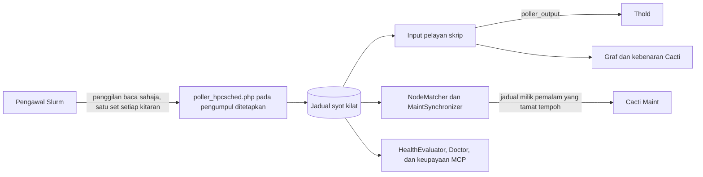

<!-- Source: README.md; SHA256: 938114d41dbd516f9dfcd94619c4fc73ef56b4da1dd693010588a93cce250534 -->

<!-- translations:start -->
[English](../../../README.md) | [简体中文](../zh-CN/README.md) | [हिन्दी](../hi-IN/README.md) | [Español (España)](../es-ES/README.md) | [Español (Latinoamérica)](../es-419/README.md) | [العربية (السعودية)](../ar-SA/README.md) | [Afrikaans](../af-ZA/README.md) | [አማርኛ](../am-ET/README.md) | [العربية (مصر)](../ar-EG/README.md) | [العربية (المغرب)](../ar-MA/README.md) | [বাংলা](../bn-BD/README.md) | [Bosanski](../bs-BA/README.md) | [Deutsch](../de-DE/README.md) | [فارسی](../fa-IR/README.md) | [Filipino](../fil-PH/README.md) | [Français](../fr-FR/README.md) | [Français (Maroc)](../fr-MA/README.md) | [Français (Sénégal)](../fr-SN/README.md) | [Hausa](../ha-NG/README.md) | [עברית](../he-IL/README.md) | [Hrvatski](../hr-HR/README.md) | [Bahasa Indonesia](../id-ID/README.md) | [Igbo](../ig-NG/README.md) | [Italiano](../it-IT/README.md) | [日本語](../ja-JP/README.md) | [한국어](../ko-KR/README.md) | [Malagasy](../mg-MG/README.md) | [मराठी](../mr-IN/README.md) | [Bahasa Melayu](README.md) | [Nederlands](../nl-NL/README.md) | [Polski](../pl-PL/README.md) | [Português (Brasil)](../pt-BR/README.md) | [Русский](../ru-RU/README.md) | [Kinyarwanda](../rw-RW/README.md) | [Soomaali](../so-SO/README.md) | [Српски](../sr-RS/README.md) | [Svenska](../sv-SE/README.md) | [Kiswahili](../sw-KE/README.md) | [தமிழ்](../ta-IN/README.md) | [తెలుగు](../te-IN/README.md) | [ไทย](../th-TH/README.md) | [Türkçe](../tr-TR/README.md) | [Українська](../uk-UA/README.md) | [اردو](../ur-PK/README.md) | [Tiếng Việt](../vi-VN/README.md) | [isiXhosa](../xh-ZA/README.md) | [Yorùbá](../yo-NG/README.md) | [繁體中文](../zh-TW/README.md) | [isiZulu](../zu-ZA/README.md)
<!-- translations:end -->

# plugin_hpcsched

Pemalam Cacti 1.2 (`hpcsched`, versi `0.1.0-dev`) yang memplotkan keadaan penjadual kelompok HPC bersebelahan dengan peranti yang sedia dipantau oleh Cacti: kedalaman baris gilir, kerja menunggu berbanding kerja berjalan, sebab kerja menunggu, keadaan nod, penggunaan partition, dan penggunaan perkongsian saksama (fair-share) peringkat akaun. Slurm ialah bahagian belakang yang dilaksanakan. Thold memberikan amaran pada sumber data yang terhasil, dan penyegerak Maint pilihan (opt-in) memacu tetingkap Maint Cacti daripada nod pengkomputeran Slurm yang disalirkan (drained), terhenti (down), dan ditempah untuk penyelenggaraan.

> **Status: dalam pembangunan, belum ada keluaran.** Cabang ini melaksanakan asas pemalam, graf kluster dan partition, keluarga sebab menunggu, pemadanan nod pengkomputeran Slurm kepada peranti Cacti, penyegerakan tetingkap Maint Cacti pilihan, ringkasan perkongsian saksama peringkat akaun, pelaksanaan dan replikasi pengumpul data jauh, CLI Configuration-as-Code (CasC) dan operasi, serta cangkuk ekosistem Cacti (CasC, Doctor, dan MCP / Abilities API v2). Suit ujian merangkumi arahan Slurm sintetik dan respons `slurmrestd`, manakala CI menjalankan ujian terhadap kluster Slurm enam nod sebenar dalam kontena. Pembaca belum lagi dijalankan terhadap kluster pengeluaran, dan ujian ulang tayang Thold hujung ke hujung belum lagi berada dalam CI.

Ini ialah projek bebas dan tidak bergabung dengan projek Cacti.

## Apa yang telah dilaksanakan

- **Kitaran hayat dan skema (v3)**: pemasangan, naik taraf idempoten, nyahpasang (mengekalkan jadual pemalam secara lalai), dan keperluan minimum PHP 8.2 sambil mengekalkan titik masuk supaya boleh dihuraikan pada PHP 8.0. Skema v3 menambah `plugin_hpcsched_node_map` dan `plugin_hpcsched_maint_link` bersama jadual kluster, larian, bahagian, kiraan kerja, kiraan nod, nod, partition, tempahan, dan perkongsian.
- **Pengumpulan Slurm baca sahaja pada pengumpul utama dan jauh**: `poller_bottom` memulakan `poller_hpcsched.php --cluster=N` di latar belakang pada setiap pengumpul (`poller_id`) bagi kluster didayakan yang ditetapkan kepadanya. Setiap larian mengumpul satu syot kilat bercache bagi setiap kluster melalui arahan klien (`squeue`, `scontrol`, `sshare` dengan `--json`) atau `slurmrestd` melalui HTTPS (HTTP gelung balik dibenarkan dengan amaran kesihatan). `INFO` mengisytiharkan `remote_collect:1, remote_poller:1`, dan `replicate_out` mereplikasi takrifan `plugin_hpcsched_cluster` bukan rahsia ke pengumpul jauh (`poller_id >= 2`); kandungan fail token tidak pernah dibaca atau direplikasi.
- **Templat Cacti dan graf kluster**: membekalkan templat peranti, data, dan graf (`templates/hpcsched-templates.xml`) serta pertanyaan data pelayan skrip partition (`scripts/ss_hpcsched_cluster.php`, `scripts/ss_hpcsched_partitions.php`). Atas pengesahan pentadbir, ia mencipta atau memetakan satu peranti Cacti bagi setiap kluster dengan graf untuk kerja mengikut keadaan, kerja menunggu mengikut keluarga sebab, nod mengikut keadaan, CPU, penggunaan (kluster dan setiap partition), dan usia syot kilat.
- **Pemadanan nod Slurm ke peranti dan penyegerakan Cacti Maint**: pemadan masa linear empat peringkat (`NodeMatcher`) memetakan nod pengkomputeran Slurm kepada rekod `host` Cacti sedia ada (nama hos tepat, alamat tepat, perihalan/alias tepat, atau label DNS pertama bagi nama bukan IP) dan menandakan padanan berbilang atau tuntutan peranti pendua sebagai `ambiguous` daripada meneka. `HostList::expand()` mengembangkan senarai hos tempahan Slurm (sehingga 10,000 nod). `MaintSynchronizer` mencipta, memperbaharui, dan membuang jadual Cacti Maint sekali sahaja milik pemalam yang dijejaki dalam `plugin_hpcsched_maint_link` bagi nod terpeta dalam keadaan `DRAIN`, `DRAINING`, `DOWN`, atau tempahan aktif `MAINT`/`MAINTENANCE` tanpa mengubah suai jadual Maint yang dicipta oleh pentadbir.
- **Ringkasan perkongsian saksama peringkat akaun**: apabila `collect_shares` didayakan, mengumpul baris perkaitan akaun Slurm ke dalam `plugin_hpcsched_share` (menggugurkan baris pengguna mengikut [ADR 0010](../../decisions/0010-bound-series-cardinality.md)). `ShareSummary` dan `ShareRepository` mengira kiraan akaun/partition, jumlah penggunaan mentah dan berkesan, faktor perkongsian saksama minimum/maksimum/purata, dan akaun teratas; kiraan akaun didedahkan dalam `hpcsched-get-queue-summary`.
- **CasC dan CLI operasi (`cli/hpcsched.php`)**: eksport konfigurasi YAML/XML, pengesahan, perancangan perbezaan dry-run, penerapan berpagar pengesahan, output kesihatan berstruktur, dan penyegerakan Maint pilihan (`sync-maint --dry-run` / `--apply`).
- **Cangkuk ekosistem (`setup.php`)**: `casc_register_providers`, `doctor_register_checks`, dan `abilities_register`.

## Peranan akses

| Alam | Akses |
| --- | --- |
| HPC Scheduler View | Gambaran keseluruhan kluster baca sahaja dan sebab menunggu (`hpcsched.php`). |
| HPC Scheduler Operator | Akses View berserta halaman Operations (`hpcsched_operator.php`) dan pengakuan triaj peribadi. |
| HPC Scheduler Admin | Akses Operator berserta pentadbiran kluster (`hpcsched_clusters.php`) dan halaman kesihatan (`hpcsched_health.php`). |

Selepas menyalin fail naik taraf, buka halaman Plugins sebagai pentadbir untuk mendaftarkan alam dan cangkuk baharu. Tetapkan alam Operator secara eksplisit di bawah **Configuration > Users** atau kumpulan pengguna. Naik taraf mengekalkan ID alam dan pemberian sedia ada bagi View dan Admin. Akses Admin mewarisi akses Operator, dan akses Operator mewarisi akses View pada setiap permintaan; ini tidak menambah pemberian tersimpan kepada pengguna atau kumpulan. Tetapan pemalam juga memerlukan akses HPC Scheduler Admin di samping kebenaran Settings Cacti.

Kebenaran peranti Cacti mengehadkan baris dan tindakan yang tersedia bagi setiap pengguna. Kluster yang dipetakan kepada peranti Cacti hanya dipaparkan, dieksport, dan diubah untuk pengguna yang dibenarkan oleh Cacti bagi peranti tersebut; pemetaan peranti juga memerlukan kebenaran untuk peranti sasaran. Kluster tanpa peranti disenaraikan pada halaman pentadbiran bagi pengguna yang mempunyai alam pemalam, tetapi tidak dalam paparan pengendali, yang hanya menyenaraikan kluster yang dipetakan kepada peranti. Kluster yang peranti terpetanya telah dipadam semasa pemalam dinyahdayakan hanya ditunjukkan kepada pengguna dengan akses HPC Scheduler Admin. Pengakuan hanya bertahan dalam sesi semasa pengguna, paling lama selama satu jam dan hanya selagi pemerhatian yang sama kekal segar. Pemerhatian baharu atau berubah membatalkannya. Pengakuan tidak pernah menandakan ukuran yang gagal sebagai sihat atau menyekat amaran.

## Nota pengendali

### Keselamatan, keistimewaan minimum, dan fail token

Pemalam ini hanya membaca. Berikan pengguna Slurm khusus tanpa peranan pentadbir atau pengendali (`AdminLevel=None` dalam `sacctmgr`). Dengan `PrivateData=jobs` (atau `nodes`, `reservations`, `usage`) dalam `slurm.conf`, pengguna tersebut hanya melihat rekodnya sendiri, menyebabkan kiraan menjadi tidak lengkap dan pemalam tidak dapat mengesannya. Mengangkat sekatan itu bagi akaun tersebut memerlukan tahap pengendali atau pentadbir, yang turut membenarkan perubahan; pertukaran itu ialah keputusan pihak tapak.

Bagi arahan klien, pengguna pengumpul Cacti memerlukan binari klien Slurm (`squeue`, `scontrol`, dan secara pilihan `sshare`) serta `slurm.conf` yang mencapai pengawal; laluan binari ialah tetapan laluan mutlak di bawah **Configuration > Settings > HPC Scheduler**.

Bagi `slurmrestd`, URL mestilah `https://`, atau `http://` pada alamat gelung balik sahaja. Sijil TLS disahkan dan ubah hala tidak diikuti. Senarai hos `slurmrestd` pilihan di bawah **Configuration > Settings > HPC Scheduler** mengehadkan hos dan port yang boleh dinamakan oleh sesuatu kluster.

Kluster `slurmrestd` menamakan fail token; token itu sendiri tidak pernah disimpan dalam pangkalan data, dipaparkan pada halaman, dieksport oleh CasC, atau ditulis ke dalam log. Fail tersebut mestilah berada di dalam salah satu Token File Directories yang dikonfigurasikan di bawah **Configuration > Settings > HPC Scheduler**, dicapai tanpa pautan simbolik, dan merupakan fail biasa milik pengguna pengumpul yang hanya boleh ditulis oleh pengguna tersebut, mengandungi satu baris: token tersebut atau `SLURM_JWT=<token>` seperti yang dicetak oleh `scontrol token`. Tanpa direktori token ditetapkan, tiada kluster boleh menggunakan `slurmrestd`. Pastikan setiap direktori token hanya boleh ditulis oleh root dan pengguna pengumpul. Fail yang boleh dibaca oleh kumpulan atau pengguna lain masih digunakan, dan halaman kesihatan memberi amaran; ia juga memberi amaran apabila token tamat tempoh dalam tetingkap amaran yang dikonfigurasikan.

Untuk menggilirkan token secara atomik:

```sh
dir=/etc/cacti/hpcsched
tmp=$(mktemp "$dir/.token.XXXXXX")
scontrol token username=cactiread lifespan=2592000 > "$tmp"
chown cacti:cacti "$tmp"
chmod 0600 "$tmp"
mv -f "$tmp" "$dir/cluster1.token"
```

Pengumpulan seterusnya membaca fail baharu tersebut. Menjana token dengan `scontrol token` memerlukan pentadbir Slurm; jalankannya di tempat yang dibenarkan dan salin fail itu ke pengumpul.

### Pengumpul data jauh

`INFO` mengisytiharkan `remote_collect:1, remote_poller:1`. `hpcsched_poller_bottom()` melancarkan `poller_hpcsched.php` pada setiap pengumpul bagi kluster didayakan yang ditetapkan kepada `poller_id` tersebut, dan `hpcsched_replicate_out()` mereplikasi baris `plugin_hpcsched_cluster` bukan rahsia ke pengumpul jauh (`poller_id >= 2`). Fail token dan binari klien Slurm mestilah wujud secara setempat pada pengumpul jauh yang ditetapkan; kandungan token tidak pernah direplikasi.

### Had memori

Setiap larian pengumpulan menyahkod satu jawapan penjadual pada satu masa, yang mengambil kira-kira 12 kali saiz jawapan dalam memori PHP (diukur pada kira-kira 10 kali untuk rekod kerja berbentuk seperti Slurm, ditambah teks itu sendiri). Pembaca menaikkan had memori PHP-nya ke tetapan Collection Memory (1024 MiB secara lalai) dan membenarkan jawapan sehingga `(Collection Memory - 64) / 12` MiB (80 MiB secara lalai), walaupun apabila Maximum Answer Size ditetapkan lebih tinggi; halaman kesihatan memberi amaran apabila Maximum Answer Size melebihi had yang dipadankan itu. Jawapan yang lebih besar menggagalkan bahagiannya sebagai terlalu besar, dan larian yang masih kehabisan memori merekodkan kegagalan memori serta melepaskan pajakan dan slot prosesnya melalui pengendali penutupan. Kluster besar mungkin memerlukan kedua-dua tetapan dinaikkan; 100,000 rekod kerja sebenar belum diukur.

### Templat, peranti kluster, dan pengiraan graf

Pemasangan dan naik taraf mengimport templat peranti, data, dan graf HPC Scheduler serta menyalin pertanyaan data partition ke direktori `resource/script_server/` Cacti. Jika direktori tersebut tidak boleh ditulis, fail lain dengan nama yang sama wujud di sana, atau sasarannya ialah pautan simbolik, pengimportan berhenti, membiarkan fail tidak disentuh, dan melaporkan keadaan itu pada halaman kesihatan tempat **Install Templates** mencuba semula. Nyahpasang membuang fail pertanyaan hanya jika pemalam yang menulisnya dan ia tidak berubah, serta mengekalkan templat, peranti, dan graf.

**HPC Clusters > Device** mempratonton graf, sumber data, fail RRD, dan panggilan pelayan skrip bagi setiap pengumpulan sebelum mencipta apa-apa. **Create Device** mencipta peranti dengan nama hos dalam domain terpelihara `.invalid` dan tanpa semakan ketersediaan; **Map Device** melampirkan graf kepada peranti sedia ada tanpa mengubah tetapannya. Setiap graf kluster dan graf partition mempunyai sumber datanya sendiri: enam untuk kluster dan lima bagi setiap partition. Partition yang ditambah kemudian diindeks semula secara automatik apabila pembaca mengesan perubahan; partition yang dibuang berhenti dikumpul dan mengekalkan grafnya. Memadam peranti menyahpeta kluster (dan mengosongkan mana-mana baris `plugin_hpcsched_node_map` yang sepadan) sambil mengekalkan rekod kluster.

Pending mengecualikan kerja yang ditahan (held), yang mempunyai sirinya sendiri. Tatasusunan kerja menunggu mengira tugasnya yang masih berbaki. Kerja atau nod dalam berbilang partition dikira sekali dalam graf kluster dan sekali dalam setiap partition, jadi jumlah partition tidak semestinya sama dengan jumlah kluster. Sebab menunggu dikumpulkan ke dalam sebelas keluarga ([ADR 0011](../../decisions/0011-pending-reason-families-and-counting.md)); paparan sebab menunggu menyenaraikan sebab mentah termasuk yang berada dalam `Other`. Penyebut penggunaan merangkumi nod yang disalirkan, terhenti, dan nod lain yang tidak tersedia. Data lapuk atau gagal dilaporkan sebagai `U`, tidak pernah sifar; `age` kekal berangka.

Untuk amaran, konfigurasikan Thold pada mana-mana sumber data kluster atau partition dengan tempoh sekurang-kurangnya satu selang pengumpulan, dan tetapkan amaran pada `age` untuk mengesan pembaca yang terhenti.

## CLI dan cangkuk ekosistem

### Titik masuk pembaca

`hpcsched_poller_bottom()` memulakan `poller_hpcsched.php` secara automatik; ia juga boleh dijalankan secara manual pada pengumpul yang ditetapkan untuk kluster tersebut:

```sh
php /path/to/cacti/plugins/hpcsched/poller_hpcsched.php --cluster=N [--force] [--debug]
```

`--force` berjalan walaupun semasa pemalam dinyahdayakan, untuk diagnosis baris perintah.

### CLI Configuration-as-Code, kesihatan, dan penyegerakan Maint

```sh
php /path/to/cacti/plugins/hpcsched/cli/hpcsched.php export [--format=yaml|xml] [--file=PATH]
php /path/to/cacti/plugins/hpcsched/cli/hpcsched.php validate --file=PATH [--format=yaml|xml]
php /path/to/cacti/plugins/hpcsched/cli/hpcsched.php plan --file=PATH [--format=yaml|xml]
php /path/to/cacti/plugins/hpcsched/cli/hpcsched.php apply --file=PATH --confirm=PLAN_HASH [--format=yaml|xml]
php /path/to/cacti/plugins/hpcsched/cli/hpcsched.php health [--format=text|json]
php /path/to/cacti/plugins/hpcsched/cli/hpcsched.php sync-maint [--dry-run | --apply] [--cluster=ID] [--format=text|json]
```

- `export` menulis fail baharu dengan mod `0600` (atau stdout) dan menggantikan laluan `token_file` yang dikonfigurasikan dengan `[REDACTED]`. `plan` dan `apply` menolak medan sebaris `jwt`, `secret`, dan `password`, serta mengekalkan laluan `token_file` setempat sedia ada apabila `[REDACTED]` dibekalkan. `apply` memerlukan `--confirm=PLAN_HASH` tepat yang dicetak oleh `plan`.
- `health` menilai kesemasaan skema, kesegaran kluster, hasil larian, ketersediaan Maint, dan amaran tanpa menghubungi penjadual atau membaca fail token.
- `sync-maint` lalai kepada `--dry-run` dan mempratonton atau menggunakan jadual Cacti Maint untuk nod Slurm terpeta dalam `DRAIN`, `DRAINING`, `DOWN`, atau tempahan aktif `MAINT`/`MAINTENANCE` (ufuk saliran/henti lalai 3600s, margin pembaharuan 600s). Ia menolak `--apply` jika `plugin_maint_schedules` dan `plugin_maint_hosts` tiada, dan hanya mengemas kini atau membuang jadual yang direkodkan dalam `plugin_hpcsched_maint_link`.

### Cangkuk ekosistem

Apabila pemalam Cacti atau integrasi hos yang sepadan hadir, `setup.php` mendaftarkan:

- `casc_register_providers`: mengeksport, mengesahkan, merancang, dan menggunakan konfigurasi `hpcsched` (`yaml` dan `xml`, skema v1) dengan pengesahan berserta penapisan rahsia.
- `doctor_register_checks`: menyediakan empat semakan diagnostik baca sahaja (`hpcsched.schema`, `hpcsched.cluster_freshness`, `hpcsched.token_health`, `hpcsched.maint_sync`).
- `abilities_register`: mendaftarkan tiga keupayaan baca sahaja, tidak memusnahkan, idempoten di bawah kategori `hpcsched`, dikawal oleh alam HPC Scheduler View (dan kebenaran peranti bagi ringkasan kluster): `hpcsched-list-clusters`, `hpcsched-get-queue-summary`, dan `hpcsched-get-health`.

## Mengapa

Pengendali yang menjalankan Cacti sudah pun memplot graf nod pengkomputeran mereka. Pandangan penjadual tiada daripada graf tersebut, yang meninggalkan dua jurang:

- **Tiada jawapan bagi "mengapa kerja tidak bermula".** Slurm merekodkan sebab bagi setiap kerja yang menunggu. Baris gilir penuh di sebelah graf nod melahu tidak menyatakan sama ada puncanya ialah keutamaan, had sumber, tahanan, kebergantungan, atau nod yang disalirkan.
- **Tiada kaitan antara keadaan penjadual dengan amaran.** Thold memberi amaran pada peranti yang telah disalirkan oleh pentadbir, dan pentadbir mencipta jadual Maint secara manual.

Pemalam ini mengumpul satu syot kilat bercache bagi setiap kluster, menerbitkannya sebagai sumber data dan graf Cacti biasa, memetakan nod penjadual kepada peranti Cacti sedia ada, dan menyegerakkan tetingkap Maint bertempoh tamat milik pemalam untuk nod yang disalirkan, terhenti, dan ditempah penyelenggaraan. Ia menggunakan semula kebenaran Cacti, pengumpul data jauh, Thold, dan Maint, serta kekal baca sahaja sepenuhnya terhadap penjadual.

## Skop dan sempadan

Di luar skop: sebarang laluan tulis penjadual (serah, batal, tahan, salir, sambung semula), enjin amaran milik pemalam, enjin pelaporan atau caj balik, dan siri mengikut pengguna atau mengikut kerja. Bahagian belakang PBS Pro, OpenPBS, dan LSF adalah untuk penyelidikan sahaja.

## Keperluan dan keserasian

| Komponen | Sasaran |
|---|---|
| Cacti | 1.2.31 atau lebih baharu (`compat = 1.2.31`), tiada tampalan teras |
| PHP | 8.2 atau lebih baharu; titik masuk kekal boleh dihuraikan pada 8.0 dan menolak pengaktifan pada 8.1 supaya masa jalan yang tidak disokong mendapat penolakan dan bukannya UI Cacti yang rosak |
| Slurm | 25.05, 25.11, dan 26.05 ([ADR 0013](../../decisions/0013-three-latest-slurm-releases.md)); 26.05.5 diuji dalam CI pada setiap perubahan terhadap kluster kontena enam nod, 25.11.8 pada `main`, mingguan, dan atas permintaan, serta 25.05 terhadap fikstur sahaja. Arahan klien lalai kepada penghurai data `v0.0.43` (dengan `v0.0.44` dan `v0.0.45` boleh dipilih); kluster `slurmrestd` menemui penghurai terbaharu yang disediakan oleh daemon |
| Thold, Maint | Tiada perubahan Thold diperlukan; `sync-maint` berintegrasi dengan jadual `plugin_maint_schedules` dan `plugin_maint_hosts` milik Cacti Maint menggunakan jadual pautan milik pemalam (`plugin_hpcsched_maint_link`) |

## Pembangunan dan ujian

Aliran kerja CI (`.github/workflows/plugin-ci-workflow.yml`) menguji PHP 8.2 hingga 8.5 terhadap Cacti `release/1.2.31` dan `1.2.x`, linting titik masuk PHP 8.0, penolakan PHP 8.1, PHPStan, pengesahan gettext/terjemahan, pelesenan REUSE, linting aliran kerja, semakan aliran peranti kluster dan hanyutan eksport templat, serta kluster Slurm enam nod sebenar (`slurm-live`).

Dengan abah-abah pemalam Pest kongsi terkunci milik Cacti (`CACTI_PEST_BIN`) dan pangkalan data Cacti pakai buang:

```sh
# Unit tests
"$CACTI_PEST_BIN" --configuration=phpunit.xml

# Lifecycle integration tests (disposable database only)
CACTI_PATH=/path/to/cacti HPCSCHED_TEST_DATABASE=disposable "$CACTI_PEST_BIN" --configuration=phpunit-integration.xml

# Static analysis (against Cacti 1.2.31)
CACTI_PATH=/path/to/cacti phpstan analyse -c phpstan.neon --no-progress

# Translation template, catalogs, and localized README checks
sh locales/build_gettext.sh --check
```

## Reka bentuk

- [docs/PLAN.md](../../PLAN.md) ialah pelan seni bina dan reka bentuk: fakta huluan berserta sumber, pemetaan nod, model keadaan, sempadan keselamatan, aritmetik prestasi, ujian, dan risiko.
- [docs/decisions/](../../decisions/) menyimpan rekod keputusan seni bina.
- [docs/REQUIREMENTS.md](../../REQUIREMENTS.md) memetakan setiap ID keperluan kepada isunya.



## Cara kerja dijejaki

- **Pencapaian** mengikut pencapaian dalam pelan. Setiap satu mempunyai isu epik yang menyenaraikan sub-isu dan bukti keluarnya.
- **Isu** dikelaskan mengikut label: `type: requirement`, `type: research`, `type: decision`, `type: epic`. Isu keperluan menyatakan keperluan bernombor dan boleh diuji (`REQ-AREA-NNN`) serta kriteria penerimaan.
- **Label** turut membawa `area:`, `phase:`, `priority:`, dan `status:`. Lihat [CONTRIBUTING.md](../../../CONTRIBUTING.md#labels).
- [Papan projek](https://github.com/users/somethingwithproof/projects/10) memaparkan semua isu merentas pencapaian.

## Menyumbang

Baca [CONTRIBUTING.md](../../../CONTRIBUTING.md). Komit memerlukan tandatangan DCO (`git commit -s`). Perbincangan reka bentuk berlaku pada isu; keputusan terbuka membawa label `type: decision`.

## Keselamatan

Laporkan kerentanan secara peribadi; lihat [SECURITY.md](../../../SECURITY.md).

## Lesen

GNU General Public License v2.0, lesen yang sama seperti Cacti dan pemalamnya. Lihat [LICENSE](../../../LICENSE).
