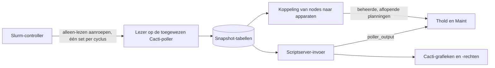

<!-- Source: README.md; SHA256: 16caa3e34c4d150a7fb1018f637e200a7580330f033b485047d8413bce09abba -->

<!-- translations:start -->
[English](../../../README.md) | [简体中文](../zh-CN/README.md) | [हिन्दी](../hi-IN/README.md) | [Español (España)](../es-ES/README.md) | [Español (Latinoamérica)](../es-419/README.md) | [العربية (السعودية)](../ar-SA/README.md) | [Afrikaans](../af-ZA/README.md) | [አማርኛ](../am-ET/README.md) | [العربية (مصر)](../ar-EG/README.md) | [العربية (المغرب)](../ar-MA/README.md) | [বাংলা](../bn-BD/README.md) | [Bosanski](../bs-BA/README.md) | [Deutsch](../de-DE/README.md) | [فارسی](../fa-IR/README.md) | [Filipino](../fil-PH/README.md) | [Français](../fr-FR/README.md) | [Français (Maroc)](../fr-MA/README.md) | [Français (Sénégal)](../fr-SN/README.md) | [Hausa](../ha-NG/README.md) | [עברית](../he-IL/README.md) | [Hrvatski](../hr-HR/README.md) | [Bahasa Indonesia](../id-ID/README.md) | [Igbo](../ig-NG/README.md) | [Italiano](../it-IT/README.md) | [日本語](../ja-JP/README.md) | [한국어](../ko-KR/README.md) | [Malagasy](../mg-MG/README.md) | [मराठी](../mr-IN/README.md) | [Bahasa Melayu](../ms-MY/README.md) | [Nederlands](README.md) | [Polski](../pl-PL/README.md) | [Português (Brasil)](../pt-BR/README.md) | [Русский](../ru-RU/README.md) | [Kinyarwanda](../rw-RW/README.md) | [Soomaali](../so-SO/README.md) | [Српски](../sr-RS/README.md) | [Svenska](../sv-SE/README.md) | [Kiswahili](../sw-KE/README.md) | [தமிழ்](../ta-IN/README.md) | [తెలుగు](../te-IN/README.md) | [ไทย](../th-TH/README.md) | [Türkçe](../tr-TR/README.md) | [Українська](../uk-UA/README.md) | [اردو](../ur-PK/README.md) | [Tiếng Việt](../vi-VN/README.md) | [isiXhosa](../xh-ZA/README.md) | [Yorùbá](../yo-NG/README.md) | [繁體中文](../zh-TW/README.md) | [isiZulu](../zu-ZA/README.md)
<!-- translations:end -->

# plugin_hpcsched

Een Cacti 1.2-plug-in die de status van een HPC-batchscheduler in grafieken weergeeft naast de apparaten die Cacti al monitort: wachtrijdiepte, wachtende versus actieve jobs, waarom jobs wachten, nodestatussen en partitiebenutting. Slurm is de eerste backend. Thold geeft meldingen op basis van de resulterende gegevensbronnen, en Maint kan worden aangestuurd door gedrainde nodes en onderhoudsreserveringen.

> **Status: in ontwikkeling, nog geen release.** Mijlpaal 2 (basis) is gemerged op `main`, en deze branch voegt mijlpaal 3 toe (clustergrafieken en wachtredenen). De code wordt geïnstalleerd, bijgewerkt en gede-installeerd via de plug-in-API van Cacti en weigert PHP lager dan 8.2. De plug-in houdt een register bij van Slurm-clusters, elk toegewezen aan één Cacti-poller. Een achtergrondlezer op de hoofdpoller verzamelt één snapshot per cluster per interval, door `squeue`, `scontrol` en `sshare` uit te voeren met `--json` of door `slurmrestd` uit te lezen via HTTPS, en slaat jobaantallen op per status en wachtreden, nodestatussen, partities, reserveringen en fair-share-gebruik samen met hun actualiteit. De plug-in levert Cacti-sjablonen mee en maakt of koppelt, na bevestiging door een beheerder, één Cacti-apparaat per cluster met grafieken van jobs per status, wachtende jobs per redenfamilie, nodes per status, CPU's en benutting, voor het cluster en voor elke partitie, plus de leeftijd van de snapshot. Een alleen-lezen overzichtspagina toont aantallen per cluster met hun actualiteit en een weergave van wachtredenen per cluster, en een statuspagina alleen voor beheerders toont wat elke verzameling heeft teruggegeven en of de sjablonen zijn geïnstalleerd. Elke pagina en actie volgt de apparaatmachtigingen van Cacti. De gegevensbronnen zijn geschikt voor Thold-meldingen, maar er is nog geen Thold- of Maint-integratie getest; dat is voor mijlpaal 4 en later. De testsuite dekt synthetische Slurm-commando's en `slurmrestd`-antwoorden, en CI test ook een echt Slurm-cluster met zes nodes in containers zoals hieronder beschreven. De lezer heeft nog niet gedraaid op een productiecluster. Onder de beheerdersnotities beschrijft deze README het ontwerp, niet het opgeleverde gedrag.

Dit is een onafhankelijk project en is niet gelieerd aan het Cacti-project.

## Toegangsrollen

| Realm | Toegang |
| --- | --- |
| HPC Scheduler View | Bestaande monitoringpagina's. |
| HPC Scheduler Operator | Monitoring plus de pagina Operations en persoonlijke triagebevestigingen. |
| HPC Scheduler Admin | Operator-toegang plus de bestaande configuratie- en beheeracties. |

Open na het kopiëren van de upgradebestanden de pagina Plugins als beheerder om het
nieuwe realm te registreren. Wijs het Operator-realm expliciet toe onder **Configuration > Users** of gebruikersgroepen.
Upgrades behouden de bestaande View- en Admin-realm-ID's en -toekenningen. Admin-toegang
erft Operator-toegang en Operator-toegang erft View-toegang bij elk verzoek;
dit voegt geen opgeslagen toekenningen toe aan gebruikers of groepen. Plug-in-instellingen vereisen daarnaast
HPC Scheduler Admin-toegang bovenop Cacti's Settings-machtiging.

De apparaatmachtigingen van Cacti blijven de rijen en acties beperken die voor elke gebruiker beschikbaar zijn; een cluster zonder apparaat wordt op de beheerpagina's weergegeven voor elke gebruiker met het plug-in-realm, maar niet in de operatorweergaven, die alleen clusters tonen die aan een apparaat zijn gekoppeld.
Inloggegevens, configuratie, koppeling, verwijdering en andere beheerwijzigingen
blijven op de beheerpagina's. Bevestigingen gelden alleen binnen de huidige sessie
van de gebruiker, voor maximaal één uur en alleen zolang dezelfde waarneming actueel
blijft. Nieuwe of gewijzigde waarnemingen maken ze ongeldig. Ze markeren nooit een mislukte
meting als gezond en onderdrukken geen meldingen.

## Beheerdersnotities voor mijlpaal 2

**Minimale rechten (least privilege).** De plug-in leest alleen. Geef de plug-in een eigen Slurm-gebruiker zonder beheerders- of operatorrol (`AdminLevel=None` in `sacctmgr`). Met `PrivateData=jobs` (of `nodes`, `reservations`, `usage`) in `slurm.conf` ziet die gebruiker alleen zijn eigen records, waardoor de aantallen onvolledig zijn en de plug-in dit niet kan detecteren. Dat opheffen voor het account betekent een operator- of beheerdersniveau, waarmee ook wijzigingen mogelijk zijn; die afweging is aan de locatie zelf. Voor clientcommando's heeft de Cacti-pollergebruiker de Slurm-clientbinaries nodig en een `slurm.conf` die de controller bereikt; de binaire paden zijn absolute instellingen onder Configuration > Settings > HPC Scheduler. Voor `slurmrestd` moet de URL `https://` zijn, of `http://` alleen op een loopback-adres. TLS-certificaten worden geverifieerd en omleidingen worden niet gevolgd. Een optionele slurmrestd-hostlijst onder Configuration > Settings > HPC Scheduler beperkt de hosts en poorten die een cluster mag opgeven.

**Externe pollers.** Deze release verzamelt alleen op de hoofdpoller van Cacti. Een cluster dat is toegewezen aan een externe gegevensverzamelaar (remote data collector) wordt niet uitgelezen: de lezer weigert daar met een gelogde reden en de statuspagina noemt het cluster. Verzameling op afstand is fase 3.

**Geheugen.** Elke verzamelingsrun decodeert één scheduler-antwoord tegelijk, wat ongeveer 12 keer de grootte van het antwoord aan PHP-geheugen kost (gemeten op ongeveer 10 keer voor jobrecords met de vorm van die van Slurm, plus de tekst zelf). De run verhoogt zijn PHP-geheugenlimiet tot de instelling Collection Memory (standaard 1024 MiB) en staat antwoorden toe tot (Collection Memory - 64) / 12 MiB, standaard 80 MiB, zelfs wanneer Maximum Answer Size hoger is ingesteld; de statuspagina waarschuwt als dat het geval is. Een groter antwoord laat zijn sectie mislukken als te groot, en een run die toch zonder geheugen komt te zitten wordt vastgelegd als mislukt. Voor een groot cluster moeten mogelijk beide instellingen worden verhoogd; 100.000 echte jobrecords zijn niet gemeten.

**Tokenbestanden.** Een `slurmrestd`-cluster vermeldt een tokenbestand; het token zelf wordt nooit in de database opgeslagen, op een pagina getoond of naar het logboek geschreven. Het bestand moet in een van de tokenbestand-mappen staan die zijn ingesteld onder Configuration > Settings > HPC Scheduler, bereikt zonder symbolische link, en een regulier bestand zijn dat eigendom is van de pollergebruiker en alleen door die gebruiker kan worden beschreven, met één regel: het token, of `SLURM_JWT=<token>` zoals `scontrol token` het afdrukt. Als er geen tokenmappen zijn ingesteld, kan geen enkel cluster `slurmrestd` gebruiken. Deze twee instellingen staan op de Settings-pagina van Cacti, dus het Admin-realm van de plug-in alleen kan ze niet wijzigen; houd elke tokenmap alleen beschrijfbaar door root en de pollergebruiker. Een bestand dat door de groep of andere gebruikers kan worden gelezen wordt nog steeds gebruikt, maar de statuspagina geeft een waarschuwing. De statuspagina waarschuwt ook wanneer het token binnen de geconfigureerde waarschuwingstijd verloopt.

Om een token te roteren zonder een tijdsvenster waarin de lezer een onvolledig bestand ziet, schrijf je het nieuwe token naast het oude en hernoem je het op zijn plaats:

```sh
dir=/etc/cacti/hpcsched
tmp=$(mktemp "$dir/.token.XXXXXX")
scontrol token username=cactiread lifespan=2592000 > "$tmp"
chown cacti:cacti "$tmp"
chmod 0600 "$tmp"
mv -f "$tmp" "$dir/cluster1.token"
```

De volgende verzameling leest het nieuwe bestand. Het genereren van tokens met `scontrol token` vereist een Slurm-beheerder; voer dit uit waar dat is toegestaan en kopieer het bestand naar de poller.

## Beheerdersnotities voor mijlpaal 3

**Sjablonen.** Installatie en upgrade importeren de HPC Scheduler-apparaat-, gegevens- en grafieksjablonen en kopiëren de partitiegegevensquery naar Cacti's map `resource/script_server/`. Als die map niet beschrijfbaar is door de gebruiker die de plug-in installeert, er al een ander bestand met dezelfde naam staat dat niet door de plug-in is geschreven, of de naam een symbolische link is, stopt de import, blijft het bestand ongemoeid en geeft de statuspagina aan wat te doen; Install Templates op de statuspagina probeert het opnieuw. Een handmatig gemaakte identieke kopie wordt gebruikt maar blijft van jou. De-installatie verwijdert het querybestand alleen als de plug-in het heeft geschreven en het ongewijzigd is, en behoudt de sjablonen, apparaten en grafieken.

**Clusterapparaten.** HPC Clusters > Device toont wat een apparaat toevoegt (grafieken, gegevensbronnen, RRD-bestanden en scriptserver-aanroepen per poll) voordat er iets wordt aangemaakt. Create Device maakt een apparaat met een hostnaam in het gereserveerde `.invalid`-domein en zonder beschikbaarheidscontrole; Map Device koppelt in plaats daarvan de grafieken aan een bestaand apparaat en laat de instellingen ervan ongemoeid. Elke clustergrafiek en elke partitiegrafiek heeft een eigen gegevensbron: zes voor het cluster en vijf per partitie, één scriptserver-aanroep per clustergegevensbron en één per waarde van een partitie (32) per poll. Partities die later worden toegevoegd worden geïndexeerd wanneer de lezer ze ziet en krijgen grafieken via Cacti's pagina New Graphs; een verwijderde partitie wordt niet meer gepolld en behoudt zijn grafieken. Het verwijderen van het apparaat ontkoppelt het cluster en behoudt het.

**Wat de grafieken tellen.** Wachtend (pending) sluit tegengehouden (held) jobs uit, die hun eigen reeks hebben. Een wachtende array telt de resterende taken. Een job of node in meerdere partities telt één keer mee in de clustergrafieken en één keer in elke partitie, dus partitiegrafieken hoeven niet op te tellen tot die van het cluster. Wachtredenen zijn gegroepeerd in elf families ([ADR 0011](../../decisions/0011-pending-reason-families-and-counting.md)); de weergave van wachtredenen somt de ruwe redenen op, inclusief die in Other. Elke job rapporteert alleen de laatste reden die de scheduler heeft onderzocht. De noemer voor benutting omvat gedrainde, niet-beschikbare (down) en andere onbeschikbare nodes. Verouderde of mislukte gegevens zijn `U`, nooit nul; `age` blijft numeriek.

**Meldingen (alerting).** Thold kan meldingen geven op elk van deze gegevensbronnen; stel Thold-duren in op ten minste één verzamelingsinterval en stel een melding in op `age` om een gestopte lezer te detecteren. De end-to-end Thold-controle is mijlpaal 4.

**Getest tegen echte Slurm-uitvoer.** CI start een Slurm-cluster met zes nodes in containers (26.05.5 bij elke wijziging, 25.11.8 gebouwd vanaf broncode bij pushes naar `main`, wekelijks en op verzoek) en controleert nodestatussen, de onderhoudsreservering, wachtredenen en arrays zoals de plug-in ze parseert, en verzamelt vervolgens gegevens van dat cluster met de eigen commando- en `slurmrestd`-transporten van de plug-in. Oudere releases worden alleen gedekt door synthetische fixtures. De lezer heeft nog steeds niet gedraaid op een productiecluster.

**Machtigingen.** Een cluster op een apparaat wordt op elke plug-inpagina alleen getoond, geëxporteerd en gewijzigd voor gebruikers die van Cacti toegang hebben tot dat apparaat; het koppelen van een apparaat vereist ook machtiging voor het doelapparaat. Een cluster zonder apparaat is zichtbaar voor iedereen met het plug-in-realm. Een cluster dat nog gekoppeld is aan een apparaat dat werd verwijderd terwijl de plug-in was uitgeschakeld, wordt alleen getoond aan gebruikers met het HPC Scheduler Admin-realm, die er een apparaat voor kunnen aanmaken of koppelen. Grafiektoegang is die van Cacti zelf.

## Waarom

Beheerders die Cacti gebruiken, maken al grafieken van hun rekennodes. Het beeld vanuit de scheduler ontbreekt in die grafieken, wat twee hiaten oplevert:

- **Geen "waarom start het werk niet".** Slurm legt voor elke wachtende job een reden vast. Een volle wachtrij naast grafieken van inactieve nodes zegt niet of de oorzaak prioriteit, resourcelimieten, holds, afhankelijkheden of gedrainde nodes is.
- **Geen koppeling tussen schedulerstatus en meldingen.** Thold geeft een melding voor een apparaat dat een beheerder al heeft gedraind, en beheerders maken handmatig Maint-planningen aan.

De plug-in verzamelt één gecachte snapshot per cluster, publiceert deze als gewone Cacti-gegevensbronnen en -grafieken, koppelt schedulernodes aan bestaande Cacti-apparaten en kan gedrainde nodes en onderhoudsreserveringen in Maint plaatsen. Het hergebruikt Cacti's machtigingen, externe gegevensverzamelaars, Thold en Maint, en is alleen-lezen richting de scheduler.

## Geplande scope

| Fase | Scope | Mijlpalen |
|---|---|---|
| 0, onderzoek | Slurm-releasematrix, bevestiging van upstreamgedrag, belasting van de controller, fixtures voor nodenaamgeving | [M1](https://github.com/somethingwithproof/plugin_hpcsched/milestone/1) |
| 1, clustergrafieken | Wachtrijdiepte, wachtende en actieve jobs, wachtredenen, nodestatussen, partitiebenutting, Thold-meldingen, statuspagina, release | [M2](https://github.com/somethingwithproof/plugin_hpcsched/milestone/2), [M3](https://github.com/somethingwithproof/plugin_hpcsched/milestone/3), [M4](https://github.com/somethingwithproof/plugin_hpcsched/milestone/4) |
| 2, nodes en onderhoud | Koppeling van node naar apparaat, status per node, automatische Maint-vensters voor gedrainde nodes en onderhoudsreserveringen | [M5](https://github.com/somethingwithproof/plugin_hpcsched/milestone/5) |
| 3, accounting | Fair-share-gebruik, begrensde accountingstatistieken, externe gegevensverzamelaars | [M6](https://github.com/somethingwithproof/plugin_hpcsched/milestone/6) |

Buiten scope: elk schrijfpad naar de scheduler (indienen, annuleren, hold, drain, hervatten), een eigen meldingen-engine in de plug-in, een rapportage- of doorbelastingsengine, reeksen per gebruiker en per job. Backends voor PBS Pro, OpenPBS en LSF zijn in onderzoek.

## Compatibiliteitsdoelen

| Component | Doel |
|---|---|
| Cacti | 1.2.31 of nieuwer, geen core-patches |
| PHP | 8.2 of nieuwer; `setup.php` blijft parsebaar op 8.0 zodat een niet-ondersteunde runtime een weigering krijgt in plaats van een kapotte Cacti-UI |
| Slurm | 25.05, 25.11 en 26.05, de drie nieuwste releases ([ADR 0013](../../decisions/0013-three-latest-slurm-releases.md)); 25.11 en 26.05 zijn getest tegen een live cluster, 25.05 alleen tegen fixtures. Clientcommando's zijn het standaardtransport ([ADR 0012](../../decisions/0012-client-commands-default-transport.md)) en gebruiken de dataparser-instelling: standaard v0.0.43, die SchedMD verwijdert in 27.05, of v0.0.44 of v0.0.45 op releases die deze meeleveren. slurmrestd-clusters ontdekken de nieuwste parser die de daemon aanbiedt |
| Thold, Maint | Geen wijziging aan Thold; Maint-integratie is een voorstel dat instemming van de Maint-beheerders vereist |

## Ontwerp

- [docs/PLAN.md](../../PLAN.md) is het volledige plan: architectuur, upstreamfeiten waarop het steunt (met bronnen en een expliciete lijst van onbevestigde aannames), nodekoppeling, statusmodel, beveiligingsgrenzen, prestatierekenen, testen en risico's.
- [docs/decisions/](../../decisions) bevat architecture decision records.
- [docs/REQUIREMENTS.md](../../REQUIREMENTS.md) koppelt elke vereiste-ID aan het bijbehorende issue.



## Hoe werk wordt bijgehouden

- **Mijlpalen** volgen de mijlpalen van het plan. Elke mijlpaal heeft een epic-issue met daarin de sub-issues en het opleverbewijs.
- **Issues** worden getypeerd met een label: `type: requirement`, `type: research`, `type: decision`, `type: epic`. Requirement-issues bevatten genummerde, testbare vereisten (`REQ-AREA-NNN`) en acceptatiecriteria.
- **Labels** bevatten ook `area:`, `phase:`, `priority:` en `status:`. Zie [CONTRIBUTING.md](../../../CONTRIBUTING.md#labels).
- Het [projectbord](https://github.com/users/somethingwithproof/projects/10) toont alle issues over de mijlpalen heen.

## Bijdragen

Lees [CONTRIBUTING.md](../../../CONTRIBUTING.md). Commits vereisen een DCO sign-off. Ontwerpdiscussies vinden plaats op issues; open beslissingen hebben het label `type: decision`.

## Beveiliging

Meld kwetsbaarheden privé; zie [SECURITY.md](../../../SECURITY.md).

## Licentie

GNU General Public License v2.0, dezelfde licentie als Cacti en zijn plug-ins. Zie [LICENSE](../../../LICENSE).
