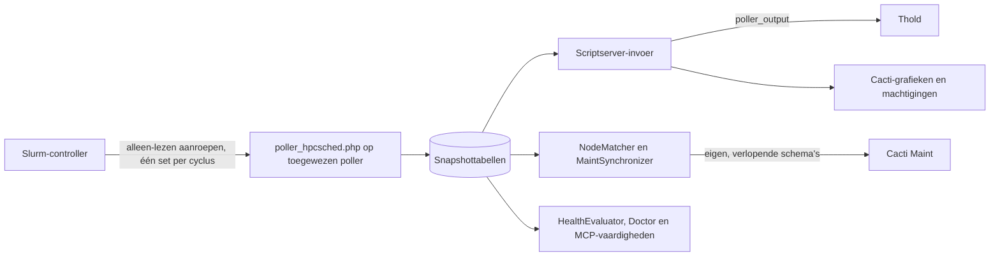

<!-- Source: README.md; SHA256: 938114d41dbd516f9dfcd94619c4fc73ef56b4da1dd693010588a93cce250534 -->

<!-- translations:start -->
[English](../../../README.md) | [简体中文](../zh-CN/README.md) | [हिन्दी](../hi-IN/README.md) | [Español (España)](../es-ES/README.md) | [Español (Latinoamérica)](../es-419/README.md) | [العربية (السعودية)](../ar-SA/README.md) | [Afrikaans](../af-ZA/README.md) | [አማርኛ](../am-ET/README.md) | [العربية (مصر)](../ar-EG/README.md) | [العربية (المغرب)](../ar-MA/README.md) | [বাংলা](../bn-BD/README.md) | [Bosanski](../bs-BA/README.md) | [Deutsch](../de-DE/README.md) | [فارسی](../fa-IR/README.md) | [Filipino](../fil-PH/README.md) | [Français](../fr-FR/README.md) | [Français (Maroc)](../fr-MA/README.md) | [Français (Sénégal)](../fr-SN/README.md) | [Hausa](../ha-NG/README.md) | [עברית](../he-IL/README.md) | [Hrvatski](../hr-HR/README.md) | [Bahasa Indonesia](../id-ID/README.md) | [Igbo](../ig-NG/README.md) | [Italiano](../it-IT/README.md) | [日本語](../ja-JP/README.md) | [한국어](../ko-KR/README.md) | [Malagasy](../mg-MG/README.md) | [मराठी](../mr-IN/README.md) | [Bahasa Melayu](../ms-MY/README.md) | [Nederlands](README.md) | [Polski](../pl-PL/README.md) | [Português (Brasil)](../pt-BR/README.md) | [Русский](../ru-RU/README.md) | [Kinyarwanda](../rw-RW/README.md) | [Soomaali](../so-SO/README.md) | [Српски](../sr-RS/README.md) | [Svenska](../sv-SE/README.md) | [Kiswahili](../sw-KE/README.md) | [தமிழ்](../ta-IN/README.md) | [తెలుగు](../te-IN/README.md) | [ไทย](../th-TH/README.md) | [Türkçe](../tr-TR/README.md) | [Українська](../uk-UA/README.md) | [اردو](../ur-PK/README.md) | [Tiếng Việt](../vi-VN/README.md) | [isiXhosa](../xh-ZA/README.md) | [Yorùbá](../yo-NG/README.md) | [繁體中文](../zh-TW/README.md) | [isiZulu](../zu-ZA/README.md)
<!-- translations:end -->

# plugin_hpcsched

Een Cacti 1.2-plug-in (`hpcsched`, versie `0.1.0-dev`) die de status van een HPC-batchscheduler in grafieken weergeeft naast de apparaten die Cacti al monitort: wachtrijdiepte, wachtende versus actieve jobs, waarom jobs wachten, nodestatussen, partitiebenutting en fair-share-gebruik op accountniveau. Slurm is de geïmplementeerde backend. Thold geeft meldingen op de resulterende gegevensbronnen, en een opt-in Maint-synchronisator stuurt Cacti Maint-vensters aan vanuit gedrainde, niet-beschikbare (down) en voor onderhoud gereserveerde Slurm-rekennodes.

> **Status: in ontwikkeling, nog geen release.** Deze branch implementeert de basis van de plug-in, cluster- en partitiegrafieken, families van wachtredenen, het koppelen van Slurm-rekennodes aan Cacti-apparaten, opt-in synchronisatie van Cacti Maint-vensters, fair-share-samenvattingen op accountniveau, uitvoering en replicatie op externe gegevensverzamelaars, een Configuration-as-Code (CasC)- en beheer-CLI, en Cacti-ecosysteemhooks (CasC, Doctor en MCP / Abilities API v2). De testsuite dekt synthetische Slurm-commando's en `slurmrestd`-antwoorden, en CI test een actief Slurm-cluster met zes nodes in containers. De lezer heeft nog niet gedraaid op een productiecluster, en een end-to-end Thold-replaytest zit nog niet in CI.

Dit is een onafhankelijk project en is niet gelieerd aan het Cacti-project.

## Wat is geïmplementeerd

- **Levenscyclus en schema (v3)**: installeren, idempotent upgraden, verwijderen (met standaard behoud van plug-intabellen) en een minimale vereiste van PHP 8.2, terwijl toegangspunten parseerbaar blijven op PHP 8.0. Schema v3 voegt `plugin_hpcsched_node_map` en `plugin_hpcsched_maint_link` toe naast de tabellen voor clusters, runs, secties, jobaantallen, nodeaantallen, nodes, partities, reserveringen en shares.
- **Alleen-lezen Slurm-verzameling op hoofd- en externe pollers**: `poller_bottom` start `poller_hpcsched.php --cluster=N` op de achtergrond op elke poller (`poller_id`) voor de daaraan toegewezen ingeschakelde clusters. Elke run verzamelt één gecachte snapshot per cluster via clientcommando's (`squeue`, `scontrol`, `sshare` met `--json`) of `slurmrestd` via HTTPS (loopback-HTTP toegestaan met een statuswaarschuwing). `INFO` verklaart `remote_collect:1, remote_poller:1`, en `replicate_out` repliceert niet-geheime `plugin_hpcsched_cluster`-definities naar externe verzamelaars (`poller_id >= 2`); de inhoud van tokenbestanden wordt nooit gelezen of gerepliceerd.
- **Cacti-sjablonen en clustergrafieken**: levert apparaat-, gegevens- en grafieksjablonen (`templates/hpcsched-templates.xml`) en de partitie-scriptservergegevensquery (`scripts/ss_hpcsched_cluster.php`, `scripts/ss_hpcsched_partitions.php`). Na bevestiging door een beheerder maakt of koppelt de plug-in één Cacti-apparaat per cluster met grafieken voor jobs per status, wachtende jobs per redenfamilie, nodes per status, CPU's, benutting (cluster en per partitie) en leeftijd van de snapshot.
- **Koppeling van Slurm-nodes aan apparaten en Cacti Maint-synchronisatie**: een viertraps matcher met lineaire looptijd (`NodeMatcher`) koppelt Slurm-rekennodes aan bestaande Cacti `host`-records (exacte hostnaam, exact adres, exacte beschrijving/alias of eerste DNS-label voor niet-IP-namen) en markeert meervoudige matches of dubbele apparaatclaims als `ambiguous` in plaats van te gokken. `HostList::expand()` vouwt hostlijsten van Slurm-reserveringen uit (tot 10.000 nodes). `MaintSynchronizer` maakt, verlengt en verwijdert eenmalige Cacti Maint-schema's die eigendom zijn van de plug-in en worden bijgehouden in `plugin_hpcsched_maint_link` voor gekoppelde nodes in `DRAIN`, `DRAINING`, `DOWN` of actieve `MAINT`/`MAINTENANCE`-reserveringen zonder door beheerders gemaakte Maint-schema's te wijzigen.
- **Fair-share-samenvattingen op accountniveau**: wanneer `collect_shares` is ingeschakeld, verzamelt het Slurm-accountkoppelingsrijen in `plugin_hpcsched_share` (waarbij gebruikersrijen worden weggelaten conform [ADR 0010](../../decisions/0010-bound-series-cardinality.md)). `ShareSummary` en `ShareRepository` berekenen aantallen accounts/partities, totalen voor ruw en effectief gebruik, min/max/gemiddelde fair-share-factoren en topaccounts; accountaantallen worden beschikbaar gemaakt in `hpcsched-get-queue-summary`.
- **CasC- en beheer-CLI (`cli/hpcsched.php`)**: YAML/XML-configuratie-export, validatie, dry-run diff-planning, door bevestiging bewaakt toepassen, gestructureerde statusuitvoer en opt-in Maint-synchronisatie (`sync-maint --dry-run` / `--apply`).
- **Ecosysteemhooks (`setup.php`)**: `casc_register_providers`, `doctor_register_checks` en `abilities_register`.

## Toegangsrollen

| Realm | Toegang |
| --- | --- |
| HPC Scheduler View | Alleen-lezen clusteroverzicht en wachtredenen (`hpcsched.php`). |
| HPC Scheduler Operator | View-toegang plus de pagina Operations (`hpcsched_operator.php`) en persoonlijke triagebevestigingen. |
| HPC Scheduler Admin | Operator-toegang plus clusterbeheer (`hpcsched_clusters.php`) en de statuspagina (`hpcsched_health.php`). |

Open na het kopiëren van de upgradebestanden als beheerder de pagina Plugins om nieuwe realms en hooks te registreren. Wijs de Operator-realm expliciet toe onder **Configuration > Users** of gebruikersgroepen. Upgrades behouden bestaande View- en Admin-realm-ID's en toekenningen. Admin-toegang erft Operator-toegang en Operator-toegang erft View-toegang bij elke aanvraag; dit voegt geen opgeslagen toekenningen toe aan gebruikers of groepen. Plug-ininstellingen vereisen naast de Settings-machtiging van Cacti ook HPC Scheduler Admin-toegang.

Apparaatmachtigingen van Cacti beperken de rijen en acties die voor elke gebruiker beschikbaar zijn. Een cluster dat is gekoppeld aan een Cacti-apparaat wordt alleen getoond, geëxporteerd en gewijzigd voor gebruikers die van Cacti toegang hebben tot dat apparaat; het koppelen van een apparaat vereist ook machtiging voor het doelapparaat. Een cluster zonder apparaat wordt op de beheerpagina's vermeld voor gebruikers met de plug-inrealm, maar niet in operatorweergaven, die alleen clusters tonen die aan een apparaat zijn gekoppeld. Een cluster waarvan het gekoppelde apparaat is verwijderd terwijl de plug-in was uitgeschakeld, wordt alleen getoond aan gebruikers met HPC Scheduler Admin-toegang. Bevestigingen blijven alleen behouden in de huidige sessie van de gebruiker, gedurende maximaal één uur en alleen zolang dezelfde waarneming actueel blijft. Nieuwe of gewijzigde waarnemingen maken ze ongeldig. Ze markeren een mislukte meting nooit als gezond en onderdrukken geen meldingen.

## Beheerdersnotities

### Beveiliging, minimale rechten en tokenbestanden

De plug-in leest alleen. Geef de plug-in een toegewezen Slurm-gebruiker zonder beheerders- of operatorrol (`AdminLevel=None` in `sacctmgr`). Met `PrivateData=jobs` (of `nodes`, `reservations`, `usage`) in `slurm.conf` ziet die gebruiker alleen zijn eigen records, waardoor aantallen onvolledig zijn en de plug-in dat niet kan detecteren. Het opheffen van die beperking voor het account vereist een operator- of beheerdersniveau, wat ook wijzigingen mogelijk maakt; die afweging is aan de beheerder van de omgeving.

Voor clientcommando's heeft de Cacti-pollergebruiker de Slurm-clientbinaries (`squeue`, `scontrol` en optioneel `sshare`) en een `slurm.conf` nodig die de controller bereikt; binaire paden zijn absolute instellingen onder **Configuration > Settings > HPC Scheduler**.

Voor `slurmrestd` moet de URL `https://` zijn, of `http://` uitsluitend op een loopback-adres. TLS-certificaten worden geverifieerd en omleidingen worden niet gevolgd. Een optionele `slurmrestd`-hostlijst onder **Configuration > Settings > HPC Scheduler** beperkt welke hosts en poorten een cluster mag opgeven.

Een `slurmrestd`-cluster wijst een tokenbestand aan; het token zelf wordt nooit opgeslagen in de database, getoond op een pagina, geëxporteerd via CasC of weggeschreven naar het logboek. Het bestand moet zich bevinden in een van de Token File Directories die zijn geconfigureerd onder **Configuration > Settings > HPC Scheduler**, bereikbaar zijn zonder symbolische link en een regulier bestand zijn dat eigendom is van de pollergebruiker en alleen door die gebruiker beschrijfbaar is, met één regel: het token of `SLURM_JWT=<token>` zoals `scontrol token` het afdrukt. Zonder ingestelde tokenmappen kan geen enkel cluster `slurmrestd` gebruiken. Houd elke tokenmap alleen beschrijfbaar voor root en de pollergebruiker. Een bestand dat leesbaar is voor groep of andere gebruikers wordt nog steeds gebruikt, en de statuspagina geeft een waarschuwing; deze waarschuwt ook wanneer het token binnen het geconfigureerde waarschuwingsvenster verloopt.

Om een token atomair te roteren:

```sh
dir=/etc/cacti/hpcsched
tmp=$(mktemp "$dir/.token.XXXXXX")
scontrol token username=cactiread lifespan=2592000 > "$tmp"
chown cacti:cacti "$tmp"
chmod 0600 "$tmp"
mv -f "$tmp" "$dir/cluster1.token"
```

De volgende verzameling leest het nieuwe bestand. Het genereren van tokens met `scontrol token` vereist een Slurm-beheerder; voer het uit waar dat is toegestaan en kopieer het bestand naar de poller.

### Externe gegevensverzamelaars

`INFO` verklaart `remote_collect:1, remote_poller:1`. `hpcsched_poller_bottom()` start `poller_hpcsched.php` op elke poller voor ingeschakelde clusters die aan die `poller_id` zijn toegewezen, en `hpcsched_replicate_out()` repliceert niet-geheime `plugin_hpcsched_cluster`-rijen naar externe pollers (`poller_id >= 2`). Tokenbestanden en Slurm-clientbinaries moeten lokaal aanwezig zijn op de toegewezen externe poller; tokeninhoud wordt nooit gerepliceerd.

### Geheugenlimieten

Elke verzamelrun decodeert één scheduler-antwoord tegelijk, wat ongeveer 12 keer de grootte van het antwoord in PHP-geheugen inneemt (gemeten op ongeveer 10 keer voor jobrecords in Slurm-formaat, plus de tekst zelf). De lezer verhoogt zijn PHP-geheugenlimiet naar de instelling Collection Memory (standaard 1024 MiB) en staat antwoorden toe tot `(Collection Memory - 64) / 12` MiB (standaard 80 MiB), zelfs wanneer Maximum Answer Size hoger is ingesteld; de statuspagina waarschuwt wanneer Maximum Answer Size die berekende limiet overschrijdt. Een groter antwoord laat zijn sectie mislukken als te groot, en een run die toch door zijn geheugen raakt, legt een geheugenfout vast en geeft zijn lease en processlot vrij via een shutdown-handler. Grote clusters moeten mogelijk beide instellingen verhogen; 100.000 echte jobrecords zijn nog niet gemeten.

### Sjablonen, clusterapparaten en grafiektelling

Installeren en upgraden importeren de apparaat-, gegevens- en grafieksjablonen van HPC Scheduler en kopiëren de partitiegegevensquery naar de map `resource/script_server/` van Cacti. Als die map niet beschrijfbaar is, er al een ander bestand met dezelfde naam staat of het doel een symbolische link is, stopt de import, blijft het bestand onaangeroerd en wordt de situatie gemeld op de statuspagina waar **Install Templates** het opnieuw kan proberen. Verwijderen verwijdert het querybestand alleen als de plug-in het heeft geschreven en het ongewijzigd is, en behoudt de sjablonen, apparaten en grafieken.

**HPC Clusters > Device** geeft vooraf een voorbeeld van de grafieken, gegevensbronnen, RRD-bestanden en scriptserver-aanroepen per poll voordat er iets wordt aangemaakt. **Create Device** maakt een apparaat aan met een hostnaam in het gereserveerde `.invalid`-domein en zonder beschikbaarheidscontrole; **Map Device** koppelt de grafieken aan een bestaand apparaat zonder de instellingen ervan te wijzigen. Elke clustergrafiek en partitiegrafiek heeft een eigen gegevensbron: zes voor het cluster en vijf per partitie. Later toegevoegde partities worden automatisch opnieuw geïndexeerd zodra de lezer een wijziging detecteert; verwijderde partities worden niet meer gepolld en behouden hun grafieken. Het verwijderen van een apparaat ontkoppelt het cluster (en wist alle bijbehorende `plugin_hpcsched_node_map`-rijen) terwijl het clusterrecord behouden blijft.

Pending sluit geblokkeerde (held) jobs uit, die hun eigen reeks hebben. Een wachtende job-array telt zijn resterende taken. Een job of node in meerdere partities wordt één keer geteld in de clustergrafieken en één keer in elke partitie, zodat partitietotalen niet hoeven op te tellen tot het clustertotaal. Wachtredenen worden gegroepeerd in elf families ([ADR 0011](../../decisions/0011-pending-reason-families-and-counting.md)); de weergave van wachtredenen somt de ruwe redenen op, inclusief die in `Other`. De noemer voor benutting omvat gedrainde, niet-beschikbare (down) en andere onbeschikbare nodes. Verouderde of mislukte gegevens worden gerapporteerd als `U`, nooit als nul; `age` blijft numeriek.

Configureer voor meldingen Thold op een van de cluster- of partitiegegevensbronnen met een duur van ten minste één verzamelinterval, en stel een melding in op `age` om een gestopte lezer te detecteren.

## CLI en ecosysteemhooks

### Toegangspunt van de lezer

`hpcsched_poller_bottom()` start `poller_hpcsched.php` automatisch; het kan ook handmatig worden uitgevoerd op de aan het cluster toegewezen poller:

```sh
php /path/to/cacti/plugins/hpcsched/poller_hpcsched.php --cluster=N [--force] [--debug]
```

`--force` draait ook terwijl de plug-in is uitgeschakeld, voor diagnose via de opdrachtregel.

### Configuration-as-Code-, status- en Maint-sync-CLI

```sh
php /path/to/cacti/plugins/hpcsched/cli/hpcsched.php export [--format=yaml|xml] [--file=PATH]
php /path/to/cacti/plugins/hpcsched/cli/hpcsched.php validate --file=PATH [--format=yaml|xml]
php /path/to/cacti/plugins/hpcsched/cli/hpcsched.php plan --file=PATH [--format=yaml|xml]
php /path/to/cacti/plugins/hpcsched/cli/hpcsched.php apply --file=PATH --confirm=PLAN_HASH [--format=yaml|xml]
php /path/to/cacti/plugins/hpcsched/cli/hpcsched.php health [--format=text|json]
php /path/to/cacti/plugins/hpcsched/cli/hpcsched.php sync-maint [--dry-run | --apply] [--cluster=ID] [--format=text|json]
```

- `export` schrijft nieuwe bestanden met modus `0600` (of naar stdout) en vervangt geconfigureerde `token_file`-paden door `[REDACTED]`. `plan` en `apply` weigeren inline `jwt`-, `secret`- en `password`-velden en behouden bestaande lokale `token_file`-paden wanneer `[REDACTED]` wordt opgegeven. `apply` vereist de exacte `--confirm=PLAN_HASH` die door `plan` is afgedrukt.
- `health` evalueert de actualiteit van het schema, clusteractualiteit, runresultaten, beschikbaarheid van Maint en waarschuwingen zonder contact op te nemen met schedulers of tokenbestanden te lezen.
- `sync-maint` gebruikt standaard `--dry-run` en toont of past Cacti Maint-schema's toe voor gekoppelde Slurm-nodes in `DRAIN`, `DRAINING`, `DOWN` of actieve `MAINT`/`MAINTENANCE`-reserveringen (standaard drain/down-horizon 3600s, verlengingsmarge 600s). Het weigert `--apply` als `plugin_maint_schedules` en `plugin_maint_hosts` ontbreken, en werkt alleen schema's bij of verwijdert alleen schema's die in `plugin_hpcsched_maint_link` zijn vastgelegd.

### Ecosysteemhooks

Wanneer de bijbehorende Cacti-plug-ins of hostintegraties aanwezig zijn, registreert `setup.php`:

- `casc_register_providers`: exporteert, valideert, plant en past met bevestiging `hpcsched`-configuratie toe (`yaml` en `xml`, schema v1) met redactie van geheimen.
- `doctor_register_checks`: biedt vier alleen-lezen diagnostische controles (`hpcsched.schema`, `hpcsched.cluster_freshness`, `hpcsched.token_health`, `hpcsched.maint_sync`).
- `abilities_register`: registreert drie alleen-lezen, niet-destructieve, idempotente vaardigheden onder categorie `hpcsched`, afgeschermd door de HPC Scheduler View-realm (en apparaatmachtigingen voor clustersamenvattingen): `hpcsched-list-clusters`, `hpcsched-get-queue-summary` en `hpcsched-get-health`.

## Waarom

Beheerders die Cacti gebruiken, brengen hun rekennodes al in grafieken in kaart. Het beeld vanuit de scheduler ontbreekt in die grafieken, wat twee leemtes achterlaat:

- **Geen "waarom start het werk niet".** Slurm legt voor elke wachtende job een reden vast. Een volle wachtrij naast grafieken van inactieve nodes vertelt niet of de oorzaak prioriteit, resourcelimieten, blokkades, afhankelijkheden of gedrainde nodes is.
- **Geen koppeling tussen schedulerstatus en meldingen.** Thold geeft meldingen voor een apparaat dat een beheerder al heeft gedraind, en beheerders maken handmatig Maint-schema's aan.

De plug-in verzamelt één gecachte snapshot per cluster, publiceert die als gewone Cacti-gegevensbronnen en -grafieken, koppelt schedulernodes aan bestaande Cacti-apparaten en synchroniseert plug-ineigen verlopende Maint-vensters voor gedrainde, niet-beschikbare en voor onderhoud gereserveerde nodes. Hij hergebruikt de machtigingen van Cacti, externe gegevensverzamelaars, Thold en Maint, en blijft strikt alleen-lezen richting de scheduler.

## Bereik en grenzen

Buiten bereik: elk schrijfpad naar een scheduler (indienen, annuleren, vasthouden, drainen, hervatten), een eigen meldingsengine in de plug-in, een rapportage- of doorbelastingsengine en tijdreeksen per gebruiker of per job. Backends voor PBS Pro, OpenPBS en LSF zijn uitsluitend onderzoeksonderwerp.

## Vereisten en compatibiliteit

| Component | Doel |
|---|---|
| Cacti | 1.2.31 of later (`compat = 1.2.31`), geen core-patches |
| PHP | 8.2 of later; toegangspunten blijven parseerbaar op 8.0 en weigeren activatie op 8.1 zodat een niet-ondersteunde runtime een weigering krijgt in plaats van een kapotte Cacti-UI |
| Slurm | 25.05, 25.11 en 26.05 ([ADR 0013](../../decisions/0013-three-latest-slurm-releases.md)); 26.05.5 wordt bij elke wijziging in CI getest tegen een containercluster met zes nodes, 25.11.8 op `main`, wekelijks en op aanvraag, en 25.05 alleen tegen fixtures. Clientcommando's gebruiken standaard gegevensparser `v0.0.43` (met `v0.0.44` en `v0.0.45` selecteerbaar); `slurmrestd`-clusters ontdekken de nieuwste parser die de daemon aanbiedt |
| Thold, Maint | Geen Thold-wijzigingen vereist; `sync-maint` integreert met de tabellen `plugin_maint_schedules` en `plugin_maint_hosts` van Cacti Maint via een koppeltabel die eigendom is van de plug-in (`plugin_hpcsched_maint_link`) |

## Ontwikkeling en testen

De CI-workflow (`.github/workflows/plugin-ci-workflow.yml`) test PHP 8.2 tot en met 8.5 tegen Cacti `release/1.2.31` en `1.2.x`, PHP 8.0-linting van toegangspunten, PHP 8.1-weigering, PHPStan, gettext-/vertalingsvalidatie, REUSE-licenties, workflow-linting, controles op clusterapparaatstromen en afwijkingen van sjabloonexports, en een live Slurm-cluster met zes nodes (`slurm-live`).

Met Cacti's vergrendelde gedeelde Pest-plug-inharnas (`CACTI_PEST_BIN`) en een wegwerpdatabase voor Cacti:

```sh
# Unit tests
"$CACTI_PEST_BIN" --configuration=phpunit.xml

# Lifecycle integration tests (disposable database only)
CACTI_PATH=/path/to/cacti HPCSCHED_TEST_DATABASE=disposable "$CACTI_PEST_BIN" --configuration=phpunit-integration.xml

# Static analysis (against Cacti 1.2.31)
CACTI_PATH=/path/to/cacti phpstan analyse -c phpstan.neon --no-progress

# Translation template, catalogs, and localized README checks
sh locales/build_gettext.sh --check
```

## Ontwerp

- [docs/PLAN.md](../../PLAN.md) is het architectuur- en ontwerpplan: upstreamfeiten met bronnen, nodekoppeling, statusmodel, beveiligingsgrenzen, prestatierekenkunde, testen en risico's.
- [docs/decisions/](../../decisions/) bevat architecturele beslissingsrecords.
- [docs/REQUIREMENTS.md](../../REQUIREMENTS.md) koppelt elke vereiste-ID aan het bijbehorende issue.



## Hoe het werk wordt gevolgd

- **Mijlpalen** volgen de mijlpalen van het plan. Elke mijlpaal heeft een epic-issue met daarin de sub-issues en het afsluitbewijs.
- **Issues** worden getypeerd met labels: `type: requirement`, `type: research`, `type: decision`, `type: epic`. Vereisten-issues vermelden genummerde, testbare vereisten (`REQ-AREA-NNN`) en acceptatiecriteria.
- **Labels** bevatten ook `area:`, `phase:`, `priority:` en `status:`. Zie [CONTRIBUTING.md](../../../CONTRIBUTING.md#labels).
- Het [projectbord](https://github.com/users/somethingwithproof/projects/10) toont alle issues over alle mijlpalen heen.

## Bijdragen

Lees [CONTRIBUTING.md](../../../CONTRIBUTING.md). Commits vereisen een DCO sign-off (`git commit -s`). Ontwerpdiscussies vinden plaats in issues; openstaande beslissingen dragen het label `type: decision`.

## Beveiliging

Meld kwetsbaarheden privé; zie [SECURITY.md](../../../SECURITY.md).

## Licentie

GNU General Public License v2.0, dezelfde licentie als Cacti en zijn plug-ins. Zie [LICENSE](../../../LICENSE).
