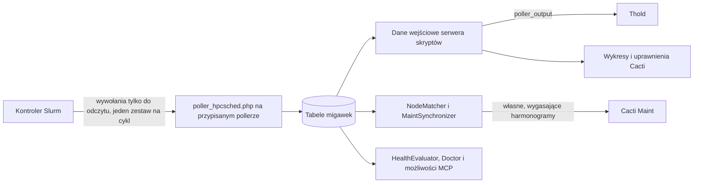

<!-- Source: README.md; SHA256: 938114d41dbd516f9dfcd94619c4fc73ef56b4da1dd693010588a93cce250534 -->

<!-- translations:start -->
[English](../../../README.md) | [简体中文](../zh-CN/README.md) | [हिन्दी](../hi-IN/README.md) | [Español (España)](../es-ES/README.md) | [Español (Latinoamérica)](../es-419/README.md) | [العربية (السعودية)](../ar-SA/README.md) | [Afrikaans](../af-ZA/README.md) | [አማርኛ](../am-ET/README.md) | [العربية (مصر)](../ar-EG/README.md) | [العربية (المغرب)](../ar-MA/README.md) | [বাংলা](../bn-BD/README.md) | [Bosanski](../bs-BA/README.md) | [Deutsch](../de-DE/README.md) | [فارسی](../fa-IR/README.md) | [Filipino](../fil-PH/README.md) | [Français](../fr-FR/README.md) | [Français (Maroc)](../fr-MA/README.md) | [Français (Sénégal)](../fr-SN/README.md) | [Hausa](../ha-NG/README.md) | [עברית](../he-IL/README.md) | [Hrvatski](../hr-HR/README.md) | [Bahasa Indonesia](../id-ID/README.md) | [Igbo](../ig-NG/README.md) | [Italiano](../it-IT/README.md) | [日本語](../ja-JP/README.md) | [한국어](../ko-KR/README.md) | [Malagasy](../mg-MG/README.md) | [मराठी](../mr-IN/README.md) | [Bahasa Melayu](../ms-MY/README.md) | [Nederlands](../nl-NL/README.md) | [Polski](README.md) | [Português (Brasil)](../pt-BR/README.md) | [Русский](../ru-RU/README.md) | [Kinyarwanda](../rw-RW/README.md) | [Soomaali](../so-SO/README.md) | [Српски](../sr-RS/README.md) | [Svenska](../sv-SE/README.md) | [Kiswahili](../sw-KE/README.md) | [தமிழ்](../ta-IN/README.md) | [తెలుగు](../te-IN/README.md) | [ไทย](../th-TH/README.md) | [Türkçe](../tr-TR/README.md) | [Українська](../uk-UA/README.md) | [اردو](../ur-PK/README.md) | [Tiếng Việt](../vi-VN/README.md) | [isiXhosa](../xh-ZA/README.md) | [Yorùbá](../yo-NG/README.md) | [繁體中文](../zh-TW/README.md) | [isiZulu](../zu-ZA/README.md)
<!-- translations:end -->

# plugin_hpcsched

Wtyczka do Cacti 1.2 (`hpcsched`, wersja `0.1.0-dev`) prezentująca na wykresach stan systemu kolejkowego HPC obok urządzeń już monitorowanych przez Cacti: głębokość kolejki, zadania oczekujące względem uruchomionych, przyczyny oczekiwania zadań, stany węzłów, wykorzystanie partycji oraz zużycie fair-share na poziomie kont. Zaimplementowanym backendem jest Slurm. Thold wysyła alerty na podstawie wynikowych źródeł danych, a opcjonalny synchronizator Maint steruje oknami Cacti Maint na podstawie węzłów obliczeniowych Slurm w stanie drained, down oraz objętych rezerwacjami serwisowymi.

> **Status: w trakcie rozwoju, brak jeszcze wydania.** Ta gałąź implementuje fundamenty wtyczki, wykresy klastra i partycji, rodziny przyczyn oczekiwania, dopasowywanie węzłów obliczeniowych Slurm do urządzeń Cacti, opcjonalną synchronizację okien Cacti Maint, podsumowania fair-share na poziomie kont, wykonywanie i replikację na zdalnych kolektorach danych, CLI Configuration-as-Code (CasC) i operacyjne oraz punkty integracji ekosystemu Cacti (CasC, Doctor i MCP / Abilities API v2). Zestaw testów obejmuje syntetyczne polecenia Slurm i odpowiedzi `slurmrestd`, a CI testuje działający sześciowęzłowy klaster Slurm w kontenerach. Czytnik nie był jeszcze uruchamiany na klastrze produkcyjnym, a test odtwarzania end-to-end w Thold nie jest jeszcze częścią CI.

Jest to niezależny projekt i nie jest powiązany z projektem Cacti.

## Co zostało zaimplementowane

- **Cykl życia i schemat (v3)**: instalacja, idempotentna aktualizacja, odinstalowanie (domyślnie z zachowaniem tabel wtyczki) oraz minimalna wersja PHP 8.2 przy zachowaniu punktów wejścia możliwych do sparsowania w PHP 8.0. Schemat v3 dodaje tabele `plugin_hpcsched_node_map` i `plugin_hpcsched_maint_link` obok tabel klastrów, przebiegów, sekcji, liczby zadań, liczby węzłów, węzłów, partycji, rezerwacji i udziałów.
- **Zbieranie danych Slurm w trybie tylko do odczytu na głównym i zdalnych pollerach**: `poller_bottom` uruchamia w tle `poller_hpcsched.php --cluster=N` na każdym pollerze (`poller_id`) dla przypisanych mu włączonych klastrów. Każdy przebieg zbiera jedną buforowaną migawkę na klaster za pomocą poleceń klienckich (`squeue`, `scontrol`, `sshare` z `--json`) lub `slurmrestd` przez HTTPS (HTTP na pętli zwrotnej jest dozwolone z ostrzeżeniem o stanie). `INFO` deklaruje `remote_collect:1, remote_poller:1`, a `replicate_out` replikuje niezawierające sekretów definicje `plugin_hpcsched_cluster` do zdalnych kolektorów (`poller_id >= 2`); zawartość plików tokenów nigdy nie jest odczytywana ani replikowana.
- **Szablony Cacti i wykresy klastra**: dostarcza szablony urządzeń, danych i wykresów (`templates/hpcsched-templates.xml`) oraz zapytanie danych serwera skryptów dla partycji (`scripts/ss_hpcsched_cluster.php`, `scripts/ss_hpcsched_partitions.php`). Po potwierdzeniu przez administratora tworzy lub mapuje po jednym urządzeniu Cacti na klaster z wykresami zadań według stanu, zadań oczekujących według rodziny przyczyn, węzłów według stanu, procesorów (CPU), wykorzystania (klastra i poszczególnych partycji) oraz wieku migawki.
- **Dopasowywanie węzłów Slurm do urządzeń i synchronizacja Cacti Maint**: czteropoziomowy mechanizm dopasowywania w czasie liniowym (`NodeMatcher`) mapuje węzły obliczeniowe Slurm do istniejących rekordów `host` w Cacti (dokładna nazwa hosta, dokładny adres, dokładny opis/alias lub pierwsza etykieta DNS dla nazw niebędących adresami IP) i oznacza wielokrotne dopasowania lub duplikaty przypisań urządzeń jako `ambiguous` zamiast zgadywać. `HostList::expand()` rozwija listy hostów rezerwacji Slurm (do 10 000 węzłów). `MaintSynchronizer` tworzy, odnawia i usuwa należące do wtyczki jednorazowe harmonogramy Cacti Maint śledzone w `plugin_hpcsched_maint_link` dla zmapowanych węzłów w stanie `DRAIN`, `DRAINING`, `DOWN` lub w aktywnych rezerwacjach `MAINT`/`MAINTENANCE` bez modyfikowania harmonogramów Maint utworzonych przez administratorów.
- **Podsumowania fair-share na poziomie kont**: gdy włączono `collect_shares`, zbiera wiersze powiązań kont Slurm do `plugin_hpcsched_share` (pomijając wiersze użytkowników zgodnie z [ADR 0010](../../decisions/0010-bound-series-cardinality.md)). `ShareSummary` i `ShareRepository` obliczają liczby kont/partycji, sumy użycia surowego i efektywnego, minimalne/maksymalne/średnie współczynniki fair-share oraz czołowe konta; liczby kont są udostępniane w `hpcsched-get-queue-summary`.
- **CasC i CLI operacyjne (`cli/hpcsched.php`)**: eksport konfiguracji YAML/XML, walidacja, planowanie różnic w trybie dry-run, wdrażanie wymagające potwierdzenia, ustrukturyzowane wyjście stanu zdrowia oraz opcjonalna synchronizacja Maint (`sync-maint --dry-run` / `--apply`).
- **Punkty integracji ekosystemu (`setup.php`)**: `casc_register_providers`, `doctor_register_checks` i `abilities_register`.

## Role dostępu

| Zakres (Realm) | Dostęp |
| --- | --- |
| HPC Scheduler View | Przegląd klastra tylko do odczytu i przyczyny oczekiwania (`hpcsched.php`). |
| HPC Scheduler Operator | Dostęp View oraz strona Operations (`hpcsched_operator.php`) i osobiste potwierdzenia w ramach triażu. |
| HPC Scheduler Admin | Dostęp Operator oraz administracja klastrami (`hpcsched_clusters.php`) i strona kondycji (`hpcsched_health.php`). |

Po skopiowaniu plików aktualizacji otwórz stronę Plugins jako administrator, aby zarejestrować nowe zakresy i punkty integracji. Przypisz zakres Operator jawnie w **Configuration > Users** lub w grupach użytkowników. Aktualizacje zachowują istniejące identyfikatory i uprawnienia zakresów View i Admin. Dostęp Admin dziedziczy dostęp Operator, a dostęp Operator dziedziczy dostęp View przy każdym żądaniu; nie dodaje to zapisanych uprawnień użytkownikom ani grupom. Ustawienia wtyczki wymagają również dostępu HPC Scheduler Admin oprócz uprawnienia Settings w Cacti.

Uprawnienia do urządzeń w Cacti ograniczają wiersze i akcje dostępne dla każdego użytkownika. Klaster zmapowany do urządzenia Cacti jest wyświetlany, eksportowany i modyfikowany tylko dla użytkowników, którym Cacti zezwala na dostęp do tego urządzenia; mapowanie urządzenia wymaga również uprawnień do urządzenia docelowego. Klaster bez urządzenia jest widoczny na stronach administracyjnych dla użytkowników z zakresem wtyczki, ale nie w widokach operatora, które pokazują wyłącznie klastry zmapowane do urządzenia. Klaster, którego zmapowane urządzenie zostało usunięte w czasie, gdy wtyczka była wyłączona, jest widoczny tylko dla użytkowników z dostępem HPC Scheduler Admin. Potwierdzenia obowiązują wyłącznie w bieżącej sesji użytkownika, maksymalnie przez jedną godzinę i tylko dopóki ta sama obserwacja pozostaje świeża. Nowe lub zmienione obserwacje je unieważniają. Nigdy nie oznaczają błędnego pomiaru jako prawidłowego ani nie wyciszają alertów.

## Uwagi dla operatorów

### Bezpieczeństwo, najmniejsze uprawnienia i pliki tokenów

Wtyczka działa wyłącznie w trybie odczytu. Przydziel jej dedykowanego użytkownika Slurm bez roli administratora ani operatora (`AdminLevel=None` w `sacctmgr`). Przy ustawieniu `PrivateData=jobs` (lub `nodes`, `reservations`, `usage`) w `slurm.conf` taki użytkownik widzi tylko własne rekordy, więc zliczenia są niepełne, a wtyczka nie jest w stanie tego wykryć. Zniesienie tego ograniczenia dla konta wymaga poziomu operatora lub administratora, co pozwala również na wprowadzanie zmian; jest to decyzja po stronie środowiska.

W przypadku poleceń klienckich użytkownik pollera Cacti potrzebuje binarnych klientów Slurm (`squeue`, `scontrol` i opcjonalnie `sshare`) oraz pliku `slurm.conf` umożliwiającego połączenie z kontrolerem; ścieżki do plików binarnych są ustawieniami bezwzględnymi w **Configuration > Settings > HPC Scheduler**.

W przypadku `slurmrestd` adres URL musi zaczynać się od `https://` lub od `http://` wyłącznie na adresie pętli zwrotnej. Certyfikaty TLS są weryfikowane, a przekierowania nie są śledzone. Opcjonalna lista hostów `slurmrestd` w **Configuration > Settings > HPC Scheduler** ogranicza hosty i porty, które klaster może wskazać.

Klaster `slurmrestd` wskazuje plik tokena; sam token nigdy nie jest zapisywany w bazie danych, pokazywany na stronie, eksportowany przez CasC ani zapisywany w logach. Plik musi znajdować się w jednym z katalogów Token File Directories skonfigurowanych w **Configuration > Settings > HPC Scheduler**, być dostępny bez dowiązań symbolicznych i stanowić zwykły plik należący do użytkownika pollera, zapisywalny wyłącznie przez niego, zawierający jedną linię: sam token lub `SLURM_JWT=<token>`, jak wypisuje `scontrol token`. Bez ustawionych katalogów tokenów żaden klaster nie może korzystać z `slurmrestd`. Każdy katalog tokenów powinien być zapisywalny wyłącznie przez root i użytkownika pollera. Plik możliwy do odczytu przez grupę lub innych użytkowników nadal jest używany, a strona kondycji wyświetla ostrzeżenie; ostrzega ona również, gdy token wygasa w skonfigurowanym oknie ostrzegawczym.

Aby podmienić token atomowo:

```sh
dir=/etc/cacti/hpcsched
tmp=$(mktemp "$dir/.token.XXXXXX")
scontrol token username=cactiread lifespan=2592000 > "$tmp"
chown cacti:cacti "$tmp"
chmod 0600 "$tmp"
mv -f "$tmp" "$dir/cluster1.token"
```

Następne zbieranie danych odczyta nowy plik. Generowanie tokenów poleceniem `scontrol token` wymaga administratora Slurm; wykonaj je tam, gdzie jest to dozwolone, i skopiuj plik na poller.

### Zdalne kolektory danych

`INFO` deklaruje `remote_collect:1, remote_poller:1`. `hpcsched_poller_bottom()` uruchamia `poller_hpcsched.php` na każdym pollerze dla włączonych klastrów przypisanych do danego `poller_id`, a `hpcsched_replicate_out()` replikuje niezawierające sekretów wiersze `plugin_hpcsched_cluster` do zdalnych pollerów (`poller_id >= 2`). Pliki tokenów i binaria klienckie Slurm muszą znajdować się lokalnie na przypisanym zdalnym pollerze; zawartość tokenów nigdy nie jest replikowana.

### Limity pamięci

Każde zbieranie danych dekoduje jednocześnie jedną odpowiedź systemu kolejkowego, co zajmuje w pamięci PHP około 12-krotność rozmiaru odpowiedzi (zmierzono około 10-krotność dla rekordów zadań w formacie Slurm plus sam tekst). Czytnik podnosi swój limit pamięci PHP do wartości ustawienia Collection Memory (domyślnie 1024 MiB) i dopuszcza odpowiedzi o rozmiarze do `(Collection Memory - 64) / 12` MiB (domyślnie 80 MiB), nawet jeśli Maximum Answer Size jest ustawione wyżej; strona kondycji ostrzega, gdy Maximum Answer Size przekracza ten dopasowany limit. Większa odpowiedź powoduje błąd danej sekcji z powodu zbyt dużego rozmiaru, a przebieg, któremu mimo to zabraknie pamięci, zapisuje błąd pamięci i zwalnia dzierżawę oraz gniazdo procesu przez procedurę zamykania (shutdown handler). Duże klastry mogą wymagać zwiększenia obu ustawień; 100 000 rzeczywistych rekordów zadań nie było jeszcze mierzone.

### Szablony, urządzenia klastra i zliczanie wykresów

Instalacja i aktualizacja importują szablony urządzeń, danych i wykresów HPC Scheduler oraz kopiują zapytanie danych partycji do katalogu `resource/script_server/` w Cacti. Jeśli katalog ten nie jest zapisywalny, istnieje tam inny plik o tej samej nazwie lub cel jest dowiązaniem symbolicznym, import zatrzymuje się, pozostawia plik nienaruszony i zgłasza ten stan na stronie kondycji, gdzie przycisk **Install Templates** ponawia próbę. Odinstalowanie usuwa plik zapytania tylko wtedy, gdy został utworzony przez wtyczkę i nie był modyfikowany, zachowując szablony, urządzenia i wykresy.

**HPC Clusters > Device** pokazuje podgląd wykresów, źródeł danych, plików RRD i wywołań serwera skryptów na cykl przed utworzeniem czegokolwiek. **Create Device** tworzy urządzenie z nazwą hosta w zarezerwowanej domenie `.invalid` i bez sprawdzania dostępności; **Map Device** dołącza wykresy do istniejącego urządzenia bez zmiany jego ustawień. Każdy wykres klastra i wykres partycji ma własne źródło danych: sześć dla klastra i pięć na partycję. Później dodane partycje są automatycznie ponownie indeksowane, gdy czytnik wykryje zmianę; usunięte partycje przestają być odpytywane i zachowują swoje wykresy. Usunięcie urządzenia odpina klaster (oraz czyści pasujące wiersze `plugin_hpcsched_node_map`), zachowując rekord klastra.

Kategoria Pending wyklucza zadania wstrzymane (held), które mają własną serię. Oczekująca tablica zadań zlicza pozostałe zadania składowe. Zadanie lub węzeł w wielu partycjach jest zliczany raz na wykresach klastra i raz w każdej partycji, więc sumy partycji nie muszą sumować się do sumy klastra. Przyczyny oczekiwania są pogrupowane w jedenaście rodzin ([ADR 0011](../../decisions/0011-pending-reason-families-and-counting.md)); widok przyczyn oczekiwania wymienia surowe przyczyny, w tym te z grupy `Other`. Mianownik wykorzystania obejmuje węzły w stanie drained, down oraz inne niedostępne węzły. Nieaktualne lub błędne dane są raportowane jako `U`, nigdy jako zero; `age` pozostaje wartością liczbową.

W celu alarmowania skonfiguruj Thold na dowolnym ze źródeł danych klastra lub partycji z czasem trwania co najmniej jednego interwału zbierania oraz ustaw alert na `age`, aby wykryć zatrzymany czytnik.

## CLI i punkty integracji ekosystemu

### Punkt wejścia czytnika

`hpcsched_poller_bottom()` uruchamia `poller_hpcsched.php` automatycznie; można go też uruchomić ręcznie na pollerze przypisanym do klastra:

```sh
php /path/to/cacti/plugins/hpcsched/poller_hpcsched.php --cluster=N [--force] [--debug]
```

`--force` działa nawet wtedy, gdy wtyczka jest wyłączona, co służy diagnostyce z wiersza poleceń.

### CLI Configuration-as-Code, kondycji i synchronizacji Maint

```sh
php /path/to/cacti/plugins/hpcsched/cli/hpcsched.php export [--format=yaml|xml] [--file=PATH]
php /path/to/cacti/plugins/hpcsched/cli/hpcsched.php validate --file=PATH [--format=yaml|xml]
php /path/to/cacti/plugins/hpcsched/cli/hpcsched.php plan --file=PATH [--format=yaml|xml]
php /path/to/cacti/plugins/hpcsched/cli/hpcsched.php apply --file=PATH --confirm=PLAN_HASH [--format=yaml|xml]
php /path/to/cacti/plugins/hpcsched/cli/hpcsched.php health [--format=text|json]
php /path/to/cacti/plugins/hpcsched/cli/hpcsched.php sync-maint [--dry-run | --apply] [--cluster=ID] [--format=text|json]
```

- `export` zapisuje nowe pliki z uprawnieniami `0600` (lub na stdout) i zastępuje skonfigurowane ścieżki `token_file` wartością `[REDACTED]`. `plan` i `apply` odrzucają wstawione bezpośrednio pola `jwt`, `secret` i `password`, oraz zachowują istniejące lokalne ścieżki `token_file`, gdy podano `[REDACTED]`. `apply` wymaga dokładnego `--confirm=PLAN_HASH` wypisanego przez `plan`.
- `health` ocenia aktualność schematu, świeżość klastra, wyniki przebiegów, dostępność Maint i ostrzeżenia bez kontaktowania się z systemami kolejkowymi ani czytania plików tokenów.
- `sync-maint` domyślnie działa w trybie `--dry-run` i wyświetla podgląd lub stosuje harmonogramy Cacti Maint dla zmapowanych węzłów Slurm w stanie `DRAIN`, `DRAINING`, `DOWN` lub aktywnych rezerwacjach `MAINT`/`MAINTENANCE` (domyślny horyzont drain/down 3600s, margines odnowienia 600s). Odmawia wykonania `--apply`, jeśli brakuje tabel `plugin_maint_schedules` i `plugin_maint_hosts`, oraz aktualizuje lub usuwa wyłącznie harmonogramy zapisane w `plugin_hpcsched_maint_link`.

### Punkty integracji ekosystemu

Gdy obecne są odpowiednie wtyczki Cacti lub integracje hosta, `setup.php` rejestruje:

- `casc_register_providers`: eksportuje, waliduje, planuje i stosuje po potwierdzeniu konfigurację `hpcsched` (`yaml` i `xml`, schemat v1) z redakcją sekretów.
- `doctor_register_checks`: dostarcza cztery kontrole diagnostyczne tylko do odczytu (`hpcsched.schema`, `hpcsched.cluster_freshness`, `hpcsched.token_health`, `hpcsched.maint_sync`).
- `abilities_register`: rejestruje trzy idempotentne, niedestrukcyjne możliwości tylko do odczytu w kategorii `hpcsched`, chronione zakresem HPC Scheduler View (oraz uprawnieniami do urządzeń przy podsumowaniach klastrów): `hpcsched-list-clusters`, `hpcsched-get-queue-summary` i `hpcsched-get-health`.

## Dlaczego

Operatorzy korzystający z Cacti już tworzą wykresy swoich węzłów obliczeniowych. Na tych wykresach brakuje perspektywy systemu kolejkowego, co pozostawia dwie luki:

- **Brak informacji "dlaczego zadania nie startują".** Slurm zapisuje przyczynę dla każdego oczekującego zadania. Pełna kolejka obok wykresów bezczynnych węzłów nie mówi, czy przyczyną jest priorytet, limity zasobów, wstrzymania, zależności czy węzły w stanie drained.
- **Brak powiązania między stanem systemu kolejkowego a alertami.** Thold alarmuje o urządzeniu, które administrator już zdążył wyłączyć w tryb drain, a administratorzy ręcznie tworzą harmonogramy Maint.

Wtyczka zbiera po jednej buforowanej migawce na klaster, publikuje ją jako zwykłe źródła danych i wykresy Cacti, mapuje węzły systemu kolejkowego na istniejące urządzenia Cacti oraz synchronizuje należące do wtyczki wygasające okna Maint dla węzłów drained, down i objętych rezerwacją serwisową. Wykorzystuje ponownie uprawnienia Cacti, zdalne kolektory danych, Thold i Maint oraz pozostaje wyłącznie w trybie do odczytu wobec systemu kolejkowego.

## Zakres i granice

Poza zakresem: jakakolwiek ścieżka zapisu do systemu kolejkowego (wysyłanie, anulowanie, wstrzymywanie, drain, wznawianie), własny silnik alertów wtyczki, silnik raportowania lub rozliczeń (chargeback) oraz serie danych per użytkownik lub per zadanie. Backendy PBS Pro, OpenPBS i LSF są wyłącznie przedmiotem badań.

## Wymagania i zgodność

| Komponent | Cel |
|---|---|
| Cacti | 1.2.31 lub nowsza (`compat = 1.2.31`), bez łatek rdzenia |
| PHP | 8.2 lub nowsza; punkty wejścia pozostają parsowalne w 8.0 i odrzucają aktywację w 8.1, aby nieobsługiwane środowisko uruchomieniowe otrzymało odmowę zamiast zepsutego interfejsu Cacti |
| Slurm | 25.05, 25.11 i 26.05 ([ADR 0013](../../decisions/0013-three-latest-slurm-releases.md)); 26.05.5 jest testowany w CI przy każdej zmianie na sześciowęzłowym klastrze w kontenerach, 25.11.8 na `main`, co tydzień i na żądanie, a 25.05 wyłącznie na fiksturach. Polecenia klienckie domyślnie używają parsera danych `v0.0.43` (z możliwością wyboru `v0.0.44` i `v0.0.45`); klastry `slurmrestd` wykrywają najnowszy parser udostępniany przez demona |
| Thold, Maint | Brak wymaganych zmian w Thold; `sync-maint` integruje się z tabelami `plugin_maint_schedules` i `plugin_maint_hosts` wtyczki Cacti Maint za pomocą tabeli powiązań należącej do wtyczki (`plugin_hpcsched_maint_link`) |

## Rozwój i testowanie

Przepływ pracy CI (`.github/workflows/plugin-ci-workflow.yml`) testuje PHP od 8.2 do 8.5 z Cacti `release/1.2.31` i `1.2.x`, lintowanie punktów wejścia w PHP 8.0, odrzucanie PHP 8.1, PHPStan, weryfikację gettext/tłumaczeń, licencjonowanie REUSE, lintowanie przepływów pracy, kontrolę przepływu urządzeń klastra i rozbieżności eksportu szablonów oraz działający sześciowęzłowy klaster Slurm (`slurm-live`).

Z zablokowanym współdzielonym środowiskiem testowym Pest dla wtyczek Cacti (`CACTI_PEST_BIN`) oraz jednorazową bazą danych Cacti:

```sh
# Unit tests
"$CACTI_PEST_BIN" --configuration=phpunit.xml

# Lifecycle integration tests (disposable database only)
CACTI_PATH=/path/to/cacti HPCSCHED_TEST_DATABASE=disposable "$CACTI_PEST_BIN" --configuration=phpunit-integration.xml

# Static analysis (against Cacti 1.2.31)
CACTI_PATH=/path/to/cacti phpstan analyse -c phpstan.neon --no-progress

# Translation template, catalogs, and localized README checks
sh locales/build_gettext.sh --check
```

## Projekt

- [docs/PLAN.md](../../PLAN.md) to plan architektury i projektu: fakty z projektów nadrzędnych wraz ze źródłami, mapowanie węzłów, model stanów, granice bezpieczeństwa, arytmetyka wydajności, testowanie i ryzyka.
- [docs/decisions/](../../decisions/) zawiera rejestry decyzji architektonicznych.
- [docs/REQUIREMENTS.md](../../REQUIREMENTS.md) mapuje każdy identyfikator wymagania na odpowiadające mu zgłoszenie.



## Jak śledzone są prace

- **Kamienie milowe** odpowiadają kamieniom milowym z planu. Każdy ma zgłoszenie epickie (epic) zawierające listę podzgłoszeń i dowody ukończenia.
- **Zgłoszenia** są oznaczane etykietami typu: `type: requirement`, `type: research`, `type: decision`, `type: epic`. Zgłoszenia wymagań określają numerowane, testowalne wymagania (`REQ-AREA-NNN`) oraz kryteria akceptacji.
- **Etykiety** obejmują również `area:`, `phase:`, `priority:` i `status:`. Zobacz [CONTRIBUTING.md](../../../CONTRIBUTING.md#labels).
- [Tablica projektu](https://github.com/users/somethingwithproof/projects/10) pokazuje wszystkie zgłoszenia we wszystkich kamieniach milowych.

## Współtworzenie

Przeczytaj [CONTRIBUTING.md](../../../CONTRIBUTING.md). Commity wymagają podpisu DCO (`git commit -s`). Dyskusje projektowe odbywają się w zgłoszeniach; otwarte decyzje noszą etykietę `type: decision`.

## Bezpieczeństwo

Zgłaszaj podatności prywatnie; zobacz [SECURITY.md](../../../SECURITY.md).

## Licencja

GNU General Public License v2.0, ta sama licencja co Cacti i jego wtyczki. Zobacz [LICENSE](../../../LICENSE).
