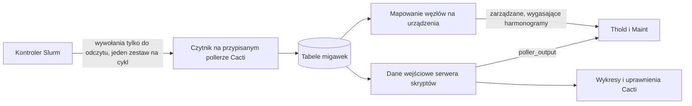

<!-- Source: README.md; SHA256: 16caa3e34c4d150a7fb1018f637e200a7580330f033b485047d8413bce09abba -->

<!-- translations:start -->
[English](../../../README.md) | [简体中文](../zh-CN/README.md) | [हिन्दी](../hi-IN/README.md) | [Español (España)](../es-ES/README.md) | [Español (Latinoamérica)](../es-419/README.md) | [العربية (السعودية)](../ar-SA/README.md) | [Afrikaans](../af-ZA/README.md) | [አማርኛ](../am-ET/README.md) | [العربية (مصر)](../ar-EG/README.md) | [العربية (المغرب)](../ar-MA/README.md) | [বাংলা](../bn-BD/README.md) | [Deutsch](../de-DE/README.md) | [فارسی](../fa-IR/README.md) | [Filipino](../fil-PH/README.md) | [Français](../fr-FR/README.md) | [Français (Maroc)](../fr-MA/README.md) | [Français (Sénégal)](../fr-SN/README.md) | [Hausa](../ha-NG/README.md) | [עברית](../he-IL/README.md) | [Bahasa Indonesia](../id-ID/README.md) | [Igbo](../ig-NG/README.md) | [Italiano](../it-IT/README.md) | [日本語](../ja-JP/README.md) | [한국어](../ko-KR/README.md) | [Malagasy](../mg-MG/README.md) | [मराठी](../mr-IN/README.md) | [Bahasa Melayu](../ms-MY/README.md) | [Nederlands](../nl-NL/README.md) | [Polski](README.md) | [Português (Brasil)](../pt-BR/README.md) | [Русский](../ru-RU/README.md) | [Kinyarwanda](../rw-RW/README.md) | [Soomaali](../so-SO/README.md) | [Svenska](../sv-SE/README.md) | [Kiswahili](../sw-KE/README.md) | [தமிழ்](../ta-IN/README.md) | [తెలుగు](../te-IN/README.md) | [ไทย](../th-TH/README.md) | [Türkçe](../tr-TR/README.md) | [Українська](../uk-UA/README.md) | [اردو](../ur-PK/README.md) | [Tiếng Việt](../vi-VN/README.md) | [isiXhosa](../xh-ZA/README.md) | [Yorùbá](../yo-NG/README.md) | [繁體中文](../zh-TW/README.md) | [isiZulu](../zu-ZA/README.md)
<!-- translations:end -->

# plugin_hpcsched

Wtyczka do Cacti 1.2 prezentująca na wykresach stan systemu kolejkowego HPC obok urządzeń już monitorowanych przez Cacti: głębokość kolejki, zadania oczekujące względem uruchomionych, przyczyny oczekiwania zadań, stany węzłów oraz wykorzystanie partycji. Pierwszym obsługiwanym silnikiem kolejkowym jest Slurm. Thold może zgłaszać alerty na podstawie wynikowych źródeł danych, a Maint może być sterowany przez węzły w stanie drained oraz rezerwacje serwisowe.

> **Status: w trakcie rozwoju, brak jeszcze wydania.** Kamień milowy 2 (podstawy) został scalony z gałęzią `main`, a niniejsza gałąź dodaje kamień milowy 3 (wykresy klastra i przyczyny oczekiwania). Kod instaluje się, aktualizuje i odinstalowuje za pośrednictwem API wtyczek Cacti oraz odrzuca wersję PHP starszą niż 8.2. Wtyczka utrzymuje rejestr klastrów Slurm, z których każdy jest przypisany do jednego pollera Cacti. Działający w tle czytnik na głównym pollerze zbiera po jednej migawce na klaster w każdym interwale — uruchamiając `squeue`, `scontrol` i `sshare` z opcją `--json` albo odpytując `slurmrestd` przez HTTPS — i zapisuje liczby zadań według stanu i przyczyny oczekiwania, stany węzłów, partycje, rezerwacje oraz użycie fair-share wraz z informacją o ich aktualności. Wtyczka dostarcza szablony Cacti i po potwierdzeniu przez administratora tworzy lub mapuje po jednym urządzeniu Cacti na klaster z wykresami zadań według stanu, zadań oczekujących według rodziny przyczyn, węzłów według stanu, procesorów (CPU) i wykorzystania — zarówno dla całego klastra, jak i dla każdej partycji — oraz wieku migawki. Strona przeglądu (tylko do odczytu) wyświetla statystyki dla każdego klastra wraz z ich aktualnością oraz widok przyczyn oczekiwania dla każdego klastra, natomiast dostępna wyłącznie dla administratorów strona kondycji (health) pokazuje wynik każdego zbierania danych oraz informację, czy szablony są zainstalowane. Każda strona i akcja respektuje uprawnienia urządzeń Cacti. Źródła danych są przystosowane do obsługi alertów w Thold, ale integracja z Thold ani Maint nie była jeszcze testowana; przewidziano ją na kamień milowy 4 i kolejne. Zestaw testów obejmuje syntetyczne polecenia Slurm i odpowiedzi `slurmrestd`, a CI uruchamia także opisany poniżej rzeczywisty sześciowęzłowy klaster Slurm w kontenerach. Czytnik nie był dotąd uruchamiany na klastrze produkcyjnym. Poniżej uwag dla operatorów niniejszy plik README opisuje projekt docelowy, a nie dostarczoną jeszcze funkcjonalność.

Jest to niezależny projekt i nie jest powiązany z projektem Cacti.

## Role dostępu

| Zakres (Realm) | Dostęp |
| --- | --- |
| HPC Scheduler View | Istniejące strony monitorowania. |
| HPC Scheduler Operator | Monitorowanie oraz strona Operations i osobiste potwierdzenia w ramach triażu. |
| HPC Scheduler Admin | Dostęp operatora oraz istniejące działania konfiguracyjne i administracyjne. |

Po skopiowaniu plików aktualizacji należy otworzyć stronę wtyczek (Plugins) jako administrator, aby zarejestrować nowy zakres uprawnień (realm). Zakres Operator należy przypisać jawnie w sekcji **Configuration > Users** lub w grupach użytkowników. Aktualizacje zachowują istniejące identyfikatory zakresów View i Admin oraz przypisane uprawnienia. Dostęp Admin dziedziczy dostęp Operator, a dostęp Operator dziedziczy dostęp View przy każdym żądaniu; nie powoduje to zapisania dodatkowych uprawnień dla użytkowników ani grup. Ustawienia wtyczki wymagają dodatkowo uprawnienia HPC Scheduler Admin oprócz uprawnienia Settings w Cacti.

Uprawnienia do urządzeń w Cacti nadal ograniczają wiersze i akcje dostępne dla każdego użytkownika; klaster bez przypisanego urządzenia jest widoczny na stronach administracyjnych dla każdego użytkownika posiadającego zakres uprawnień wtyczki, ale nie w widokach operatora, które wyświetlają wyłącznie klastry zmapowane na urządzenie. Dane uwierzytelniające, konfiguracja, mapowanie, usuwanie i inne zmiany administracyjne pozostają na stronach administracyjnych. Potwierdzenia obowiązują wyłącznie w bieżącej sesji użytkownika, maksymalnie przez jedną godzinę i tylko dopóki ta sama obserwacja pozostaje aktualna. Nowe lub zmienione obserwacje je unieważniają. Potwierdzenia nigdy nie oznaczają nieudanego pomiaru jako prawidłowego ani nie wyciszają alertów.

## Uwagi dla operatorów — kamień milowy 2

**Zasada najmniejszych uprawnień.** Wtyczka wykonuje wyłącznie operacje odczytu. Należy przydzielić jej dedykowanego użytkownika Slurm bez roli administratora ani operatora (`AdminLevel=None` w `sacctmgr`). Przy ustawieniu `PrivateData=jobs` (lub `nodes`, `reservations`, `usage`) w pliku `slurm.conf` taki użytkownik widzi wyłącznie własne rekordy, przez co zliczenia są niepełne, a wtyczka nie jest w stanie tego wykryć. Zniesienie tego ograniczenia dla konta oznacza nadanie poziomu operatora lub administratora, co pozwala również na wprowadzanie zmian; decyzja o tym kompromisie należy do danego ośrodka. W przypadku poleceń klienckich użytkownik pollera Cacti potrzebuje plików wykonywalnych klienta Slurm oraz pliku `slurm.conf` pozwalającego połączyć się z kontrolerem; ścieżki do plików wykonywalnych są ustawieniami bezwzględnymi w Configuration > Settings > HPC Scheduler. W przypadku `slurmrestd` adres URL musi używać schematu `https://`, a `http://` jest dozwolone wyłącznie dla adresu pętli zwrotnej (loopback). Certyfikaty TLS są weryfikowane, a przekierowania nie są śledzone. Opcjonalna lista hostów slurmrestd w Configuration > Settings > HPC Scheduler ogranicza hosty i porty, które klaster może wskazać.

**Zdalne pollery.** Niniejsze wydanie zbiera dane wyłącznie na głównym pollerze Cacti. Klaster przypisany do zdalnego kolektora danych nie jest odpytywany: tamtejszy czytnik odmawia działania, rejestrując przyczynę w logu, a strona kondycji (health) wskazuje taki klaster. Zbieranie zdalne jest zaplanowane w fazie 3.

**Pamięć.** Każdy przebieg zbierania danych dekoduje naraz jedną odpowiedź systemu kolejkowego, co zajmuje około 12-krotność rozmiaru odpowiedzi w pamięci PHP (zmierzono około 10-krotności dla rekordów zadań o strukturze takiej jak w Slurm, plus sam tekst odpowiedzi). Przebieg podnosi limit pamięci PHP do wartości ustawienia Collection Memory (domyślnie 1024 MiB) i dopuszcza odpowiedzi o rozmiarze do (Collection Memory - 64) / 12 MiB, czyli domyślnie 80 MiB, nawet jeśli ustawienie Maximum Answer Size ma wyższą wartość; strona kondycji wyświetla wtedy ostrzeżenie. Większa odpowiedź powoduje błąd danej sekcji z powodu zbyt dużego rozmiaru, a przebieg, w którym nadal zabraknie pamięci, jest rejestrowany jako nieudany. Duży klaster może wymagać zwiększenia obu ustawień; nie wykonano pomiarów dla 100 000 rzeczywistych rekordów zadań.

**Pliki tokenów.** Klaster korzystający z `slurmrestd` wskazuje plik tokenu; sam token nigdy nie jest zapisywany w bazie danych, wyświetlany na stronie ani zapisywany w logu. Plik musi znajdować się w jednym z katalogów plików tokenów skonfigurowanych w Configuration > Settings > HPC Scheduler, bez dowiązań symbolicznych po drodze, oraz musi być zwykłym plikiem należącym do użytkownika pollera, do którego wyłącznie ten użytkownik ma prawo zapisu, zawierającym jeden wiersz: sam token albo `SLURM_JWT=<token>` w formacie wypisywanym przez `scontrol token`. Jeśli nie skonfigurowano żadnych katalogów tokenów, żaden klaster nie może korzystać z `slurmrestd`. Te dwa ustawienia znajdują się na stronie Settings w Cacti, więc sam zakres Admin wtyczki nie pozwala na ich zmianę; każdy katalog tokenów powinien być zapisywalny wyłącznie przez użytkownika root oraz użytkownika pollera. Plik, który może zostać odczytany przez grupę lub innych użytkowników, nadal jest używany, ale strona kondycji wyświetla ostrzeżenie. Strona kondycji ostrzega również, gdy token wygasa w skonfigurowanym czasie ostrzeżenia.

Aby przeprowadzić rotację tokenu bez okna czasowego, w którym czytnik mógłby trafić na niekompletny plik, należy zapisać nowy token obok starego i zastąpić stary poprzez zmianę nazwy:

```sh
dir=/etc/cacti/hpcsched
tmp=$(mktemp "$dir/.token.XXXXXX")
scontrol token username=cactiread lifespan=2592000 > "$tmp"
chown cacti:cacti "$tmp"
chmod 0600 "$tmp"
mv -f "$tmp" "$dir/cluster1.token"
```

Kolejne zbieranie danych odczyta nowy plik. Wygenerowanie tokenów poleceniem `scontrol token` wymaga uprawnień administratora Slurm; należy je uruchomić tam, gdzie jest to dozwolone, i skopiować plik na poller.

## Uwagi dla operatorów — kamień milowy 3

**Szablony.** Instalacja i aktualizacja importują szablony urządzenia, danych i wykresów wtyczki HPC Scheduler oraz kopiują zapytanie danych partycji (partition data query) do katalogu `resource/script_server/` w Cacti. Jeśli ten katalog nie jest zapisywalny dla użytkownika instalującego wtyczkę, istnieje tam już inny plik o tej samej nazwie nieutworzony przez wtyczkę lub nazwa ta jest dowiązaniem symbolicznym, import zostaje przerwany, plik pozostaje nienaruszony, a strona kondycji informuje, co należy zrobić; przycisk Install Templates na stronie kondycji ponawia próbę. Identyczna kopia utworzona ręcznie jest używana, ale pozostaje pod zarządzaniem administratora. Odinstalowanie usuwa plik zapytania tylko wtedy, gdy został utworzony przez wtyczkę i nie był modyfikowany, natomiast zachowuje szablony, urządzenia i wykresy.

**Urządzenia klastrów.** Sekcja HPC Clusters > Device pokazuje przed utworzeniem czegokolwiek, jakie elementy doda urządzenie (wykresy, źródła danych, pliki RRD oraz wywołania serwera skryptów na cykl odpytywania). Akcja Create Device tworzy urządzenie o nazwie hosta w zarezerwowanej domenie `.invalid` i bez sprawdzania dostępności; z kolei Map Device dołącza wykresy do istniejącego urządzenia, pozostawiając jego ustawienia bez zmian. Każdy wykres klastra i każdy wykres partycji ma własne źródło danych: sześć dla klastra i pięć na partycję, po jednym wywołaniu serwera skryptów na źródło danych klastra oraz po jednym na wartość partycji (32) w każdym cyklu odpytywania. Partycje dodane później są indeksowane w momencie wykrycia przez czytnik i otrzymują wykresy na stronie New Graphs w Cacti; usunięta partycja przestaje być odpytywana, ale zachowuje swoje wykresy. Usunięcie urządzenia usuwa mapowanie klastra, zachowując sam klaster.

**Co zliczają wykresy.** Liczba zadań oczekujących (pending) nie obejmuje zadań wstrzymanych (held), które mają własną serię danych. Oczekująca tablica zadań (array) zlicza pozostałe w niej zadania składowe. Zadanie lub węzeł należący do kilku partycji jest liczony raz na wykresach klastra i po jednym razie w każdej z partycji, dlatego sumy z wykresów partycji nie muszą równać się wartościom dla całego klastra. Przyczyny oczekiwania są pogrupowane w jedenaście rodzin ([ADR 0011](../../decisions/0011-pending-reason-families-and-counting.md)); widok przyczyn oczekiwania zawiera listę surowych przyczyn, w tym te z kategorii Other. Każde zadanie raportuje wyłącznie ostatnią przyczynę sprawdzoną przez system kolejkowy. Mianownik wskaźnika wykorzystania obejmuje węzły w stanie drained, down oraz inne niedostępne. Nieaktualne lub błędne dane przyjmują wartość `U`, nigdy zero; wartość `age` pozostaje liczbowa.

**Alerty.** Thold może zgłaszać alerty dla dowolnego z tych źródeł danych; należy ustawić czasy trwania w Thold na co najmniej jeden interwał zbierania danych oraz skonfigurować alert dla wartości `age`, aby wykryć zatrzymanie czytnika. Kompleksowa weryfikacja działania Thold jest zaplanowana na kamień milowy 4.

**Testy na rzeczywistych danych wyjściowych Slurm.** Środowisko CI uruchamia sześciowęzłowy klaster Slurm w kontenerach (wersję 26.05.5 przy każdej zmianie oraz wersję 25.11.8 budowaną ze źródeł przy wypchnięciach do `main`, co tydzień i na żądanie) i weryfikuje stany węzłów, rezerwację serwisową, przyczyny oczekiwania oraz tablice zadań w postaci analizowanej przez wtyczkę, a następnie zbiera dane z tego klastra za pomocą własnych transportów wtyczki opartych na poleceniach oraz `slurmrestd`. Starsze wydania są objęte wyłącznie syntetycznymi danymi testowymi. Czytnik nadal nie był uruchamiany na klastrze produkcyjnym.

**Uprawnienia.** Klaster przypisany do urządzenia jest wyświetlany, eksportowany i modyfikowany na każdej stronie wtyczki wyłącznie przez użytkowników, którym Cacti zezwala na dostęp do tego urządzenia; mapowanie urządzenia wymaga również uprawnień do urządzenia docelowego. Klaster bez urządzenia jest widoczny dla każdego użytkownika z zakresem uprawnień wtyczki. Klaster nadal zmapowany na urządzenie, które zostało usunięte podczas gdy wtyczka była wyłączona, jest widoczny wyłącznie dla użytkowników z zakresem HPC Scheduler Admin, którzy mogą utworzyć lub zmapować dla niego urządzenie. Dostęp do wykresów jest zarządzany bezpośrednio przez Cacti.

## Dlaczego

Operatorzy korzystający z Cacti już teraz tworzą wykresy dla swoich węzłów obliczeniowych. Na tych wykresach brakuje jednak perspektywy systemu kolejkowego, co pozostawia dwie luki:

- **Brak odpowiedzi na pytanie „dlaczego zadania nie startują”.** Slurm zapisuje przyczynę oczekiwania każdego oczekującego zadania. Pełna kolejka przy wykresach pokazujących bezczynne węzły nie wyjaśnia, czy powodem jest priorytet, limity zasobów, wstrzymania (holds), zależności czy węzły w stanie drained.
- **Brak powiązania między stanem systemu kolejkowego a alertami.** Thold wysyła alerty dla urządzenia, które administrator już wcześniej przełączył w stan drained, a harmonogramy Maint administratorzy tworzą ręcznie.

Wtyczka zbiera po jednej buforowanej migawce na klaster, publikuje ją jako standardowe źródła danych i wykresy Cacti, mapuje węzły systemu kolejkowego na istniejące urządzenia Cacti oraz może automatycznie dodawać węzły w stanie drained i rezerwacje serwisowe do Maint. Wykorzystuje ponownie uprawnienia Cacti, zdalne kolektory danych, Thold i Maint, a wobec systemu kolejkowego działa wyłącznie w trybie tylko do odczytu.

## Planowany zakres

| Faza | Zakres | Kamienie milowe |
|---|---|---|
| 0, badania | Macierz wydań Slurm, potwierdzenie zachowania po stronie upstream, obciążenie kontrolera, dane testowe nazewnictwa węzłów | [M1](https://github.com/somethingwithproof/plugin_hpcsched/milestone/1) |
| 1, wykresy klastra | Głębokość kolejki, zadania oczekujące i uruchomione, przyczyny oczekiwania, stany węzłów, wykorzystanie partycji, alerty Thold, strona kondycji, wydanie | [M2](https://github.com/somethingwithproof/plugin_hpcsched/milestone/2), [M3](https://github.com/somethingwithproof/plugin_hpcsched/milestone/3), [M4](https://github.com/somethingwithproof/plugin_hpcsched/milestone/4) |
| 2, węzły i konserwacja | Mapowanie węzłów na urządzenia, stan poszczególnych węzłów, automatyczne okna Maint dla węzłów w stanie drained i rezerwacji serwisowych | [M5](https://github.com/somethingwithproof/plugin_hpcsched/milestone/5) |
| 3, rozliczanie (accounting) | Użycie fair-share, ograniczone statystyki rozliczeniowe, zdalne kolektory danych | [M6](https://github.com/somethingwithproof/plugin_hpcsched/milestone/6) |

Poza zakresem: wszelkie operacje zapisu w systemie kolejkowym (wysyłanie, anulowanie, wstrzymywanie, przełączanie w stan drain, wznawianie), własny silnik alertów wtyczki, silnik raportowania lub rozliczeń (chargeback), a także serie danych dla poszczególnych użytkowników i zadań. Silniki PBS Pro, OpenPBS i LSF są na etapie badań.

## Docelowa zgodność

| Komponent | Cel |
|---|---|
| Cacti | 1.2.31 lub nowsza, bez łatek jądra |
| PHP | 8.2 lub nowsza; `setup.php` zachowuje poprawność składniową w wersji 8.0, aby nieobsługiwane środowisko uruchomieniowe otrzymało komunikat odmowy zamiast uszkodzonego interfejsu Cacti |
| Slurm | 25.05, 25.11 i 26.05 — trzy najnowsze wydania ([ADR 0013](../../decisions/0013-three-latest-slurm-releases.md)); 25.11 i 26.05 są testowane na żywym klastrze, a 25.05 wyłącznie na danych testowych. Polecenia klienckie są domyślnym transportem ([ADR 0012](../../decisions/0012-client-commands-default-transport.md)) i używają ustawienia parsera danych: domyślnie v0.0.43, które SchedMD usuwa w wersji 27.05, lub v0.0.44 albo v0.0.45 w wydaniach, które je dostarczają. Klastry z slurmrestd wykrywają najnowszy parser udostępniany przez demona |
| Thold, Maint | Brak zmian w Thold; integracja z Maint jest propozycją wymagającą uzgodnienia z opiekunami Maint |

## Projekt

- [docs/PLAN.md](../../PLAN.md) stanowi pełny plan: architekturę, fakty dotyczące projektów nadrzędnych (upstream), na których się opiera (wraz ze źródłami i jawną listą niepotwierdzonych założeń), mapowanie węzłów, model stanów, granice bezpieczeństwa, obliczenia wydajnościowe, testowanie oraz ryzyka.
- [docs/decisions/](../../decisions) zawiera rejestry decyzji architektonicznych (ADR).
- [docs/REQUIREMENTS.md](../../REQUIREMENTS.md) mapuje każdy identyfikator wymagania na odpowiadające mu zgłoszenie.



## Sposób śledzenia prac

- **Kamienie milowe** odpowiadają kamieniom milowym z planu. Każdy z nich ma zgłoszenie zbiorcze (epic) wymieniające podzadania oraz dowody ukończenia.
- **Zgłoszenia** są kategoryzowane etykietami: `type: requirement`, `type: research`, `type: decision`, `type: epic`. Zgłoszenia wymagań określają numerowane, testowalne wymagania (`REQ-AREA-NNN`) oraz kryteria akceptacji.
- **Etykiety** zawierają również prefiksy `area:`, `phase:`, `priority:` oraz `status:`. Zobacz [CONTRIBUTING.md](../../../CONTRIBUTING.md#labels).
- [Tablica projektu](https://github.com/users/somethingwithproof/projects/10) przedstawia wszystkie zgłoszenia w podziale na kamienie milowe.

## Współpraca

Przeczytaj [CONTRIBUTING.md](../../../CONTRIBUTING.md). Commity wymagają poświadczenia DCO (sign-off). Dyskusje projektowe toczą się w zgłoszeniach; otwarte decyzje noszą etykietę `type: decision`.

## Bezpieczeństwo

Podatności należy zgłaszać poufnie; zobacz [SECURITY.md](../../../SECURITY.md).

## Licencja

GNU General Public License v2.0 — ta sama licencja co w przypadku Cacti i jego wtyczek. Zobacz [LICENSE](../../../LICENSE).
