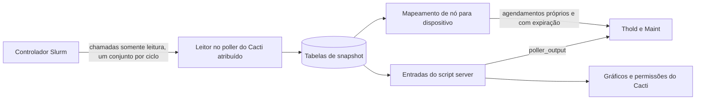

<!-- Source: README.md; SHA256: 16caa3e34c4d150a7fb1018f637e200a7580330f033b485047d8413bce09abba -->

<!-- translations:start -->
[English](../../../README.md) | [简体中文](../zh-CN/README.md) | [हिन्दी](../hi-IN/README.md) | [Español (España)](../es-ES/README.md) | [Español (Latinoamérica)](../es-419/README.md) | [العربية (السعودية)](../ar-SA/README.md) | [Afrikaans](../af-ZA/README.md) | [አማርኛ](../am-ET/README.md) | [العربية (مصر)](../ar-EG/README.md) | [العربية (المغرب)](../ar-MA/README.md) | [বাংলা](../bn-BD/README.md) | [Deutsch](../de-DE/README.md) | [فارسی](../fa-IR/README.md) | [Filipino](../fil-PH/README.md) | [Français](../fr-FR/README.md) | [Français (Maroc)](../fr-MA/README.md) | [Français (Sénégal)](../fr-SN/README.md) | [Hausa](../ha-NG/README.md) | [עברית](../he-IL/README.md) | [Bahasa Indonesia](../id-ID/README.md) | [Igbo](../ig-NG/README.md) | [Italiano](../it-IT/README.md) | [日本語](../ja-JP/README.md) | [한국어](../ko-KR/README.md) | [Malagasy](../mg-MG/README.md) | [मराठी](../mr-IN/README.md) | [Bahasa Melayu](../ms-MY/README.md) | [Nederlands](../nl-NL/README.md) | [Polski](../pl-PL/README.md) | [Português (Brasil)](README.md) | [Русский](../ru-RU/README.md) | [Kinyarwanda](../rw-RW/README.md) | [Soomaali](../so-SO/README.md) | [Svenska](../sv-SE/README.md) | [Kiswahili](../sw-KE/README.md) | [தமிழ்](../ta-IN/README.md) | [తెలుగు](../te-IN/README.md) | [ไทย](../th-TH/README.md) | [Türkçe](../tr-TR/README.md) | [Українська](../uk-UA/README.md) | [اردو](../ur-PK/README.md) | [Tiếng Việt](../vi-VN/README.md) | [isiXhosa](../xh-ZA/README.md) | [Yorùbá](../yo-NG/README.md) | [繁體中文](../zh-TW/README.md) | [isiZulu](../zu-ZA/README.md)
<!-- translations:end -->

# plugin_hpcsched

Um plugin para Cacti 1.2 que gera gráficos do estado de um agendador em lote de HPC junto aos dispositivos que o Cacti já monitora: profundidade da fila, jobs pendentes versus em execução, motivos pelos quais os jobs estão pendentes, estados dos nós e utilização das partições. O Slurm é o primeiro backend. O Thold gera alertas sobre as fontes de dados resultantes, e o Maint pode ser acionado por nós drenados (drained) e reservas de manutenção.

> **Status: em desenvolvimento, sem versão lançada ainda.** O marco 2 (base) foi mesclado em `main`, e esta branch adiciona o marco 3 (gráficos de cluster e motivos de pendência). O código instala, atualiza e desinstala por meio da API de plugins do Cacti e recusa versões de PHP inferiores à 8.2. Ele mantém um registro de clusters Slurm, cada um atribuído a um poller do Cacti. Um leitor em segundo plano no poller principal coleta um snapshot por cluster a cada intervalo, executando `squeue`, `scontrol` e `sshare` com `--json` ou consultando o `slurmrestd` via HTTPS, e armazena contagens de jobs por estado e motivo de pendência, estados dos nós, partições, reservas e uso de fair-share com o respectivo indicador de atualidade (freshness). O plugin inclui templates do Cacti e, mediante confirmação de um administrador, cria ou mapeia um dispositivo do Cacti por cluster com gráficos de jobs por estado, jobs pendentes por família de motivo, nós por estado, CPUs e utilização — para o cluster e para cada partição — além da idade do snapshot. Uma página de visão geral somente leitura exibe contagens por cluster com sua atualidade e uma visualização de motivos de pendência por cluster, e uma página de integridade exclusiva para administradores mostra o que cada coleta retornou e se os templates estão instalados. Todas as páginas e ações seguem as permissões de dispositivo do Cacti. As fontes de dados permitem alertas no Thold, mas nenhuma integração com o Thold ou o Maint foi testada ainda; isso faz parte do marco 4 em diante. A suíte de testes cobre comandos Slurm sintéticos e respostas do `slurmrestd`, e a CI também exercita um cluster Slurm real de seis nós em contêineres, conforme descrito abaixo. O leitor não foi executado contra um cluster de produção. Abaixo das notas de operação, este README descreve o design, e não o comportamento já entregue.

Este é um projeto independente e não é afiliado ao projeto Cacti.

## Papéis de acesso

| Realm | Acesso |
| --- | --- |
| HPC Scheduler View | Páginas de monitoramento existentes. |
| HPC Scheduler Operator | Monitoramento, além da página Operations e reconhecimentos pessoais de triagem. |
| HPC Scheduler Admin | Acesso de Operator, além das ações de configuração e administração existentes. |

Após copiar os arquivos de atualização, abra a página Plugins como administrador para registrar
o novo realm. Atribua o realm Operator explicitamente em **Configuration > Users** ou nos grupos de usuários.
As atualizações mantêm os IDs e as concessões existentes dos realms View e Admin. O acesso Admin
herda o acesso Operator, e o acesso Operator herda o acesso View em cada requisição;
isso não adiciona concessões armazenadas a usuários ou grupos. As configurações do plugin também exigem
acesso HPC Scheduler Admin além da permissão Settings do Cacti.

As permissões de dispositivo do Cacti continuam limitando as linhas e ações disponíveis para cada usuário; um cluster sem dispositivo é listado nas páginas administrativas para todos os usuários com o realm do plugin, mas não nas visualizações de operador, que listam apenas clusters mapeados a um dispositivo.
Credenciais, configuração, mapeamento, exclusão e outras alterações administrativas
permanecem nas páginas administrativas. Os reconhecimentos duram apenas na sessão atual
do usuário, por no máximo uma hora e somente enquanto a mesma observação permanecer
atual. Observações novas ou alteradas os invalidam. Eles nunca marcam uma medição com falha
como saudável nem suprimem alertas.

## Notas de operação para o marco 2

**Privilégio mínimo.** O plugin apenas realiza leituras. Dê a ele um usuário dedicado do Slurm sem papel de administrador ou operador (`AdminLevel=None` no `sacctmgr`). Com `PrivateData=jobs` (ou `nodes`, `reservations`, `usage`) em `slurm.conf`, esse usuário vê apenas seus próprios registros, fazendo com que as contagens fiquem incompletas sem que o plugin consiga detectar isso. Remover essa restrição para a conta significa conceder nível de operador ou administrador, o que também permite alterações; essa escolha cabe ao ambiente. Para comandos de cliente, o usuário do poller do Cacti precisa dos binários de cliente do Slurm e de um `slurm.conf` que alcance o controlador; os caminhos dos binários são configurações absolutas em Configuration > Settings > HPC Scheduler. Para `slurmrestd`, a URL deve ser `https://`, ou `http://` apenas em um endereço de loopback. Certificados TLS são verificados e redirecionamentos não são seguidos. Uma lista opcional de hosts do slurmrestd em Configuration > Settings > HPC Scheduler limita os hosts e portas que um cluster pode especificar.

**Pollers remotos.** Esta versão coleta apenas no poller principal do Cacti. Um cluster atribuído a um coletor de dados remoto não é coletado: o leitor lá recusa a coleta com um motivo registrado no log e a página de integridade nomeia o cluster. A coleta remota faz parte da fase 3.

**Memória.** Cada execução de coleta decodifica uma resposta do agendador por vez, o que consome cerca de 12 vezes o tamanho da resposta em memória PHP (medido em cerca de 10 vezes para registros de jobs com formato semelhante ao do Slurm, mais o próprio texto). A execução eleva seu limite de memória PHP para a configuração Collection Memory (1024 MiB por padrão) e permite respostas de até (Collection Memory - 64) / 12 MiB, 80 MiB por padrão, mesmo quando Maximum Answer Size estiver definido com um valor maior; a página de integridade emite um aviso quando isso ocorre. Uma resposta maior faz a respectiva seção falhar por tamanho excessivo, e uma execução que ainda assim ficar sem memória é registrada como falha. Um cluster grande pode exigir o aumento de ambas as configurações; 100.000 registros reais de jobs não foram medidos.

**Arquivos de token.** Um cluster `slurmrestd` especifica um arquivo de token; o token em si nunca é armazenado no banco de dados, exibido em uma página ou gravado no log. O arquivo deve estar dentro de um dos diretórios de arquivos de token definidos em Configuration > Settings > HPC Scheduler, alcançado sem link simbólico, e ser um arquivo regular pertencente ao usuário do poller que apenas esse usuário possa gravar, contendo uma linha: o token, ou `SLURM_JWT=<token>` conforme impresso por `scontrol token`. Sem diretórios de token configurados, nenhum cluster pode usar `slurmrestd`. Essas duas configurações ficam na página Settings do Cacti, portanto o realm Admin do plugin sozinho não pode alterá-las; mantenha cada diretório de tokens gravável apenas pelo root e pelo usuário do poller. Um arquivo que o grupo ou outros usuários possam ler ainda é utilizado, e a página de integridade exibe um aviso. A página de integridade também avisa quando o token expira dentro do prazo de aviso configurado.

Para rotacionar um token sem abrir uma janela na qual o leitor veja um arquivo parcial, grave o novo token ao lado do antigo e renomeie-o para o lugar definitivo:

```sh
dir=/etc/cacti/hpcsched
tmp=$(mktemp "$dir/.token.XXXXXX")
scontrol token username=cactiread lifespan=2592000 > "$tmp"
chown cacti:cacti "$tmp"
chmod 0600 "$tmp"
mv -f "$tmp" "$dir/cluster1.token"
```

A próxima coleta lê o novo arquivo. Gerar tokens com `scontrol token` requer um administrador do Slurm; execute o comando onde isso for permitido e copie o arquivo para o poller.

## Notas de operação para o marco 3

**Templates.** A instalação e a atualização importam os templates de dispositivo, dados e gráficos do HPC Scheduler e copiam a consulta de dados (data query) de partição para o diretório `resource/script_server/` do Cacti. Se esse diretório não tiver permissão de escrita para o usuário que instala o plugin, se um arquivo diferente com o mesmo nome já estiver lá e não tiver sido gravado pelo plugin, ou se o nome for um link simbólico, a importação para, o arquivo não é alterado e a página de integridade informa o que fazer; Install Templates na página de integridade tenta novamente. Uma cópia idêntica feita manualmente é usada, mas permanece sob sua responsabilidade. A desinstalação remove o arquivo de consulta apenas se o plugin o tiver gravado e ele não tiver sido modificado, mantendo os templates, dispositivos e gráficos.

**Dispositivos de cluster.** HPC Clusters > Device mostra o que um dispositivo adicionará (gráficos, fontes de dados, arquivos RRD e chamadas ao script server por ciclo de polling) antes que qualquer item seja criado. Create Device cria um dispositivo com um nome de host no domínio reservado `.invalid` e sem verificação de disponibilidade; em vez disso, Map Device anexa os gráficos a um dispositivo existente e mantém suas configurações intactas. Cada gráfico de cluster e cada gráfico de partição tem sua própria fonte de dados: seis para o cluster e cinco por partição, uma chamada ao script server por fonte de dados de cluster e uma por valor de uma partição (32) por polling. Partições adicionadas posteriormente são indexadas quando o leitor as detecta e recebem gráficos pela página New Graphs do Cacti; uma partição removida deixa de ser consultada no polling e mantém seus gráficos. Excluir o dispositivo desmapeia o cluster e o mantém.

**O que os gráficos contabilizam.** Pendentes exclui jobs retidos, que têm sua própria série. Um job array pendente contabiliza suas tarefas restantes. Um job ou nó presente em várias partições é contado uma vez nos gráficos do cluster e uma vez em cada partição, portanto os gráficos de partição não precisam somar o total do cluster. Os motivos de pendência são agrupados em onze famílias ([ADR 0011](../../decisions/0011-pending-reason-families-and-counting.md)); a visualização de motivos de pendência lista os motivos brutos, incluindo os da família Other. Cada job relata apenas o último motivo examinado pelo agendador. O denominador de utilização inclui nós drenados, inativos e outros nós indisponíveis. Dados obsoletos ou com falha são `U`, nunca zero; `age` permanece numérico.

**Alertas.** O Thold pode alertar sobre qualquer uma dessas fontes de dados; defina as durações do Thold para pelo menos um intervalo de coleta e crie um alerta sobre `age` para detectar um leitor parado. A verificação ponta a ponta com o Thold é o marco 4.

**Testado contra saída real do Slurm.** A CI inicia um cluster Slurm de seis nós em contêineres (26.05.5 a cada alteração, 25.11.8 compilado a partir do código-fonte em pushes para `main`, semanalmente e sob demanda) e verifica estados dos nós, a reserva de manutenção, motivos de pendência e arrays conforme analisados pelo plugin, e então coleta desse cluster usando os transportes de comando e `slurmrestd` do próprio plugin. Versões mais antigas são cobertas apenas por fixtures sintéticos. O leitor ainda não foi executado contra um cluster de produção.

**Permissões.** Um cluster em um dispositivo é exibido, exportado e alterado apenas para usuários aos quais o Cacti permite acesso a esse dispositivo, em todas as páginas do plugin; mapear um dispositivo também exige permissão para o dispositivo de destino. Um cluster sem dispositivo fica visível para todos com o realm do plugin. Um cluster ainda mapeado a um dispositivo excluído enquanto o plugin estava desabilitado é mostrado apenas para usuários com o realm HPC Scheduler Admin, que podem criar ou mapear um dispositivo para ele. O acesso aos gráficos é gerenciado pelo próprio Cacti.

## Por quê

Operadores que executam o Cacti já geram gráficos de seus nós de computação. A visão do agendador está ausente nesses gráficos, o que deixa duas lacunas:

- **Ausência do "por que o trabalho não está iniciando".** O Slurm registra um motivo para cada job pendente. Uma fila cheia ao lado de gráficos de nós ociosos não informa se a causa é prioridade, limites de recursos, retenções, dependências ou nós drenados.
- **Ausência de vínculo entre o estado do agendador e os alertas.** O Thold gera alertas sobre um dispositivo que um administrador já drenou, e os administradores criam agendamentos do Maint manualmente.

O plugin coleta um snapshot em cache por cluster, publica-o como fontes de dados e gráficos comuns do Cacti, mapeia nós do agendador para dispositivos existentes do Cacti e pode colocar nós drenados e reservas de manutenção no Maint. Ele reutiliza as permissões do Cacti, os coletores de dados remotos, o Thold e o Maint, e é somente leitura em relação ao agendador.

## Escopo planejado

| Fase | Escopo | Marcos |
|---|---|---|
| 0, pesquisa | Matriz de versões do Slurm, confirmação do comportamento upstream, carga no controlador, fixtures de nomenclatura de nós | [M1](https://github.com/somethingwithproof/plugin_hpcsched/milestone/1) |
| 1, gráficos de cluster | Profundidade da fila, jobs pendentes e em execução, motivos de pendência, estados dos nós, utilização de partições, alertas do Thold, página de integridade, lançamento | [M2](https://github.com/somethingwithproof/plugin_hpcsched/milestone/2), [M3](https://github.com/somethingwithproof/plugin_hpcsched/milestone/3), [M4](https://github.com/somethingwithproof/plugin_hpcsched/milestone/4) |
| 2, nós e manutenção | Mapeamento de nó para dispositivo, estado por nó, janelas automáticas do Maint para nós drenados e reservas de manutenção | [M5](https://github.com/somethingwithproof/plugin_hpcsched/milestone/5) |
| 3, contabilidade | Uso de fair-share, estatísticas de contabilidade limitadas, coletores de dados remotos | [M6](https://github.com/somethingwithproof/plugin_hpcsched/milestone/6) |

Fora do escopo: qualquer caminho de escrita no agendador (enviar, cancelar, reter, drenar, retomar), um mecanismo de alertas próprio do plugin, um mecanismo de relatórios ou cobrança e séries por usuário e por job. Backends para PBS Pro, OpenPBS e LSF estão em fase de pesquisa.

## Metas de compatibilidade

| Componente | Meta |
|---|---|
| Cacti | 1.2.31 ou posterior, sem patches no core |
| PHP | 8.2 ou posterior; `setup.php` permanece analisável no 8.0 para que um runtime incompatível receba uma recusa em vez de uma interface do Cacti quebrada |
| Slurm | 25.05, 25.11 e 26.05, as três versões mais recentes ([ADR 0013](../../decisions/0013-three-latest-slurm-releases.md)); 25.11 e 26.05 são testadas contra um cluster ativo, 25.05 apenas contra fixtures. Comandos de cliente são o transporte padrão ([ADR 0012](../../decisions/0012-client-commands-default-transport.md)) e usam a configuração do data parser: v0.0.43 por padrão, que a SchedMD remove na 27.05, ou v0.0.44 ou v0.0.45 nas versões que os incluem. Clusters slurmrestd descobrem o parser mais recente servido pelo daemon |
| Thold, Maint | Nenhuma alteração no Thold; a integração com o Maint é uma proposta que requer concordância dos mantenedores do Maint |

## Design

- [docs/PLAN.md](../../PLAN.md) é o plano completo: arquitetura, fatos upstream dos quais depende (com fontes e uma lista explícita de suposições não confirmadas), mapeamento de nós, modelo de estados, limites de segurança, aritmética de desempenho, testes e riscos.
- [docs/decisions/](../../decisions) contém os registros de decisão arquitetural.
- [docs/REQUIREMENTS.md](../../REQUIREMENTS.md) mapeia cada ID de requisito para sua issue.



## Como o trabalho é acompanhado

- **Marcos** seguem os marcos do plano. Cada um possui uma issue épica listando suas sub-issues e evidências de saída.
- **Issues** são tipadas por rótulo: `type: requirement`, `type: research`, `type: decision`, `type: epic`. As issues de requisito declaram requisitos numerados e testáveis (`REQ-AREA-NNN`) e critérios de aceitação.
- **Rótulos** também carregam `area:`, `phase:`, `priority:` e `status:`. Consulte [CONTRIBUTING.md](../../../CONTRIBUTING.md#labels).
- O [quadro do projeto](https://github.com/users/somethingwithproof/projects/10) exibe todas as issues em todos os marcos.

## Contribuição

Leia [CONTRIBUTING.md](../../../CONTRIBUTING.md). Os commits precisam de uma assinatura DCO. As discussões de design acontecem nas issues; decisões em aberto carregam o rótulo `type: decision`.

## Segurança

Relate vulnerabilidades de forma privada; consulte [SECURITY.md](../../../SECURITY.md).

## Licença

GNU General Public License v2.0, a mesma licença do Cacti e de seus plugins. Consulte [LICENSE](../../../LICENSE).
