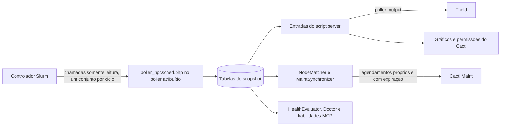

<!-- Source: README.md; SHA256: 938114d41dbd516f9dfcd94619c4fc73ef56b4da1dd693010588a93cce250534 -->

<!-- translations:start -->
[English](../../../README.md) | [简体中文](../zh-CN/README.md) | [हिन्दी](../hi-IN/README.md) | [Español (España)](../es-ES/README.md) | [Español (Latinoamérica)](../es-419/README.md) | [العربية (السعودية)](../ar-SA/README.md) | [Afrikaans](../af-ZA/README.md) | [አማርኛ](../am-ET/README.md) | [العربية (مصر)](../ar-EG/README.md) | [العربية (المغرب)](../ar-MA/README.md) | [বাংলা](../bn-BD/README.md) | [Bosanski](../bs-BA/README.md) | [Deutsch](../de-DE/README.md) | [فارسی](../fa-IR/README.md) | [Filipino](../fil-PH/README.md) | [Français](../fr-FR/README.md) | [Français (Maroc)](../fr-MA/README.md) | [Français (Sénégal)](../fr-SN/README.md) | [Hausa](../ha-NG/README.md) | [עברית](../he-IL/README.md) | [Hrvatski](../hr-HR/README.md) | [Bahasa Indonesia](../id-ID/README.md) | [Igbo](../ig-NG/README.md) | [Italiano](../it-IT/README.md) | [日本語](../ja-JP/README.md) | [한국어](../ko-KR/README.md) | [Malagasy](../mg-MG/README.md) | [मराठी](../mr-IN/README.md) | [Bahasa Melayu](../ms-MY/README.md) | [Nederlands](../nl-NL/README.md) | [Polski](../pl-PL/README.md) | [Português (Brasil)](README.md) | [Русский](../ru-RU/README.md) | [Kinyarwanda](../rw-RW/README.md) | [Soomaali](../so-SO/README.md) | [Српски](../sr-RS/README.md) | [Svenska](../sv-SE/README.md) | [Kiswahili](../sw-KE/README.md) | [தமிழ்](../ta-IN/README.md) | [తెలుగు](../te-IN/README.md) | [ไทย](../th-TH/README.md) | [Türkçe](../tr-TR/README.md) | [Українська](../uk-UA/README.md) | [اردو](../ur-PK/README.md) | [Tiếng Việt](../vi-VN/README.md) | [isiXhosa](../xh-ZA/README.md) | [Yorùbá](../yo-NG/README.md) | [繁體中文](../zh-TW/README.md) | [isiZulu](../zu-ZA/README.md)
<!-- translations:end -->

# plugin_hpcsched

Um plugin para Cacti 1.2 (`hpcsched`, versão `0.1.0-dev`) que gera gráficos do estado de um agendador em lote de HPC junto aos dispositivos que o Cacti já monitora: profundidade da fila, jobs pendentes versus em execução, motivos pelos quais os jobs estão pendentes, estados dos nós, utilização das partições e uso de fair-share por conta. O Slurm é o backend implementado. O Thold gera alertas sobre as fontes de dados resultantes, e um sincronizador opt-in do Maint controla janelas do Cacti Maint a partir de nós de computação Slurm drenados (drained), inativos (down) e com reserva de manutenção.

> **Status: em desenvolvimento, sem versão lançada ainda.** Esta branch implementa a base do plugin, gráficos de cluster e partição, famílias de motivos de pendência, correspondência entre nós de computação do Slurm e dispositivos do Cacti, sincronização opt-in de janelas do Cacti Maint, resumos de fair-share por conta, execução e replicação em coletores de dados remotos, CLI de Configuration-as-Code (CasC) e operações, e hooks do ecossistema Cacti (CasC, Doctor e MCP / Abilities API v2). A suíte de testes cobre comandos Slurm sintéticos e respostas do `slurmrestd`, e a CI exercita um cluster Slurm real de seis nós em contêineres. O leitor não foi executado contra um cluster de produção, e um teste de replay ponta a ponta com o Thold ainda não está na CI.

Este é um projeto independente e não é afiliado ao projeto Cacti.

## O que está implementado

- **Ciclo de vida e esquema (v3)**: instalação, atualização idempotente, desinstalação (mantendo as tabelas do plugin por padrão) e requisito mínimo de PHP 8.2, mantendo os pontos de entrada analisáveis no PHP 8.0. O esquema v3 adiciona `plugin_hpcsched_node_map` e `plugin_hpcsched_maint_link` junto às tabelas de cluster, execução, seção, contagem de jobs, contagem de nós, nó, partição, reserva e compartilhamento.
- **Coleta Slurm somente leitura nos pollers principal e remotos**: `poller_bottom` inicia `poller_hpcsched.php --cluster=N` em segundo plano em cada poller (`poller_id`) para os clusters habilitados atribuídos a ele. Cada execução coleta um snapshot em cache por cluster via comandos de cliente (`squeue`, `scontrol`, `sshare` com `--json`) ou `slurmrestd` via HTTPS (HTTP em loopback é permitido com um aviso de integridade). `INFO` declara `remote_collect:1, remote_poller:1`, e `replicate_out` replica definições não secretas de `plugin_hpcsched_cluster` para coletores remotos (`poller_id >= 2`); o conteúdo dos arquivos de token nunca é lido nem replicado.
- **Templates do Cacti e gráficos de cluster**: fornece templates de dispositivo, dados e gráficos (`templates/hpcsched-templates.xml`) e a consulta de dados de script-server de partições (`scripts/ss_hpcsched_cluster.php`, `scripts/ss_hpcsched_partitions.php`). Mediante confirmação de um administrador, cria ou mapeia um dispositivo do Cacti por cluster com gráficos de jobs por estado, jobs pendentes por família de motivo, nós por estado, CPUs, utilização (do cluster e por partição) e idade do snapshot.
- **Correspondência de nós do Slurm para dispositivos e sincronização com o Cacti Maint**: o correspondenciador em tempo linear de quatro níveis (`NodeMatcher`) mapeia nós de computação do Slurm para registros `host` existentes do Cacti (nome de host exato, endereço exato, descrição/alias exato ou primeiro rótulo DNS para nomes que não são IP) e marca múltiplas correspondências ou reivindicações duplicadas de dispositivos como `ambiguous` em vez de adivinhar. `HostList::expand()` expande listas de hosts de reservas do Slurm (até 10.000 nós). `MaintSynchronizer` cria, renova e remove agendamentos únicos do Cacti Maint pertencentes ao plugin e rastreados em `plugin_hpcsched_maint_link` para nós mapeados em `DRAIN`, `DRAINING`, `DOWN` ou reservas ativas `MAINT`/`MAINTENANCE` sem modificar agendamentos do Maint criados por administradores.
- **Resumos de fair-share por conta**: quando `collect_shares` está habilitado, coleta linhas de associação de contas do Slurm em `plugin_hpcsched_share` (descartando linhas de usuário conforme [ADR 0010](../../decisions/0010-bound-series-cardinality.md)). `ShareSummary` e `ShareRepository` calculam contagens de contas/partições, totais de uso bruto e efetivo, fatores fair-share mínimo/máximo/médio e contas principais; as contagens de contas são expostas em `hpcsched-get-queue-summary`.
- **CasC e CLI de operações (`cli/hpcsched.php`)**: exportação de configuração em YAML/XML, validação, planejamento de diff em dry-run, aplicação condicionada a confirmação, saída estruturada de integridade e sincronização opt-in com o Maint (`sync-maint --dry-run` / `--apply`).
- **Hooks do ecossistema (`setup.php`)**: `casc_register_providers`, `doctor_register_checks` e `abilities_register`.

## Papéis de acesso

| Realm | Acesso |
| --- | --- |
| HPC Scheduler View | Visão geral de cluster somente leitura e motivos de pendência (`hpcsched.php`). |
| HPC Scheduler Operator | Acesso View mais a página Operations (`hpcsched_operator.php`) e reconhecimentos pessoais de triagem. |
| HPC Scheduler Admin | Acesso Operator mais administração de clusters (`hpcsched_clusters.php`) e a página de integridade (`hpcsched_health.php`). |

Após copiar os arquivos de atualização, abra a página Plugins como administrador para registrar novos realms e hooks. Atribua o realm Operator explicitamente em **Configuration > Users** ou nos grupos de usuários. As atualizações mantêm os IDs e as concessões existentes dos realms View e Admin. O acesso Admin herda o acesso Operator, e o acesso Operator herda o acesso View em cada requisição; isso não adiciona concessões armazenadas a usuários ou grupos. As configurações do plugin também exigem acesso HPC Scheduler Admin além da permissão Settings do Cacti.

As permissões de dispositivo do Cacti limitam as linhas e ações disponíveis para cada usuário. Um cluster mapeado a um dispositivo do Cacti é exibido, exportado e alterado apenas para usuários aos quais o Cacti permite acesso a esse dispositivo; mapear um dispositivo também exige permissão para o dispositivo de destino. Um cluster sem dispositivo é listado nas páginas administrativas para usuários com o realm do plugin, mas não nas visualizações de operador, que listam apenas clusters mapeados a um dispositivo. Um cluster cujo dispositivo mapeado foi excluído enquanto o plugin estava desabilitado é mostrado apenas para usuários com acesso HPC Scheduler Admin. Os reconhecimentos duram apenas na sessão atual do usuário, por no máximo uma hora e somente enquanto a mesma observação permanecer atual. Observações novas ou alteradas os invalidam. Eles nunca marcam uma medição com falha como saudável nem suprimem alertas.

## Notas de operação

### Segurança, privilégio mínimo e arquivos de token

O plugin apenas realiza leituras. Dê a ele um usuário dedicado do Slurm sem papel de administrador ou operador (`AdminLevel=None` no `sacctmgr`). Com `PrivateData=jobs` (ou `nodes`, `reservations`, `usage`) em `slurm.conf`, esse usuário vê apenas seus próprios registros, fazendo com que as contagens fiquem incompletas sem que o plugin consiga detectar isso. Remover essa restrição para a conta exige nível de operador ou administrador, o que também permite alterações; essa escolha cabe ao ambiente.

Para comandos de cliente, o usuário do poller do Cacti precisa dos binários de cliente do Slurm (`squeue`, `scontrol` e opcionalmente `sshare`) e de um `slurm.conf` que alcance o controlador; os caminhos dos binários são configurações absolutas em **Configuration > Settings > HPC Scheduler**.

Para `slurmrestd`, a URL deve ser `https://`, ou `http://` apenas em um endereço de loopback. Certificados TLS são verificados e redirecionamentos não são seguidos. Uma lista opcional de hosts do `slurmrestd` em **Configuration > Settings > HPC Scheduler** restringe quais hosts e portas um cluster pode informar.

Um cluster `slurmrestd` indica um arquivo de token; o token em si nunca é armazenado no banco de dados, exibido em uma página, exportado pelo CasC ou gravado no log. O arquivo deve estar dentro de um dos Token File Directories configurados em **Configuration > Settings > HPC Scheduler**, alcançado sem link simbólico, e ser um arquivo regular pertencente ao usuário do poller que apenas esse usuário possa gravar, contendo uma linha: o token ou `SLURM_JWT=<token>` conforme impresso por `scontrol token`. Sem diretórios de token definidos, nenhum cluster pode usar `slurmrestd`. Mantenha cada diretório de tokens gravável apenas pelo root e pelo usuário do poller. Um arquivo que o grupo ou outros usuários possam ler ainda é utilizado, e a página de integridade exibe um aviso; ela também avisa quando o token expira dentro da janela de aviso configurada.

Para rotacionar um token atomicamente:

```sh
dir=/etc/cacti/hpcsched
tmp=$(mktemp "$dir/.token.XXXXXX")
scontrol token username=cactiread lifespan=2592000 > "$tmp"
chown cacti:cacti "$tmp"
chmod 0600 "$tmp"
mv -f "$tmp" "$dir/cluster1.token"
```

A próxima coleta lê o novo arquivo. Gerar tokens com `scontrol token` requer um administrador do Slurm; execute onde for permitido e copie o arquivo para o poller.

### Coletores de dados remotos

`INFO` declara `remote_collect:1, remote_poller:1`. `hpcsched_poller_bottom()` inicia `poller_hpcsched.php` em cada poller para clusters habilitados atribuídos a esse `poller_id`, e `hpcsched_replicate_out()` replica linhas não secretas de `plugin_hpcsched_cluster` para pollers remotos (`poller_id >= 2`). Arquivos de token e binários de cliente do Slurm devem existir localmente no poller remoto atribuído; o conteúdo dos tokens nunca é replicado.

### Limites de memória

Cada execução de coleta decodifica uma resposta do agendador por vez, o que consome cerca de 12 vezes o tamanho da resposta em memória PHP (medido em cerca de 10 vezes para registros de jobs com formato semelhante ao do Slurm, mais o próprio texto). O leitor eleva seu limite de memória PHP para a configuração Collection Memory (1024 MiB por padrão) e permite respostas de até `(Collection Memory - 64) / 12` MiB (80 MiB por padrão), mesmo quando Maximum Answer Size estiver definido com um valor maior; a página de integridade avisa quando Maximum Answer Size excede esse limite ajustado. Uma resposta maior faz sua seção falhar por tamanho excessivo, e uma execução que ainda assim ficar sem memória registra uma falha de memória e libera sua concessão (lease) e seu slot de processo por meio de um manipulador de encerramento. Clusters grandes podem exigir o aumento de ambas as configurações; 100.000 registros reais de jobs não foram medidos.

### Templates, dispositivos de cluster e contagem de gráficos

A instalação e a atualização importam os templates de dispositivo, dados e gráficos do HPC Scheduler e copiam a consulta de dados de partição para o diretório `resource/script_server/` do Cacti. Se esse diretório não tiver permissão de escrita, se um arquivo diferente com o mesmo nome já existir lá ou se o destino for um link simbólico, a importação para, deixa o arquivo intacto e relata a condição na página de integridade, onde **Install Templates** tenta novamente. A desinstalação remove o arquivo de consulta apenas se o plugin o tiver gravado e ele não tiver sido alterado, mantendo os templates, dispositivos e gráficos.

**HPC Clusters > Device** exibe uma prévia dos gráficos, fontes de dados, arquivos RRD e chamadas ao script server por ciclo de polling antes de criar qualquer item. **Create Device** cria um dispositivo com um nome de host no domínio reservado `.invalid` e sem verificação de disponibilidade; **Map Device** anexa os gráficos a um dispositivo existente sem alterar suas configurações. Cada gráfico de cluster e gráfico de partição tem sua própria fonte de dados: seis para o cluster e cinco por partição. Partições adicionadas posteriormente são reindexadas automaticamente quando o leitor detecta uma mudança; partições removidas deixam de ser consultadas no polling e mantêm seus gráficos. Excluir um dispositivo desmapeia o cluster (e limpa quaisquer linhas correspondentes de `plugin_hpcsched_node_map`) mantendo o registro do cluster.

Pendentes exclui jobs retidos (held), que têm sua própria série. Um job array pendente contabiliza suas tarefas restantes. Um job ou nó presente em várias partições é contado uma vez nos gráficos do cluster e uma vez em cada partição, portanto os totais das partições não precisam somar o total do cluster. Os motivos de pendência são agrupados em onze famílias ([ADR 0011](../../decisions/0011-pending-reason-families-and-counting.md)); a visualização de motivos de pendência lista os motivos brutos, incluindo os da família `Other`. O denominador de utilização inclui nós drenados, inativos e outros nós indisponíveis. Dados obsoletos ou com falha são relatados como `U`, nunca zero; `age` permanece numérico.

Para alertas, configure o Thold em qualquer uma das fontes de dados de cluster ou partição com durações de pelo menos um intervalo de coleta e configure um alerta sobre `age` para detectar um leitor parado.

## CLI e hooks do ecossistema

### Ponto de entrada do leitor

`hpcsched_poller_bottom()` inicia `poller_hpcsched.php` automaticamente; ele também pode ser executado manualmente no poller atribuído ao cluster:

```sh
php /path/to/cacti/plugins/hpcsched/poller_hpcsched.php --cluster=N [--force] [--debug]
```

`--force` executa mesmo enquanto o plugin está desabilitado, para diagnóstico em linha de comando.

### CLI de Configuration-as-Code, integridade e sincronização do Maint

```sh
php /path/to/cacti/plugins/hpcsched/cli/hpcsched.php export [--format=yaml|xml] [--file=PATH]
php /path/to/cacti/plugins/hpcsched/cli/hpcsched.php validate --file=PATH [--format=yaml|xml]
php /path/to/cacti/plugins/hpcsched/cli/hpcsched.php plan --file=PATH [--format=yaml|xml]
php /path/to/cacti/plugins/hpcsched/cli/hpcsched.php apply --file=PATH --confirm=PLAN_HASH [--format=yaml|xml]
php /path/to/cacti/plugins/hpcsched/cli/hpcsched.php health [--format=text|json]
php /path/to/cacti/plugins/hpcsched/cli/hpcsched.php sync-maint [--dry-run | --apply] [--cluster=ID] [--format=text|json]
```

- `export` grava novos arquivos com modo `0600` (ou em stdout) e substitui caminhos `token_file` configurados por `[REDACTED]`. `plan` e `apply` rejeitam campos embutidos `jwt`, `secret` e `password`, e preservam os caminhos locais existentes de `token_file` quando `[REDACTED]` é fornecido. `apply` exige o `--confirm=PLAN_HASH` exato impresso por `plan`.
- `health` avalia a atualidade do esquema, a atualidade dos clusters, resultados de execução, disponibilidade do Maint e avisos sem contatar agendadores nem ler arquivos de token.
- `sync-maint` usa `--dry-run` por padrão e exibe prévia ou aplica agendamentos do Cacti Maint para nós Slurm mapeados em `DRAIN`, `DRAINING`, `DOWN` ou reservas ativas `MAINT`/`MAINTENANCE` (horizonte padrão de drain/down de 3600s, margem de renovação de 600s). Ele recusa `--apply` se `plugin_maint_schedules` e `plugin_maint_hosts` estiverem ausentes, e só atualiza ou remove agendamentos registrados em `plugin_hpcsched_maint_link`.

### Hooks do ecossistema

Quando os plugins do Cacti ou integrações de host correspondentes estiverem presentes, `setup.php` registra:

- `casc_register_providers`: exporta, valida, planeja e aplica com confirmação a configuração `hpcsched` (`yaml` e `xml`, esquema v1) com redação de segredos.
- `doctor_register_checks`: fornece quatro verificações de diagnóstico somente leitura (`hpcsched.schema`, `hpcsched.cluster_freshness`, `hpcsched.token_health`, `hpcsched.maint_sync`).
- `abilities_register`: registra três habilidades somente leitura, não destrutivas e idempotentes na categoria `hpcsched`, controladas pelo realm HPC Scheduler View (e permissões de dispositivo para resumos de cluster): `hpcsched-list-clusters`, `hpcsched-get-queue-summary` e `hpcsched-get-health`.

## Por quê

Operadores que executam o Cacti já geram gráficos de seus nós de computação. A visão do agendador está ausente nesses gráficos, o que deixa duas lacunas:

- **Ausência do "por que o trabalho não está iniciando".** O Slurm registra um motivo para cada job pendente. Uma fila cheia ao lado de gráficos de nós ociosos não informa se a causa é prioridade, limites de recursos, retenções, dependências ou nós drenados.
- **Ausência de vínculo entre o estado do agendador e os alertas.** O Thold gera alertas sobre um dispositivo que um administrador já drenou, e os administradores criam agendamentos do Maint manualmente.

O plugin coleta um snapshot em cache por cluster, publica-o como fontes de dados e gráficos comuns do Cacti, mapeia nós do agendador para dispositivos existentes do Cacti e sincroniza janelas do Maint com expiração pertencentes ao plugin para nós drenados, inativos e com reserva de manutenção. Ele reutiliza as permissões do Cacti, os coletores de dados remotos, o Thold e o Maint, e permanece estritamente somente leitura em relação ao agendador.

## Escopo e limites

Fora do escopo: qualquer caminho de escrita no agendador (enviar, cancelar, reter, drenar, retomar), um mecanismo de alertas próprio do plugin, um mecanismo de relatórios ou cobrança e séries por usuário ou por job. Backends para PBS Pro, OpenPBS e LSF são apenas para pesquisa.

## Requisitos e compatibilidade

| Componente | Alvo |
|---|---|
| Cacti | 1.2.31 ou posterior (`compat = 1.2.31`), sem patches no core |
| PHP | 8.2 ou posterior; pontos de entrada permanecem analisáveis no 8.0 e recusam ativação no 8.1 para que um runtime incompatível receba uma recusa em vez de uma interface do Cacti quebrada |
| Slurm | 25.05, 25.11 e 26.05 ([ADR 0013](../../decisions/0013-three-latest-slurm-releases.md)); 26.05.5 é testado na CI a cada alteração contra um cluster de contêineres de seis nós, 25.11.8 em `main`, semanalmente e sob demanda, e 25.05 apenas contra fixtures. Comandos de cliente usam o parser de dados `v0.0.43` por padrão (com `v0.0.44` e `v0.0.45` selecionáveis); clusters `slurmrestd` descobrem o parser mais recente servido pelo daemon |
| Thold, Maint | Nenhuma alteração no Thold necessária; `sync-maint` integra-se às tabelas `plugin_maint_schedules` e `plugin_maint_hosts` do Cacti Maint usando uma tabela de vínculo pertencente ao plugin (`plugin_hpcsched_maint_link`) |

## Desenvolvimento e testes

O workflow de CI (`.github/workflows/plugin-ci-workflow.yml`) testa PHP 8.2 a 8.5 contra Cacti `release/1.2.31` e `1.2.x`, linting de pontos de entrada no PHP 8.0, recusa no PHP 8.1, PHPStan, verificação de gettext/traduções, licenciamento REUSE, linting de workflows, verificações de fluxo de dispositivo de cluster e desvio de exportação de templates, além de um cluster Slurm ativo de seis nós (`slurm-live`).

Com o harness compartilhado e travado de plugin Pest do Cacti (`CACTI_PEST_BIN`) e um banco de dados Cacti descartável:

```sh
# Unit tests
"$CACTI_PEST_BIN" --configuration=phpunit.xml

# Lifecycle integration tests (disposable database only)
CACTI_PATH=/path/to/cacti HPCSCHED_TEST_DATABASE=disposable "$CACTI_PEST_BIN" --configuration=phpunit-integration.xml

# Static analysis (against Cacti 1.2.31)
CACTI_PATH=/path/to/cacti phpstan analyse -c phpstan.neon --no-progress

# Translation template, catalogs, and localized README checks
sh locales/build_gettext.sh --check
```

## Design

- [docs/PLAN.md](../../PLAN.md) é o plano de arquitetura e design: fatos upstream com fontes, mapeamento de nós, modelo de estados, limites de segurança, aritmética de desempenho, testes e riscos.
- [docs/decisions/](../../decisions/) contém os registros de decisão arquitetural.
- [docs/REQUIREMENTS.md](../../REQUIREMENTS.md) mapeia cada ID de requisito para sua issue.



## Como o trabalho é acompanhado

- **Marcos** seguem os marcos do plano. Cada um possui uma issue épica listando suas sub-issues e evidências de saída.
- **Issues** são tipadas por rótulo: `type: requirement`, `type: research`, `type: decision`, `type: epic`. As issues de requisito declaram requisitos numerados e testáveis (`REQ-AREA-NNN`) e critérios de aceitação.
- **Rótulos** também carregam `area:`, `phase:`, `priority:` e `status:`. Consulte [CONTRIBUTING.md](../../../CONTRIBUTING.md#labels).
- O [quadro do projeto](https://github.com/users/somethingwithproof/projects/10) exibe todas as issues em todos os marcos.

## Contribuição

Leia [CONTRIBUTING.md](../../../CONTRIBUTING.md). Os commits precisam de uma assinatura DCO (`git commit -s`). As discussões de design acontecem nas issues; decisões em aberto carregam o rótulo `type: decision`.

## Segurança

Relate vulnerabilidades de forma privada; consulte [SECURITY.md](../../../SECURITY.md).

## Licença

GNU General Public License v2.0, a mesma licença do Cacti e de seus plugins. Consulte [LICENSE](../../../LICENSE).
