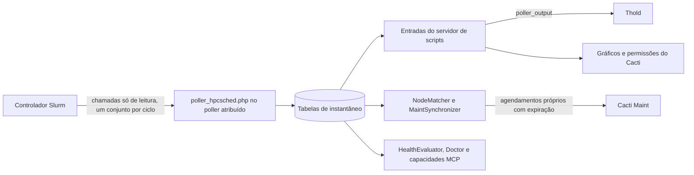

<!-- Source: README.md; SHA256: 938114d41dbd516f9dfcd94619c4fc73ef56b4da1dd693010588a93cce250534 -->

<!-- translations:start -->
[English](../../../README.md) | [简体中文](../zh-CN/README.md) | [हिन्दी](../hi-IN/README.md) | [Español (España)](../es-ES/README.md) | [Español (Latinoamérica)](../es-419/README.md) | [العربية (السعودية)](../ar-SA/README.md) | [Afrikaans](../af-ZA/README.md) | [አማርኛ](../am-ET/README.md) | [العربية (مصر)](../ar-EG/README.md) | [العربية (المغرب)](../ar-MA/README.md) | [Български](../bg-BG/README.md) | [বাংলা](../bn-BD/README.md) | [Bosanski](../bs-BA/README.md) | [Deutsch](../de-DE/README.md) | [Ελληνικά](../el-GR/README.md) | [فارسی](../fa-IR/README.md) | [Filipino](../fil-PH/README.md) | [Français](../fr-FR/README.md) | [Français (Maroc)](../fr-MA/README.md) | [Français (Sénégal)](../fr-SN/README.md) | [Hausa](../ha-NG/README.md) | [עברית](../he-IL/README.md) | [Hrvatski](../hr-HR/README.md) | [Bahasa Indonesia](../id-ID/README.md) | [Igbo](../ig-NG/README.md) | [Italiano](../it-IT/README.md) | [日本語](../ja-JP/README.md) | [ქართული](../ka-GE/README.md) | [한국어](../ko-KR/README.md) | [Latviešu](../lv-LV/README.md) | [Malagasy](../mg-MG/README.md) | [मराठी](../mr-IN/README.md) | [Bahasa Melayu](../ms-MY/README.md) | [Nederlands](../nl-NL/README.md) | [Polski](../pl-PL/README.md) | [Português (Brasil)](../pt-BR/README.md) | [Português (Portugal)](README.md) | [Русский](../ru-RU/README.md) | [Kinyarwanda](../rw-RW/README.md) | [Soomaali](../so-SO/README.md) | [Српски](../sr-RS/README.md) | [Svenska](../sv-SE/README.md) | [Kiswahili](../sw-KE/README.md) | [தமிழ்](../ta-IN/README.md) | [తెలుగు](../te-IN/README.md) | [ไทย](../th-TH/README.md) | [Türkçe](../tr-TR/README.md) | [Українська](../uk-UA/README.md) | [اردو](../ur-PK/README.md) | [Tiếng Việt](../vi-VN/README.md) | [isiXhosa](../xh-ZA/README.md) | [Yorùbá](../yo-NG/README.md) | [繁體中文](../zh-TW/README.md) | [isiZulu](../zu-ZA/README.md)
<!-- translations:end -->

# plugin_hpcsched

Um plugin para Cacti 1.2 (`hpcsched`, versão `0.1.0-dev`) que representa em gráfico o estado de um escalonador em lote HPC junto aos dispositivos que o Cacti já monitoriza: profundidade da fila, tarefas pendentes versus em execução, motivos de pendência das tarefas, estados dos nós, utilização de partições e utilização de partilha justa (fair-share) ao nível de conta. O Slurm é o backend implementado. O Thold gera alertas sobre as origens de dados resultantes e um sincronizador Maint opcional cria janelas Cacti Maint a partir de nós de computação Slurm drenados, inativos ou reservados para manutenção.

> **Estado: em desenvolvimento, ainda sem versão publicada.** Este ramo implementa a base do plugin, gráficos de cluster e de partição, famílias de motivos de pendência, correspondência entre nós de computação Slurm e dispositivos do Cacti, sincronização opcional de janelas Cacti Maint, resumos de partilha justa por conta, execução e replicação em recoletores de dados remotos, uma CLI de Configuração como Código (CasC) e operações, bem como hooks de ecossistema do Cacti (CasC, Doctor e MCP / Abilities API v2). O conjunto de testes cobre comandos Slurm sintéticos e respostas `slurmrestd`, e o CI exercita um cluster Slurm real de seis nós em contentores. O leitor ainda não foi executado num cluster de produção e um teste de reprodução Thold de ponta a ponta ainda não existe em CI.

Este é um projeto independente e não é afiliado ao projeto Cacti.

## O que está implementado

- **Ciclo de vida e esquema (v3)**: instalação, atualização idempotente, desinstalação (mantendo as tabelas do plugin por predefinição) e requisito mínimo de PHP 8.2, mantendo os pontos de entrada analisáveis em PHP 8.0. O esquema v3 adiciona `plugin_hpcsched_node_map` e `plugin_hpcsched_maint_link` a par das tabelas de cluster, execução, secção, contagem de tarefas, contagem de nós, nó, partição, reserva e partilha.
- **Recolha Slurm só de leitura nos pollers principal e remotos**: `poller_bottom` inicia `poller_hpcsched.php --cluster=N` em segundo plano em cada poller (`poller_id`) para os seus clusters ativados atribuídos. Cada execução recolhe um instantâneo em cache por cluster através de comandos de cliente (`squeue`, `scontrol`, `sshare` com `--json`) ou `slurmrestd` por HTTPS (HTTP em loopback permitido com aviso de estado de saúde). `INFO` declara `remote_collect:1, remote_poller:1` e `replicate_out` replica definições não secretas de `plugin_hpcsched_cluster` para recoletores remotos (`poller_id >= 2`); o conteúdo dos ficheiros de token nunca é lido nem replicado.
- **Modelos do Cacti e gráficos de cluster**: distribui modelos de dispositivo, de dados e de gráficos (`templates/hpcsched-templates.xml`) e a consulta de dados de servidor de scripts de partições (`scripts/ss_hpcsched_cluster.php`, `scripts/ss_hpcsched_partitions.php`). Mediante confirmação do administrador, cria ou associa um dispositivo do Cacti por cluster com gráficos de tarefas por estado, tarefas pendentes por família de motivo, nós por estado, CPUs, utilização (do cluster e por partição) e idade do instantâneo.
- **Correspondência entre nós Slurm e dispositivos e sincronização Cacti Maint**: um algoritmo de correspondência em quatro níveis em tempo linear (`NodeMatcher`) associa nós de computação Slurm a registos `host` existentes do Cacti (nome de anfitrião exato, endereço exato, descrição/alias exato ou primeiro rótulo DNS para nomes que não sejam IP) e marca correspondências múltiplas ou disputas duplicadas de dispositivo como `ambiguous` em vez de adivinhar. `HostList::expand()` expande listas de anfitriões de reservas Slurm (até 10 000 nós). `MaintSynchronizer` cria, renova e remove agendamentos únicos Cacti Maint pertencentes ao plugin registados em `plugin_hpcsched_maint_link` para nós associados em `DRAIN`, `DRAINING`, `DOWN` ou reservas ativas `MAINT`/`MAINTENANCE` sem modificar agendamentos Maint criados por administradores.
- **Resumos de partilha justa por conta**: quando `collect_shares` está ativado, recolhe linhas de associação de contas Slurm para `plugin_hpcsched_share` (descartando linhas de utilizador conforme [ADR 0010](../../decisions/0010-bound-series-cardinality.md)). `ShareSummary` e `ShareRepository` calculam contagens de contas/partições, totais de utilização bruta e efetiva, fatores mínimos/máximos/médios de partilha justa e principais contas; as contagens de contas são expostas em `hpcsched-get-queue-summary`.
- **CLI de CasC e operações (`cli/hpcsched.php`)**: exportação de configuração em YAML/XML, validação, planeamento de diferenças em simulação, aplicação mediante confirmação, saída estruturada de estado de saúde e sincronização opcional Maint (`sync-maint --dry-run` / `--apply`).
- **Hooks de ecossistema (`setup.php`)**: `casc_register_providers`, `doctor_register_checks` e `abilities_register`.

## Funções de acesso

| Âmbito | Acesso |
| --- | --- |
| HPC Scheduler View | Vista geral de clusters e motivos de pendência só de leitura (`hpcsched.php`). |
| HPC Scheduler Operator | Acesso View mais a página Operações (`hpcsched_operator.php`) e reconhecimentos pessoais de triagem. |
| HPC Scheduler Admin | Acesso Operator mais administração de clusters (`hpcsched_clusters.php`) e a página de estado de saúde (`hpcsched_health.php`). |

Após copiar os ficheiros de atualização, abra a página Plugins como administrador para registar novos âmbitos e hooks. Atribua explicitamente o âmbito Operator em **Configuration > Users** ou em grupos de utilizadores. As atualizações mantêm os IDs e concessões existentes dos âmbitos View e Admin. O acesso Admin herda o acesso Operator e o acesso Operator herda o acesso View em cada pedido; isto não adiciona concessões armazenadas a utilizadores nem a grupos. As definições do plugin requerem também acesso HPC Scheduler Admin além da permissão Settings do Cacti.

As permissões de dispositivos do Cacti limitam as linhas e ações disponíveis para cada utilizador. Um cluster associado a um dispositivo do Cacti é apresentado, exportado e alterado apenas para utilizadores aos quais o Cacti autorize esse dispositivo; associar um dispositivo requer também permissão para o dispositivo de destino. Um cluster sem dispositivo é listado nas páginas administrativas para utilizadores com o âmbito do plugin, mas não nas vistas de operador, que listam apenas clusters associados a um dispositivo. Um cluster cujo dispositivo associado foi eliminado enquanto o plugin estava desativado é apresentado apenas a utilizadores com acesso HPC Scheduler Admin. Os reconhecimentos duram apenas na sessão atual do utilizador, no máximo durante uma hora e apenas enquanto a mesma observação permanecer atual. Observações novas ou alteradas invalidam-nos. Nunca marcam uma medição falhada como saudável nem suprimem alertas.

## Notas de operação

### Segurança, privilégio mínimo e ficheiros de token

O plugin efetua apenas leitura. Atribua-lhe um utilizador Slurm dedicado sem função de administrador nem de operador (`AdminLevel=None` em `sacctmgr`). Com `PrivateData=jobs` (ou `nodes`, `reservations`, `usage`) em `slurm.conf`, esse utilizador vê apenas os seus próprios registos, pelo que as contagens ficam incompletas e o plugin não consegue detetá-lo. Levantar essa restrição para a conta exige nível de operador ou administrador, o que também permite alterações; essa ponderação cabe ao local.

Para comandos de cliente, o utilizador do poller do Cacti necessita dos binários cliente do Slurm (`squeue`, `scontrol` e opcionalmente `sshare`) e de um `slurm.conf` que contacte o controlador; os caminhos dos binários são definições absolutas em **Configuration > Settings > HPC Scheduler**.

Para `slurmrestd`, o URL tem de ser `https://`, ou `http://` apenas num endereço de loopback. Os certificados TLS são verificados e não são seguidos redirecionamentos. Uma lista opcional de anfitriões `slurmrestd` em **Configuration > Settings > HPC Scheduler** restringe os anfitriões e portas que um cluster pode indicar.

Um cluster `slurmrestd` indica um ficheiro de token; o token em si nunca é armazenado na base de dados, apresentado numa página, exportado por CasC nem escrito no registo. O ficheiro tem de residir dentro de um dos Diretórios de Ficheiros de Token configurados em **Configuration > Settings > HPC Scheduler**, alcançado sem ligação simbólica, e ser um ficheiro normal pertencente ao utilizador do poller que apenas esse utilizador pode escrever, contendo uma linha: o token ou `SLURM_JWT=<token>` tal como `scontrol token` devolve. Sem diretórios de token definidos, nenhum cluster pode utilizar `slurmrestd`. Mantenha cada diretório de token com permissão de escrita apenas para root e o utilizador do poller. Um ficheiro legível pelo grupo ou por outros utilizadores continua a ser utilizado e a página de estado de saúde apresenta um aviso; também avisa quando o token expira dentro da janela de aviso configurada.

Para rodar um token de forma atómica:

```sh
dir=/etc/cacti/hpcsched
tmp=$(mktemp "$dir/.token.XXXXXX")
scontrol token username=cactiread lifespan=2592000 > "$tmp"
chown cacti:cacti "$tmp"
chmod 0600 "$tmp"
mv -f "$tmp" "$dir/cluster1.token"
```

A recolha seguinte lê o novo ficheiro. Gerar tokens com `scontrol token` requer um administrador Slurm; execute-o onde permitido e copie o ficheiro para o poller.

### Recoletores de dados remotos

`INFO` declara `remote_collect:1, remote_poller:1`. `hpcsched_poller_bottom()` lança `poller_hpcsched.php` em cada poller para clusters ativados atribuídos a esse `poller_id`, e `hpcsched_replicate_out()` replica linhas não secretas de `plugin_hpcsched_cluster` para pollers remotos (`poller_id >= 2`). Os ficheiros de token e os binários cliente do Slurm têm de existir localmente no poller remoto atribuído; o conteúdo dos tokens nunca é replicado.

### Limites de memória

Cada execução de recolha descodifica uma resposta do escalonador de cada vez, o que consome cerca de 12 vezes o tamanho da resposta em memória PHP (medido em cerca de 10 vezes para registos de tarefas com o formato do Slurm, mais o texto em si). O leitor eleva o seu limite de memória PHP até à definição Memória de Recolha (1024 MiB por predefinição) e permite respostas até `(Collection Memory - 64) / 12` MiB (80 MiB por predefinição), mesmo quando o Tamanho Máximo de Resposta está definido acima disso; a página de estado de saúde avisa quando o Tamanho Máximo de Resposta excede esse limite ajustado. Uma resposta maior faz falhar a respetiva secção por ser demasiado grande e uma execução que ainda assim esgote a memória regista uma falha de memória e liberta a sua concessão e vaga de processo através de um gestor de encerramento. Clusters grandes podem precisar de aumentar ambas as definições; 100 000 registos reais de tarefas ainda não foram medidos.

### Modelos, dispositivos de cluster e contagem de gráficos

A instalação e a atualização importam os modelos de dispositivo, de dados e de gráficos do Escalonador HPC e copiam a consulta de dados de partições para o diretório `resource/script_server/` do Cacti. Se esse diretório não tiver permissão de escrita, existir lá um ficheiro diferente com o mesmo nome ou o destino for uma ligação simbólica, a importação para, deixa o ficheiro intacto e comunica a condição na página de estado de saúde, onde **Instalar modelos** tenta novamente. A desinstalação remove o ficheiro de consulta apenas se tiver sido escrito pelo plugin e não tiver sido alterado, mantendo os modelos, dispositivos e gráficos.

**HPC Clusters > Device** pré-visualiza os gráficos, origens de dados, ficheiros RRD e chamadas ao servidor de scripts por sondagem antes de criar o que quer que seja. **Criar dispositivo** cria um dispositivo com um nome de anfitrião no domínio reservado `.invalid` e sem verificação de disponibilidade; **Associar dispositivo** anexa os gráficos a um dispositivo existente sem alterar as suas definições. Cada gráfico de cluster e gráfico de partição tem a sua própria origem de dados: seis para o cluster e cinco por partição. Partições adicionadas posteriormente são reindexadas automaticamente quando o leitor deteta uma alteração; partições removidas deixam de ser sondadas e mantêm os seus gráficos. Eliminar um dispositivo desassocia o cluster (e limpa quaisquer linhas correspondentes de `plugin_hpcsched_node_map`), mantendo o registo do cluster.

Pendentes exclui tarefas retidas, que têm a sua própria série. Um conjunto (array) de tarefas pendentes conta as suas tarefas restantes. Uma tarefa ou nó em várias partições conta uma vez nos gráficos do cluster e uma vez em cada partição, pelo que os totais das partições podem não somar o total do cluster. Os motivos de pendência são agrupados em onze famílias ([ADR 0011](../../decisions/0011-pending-reason-families-and-counting.md)); a vista de motivos de pendência lista os motivos brutos, incluindo os que pertencem a `Other`. O denominador de utilização inclui nós drenados, inativos e outros indisponíveis. Dados desatualizados ou falhados são comunicados como `U`, nunca como zero; `age` permanece numérico.

Para alertas, configure o Thold em qualquer uma das origens de dados de cluster ou de partição com durações de pelo menos um intervalo de recolha, e configure alertas em `age` para detetar um leitor parado.

## CLI e hooks de ecossistema

### Ponto de entrada do leitor

`hpcsched_poller_bottom()` inicia `poller_hpcsched.php` automaticamente; também pode ser executado manualmente no poller atribuído ao cluster:

```sh
php /path/to/cacti/plugins/hpcsched/poller_hpcsched.php --cluster=N [--force] [--debug]
```

`--force` executa mesmo enquanto o plugin está desativado, para diagnóstico na linha de comandos.

### CLI de Configuração como Código, estado de saúde e sincronização Maint

```sh
php /path/to/cacti/plugins/hpcsched/cli/hpcsched.php export [--format=yaml|xml] [--file=PATH]
php /path/to/cacti/plugins/hpcsched/cli/hpcsched.php validate --file=PATH [--format=yaml|xml]
php /path/to/cacti/plugins/hpcsched/cli/hpcsched.php plan --file=PATH [--format=yaml|xml]
php /path/to/cacti/plugins/hpcsched/cli/hpcsched.php apply --file=PATH --confirm=PLAN_HASH [--format=yaml|xml]
php /path/to/cacti/plugins/hpcsched/cli/hpcsched.php health [--format=text|json]
php /path/to/cacti/plugins/hpcsched/cli/hpcsched.php sync-maint [--dry-run | --apply] [--cluster=ID] [--format=text|json]
```

- `export` escreve novos ficheiros com modo `0600` (ou em stdout) e substitui os caminhos `token_file` configurados por `[REDACTED]`. `plan` e `apply` rejeitam campos incorporados `jwt`, `secret` e `password`, e preservam caminhos locais `token_file` existentes quando é fornecido `[REDACTED]`. `apply` exige exatamente o `--confirm=PLAN_HASH` apresentado por `plan`.
- `health` avalia a atualidade do esquema, a atualidade dos clusters, os resultados das execuções, a disponibilidade do Maint e os avisos sem contactar escalonadores nem ler ficheiros de token.
- `sync-maint` utiliza `--dry-run` por predefinição e pré-visualiza ou aplica agendamentos Cacti Maint para nós Slurm associados em `DRAIN`, `DRAINING`, `DOWN` ou reservas ativas `MAINT`/`MAINTENANCE` (horizonte predefinido de drenagem/inatividade de 3600 s, margem de renovação de 600 s). Recusa `--apply` se `plugin_maint_schedules` e `plugin_maint_hosts` estiverem ausentes, e apenas atualiza ou remove agendamentos registados em `plugin_hpcsched_maint_link`.

### Hooks de ecossistema

Quando os plugins do Cacti ou integrações de anfitrião correspondentes estão presentes, `setup.php` regista:

- `casc_register_providers`: exporta, valida, planeia e aplica com confirmação a configuração de `hpcsched` (`yaml` e `xml`, esquema v1) com ocultação de segredos.
- `doctor_register_checks`: fornece quatro verificações de diagnóstico só de leitura (`hpcsched.schema`, `hpcsched.cluster_freshness`, `hpcsched.token_health`, `hpcsched.maint_sync`).
- `abilities_register`: regista três capacidades só de leitura, não destrutivas e idempotentes na categoria `hpcsched`, protegidas pelo âmbito HPC Scheduler View (e pelas permissões de dispositivos para resumos de cluster): `hpcsched-list-clusters`, `hpcsched-get-queue-summary` e `hpcsched-get-health`.

## Porquê

Os operadores que executam o Cacti já criam gráficos dos seus nós de computação. A perspetiva do escalonador falta nesses gráficos, o que deixa duas lacunas:

- **Sem «porque é que o trabalho não arranca».** O Slurm regista um motivo para cada tarefa pendente. Uma fila cheia junto a gráficos de nós inativos não indica se a causa é prioridade, limites de recursos, retenções, dependências ou nós drenados.
- **Sem ligação entre o estado do escalonador e os alertas.** O Thold alerta sobre um dispositivo que um administrador já drenou e os administradores criam agendamentos Maint manualmente.

O plugin recolhe um instantâneo em cache por cluster, publica-o como origens de dados e gráficos comuns do Cacti, associa nós do escalonador a dispositivos existentes do Cacti e sincroniza janelas Maint com expiração pertencentes ao plugin para nós drenados, inativos ou reservados para manutenção. Reutiliza as permissões, recoletores de dados remotos, Thold e Maint do Cacti e mantém-se estritamente só de leitura perante o escalonador.

## Âmbito e fronteiras

Fora de âmbito: qualquer caminho de escrita no escalonador (submeter, cancelar, reter, drenar, retomar), um motor de alertas próprio do plugin, um motor de relatórios ou faturação e séries por utilizador ou por tarefa. Os backends PBS Pro, OpenPBS e LSF são apenas de investigação.

## Requisitos e compatibilidade

| Componente | Alvo |
|---|---|
| Cacti | 1.2.31 ou posterior (`compat = 1.2.31`), sem correções ao núcleo |
| PHP | 8.2 ou posterior; os pontos de entrada mantêm-se analisáveis em 8.0 e recusam ativação em 8.1 para que um ambiente não suportado receba uma recusa em vez de partir a interface do Cacti |
| Slurm | 25.05, 25.11 e 26.05 ([ADR 0013](../../decisions/0013-three-latest-slurm-releases.md)); 26.05.5 é testado em CI a cada alteração contra um cluster em contentores de seis nós, 25.11.8 em `main`, semanalmente e a pedido, e 25.05 apenas contra fixtures. Os comandos de cliente usam por predefinição o analisador de dados `v0.0.43` (com `v0.0.44` e `v0.0.45` selecionáveis); clusters `slurmrestd` detetam o analisador mais recente servido pelo daemon |
| Thold, Maint | Não requer alterações ao Thold; `sync-maint` integra-se com as tabelas `plugin_maint_schedules` e `plugin_maint_hosts` do Cacti Maint utilizando uma tabela de ligação pertencente ao plugin (`plugin_hpcsched_maint_link`) |

## Desenvolvimento e testes

O fluxo de trabalho de CI (`.github/workflows/plugin-ci-workflow.yml`) testa PHP 8.2 a 8.5 contra Cacti `release/1.2.31` e `1.2.x`, verificação de sintaxe de pontos de entrada em PHP 8.0, recusa em PHP 8.1, PHPStan, verificação de gettext/traduções, licenciamento REUSE, validação de fluxos de trabalho, fluxo de dispositivos de cluster e verificações de deriva de exportação de modelos, e um cluster Slurm real de seis nós (`slurm-live`).

Com o ambiente de testes Pest partilhado do Cacti (`CACTI_PEST_BIN`) e uma base de dados descartável do Cacti:

```sh
# Unit tests
"$CACTI_PEST_BIN" --configuration=phpunit.xml

# Lifecycle integration tests (disposable database only)
CACTI_PATH=/path/to/cacti HPCSCHED_TEST_DATABASE=disposable "$CACTI_PEST_BIN" --configuration=phpunit-integration.xml

# Static analysis (against Cacti 1.2.31)
CACTI_PATH=/path/to/cacti phpstan analyse -c phpstan.neon --no-progress

# Translation template, catalogs, and localized README checks
sh locales/build_gettext.sh --check
```

## Arquitetura

- [docs/PLAN.md](../../PLAN.md) é o plano de arquitetura e desenho: factos a montante com fontes, mapeamento de nós, modelo de estado, fronteiras de segurança, aritmética de desempenho, testes e riscos.
- [docs/decisions/](../../decisions/) contém registos de decisões de arquitetura.
- [docs/REQUIREMENTS.md](../../REQUIREMENTS.md) mapeia cada ID de requisito à respetiva issue.



## Como o trabalho é acompanhado

- Os **Marcos (Milestones)** seguem os marcos do plano. Cada um tem uma issue épica que lista as respetivas sub-issues e evidências de conclusão.
- As **Issues** são tipificadas por etiqueta: `type: requirement`, `type: research`, `type: decision`, `type: epic`. As issues de requisitos especificam requisitos numerados e testáveis (`REQ-AREA-NNN`) e critérios de aceitação.
- As **Etiquetas** incluem também `area:`, `phase:`, `priority:` e `status:`. Consulte [CONTRIBUTING.md](../../../CONTRIBUTING.md#labels).
- O [quadro do projeto](https://github.com/users/somethingwithproof/projects/10) mostra todas as issues ao longo dos marcos.

## Contribuir

Leia [CONTRIBUTING.md](../../../CONTRIBUTING.md). Os commits requerem assinatura DCO (`git commit -s`). A discussão de arquitetura decorre nas issues; as decisões em aberto utilizam a etiqueta `type: decision`.

## Segurança

Comunique vulnerabilidades de forma privada; consulte [SECURITY.md](../../../SECURITY.md).

## Licença

GNU General Public License v2.0, a mesma licença do Cacti e dos seus plugins. Consulte [LICENSE](../../../LICENSE).
