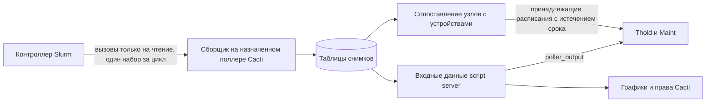

<!-- Source: README.md; SHA256: 16caa3e34c4d150a7fb1018f637e200a7580330f033b485047d8413bce09abba -->

<!-- translations:start -->
[English](../../../README.md) | [简体中文](../zh-CN/README.md) | [हिन्दी](../hi-IN/README.md) | [Español (España)](../es-ES/README.md) | [Español (Latinoamérica)](../es-419/README.md) | [العربية (السعودية)](../ar-SA/README.md) | [Afrikaans](../af-ZA/README.md) | [አማርኛ](../am-ET/README.md) | [العربية (مصر)](../ar-EG/README.md) | [العربية (المغرب)](../ar-MA/README.md) | [বাংলা](../bn-BD/README.md) | [Deutsch](../de-DE/README.md) | [فارسی](../fa-IR/README.md) | [Filipino](../fil-PH/README.md) | [Français](../fr-FR/README.md) | [Français (Maroc)](../fr-MA/README.md) | [Français (Sénégal)](../fr-SN/README.md) | [Hausa](../ha-NG/README.md) | [עברית](../he-IL/README.md) | [Bahasa Indonesia](../id-ID/README.md) | [Igbo](../ig-NG/README.md) | [Italiano](../it-IT/README.md) | [日本語](../ja-JP/README.md) | [한국어](../ko-KR/README.md) | [Malagasy](../mg-MG/README.md) | [मराठी](../mr-IN/README.md) | [Bahasa Melayu](../ms-MY/README.md) | [Nederlands](../nl-NL/README.md) | [Polski](../pl-PL/README.md) | [Português (Brasil)](../pt-BR/README.md) | [Русский](README.md) | [Kinyarwanda](../rw-RW/README.md) | [Soomaali](../so-SO/README.md) | [Svenska](../sv-SE/README.md) | [Kiswahili](../sw-KE/README.md) | [தமிழ்](../ta-IN/README.md) | [తెలుగు](../te-IN/README.md) | [ไทย](../th-TH/README.md) | [Türkçe](../tr-TR/README.md) | [Українська](../uk-UA/README.md) | [اردو](../ur-PK/README.md) | [Tiếng Việt](../vi-VN/README.md) | [isiXhosa](../xh-ZA/README.md) | [Yorùbá](../yo-NG/README.md) | [繁體中文](../zh-TW/README.md) | [isiZulu](../zu-ZA/README.md)
<!-- translations:end -->

# plugin_hpcsched

Плагин для Cacti 1.2, который строит графики состояния пакетного планировщика HPC рядом с устройствами, уже отслеживаемыми в Cacti: глубина очереди, ожидающие и выполняющиеся задания, причины ожидания заданий, состояния узлов и загрузка разделов. Первым поддерживаемым бэкендом является Slurm. Thold формирует оповещения по полученным источникам данных, а Maint может управляться на основе выведенных в режим drain узлов и резервирований для обслуживания.

> **Статус: в разработке, релизов пока нет.** Этап 2 (базовая основа) объединён с веткой `main`, а текущая ветка добавляет этап 3 (графики кластера и причины ожидания). Код устанавливается, обновляется и удаляется через API плагинов Cacti и отказывается работать на PHP ниже версии 8.2. Плагин ведёт реестр кластеров Slurm, каждый из которых назначен одному поллеру Cacti. Фоновый сборщик на основном поллере собирает по одному снимку состояния на кластер за интервал — либо запуская `squeue`, `scontrol` и `sshare` с флагом `--json`, либо опрашивая `slurmrestd` по HTTPS — и сохраняет количество заданий по состояниям и причинам ожидания, состояния узлов, разделы, резервирования и использование квот fair-share вместе с их актуальностью. Плагин поставляется с шаблонами Cacti и после подтверждения администратором создаёт или привязывает по одному устройству Cacti на кластер с графиками заданий по состояниям, ожидающих заданий по семействам причин, узлов по состояниям, CPU и загрузки — как для всего кластера, так и для каждого раздела, плюс возраст снимка. Страница обзора только для чтения отображает показатели по каждому кластеру с их актуальностью и представление причин ожидания по каждому кластеру, а доступная только администраторам страница состояния (health) показывает, что вернул каждый сбор данных и установлены ли шаблоны. Каждая страница и действие подчиняются правам доступа к устройствам в Cacti. На основе этих источников данных Thold может формировать оповещения, однако интеграция с Thold или Maint ещё не тестировалась — это задача этапа 4 и последующих этапов. Набор тестов покрывает синтетические команды Slurm и ответы `slurmrestd`, а CI также проверяет работу на реальном шестиузловом кластере Slurm в контейнерах, как описано ниже. На производственном кластере сборщик ещё не запускался. Ниже примечаний для операторов этот файл README описывает проектируемую архитектуру, а не уже реализованное поведение.

Это независимый проект, не аффилированный с проектом Cacti.

## Роли доступа

| Область | Доступ |
| --- | --- |
| HPC Scheduler View | Существующие страницы мониторинга. |
| HPC Scheduler Operator | Мониторинг, а также страница Operations и личные подтверждения при разборе инцидентов. |
| HPC Scheduler Admin | Доступ Operator, а также существующие настройки и административные действия. |

После копирования файлов обновления откройте страницу Plugins от имени администратора, чтобы зарегистрировать новую область прав (realm). Назначьте право Operator явно в разделе **Configuration > Users** или группах пользователей. При обновлении сохраняются существующие идентификаторы и выданные права для областей View и Admin. Доступ Admin наследует доступ Operator, а доступ Operator наследует доступ View при каждом запросе; это не добавляет сохранённых разрешений пользователям или группам. Для доступа к настройкам плагина в дополнение к праву Settings в Cacti также требуется право HPC Scheduler Admin.

Права доступа к устройствам Cacti по-прежнему ограничивают строки и действия, доступные каждому пользователю; кластер без привязанного устройства отображается на административных страницах каждому пользователю с правом плагина, но не в представлениях оператора, где перечисляются только кластеры, сопоставленные с устройством. Учётные данные, конфигурация, привязка, удаление и прочие административные изменения остаются на административных страницах. Подтверждения действуют только в текущей сессии пользователя, не более одного часа и только пока остаётся актуальным то же самое наблюдение. Новые или изменившиеся наблюдения аннулируют их. Они никогда не помечают сбойное измерение как исправное и не подавляют оповещения.

## Примечания для операторов для этапа 2

**Минимальные привилегии.** Плагин работает только на чтение. Выделите ему отдельную учётную запись пользователя Slurm без роли администратора или оператора (`AdminLevel=None` в `sacctmgr`). При наличии `PrivateData=jobs` (или `nodes`, `reservations`, `usage`) в `slurm.conf` этот пользователь видит только собственные записи, из-за чего подсчёты будут неполными, и плагин не сможет этого обнаружить. Снятие этого ограничения для учётной записи означает предоставление уровня оператора или администратора, что также разрешает внесение изменений; этот компромисс остаётся на усмотрение площадки. Для клиентских команд пользователю поллера Cacti требуются клиентские бинарные файлы Slurm и файл `slurm.conf`, обеспечивающий доступ к контроллеру; абсолютные пути к бинарным файлам задаются в настройках Configuration > Settings > HPC Scheduler. Для `slurmrestd` URL должен начинаться с `https://`, либо с `http://` только на адресе loopback. TLS-сертификаты проверяются, а перенаправления не выполняются. Необязательный список хостов slurmrestd в Configuration > Settings > HPC Scheduler ограничивает хосты и порты, которые можно указать для кластера.

**Удалённые поллеры.** В этом выпуске сбор данных выполняется только на основном поллере Cacti. Кластер, назначенный удалённому сборщику данных, не опрашивается: сборщик на нём отказывается от работы с записью причины в журнал, а страница состояния указывает имя этого кластера. Удалённый сбор данных относится к фазе 3.

**Память.** Каждый запуск сбора декодирует по одному ответу планировщика за раз, что занимает в памяти PHP примерно в 12 раз больше размера ответа (по измерениям — около 10 раз для записей заданий со структурой, как в Slurm, плюс сам текст). Во время выполнения лимит памяти PHP повышается до значения настройки Collection Memory (по умолчанию 1024 MiB) и допускаются ответы размером до (Collection Memory - 64) / 12 MiB — по умолчанию 80 MiB — даже если параметр Maximum Answer Size задан выше; при этом страница состояния выводит предупреждение. Более крупный ответ завершает соответствующий раздел с ошибкой превышения размера, а запуск, которому всё равно не хватило памяти, фиксируется как завершившийся сбоем. Для крупного кластера может потребоваться увеличить оба параметра; работа на 100 000 реальных записей заданий не измерялась.

**Файлы токенов.** Кластер `slurmrestd` указывает файл токена; сам токен никогда не сохраняется в базе данных, не отображается на страницах и не записывается в журнал. Файл должен находиться в одном из каталогов файлов токенов, заданных в Configuration > Settings > HPC Scheduler, без использования символических ссылок по пути, быть обычным файлом, принадлежащим пользователю поллера, с правом записи только для этого пользователя и содержать одну строку: токен или `SLURM_JWT=<token>`, как его выводит `scontrol token`. Если каталоги токенов не заданы, ни один кластер не сможет использовать `slurmrestd`. Эти два параметра находятся на странице Settings в Cacti, поэтому только права Admin плагина недостаточно для их изменения; разрешайте запись в каждый каталог токенов только пользователю root и пользователю поллера. Файл, доступный для чтения группе или другим пользователям, всё равно используется, но страница состояния выводит предупреждение. Страница состояния также предупреждает, если срок действия токена истекает в пределах настроенного времени предупреждения.

Чтобы ротировать токен без окна, в течение которого сборщик видит частично записанный файл, запишите новый токен рядом со старым и переименуйте его на место старого:

```sh
dir=/etc/cacti/hpcsched
tmp=$(mktemp "$dir/.token.XXXXXX")
scontrol token username=cactiread lifespan=2592000 > "$tmp"
chown cacti:cacti "$tmp"
chmod 0600 "$tmp"
mv -f "$tmp" "$dir/cluster1.token"
```

При следующем сборе будет прочитан новый файл. Генерация токенов командой `scontrol token` требует прав администратора Slurm; выполняйте её там, где это разрешено, и копируйте файл на поллер.

## Примечания для операторов для этапа 3

**Шаблоны.** При установке и обновлении импортируются шаблоны устройств, данных и графиков HPC Scheduler, а также копируется запрос данных по разделам в каталог Cacti `resource/script_server/`. Если этот каталог недоступен для записи пользователю, устанавливающему плагин, там уже есть другой файл с тем же именем, созданный не плагином, или это имя является символической ссылкой, импорт останавливается, файл остаётся нетронутым, а страница состояния сообщает, что нужно сделать; кнопка Install Templates на странице состояния повторяет попытку. Идентичная копия, созданная вручную, используется, но остаётся под вашим управлением. При удалении плагина файл запроса удаляется только в том случае, если он был записан плагином и не изменялся, при этом шаблоны, устройства и графики сохраняются.

**Устройства кластеров.** Раздел HPC Clusters > Device перед созданием чего-либо показывает, что именно добавит устройство (графики, источники данных, RRD-файлы и вызовы script server за один опрос). Create Device создаёт устройство с именем хоста в зарезервированном домене `.invalid` и без проверки доступности; Map Device вместо этого привязывает графики к существующему устройству, не меняя его настройки. Каждый график кластера и каждый график раздела имеет собственный источник данных: шесть для кластера и пять на раздел, по одному вызову script server на источник данных кластера и по одному на каждое значение раздела (32) за один опрос. Разделы, добавленные позже, индексируются, когда сборщик их обнаруживает, и получают графики со страницы Cacti New Graphs; удалённый раздел перестаёт опрашиваться, но сохраняет свои графики. Удаление устройства отвязывает кластер и сохраняет его.

**Что подсчитывают графики.** В ожидающие задания не включаются отложенные задания, у которых есть собственный ряд данных. Ожидающий массив заданий учитывает оставшиеся задачи. Задание или узел, входящие в несколько разделов, учитываются один раз на графиках кластера и по одному разу в каждом разделе, поэтому сумма по графикам разделов не обязана совпадать с графиками кластера. Причины ожидания сгруппированы в одиннадцать семейств ([ADR 0011](../../decisions/0011-pending-reason-families-and-counting.md)); представление причин ожидания перечисляет исходные причины, включая входящие в Other. Каждое задание сообщает только последнюю причину, которую проверил планировщик. Знаменатель загрузки включает узлы в состоянии drain, down и другие недоступные узлы. Устаревшие или сбойные данные отображаются как `U`, никогда как ноль; значение `age` остаётся числовым.

**Оповещения.** Thold может формировать оповещения по любому из этих источников данных; задавайте длительность в Thold не менее одного интервала сбора и настройте оповещение по `age`, чтобы отслеживать остановку сборщика. Сквозная проверка Thold относится к этапу 4.

**Проверено на реальном выводе Slurm.** CI запускает шестиузловой кластер Slurm в контейнерах (версия 26.05.5 при каждом изменении, версия 25.11.8, собранная из исходников, при отправке в `main`, еженедельно и по запросу) и проверяет состояния узлов, резервирование для обслуживания, причины ожидания и массивы заданий в том виде, в каком их разбирает плагин, а затем собирает данные с этого кластера собственными транспортами плагина — через команды и `slurmrestd`. Более ранние выпуски покрыты только синтетическими фикстурами. На производственном кластере сборщик по-прежнему не запускался.

**Права доступа.** Кластер на устройстве отображается, экспортируется и изменяется на любой странице плагина только для пользователей, которым Cacti разрешает доступ к этому устройству; для привязки устройства также требуются права на целевое устройство. Кластер без устройства виден всем пользователям с правом плагина. Кластер, всё ещё привязанный к устройству, которое было удалено, пока плагин был отключён, отображается только пользователям с правом HPC Scheduler Admin, которые могут создать или привязать для него устройство. Доступ к графикам регулируется средствами самого Cacti.

## Зачем это нужно

Операторы, использующие Cacti, уже строят графики для своих вычислительных узлов. На этих графиках не хватает представления со стороны планировщика, что оставляет два пробела:

- **Нет ответа на вопрос «почему работа не запускается».** Slurm фиксирует причину для каждого ожидающего задания. Заполненная очередь на фоне графиков простаивающих узлов не объясняет, вызвано ли это приоритетами, ограничениями ресурсов, удержаниями, зависимостями или узлами в состоянии drain.
- **Нет связи между состоянием планировщика и оповещениями.** Thold отправляет оповещения об устройстве, которое администратор уже перевёл в состояние drain, а расписания Maint администраторы создают вручную.

Плагин собирает один кешированный снимок на кластер, публикует его как обычные источники данных и графики Cacti, сопоставляет узлы планировщика с существующими устройствами Cacti и может помещать узлы в состоянии drain и резервирования для обслуживания в Maint. Он повторно использует права доступа Cacti, удалённые сборщики данных, Thold и Maint и работает по отношению к планировщику только на чтение.

## Планируемый объём работ

| Фаза | Объём работ | Этапы |
|---|---|---|
| 0, исследование | Матрица выпусков Slurm, подтверждение поведения upstream, нагрузка на контроллер, фикстуры именования узлов | [M1](https://github.com/somethingwithproof/plugin_hpcsched/milestone/1) |
| 1, графики кластера | Глубина очереди, ожидающие и выполняющиеся задания, причины ожидания, состояния узлов, загрузка разделов, оповещения Thold, страница состояния, релиз | [M2](https://github.com/somethingwithproof/plugin_hpcsched/milestone/2), [M3](https://github.com/somethingwithproof/plugin_hpcsched/milestone/3), [M4](https://github.com/somethingwithproof/plugin_hpcsched/milestone/4) |
| 2, узлы и обслуживание | Сопоставление узлов с устройствами, состояние отдельных узлов, автоматические окна Maint для узлов в состоянии drain и резервирований для обслуживания | [M5](https://github.com/somethingwithproof/plugin_hpcsched/milestone/5) |
| 3, учёт ресурсов | Использование квот fair-share, ограниченная статистика учёта ресурсов, удалённые сборщики данных | [M6](https://github.com/somethingwithproof/plugin_hpcsched/milestone/6) |

Вне рамок проекта: любые операции записи в планировщик (отправка, отмена, удержание, перевод в drain, возобновление работы), собственный движок оповещений плагина, движок отчётности или биллинга, а также ряды данных по отдельным пользователям и заданиям. Бэкенды PBS Pro, OpenPBS и LSF находятся на стадии исследования.

## Целевые параметры совместимости

| Компонент | Целевой уровень |
|---|---|
| Cacti | 1.2.31 или новее, без патчей ядра |
| PHP | 8.2 или новее; `setup.php` остаётся синтаксически совместимым с 8.0, чтобы неподдерживаемая среда выполнения получала отказ вместо поломки интерфейса Cacti |
| Slurm | 25.05, 25.11 и 26.05 — три последних выпуска ([ADR 0013](../../decisions/0013-three-latest-slurm-releases.md)); 25.11 и 26.05 тестируются на работающем кластере, 25.05 — только на фикстурах. Клиентские команды являются транспортом по умолчанию ([ADR 0012](../../decisions/0012-client-commands-default-transport.md)) и используют настройку парсера данных: по умолчанию v0.0.43, который SchedMD удаляет в версии 27.05, либо v0.0.44 или v0.0.45 в выпусках, которые их содержат. Кластеры slurmrestd автоматически определяют новейший парсер, поддерживаемый демоном |
| Thold, Maint | Без изменений в Thold; интеграция с Maint является предложением, требующим согласования с сопровождающими Maint |

## Архитектура

- [docs/PLAN.md](../../PLAN.md) — полный план: архитектура, факты об upstream, на которые он опирается (с источниками и явным списком неподтверждённых допущений), сопоставление узлов, модель состояний, границы безопасности, расчёты производительности, тестирование и риски.
- [docs/decisions/](../../decisions) — записи об архитектурных решениях.
- [docs/REQUIREMENTS.md](../../REQUIREMENTS.md) — сопоставляет каждый идентификатор требования с его задачей.



## Как отслеживается работа

- **Этапы (Milestones)** соответствуют этапам плана. У каждого есть эпик-задача со списком подзадач и критериями завершения.
- **Задачи (Issues)** классифицируются метками: `type: requirement`, `type: research`, `type: decision`, `type: epic`. Задачи требований содержат нумерованные проверяемые требования (`REQ-AREA-NNN`) и критерии приёмки.
- **Метки** также включают `area:`, `phase:`, `priority:` и `status:`. См. [CONTRIBUTING.md](../../../CONTRIBUTING.md#labels).
- [Доска проекта](https://github.com/users/somethingwithproof/projects/10) отображает все задачи по этапам.

## Участие в разработке

Ознакомьтесь с [CONTRIBUTING.md](../../../CONTRIBUTING.md). Для коммитов требуется подпись DCO. Обсуждение архитектуры происходит в задачах; открытые решения помечаются меткой `type: decision`.

## Безопасность

Сообщайте об уязвимостях конфиденциально; см. [SECURITY.md](../../../SECURITY.md).

## Лицензия

GNU General Public License v2.0 — та же лицензия, что и у Cacti и его плагинов. См. [LICENSE](../../../LICENSE).
