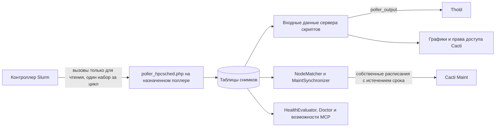

<!-- Source: README.md; SHA256: 938114d41dbd516f9dfcd94619c4fc73ef56b4da1dd693010588a93cce250534 -->

<!-- translations:start -->
[English](../../../README.md) | [简体中文](../zh-CN/README.md) | [हिन्दी](../hi-IN/README.md) | [Español (España)](../es-ES/README.md) | [Español (Latinoamérica)](../es-419/README.md) | [العربية (السعودية)](../ar-SA/README.md) | [Afrikaans](../af-ZA/README.md) | [አማርኛ](../am-ET/README.md) | [العربية (مصر)](../ar-EG/README.md) | [العربية (المغرب)](../ar-MA/README.md) | [Български](../bg-BG/README.md) | [বাংলা](../bn-BD/README.md) | [Bosanski](../bs-BA/README.md) | [Deutsch](../de-DE/README.md) | [Ελληνικά](../el-GR/README.md) | [فارسی](../fa-IR/README.md) | [Filipino](../fil-PH/README.md) | [Français](../fr-FR/README.md) | [Français (Maroc)](../fr-MA/README.md) | [Français (Sénégal)](../fr-SN/README.md) | [Hausa](../ha-NG/README.md) | [עברית](../he-IL/README.md) | [Hrvatski](../hr-HR/README.md) | [Bahasa Indonesia](../id-ID/README.md) | [Igbo](../ig-NG/README.md) | [Italiano](../it-IT/README.md) | [日本語](../ja-JP/README.md) | [ქართული](../ka-GE/README.md) | [한국어](../ko-KR/README.md) | [Latviešu](../lv-LV/README.md) | [Malagasy](../mg-MG/README.md) | [मराठी](../mr-IN/README.md) | [Bahasa Melayu](../ms-MY/README.md) | [Nederlands](../nl-NL/README.md) | [Polski](../pl-PL/README.md) | [Português (Brasil)](../pt-BR/README.md) | [Português (Portugal)](../pt-PT/README.md) | [Русский](README.md) | [Kinyarwanda](../rw-RW/README.md) | [Soomaali](../so-SO/README.md) | [Српски](../sr-RS/README.md) | [Svenska](../sv-SE/README.md) | [Kiswahili](../sw-KE/README.md) | [தமிழ்](../ta-IN/README.md) | [తెలుగు](../te-IN/README.md) | [ไทย](../th-TH/README.md) | [Türkçe](../tr-TR/README.md) | [Українська](../uk-UA/README.md) | [اردو](../ur-PK/README.md) | [Tiếng Việt](../vi-VN/README.md) | [isiXhosa](../xh-ZA/README.md) | [Yorùbá](../yo-NG/README.md) | [繁體中文](../zh-TW/README.md) | [isiZulu](../zu-ZA/README.md)
<!-- translations:end -->

# plugin_hpcsched

Плагин для Cacti 1.2 (`hpcsched`, версия `0.1.0-dev`), который строит графики состояния пакетного планировщика HPC рядом с устройствами, уже отслеживаемыми в Cacti: глубина очереди, ожидающие и выполняющиеся задания, причины ожидания заданий, состояния узлов, загрузка разделов и использование квот fair-share по учётным записям. Реализованный бэкенд: Slurm. Thold формирует оповещения по полученным источникам данных, а включаемый по желанию синхронизатор Maint управляет окнами обслуживания Cacti Maint на основе выведенных в режим drain, отключённых (down) и зарезервированных под обслуживание вычислительных узлов Slurm.

> **Статус: в разработке, релизов пока нет.** Эта ветка реализует основу плагина, графики кластера и разделов, семейства причин ожидания, сопоставление вычислительных узлов Slurm с устройствами Cacti, включаемую по желанию синхронизацию окон Cacti Maint, сводки fair-share по учётным записям, выполнение и репликацию на удалённых сборщиках данных, CLI для Configuration-as-Code (CasC) и операций, а также хуки экосистемы Cacti (CasC, Doctor и MCP / Abilities API v2). Набор тестов покрывает синтетические команды Slurm и ответы `slurmrestd`, а CI проверяет работу на живом шестиузловом кластере Slurm в контейнерах. На производственном кластере сборщик ещё не запускался, и сквозной тест воспроизведения с Thold пока не включён в CI.

Это независимый проект, не аффилированный с проектом Cacti.

## Что реализовано

- **Жизненный цикл и схема (v3)**: установка, идемпотентное обновление, удаление (с сохранением таблиц плагина по умолчанию) и минимальная версия PHP 8.2 при сохранении синтаксической совместимости точек входа с PHP 8.0. Схема v3 добавляет таблицы `plugin_hpcsched_node_map` и `plugin_hpcsched_maint_link` наряду с таблицами кластеров, запусков, секций, счётчиков заданий, счётчиков узлов, узлов, разделов, резервирований и долей.
- **Сбор данных Slurm в режиме только для чтения на основном и удалённых поллерах**: `poller_bottom` запускает `poller_hpcsched.php --cluster=N` в фоновом режиме на каждом поллере (`poller_id`) для назначенных ему включённых кластеров. Каждый запуск собирает один кэшированный снимок на кластер через клиентские команды (`squeue`, `scontrol`, `sshare` с `--json`) или `slurmrestd` по HTTPS (HTTP на loopback допускается с предупреждением о состоянии). `INFO` объявляет `remote_collect:1, remote_poller:1`, а `replicate_out` реплицирует несекретные определения `plugin_hpcsched_cluster` на удалённые сборщики (`poller_id >= 2`); содержимое файлов токенов никогда не читается и не реплицируется.
- **Шаблоны Cacti и графики кластера**: поставляет шаблоны устройств, данных и графиков (`templates/hpcsched-templates.xml`), а также запрос данных сервера скриптов для разделов (`scripts/ss_hpcsched_cluster.php`, `scripts/ss_hpcsched_partitions.php`). После подтверждения администратором создаёт или привязывает по одному устройству Cacti на кластер с графиками заданий по состояниям, ожидающих заданий по семействам причин, узлов по состояниям, CPU, загрузки (для кластера и по каждому разделу) и возраста снимка.
- **Сопоставление узлов Slurm с устройствами и синхронизация Cacti Maint**: четырёхуровневый сопоставитель с линейным временем работы (`NodeMatcher`) связывает вычислительные узлы Slurm с существующими записями `host` в Cacti (точное имя хоста, точный адрес, точное описание/псевдоним или первая метка DNS для не-IP-имён) и помечает множественные совпадения или дублирующиеся привязки устройств как `ambiguous`, не прибегая к угадыванию. `HostList::expand()` разворачивает списки хостов резервирований Slurm (до 10 000 узлов). `MaintSynchronizer` создаёт, продлевает и удаляет принадлежащие плагину разовые расписания Cacti Maint, отслеживаемые в `plugin_hpcsched_maint_link`, для сопоставленных узлов в состоянии `DRAIN`, `DRAINING`, `DOWN` или в активных резервированиях `MAINT`/`MAINTENANCE`, не изменяя расписания Maint, созданные администратором.
- **Сводки fair-share по учётным записям**: при включённом `collect_shares` собирает строки ассоциаций учётных записей Slurm в `plugin_hpcsched_share` (отбрасывая строки пользователей согласно [ADR 0010](../../decisions/0010-bound-series-cardinality.md)). `ShareSummary` и `ShareRepository` вычисляют количество учётных записей и разделов, суммы сырого и эффективного использования, минимальные/максимальные/средние коэффициенты fair-share и ведущие учётные записи; количество учётных записей передаётся в `hpcsched-get-queue-summary`.
- **CasC и CLI для операций (`cli/hpcsched.php`)**: экспорт конфигурации в YAML/XML, валидация, планирование различий в режиме пробного запуска (`dry-run`), применение с подтверждением, структурированный вывод состояния и включаемая по желанию синхронизация Maint (`sync-maint --dry-run` / `--apply`).
- **Хуки экосистемы (`setup.php`)**: `casc_register_providers`, `doctor_register_checks` и `abilities_register`.

## Роли доступа

| Область | Доступ |
| --- | --- |
| HPC Scheduler View | Обзор кластеров и причины ожидания только для чтения (`hpcsched.php`). |
| HPC Scheduler Operator | Доступ View плюс страница Operations (`hpcsched_operator.php`) и личные подтверждения при разборе инцидентов. |
| HPC Scheduler Admin | Доступ Operator плюс администрирование кластеров (`hpcsched_clusters.php`) и страница состояния (`hpcsched_health.php`). |

После копирования файлов обновления откройте страницу Plugins от имени администратора, чтобы зарегистрировать новые области и хуки. Назначьте область Operator явным образом в разделе **Configuration > Users** или для групп пользователей. Обновления сохраняют существующие идентификаторы областей View и Admin и выданные права. Доступ Admin наследует доступ Operator, а доступ Operator наследует доступ View при каждом запросе; это не добавляет сохранённых прав пользователям или группам. Для настройки параметров плагина помимо права Settings в Cacti также требуется доступ HPC Scheduler Admin.

Права доступа к устройствам в Cacti ограничивают строки и действия, доступные каждому пользователю. Кластер, привязанный к устройству Cacti, отображается, экспортируется и изменяется только для пользователей, которым Cacti разрешает доступ к этому устройству; для привязки устройства также требуется разрешение на целевое устройство. Кластер без устройства отображается на административных страницах для пользователей с областью плагина, но не в представлениях оператора, которые показывают только кластеры, привязанные к устройству. Кластер, привязанное устройство которого было удалено при отключённом плагине, виден только пользователям с доступом HPC Scheduler Admin. Подтверждения действуют только в текущей сессии пользователя, не более одного часа и только пока то же самое наблюдение остаётся свежим. Новые или изменившиеся наблюдения аннулируют их. Они никогда не помечают неудачное измерение как исправное и не подавляют оповещения.

## Примечания для операторов

### Безопасность, минимальные привилегии и файлы токенов

Плагин работает только в режиме чтения. Выделите ему отдельного пользователя Slurm без роли администратора или оператора (`AdminLevel=None` в `sacctmgr`). При наличии `PrivateData=jobs` (или `nodes`, `reservations`, `usage`) в `slurm.conf` такой пользователь видит только собственные записи, из-за чего подсчёт становится неполным, и плагин не может этого обнаружить. Снятие этого ограничения для учётной записи требует уровня оператора или администратора, что также разрешает изменения; этот компромисс остаётся на усмотрение площадки.

Для клиентских команд пользователю поллера Cacti требуются клиентские бинарные файлы Slurm (`squeue`, `scontrol` и при необходимости `sshare`), а также `slurm.conf`, обеспечивающий связь с контроллером; пути к бинарным файлам задаются как абсолютные пути в **Configuration > Settings > HPC Scheduler**.

Для `slurmrestd` URL должен начинаться с `https://`, либо с `http://` только для loopback-адреса. Сертификаты TLS проверяются, а перенаправления не выполняются. Необязательный список хостов `slurmrestd` в **Configuration > Settings > HPC Scheduler** ограничивает хосты и порты, которые может указывать кластер.

Кластер `slurmrestd` указывает файл токена; сам токен никогда не сохраняется в базе данных, не отображается на страницах, не экспортируется через CasC и не записывается в журнал. Файл должен находиться внутри одного из каталогов Token File Directories, настроенных в **Configuration > Settings > HPC Scheduler**, быть доступным без символических ссылок и представлять собой обычный файл, принадлежащий пользователю поллера и доступный для записи только этому пользователю, содержащий одну строку: сам токен или `SLURM_JWT=<token>`, как выводит `scontrol token`. Если каталоги токенов не заданы, ни один кластер не сможет использовать `slurmrestd`. Каждый каталог токенов должен быть доступен для записи только пользователю root и пользователю поллера. Файл, доступный для чтения группе или другим пользователям, всё равно используется, но страница состояния выводит предупреждение; она также предупреждает, если срок действия токена истекает в пределах настроенного окна предупреждения.

Чтобы ротировать токен атомарно:

```sh
dir=/etc/cacti/hpcsched
tmp=$(mktemp "$dir/.token.XXXXXX")
scontrol token username=cactiread lifespan=2592000 > "$tmp"
chown cacti:cacti "$tmp"
chmod 0600 "$tmp"
mv -f "$tmp" "$dir/cluster1.token"
```

Следующий сбор данных прочитает новый файл. Генерация токенов командой `scontrol token` требует прав администратора Slurm; выполните её там, где это разрешено, и скопируйте файл на поллер.

### Удалённые сборщики данных

`INFO` объявляет `remote_collect:1, remote_poller:1`. `hpcsched_poller_bottom()` запускает `poller_hpcsched.php` на каждом поллере для включённых кластеров, назначенных этому `poller_id`, а `hpcsched_replicate_out()` реплицирует несекретные строки `plugin_hpcsched_cluster` на удалённые поллеры (`poller_id >= 2`). Файлы токенов и клиентские бинарные файлы Slurm должны присутствовать локально на назначенном удалённом поллере; содержимое токенов никогда не реплицируется.

### Ограничения памяти

Каждый запуск сбора декодирует по одному ответу планировщика за раз, что занимает в памяти PHP примерно в 12 раз больше размера ответа (измерено примерно в 10 раз для записей заданий в формате Slurm плюс сам текст). Сборщик повышает лимит памяти PHP до значения настройки Collection Memory (по умолчанию 1024 MiB) и допускает ответы размером до `(Collection Memory - 64) / 12` MiB (по умолчанию 80 MiB), даже если Maximum Answer Size задан выше; страница состояния предупреждает, когда Maximum Answer Size превышает этот расчётный предел. Более крупный ответ приводит к ошибке соответствующей секции из-за превышения размера, а запуск, которому всё же не хватит памяти, фиксирует ошибку памяти и освобождает свою аренду (lease) и слот процесса через обработчик завершения. Крупным кластерам может потребоваться увеличение обеих настроек; 100 000 реальных записей заданий ещё не измерялись.

### Шаблоны, устройства кластера и подсчёт графиков

Установка и обновление импортируют шаблоны устройств, данных и графиков HPC Scheduler и копируют запрос данных разделов в каталог `resource/script_server/` в Cacti. Если этот каталог недоступен для записи, там уже существует другой файл с таким же именем или целевой путь является символической ссылкой, импорт останавливается, оставляет файл без изменений и сообщает о состоянии на странице состояния, где **Install Templates** повторяет попытку. Удаление удаляет файл запроса только в том случае, если его записал плагин и он не изменялся, сохраняя шаблоны, устройства и графики.

**HPC Clusters > Device** перед созданием чего-либо показывает предварительный просмотр графиков, источников данных, RRD-файлов и вызовов сервера скриптов за один цикл опроса. **Create Device** создаёт устройство с именем хоста в зарезервированном домене `.invalid` и без проверки доступности; **Map Device** привязывает графики к существующему устройству, не меняя его настроек. Каждый график кластера и график раздела имеет собственный источник данных: шесть для кластера и пять на каждый раздел. Добавленные позже разделы автоматически переиндексируются, когда сборщик обнаруживает изменение; удалённые разделы перестают опрашиваться, но сохраняют свои графики. Удаление устройства отвязывает кластер (и очищает соответствующие строки `plugin_hpcsched_node_map`), сохраняя запись кластера.

Pending исключает удержанные задания (`held`), для которых существует отдельная серия. Ожидающий массив заданий подсчитывает оставшиеся задачи. Задание или узел в нескольких разделах учитывается один раз на графиках кластера и по одному разу в каждом разделе, поэтому суммы по разделам не обязаны равняться общему числу по кластеру. Причины ожидания сгруппированы в одиннадцать семейств ([ADR 0011](../../decisions/0011-pending-reason-families-and-counting.md)); представление причин ожидания перечисляет исходные причины, включая относящиеся к `Other`. В знаменатель загрузки включаются узлы в состоянии drained, down и другие недоступные узлы. Устаревшие или завершившиеся ошибкой данные передаются как `U`, никогда как ноль; `age` остаётся числовым значением.

Для оповещений настройте Thold на любом из источников данных кластера или раздела с длительностью не менее одного интервала сбора и настройте оповещение по `age` для обнаружения остановившегося сборщика.

## CLI и хуки экосистемы

### Точка входа сборщика

`hpcsched_poller_bottom()` запускает `poller_hpcsched.php` автоматически; его также можно запустить вручную на поллере, назначенном кластеру:

```sh
php /path/to/cacti/plugins/hpcsched/poller_hpcsched.php --cluster=N [--force] [--debug]
```

`--force` выполняется даже при отключённом плагине для диагностики из командной строки.

### CLI для Configuration-as-Code, состояния и синхронизации Maint

```sh
php /path/to/cacti/plugins/hpcsched/cli/hpcsched.php export [--format=yaml|xml] [--file=PATH]
php /path/to/cacti/plugins/hpcsched/cli/hpcsched.php validate --file=PATH [--format=yaml|xml]
php /path/to/cacti/plugins/hpcsched/cli/hpcsched.php plan --file=PATH [--format=yaml|xml]
php /path/to/cacti/plugins/hpcsched/cli/hpcsched.php apply --file=PATH --confirm=PLAN_HASH [--format=yaml|xml]
php /path/to/cacti/plugins/hpcsched/cli/hpcsched.php health [--format=text|json]
php /path/to/cacti/plugins/hpcsched/cli/hpcsched.php sync-maint [--dry-run | --apply] [--cluster=ID] [--format=text|json]
```

- `export` записывает новые файлы с правами `0600` (или в stdout) и заменяет настроенные пути `token_file` на `[REDACTED]`. `plan` и `apply` отклоняют встроенные поля `jwt`, `secret` и `password` и сохраняют существующие локальные пути `token_file`, если передано `[REDACTED]`. Для `apply` требуется точный параметр `--confirm=PLAN_HASH`, выведенный командой `plan`.
- `health` оценивает актуальность схемы, свежесть кластеров, результаты запусков, доступность Maint и предупреждения, не обращаясь к планировщикам и не читая файлы токенов.
- `sync-maint` по умолчанию работает в режиме `--dry-run` и предварительно показывает или применяет расписания Cacti Maint для сопоставленных узлов Slurm в состоянии `DRAIN`, `DRAINING`, `DOWN` или в активных резервированиях `MAINT`/`MAINTENANCE` (горизонт drain/down по умолчанию 3600 с, запас продления 600 с). Команда отклоняет `--apply`, если отсутствуют таблицы `plugin_maint_schedules` и `plugin_maint_hosts`, и обновляет или удаляет только расписания, записанные в `plugin_hpcsched_maint_link`.

### Хуки экосистемы

При наличии соответствующих плагинов Cacti или интеграций хоста `setup.php` регистрирует:

- `casc_register_providers`: экспортирует, проверяет, планирует и применяет с подтверждением конфигурацию `hpcsched` (`yaml` и `xml`, схема v1) со скрытием секретов.
- `doctor_register_checks`: предоставляет четыре диагностические проверки только для чтения (`hpcsched.schema`, `hpcsched.cluster_freshness`, `hpcsched.token_health`, `hpcsched.maint_sync`).
- `abilities_register`: регистрирует три идемпотентные, неразрушающие возможности только для чтения в категории `hpcsched`, ограниченные областью HPC Scheduler View (и правами на устройства для сводок кластеров): `hpcsched-list-clusters`, `hpcsched-get-queue-summary` и `hpcsched-get-health`.

## Зачем это нужно

Операторы, использующие Cacti, уже строят графики своих вычислительных узлов. На этих графиках отсутствует взгляд со стороны планировщика, что оставляет два пробела:

- **Нет ответа на вопрос "почему работа не запускается".** Slurm фиксирует причину для каждого ожидающего задания. Заполненная очередь рядом с графиками простаивающих узлов не показывает, вызвано ли это приоритетом, ограничениями ресурсов, удержаниями, зависимостями или узлами в состоянии drain.
- **Нет связи между состоянием планировщика и оповещениями.** Thold отправляет оповещения об устройстве, которое администратор уже вывел в режим drain, а расписания Maint администраторы создают вручную.

Плагин собирает один кэшированный снимок на кластер, публикует его как обычные источники данных и графики Cacti, сопоставляет узлы планировщика с существующими устройствами Cacti и синхронизирует принадлежащие плагину окна Maint с истекающим сроком действия для узлов в состоянии drain, down и в резервированиях обслуживания. Он повторно использует права доступа Cacti, удалённые сборщики данных, Thold и Maint, оставаясь строго в режиме только для чтения по отношению к планировщику.

## Область применения и границы

Вне рамок проекта: любой путь записи в планировщик (отправка, отмена, удержание, вывод в drain, возобновление), собственный движок оповещений плагина, движок отчётности или расчёта стоимости, а также временные ряды по пользователям или по заданиям. Бэкенды PBS Pro, OpenPBS и LSF находятся только на этапе исследования.

## Требования и совместимость

| Компонент | Цель |
|---|---|
| Cacti | 1.2.31 или новее (`compat = 1.2.31`), без патчей ядра |
| PHP | 8.2 или новее; точки входа остаются синтаксически совместимыми с 8.0 и отклоняют активацию на 8.1, чтобы неподдерживаемая среда выполнения получила отказ вместо сломанного интерфейса Cacti |
| Slurm | 25.05, 25.11 и 26.05 ([ADR 0013](../../decisions/0013-three-latest-slurm-releases.md)); 26.05.5 тестируется в CI при каждом изменении на шестиузловом кластере в контейнерах, 25.11.8 на `main`, еженедельно и по запросу, а 25.05 только на синтетических фикстурах. Клиентские команды по умолчанию используют парсер данных `v0.0.43` (с возможностью выбора `v0.0.44` и `v0.0.45`); кластеры `slurmrestd` определяют новейший парсер, предоставляемый демоном |
| Thold, Maint | Изменения в Thold не требуются; `sync-maint` интегрируется с таблицами `plugin_maint_schedules` и `plugin_maint_hosts` плагина Cacti Maint через таблицу связей, принадлежащую плагину (`plugin_hpcsched_maint_link`) |

## Разработка и тестирование

Рабочий процесс CI (`.github/workflows/plugin-ci-workflow.yml`) тестирует PHP от 8.2 до 8.5 с Cacti `release/1.2.31` и `1.2.x`, проверку синтаксиса точек входа в PHP 8.0, отказ в PHP 8.1, PHPStan, проверку gettext/переводов, лицензирование REUSE, линтинг рабочих процессов, проверки потока устройств кластера и расхождения экспорта шаблонов, а также живой шестиузловый кластер Slurm (`slurm-live`).

С использованием зафиксированной общей среды тестирования Pest для плагинов Cacti (`CACTI_PEST_BIN`) и одноразовой базы данных Cacti:

```sh
# Unit tests
"$CACTI_PEST_BIN" --configuration=phpunit.xml

# Lifecycle integration tests (disposable database only)
CACTI_PATH=/path/to/cacti HPCSCHED_TEST_DATABASE=disposable "$CACTI_PEST_BIN" --configuration=phpunit-integration.xml

# Static analysis (against Cacti 1.2.31)
CACTI_PATH=/path/to/cacti phpstan analyse -c phpstan.neon --no-progress

# Translation template, catalogs, and localized README checks
sh locales/build_gettext.sh --check
```

## Проектирование

- [docs/PLAN.md](../../PLAN.md) представляет собой план архитектуры и проектирования: факты из апстрима с указанием источников, сопоставление узлов, модель состояний, границы безопасности, расчёты производительности, тестирование и риски.
- [docs/decisions/](../../decisions/) содержит записи об архитектурных решениях.
- [docs/REQUIREMENTS.md](../../REQUIREMENTS.md) сопоставляет каждый идентификатор требования с его задачей.



## Как отслеживается работа

- **Этапы** следуют этапам плана. У каждого есть эпик-задача со списком подзадач и критериями завершения.
- **Задачи** классифицируются метками: `type: requirement`, `type: research`, `type: decision`, `type: epic`. Задачи требований содержат нумерованные проверяемые требования (`REQ-AREA-NNN`) и критерии приёмки.
- **Метки** также включают `area:`, `phase:`, `priority:` и `status:`. См. [CONTRIBUTING.md](../../../CONTRIBUTING.md#labels).
- На [доске проекта](https://github.com/users/somethingwithproof/projects/10) отображаются все задачи по всем этапам.

## Участие в разработке

Прочтите [CONTRIBUTING.md](../../../CONTRIBUTING.md). Для коммитов требуется подпись DCO (`git commit -s`). Обсуждение архитектуры ведётся в задачах; открытые решения помечаются меткой `type: decision`.

## Безопасность

Сообщайте об уязвимостях конфиденциально; см. [SECURITY.md](../../../SECURITY.md).

## Лицензия

GNU General Public License v2.0, та же лицензия, что и у Cacti и его плагинов. См. [LICENSE](../../../LICENSE).
