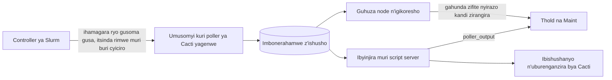

<!-- Source: README.md; SHA256: 16caa3e34c4d150a7fb1018f637e200a7580330f033b485047d8413bce09abba -->

<!-- translations:start -->
[English](../../../README.md) | [简体中文](../zh-CN/README.md) | [हिन्दी](../hi-IN/README.md) | [Español (España)](../es-ES/README.md) | [Español (Latinoamérica)](../es-419/README.md) | [العربية (السعودية)](../ar-SA/README.md) | [Afrikaans](../af-ZA/README.md) | [አማርኛ](../am-ET/README.md) | [العربية (مصر)](../ar-EG/README.md) | [العربية (المغرب)](../ar-MA/README.md) | [বাংলা](../bn-BD/README.md) | [Deutsch](../de-DE/README.md) | [فارسی](../fa-IR/README.md) | [Filipino](../fil-PH/README.md) | [Français](../fr-FR/README.md) | [Français (Maroc)](../fr-MA/README.md) | [Français (Sénégal)](../fr-SN/README.md) | [Hausa](../ha-NG/README.md) | [עברית](../he-IL/README.md) | [Bahasa Indonesia](../id-ID/README.md) | [Igbo](../ig-NG/README.md) | [Italiano](../it-IT/README.md) | [日本語](../ja-JP/README.md) | [한국어](../ko-KR/README.md) | [Malagasy](../mg-MG/README.md) | [मराठी](../mr-IN/README.md) | [Bahasa Melayu](../ms-MY/README.md) | [Nederlands](../nl-NL/README.md) | [Polski](../pl-PL/README.md) | [Português (Brasil)](../pt-BR/README.md) | [Русский](../ru-RU/README.md) | [Kinyarwanda](README.md) | [Soomaali](../so-SO/README.md) | [Svenska](../sv-SE/README.md) | [Kiswahili](../sw-KE/README.md) | [தமிழ்](../ta-IN/README.md) | [తెలుగు](../te-IN/README.md) | [ไทย](../th-TH/README.md) | [Türkçe](../tr-TR/README.md) | [Українська](../uk-UA/README.md) | [اردو](../ur-PK/README.md) | [Tiếng Việt](../vi-VN/README.md) | [isiXhosa](../xh-ZA/README.md) | [Yorùbá](../yo-NG/README.md) | [繁體中文](../zh-TW/README.md) | [isiZulu](../zu-ZA/README.md)
<!-- translations:end -->

# plugin_hpcsched

Umugereka wa Cacti 1.2 ushushanya imiterere y'ikigenga cy'imirimo ya HPC (batch scheduler) iruhande rw'ibikoresho Cacti isanzwe igenzura: uburebure bw'umurongo w'imirimo itegereje, imirimo itegereje ugereranyije n'irimo gukora, impamvu imirimo itegereje, imiterere ya za node, n'ikoreshwa ry'ibice (partitions). Slurm ni yo backend ya mbere. Thold itanga impuruza ku masoko y'amakuru avamo, kandi Maint ishobora kuyoborwa na za node zahagaritswe (drained) n'ibibanza byateganyirijwe isanwa (maintenance reservations).

> **Imiterere: biracyari mu ikorwa, nta gisohorwa kiraboneka.** Icyiciro cya 2 (urufatiro) cyahujwe kuri `main`, kandi iri shami ryongeraho icyiciro cya 3 (ibishushanyo bya cluster n'impamvu z'itegereza). Kode irinjizwa, ikavugururwa, kandi ikavanwamo binyuze muri API y'imigereka ya Cacti kandi yanga PHP iri munsi ya 8.2. Igaragaza urutonde rwa za cluster za Slurm, buri imwe igenerwa poller imwe ya Cacti. Umusomyi wo mu nyuma (background reader) kuri poller nyamukuru akusanya ishusho imwe (snapshot) kuri buri cluster muri buri gihe cyagenwe, haba mu gukoresha `squeue`, `scontrol`, na `sshare` hamwe na `--json` cyangwa mu gusoma `slurmrestd` binyuze kuri HTTPS, kandi akabika umubare w'imirimo hakurikijwe imiterere n'impamvu y'itegereza, imiterere ya za node, ibice (partitions), ibibanza byabitswe (reservations), n'ikoreshwa ringana (fair-share) hamwe n'uburyo amakuru akiri mashya. Uyu mugereka utanga inyandikorugero (templates) za Cacti kandi, igihe umuyobozi wa sisitemu abyemeje, ugakora cyangwa ugahuza igikoresho kimwe cya Cacti kuri buri cluster gifite ibishushanyo by'imirimo hakurikijwe imiterere, imirimo itegereje hakurikijwe umuryango w'impamvu, za node hakurikijwe imiterere, za CPU, n'ikoreshwa, kuri cluster no kuri buri gice, hiyongereyeho igihe ishusho imaze. Urupapuro rwo gusoma gusa rugaragaza umubare kuri buri cluster hamwe n'uburyo amakuru akiri mashya n'urupapuro rw'impamvu z'itegereza kuri buri cluster, naho urupapuro rw'ubuzima rugenewe umuyobozi gusa rukerekana ibyo buri ikusanya ryagaruye niba n'inyandikorugero zarashyizwemo. Buri rupapuro na buri gikorwa bikurikiza uburenganzira bw'ibikoresho bya Cacti. Amasoko y'amakuru ni ayo Thold ishobora gutangiraho impuruza, ariko nta isuzuma rya Thold cyangwa Maint rirakorwa kugeza ubu; ibyo ni icyiciro cya 4 n'ibikurikiraho. Isuzuma (test suite) rikubiyemo amabwiriza ya Slurm yahimbwe n'ibisubizo bya `slurmrestd`, kandi CI inagerageza cluster nyayo ya Slurm ya node esheshatu muri za kontineri nk'uko bisobanurwa hasi aha. Umusomyi ntarakoreshwa kuri cluster ikora mu musaruro (production). Munsi y'inyandiko z'abakoresha (operator notes), iyi README isobanura igishushanyo mbonera, atari imikorere yasohowe.

Uyu ni umushinga wigenga kandi nta sano ufitanye n'umushinga wa Cacti.

## Inshingano z'uburenganzira

| Urwego | Uburenganzira |
| --- | --- |
| HPC Scheduler View | Impapuro zisanzwe zo gukurikirana. |
| HPC Scheduler Operator | Gukurikirana hiyongereyeho urupapuro rwa Operations n'ibyemezo bwite byo kumenyesha ko byitaweho. |
| HPC Scheduler Admin | Uburenganzira bwa Operator hiyongereyeho igenamiterere risanzwe n'ibikorwa by'ubuyobozi. |

Nyuma yo gukoporora dosiye z'ivugurura, fungura urupapuro rwa Plugins nk'umuyobozi wa sisitemu kugira ngo wandikishe
urwego rushya. Tanga urwego rwa Operator ku buryo bweruye munsi ya **Configuration > Users** cyangwa amatsinda y'abakoresha.
Amavugurura agumana ba ID b'inzego za View na Admin zisanzwe hamwe n'uburenganzira bwatanzwe. Uburenganzira bwa Admin
burimo uburenganzira bwa Operator, naho uburenganzira bwa Operator burimo uburenganzira bwa View kuri buri busabe;
ibi ntibyongera uburenganzira bubitswe ku bakoresha cyangwa amatsinda. Igenamiterere ry'umugereka na ryo risaba
uburenganzira bwa HPC Scheduler Admin hiyongereyeho uruhushya rwa Settings ya Cacti.

Uburenganzira bw'ibikoresho bya Cacti bukomeza kugabanya imirongo n'ibikorwa biboneka kuri buri mukoresha; cluster idafite igikoresho igaragara ku mpapuro z'ubuyobozi kuri buri mukoresha ufite urwego rw'umugereka, ariko ntabwo igaragara mu mbonerahamwe z'abakoresha, zerekana gusa za cluster zahujwe n'igikoresho.
Ibyangombwa byo kwinjira, igenamiterere, guhuza, gusiba n'izindi mpinduka z'ubuyobozi
biguma mu mpapuro z'ubuyobozi. Kwemeza ko ikibazo cyitaweho bimara gusa mu gihe cy'ifungura ry'umukoresha
uriho, mu gihe kitarenze isaha imwe kandi gusa igihe iryo genzura rimwe rigikomeje
kuba rishya. Amagenzura mashya cyangwa yahindutse ahita abitesha agaciro. Ntibishobora na rimwe kwerekana ipima
ryatsinzwe nk'aho rimeze neza cyangwa guhagarika impuruza.

## Inyandiko z'abakoresha ku cyiciro cya 2

**Uburenganzira buke bushoboka.** Umugereka usoma gusa. Wuhe umukoresha wihariye wa Slurm udafite inshingano z'umuyobozi cyangwa iz'umukozi (`AdminLevel=None` muri `sacctmgr`). Iyo hari `PrivateData=jobs` (cyangwa `nodes`, `reservations`, `usage`) muri `slurm.conf`, uwo mukoresha abona gusa inyandiko ze bwite, bityo imibare ntiyuzure kandi umugereka ntushobore kubitahura. Gukuraho ibyo kuri iyo konti bisobanura urwego rw'umukozi cyangwa umuyobozi, ibyo bikaba binatuma habaho impinduka; uko guhitamo ni ukwa buri kigo. Ku mabwiriza y'umukiriya, umukoresha wa poller ya Cacti akeneye porogaramu z'umukiriya wa Slurm na `slurm.conf` igera kuri controller; inzira za porogaramu ni igenamiterere ryuzuye munsi ya Configuration > Settings > HPC Scheduler. Kuri `slurmrestd`, URL igomba kuba `https://`, cyangwa `http://` kuri aderesi ya loopback gusa. Impamyabushobozi za TLS zirasuzumwa kandi kohereza ku yindi nzira (redirects) ntibikurikizwa. Urutonde rw'abahost ba slurmrestd rutari itegeko munsi ya Configuration > Settings > HPC Scheduler rugabanya ba host n'ibyambu cluster ishobora kuvuga.

**Za poller za kure.** Iri sohorwa rikusanya gusa kuri poller nyamukuru ya Cacti. Cluster yahawe ikusanyirizo rya kure ntikusanywa: umusomyi uhari aranga atanga impamvu yanditswe mu nyandiko z'ibikorwa kandi urupapuro rw'ubuzima rukavuga izina ry'iyo cluster. Ikusanya rya kure ni icyiciro cya 3.

**Ububiko bw'akanya gato.** Buri gikorwa cyo gukusanya gisobanura igisubizo kimwe cy'ikigenga icyarimwe, ibyo bigafata inshuro zigera kuri 12 z'ubunini bw'igisubizo mu bubiko bwa PHP (byapimiwe hafi inshuro 10 ku nyandiko z'imirimo zimeze nk'iza Slurm, hiyongereyeho umwandiko ubwawo). Igikorwa cyo gukusanya cyongera urubibi rw'ububiko bwa PHP kugera ku igenamiterere rya Collection Memory (1024 MiB nk'isanzwe) kandi cyemera ibisubizo bigera kuri (Collection Memory - 64) / 12 MiB, 80 MiB nk'isanzwe, kabone n'iyo Maximum Answer Size yashyizwe hejuru; urupapuro rw'ubuzima rutanga umuburo iyo bimeze bityo. Igisubizo kinini kurushaho gitsindwa mu gice cyacyo nk'ikirengeje ubunini, kandi igikorwa kikibura ububiko cyandikwa nk'icyatsinzwe. Cluster nini ishobora gukenera ko aya magenamiterere yombi yongerwa; inyandiko nyazo z'imirimo 100,000 ntizirapimwa.

**Dosiye za token.** Cluster ya `slurmrestd` ivuga izina rya dosiye ya token; token ubwayo ntishobora na rimwe kubikwa muri database, kwerekanwa ku rupapuro, cyangwa kwandikwa mu nyandiko z'ibikorwa. Dosiye igomba kuba iri muri imwe mu bubiko bwa dosiye za token bwagenwe munsi ya Configuration > Settings > HPC Scheduler, ikagerwaho nta symbolic link ikoreshejwe, kandi ikaba dosiye isanzwe ifitwe n'umukoresha wa poller uwo mukoresha wenyine ari we ushobora kuyandikamo, irimo umurongo umwe: token, cyangwa `SLURM_JWT=<token>` nk'uko `scontrol token` iyisohora. Iyo nta bubiko bwa token bwagenwe, nta cluster ishobora gukoresha `slurmrestd`. Aya magenamiterere abiri ari ku rupapuro rwa Settings rwa Cacti, bityo urwego rwa Admin rw'umugereka rwonyine ntirushobora kuyahindura; rinda buri bubiko bwa token ku buryo bwandikwamo gusa na root n'umukoresha wa poller. Dosiye itsinda cyangwa abandi bakoresha bashobora gusoma irakomeza igakoreshwa, kandi urupapuro rw'ubuzima rugatanga umuburo. Urupapuro rw'ubuzima runabira umuburo igihe token igiye kurangiza igihe mu gihe cy'umuburo cyagenwe.

Kugira ngo uhindure token nta mwanya ubaho aho umusomyi abona dosiye ituzuye, andika token nshya iruhande rw'ishaje maze uyimurire mu mwanya wayo uyihindurira izina:

```sh
dir=/etc/cacti/hpcsched
tmp=$(mktemp "$dir/.token.XXXXXX")
scontrol token username=cactiread lifespan=2592000 > "$tmp"
chown cacti:cacti "$tmp"
chmod 0600 "$tmp"
mv -f "$tmp" "$dir/cluster1.token"
```

Ikusanya rikurikiraho risoma dosiye nshya. Gukora za token ukoresheje `scontrol token` bisaba umuyobozi wa Slurm; bikorere aho byemewe maze ukoporore dosiye kuri poller.

## Inyandiko z'abakoresha ku cyiciro cya 3

**Inyandikorugero.** Kwinjiza no kuvugurura byinjiza inyandikorugero z'igikoresho, iz'amakuru, n'iz'ibishushanyo bya HPC Scheduler kandi bikakoporora ikibazo cy'amakuru y'igice mu bubiko bwa Cacti bwa `resource/script_server/`. Niba ubwo bubiko budashobora kwandikwamo n'umukoresha winjiza umugereka, hari indi dosiye ifite iryo zina ihari itaranditswe n'umugereka, cyangwa izina ari symbolic link, iyinjiza rirahagarara, dosiye ikaguma uko iri, kandi urupapuro rw'ubuzima rukavuga icyo gukora; Install Templates ku rupapuro rw'ubuzima irongera ikagerageza. Kopi isa neza yakozwe n'intoki irakoreshwa ariko ikaguma ari iyawe. Gukuramo umugereka bisiba dosiye y'ikibazo gusa iyo umugereka ari wo wayanditse kandi itarahinduwe, bikagumana inyandikorugero, ibikoresho, n'ibishushanyo.

**Ibikoresho bya cluster.** HPC Clusters > Device yerekana ibyo igikoresho kizongera (ibishushanyo, amasoko y'amakuru, dosiye za RRD, n'amabwiriza ya script server kuri buri pol) mbere y'uko hagira ikintu gikorwa. Create Device ikora igikoresho gifite izina rya host riri muri domain yabitswe ya `.invalid` kandi nta suzuma ryo kuboneka; Map Device yo ihuza ibishushanyo n'igikoresho gisanzwe ihari kandi ikagumisha igenamiterere ryacyo uko riri. Buri gishushanyo cya cluster na buri gishushanyo cy'igice bifite isoko ryabyo ry'amakuru: atandatu kuri cluster n'atanu kuri buri gice, ihamagara rimwe rya script server kuri buri soko ry'amakuru ya cluster na rimwe kuri buri gaciro k'igice (32) kuri buri pol. Ibice byongeweho nyuma bishyirwa ku rutonde igihe umusomyi abibonye kandi bikabona ibishushanyo binyuze ku rupapuro rwa New Graphs rwa Cacti; igice cyakuweho gihagarika gukusanywaho amakuru kandi kikagumana ibishushanyo byacyo. Gusiba igikoresho bikuraho ihuza rya cluster bikayigumana.

**Ibyo ibishushanyo bibara.** Imirimo itegereje ntiyibaramo imirimo yahagaritswe (held jobs), ifite umurongo wayo bwite. Umurongo w'imirimo itegereje (pending array) ubara imirimo yayo isigaye. Umurimo cyangwa node iri mu bice byinshi ibarwa rimwe mu bishushanyo bya cluster kandi ikabarwa rimwe muri buri gice, bityo ibishushanyo by'ibice ntibigomba kuba bihwanye n'ibya cluster. Impamvu z'itegereza zigabanyijwe mu miryango cumi n'umwe ([ADR 0011](../../decisions/0011-pending-reason-families-and-counting.md)); urupapuro rw'impamvu z'itegereza ruvuga impamvu z'umwimerere, harimo n'izo muri Other. Buri murimo utangaza gusa impamvu ya nyuma ikigenga cyasuzumye. Umubare fatizo w'ikoreshwa ukubiyemo za node zahagaritswe (drained), izidakora (down), n'izindi zitaboneka. Amakuru ashaje cyangwa yatsinzwe aba `U`, ntabwo aba zeru; `age` ikomeza kuba umubare.

**Gutanga impuruza.** Thold ishobora gutanga impuruza kuri rimwe muri aya masoko y'amakuru; shyira ibihe bya Thold nibura ku gihe kimwe cy'ikusanya, kandi utange impuruza kuri `age` kugira ngo umenye igihe umusomyi yahagaze. Isuzuma ryuzuye rya Thold ni icyiciro cya 4.

**Byasuzumwe ku bisohoka nyabyo bya Slurm.** CI itangiza cluster ya Slurm ya node esheshatu muri za kontineri (26.05.5 kuri buri mpinduka, 25.11.8 yubatswe kuva ku isoko ya kode kuri za push zijya kuri `main`, buri cyumweru, n'igihe bisabwe) kandi ikagenzura imiterere ya za node, igihe cyabitswe cy'isanwa, impamvu z'itegereza, n'imirongo y'imirimo nk'uko umugereka ubisesengura, hanyuma ugakusanya amakuru kuri iyo cluster ukoresheje uburyo bw'amabwiriza y'umugereka ubwawo n'ubwa `slurmrestd`. Amasohorwa ya kera asuzumwa hakoreshejwe ibyitegererezo byahimbwe gusa. Umusomyi ntarakoreshwa kuri cluster ikora mu musaruro.

**Uburenganzira.** Cluster iri ku gikoresho yerekanwa, ikoherezwa hanze, kandi igahindurwa gusa ku bakoresha Cacti yemerera icyo gikoresho, kuri buri rupapuro rw'umugereka; guhuza igikoresho na byo bisaba uburenganzira ku gikoresho kigamijwe. Cluster idafite igikoresho ibonwa na buri wese ufite urwego rw'umugereka. Cluster ikihujwe n'igikoresho cyasibwe igihe umugereka wari uhagaritswe yerekanwa gusa ku bakoresha bafite urwego rwa HPC Scheduler Admin, bashobora kuyikorera cyangwa kuyihuza n'igikoresho. Uburenganzira ku bishushanyo ni ubwa Cacti ubwayo.

## Impamvu

Abakoresha ba Cacti basanzwe bashushanya za node zabo zikora imibare. Imbonerahamwe y'ikigenga irabura muri ibyo bishushanyo, ibyo bigasiga ibyuho bibiri:

- **Nta "mpamvu imirimo idatangira".** Slurm yandika impamvu kuri buri murimo utegereje. Umurongo wuzuye iruhande rw'ibishushanyo bya za node zidakora ntuvuga niba impamvu ari urutonde rw'ibyihutirwa, imipaka y'ubushobozi, ihagarikwa, imirimo ishingiye ku yindi, cyangwa za node zahagaritswe.
- **Nta sano hagati y'imiterere y'ikigenga n'itangwa ry'impuruza.** Thold itanga impuruza ku gikoresho umuyobozi yamaze guhagarika, kandi abayobozi bashyiraho gahunda za Maint n'intoki.

Umugereka ukusanya ishusho imwe yabitswe mu bubiko bw'agateganyo kuri buri cluster, ukayitangaza nk'amasoko y'amakuru n'ibishushanyo bisanzwe bya Cacti, ugahuza za node z'ikigenga ku bikoresho bisanzwe bya Cacti, kandi ushobora gushyira za node zahagaritswe n'ibibanza by'isanwa muri Maint. Wifashisha uburenganzira bwa Cacti, amakusanyirizo y'amakuru ya kure, Thold, na Maint, kandi usoma gusa udafite uburenganzira bwo guhindura ku kigenga.

## Ibiteganyijwe gukorwa

| Icyiciro | Ibikubiyemo | Intego z'ingenzi |
|---|---|---|
| 0, ubushakashatsi | Imbonerahamwe y'amasohorwa ya Slurm, kwemeza imikorere y'isoko nkuru, umutwaro wa controller, ibipimo by'amazina ya za node | [M1](https://github.com/somethingwithproof/plugin_hpcsched/milestone/1) |
| 1, ibishushanyo bya cluster | Uburebure bw'umurongo, imirimo itegereje n'irimo gukora, impamvu z'itegereza, imiterere ya za node, ikoreshwa ry'ibice, impuruza za Thold, urupapuro rw'ubuzima, isohorwa | [M2](https://github.com/somethingwithproof/plugin_hpcsched/milestone/2), [M3](https://github.com/somethingwithproof/plugin_hpcsched/milestone/3), [M4](https://github.com/somethingwithproof/plugin_hpcsched/milestone/4) |
| 2, za node n'isanwa | Guhuza node n'igikoresho, imiterere ya buri node, igihe cya Maint cyikoresha kuri za node zahagaritswe n'ibibanza byabitswe by'isanwa | [M5](https://github.com/somethingwithproof/plugin_hpcsched/milestone/5) |
| 3, ibaruramakuru | Ikoreshwa ringana, imibare igarukiye y'ibaruramakuru, amakusanyirizo y'amakuru ya kure | [M6](https://github.com/somethingwithproof/plugin_hpcsched/milestone/6) |

Ibiri hanze y'ibiteganyijwe: inzira iyo ari yo yose yo kwandika ku kigenga (kohereza umurimo, guhagarika, gufata, guhagarika node, gukomeza), moteri y'impuruza yihariye ku mugereka, moteri yo gutanga raporo cyangwa kwishyuza, imirongo y'amakuru ya buri mukoresha na buri murimo. Za backend za PBS Pro, OpenPBS, na LSF ziri mu bushakashatsi.

## Intego z'ubwuzuzanye

| Igice | Intego |
|---|---|
| Cacti | 1.2.31 cyangwa ikurikiyeho, nta mpinduka ku shingiro |
| PHP | 8.2 cyangwa ikurikiyeho; `setup.php` iguma isomeka kuri 8.0 ku buryo sisitemu itemewe ihabwa ubutumwa bwanga aho kwangiza igaragara rya Cacti |
| Slurm | 25.05, 25.11, na 26.05, amasohorwa atatu aheruka ([ADR 0013](../../decisions/0013-three-latest-slurm-releases.md)); 25.11 na 26.05 bisuzumwa kuri cluster ikora, 25.05 ku byitegererezo byahimbwe gusa. Amabwiriza y'umukiriya ni yo nzira y'ibanze yo kohereza amakuru ([ADR 0012](../../decisions/0012-client-commands-default-transport.md)) kandi akoresha igenamiterere rya data parser: v0.0.43 nk'isanzwe, SchedMD ikuraho muri 27.05, cyangwa v0.0.44 cyangwa v0.0.45 ku masohorwa azitanga. Za cluster za slurmrestd zitahura parser nshya kurusha izindi daemon itanga |
| Thold, Maint | Nta mpinduka kuri Thold; guhuza na Maint ni igitekerezo gisaba ubwumvikane bw'abashinzwe Maint |

## Igishushanyo mbonera

- [docs/PLAN.md](../../PLAN.md) ni gahunda yuzuye: imyubakire, amakuru y'ukuri y'isoko nkuru ashingirwaho (hamwe n'inkomoko zayo n'urutonde rweruye rw'ibyiringirwa bitaremezwa), guhuza za node, icyitegererezo cy'imiterere, imipaka y'umutekano, imibare y'imikorere, isuzuma, n'ibyago.
- [docs/decisions/](../../decisions) habikwa inyandiko z'ibyemezo by'imyubakire.
- [docs/REQUIREMENTS.md](../../REQUIREMENTS.md) ihuza buri ID y'ibisabwa n'ikibazo cyayo.



## Uko akazi gakurikiranwa

- **Intego z'ingenzi** zikurikiza intego z'igenamigambi. Buri imwe ifite ikibazo cy'ingirakamaro (epic issue) kigaragaza ibibazo bito biyigize n'ibimenyetso byo gusohoka.
- **Ibibazo** bigaragazwa na label: `type: requirement`, `type: research`, `type: decision`, `type: epic`. Ibibazo by'ibisabwa bitanga ibisabwa bifite imibare kandi bisuzumwa (`REQ-AREA-NNN`) hamwe n'ibishingirwaho mu kwemeza.
- **Labels** zinafite `area:`, `phase:`, `priority:`, na `status:`. Reba [CONTRIBUTING.md](../../../CONTRIBUTING.md#labels).
- [Urubaho rw'umushinga](https://github.com/users/somethingwithproof/projects/10) rugaragaza ibibazo byose mu byiciro byose.

## Gutanga umusanzu

Soma [CONTRIBUTING.md](../../../CONTRIBUTING.md). Za commit zikeneye umukono wa DCO. Ibiganiro ku gishushanyo mbonera bibera ku bibazo; ibyemezo bitarafatwa bifite label ya `type: decision`.

## Umutekano

Menyesha intege nke mu ibanga; reba [SECURITY.md](../../../SECURITY.md).

## Uruhushya

GNU General Public License v2.0, ari rwo ruhushya rumwe na Cacti n'imigereka yayo. Reba [LICENSE](../../../LICENSE).
