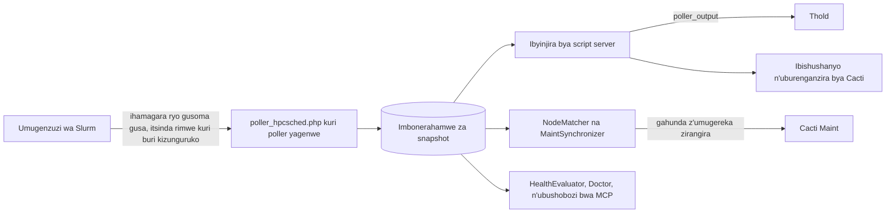

<!-- Source: README.md; SHA256: 938114d41dbd516f9dfcd94619c4fc73ef56b4da1dd693010588a93cce250534 -->

<!-- translations:start -->
[English](../../../README.md) | [简体中文](../zh-CN/README.md) | [हिन्दी](../hi-IN/README.md) | [Español (España)](../es-ES/README.md) | [Español (Latinoamérica)](../es-419/README.md) | [العربية (السعودية)](../ar-SA/README.md) | [Afrikaans](../af-ZA/README.md) | [አማርኛ](../am-ET/README.md) | [العربية (مصر)](../ar-EG/README.md) | [العربية (المغرب)](../ar-MA/README.md) | [বাংলা](../bn-BD/README.md) | [Bosanski](../bs-BA/README.md) | [Deutsch](../de-DE/README.md) | [فارسی](../fa-IR/README.md) | [Filipino](../fil-PH/README.md) | [Français](../fr-FR/README.md) | [Français (Maroc)](../fr-MA/README.md) | [Français (Sénégal)](../fr-SN/README.md) | [Hausa](../ha-NG/README.md) | [עברית](../he-IL/README.md) | [Hrvatski](../hr-HR/README.md) | [Bahasa Indonesia](../id-ID/README.md) | [Igbo](../ig-NG/README.md) | [Italiano](../it-IT/README.md) | [日本語](../ja-JP/README.md) | [한국어](../ko-KR/README.md) | [Malagasy](../mg-MG/README.md) | [मराठी](../mr-IN/README.md) | [Bahasa Melayu](../ms-MY/README.md) | [Nederlands](../nl-NL/README.md) | [Polski](../pl-PL/README.md) | [Português (Brasil)](../pt-BR/README.md) | [Русский](../ru-RU/README.md) | [Kinyarwanda](README.md) | [Soomaali](../so-SO/README.md) | [Српски](../sr-RS/README.md) | [Svenska](../sv-SE/README.md) | [Kiswahili](../sw-KE/README.md) | [தமிழ்](../ta-IN/README.md) | [తెలుగు](../te-IN/README.md) | [ไทย](../th-TH/README.md) | [Türkçe](../tr-TR/README.md) | [Українська](../uk-UA/README.md) | [اردو](../ur-PK/README.md) | [Tiếng Việt](../vi-VN/README.md) | [isiXhosa](../xh-ZA/README.md) | [Yorùbá](../yo-NG/README.md) | [繁體中文](../zh-TW/README.md) | [isiZulu](../zu-ZA/README.md)
<!-- translations:end -->

# plugin_hpcsched

Umugereka wa Cacti 1.2 (`hpcsched`, verisiyo `0.1.0-dev`) ushushanya imiterere y'ikigenga cy'imirimo ya HPC (batch scheduler) iruhande rw'ibikoresho Cacti isanzwe igenzura: uburebure bw'umurongo w'imirimo itegereje, imirimo itegereje ugereranyije n'irimo gukora, impamvu imirimo itegereje, imiterere ya za node, ikoreshwa ry'ibice (partitions), n'ikoreshwa ringana (fair-share) ku rwego rwa konti. Slurm ni yo backend ishyizwe mu bikorwa. Thold itanga impuruza ku masoko y'amakuru avamo, kandi umuhuzabikorwa wa Maint uhitamo gukoreshwa (opt-in) utwara amadirishya ya Cacti Maint avuye kuri za node za Slurm zahagaritswe (drained), izitarakora (down), n'izabitswe ku bw'isanwa.

> **Imiterere: biracyari mu ikorwa, nta gisohorwa kiraboneka.** Iri shami rishyira mu bikorwa urufatiro rw'umugereka, ibishushanyo bya cluster n'ibice, imiryango y'impamvu z'itegereza, guhuza za node za Slurm n'ibikoresho bya Cacti, ihuza rihitamo gukoreshwa ry'amadirishya ya Cacti Maint, incamake ya fair-share ku rwego rwa konti, ikoreshwa n'iyimura ryo gukusanya amakuru kure, CLI ya Configuration-as-Code (CasC) n'ibikorwa, hamwe na hooks z'urusobe rwa Cacti (CasC, Doctor, na MCP / Abilities API v2). Isuzuma (test suite) rikubiyemo amabwiriza ya Slurm yahimbwe n'ibisubizo bya `slurmrestd`, kandi CI ikora isuzuma kuri cluster nyayo ya Slurm ya node esheshatu muri za kontineri. Umusomyi ntarakoreshwa kuri cluster ikora mu musaruro (production), kandi isuzuma ry'imikorere yose ya Thold ntirirashyirwa muri CI.

Uyu ni umushinga wigenga kandi nta sano ufitanye n'umushinga wa Cacti.

## Ibimaze gushyirwa mu bikorwa

- **Imikorere n'imbonerahamwe y'ububiko (v3)**: kwinjiza, kuvugurura bidahindura ibisanzwe (idempotent), gukuramo (bigumisha imbonerahamwe z'umugereka ku buryo busanzwe), n'itegeko rya PHP 8.2 byibura mu gihe aho binjirira biguma bisomeka kuri PHP 8.0. Imbonerahamwe v3 yongeraho `plugin_hpcsched_node_map` na `plugin_hpcsched_maint_link` hamwe n'imbonerahamwe za cluster, run, section, umubare w'imirimo, umubare wa node, node, partition, reservation, na share.
- **Ikusanya rya Slurm ryo gusoma gusa kuri poller nyamukuru n'izo kure**: `poller_bottom` itangiza `poller_hpcsched.php --cluster=N` mu nyuma kuri buri poller (`poller_id`) ku ma cluster yemerewe yahawe iyo poller. Buri gikorwa gikusanya ishusho imwe (snapshot) yabitswe kuri buri cluster binyuze ku mabwiriza y'umukiliya (`squeue`, `scontrol`, `sshare` hamwe na `--json`) cyangwa `slurmrestd` kuri HTTPS (HTTP ya loopback iremewe hamwe n'iburira ry'ubuzima). `INFO` itangaza `remote_collect:1, remote_poller:1`, kandi `replicate_out` yimura ibisobanuro bitarimo ibanga bya `plugin_hpcsched_cluster` ku bakusanya bo kure (`poller_id >= 2`); ibiri mu madosiye ya token ntibisomwa cyangwa ngo byimurwe na rimwe.
- **Inyandikorugero za Cacti n'ibishushanyo bya cluster**: itanga inyandikorugero z'ibikoresho, iz'amakuru, n'iz'ibishushanyo (`templates/hpcsched-templates.xml`) hamwe n'ikibazo cy'amakuru ya script-server ku bice (`scripts/ss_hpcsched_cluster.php`, `scripts/ss_hpcsched_partitions.php`). Igihe umuyobozi wa sisitemu abyemeje, ikora cyangwa igahuza igikoresho kimwe cya Cacti kuri buri cluster gifite ibishushanyo by'imirimo hakurikijwe imiterere, imirimo itegereje hakurikijwe umuryango w'impamvu, za node hakurikijwe imiterere, za CPU, ikoreshwa (kuri cluster no kuri buri gice), n'igihe ishusho imaze.
- **Guhuza node za Slurm n'ibikoresho hamwe n'ihuza rya Cacti Maint**: umuhuza w'ibyiciro bine mu gihe cyo ku murongo (`NodeMatcher`) ahuza za node za Slurm n'inyandiko za `host` za Cacti zisanzweho (izina rya host nyaryo, aderesi nyayo, ibisobanuro/izina rya kabiri ryaryo, cyangwa akamenyetso ka DNS ka mbere ku mazina atari IP) kandi agashyira ikimenyetso cya `ambiguous` ku guhuza kurenze kumwe cyangwa gukoresha igikoresho kimwe kabiri aho kugenera. `HostList::expand()` yagura urutonde rwa za host zo kubika ibibanza muri Slurm (kugeza kuri node 10.000). `MaintSynchronizer` ikora, ikavugurura, kandi ikavanaho gahunda z'umugereka za rimwe gusa za Cacti Maint zikurikiranwa muri `plugin_hpcsched_maint_link` ku ma node yahujwe ari muri `DRAIN`, `DRAINING`, `DOWN`, cyangwa mu bibanza bikora bya `MAINT`/`MAINTENANCE` itahinduye gahunda za Maint zakozwe n'umuyobozi.
- **Incamake ya fair-share ku rwego rwa konti**: igihe `collect_shares` ifunguye, ikusanya imirongo y'imikoranire ya konti za Slurm muri `plugin_hpcsched_share` (ivanamo imirongo y'abakoresha nk'uko bikubiye muri [ADR 0010](../../decisions/0010-bound-series-cardinality.md)). `ShareSummary` na `ShareRepository` zibara umubare wa konti/ibice, igiteranyo cy'ikoreshwa ry'ibanze n'iry'ukuri, ibipimo byo hasi/hejuru/mpuzandengo bya fair-share, na konti z'imbere; imibare ya konti igaragarizwa muri `hpcsched-get-queue-summary`.
- **CasC na CLI y'ibikorwa (`cli/hpcsched.php`)**: kohereza hanze imiterere ya YAML/XML, kugenzura, gutegura itandukaniro rya dry-run, gushyira mu bikorwa bisaba kwemezwa, ibisohoka by'ubuzima biteguye neza, n'ihuza rya Maint rihitamo gukoreshwa (`sync-maint --dry-run` / `--apply`).
- **Hooks z'urusobe (`setup.php`)**: `casc_register_providers`, `doctor_register_checks`, na `abilities_register`.

## Inshingano z'uburenganzira

| Urwego | Uburenganzira |
| --- | --- |
| HPC Scheduler View | Incamake ya cluster yo gusoma gusa n'impamvu z'itegereza (`hpcsched.php`). |
| HPC Scheduler Operator | Uburenganzira bwa View hiyongereyeho urupapuro rwa Operations (`hpcsched_operator.php`) n'ibyemezo bwite byo kumenyesha ko byitaweho. |
| HPC Scheduler Admin | Uburenganzira bwa Operator hiyongereyeho imicungire ya cluster (`hpcsched_clusters.php`) n'urupapuro rw'ubuzima (`hpcsched_health.php`). |

Nyuma yo kwimura amadosiye y'ivugurura, fungura urupapuro rwa Plugins nk'umuyobozi wa sisitemu kugira ngo wandikishe inzego nshya na hooks. Tanga urwego rwa Operator ku buryo bweruye munsi ya **Configuration > Users** cyangwa amatsinda y'abakoresha. Ivugurura rigumana indangamuntu n'uburenganzira bisanzwe by'inzego za View na Admin. Uburenganzira bwa Admin buhabwa ubwa Operator, naho ubwa Operator bugahabwa ubwa View kuri buri busabe; ibi ntibyongera uburenganzira bubitswe ku bakoresha cyangwa amatsinda. Igenamiterere ry'umugereka na ryo risaba uburenganzira bwa HPC Scheduler Admin hiyongereyeho uruhushya rwa Settings rwa Cacti.

Uburenganzira bw'ibikoresho bya Cacti bugabanya imirongo n'ibikorwa biboneka kuri buri mukoresha. Cluster ihujwe n'igikoresho cya Cacti yerekanwa, yoherezwa hanze, kandi igahindurwa gusa ku bakoresha Cacti yemerera icyo gikoresho; guhuza igikoresho na byo bisaba uburenganzira ku gikoresho kigenderewe. Cluster itagira igikoresho ishyirwa ku mpapuro z'ubuyobozi ku bakoresha bafite urwego rw'umugereka, ariko ntiyerekanwa mu masura y'abakoresha (operator views), yo agaragaza gusa za cluster zihujwe n'igikoresho. Cluster ifite igikoresho cyayo cyasibwe igihe umugereka wari uhagaritswe yerekanwa gusa ku bakoresha bafite uburenganzira bwa HPC Scheduler Admin. Ibyemezo byo kumenyesha ko byitaweho bimara mu gihe cy'ifungura ry'ubu ry'umukoresha gusa, ku gihe kitarenze isaha imwe kandi gusa igihe icyo gipimo kikiri gishya. Ibipimo bishya cyangwa byahindutse birabitesha agaciro. Ntibishobora na rimwe kwerekana igipimo cyatsinzwe nk'aho ari kizima cyangwa ngo bihagarike impuruza.

## Inyandiko z'abakoresha

### Umutekano, uburenganzira buke bushoboka, n'amadosiye ya token

Umugereka usoma gusa. Wuhe umukoresha wa Slurm wihariye udafite uruhare rw'umuyobozi cyangwa umukoresha (`AdminLevel=None` muri `sacctmgr`). Hamwe na `PrivateData=jobs` (cyangwa `nodes`, `reservations`, `usage`) muri `slurm.conf`, uwo mukoresha abona inyandiko ze bwite gusa, bityo imibare ntibe yuzuye kandi umugereka ntushobora kubitahura. Gukuraho iyo mbogamizi kuri iyo konti bisaba urwego rw'umukoresha cyangwa umuyobozi, ibyo na byo bikemera impinduka; icyo cyemezo kireba ubuyobozi bw'aho ikoresherezwa.

Ku mabwiriza y'umukiliya, umukoresha wa poller ya Cacti akeneye ibikoresho bya Slurm by'umukiliya (`squeue`, `scontrol`, na `sshare` ku bushake) hamwe na `slurm.conf` igera ku mugenzuzi (controller); inzira z'ibyo bikoresho ni igenamiterere ry'inzira yuzuye munsi ya **Configuration > Settings > HPC Scheduler**.

Kuri `slurmrestd`, URL igomba kuba `https://`, cyangwa `http://` kuri aderesi ya loopback gusa. Impamyabumenyi za TLS ziragenzurwa kandi iyobora ryimurira ahandi (redirects) ntirikurikizwa. Urutonde rwa za host za `slurmrestd` rwo guhitamo munsi ya **Configuration > Settings > HPC Scheduler** rugabanya za host n'ibyambu cluster ishobora kuvuga.

Cluster ya `slurmrestd` itanga izina ry'idosiye ya token; token ubwayo ntibikwa na rimwe mu bubiko bw'amakuru, ntiyerekanwa ku rupapuro, ntiyoherezwa na CasC, kandi ntiyandikwa muri log. Idosiye igomba kuba iri imbere ya rimwe mu mabubiko ya Token File Directories yagenwe munsi ya **Configuration > Settings > HPC Scheduler**, ikagerwaho nta rohy rya symbolic link rinyuzwemo, kandi ikaba ari idosiye isanzwe y'umukoresha wa poller uwo mukoresha wenyine ashobora kwandikamo, irimo umurongo umwe: token cyangwa `SLURM_JWT=<token>` nk'uko `scontrol token` ibisohora. Iyo nta bubiko bwa token bwagenwe, nta cluster ishobora gukoresha `slurmrestd`. Rinda buri bubiko bwa token ku buryo root n'umukoresha wa poller gusa ari bo bashobora kubwandikamo. Idosiye isomeka n'itsinda cyangwa abandi bakoresha irakoreshwa na yo, kandi urupapuro rw'ubuzima rutanga iburira; runaburira iyo token igiye kurangira mu gihe cy'iburira cyagenwe.

Kugira ngo uhindure token mu buryo budasiga igice kituzuye (atomically):

```sh
dir=/etc/cacti/hpcsched
tmp=$(mktemp "$dir/.token.XXXXXX")
scontrol token username=cactiread lifespan=2592000 > "$tmp"
chown cacti:cacti "$tmp"
chmod 0600 "$tmp"
mv -f "$tmp" "$dir/cluster1.token"
```

Ikusanya rikurikira risoma idosiye nshya. Gukora za token ukoresheje `scontrol token` bisaba umuyobozi wa Slurm; bikore aho byemewe maze wimurire idosiye kuri poller.

### Abakusanya amakuru bo kure

`INFO` itangaza `remote_collect:1, remote_poller:1`. `hpcsched_poller_bottom()` itangiza `poller_hpcsched.php` kuri buri poller ku ma cluster afunguye yahawe iyo `poller_id`, kandi `hpcsched_replicate_out()` yimura imirongo itarimo ibanga ya `plugin_hpcsched_cluster` kuri za poller zo kure (`poller_id >= 2`). Amadosiye ya token n'ibikoresho by'umukiliya bya Slurm bigomba kuba bihari imbere muri iyo poller yo kure yagenwe; ibiri muri token ntibyimurwa na rimwe.

### Imipaka y'ububiko bw'igihe gito (Memory limits)

Buri gikorwa cyo gukusanya gisobanura igisubizo kimwe cy'ikigenga cy'imirimo icyarimwe, ibyo bikoresha hafi inshuro 12 z'ubunini bw'igisubizo mu bubiko bwa PHP (byapimwe hafi inshuro 10 ku nyandiko z'imirimo zimeze nk'iza Slurm, hiyongereyeho umwandiko ubwawo). Umusomyi azamura umupaka w'ububiko bwa PHP ku igenamiterere rya Collection Memory (1024 MiB ku buryo busanzwe) kandi akemera ibisubizo bigera kuri `(Collection Memory - 64) / 12` MiB (80 MiB ku buryo busanzwe), nubwo Maximum Answer Size yaba yashyizwe hejuru y'aho; urupapuro rw'ubuzima ruburira igihe Maximum Answer Size irenze uwo mupaka ukwiriye. Igisubizo kinini kurushaho gitsindisha igice cyacyo nk'ikinini cyane, kandi igikorwa gishiramo ububiko bwa memory cyandika ukunanirwa kw'ububiko kandi kikarekura uruhushya rwacyo (lease) n'umwanya w'igikorwa binyuze ku mutunganya w'ifunga (shutdown handler). Za cluster nini zishobora gukenera kuzamura aya magenamiterere yombi; inyandiko z'imirimo 100.000 z'ukuri ntizirapimwa.

### Inyandikorugero, ibikoresho bya cluster, n'ibarura ry'ibishushanyo

Kwinjiza no kuvugurura bizana inyandikorugero z'ibikoresho, iz'amakuru, n'iz'ibishushanyo bya HPC Scheduler kandi bikimura ikibazo cy'amakuru y'ibice mu bubiko bwa `resource/script_server/` bwa Cacti. Niba ubwo bubiko budashobora kwandikwamo, niba hari indi dosiye ifite iryo zina ihari, cyangwa niba aho bigana ari symbolic link, kwinjiza birahagarara, bikareka iyo dosiye uko iri, kandi bikamenyesha icyo kibazo ku rupapuro rw'ubuzima aho **Install Templates** yongera kugerageza. Gukuramo bisiba idosiye y'ikibazo gusa iyo umugereka ari wo wayanditse kandi itarahinduwe, bikagumana inyandikorugero, ibikoresho, n'ibishushanyo.

**HPC Clusters > Device** yerekana mbere y'igihe ibishushanyo, amasoko y'amakuru, amadosiye ya RRD, n'ihamagarwa rya script server kuri buri polling mbere yo gukora ikintu na kimwe. **Create Device** ikora igikoresho gifite izina rya host mu rwego rwabikiwe `.invalid` kandi nta bugenzuzi bw'uko kiboneka; **Map Device** ifatanya ibishushanyo ku gikoresho gisanzweho itahinduye igenamiterere ryacyo. Buri gishushanyo cya cluster n'icy'igice bifite isoko yabyo y'amakuru: atandatu kuri cluster n'atanu kuri buri gice. Ibice byongeweho nyuma bisubizwa mu rutonde mu buryo bwikora igihe umusomyi abonye impinduka; ibice byavanyweho bihagarara gukusanywa kandi bikagumana ibishushanyo byabyo. Gusiba igikoresho bikuraho ihuza rya cluster (kandi bigasiba imirongo ihuye ya `plugin_hpcsched_node_map`) ariko bikagumana inyandiko ya cluster.

Pending ikuramo imirimo yafashwe (held), ifite urukurikirane rwayo rwihariye. Urutonde rw'imirimo itegereje (job array) rubara imirimo isigaye muri rwo. Umurimo cyangwa node biri mu bice byinshi bibarwa rimwe mu bishushanyo bya cluster kandi rimwe muri buri gice, bityo igiteranyo cy'ibice ntigisabwa kungana n'igiteranyo cya cluster. Impamvu z'itegereza zishyirwa mu miryango cumi n'umwe ([ADR 0011](../../decisions/0011-pending-reason-families-and-counting.md)); urupapuro rw'impamvu z'itegereza rutondeka impamvu shingiro harimo n'izo muri `Other`. Igigabanya cy'ikoreshwa kirimo za node za drained, izitarakora (down), n'izindi node zitaboneka. Amakuru ashaje cyangwa yatsinzwe atangwa nka `U`, ntabwo ari zeru na rimwe; `age` iguma ari umubare.

Ku mpuruza, tegura Thold ku isoko iryo ari ryo ryose ry'amakuru ya cluster cyangwa igice ufite igihe kingana nibura n'intera imwe y'ikusanya, kandi ushyireho impuruza kuri `age` kugira ngo umenye umusomyi wahagaze.

## CLI na hooks z'urusobe

### Aho umusomyi atangirira

`hpcsched_poller_bottom()` itangiza `poller_hpcsched.php` mu buryo bwikora; ishobora no gukoreshwa n'intoki kuri poller yahawe iyo cluster:

```sh
php /path/to/cacti/plugins/hpcsched/poller_hpcsched.php --cluster=N [--force] [--debug]
```

`--force` ikora nubwo umugereka waba uhagaritswe, ku bw'isuzuma ryo ku murongo w'amabwiriza.

### CLI ya Configuration-as-Code, ubuzima, n'ihuza rya Maint

```sh
php /path/to/cacti/plugins/hpcsched/cli/hpcsched.php export [--format=yaml|xml] [--file=PATH]
php /path/to/cacti/plugins/hpcsched/cli/hpcsched.php validate --file=PATH [--format=yaml|xml]
php /path/to/cacti/plugins/hpcsched/cli/hpcsched.php plan --file=PATH [--format=yaml|xml]
php /path/to/cacti/plugins/hpcsched/cli/hpcsched.php apply --file=PATH --confirm=PLAN_HASH [--format=yaml|xml]
php /path/to/cacti/plugins/hpcsched/cli/hpcsched.php health [--format=text|json]
php /path/to/cacti/plugins/hpcsched/cli/hpcsched.php sync-maint [--dry-run | --apply] [--cluster=ID] [--format=text|json]
```

- `export` yandika amadosiye mashya ifite uburenganzira `0600` (cyangwa kuri stdout) kandi igasimbuza inzira za `token_file` zagenwe na `[REDACTED]`. `plan` na `apply` zanga imirima ya `jwt`, `secret`, na `password` yanditswe imbere mu idosiye, kandi zigumana inzira za `token_file` zisanzwe ziriho iyo hatanzwe `[REDACTED]`. `apply` isaba `--confirm=PLAN_HASH` nyayo yasohowe na `plan`.
- `health` isuzuma ko imbonerahamwe y'ububiko igezweho, ko amakuru ya cluster ari mashya, ibyavuye mu mikorere, kuboneka kwa Maint, n'amaburira itavuganye n'ibigenga by'imirimo cyangwa ngo isome amadosiye ya token.
- `sync-maint` ikoresha `--dry-run` ku buryo busanzwe kandi yerekana mbere cyangwa ikashyira mu bikorwa gahunda za Cacti Maint ku ma node ya Slurm yahujwe ari muri `DRAIN`, `DRAINING`, `DOWN`, cyangwa mu bibanza bikora bya `MAINT`/`MAINTENANCE` (igihe gisanzwe cya drain/down ni 3600s, igihe cyo kuvugurura ni 600s). Yanga `--apply` iyo `plugin_maint_schedules` na `plugin_maint_hosts` zidahari, kandi ivugurura cyangwa igakuraho gusa gahunda zanditswe muri `plugin_hpcsched_maint_link`.

### Hooks z'urusobe

Iyo imigereka ya Cacti ijyanye cyangwa ihuza rya host bihari, `setup.php` yandikisha:

- `casc_register_providers`: yohereza hanze, ikagenzura, igategura, kandi igashyira mu bikorwa bisaba kwemezwa imiterere ya `hpcsched` (`yaml` na `xml`, schema v1) ihisha amabanga.
- `doctor_register_checks`: itanga igenzura rine ryo gusoma gusa (`hpcsched.schema`, `hpcsched.cluster_freshness`, `hpcsched.token_health`, `hpcsched.maint_sync`).
- `abilities_register`: yandikisha ubushobozi butatu bwo gusoma gusa, budasenya, budahindura ibisanzwe mu cyiciro cya `hpcsched`, bucungwa n'urwego rwa HPC Scheduler View (n'uburenganzira bw'ibikoresho ku ncamake za cluster): `hpcsched-list-clusters`, `hpcsched-get-queue-summary`, na `hpcsched-get-health`.

## Impamvu

Abakoresha ba Cacti basanzwe bashushanya imiterere ya za node zabo zikora imibare. Ishusho y'ikigenga cy'imirimo ibura muri ibyo bishushanyo, bigasiga icyuho mu bintu bibiri:

- **Kutamenya "impamvu umurimo udatangira".** Slurm yandika impamvu kuri buri murimo utegereje. Umurongo muremure w'imirimo iruhande rw'ibishushanyo bya za node zidakora ntuvuga niba impamvu ari urutonde rw'ibanze, imipaka y'ubushobozi, imirimo yafashwe, ibishingiyeho, cyangwa za node zahagaritswe.
- **Kutagira isano hagati y'imiterere y'ikigenga cy'imirimo n'impuruza.** Thold itanga impuruza ku gikoresho umuyobozi yamaze guhagarika (drained), kandi abayobozi bagakora gahunda za Maint n'intoki.

Uyu mugereka ukusanya ishusho imwe yabitswe kuri buri cluster, ukayisohora nk'amasoko y'amakuru n'ibishushanyo bisanzwe bya Cacti, ugahuza za node z'ikigenga cy'imirimo n'ibikoresho bya Cacti bisanzweho, kandi ugahuza amadirishya ya Maint y'umugereka afite igihe cyo kurangira ku ma node yahagaritswe, atarakora, n'abitswe ku bw'isanwa. Ukoresha nanone uburenganzira bwa Cacti, abakusanya amakuru bo kure, Thold, na Maint, kandi ugakomeza kuba uwo gusoma gusa ku kigenga cy'imirimo.

## Aho ugarukira n'imipaka

Bitari mu nshingano: inzira iyo ari yo yose yo kwandika ku kigenga cy'imirimo (kohereza, guhagarika, gufata, guhagarika node, gusubukura), moteri y'impuruza yihariye y'umugereka, moteri ya raporo cyangwa kwishyuza, n'uruhererekane rw'amakuru ku mukoresha cyangwa ku murimo. Backend za PBS Pro, OpenPBS, na LSF ni iz'ubushakashatsi gusa.

## Ibisabwa n'imikoranire

| Igice | Intego |
|---|---|
| Cacti | 1.2.31 cyangwa irengaho (`compat = 1.2.31`), nta mpinduka mu mizi ya Cacti |
| PHP | 8.2 cyangwa irengaho; aho binjirira biguma bisomeka kuri 8.0 kandi bikanga gukora kuri 8.1 kugira ngo sisitemu idashyigikiwe ihabwe ukwangirwa aho guhabwa UI ya Cacti yangiritse |
| Slurm | 25.05, 25.11, na 26.05 ([ADR 0013](../../decisions/0013-three-latest-slurm-releases.md)); 26.05.5 isuzumwa muri CI kuri buri mpinduka kuri cluster ya kontineri ya node esheshatu, 25.11.8 kuri `main`, buri cyumweru, no ku busabe, naho 25.05 kuri fixtures gusa. Amabwiriza y'umukiliya akoresha umusesenguzi w'amakuru `v0.0.43` ku buryo busanzwe (`v0.0.44` na `v0.0.45` bishobora guhitamo); za cluster za `slurmrestd` zitahura umusesenguzi mushya kurusha abandi utangwa na daemon |
| Thold, Maint | Nta mpinduka za Thold zisabwa; `sync-maint` ikorana n'imbonerahamwe za `plugin_maint_schedules` na `plugin_maint_hosts` za Cacti Maint ikoresheje imbonerahamwe y'ihuza y'umugereka (`plugin_hpcsched_maint_link`) |

## Iterambere n'isuzuma

Uburyo bwa CI (`.github/workflows/plugin-ci-workflow.yml`) busuzuma PHP 8.2 kugeza kuri 8.5 hamwe na Cacti `release/1.2.31` na `1.2.x`, igenzura ry'imiterere y'aho binjirira muri PHP 8.0, ukwangirwa kwa PHP 8.1, PHPStan, igenzura rya gettext/ubuhinduzi, uruhushya rwa REUSE, igenzura rya workflow, igenzura ry'imigendekere y'ibikoresho bya cluster n'itandukaniro ry'inyandikorugero zoherezwa, hamwe na cluster nyayo ya Slurm ya node esheshatu (`slurm-live`).

Hamwe n'igikoresho cya Pest gisangiwe kandi gifunze cya Cacti (`CACTI_PEST_BIN`) n'ububiko bw'amakuru bwa Cacti bukoreshwa mu isuzuma gusa:

```sh
# Unit tests
"$CACTI_PEST_BIN" --configuration=phpunit.xml

# Lifecycle integration tests (disposable database only)
CACTI_PATH=/path/to/cacti HPCSCHED_TEST_DATABASE=disposable "$CACTI_PEST_BIN" --configuration=phpunit-integration.xml

# Static analysis (against Cacti 1.2.31)
CACTI_PATH=/path/to/cacti phpstan analyse -c phpstan.neon --no-progress

# Translation template, catalogs, and localized README checks
sh locales/build_gettext.sh --check
```

## Igishushanyo mbonera

- [docs/PLAN.md](../../PLAN.md) ni gahunda y'imyubakire n'igishushanyo mbonera: amakuru ya upstream hamwe n'amasoko yayo, guhuza za node, imiterere y'ibihe, imipaka y'umutekano, imibare y'imikorere, isuzuma, n'ibyago.
- [docs/decisions/](../../decisions/) ibika inyandiko z'ibyemezo by'imyubakire.
- [docs/REQUIREMENTS.md](../../REQUIREMENTS.md) ihuza buri ID y'icyifuzo na issue ijyanye na cyo.



## Uko imirimo ikurikiranwa

- **Ibyiciro (Milestones)** bikurikira ibyiciro by'igishushanyo mbonera. Buri cyiciro gifite issue nkuru (epic) itondeka ibibazo biyishamikiyeho n'ibimenyetso byo gusoza.
- **Issues** zishyirwa mu byiciro hakurikijwe ibirango: `type: requirement`, `type: research`, `type: decision`, `type: epic`. Issue z'ibisabwa zigaragaza ibisabwa bifite imibare kandi bishobora gusuzumwa (`REQ-AREA-NNN`) n'ibipimo byo kwemerwa.
- **Ibirango** na byo bigira `area:`, `phase:`, `priority:`, na `status:`. Reba [CONTRIBUTING.md](../../../CONTRIBUTING.md#labels).
- [Ikibaho cy'umushinga](https://github.com/users/somethingwithproof/projects/10) cyerekana issue zose mu byiciro byose.

## Gutanga umusanzu

Soma [CONTRIBUTING.md](../../../CONTRIBUTING.md). Commit zisaba umukono wa DCO (`git commit -s`). Ibiganiro ku gishushanyo mbonera bibera kuri issues; ibyemezo bitarafatwa bifite ikirango cya `type: decision`.

## Umutekano

Menyesha ibibazo by'umutekano mu ibanga; reba [SECURITY.md](../../../SECURITY.md).

## Uruhushya

GNU General Public License v2.0, uruhushya rumwe n'urwa Cacti n'imigereka yayo. Reba [LICENSE](../../../LICENSE).
