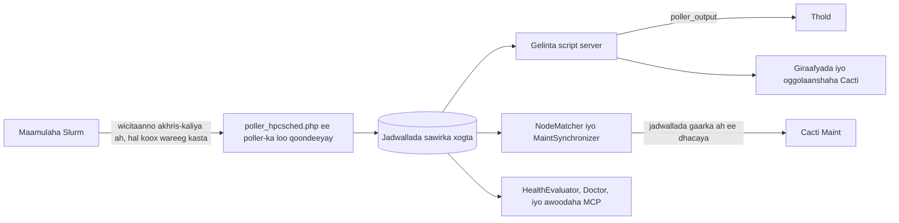

<!-- Source: README.md; SHA256: 938114d41dbd516f9dfcd94619c4fc73ef56b4da1dd693010588a93cce250534 -->

<!-- translations:start -->
[English](../../../README.md) | [简体中文](../zh-CN/README.md) | [हिन्दी](../hi-IN/README.md) | [Español (España)](../es-ES/README.md) | [Español (Latinoamérica)](../es-419/README.md) | [العربية (السعودية)](../ar-SA/README.md) | [Afrikaans](../af-ZA/README.md) | [አማርኛ](../am-ET/README.md) | [العربية (مصر)](../ar-EG/README.md) | [العربية (المغرب)](../ar-MA/README.md) | [বাংলা](../bn-BD/README.md) | [Bosanski](../bs-BA/README.md) | [Deutsch](../de-DE/README.md) | [فارسی](../fa-IR/README.md) | [Filipino](../fil-PH/README.md) | [Français](../fr-FR/README.md) | [Français (Maroc)](../fr-MA/README.md) | [Français (Sénégal)](../fr-SN/README.md) | [Hausa](../ha-NG/README.md) | [עברית](../he-IL/README.md) | [Hrvatski](../hr-HR/README.md) | [Bahasa Indonesia](../id-ID/README.md) | [Igbo](../ig-NG/README.md) | [Italiano](../it-IT/README.md) | [日本語](../ja-JP/README.md) | [한국어](../ko-KR/README.md) | [Malagasy](../mg-MG/README.md) | [मराठी](../mr-IN/README.md) | [Bahasa Melayu](../ms-MY/README.md) | [Nederlands](../nl-NL/README.md) | [Polski](../pl-PL/README.md) | [Português (Brasil)](../pt-BR/README.md) | [Русский](../ru-RU/README.md) | [Kinyarwanda](../rw-RW/README.md) | [Soomaali](README.md) | [Српски](../sr-RS/README.md) | [Svenska](../sv-SE/README.md) | [Kiswahili](../sw-KE/README.md) | [தமிழ்](../ta-IN/README.md) | [తెలుగు](../te-IN/README.md) | [ไทย](../th-TH/README.md) | [Türkçe](../tr-TR/README.md) | [Українська](../uk-UA/README.md) | [اردو](../ur-PK/README.md) | [Tiếng Việt](../vi-VN/README.md) | [isiXhosa](../xh-ZA/README.md) | [Yorùbá](../yo-NG/README.md) | [繁體中文](../zh-TW/README.md) | [isiZulu](../zu-ZA/README.md)
<!-- translations:end -->

# plugin_hpcsched

Kordhin (plugin) loogu talagalay Cacti 1.2 (`hpcsched`, nooca `0.1.0-dev`) oo sawir-giraaf ku muujisa xaaladda jadwaleeyaha hawlaha HPC iyadoo barbar socota qalabka uu Cacti horey u kormeero: qoto-dheeraanta safka, shaqooyinka sugaya iyo kuwa socda, sababta ay shaqooyinku u sugayaan, xaaladaha noodhadhka, isticmaalka qaybaha, iyo isticmaalka wadaagga caddaaladda ah (fair-share) ee heerka koontada. Slurm waa habka dambe (backend) ee la hirgeliyay. Thold waxay digniino ka soo saartaa ilaha xogta ee ka dhasha, isku-dubaridaha Maint ee ikhtiyaariga ah (opt-in) wuxuuna wadaa daaqadaha Cacti Maint ee ka yimaada noodhadhka xisaabinta Slurm ee la faarujiyay (drained), kuwa damay (down), iyo kuwa loo qoondeeyay dayactirka.

> **Xaaladda: waa la horumarinayaa, weli lama sii deyn.** Laantani waxay hirgelisaa aasaaska kordhinta, giraafyada koox-kombuyuutarrada iyo qaybaha, qoysaska sababaha sugitaanka, isku-aadinta noodhadhka xisaabinta Slurm iyo qalabka Cacti, isku-dubaridka daaqadda Cacti Maint ee ikhtiyaariga ah, soo koobista wadaagga caddaaladda ah ee heerka koontada, fulinta iyo nuqulaynta ururiyaha xogta fog, CLI-ga Configuration-as-Code (CasC) iyo hawlgallada, iyo jillaabyada nidaamka deegaanka Cacti (CasC, Doctor, iyo MCP / Abilities API v2). Qaybta tijaabadu waxay dabooshaa amarada Slurm ee macmalka ah iyo jawaabaha `slurmrestd`, CI-na waxay ku tijaabisaa koox Slurm ah oo dhab ah oo ka kooban lix noodh oo ku jira weelal (containers). Akhriyuhu weli kuma shaqeyn koox wax-soo-saar ah, tijaabada dib-u-ciyaarista Thold ee dhammaad-ka-dhammaadna weli kuma jirto CI.

Kani waa mashruuc madax-bannaan mana la xidhiidho mashruuca Cacti.

## Waxa la hirgeliyay

- **Wareegga nolosha iyo qaab-dhismeedka xogta (v3)**: rakibid, cusboonaysiin aan wax ka beddelin natiijada (idempotent), tirtirid (iyadoo si caadi ah loo hayo jadwallada kordhinta), iyo shardi PHP 8.2 ah iyadoo meelaha laga soo galo lagu hayo kuwo lagu akhrin karo PHP 8.0. Qaabka v3 wuxuu ku daraa `plugin_hpcsched_node_map` iyo `plugin_hpcsched_maint_link` oo la socda jadwallada kooxda, orodka, qaybta, tirada shaqooyinka, tirada noodhadhka, noodhka, qaybinta (partition), boos-celinta, iyo wadaagga.
- **Ururinta Slurm ee akhris-kaliya ee ku jirta poller-ka weyn iyo kuwa fog**: `poller_bottom` wuxuu gadaal ka bilaabaa `poller_hpcsched.php --cluster=N` poller kasta (`poller_id`) kooxaha shaqaynaya ee loo qoondeeyay. Orod kasta wuxuu soo ururiyaa hal sawir xog oo kaydsan kooxkiiba iyadoo loo marayo amarada macmiilka (`squeue`, `scontrol`, `sshare` oo wata `--json`) ama `slurmrestd` iyadoo la marayo HTTPS (loopback HTTP waa la oggol yahay iyadoo la siinayo digniin caafimaad). `INFO` waxay caddeysaa `remote_collect:1, remote_poller:1`, `replicate_out`-na wuxuu u nuqulaysaa qeexitaannada `plugin_hpcsched_cluster` ee aan sirta ahayn ururiyayaasha fog (`poller_id >= 2`); waxa ku jira faylasha token-ka weligood lama akhriyo lamana nuqulayo.
- **Qaababka Cacti iyo giraafyada koox-kombuyuutarrada**: waxay keentaa qaababka qalabka, xogta, iyo giraafyada (`templates/hpcsched-templates.xml`) iyo weydiinta xogta script-server ee qaybaha (`scripts/ss_hpcsched_cluster.php`, `scripts/ss_hpcsched_partitions.php`). Marka maamuluhu xaqiijiyo, waxay abuurtaa ama ku xidhaa hal qalab Cacti ah kooxkiiba oo leh giraafyada shaqooyinka xaaladooda, shaqooyinka sugaya koox-sababeedkooda, noodhadhka xaaladooda, CPU-yada, isticmaalka (kooxda iyo qayb kasta), iyo da'da sawirka xogta.
- **Isku-aadinta noodhadhka Slurm iyo qalabka iyo isku-dubaridka Cacti Maint**: isku-aadinta afar-heer ah oo waqti toosan qaadata (`NodeMatcher`) waxay noodhadhka xisaabinta Slurm ku xidhaa diiwaannada `host` ee Cacti ee jira (magaca host-ka oo sax ah, ciwaanka oo sax ah, sharraxaadda/magaca kale oo sax ah, ama summadda DNS ee ugu horreysa ee magacyada aan IP ahayn) waxayna u calaamadeysaa isku-aadisyada badan ama sheegashooyinka qalabka oo labanlaabma `ambiguous` halkii ay ka qiyaasi lahayd. `HostList::expand()` waxay ballaarisaa liisaska host-ka ee boos-celinta Slurm (ilaa 10,000 noodh). `MaintSynchronizer` waxay abuurtaa, cusboonaysiisaa, oo ka saartaa jadwallada hal-mar ah ee Cacti Maint ee ay leedahay kordhintu kuna dabagasho `plugin_hpcsched_maint_link` noodhadhka ku xidhan ee ku jira `DRAIN`, `DRAINING`, `DOWN`, ama boos-celinta firfircoon ee `MAINT`/`MAINTENANCE` iyadoon wax ka beddelin jadwallada Maint ee ay abuureen maamulayaashu.
- **Soo koobista wadaagga caddaaladda ah (fair-share) ee heerka koontada**: marka `collect_shares` la furo, waxay ku ururisaa safafka xidhiidhka koontada Slurm gudaha `plugin_hpcsched_share` (iyadoo laga tuurayo safafka isticmaalaha sida ku cad [ADR 0010](../../decisions/0010-bound-series-cardinality.md)). `ShareSummary` iyo `ShareRepository` waxay xisaabiyaan tirada koontooyinka/qaybaha, wadarta isticmaalka ceyriinka ah iyo kan wax ku oolka ah, qodobada fair-share ee ugu yar/ugu badan/celceliska ah, iyo koontooyinka ugu sarreeya; tirada koontooyinka waxaa lagu soo bandhigaa `hpcsched-get-queue-summary`.
- **CasC iyo CLI-ga hawlgallada (`cli/hpcsched.php`)**: dhoofinta qaabeynta YAML/XML, hubinta, qorsheynta farqiga dry-run, ku-dhaqanka ku xiran xaqiijinta, soo-saarka caafimaadka ee habaysan, iyo isku-dubaridka Maint ee ikhtiyaariga ah (`sync-maint --dry-run` / `--apply`).
- **Jillaabyada nidaamka deegaanka (`setup.php`)**: `casc_register_providers`, `doctor_register_checks`, iyo `abilities_register`.

## Doorarka gelitaanka

| Goobta (Realm) | Gelitaanka |
| --- | --- |
| HPC Scheduler View | Guudmar kooxeed akhris-kaliya ah iyo sababaha sugitaanka (`hpcsched.php`). |
| HPC Scheduler Operator | Gelitaanka View oo lagu daray bogga Operations (`hpcsched_operator.php`) iyo qirashada kala-soocidda shakhsi ahaaneed. |
| HPC Scheduler Admin | Gelitaanka Operator oo lagu daray maamulka kooxaha (`hpcsched_clusters.php`) iyo bogga caafimaadka (`hpcsched_health.php`). |

Marka aad koobiyeyso faylasha cusboonaysiinta ka dib, fur bogga Plugins adigoo ah maamule si aad u diiwaangeliso goobaha cusub iyo jillaabyada. Si cad ugu qoondee goobta Operator hoosta **Configuration > Users** ama kooxaha isticmaalayaasha. Cusboonaysiintu waxay xajisaa aqoonsiyada iyo oggolaanshooyinka jira ee goobaha View iyo Admin. Gelitaanka Admin wuxuu dhaxlaa gelitaanka Operator, gelitaanka Operator-na wuxuu dhaxlaa gelitaanka View codsi kasta; tani kuma darto oggolaansho keydsan isticmaalayaasha ama kooxaha. Dejinta kordhintu waxay sidoo kale u baahan tahay gelitaanka HPC Scheduler Admin marka lagu daro oggolaanshaha Settings ee Cacti.

Oggolaanshaha qalabka ee Cacti wuxuu xaddidaa safafka iyo falalka uu isticmaale kasta heli karo. Koox ku xidhan qalab Cacti ah waxaa loo muujiyaa, loo dhoofiyaa, loona beddelaa oo keliya isticmaalayaasha uu Cacti u oggol yahay qalabkaas; ku xidhista qalab waxay sidoo kale u baahan tahay oggolaanshaha qalabka la beegsanayo. Koox aan qalab lahayn waxaa lagu taxaa boggaga maamulka ee isticmaalayaasha leh goobta kordhinta, laakiin kuma jirto aragtida hawlwadeenka, taas oo taxda oo keliya kooxaha ku xidhan qalab. Koox qalabkeedii ku xidhnaa la tirtiray iyadoo kordhintu damisan tahay waxaa la tusaa oo keliya isticmaalayaasha leh gelitaanka HPC Scheduler Admin. Qirashadu waxay jirtaa oo keliya fadhiga hadda jira ee isticmaalaha, ugu badnaan hal saac iyo oo keliya inta isla aragtidaasi ay weli cusub tahay. Aragtiyaha cusub ama isbeddelay way buriyaan. Weligood cabbir fashilmay uma calaamadeeyaan mid caafimaad qaba kamana hor istaagaan digniinaha.

## Qoraallada hawlwadeenka

### Amniga, mudnaanta ugu yar, iyo faylasha token-ka

Kordhintu way akhrisaa oo keliya. Sii isticmaale Slurm oo gaar ah oo aan lahayn door maamule ama hawlwadeen (`AdminLevel=None` gudaha `sacctmgr`). Haddii `PrivateData=jobs` (ama `nodes`, `reservations`, `usage`) ay ku jirto `slurm.conf`, isticmaalahaasi wuxuu arkaa oo keliya diiwaannadiisa gaarka ah, markaas tirakoobku wuxuu noqdaa mid aan dhammaystirnayn kordhintuna ma ogaan karto. Ka qaadista xaddidaaddaas ee koontada waxay u baahan tahay heer hawlwadeen ama maamule, taas oo sidoo kale oggolaanaysa isbeddello; go'aanka isku-beddelkaas waxaa leh goobta.

Amarada macmiilka, isticmaalaha Cacti poller wuxuu u baahan yahay faylasha fulinta ee macmiilka Slurm (`squeue`, `scontrol`, iyo ikhtiyaar ahaan `sshare`) iyo `slurm.conf` gaara maamulaha (controller); waddooyinka faylasha fulintu waa dejin waddo buuxda oo hoos timaadda **Configuration > Settings > HPC Scheduler**.

`slurmrestd` awgeed, URL-ku waa inuu ahaadaa `https://`, ama `http://` oo ku yaalla ciwaanka loopback oo keliya. Shahaadooyinka TLS waa la hubiyaa dib-u-hagidana lama raaco. Liis ikhtiyaari ah oo ah host-yada `slurmrestd` oo hoos yimaada **Configuration > Settings > HPC Scheduler** wuxuu xaddidaa host-yada iyo dekedaha (ports) ay kooxdu magacaabi karto.

Kooxda `slurmrestd` waxay magacawdaa fayl token ah; token-ka laftiisa weligiis laguma keydiyo kaydka xogta, laguma soo bandhigo bog, laguma dhoofiyo CasC, lagumana qoro diiwaanka (log). Faylku waa inuu ku dhex jiraa mid ka mid ah Token File Directories ee lagu habeeyay **Configuration > Settings > HPC Scheduler**, lagu gaari karaa iyadoon la marin xidhiidh astaameed (symbolic link), uuna yahay fayl caadi ah oo uu leeyahay isticmaalaha poller-ka oo isticmaalahaas oo keliya qori karo, kuna jiro hal sadar: token-ka ama `SLURM_JWT=<token>` sida uu daabaco `scontrol token`. Haddii aan la dejin wax galal token ah, kooxna ma isticmaali karto `slurmrestd`. Ku hay gal kasta oo token ah mid ay qori karaan root iyo isticmaalaha poller-ka oo keliya. Fayl ay kooxdu ama isticmaalayaal kale akhrin karaan weli waa la isticmaalaa, bogga caafimaadkuna wuxuu bixiyaa digniin; sidoo kale wuxuu bixiyaa digniin marka token-ku uu dhacayo muddada digniinta ee la habeeyay gudaheeda.

Si aad token-ka u beddesho si aan kala go' lahayn (atomically):

```sh
dir=/etc/cacti/hpcsched
tmp=$(mktemp "$dir/.token.XXXXXX")
scontrol token username=cactiread lifespan=2592000 > "$tmp"
chown cacti:cacti "$tmp"
chmod 0600 "$tmp"
mv -f "$tmp" "$dir/cluster1.token"
```

Ururinta xigta waxay akhridaa faylka cusub. Soo saarista token-nada iyadoo la adeegsanayo `scontrol token` waxay u baahan tahay maamule Slurm ah; ku orod meesha laga oggol yahay oo u koobiyee faylka poller-ka.

### Ururiyayaasha xogta fog

`INFO` waxay caddeysaa `remote_collect:1, remote_poller:1`. `hpcsched_poller_bottom()` waxay ka furtaa `poller_hpcsched.php` poller kasta kooxaha shaqaynaya ee loo qoondeeyay `poller_id`-gaas, `hpcsched_replicate_out()`-na waxay u nuqulaysaa safafka `plugin_hpcsched_cluster` ee aan sirta ahayn poller-rada fog (`poller_id >= 2`). Faylasha token-ka iyo faylasha fulinta ee macmiilka Slurm waa inay gudaha ku jiraan poller-ka fog ee loo qoondeeyay; waxa ku jira token-ka weligood lama nuqulayo.

### Xadka xusuusta (Memory limits)

Orod kasta oo ururin ah wuxuu furaa hal jawaab jadwaleeye ah halkii mar, taas oo ku qaadata qiyaastii 12 jibbaar cabbirka jawaabta xusuusta PHP (lagu cabbiray qiyaastii 10 jibbaar diiwaannada shaqooyinka ee u qaabaysan sida Slurm, oo lagu daray qoraalka laftiisa). Akhriyuhu wuxuu u kordhiyaa xadka xusuusta PHP dejinta Collection Memory (1024 MiB sida caadiga ah) wuxuuna oggolaadaa jawaabo ilaa `(Collection Memory - 64) / 12` MiB (80 MiB sida caadiga ah), xitaa marka Maximum Answer Size laga dhigo mid ka sarreeya; bogga caafimaadku wuxuu bixiyaa digniin marka Maximum Answer Size uu dhaafo xadkaas ku habboon. Jawaab ka weyn waxay fashilisaa qaybteeda iyadoo loo arko inay aad u weyn tahay, orod weli ay xusuustu ka dhammaatana wuxuu diiwaangeliyaa fashil xusuuseed wuxuuna sii daayaa kiradiisa iyo booskiisa hawlgalka iyada oo loo marayo maareeyaha xidhitaanka. Kooxaha waaweyn waxay u baahan karaan in labada dejinba la kordhiyo; 100,000 diiwaanno shaqo oo dhab ah weli lama cabbirin.

### Qaababka, qalabka kooxda, iyo tirinta giraafyada

Rakibidda iyo cusboonaysiintu waxay soo dejiyaan qaababka qalabka, xogta, iyo giraafyada HPC Scheduler waxayna u koobiyeeyaan weydiinta xogta qaybaha galka `resource/script_server/` ee Cacti. Haddii galkaas aan wax lagu qori karin, haddii fayl kale oo isku magac ah uu halkaas ku jiro, ama haddii bartilmaameedku yahay xidhiidh astaameed, soo dejintu way joogsataa, faylka ma taabato, waxayna xaaladda ku soo wargelisaa bogga caafimaadka halkaas oo **Install Templates** mar kale isku daydo. Tirtiriddu waxay ka saartaa faylka weydiinta oo keliya haddii kordhintu qortay uusanuna isbeddelin, waxayna ilaalisaa qaababka, qalabka, iyo giraafyada.

**HPC Clusters > Device** waxay horey u tusisaa giraafyada, ilaha xogta, faylasha RRD, iyo wicitaannada script server ee poll kasta ka hor inta aan waxba la abuurin. **Create Device** waxay abuurtaa qalab leh magac host ah oo ku jira bogga gaarka ah ee `.invalid` oo aan lahayn hubin helitaan; **Map Device** waxay ku xidhaa giraafyada qalab jira iyadoon wax ka beddelin dejintiisa. Giraaf kasta oo kooxeed iyo giraaf qaybeedba wuxuu leeyahay isha xogtiisa gaarka ah: lix kooxda iyo shan qayb kasta. Qaybaha hadhow lagu daro waxaa si toos ah dib loogu tusmeeyaa marka akhriyuhu ogaado isbeddel; qaybaha laga saaro waxaa laga joojiyaa ururinta waxayna haystaan giraafyadooda. Tirtiridda qalabku waxay ka furtaa kooxda (waxayna nadiifisaa safafka u dhigma ee `plugin_hpcsched_node_map`) iyadoo haynaysa diiwaanka kooxda.

Pending waxay ka reebtaa shaqooyinka la hayo (held), kuwaas oo leh taxanahooda gaarka ah. Taxanaha shaqo ee sugaya (job array) wuxuu tiriyaa hawlaha u hadhay. Shaqo ama noodh ku jira qaybo badan waxaa la tiriyaa hal mar giraafyada kooxda iyo hal mar qayb kasta, sidaas darteed wadarta qaybaha looma baahna inay la mid noqoto wadarta kooxda. Sababaha sugitaanka waxaa loo kooxeeyaa kow iyo toban qoys ([ADR 0011](../../decisions/0011-pending-reason-families-and-counting.md)); aragtida sababaha sugitaanku waxay taxdaa sababaha ceyriinka ah oo ay ku jiraan kuwa ku jira `Other`. Qaybiyaha hoose ee isticmaalku wuxuu ka kooban yahay noodhadhka la faarujiyay, kuwa damay, iyo noodhadhka kale ee aan la heli karin. Xogta duugowday ama fashilantay waxaa loo soo sheegaa `U`, weligeed eber ma noqoto; `age` wuxuu sii ahaadaa tiro.

Digniinaha awgood, ku habeey Thold mid ka mid ah ilaha xogta ee kooxda ama qaybta muddo ah ugu yaraan hal wareeg ururin, oo digniin saar `age` si aad u ogaato akhriye joogsaday.

## CLI iyo jillaabyada nidaamka deegaanka

### Barta gelitaanka akhriyaha

`hpcsched_poller_bottom()` waxay si toos ah u bilawdaa `poller_hpcsched.php`; sidoo kale gacanta ayaa looga ordi karaa poller-ka loo qoondeeyay kooxda:

```sh
php /path/to/cacti/plugins/hpcsched/poller_hpcsched.php --cluster=N [--force] [--debug]
```

`--force` way shaqeysaa xitaa iyadoo kordhintu damisan tahay, si loogu baaro khadka taliska.

### CLI-ga Configuration-as-Code, caafimaadka, iyo isku-dubaridka Maint

```sh
php /path/to/cacti/plugins/hpcsched/cli/hpcsched.php export [--format=yaml|xml] [--file=PATH]
php /path/to/cacti/plugins/hpcsched/cli/hpcsched.php validate --file=PATH [--format=yaml|xml]
php /path/to/cacti/plugins/hpcsched/cli/hpcsched.php plan --file=PATH [--format=yaml|xml]
php /path/to/cacti/plugins/hpcsched/cli/hpcsched.php apply --file=PATH --confirm=PLAN_HASH [--format=yaml|xml]
php /path/to/cacti/plugins/hpcsched/cli/hpcsched.php health [--format=text|json]
php /path/to/cacti/plugins/hpcsched/cli/hpcsched.php sync-maint [--dry-run | --apply] [--cluster=ID] [--format=text|json]
```

- `export` waxay faylasha cusub ku qortaa qaabka `0600` (ama stdout) waxayna ku beddeshaa waddooyinka `token_file` ee la habeeyay `[REDACTED]`. `plan` iyo `apply` waxay diidaan meelaha tooska ah ee `jwt`, `secret`, iyo `password`, waxayna ilaaliyaan waddooyinka `token_file` ee gudaha ee jira marka `[REDACTED]` la keeno. `apply` waxay u baahan tahay `--confirm=PLAN_HASH` sax ah oo ay daabacday `plan`.
- `health` waxay qiimeysaa cusboonaanta qaab-dhismeedka xogta, cusboonaanta kooxda, natiijooyinka orodka, helitaanka Maint, iyo digniinaha iyadoon la xidhiidhin jadwaleeyayaasha ama akhrin faylasha token-ka.
- `sync-maint` waxay si caadi ah u adeegsataa `--dry-run` waxayna tusisaa ama ku dabaqdaa jadwallada Cacti Maint noodhadhka Slurm ee ku xidhan ee ku jira `DRAIN`, `DRAINING`, `DOWN`, ama boos-celinta firfircoon ee `MAINT`/`MAINTENANCE` (muddo drain/down caadi ah 3600s, farqi cusboonaysiin 600s). Waxay diiddaa `--apply` haddii `plugin_maint_schedules` iyo `plugin_maint_hosts` ay maqan yihiin, waxayna cusboonaysiisaa ama ka saartaa oo keliya jadwallada ku diiwaangashan `plugin_hpcsched_maint_link`.

### Jillaabyada nidaamka deegaanka

Marka kordhinnada Cacti ama is-dhexgallada host ee u dhigma ay jiraan, `setup.php` waxay diiwaangelisaa:

- `casc_register_providers`: waxay dhoofisaa, hubisaa, qorsheysaa, oo ku dhaqantaa xaqiijin qaabeynta `hpcsched` (`yaml` iyo `xml`, schema v1) iyadoo qarisa siraha.
- `doctor_register_checks`: waxay bixisaa afar hubin baaritaan oo akhris-kaliya ah (`hpcsched.schema`, `hpcsched.cluster_freshness`, `hpcsched.token_health`, `hpcsched.maint_sync`).
- `abilities_register`: waxay diiwaangelisaa saddex awoodood oo akhris-kaliya ah, aan waxba burburin, oo natiijo isku mid ah bixiya (idempotent) hoosta qaybta `hpcsched`, oo ay maamusho goobta HPC Scheduler View (iyo oggolaanshaha qalabka ee soo koobista kooxaha): `hpcsched-list-clusters`, `hpcsched-get-queue-summary`, iyo `hpcsched-get-health`.

## Sababta

Hawlwadeennada adeegsada Cacti waxay horeyba sawir-giraaf ugu sameeyaan noodhadhkooda xisaabinta. Aragtida jadwaleeyaha ayaa ka maqan giraafyadaas, taas oo reebta laba daldaloolo:

- **Ma jiro "sababta shaqadu u bilaaban weyday".** Slurm wuxuu diiwaangeliyaa sabab shaqo kasta oo sugaysa. Saf buuxa oo ku xiga giraafyada noodhadhka fadhiya ma sheego haddii sababtu tahay mudnaan, xadka kheyraadka, hayn, ku-tiirsanaan, ama noodhadh la faarujiyay.
- **Ma jiro xidhiidh u dhexeeya xaaladda jadwaleeyaha iyo digniinaha.** Thold waxay digniin ka soo saartaa qalab uu maamuluhu horey u faarujiyay, maamulayaashuna waxay gacanta ku abuuraan jadwallada Maint.

Kordhintu waxay soo ururisaa hal sawir xog oo kaydsan kooxkiiba, waxay u daabacdaa sida ilaha xogta iyo giraafyada caadiga ah ee Cacti, waxay ku xidhaa noodhadhka jadwaleeyaha qalabka Cacti ee jira, waxayna isku-dubariddaa daaqadaha Maint ee dhacaya ee ay leedahay kordhintu ee loogu talagalay noodhadhka la faarujiyay, kuwa damay, iyo kuwa dayactirka loo qoondeeyay. Waxay dib u adeegsataa oggolaanshaha Cacti, ururiyayaasha xogta fog, Thold, iyo Maint, waxayna u ahaataa akhris-kaliya si adag dhanka jadwaleeyaha.

## Baaxadda iyo xuduudaha

Ka baxsan baaxadda: waddo kasta oo wax ku qorta jadwaleeyaha (dirid, joojin, hayn, faaruqin, dib-u-bilaabid), matoor digniin oo ay leedahay kordhintu, matoor warbixin ama khidmad-qaadis, iyo taxanayaal ku salaysan isticmaale ama shaqo. Hababka dambe ee PBS Pro, OpenPBS, iyo LSF waa cilmi-baaris keliya.

## Shuruudaha iyo iswaafajinta

| Qayb | Bartilmaameed |
|---|---|
| Cacti | 1.2.31 ama ka dambeeya (`compat = 1.2.31`), wax ka beddel xudunta ma laha |
| PHP | 8.2 ama ka dambeeya; meelaha laga soo galo waxay ku sii jiraan kuwo lagu akhrin karo 8.0 waxayna diidaan hawlgelinta 8.1 si nidaam aan la taageerin uu u helo diidmo halkii uu ka heli lahaa UI Cacti ah oo jabay |
| Slurm | 25.05, 25.11, iyo 26.05 ([ADR 0013](../../decisions/0013-three-latest-slurm-releases.md)); 26.05.5 waxaa lagu tijaabiyaa CI isbeddel kasta iyadoo la adeegsanayo koox weelal ah oo lix noodh leh, 25.11.8 waxaa lagu tijaabiyaa `main`, toddobaadle, iyo marka la codsado, 25.05-na fixtures keliya. Amarada macmiilku waxay si caadi ah u adeegsadaan falanqeeyaha xogta `v0.0.43` (iyadoo la dooran karo `v0.0.44` iyo `v0.0.45`); kooxaha `slurmrestd` waxay ogaadaan falanqeeyaha ugu cusub ee daemon-ku bixiyo |
| Thold, Maint | Wax isbeddel ah oo Thold loogama baahna; `sync-maint` waxay la falgashaa jadwallada `plugin_maint_schedules` iyo `plugin_maint_hosts` ee Cacti Maint iyadoo adeegsanaysa jadwal xidhiidh oo ay leedahay kordhintu (`plugin_hpcsched_maint_link`) |

## Horumarinta iyo tijaabinta

Socodka shaqada ee CI (`.github/workflows/plugin-ci-workflow.yml`) wuxuu tijaabiyaa PHP 8.2 ilaa 8.5 oo la socda Cacti `release/1.2.31` iyo `1.2.x`, hubinta qaabka meelaha laga soo galo ee PHP 8.0, diidmada PHP 8.1, PHPStan, xaqiijinta gettext/turjumaadda, shatiga REUSE, hubinta socodka shaqada, hubinta socodka qalabka kooxda iyo leexashada dhoofinta qaabka, iyo koox Slurm ah oo nool oo lix noodh leh (`slurm-live`).

Iyadoo la adeegsanayo qalabka tijaabada Pest ee wadaagga ah ee xidhan ee Cacti (`CACTI_PEST_BIN`) iyo kaydka xogta Cacti ee la tuuri karo:

```sh
# Unit tests
"$CACTI_PEST_BIN" --configuration=phpunit.xml

# Lifecycle integration tests (disposable database only)
CACTI_PATH=/path/to/cacti HPCSCHED_TEST_DATABASE=disposable "$CACTI_PEST_BIN" --configuration=phpunit-integration.xml

# Static analysis (against Cacti 1.2.31)
CACTI_PATH=/path/to/cacti phpstan analyse -c phpstan.neon --no-progress

# Translation template, catalogs, and localized README checks
sh locales/build_gettext.sh --check
```

## Naqshadda

- [docs/PLAN.md](../../PLAN.md) waa qorshaha dhismaha iyo naqshadda: xaqiiqooyinka ilaha sare ee leh tixraacyo, isku-aadinta noodhadhka, qaabka xaaladda, xuduudaha amniga, xisaabta waxqabadka, tijaabinta, iyo khataraha.
- [docs/decisions/](../../decisions/) waxaa ku jira diiwaannada go'aannada dhismaha.
- [docs/REQUIREMENTS.md](../../REQUIREMENTS.md) wuxuu ku xidhaa aqoonsi shuruud kasta arrintiisa (issue).



## Sida shaqada loo dabagalo

- **Marxaladaha (Milestones)** waxay raacaan marxaladaha qorshaha. Mid kastaa wuxuu leeyahay arrin weyn (epic) oo taxaysa arrimaha hoose iyo caddaynta bixitaanka.
- **Arrimaha (Issues)** waxaa lagu kala saaraa calaamad: `type: requirement`, `type: research`, `type: decision`, `type: epic`. Arrimaha shuruuduhu waxay sheegaan shuruudo lambaraysan oo la tijaabin karo (`REQ-AREA-NNN`) iyo shuruudaha oggolaanshaha.
- **Calaamaduhu** waxay sidoo kale sitaan `area:`, `phase:`, `priority:`, iyo `status:`. Eeg [CONTRIBUTING.md](../../../CONTRIBUTING.md#labels).
- [Looxa mashruuca](https://github.com/users/somethingwithproof/projects/10) wuxuu muujiyaa dhammaan arrimaha dhammaan marxaladaha.

## Ka qaybqaadashada

Akhri [CONTRIBUTING.md](../../../CONTRIBUTING.md). Commit-yadu waxay u baahan yihiin saxeexa DCO (`git commit -s`). Doodaha naqshaddu waxay ka dhacaan arrimaha; go'aannada furan waxay sitaan calaamadda `type: decision`.

## Amniga

U soo sheeg dayacanka si qarsoodi ah; eeg [SECURITY.md](../../../SECURITY.md).

## Shatiga

GNU General Public License v2.0, waa isla shatiga Cacti iyo kordhinnadiisa. Eeg [LICENSE](../../../LICENSE).
