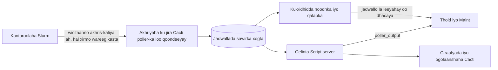

<!-- Source: README.md; SHA256: 16caa3e34c4d150a7fb1018f637e200a7580330f033b485047d8413bce09abba -->

<!-- translations:start -->
[English](../../../README.md) | [简体中文](../zh-CN/README.md) | [हिन्दी](../hi-IN/README.md) | [Español (España)](../es-ES/README.md) | [Español (Latinoamérica)](../es-419/README.md) | [العربية (السعودية)](../ar-SA/README.md) | [Afrikaans](../af-ZA/README.md) | [አማርኛ](../am-ET/README.md) | [العربية (مصر)](../ar-EG/README.md) | [العربية (المغرب)](../ar-MA/README.md) | [বাংলা](../bn-BD/README.md) | [Bosanski](../bs-BA/README.md) | [Deutsch](../de-DE/README.md) | [فارسی](../fa-IR/README.md) | [Filipino](../fil-PH/README.md) | [Français](../fr-FR/README.md) | [Français (Maroc)](../fr-MA/README.md) | [Français (Sénégal)](../fr-SN/README.md) | [Hausa](../ha-NG/README.md) | [עברית](../he-IL/README.md) | [Hrvatski](../hr-HR/README.md) | [Bahasa Indonesia](../id-ID/README.md) | [Igbo](../ig-NG/README.md) | [Italiano](../it-IT/README.md) | [日本語](../ja-JP/README.md) | [한국어](../ko-KR/README.md) | [Malagasy](../mg-MG/README.md) | [मराठी](../mr-IN/README.md) | [Bahasa Melayu](../ms-MY/README.md) | [Nederlands](../nl-NL/README.md) | [Polski](../pl-PL/README.md) | [Português (Brasil)](../pt-BR/README.md) | [Русский](../ru-RU/README.md) | [Kinyarwanda](../rw-RW/README.md) | [Soomaali](README.md) | [Српски](../sr-RS/README.md) | [Svenska](../sv-SE/README.md) | [Kiswahili](../sw-KE/README.md) | [தமிழ்](../ta-IN/README.md) | [తెలుగు](../te-IN/README.md) | [ไทย](../th-TH/README.md) | [Türkçe](../tr-TR/README.md) | [Українська](../uk-UA/README.md) | [اردو](../ur-PK/README.md) | [Tiếng Việt](../vi-VN/README.md) | [isiXhosa](../xh-ZA/README.md) | [Yorùbá](../yo-NG/README.md) | [繁體中文](../zh-TW/README.md) | [isiZulu](../zu-ZA/README.md)
<!-- translations:end -->

# plugin_hpcsched

Kordhin (plugin) loogu talagalay Cacti 1.2 oo sawir-giraaf ku muujisa xaaladda jadwaleeyaha hawlaha HPC iyadoo barbar socota qalabka uu Cacti horey u kormeero: qoto-dheeraanta safka (queue depth), shaqooyinka sugaya iyo kuwa socda, sababta ay shaqooyinku u sugayaan, xaaladaha noodhadhka (node states), iyo isticmaalka qaybaha (partition utilization). Slurm waa habka dambe (backend) ee ugu horreeya. Thold waxay digniino ka soo saartaa ilaha xogta ee ka dhasha, Maint-na waxaa lagu hagi karaa noodhadhka la faarujiyay (drained nodes) iyo boos-celinta dayactirka.

> **Xaaladda: waa la horumarinayaa, weli lama sii deyn.** Marxaladda 2 (aasaaska) waxaa lagu daray laanta `main`, laantanna waxay ku daraysaa marxaladda 3 (giraafyada koox-kombuyuutarrada iyo sababaha sugitaanka). Koodhku wuxuu ku rakibmaa, ku cusboonaysiismaa, kuna tirtirmaa iyada oo loo marayo plugin API-ga Cacti, wuuna diidaa PHP ka hooseeya 8.2. Wuxuu hayaa diiwaanka koox-kombuyuutarrada (clusters) Slurm, oo mid walba loo qoondeeyay hal Cacti poller. Akhriye gadaal ka shaqeeya (background reader) oo ku jira poller-ka weyn ayaa soo ururiya hal sawir xog (snapshot) kooxkiiba muddo-wareeg kasta, isagoo adeegsanaya `squeue`, `scontrol`, iyo `sshare` oo wata `--json` ama ka akhrinaya `slurmrestd` iyadoo la marayo HTTPS, wuxuuna kaydiyaa tirada shaqooyinka iyadoo loo eegayo xaaladda iyo sababta sugitaanka, xaaladaha noodhadhka, qaybaha (partitions), boos-celinta, iyo isticmaalka wadaagga caddaaladda ah (fair-share) oo ay la socoto cusboonaantooda. Kordhintu waxay la timaaddaa qaababka (templates) Cacti, iyadoo marka maamuluhu xaqiijiyo, abuurta ama ku xidha hal qalab Cacti ah kooxkiiba oo leh giraafyada shaqooyinka xaaladooda, shaqooyinka sugaya koox-sababeedkooda, noodhadhka xaaladooda, CPU-yada, iyo isticmaalka, kooxda oo dhan iyo qayb kastaaba, oo ay u dheer tahay da'da sawirka xogta. Bog guud oo akhris-kaliya ah ayaa muujinaya tirada kooxkiiba iyo cusboonaantooda iyo aragtida sababaha sugitaanka kooxkiiba, bogga caafimaadka oo maamulka keliya u gaar ahna wuxuu muujinayaa waxa ururin kastaa soo celisay iyo haddii qaababku rakiban yihiin. Bog kasta iyo fal kasta wuxuu raacaa ogolaanshaha qalabka ee Cacti. Ilaha xogtu waa kuwo Thold ay digniin ka soo saari karto, laakiin weli lama tijaabin wax is-dhexgal ah oo Thold ama Maint ah; taasi waa marxaladda 4 iyo wixii ka dambeeya. Qaybta tijaabadu waxay dabooshaa amarada Slurm ee macmalka ah iyo jawaabaha `slurmrestd`, sidoo kale CI waxay ku tijaabisaa koox Slurm ah oo dhab ah oo ka kooban lix noodh oo ku jira weelal (containers) sida hoos lagu sharaxay. Akhriyuhu weli kuma shaqeyn koox wax-soo-saar ah (production cluster). Qoraallada hawlwadeenka ka hooseeya, README-gan wuxuu sharaxayaa naqshadda, ma aha dhaqanka la sii daayay.

Kani waa mashruuc madax-bannaan mana la xidhiidho mashruuca Cacti.

## Doorarka gelitaanka

| Goobta (Realm) | Gelitaanka |
| --- | --- |
| HPC Scheduler View | Boggaga kormeerka ee jira. |
| HPC Scheduler Operator | Kormeerka oo lagu daray bogga Hawlgallada (Operations) iyo qirashada kala-soocidda shakhsi ahaaneed. |
| HPC Scheduler Admin | Gelitaanka Hawlwadeenka oo lagu daray qaabaynta jirta iyo tallaabooyinka maamulka. |

Marka aad koobiyeyso faylasha cusboonaysiinta, u fur bogga Plugins adigoo ah maamule si aad u diiwaangeliso
goobta (realm) cusub. Si cad ugu qoondee goobta Operator hoosta **Configuration > Users** ama kooxaha isticmaalayaasha.
Cusboonaysiintu waxay ilaalisaa aqoonsiyada (IDs) iyo deeqaha View iyo Admin ee jira. Gelitaanka Admin
wuxuu dhaxlaa gelitaanka Operator, gelitaanka Operator-na wuxuu dhaxlaa gelitaanka View codsi kasta;
tani kuma kordhiso deeqo kaydsan isticmaalayaasha ama kooxaha. Dejinta kordhintu waxay sidoo kale u baahan tahay
gelitaanka HPC Scheduler Admin marka lagu daro ogolaanshaha Settings ee Cacti.

Ogolaanshaha qalabka Cacti weli waxay xaddidaan safafka iyo tallaabooyinka u furan isticmaale kasta; koox aan qalab lahayn waxaa lagu taxaa boggaga maamulka isticmaale kasta oo leh goobta kordhinta, laakiin laguma taxo aragtiyaha hawlwadeenka, kuwaas oo taxaya oo keliya kooxaha ku xidhan qalab.
Aqoonsiyada sirta ah, qaabaynta, isku-xidhka, tirtiridda iyo isbeddellada kale ee maamulka
waxay ku sii jiraan boggaga maamulka. Qirashooyinku (Acknowledgments) waxay shaqeeyaan oo keliya fadhiga (session)
hadda ee isticmaalaha, ugu badnaan hal saac iyo oo keliya inta isla indho-indheyntu ay
cusub tahay. Indho-indheyn cusub ama isbeddeshay way burisaa. Weligood cabbir fashilmay
kama dhigaan mid caafimaad qaba mana joojiyaan digniinaha.

## Qoraallada hawlwadeenka ee marxaladda 2

**Mudnaanta ugu yar (Least privilege).** Kordhintu way akhrisaa oo keliya. Sii isticmaale Slurm oo gooni ah oo aan lahayn door maamule ama hawlwadeen (`AdminLevel=None` gudaha `sacctmgr`). Marka `PrivateData=jobs` (ama `nodes`, `reservations`, `usage`) ay ku jirto `slurm.conf`, isticmaalahaasi wuxuu arkaa diiwaannadiisa oo keliya, sidaas darteed tiradu ma dhammaan kordhintuna ma ogaan karto. Ka qaadista xaddidaaddaas akoonka waxay ka dhigan tahay heer hawlwadeen ama maamule, taasoo sidoo kale ogolaanaysa isbeddello; go'aanka is-dhaafsigaas waxaa iska leh goobta (site). Amarada macmiilka, isticmaalaha Cacti poller wuxuu u baahan yahay faylasha fulinta ee macmiilka Slurm iyo `slurm.conf` gaadha kantaroolaha; waddooyinka faylasha fulintu waa dejimo buuxa oo ku jira Configuration > Settings > HPC Scheduler. Wixii `slurmrestd` ah, URL-ku waa inuu noqdaa `https://`, ama `http://` oo ku jira cinwaanka loopback oo keliya. Shahaadooyinka TLS waa la xaqiijiyaa, dib-u-jihaynta (redirects) lamana raaco. Liis ikhtiyaari ah oo martigeliyeyaasha slurmrestd ah oo ku jira Configuration > Settings > HPC Scheduler ayaa xaddidaya martigeliyeyaasha iyo dekedaha (ports) ay kooxi magacaabi karto.

**Poller-rada fog (Remote pollers).** Sii-deyntani waxay xogta ka soo ururisaa oo keliya Cacti poller-ka weyn. Koox loo qoondeeyay xog-ururiye fog lama ururiyo: akhriyaha halkaas jooga wuu diidaa isagoo sababta ku qoraya diiwaanka (log), bogga caafimaadkuna wuxuu magacaabaa kooxda. Ururinta fog waa wajiga 3.

**Xusuusta (Memory).** Wareeg kasta oo ururin ah wuxuu fasiraa hal jawaab oo jadwaleeye ah marba, taasoo qaadata ilaa 12 jeer cabbirka jawaabta xusuusta PHP (waxaa lagu cabbiray ilaa 10 jeer diiwaannada shaqada ee u qaabaysan sida Slurm, oo lagu daray qoraalka laftiisa). Wareeggu wuxuu kor u qaadaa xadka xusuusta PHP ilaa dejinta Collection Memory (1024 MiB sida caadiga ah) wuxuuna ogolaadaa jawaabaha ilaa (Collection Memory - 64) / 12 MiB, 80 MiB sida caadiga ah, xitaa marka Maximum Answer Size loo dejiyo meel ka sarreysa; bogga caafimaadku wuu ka digaa marka ay sidaas tahay. Jawaab ka weyn waxay qaybteeda u fashilantaa inay aad u weyn tahay, wareegga ay weli xusuustu ka dhamaatona waxaa loo diiwaangeliyaa inuu fashilmay. Koox weyn waxay u baahan kartaa in labada dejinba kor loo qaado; 100,000 oo diiwaanno shaqo oo dhab ah lama cabbirin.

**Faylasha Token-ka.** Koox `slurmrestd` ah waxay magacawdaa fayl token; token-ka laftiisa weligiis laguma kaydiyo kaydka xogta, laguma muujiyo bog, lagumana qoro diiwaanka. Faylku waa inuu ku dhex jiraa mid ka mid ah galalka faylka token-ka ee lagu dejiyay Configuration > Settings > HPC Scheduler, iyadoo la gaadho iyada oo aan lahayn isku-xidh astaan ah (symbolic link), waana inuu noqdaa fayl caadi ah oo uu leeyahay isticmaalaha poller-ka oo isaga keliya uu wax ku qori karo, haystana hal sadar: token-ka, ama `SLURM_JWT=<token>` sida uu `scontrol token` u daabaco. Haddii aan la dejin galal token ah, kooxina ma isticmaali karto `slurmrestd`. Labadan dejin waxay ku yaalliin bogga Settings ee Cacti, sidaas darteed goobta Admin ee kordhinta keligeed ma beddeli karto; ku hay gal kasta oo token ah mid ay wax ku qori karaan root iyo isticmaalaha poller-ka oo keliya. Fayl ay kooxdu ama isticmaalayaasha kale akhrin karaan weli waa la isticmaalaa, bogga caafimaadkuna wuu ka digaa. Bogga caafimaadku wuxuu sidoo kale ka digaa marka token-ku dhacayo gudaha wakhtiga digniinta ee la habeeyay.

Si aad u beddesho (rotate) token iyada oo aan la helin daqiiqad uu akhriyuhu ku arko fayl aan dhammaystirnayn, ku qor token-ka cusub kan hore agtiisa ka dibna magac-beddel ku gee booskiisa:

```sh
dir=/etc/cacti/hpcsched
tmp=$(mktemp "$dir/.token.XXXXXX")
scontrol token username=cactiread lifespan=2592000 > "$tmp"
chown cacti:cacti "$tmp"
chmod 0600 "$tmp"
mv -f "$tmp" "$dir/cluster1.token"
```

Ururinta xigta waxay akhridaa faylka cusub. Soo saarista token-nada iyadoo la adeegsanayo `scontrol token` waxay u baahan tahay maamule Slurm; ku orod meesha taas laga ogol yahay oo u koobiyee faylka poller-ka.

## Qoraallada hawlwadeenka ee marxaladda 3

**Qaababka (Templates).** Rakibidda iyo cusboonaysiintu waxay soo dejiyaan qaababka qalabka, xogta, iyo giraafka ee HPC Scheduler waxayna u koobiyeyaan waydiinta xogta qaybta (partition data query) galka `resource/script_server/` ee Cacti. Haddii galkaas uusan wax ku qori karin isticmaalaha rakibaya kordhinta, fayl kale oo isku magac ah uu horey halkaas u yaallo oo aanay kordhintu qorin, ama magacu uu yahay isku-xidh astaan ah, soo dejintu way istaagtaa, faylka waa la dhaafaa, bogga caafimaadkuna wuxuu sheegaa waxa la samaynayo; Install Templates oo ku jira bogga caafimaadka ayaa dib u isku daya. Koobi isku mid ah oo gacanta lagu sameeyay waa la isticmaalaa laakiin adiga ayuu kuu sii jiraa. Ka-saaristu waxay tirtirtaa faylka waydiinta oo keliya haddii kordhintu qortay oo aan wax laga beddelin, waxayna ilaalisaa qaababka, qalabka, iyo giraafyada.

**Qalabka koox-kombuyuutarrada.** HPC Clusters > Device wuxuu muujiyaa waxa uu qalab ku dari doono (giraafyada, ilaha xogta, faylasha RRD, iyo wicitaannada script server ee wareeg kasta) ka hor inta aan waxba la abuurin. Create Device wuxuu sameeyaa qalab leh magac martigeliye oo ku jira domain-ka gaarka loo xidhay ee `.invalid` iyada oo aan la hubin helitaankiisa; Map Device taa beddelkeeda wuxuu ku xidhaa giraafyada qalab horey u jiray wuuna dhaafaa dejimihiisa. Giraaf kasta oo koox ah iyo giraaf kasta oo qayb ah wuxuu leeyahay il xogeed u gaar ah: lix kooxda ah iyo shan qaybtiiba, hal wicitaan oo script server ah il xogeed kasta oo koox ah iyo hal qiime kasta oo qayb ah (32) wareeg kasta. Qaybaha dambe lagu daro waa la tusmeeyaa marka akhriyuhu arko waxayna giraafyo ka helaan bogga New Graphs ee Cacti; qayb laga saaro way joojisaa in xogta laga ururiyo waxayna ilaalisaa giraafyadeeda. Tirtiridda qalabku waxay ka furtaa kooxda weyna ilaalisaa.

**Waxa giraafyadu tiriyaan.** Sugitaanku (Pending) kama mid aha shaqooyinka la hayo (held jobs), kuwaas oo leh taxanahooda u gaarka ah. Taxane sugaya (pending array) wuxuu tiriyaa hawlihiisa hadhay. Shaqo ama noodh ku jira dhowr qaybood wuxuu hal mar ku tirsamaa giraafyada kooxda iyo hal mar qayb kasta, sidaas darteed giraafyada qaybaha uma baahna inay isku daraan kan kooxda. Sababaha sugitaanka waxaa loo kooxeeyaa kow iyo toban qoys ([ADR 0011](../../decisions/0011-pending-reason-families-and-counting.md)); aragtida sababaha sugitaanku waxay taxdaa sababaha ceeriin, oo ay ku jiraan kuwa ku jira Other. Shaqo kastaa waxay soo warisaa oo keliya sababtii u dambaysay ee jadwaleeyuhu baadhay. Qaybiyaha hoose ee isticmaalka (utilization denominator) waxaa ku jira noodhadhka la faarujiyay, kuwa hoos u dhacay (down), iyo kuwa kale ee aan la heli karin. Xogta duugowday ama fashilantay waa `U`, weligeed ma noqoto eber; `age` wuxuu sii ahaadaa tiro.

**Digniinaha.** Thold waxay digniin ka soo saari kartaa mid kasta oo ka mid ah ilaha xogtan; u deji muddooyinka Thold ugu yaraan hal muddo-wareeg oo ururin ah, oo ka dig `age` si aad u qabato akhriye istaagay. Hubinta Thold ee bilow-ilaa-dhammaad waa marxaladda 4.

**Lagu tijaabiyay wax-soo-saarka dhabta ah ee Slurm.** CI waxay ku bilowdaa koox Slurm ah oo lix noodh leh gudaha weelal (26.05.5 isbeddel kasta, 25.11.8 oo laga dhisay isha marka loo riixo `main`, toddobaadle, iyo marka la codsado) waxayna hubisaa xaaladaha noodhadhka, boos-celinta dayactirka, sababaha sugitaanka, iyo taxanayaasha (arrays) sida ay kordhintu u fasirto, ka dibna waxay xogta ka soo ururisaa kooxdaas iyadoo adeegsanaysa amarka u gaarka ah kordhinta iyo hababka `slurmrestd`. Sii-deynta ka sii horreeya waxaa lagu daboolaa oo keliya tusaalooyin macmal ah. Akhriyuhu weli kuma shaqeyn koox wax-soo-saar ah.

**Ogolaanshaha.** Koox ku xidhan qalab waxaa loo muujiyaa, loo dhoofiyaa, loona beddelaa oo keliya isticmaalayaasha uu Cacti u ogolaado qalabkaas, bog kasta oo kordhinta ah; ku-xidhidda qalabku waxay sidoo kale u baahan tahay ogolaanshaha qalabka la beegsanayo. Koox aan qalab lahayn way u muuqataa qof kasta oo leh goobta kordhinta. Koox weli ku xidhan qalab la tirtiray iyadoo kordhintu dansan tahay waxaa loo muujiyaa oo keliya isticmaalayaasha leh goobta HPC Scheduler Admin, kuwaas oo u abuuri kara ama u xidhi kara qalab. Gelitaanka giraafku waa kan Cacti u gaarka ah.

## Sababta

Hawlwadeennada maamula Cacti waxay horey u sawir-giraafiyaan noodhadhkooda xisaabinta. Aragtida jadwaleeyuhu way ka maqan tahay giraafyadaas, taasoo keenaysa laba daldaloolo:

- **Ma jirto "sababta shaqadu u bilaaban weyday".** Slurm wuxuu diiwaangeliyaa sabab shaqo kasta oo sugaysa. Saf buuxa oo barbar yaalla giraafyada noodhadhka aan shaqaynayn ma sheego haddii sababtu tahay mudnaanta, xaddidaadda kheyraadka, haynta (holds), ku-tiirsanaanta, ama noodhadhka la faarujiyay.
- **Ma jiro xidhiidh u dhexeeya xaaladda jadwaleeyaha iyo digniinaha.** Thold waxay digniin ka soo saartaa qalab uu maamuluhu horey u faarujiyay, maamulayaashuna waxay jadwallada Maint ku sameeyaan gacanta.

Kordhintu waxay soo ururisaa hal sawir xog oo kaydsan kooxkiiba, waxay u daabacdaa sida ilaha xogta iyo giraafyada caadiga ah ee Cacti, waxay noodhadhka jadwaleeyaha ku xidhaa qalabka Cacti ee jira, waxayna gelin kartaa noodhadhka la faarujiyay iyo boos-celinta dayactirka gudaha Maint. Waxay dib u isticmaashaa ogolaanshaha Cacti, xog-ururiyeyaasha fog, Thold, iyo Maint, waana akhris-kaliya xagga jadwaleeyaha.

## Baaxadda la qorsheeyay

| Wajiga | Baaxadda | Marxaladaha |
|---|---|---|
| 0, cilmi-baadhis | Shaxda sii-deynta Slurm, xaqiijinta dhaqanka isha sare (upstream), culayska kantaroolaha, tusaalooyinka magacaabista noodhadhka | [M1](https://github.com/somethingwithproof/plugin_hpcsched/milestone/1) |
| 1, giraafyada kooxda | Qoto-dheeraanta safka, shaqooyinka sugaya iyo kuwa socda, sababaha sugitaanka, xaaladaha noodhadhka, isticmaalka qaybaha, digniinaha Thold, bogga caafimaadka, sii-deynta | [M2](https://github.com/somethingwithproof/plugin_hpcsched/milestone/2), [M3](https://github.com/somethingwithproof/plugin_hpcsched/milestone/3), [M4](https://github.com/somethingwithproof/plugin_hpcsched/milestone/4) |
| 2, noodhadhka iyo dayactirka | Ku-xidhidda noodhka iyo qalabka, xaaladda noodhkiiba, daaqadaha Maint ee otomaatiga ah ee noodhadhka la faarujiyay iyo boos-celinta dayactirka | [M5](https://github.com/somethingwithproof/plugin_hpcsched/milestone/5) |
| 3, xisaabaadka | Isticmaalka wadaagga caddaaladda ah, tirakoobka xisaabaadka xaddidan, xog-ururiyeyaasha fog | [M6](https://github.com/somethingwithproof/plugin_hpcsched/milestone/6) |

Ka baxsan baaxadda: wax kasta oo wax ku qorid ah oo ku wajahan jadwaleeyaha (dirid, joojin, hayn, faaruqin, dib-u-bilaabid), matoor digniin oo ay kordhintu leedahay, matoor warbixin ama kharash-celin, taxanayaal isticmaale-kiiba iyo shaqo-kiiba ah. Hababka dambe ee PBS Pro, OpenPBS, iyo LSF waa cilmi-baadhis.

## Bartilmaameedyada is-waafaqsanaanta

| Qaybta | Bartilmaameedka |
|---|---|
| Cacti | 1.2.31 ama ka dambeeya, iyada oo aan wax balastar ah lagu samayn xudunta (no core patches) |
| PHP | 8.2 ama ka dambeeya; `setup.php` wuxuu sii ahaadaa mid la akhriyi karo (parseable) oo ku jira 8.0 si deegaan-fulin aan la taageerin uu u helo diidmo halkii uu ka heli lahaa Cacti UI jaban |
| Slurm | 25.05, 25.11, iyo 26.05, saddexda sii-deyn ee ugu dambeeyay ([ADR 0013](../../decisions/0013-three-latest-slurm-releases.md)); 25.11 iyo 26.05 waxaa lagu tijaabiyaa koox nool, 25.05 waxaa lagu tijaabiyaa tusaalooyin macmal ah oo keliya. Amarada macmiilku waa habka gudbinta ee caadiga ah ([ADR 0012](../../decisions/0012-client-commands-default-transport.md)) waxayna isticmaalaan dejinta fasiraha xogta: v0.0.43 sida caadiga ah, kaas oo SchedMD ka saarto 27.05, ama v0.0.44 ama v0.0.45 sii-deynta la yimaadda. Kooxaha slurmrestd waxay ogaadaan fasiraha ugu cusub ee daemon-ku bixiyo |
| Thold, Maint | Wax isbeddel ah oo Thold lagu sameeyo ma jiro; is-dhexgalka Maint waa soo jeedin u baahan ogolaanshaha ilaaliyeyaasha Maint |

## Naqshadda

- [docs/PLAN.md](../../PLAN.md) waa qorshaha buuxa: qaab-dhismeedka, xaqiiqooyinka isha sare ee uu ku tiirsan yahay (oo wata ilo iyo liis cad oo malo-awaal aan la xaqiijin ah), ku-xidhidda noodhadhka, qaabka xaaladda, xuduudaha amniga, xisaabinta waxqabadka, tijaabinta, iyo khataraha.
- [docs/decisions/](../../decisions) waxay haysaa diiwaannada go'aannada qaab-dhismeedka.
- [docs/REQUIREMENTS.md](../../REQUIREMENTS.md) waxay ku xidhaa aqoonsi kasta oo shuruud ah arrintiisa (issue).



## Sida shaqada loola socdo

- **Marxaladuhu (Milestones)** waxay raacaan marxaladaha qorshaha. Mid kasta wuxuu leeyahay arrin weyn (epic issue) oo taxaysa arrimaha hoose iyo caddaynta bixitaanka.
- **Arrimaha (Issues)** waxaa lagu kala saaraa summado: `type: requirement`, `type: research`, `type: decision`, `type: epic`. Arrimaha shuruuduhu waxay sheegaan shuruudo tiro leh oo la tijaabin karo (`REQ-AREA-NNN`) iyo shuruudaha aqbalidda.
- **Summaduhu (Labels)** waxay sidoo kale sitaan `area:`, `phase:`, `priority:`, iyo `status:`. Eeg [CONTRIBUTING.md](../../../CONTRIBUTING.md#labels).
- [Guddiga mashruuca](https://github.com/users/somethingwithproof/projects/10) wuxuu muujiyaa dhammaan arrimaha marxaladaha oo dhan.

## Ka qayb-qaadashada

Akhri [CONTRIBUTING.md](../../../CONTRIBUTING.md). Gudbinta (commits) waxay u baahan yihiin saxiixa DCO. Doodda naqshadda waxay ka dhacdaa arrimaha (issues); go'aannada furan waxay sitaan summadda `type: decision`.

## Amniga

U soo sheeg nuglaanshaha si gaar ah; eeg [SECURITY.md](../../../SECURITY.md).

## Shatiga

GNU General Public License v2.0, waa isla shatiga Cacti iyo kordhinteeda. Eeg [LICENSE](../../../LICENSE).
