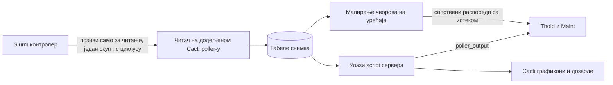

<!-- Source: README.md; SHA256: 16caa3e34c4d150a7fb1018f637e200a7580330f033b485047d8413bce09abba -->

<!-- translations:start -->
[English](../../../README.md) | [简体中文](../zh-CN/README.md) | [हिन्दी](../hi-IN/README.md) | [Español (España)](../es-ES/README.md) | [Español (Latinoamérica)](../es-419/README.md) | [العربية (السعودية)](../ar-SA/README.md) | [Afrikaans](../af-ZA/README.md) | [አማርኛ](../am-ET/README.md) | [العربية (مصر)](../ar-EG/README.md) | [العربية (المغرب)](../ar-MA/README.md) | [বাংলা](../bn-BD/README.md) | [Bosanski](../bs-BA/README.md) | [Deutsch](../de-DE/README.md) | [فارسی](../fa-IR/README.md) | [Filipino](../fil-PH/README.md) | [Français](../fr-FR/README.md) | [Français (Maroc)](../fr-MA/README.md) | [Français (Sénégal)](../fr-SN/README.md) | [Hausa](../ha-NG/README.md) | [עברית](../he-IL/README.md) | [Hrvatski](../hr-HR/README.md) | [Bahasa Indonesia](../id-ID/README.md) | [Igbo](../ig-NG/README.md) | [Italiano](../it-IT/README.md) | [日本語](../ja-JP/README.md) | [한국어](../ko-KR/README.md) | [Malagasy](../mg-MG/README.md) | [मराठी](../mr-IN/README.md) | [Bahasa Melayu](../ms-MY/README.md) | [Nederlands](../nl-NL/README.md) | [Polski](../pl-PL/README.md) | [Português (Brasil)](../pt-BR/README.md) | [Русский](../ru-RU/README.md) | [Kinyarwanda](../rw-RW/README.md) | [Soomaali](../so-SO/README.md) | [Српски](README.md) | [Svenska](../sv-SE/README.md) | [Kiswahili](../sw-KE/README.md) | [தமிழ்](../ta-IN/README.md) | [తెలుగు](../te-IN/README.md) | [ไทย](../th-TH/README.md) | [Türkçe](../tr-TR/README.md) | [Українська](../uk-UA/README.md) | [اردو](../ur-PK/README.md) | [Tiếng Việt](../vi-VN/README.md) | [isiXhosa](../xh-ZA/README.md) | [Yorùbá](../yo-NG/README.md) | [繁體中文](../zh-TW/README.md) | [isiZulu](../zu-ZA/README.md)
<!-- translations:end -->

# plugin_hpcsched

Додатак за Cacti 1.2 који графички приказује стање HPC batch планера поред уређаја које Cacti већ надзире: дубину реда, послове на чекању у односу на послове у току, разлоге зашто послови чекају, стања чворова и искоришћеност партиција. Slurm је први подржани backend. Thold генерише упозорења на основу добијених извора података, а Maint може да се покреће на основу испражњених чворова и резервација за одржавање.

> **Статус: у развоју, још нема издања.** Прекретница 2 (основа) је спојена на грану `main`, а ова грана додаје прекретницу 3 (графикони кластера и разлози чекања). Код се инсталира, надограђује и деинсталира преко Cacti API-ја за додатке и одбија верзије PHP-а ниже од 8.2. Води регистар Slurm кластера, при чему је сваки додељен једном Cacti poller-у. Позадински читач на главном poller-у прикупља по један снимак по кластеру у сваком интервалу, било покретањем команди `squeue`, `scontrol` и `sshare` са заставицом `--json`, или читањем сервиса `slurmrestd` преко HTTPS-а, и чува број послова по стању и разлогу чекања, стања чворова, партиције, резервације и fair-share искоришћеност заједно са њиховом свежином. Додатак испоручује Cacti шаблоне и, након потврде администратора, креира или мапира по један Cacti уређај за сваки кластер са графиконима послова по стању, послова на чекању по групи разлога, чворова по стању, CPU ресурса и искоришћености, за цео кластер и за сваку партицију, као и старости снимка. Прегледна страница само за читање приказује бројеве по кластеру са њиховом свежином и преглед разлога чекања по кластеру, док администраторска страница стања система приказује шта је свако прикупљање вратило и да ли су шаблони инсталирани. Свака страница и свака радња прати Cacti дозволе за уређаје. Извори података су такви да Thold може да поставља упозорења на њима, али интеграција са додацима Thold и Maint још није тестирана; то је предвиђено за прекретницу 4 и касније. Скуп тестова покрива синтетичке Slurm команде и одговоре сервиса `slurmrestd`, а CI такође тестира стварни Slurm кластер са шест чворова у контејнерима како је описано испод. Читач још није покренут на продукцијском кластеру. Испод напомена за оператере, овај README описује дизајн, а не већ испоручено понашање.

Ово је независан пројекат и није повезан са пројектом Cacti.

## Улоге приступа

| Подручје (Realm) | Приступ |
| --- | --- |
| HPC Scheduler View | Постојеће странице за надзор. |
| HPC Scheduler Operator | Надзор плус страница Операције и личне потврде за тријажу. |
| HPC Scheduler Admin | Приступ оператера плус постојеће конфигурационе и администраторске радње. |

Након копирања датотека за надоградњу, отворите страницу Plugins као администратор да бисте регистровали ново подручје. Доделите подручје Operator изричито под **Configuration > Users** или корисничким групама. Надоградње задржавају постојеће ID-ове и дозволе за подручја View и Admin. Приступ Admin наслеђује приступ Operator, а приступ Operator наслеђује приступ View при сваком захтеву; тиме се корисницима ни групама не додају трајно сачуване дозволе. Подешавања додатка захтевају и приступ HPC Scheduler Admin поред Cacti дозволе Settings.

Cacti дозволе за уређаје и даље ограничавају редове и радње доступне сваком кориснику; кластер без уређаја приказан је на администраторским страницама сваком кориснику са подручјем додатка, али не у приказима за оператере, који приказују само кластере мапиране на уређај. Акредитиви, конфигурација, мапирање, брисање и друге администраторске измене остају на администраторским страницама. Потврде трају само у тренутној корисничкој сесији, највише један сат и само док исто запажање остаје свеже. Нова или измењена запажања их поништавају. Она никада не означавају неуспело мерење као исправно нити потискују упозорења.

## Напомене за оператере за прекретницу 2

**Принцип најмањих овлашћења.** Додатак само чита податке. Доделите му наменског Slurm корисника без администраторске или оператерске улоге (`AdminLevel=None` у `sacctmgr`). Када је у датотеци `slurm.conf` подешено `PrivateData=jobs` (или `nodes`, `reservations`, `usage`), тај корисник види само сопствене записе, па су бројеви непотпуни и додатак то не може да открије. Уклањање тог ограничења за налог значи ниво оператера или администратора, што такође омогућава измене; тај компромис је одлука саме локације. За клијентске команде, корисник Cacti poller-а треба Slurm клијентске бинарне датотеке и датотеку `slurm.conf` која може да приступи контролеру; путање бинарних датотека су апсолутна подешавања под Configuration > Settings > HPC Scheduler. За `slurmrestd`, URL мора бити `https://`, или `http://` искључиво на loopback адреси. TLS сертификати се проверавају, а преусмеравања се не прате. Опционални списак slurmrestd хостова под Configuration > Settings > HPC Scheduler ограничава хостове и портове које кластер сме да наведе.

**Удаљени poller-и.** Ово издање прикупља податке само на главном Cacti poller-у. Кластер додељен удаљеном прикупљачу података се не прикупља: читач тамо одбија рад уз забележен разлог у дневнику, а страница стања система наводи тај кластер. Удаљено прикупљање планирано је за фазу 3.

**Меморија.** Свако покретање прикупљања декодира по један одговор планера истовремено, што заузима отприлике 12 пута више PHP меморије од величине одговора (измерено око 10 пута за записе послова у Slurm облику, плус сам текст). Покретање подиже своје PHP ограничење меморије на вредност подешавања Collection Memory (подразумевано 1024 MiB) и дозвољава одговоре до (Collection Memory - 64) / 12 MiB, подразумевано 80 MiB, чак и када је Maximum Answer Size подешено више; страница стања система упозорава када је то случај. Већи одговор узрокује да његов одељак не успе као превелик, а покретање које ипак остане без меморије бележи се као неуспело. Велики кластер може захтевати повећање оба подешавања; 100.000 стварних записа послова још није мерено.

**Датотеке токена.** Кластер који користи `slurmrestd` наводи датотеку токена; сам токен се никада не чува у бази података, не приказује на страници и не уписује у дневник. Датотека мора да се налази унутар једног од директоријума за датотеке токена подешених под Configuration > Settings > HPC Scheduler, да буде доступна без симболичке везе и да буде обична датотека у власништву корисника poller-а у коју само тај корисник може да пише, са једним редом: самим токеном или `SLURM_JWT=<token>` како исписује `scontrol token`. Ако директоријуми за токене нису подешени, ниједан кластер не може да користи `slurmrestd`. Ова два подешавања налазе се на Cacti страници Подешавања, тако да их само подручје Admin додатка не може изменити; држите сваки директоријум токена отвореним за упис само кориснику root и кориснику poller-а. Датотека коју група или други корисници могу да читају и даље се користи, а страница стања система приказује упозорење. Страница стања система такође упозорава када токен истиче унутар конфигурисаног времена упозорења.

Да бисте ротирали токен без временског прозора у којем читач види непотпуну датотеку, запишите нови токен поред старог и преименујте га на његово место:

```sh
dir=/etc/cacti/hpcsched
tmp=$(mktemp "$dir/.token.XXXXXX")
scontrol token username=cactiread lifespan=2592000 > "$tmp"
chown cacti:cacti "$tmp"
chmod 0600 "$tmp"
mv -f "$tmp" "$dir/cluster1.token"
```

Следеће прикупљање чита нову датотеку. Генерисање токена помоћу `scontrol token` захтева Slurm администратора; покрените команду тамо где је то дозвољено и копирајте датотеку на poller.

## Напомене за оператере за прекретницу 3

**Шаблони.** Инсталација и надоградња увозе шаблоне уређаја, података и графикона за HPC Scheduler и копирају упит података за партиције у Cacti директоријум `resource/script_server/`. Ако корисник који инсталира додатак нема право уписа у тај директоријум, ако већ постоји другачија датотека истог назива коју није уписао додатак или је назив симболичка веза, увоз се зауставља, датотека остаје нетакнута, а страница стања система наводи шта треба урадити; опција Install Templates на страници стања система понавља покушај. Ручно направљена идентична копија се користи, али остаје под вашом контролом. Деинсталација уклања датотеку упита само ако ју је уписао додатак и ако није мењана, а задржава шаблоне, уређаје и графиконе.

**Уређаји кластера.** Страница HPC Clusters > Device приказује шта ће уређај додати (графиконе, изворе података, RRD датотеке и позиве script сервера по испитивању) пре него што се било шта креира. Create Device креира уређај са називом хоста у резервисаном домену `.invalid` и без провере доступности; Map Device уместо тога додаје графиконе постојећем уређају без измене његових подешавања. Сваки графикон кластера и сваки графикон партиције има сопствени извор података: шест за кластер и пет по партицији, један позив script сервера по извору података кластера и један по вредности партиције (32) по испитивању. Касније додате партиције индексирају се када их читач уочи и добијају графиконе са Cacti странице New Graphs; уклоњена партиција престаје да се испитује и задржава своје графиконе. Брисање уређаја уклања мапирање кластера и задржава сам кластер.

**Шта графикони броје.** На чекању искључује задржане послове, који имају сопствену серију. Низ послова на чекању броји своје преостале задатке. Посао или чвор у више партиција броји се једном у графиконима кластера и једном у свакој партицији, па збир графикона партиција не мора да одговара графикону кластера. Разлози чекања груписани су у једанаест група ([ADR 0011](../../decisions/0011-pending-reason-families-and-counting.md)); преглед разлога чекања наводи сирове разлоге, укључујући оне у категорији Other. Сваки посао пријављује само последњи разлог који је планер испитао. Именилац искоришћености укључује испражњене, недоступне и друге чворове који нису на располагању. Застарели или неуспели подаци приказују се као `U`, никада као нула; `age` остаје нумеричка вредност.

**Упозоравање.** Thold може да поставља упозорења на било ком од ових извора података; подесите трајање у Thold-у на најмање један интервал прикупљања и поставите упозорење на `age` да бисте открили заустављен читач. Целовита провера са додатком Thold део је прекретнице 4.

**Тестирано на стварном излазу Slurm-а.** CI покреће Slurm кластер са шест чворова у контејнерима (26.05.5 при свакој измени, 25.11.8 изграђен из изворног кода при слању на `main`, недељно и на захтев) и проверава стања чворова, резервацију за одржавање, разлоге чекања и низове послова онако како их додатак рашчлањује, а затим прикупља податке са тог кластера користећи сопствене транспорте додатка за команде и `slurmrestd`. Старија издања покривена су само синтетичким тестним подацима. Читач још није покренут на продукцијском кластеру.

**Дозволе.** Кластер мапиран на уређај приказује се, извози и мења само корисницима којима Cacti дозвољава приступ том уређају, на свакој страници додатка; мапирање уређаја такође захтева дозволу за циљни уређај. Кластер без уређаја видљив је свима са подручјем додатка. Кластер који је још мапиран на уређај обрисан док је додатак био онемогућен приказује се само корисницима са подручјем HPC Scheduler Admin, који могу да креирају или мапирају уређај за њега. Приступ графиконима уређује сам Cacti.

## Зашто

Оператери који користе Cacti већ цртају графиконе својих рачунарских чворова. Поглед планера недостаје на тим графиконима, што оставља две празнине:

- **Нема одговора на питање "зашто посао не почиње".** Slurm бележи разлог за сваки посао на чекању. Пун ред чекања поред графикона неактивних чворова не говори да ли је узрок приоритет, ограничења ресурса, задржавања, зависности или испражњени чворови.
- **Нема везе између стања планера и упозоравања.** Thold шаље упозорења за уређај који је администратор већ испразнио, а администратори ручно креирају распореде у Maint-у.

Додатак прикупља један кеширани снимак по кластеру, објављује га као обичне Cacti изворе података и графиконе, мапира чворове планера на постојеће Cacti уређаје и може да уноси испражњене чворове и резервације за одржавање у Maint. Користи постојеће Cacti дозволе, удаљене прикупљаче података, Thold и Maint, а према планеру ради искључиво у режиму читања.

## Планирани опсег

| Фаза | Опсег | Прекретнице |
|---|---|---|
| 0, истраживање | Матрица издања Slurm-а, потврда понашања узводног софтвера, оптерећење контролера, тестни подаци за именовање чворова | [M1](https://github.com/somethingwithproof/plugin_hpcsched/milestone/1) |
| 1, графикони кластера | Дубина реда, послови на чекању и у току, разлози чекања, стања чворова, искоришћеност партиција, Thold упозоравање, страница стања система, издање | [M2](https://github.com/somethingwithproof/plugin_hpcsched/milestone/2), [M3](https://github.com/somethingwithproof/plugin_hpcsched/milestone/3), [M4](https://github.com/somethingwithproof/plugin_hpcsched/milestone/4) |
| 2, чворови и одржавање | Мапирање чворова на уређаје, стање по чвору, аутоматски Maint термини за испражњене чворове и резервације за одржавање | [M5](https://github.com/somethingwithproof/plugin_hpcsched/milestone/5) |
| 3, обрачун | Fair-share искоришћеност, ограничена статистика обрачуна, удаљени прикупљачи података | [M6](https://github.com/somethingwithproof/plugin_hpcsched/milestone/6) |

Ван опсега: било какав пут уписа према планеру (слање, отказивање, задржавање, пражњење, наставак), сопствени систем упозоравања у додатку, систем за извештавање или наплату, серије по кориснику и по послу. Backend-ови за PBS Pro, OpenPBS и LSF су предмет истраживања.

## Циљеви компатибилности

| Компонента | Циљ |
|---|---|
| Cacti | 1.2.31 или новији, без измена језгра |
| PHP | 8.2 или новији; `setup.php` остаје рашчлањив на верзији 8.0 како би неподржано окружење добило уредно одбијање уместо оштећеног Cacti интерфејса |
| Slurm | 25.05, 25.11 и 26.05, три најновија издања ([ADR 0013](../../decisions/0013-three-latest-slurm-releases.md)); 25.11 и 26.05 тестирани су на живом кластеру, 25.05 само на тестним подацима. Клијентске команде су подразумевани транспорт ([ADR 0012](../../decisions/0012-client-commands-default-transport.md)) и користе подешавање парсера података: подразумевано v0.0.43, који SchedMD уклања у 27.05, или v0.0.44 односно v0.0.45 на издањима која их испоручују. Кластери преко slurmrestd аутоматски откривају најновији парсер који демон нуди |
| Thold, Maint | Без измена у Thold-у; интеграција са Maint-ом је предлог који захтева сагласност одржавалаца Maint-а |

## Дизајн

- [docs/PLAN.md](../../PLAN.md) је целовит план: архитектура, чињенице о узводном софтверу на које се ослања (са изворима и изричитим списком непотврђених претпоставки), мапирање чворова, модел стања, безбедносне границе, прорачун перформанси, тестирање и ризици.
- [docs/decisions/](../../decisions) садржи записе о архитектонским одлукама.
- [docs/REQUIREMENTS.md](../../REQUIREMENTS.md) повезује сваки ID захтева са његовим задатком.



## Праћење рада

- **Прекретнице** прате прекретнице плана. Свака има епски задатак са списком подзадатака и доказа о завршетку.
- **Задаци** су означени врстом: `type: requirement`, `type: research`, `type: decision`, `type: epic`. Задаци захтева наводе нумерисане, тестабилне захтеве (`REQ-AREA-NNN`) и критеријуме прихватања.
- **Ознаке** такође носе префиксе `area:`, `phase:`, `priority:` и `status:`. Погледајте [CONTRIBUTING.md](../../../CONTRIBUTING.md#labels).
- [Табла пројекта](https://github.com/users/somethingwithproof/projects/10) приказује све задатке кроз прекретнице.

## Допринос

Прочитајте [CONTRIBUTING.md](../../../CONTRIBUTING.md). Комити захтевају DCO потпис (sign-off). Расправа о дизајну одвија се у задацима; отворене одлуке носе ознаку `type: decision`.

## Безбедност

Безбедносне рањивости пријавите приватно; погледајте [SECURITY.md](../../../SECURITY.md).

## Лиценца

GNU General Public License v2.0, иста лиценца као Cacti и његови додаци. Погледајте [LICENSE](../../../LICENSE).
