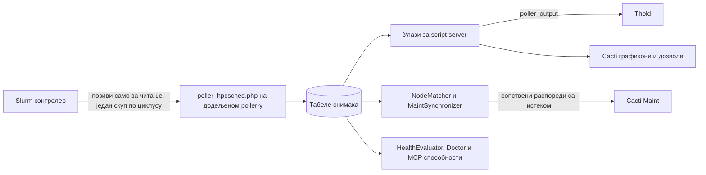

<!-- Source: README.md; SHA256: 938114d41dbd516f9dfcd94619c4fc73ef56b4da1dd693010588a93cce250534 -->

<!-- translations:start -->
[English](../../../README.md) | [简体中文](../zh-CN/README.md) | [हिन्दी](../hi-IN/README.md) | [Español (España)](../es-ES/README.md) | [Español (Latinoamérica)](../es-419/README.md) | [العربية (السعودية)](../ar-SA/README.md) | [Afrikaans](../af-ZA/README.md) | [አማርኛ](../am-ET/README.md) | [العربية (مصر)](../ar-EG/README.md) | [العربية (المغرب)](../ar-MA/README.md) | [বাংলা](../bn-BD/README.md) | [Bosanski](../bs-BA/README.md) | [Deutsch](../de-DE/README.md) | [فارسی](../fa-IR/README.md) | [Filipino](../fil-PH/README.md) | [Français](../fr-FR/README.md) | [Français (Maroc)](../fr-MA/README.md) | [Français (Sénégal)](../fr-SN/README.md) | [Hausa](../ha-NG/README.md) | [עברית](../he-IL/README.md) | [Hrvatski](../hr-HR/README.md) | [Bahasa Indonesia](../id-ID/README.md) | [Igbo](../ig-NG/README.md) | [Italiano](../it-IT/README.md) | [日本語](../ja-JP/README.md) | [한국어](../ko-KR/README.md) | [Malagasy](../mg-MG/README.md) | [मराठी](../mr-IN/README.md) | [Bahasa Melayu](../ms-MY/README.md) | [Nederlands](../nl-NL/README.md) | [Polski](../pl-PL/README.md) | [Português (Brasil)](../pt-BR/README.md) | [Русский](../ru-RU/README.md) | [Kinyarwanda](../rw-RW/README.md) | [Soomaali](../so-SO/README.md) | [Српски](README.md) | [Svenska](../sv-SE/README.md) | [Kiswahili](../sw-KE/README.md) | [தமிழ்](../ta-IN/README.md) | [తెలుగు](../te-IN/README.md) | [ไทย](../th-TH/README.md) | [Türkçe](../tr-TR/README.md) | [Українська](../uk-UA/README.md) | [اردو](../ur-PK/README.md) | [Tiếng Việt](../vi-VN/README.md) | [isiXhosa](../xh-ZA/README.md) | [Yorùbá](../yo-NG/README.md) | [繁體中文](../zh-TW/README.md) | [isiZulu](../zu-ZA/README.md)
<!-- translations:end -->

# plugin_hpcsched

Додатак за Cacti 1.2 (`hpcsched`, верзија `0.1.0-dev`) који графички приказује стање HPC batch планера поред уређаја које Cacti већ надзире: дубину реда, послове на чекању у односу на послове у току, разлоге зашто послови чекају, стања чворова, искоришћеност партиција и fair-share потрошњу на нивоу налога. Slurm је имплементирани backend. Thold генерише упозорења на основу добијених извора података, а опциони синхронизатор за Maint покреће Cacti Maint прозоре на основу Slurm рачунарских чворова који су у стању drain, down или резервисани за одржавање.

> **Статус: у развоју, још нема издања.** Ова грана имплементира основу додатка, графиконе кластера и партиција, групе разлога чекања, повезивање Slurm рачунарских чворова са Cacti уређајима, опциону синхронизацију Cacti Maint прозора, fair-share прегледе на нивоу налога, извршавање и репликацију на удаљеним прикупљачима података, CLI за Configuration-as-Code (CasC) и операције, као и hook-ове за Cacti екосистем (CasC, Doctor и MCP / Abilities API v2). Скуп тестова покрива синтетичке Slurm команде и одговоре сервиса `slurmrestd`, а CI тестира живи Slurm кластер са шест чворова у контејнерима. Читач још није покренут на продукцијском кластеру, а тест поновног извршавања од почетка до краја са Thold-ом још није у CI-ју.

Ово је независан пројекат и није повезан са пројектом Cacti.

## Шта је имплементирано

- **Животни циклус и шема (v3)**: инсталација, идемпотентна надоградња, деинсталација (подразумевано задржавајући табеле додатка) и минимална верзија PHP 8.2, док улазне тачке остају синтаксички читљиве на PHP 8.0. Шема v3 додаје `plugin_hpcsched_node_map` и `plugin_hpcsched_maint_link` поред табела за кластере, покретања, секције, број послова, број чворова, чворове, партиције, резервације и уделе.
- **Прикупљање података из Slurm-а само за читање на главном и удаљеним poller-има**: `poller_bottom` покреће `poller_hpcsched.php --cluster=N` у позадини на сваком poller-у (`poller_id`) за њему додељене омогућене кластере. Свако покретање прикупља по један кеширани снимак по кластеру путем клијентских команди (`squeue`, `scontrol`, `sshare` са `--json`) или преко `slurmrestd` преко HTTPS-а (loopback HTTP је дозвољен уз здравствено упозорење). `INFO` декларише `remote_collect:1, remote_poller:1`, а `replicate_out` реплицира дефиниције `plugin_hpcsched_cluster` без тајних података на удаљене прикупљаче (`poller_id >= 2`); садржај датотека са токенима се никада не чита нити реплицира.
- **Cacti шаблони и графикони кластера**: испоручује шаблоне уређаја, података и графикона (`templates/hpcsched-templates.xml`) и script-server упит података за партиције (`scripts/ss_hpcsched_cluster.php`, `scripts/ss_hpcsched_partitions.php`). Након потврде администратора, креира или мапира по један Cacti уређај по кластеру са графиконима послова по стању, послова на чекању по групи разлога, чворова по стању, CPU ресурса, искоришћености (кластера и по партицији) и старости снимка.
- **Повезивање Slurm чворова са уређајима и Cacti Maint синхронизација**: четворостепени упаривач линеарне сложености (`NodeMatcher`) мапира Slurm рачунарске чворове на постојеће Cacti `host` записе (тачно име хоста, тачна адреса, тачан опис/алијас или прва DNS ознака за имена која нису IP адресе) и означава вишеструка поклапања или дупле пријаве уређаја као `ambiguous` уместо нагађања. `HostList::expand()` проширује листе хостова за Slurm резервације (до 10.000 чворова). `MaintSynchronizer` креира, обнавља и уклања једнократне Cacti Maint распореде у власништву додатка који се прате у `plugin_hpcsched_maint_link` за мапиране чворове у стању `DRAIN`, `DRAINING`, `DOWN` или активним `MAINT`/`MAINTENANCE` резервацијама без мењања Maint распореда које су креирали администратори.
- **Fair-share прегледи на нивоу налога**: када је укључено `collect_shares`, прикупља редове повезаности Slurm налога у `plugin_hpcsched_share` (избацујући корисничке редове према [ADR 0010](../../decisions/0010-bound-series-cardinality.md)). `ShareSummary` и `ShareRepository` рачунају број налога/партиција, збирове сирове и ефективне потрошње, минималне/максималне/просечне fair-share факторе и водеће налоге; број налога је изложен у `hpcsched-get-queue-summary`.
- **CasC и оперативни CLI (`cli/hpcsched.php`)**: извоз YAML/XML конфигурације, валидација, планирање разлика у dry-run режиму, примена уз обавезну потврду, структурирани излаз стања и опциона Maint синхронизација (`sync-maint --dry-run` / `--apply`).
- **Hook-ови екосистема (`setup.php`)**: `casc_register_providers`, `doctor_register_checks` и `abilities_register`.

## Улоге приступа

| Подручје (Realm) | Приступ |
| --- | --- |
| HPC Scheduler View | Преглед кластера само за читање и разлози чекања (`hpcsched.php`). |
| HPC Scheduler Operator | Приступ прегледа View плус страница Operations (`hpcsched_operator.php`) и личне потврде за тријажу. |
| HPC Scheduler Admin | Приступ Operator плус администрација кластера (`hpcsched_clusters.php`) и страница стања (`hpcsched_health.php`). |

Након копирања датотека за надоградњу, отворите страницу Plugins као администратор да бисте регистровали нова подручја и hook-ове. Доделите подручје Operator изричито у оквиру **Configuration > Users** или корисничких група. Надоградње чувају постојеће ID-јеве и додељена права за подручја View и Admin. Admin приступ наслеђује Operator приступ, а Operator приступ наслеђује View приступ при сваком захтеву; ово не додаје сачуване дозволе корисницима или групама. Подешавања додатка такође захтевају приступ HPC Scheduler Admin поред Cacti дозволе Settings.

Cacti дозволе за уређаје ограничавају редове и радње доступне сваком кориснику. Кластер мапиран на Cacti уређај приказује се, извози и мења само корисницима којима Cacti дозвољава приступ том уређају; мапирање уређаја такође захтева дозволу за циљни уређај. Кластер без уређаја наведен је на административним страницама за кориснике са подручјем додатка, али не и у оператерским приказима, који приказују само кластере мапиране на уређај. Кластер чији је мапирани уређај обрисан док је додатак био онемогућен приказује се само корисницима са приступом HPC Scheduler Admin. Потврде трају само у тренутној сесији корисника, највише један сат и само док исто запажање остаје свеже. Нова или измењена запажања их поништавају. Оне никада не означавају неуспело мерење као исправно нити потискују упозорења.

## Напомене за оператере

### Безбедност, најмање привилегије и датотеке са токенима

Додатак само чита. Доделите му посебног Slurm корисника без улоге администратора или оператера (`AdminLevel=None` у `sacctmgr`). Са `PrivateData=jobs` (или `nodes`, `reservations`, `usage`) у `slurm.conf`, тај корисник види само сопствене записе, па су бројеви непотпуни, а додатак то не може да открије. Уклањање тог ограничења за налог захтева ниво оператера или администратора, што омогућава и измене; тај компромис је одлука локалног тима.

За клијентске команде, кориснику Cacti poller-а потребни су Slurm клијентски бинарни фајлови (`squeue`, `scontrol` и опционо `sshare`) и `slurm.conf` који досеже контролер; путање до бинарних фајлова су апсолутна подешавања у **Configuration > Settings > HPC Scheduler**.

За `slurmrestd`, URL мора бити `https://`, или `http://` само на loopback адреси. TLS сертификати се проверавају, а преусмеравања се не прате. Опциона листа хостова за `slurmrestd` у **Configuration > Settings > HPC Scheduler** ограничава које хостове и портове кластер може да наведе.

`slurmrestd` кластер наводи датотеку са токеном; сам токен се никада не чува у бази података, не приказује на страници, не извози кроз CasC и не уписује у дневник. Датотека мора да се налази унутар једног од директоријума Token File Directories конфигурисаних у **Configuration > Settings > HPC Scheduler**, да буде доступна без симболичке везе и да буде обична датотека у власништву корисника poller-а у коју само тај корисник може да уписује, са једним редом: токеном или `SLURM_JWT=<token>` како исписује `scontrol token`. Без подешених директоријума за токене, ниједан кластер не може да користи `slurmrestd`. Одржавајте сваки директоријум за токене тако да у њега могу да уписују само root и корисник poller-а. Датотека коју група или други корисници могу да читају и даље се користи, али страница стања издаје упозорење; такође упозорава када токен истиче у оквиру конфигурисаног прозора упозорења.

Да бисте атомично заменили токен:

```sh
dir=/etc/cacti/hpcsched
tmp=$(mktemp "$dir/.token.XXXXXX")
scontrol token username=cactiread lifespan=2592000 > "$tmp"
chown cacti:cacti "$tmp"
chmod 0600 "$tmp"
mv -f "$tmp" "$dir/cluster1.token"
```

Следеће прикупљање чита нову датотеку. Генерисање токена командом `scontrol token` захтева Slurm администратора; покрените је тамо где је дозвољено и копирајте датотеку на poller.

### Удаљени прикупљачи података

`INFO` декларише `remote_collect:1, remote_poller:1`. `hpcsched_poller_bottom()` покреће `poller_hpcsched.php` на сваком poller-у за омогућене кластере додељене том `poller_id`, а `hpcsched_replicate_out()` реплицира редове `plugin_hpcsched_cluster` без тајних података на удаљене poller-е (`poller_id >= 2`). Датотеке са токенима и Slurm клијентски бинарни фајлови морају постојати локално на додељеном удаљеном poller-у; садржај токена се никада не реплицира.

### Ограничења меморије

Свако прикупљање декодира по један одговор планера истовремено, што заузима око 12 пута више меморије од величине одговора у PHP меморији (измерено на око 10 пута за записе послова облика као у Slurm-у, плус сам текст). Читач подиже свој PHP меморијски лимит на подешавање Collection Memory (подразумевано 1024 MiB) и дозвољава одговоре до `(Collection Memory - 64) / 12` MiB (подразумевано 80 MiB), чак и када је Maximum Answer Size постављен више; страница стања упозорава када Maximum Answer Size прелази то прилагођено ограничење. Већи одговор доводи до неуспеха своје секције као превелике, а покретање које ипак остане без меморије бележи меморијску грешку и ослобађа свој закуп и процесни слот преко руковаоца затварањем. Великим кластерима може бити потребно повећање оба подешавања; 100.000 стварних записа послова још није мерено.

### Шаблони, уређаји кластера и бројање графикона

Инсталација и надоградња увозе шаблоне уређаја, података и графикона за HPC Scheduler и копирају упит података за партиције у Cacti директоријум `resource/script_server/`. Ако тај директоријум није уписив, ако тамо већ постоји другачија датотека истог имена или је циљ симболичка веза, увоз се зауставља, оставља датотеку нетакнуту и пријављује стање на страници стања где **Install Templates** покушава поново. Деинсталација уклања датотеку упита само ако ју је додатак написао и није измењена, а чува шаблоне, уређаје и графиконе.

**HPC Clusters > Device** прегледа графиконе, изворе података, RRD датотеке и позиве script server-а по циклусу пре креирања било чега. **Create Device** прави уређај са именом хоста у резервисаном домену `.invalid` и без провере доступности; **Map Device** прикључује графиконе постојећем уређају без промене његових подешавања. Сваки графикон кластера и графикон партиције има сопствени извор података: шест за кластер и пет по партицији. Партиције додате касније аутоматски се поново индексирају када читач уочи промену; уклоњене партиције престају да се прикупљају и задржавају своје графиконе. Брисање уређаја уклања мапирање кластера (и брише одговарајуће редове у `plugin_hpcsched_node_map`), док запис кластера остаје сачуван.

Pending искључује задржане послове (`held`), који имају сопствену серију. Низ послова на чекању броји преостале задатке. Посао или чвор у више партиција броји се једном на графиконима кластера и једном у свакој партицији, па збирови партиција не морају да се поклапају са укупним бројем кластера. Разлози чекања су груписани у једанаест породица ([ADR 0011](../../decisions/0011-pending-reason-families-and-counting.md)); приказ разлога чекања наводи сирове разлоге укључујући оне у `Other`. Именилац искоришћености укључује чворове у стању drain, down и друге недоступне чворове. Застарели или неуспешни подаци пријављују се као `U`, никада као нула; `age` остаје нумеричка вредност.

За упозоравање, подесите Thold на било ком од извора података кластера или партиције са трајањем од најмање једног интервала прикупљања и подесите упозорење на `age` да бисте открили заустављени читач.

## CLI и hook-ови екосистема

### Улазна тачка читача

`hpcsched_poller_bottom()` аутоматски покреће `poller_hpcsched.php`; такође се може покренути ручно на poller-у додељеном кластеру:

```sh
php /path/to/cacti/plugins/hpcsched/poller_hpcsched.php --cluster=N [--force] [--debug]
```

`--force` се извршава и док је додатак онемогућен, ради дијагностике из командне линије.

### CLI за Configuration-as-Code, стање и Maint синхронизацију

```sh
php /path/to/cacti/plugins/hpcsched/cli/hpcsched.php export [--format=yaml|xml] [--file=PATH]
php /path/to/cacti/plugins/hpcsched/cli/hpcsched.php validate --file=PATH [--format=yaml|xml]
php /path/to/cacti/plugins/hpcsched/cli/hpcsched.php plan --file=PATH [--format=yaml|xml]
php /path/to/cacti/plugins/hpcsched/cli/hpcsched.php apply --file=PATH --confirm=PLAN_HASH [--format=yaml|xml]
php /path/to/cacti/plugins/hpcsched/cli/hpcsched.php health [--format=text|json]
php /path/to/cacti/plugins/hpcsched/cli/hpcsched.php sync-maint [--dry-run | --apply] [--cluster=ID] [--format=text|json]
```

- `export` уписује нове датотеке са режимом `0600` (или на stdout) и замењује конфигурисане `token_file` путање са `[REDACTED]`. `plan` и `apply` одбијају директно наведена поља `jwt`, `secret` и `password`, а чувају постојеће локалне `token_file` путање када се проследи `[REDACTED]`. `apply` захтева тачан `--confirm=PLAN_HASH` који је исписала команда `plan`.
- `health` процењује ажурност шеме, свежину кластера, исходе покретања, доступност Maint-а и упозорења без контактирања планера или читања датотека са токенима.
- `sync-maint` подразумевано користи `--dry-run` и приказује преглед или примењује Cacti Maint распореде за мапиране Slurm чворове у стању `DRAIN`, `DRAINING`, `DOWN` или активним `MAINT`/`MAINTENANCE` резервацијама (подразумевани хоризонт за drain/down 3600s, маргина обнове 600s). Одбија `--apply` ако недостају табеле `plugin_maint_schedules` и `plugin_maint_hosts`, и ажурира или уклања искључиво распореде забележене у `plugin_hpcsched_maint_link`.

### Hook-ови екосистема

Када су присутни одговарајући Cacti додаци или интеграције хоста, `setup.php` региструје:

- `casc_register_providers`: извози, валидира, планира и уз потврду примењује `hpcsched` конфигурацију (`yaml` и `xml`, шема v1) уз маскирање тајних података.
- `doctor_register_checks`: обезбеђује четири дијагностичке провере само за читање (`hpcsched.schema`, `hpcsched.cluster_freshness`, `hpcsched.token_health`, `hpcsched.maint_sync`).
- `abilities_register`: региструје три идемпотентне, недеструктивне способности само за читање у категорији `hpcsched`, ограничене подручјем HPC Scheduler View (и дозволама за уређаје за прегледе кластера): `hpcsched-list-clusters`, `hpcsched-get-queue-summary` и `hpcsched-get-health`.

## Зашто

Оператери који користе Cacti већ графички прате своје рачунарске чворове. На тим графиконима недостаје поглед из угла планера, што оставља две празнине:

- **Нема одговора на "зашто посао не креће".** Slurm бележи разлог за сваки посао на чекању. Пун ред поред графикона неактивних чворова не говори да ли је узрок приоритет, ограничење ресурса, задржавање, зависност или чворови у стању drain.
- **Нема везе између стања планера и упозоравања.** Thold упозорава на уређај који је администратор већ испразнио, а администратори ручно праве Maint распореде.

Додатак прикупља по један кеширани снимак по кластеру, објављује га као обичне Cacti изворе података и графиконе, мапира чворове планера на постојеће Cacti уређаје и синхронизује пролазне Maint прозоре у власништву додатка за чворове у стању drain, down и резервације за одржавање. Поново користи Cacti дозволе, удаљене прикупљаче података, Thold и Maint, а према планеру остаје искључиво само за читање.

## Обим и границе

Ван обима: свака путања уписа ка планеру (слање, отказивање, задржавање, drain, наставак), сопствени механизам упозоравања у оквиру додатка, механизам за извештавање или наплату и временске серије по кориснику или по послу. Backend-ови за PBS Pro, OpenPBS и LSF су искључиво у фази истраживања.

## Захтеви и компатибилност

| Компонента | Циљ |
|---|---|
| Cacti | 1.2.31 или новији (`compat = 1.2.31`), без измена језгра |
| PHP | 8.2 или новији; улазне тачке остају читљиве на 8.0 и одбијају активацију на 8.1 тако да неподржано окружење добије одбијање уместо поквареног Cacti интерфејса |
| Slurm | 25.05, 25.11 и 26.05 ([ADR 0013](../../decisions/0013-three-latest-slurm-releases.md)); 26.05.5 се тестира у CI-ју при свакој измени на кластеру од шест чворова у контејнерима, 25.11.8 на грани `main`, недељно и на захтев, а 25.05 само на фикстурама. Клијентске команде подразумевано користе парсер података `v0.0.43` (са избором `v0.0.44` и `v0.0.45`); `slurmrestd` кластери откривају најновији парсер који демон пружа |
| Thold, Maint | Нису потребне измене у Thold-у; `sync-maint` се интегрише са табелама `plugin_maint_schedules` и `plugin_maint_hosts` додатка Cacti Maint користећи табелу веза у власништву додатка (`plugin_hpcsched_maint_link`) |

## Развој и тестирање

CI радни ток (`.github/workflows/plugin-ci-workflow.yml`) тестира PHP од 8.2 до 8.5 са Cacti `release/1.2.31` и `1.2.x`, проверу синтаксе улазних тачака на PHP 8.0, одбијање на PHP 8.1, PHPStan, проверу gettext-а и превода, REUSE лиценцирање, проверу радних токова, провере тока уређаја кластера и одступања извоза шаблона, као и живи Slurm кластер са шест чворова (`slurm-live`).

Са закључаним заједничким Pest окружењем за Cacti додатке (`CACTI_PEST_BIN`) и привременом Cacti базом података:

```sh
# Unit tests
"$CACTI_PEST_BIN" --configuration=phpunit.xml

# Lifecycle integration tests (disposable database only)
CACTI_PATH=/path/to/cacti HPCSCHED_TEST_DATABASE=disposable "$CACTI_PEST_BIN" --configuration=phpunit-integration.xml

# Static analysis (against Cacti 1.2.31)
CACTI_PATH=/path/to/cacti phpstan analyse -c phpstan.neon --no-progress

# Translation template, catalogs, and localized README checks
sh locales/build_gettext.sh --check
```

## Дизајн

- [docs/PLAN.md](../../PLAN.md) је план архитектуре и дизајна: чињенице из узводних пројеката са изворима, мапирање чворова, модел стања, границе безбедности, прорачуни перформанси, тестирање и ризици.
- [docs/decisions/](../../decisions/) садржи записе о архитектонским одлукама.
- [docs/REQUIREMENTS.md](../../REQUIREMENTS.md) повезује сваки ID захтева са одговарајућим проблемом (issue).



## Како се прати рад

- **Прекретнице** прате прекретнице из плана. Свака има епик (epic) проблем са списком потпроблема и доказа о завршетку.
- **Проблеми (Issues)** су разврстани ознакама: `type: requirement`, `type: research`, `type: decision`, `type: epic`. Проблеми захтева наводе нумерисане, проверљиве захтеве (`REQ-AREA-NNN`) и критеријуме прихватања.
- **Ознаке** такође садрже `area:`, `phase:`, `priority:` и `status:`. Погледајте [CONTRIBUTING.md](../../../CONTRIBUTING.md#labels).
- [Табла пројекта](https://github.com/users/somethingwithproof/projects/10) приказује све проблеме кроз све прекретнице.

## Допринос

Прочитајте [CONTRIBUTING.md](../../../CONTRIBUTING.md). За commit-ове је потребан DCO потпис (`git commit -s`). Дискусије о дизајну воде се у проблемима (issues); отворене одлуке носе ознаку `type: decision`.

## Безбедност

Пријавите рањивости приватно; погледајте [SECURITY.md](../../../SECURITY.md).

## Лиценца

GNU General Public License v2.0, иста лиценца као за Cacti и његове додатке. Погледајте [LICENSE](../../../LICENSE).
