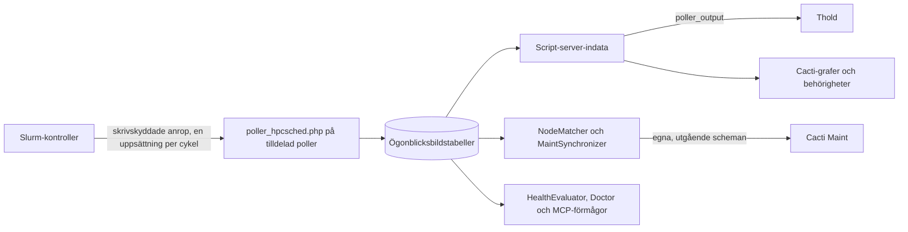

<!-- Source: README.md; SHA256: 938114d41dbd516f9dfcd94619c4fc73ef56b4da1dd693010588a93cce250534 -->

<!-- translations:start -->
[English](../../../README.md) | [简体中文](../zh-CN/README.md) | [हिन्दी](../hi-IN/README.md) | [Español (España)](../es-ES/README.md) | [Español (Latinoamérica)](../es-419/README.md) | [العربية (السعودية)](../ar-SA/README.md) | [Afrikaans](../af-ZA/README.md) | [አማርኛ](../am-ET/README.md) | [العربية (مصر)](../ar-EG/README.md) | [العربية (المغرب)](../ar-MA/README.md) | [Български](../bg-BG/README.md) | [বাংলা](../bn-BD/README.md) | [Bosanski](../bs-BA/README.md) | [Deutsch](../de-DE/README.md) | [Ελληνικά](../el-GR/README.md) | [فارسی](../fa-IR/README.md) | [Filipino](../fil-PH/README.md) | [Français](../fr-FR/README.md) | [Français (Maroc)](../fr-MA/README.md) | [Français (Sénégal)](../fr-SN/README.md) | [Hausa](../ha-NG/README.md) | [עברית](../he-IL/README.md) | [Hrvatski](../hr-HR/README.md) | [Bahasa Indonesia](../id-ID/README.md) | [Igbo](../ig-NG/README.md) | [Italiano](../it-IT/README.md) | [日本語](../ja-JP/README.md) | [ქართული](../ka-GE/README.md) | [한국어](../ko-KR/README.md) | [Latviešu](../lv-LV/README.md) | [Malagasy](../mg-MG/README.md) | [मराठी](../mr-IN/README.md) | [Bahasa Melayu](../ms-MY/README.md) | [Nederlands](../nl-NL/README.md) | [Polski](../pl-PL/README.md) | [Português (Brasil)](../pt-BR/README.md) | [Português (Portugal)](../pt-PT/README.md) | [Русский](../ru-RU/README.md) | [Kinyarwanda](../rw-RW/README.md) | [Soomaali](../so-SO/README.md) | [Српски](../sr-RS/README.md) | [Svenska](README.md) | [Kiswahili](../sw-KE/README.md) | [தமிழ்](../ta-IN/README.md) | [తెలుగు](../te-IN/README.md) | [ไทย](../th-TH/README.md) | [Türkçe](../tr-TR/README.md) | [Українська](../uk-UA/README.md) | [اردو](../ur-PK/README.md) | [Tiếng Việt](../vi-VN/README.md) | [isiXhosa](../xh-ZA/README.md) | [Yorùbá](../yo-NG/README.md) | [繁體中文](../zh-TW/README.md) | [isiZulu](../zu-ZA/README.md)
<!-- translations:end -->

# plugin_hpcsched

Ett insticksprogram för Cacti 1.2 (`hpcsched`, version `0.1.0-dev`) som ritar grafer över tillståndet i en HPC-batchschemaläggare bredvid de enheter som Cacti redan övervakar: ködjup, väntande respektive körande jobb, varför jobb väntar, nodtillstånd, partitionsutnyttjande och fair-share-användning på kontonivå. Slurm är den implementerade bakänden. Thold larmar på de resulterande datakällorna, och en valfri (opt-in) Maint-synkroniserare styr Cacti Maint-fönster utifrån dränerade, nedstängda (down) och underhållsreserverade Slurm-beräkningsnoder.

> **Status: under utveckling, ingen utgåva ännu.** Den här grenen implementerar grunden för insticksprogrammet, kluster- och partitionsgrafer, familjer av vänteorsaker, matchning mellan Slurm-beräkningsnoder och Cacti-enheter, valfri synkronisering av Cacti Maint-fönster, fair-share-sammanfattningar på kontonivå, körning och replikering på fjärrdatainsamlare, ett CLI för Configuration-as-Code (CasC) och drift, samt Cacti-ekosystemkrokar (CasC, Doctor och MCP / Abilities API v2). Testsviten täcker syntetiska Slurm-kommandon och `slurmrestd`-svar, och CI testar mot ett levande Slurm-kluster med sex noder i containrar. Läsaren har inte körts mot ett produktionskluster, och ett fullständigt Thold-återspelningstest finns ännu inte i CI.

Detta är ett oberoende projekt och är inte anknutet till Cacti-projektet.

## Vad som är implementerat

- **Livscykel och schema (v3)**: installation, idempotent uppgradering, avinstallation (behåller insticksprogrammets tabeller som standard) samt krav på minst PHP 8.2 samtidigt som startpunkter förblir tolkningsbara på PHP 8.0. Schema v3 lägger till `plugin_hpcsched_node_map` och `plugin_hpcsched_maint_link` vid sidan av tabellerna för kluster, körningar, sektioner, jobbantal, nodantal, noder, partitioner, reservationer och andelar.
- **Skrivskyddad Slurm-insamling på huvud- och fjärrpollers**: `poller_bottom` startar `poller_hpcsched.php --cluster=N` i bakgrunden på varje poller (`poller_id`) för dess tilldelade aktiverade kluster. Varje körning samlar in en cachad ögonblicksbild per kluster via klientkommandon (`squeue`, `scontrol`, `sshare` med `--json`) eller `slurmrestd` över HTTPS (loopback-HTTP tillåts med en hälsovarning). `INFO` deklarerar `remote_collect:1, remote_poller:1`, och `replicate_out` replikerar icke-hemliga `plugin_hpcsched_cluster`-definitioner till fjärrinsamlare (`poller_id >= 2`); innehållet i tokenfiler läses eller replikeras aldrig.
- **Cacti-mallar och klustergrafer**: tillhandahåller enhets-, data- och grafmallar (`templates/hpcsched-templates.xml`) samt script-server-datafrågan för partitioner (`scripts/ss_hpcsched_cluster.php`, `scripts/ss_hpcsched_partitions.php`). Efter bekräftelse av en administratör skapar eller mappar det en Cacti-enhet per kluster med grafer för jobb per tillstånd, väntande jobb per orsaksfamilj, noder per tillstånd, processorer, utnyttjande (kluster och per partition) samt ögonblicksbildens ålder.
- **Matchning av Slurm-noder till enheter och Cacti Maint-synkronisering**: en fyrstegs matchare i linjär tid (`NodeMatcher`) mappar Slurm-beräkningsnoder till befintliga `host`-poster i Cacti (exakt värdnamn, exakt adress, exakt beskrivning/alias eller första DNS-etiketten för namn som inte är IP-adresser) och markerar flermatchningar eller dubbla enhetsanspråk som `ambiguous` i stället för att gissa. `HostList::expand()` expanderar värdlistor för Slurm-reservationer (upp till 10 000 noder). `MaintSynchronizer` skapar, förnyar och tar bort engångsscheman i Cacti Maint som ägs av insticksprogrammet och spåras i `plugin_hpcsched_maint_link` för mappade noder i `DRAIN`, `DRAINING`, `DOWN` eller aktiva `MAINT`/`MAINTENANCE`-reservationer utan att ändra Maint-scheman som skapats av administratörer.
- **Fair-share-sammanfattningar på kontonivå**: när `collect_shares` är aktiverat samlas rader för Slurm-kontoassociationer in i `plugin_hpcsched_share` (och användarrader utelämnas enligt [ADR 0010](../../decisions/0010-bound-series-cardinality.md)). `ShareSummary` och `ShareRepository` beräknar antal konton/partitioner, summor för rå och effektiv användning, min/max/genomsnittliga fair-share-faktorer samt toppkonton; kontoantal exponeras i `hpcsched-get-queue-summary`.
- **CasC- och drifts-CLI (`cli/hpcsched.php`)**: export av YAML/XML-konfiguration, validering, dry-run diff-planering, bekräftelsestyrd tillämpning, strukturerad hälsoutdata samt valfri Maint-synkronisering (`sync-maint --dry-run` / `--apply`).
- **Ekosystemkrokar (`setup.php`)**: `casc_register_providers`, `doctor_register_checks` och `abilities_register`.

## Åtkomstroller

| Roll (Realm) | Åtkomst |
| --- | --- |
| HPC Scheduler View | Skrivskyddad klusteröversikt och vänteorsaker (`hpcsched.php`). |
| HPC Scheduler Operator | View-åtkomst samt sidan Operations (`hpcsched_operator.php`) och personliga åtgärdsbekräftelser. |
| HPC Scheduler Admin | Operator-åtkomst samt klusteradministration (`hpcsched_clusters.php`) och hälsosidan (`hpcsched_health.php`). |

Efter att ha kopierat uppgraderingsfilerna öppnar du sidan Plugins som administratör för att registrera nya roller och krokar. Tilldela rollen Operator explicit under **Configuration > Users** eller användargrupper. Uppgraderingar behåller befintliga roll-ID:n och tilldelningar för View och Admin. Admin-åtkomst ärver Operator-åtkomst, och Operator-åtkomst ärver View-åtkomst vid varje begäran; detta lägger inte till lagrade tilldelningar för användare eller grupper. Insticksprogrammets inställningar kräver även åtkomst till HPC Scheduler Admin utöver Cactis behörighet Settings.

Cactis enhetsbehörigheter begränsar de rader och åtgärder som är tillgängliga för varje användare. Ett kluster som är mappat till en Cacti-enhet visas, exporteras och ändras endast för användare som Cacti ger åtkomst till den enheten; att mappa en enhet kräver också behörighet för målenheten. Ett kluster utan enhet visas på administrationssidorna för användare med insticksprogrammets roll, men inte i operatörsvyer, som endast listar kluster mappade till en enhet. Ett kluster vars mappade enhet togs bort medan insticksprogrammet var inaktiverat visas endast för användare med åtkomst till HPC Scheduler Admin. Bekräftelser gäller endast i användarens aktuella session, i högst en timme och endast så länge samma observation förblir färsk. Nya eller ändrade observationer ogiltigförklarar dem. De markerar aldrig en misslyckad mätning som frisk och undertrycker inga larm.

## Operatörsanmärkningar

### Säkerhet, minsta privilegium och tokenfiler

Insticksprogrammet läser enbart. Ge det en dedikerad Slurm-användare utan administratörs- eller operatörsroll (`AdminLevel=None` i `sacctmgr`). Med `PrivateData=jobs` (eller `nodes`, `reservations`, `usage`) i `slurm.conf` ser den användaren endast sina egna poster, så antal blir ofullständiga och insticksprogrammet kan inte upptäcka det. Att häva den begränsningen för kontot kräver operatörs- eller administratörsnivå, vilket även tillåter ändringar; den avvägningen avgörs av respektive driftmiljö.

För klientkommandon behöver Cacti-polleranvändaren Slurm-klientbinärerna (`squeue`, `scontrol` och valfritt `sshare`) samt en `slurm.conf` som når kontrollern; sökvägarna till binärerna anges som absoluta sökvägar under **Configuration > Settings > HPC Scheduler**.

För `slurmrestd` måste URL:en vara `https://`, eller `http://` enbart på en loopback-adress. TLS-certifikat verifieras och omdirigeringar följs inte. En valfri lista över `slurmrestd`-värdar under **Configuration > Settings > HPC Scheduler** begränsar vilka värdar och portar ett kluster får ange.

Ett `slurmrestd`-kluster anger en tokenfil; själva tokenet lagras aldrig i databasen, visas aldrig på en sida, exporteras aldrig av CasC och skrivs aldrig till loggen. Filen måste ligga i en av de Token File Directories som konfigurerats under **Configuration > Settings > HPC Scheduler**, kunna nås utan symbolisk länk och vara en vanlig fil som ägs av polleranvändaren och endast är skrivbar av den användaren, med en enda rad: tokenet eller `SLURM_JWT=<token>` såsom `scontrol token` skriver ut det. Om inga tokenkataloger är angivna kan inget kluster använda `slurmrestd`. Håll varje tokenkatalog skrivbar endast för root och polleranvändaren. En fil som är läsbar för grupp eller andra användare används ändå, och hälsosidan varnar; den varnar också när tokenet löper ut inom det konfigurerade varningsfönstret.

För att rotera ett token atomärt:

```sh
dir=/etc/cacti/hpcsched
tmp=$(mktemp "$dir/.token.XXXXXX")
scontrol token username=cactiread lifespan=2592000 > "$tmp"
chown cacti:cacti "$tmp"
chmod 0600 "$tmp"
mv -f "$tmp" "$dir/cluster1.token"
```

Nästa insamling läser den nya filen. Att generera tokens med `scontrol token` kräver en Slurm-administratör; kör kommandot där det är tillåtet och kopiera filen till pollern.

### Fjärrdatainsamlare

`INFO` deklarerar `remote_collect:1, remote_poller:1`. `hpcsched_poller_bottom()` startar `poller_hpcsched.php` på varje poller för aktiverade kluster som tilldelats det `poller_id`:t, och `hpcsched_replicate_out()` replikerar icke-hemliga `plugin_hpcsched_cluster`-rader till fjärrpollers (`poller_id >= 2`). Tokenfiler och Slurm-klientbinärer måste finnas lokalt på den tilldelade fjärrpollern; tokeninnehåll replikeras aldrig.

### Minnesgränser

Varje insamlingskörning avkodar ett schemaläggarsvar i taget, vilket tar cirka 12 gånger svarets storlek i PHP-minne (uppmätt till cirka 10 gånger för jobbposter utformade som Slurms, plus själva texten). Läsaren höjer sin PHP-minnesgräns till inställningen Collection Memory (1024 MiB som standard) och tillåter svar upp till `(Collection Memory - 64) / 12` MiB (80 MiB som standard), även när Maximum Answer Size är satt högre; hälsosidan varnar när Maximum Answer Size överstiger den anpassade gränsen. Ett större svar får sin sektion att misslyckas som för stort, och en körning som ändå får slut på minne registrerar ett minnesfel och frigör sin lease och processplats via en avslutningshanterare. Stora kluster kan behöva höja båda inställningarna; 100 000 verkliga jobbposter har inte mätts.

### Mallar, klusterenheter och grafräkning

Installation och uppgradering importerar HPC Schedulers enhets-, data- och grafmallar samt kopierar partitionsdatafrågan till Cactis katalog `resource/script_server/`. Om den katalogen inte är skrivbar, om en annan fil med samma namn finns där eller om målet är en symbolisk länk, avbryts importen, filen lämnas orörd och tillståndet rapporteras på hälsosidan där **Install Templates** försöker igen. Avinstallation tar bort frågefilen endast om insticksprogrammet skrev den och den är oförändrad, och behåller mallar, enheter och grafer.

**HPC Clusters > Device** förhandsgranskar grafer, datakällor, RRD-filer och script-server-anrop per pollning innan något skapas. **Create Device** skapar en enhet med ett värdnamn i den reserverade domänen `.invalid` och utan tillgänglighetskontroll; **Map Device** kopplar graferna till en befintlig enhet utan att ändra dess inställningar. Varje klustergraf och partitionsgraf har sin egen datakälla: sex för klustret och fem per partition. Partitioner som läggs till senare indexeras om automatiskt när läsaren upptäcker en ändring; borttagna partitioner slutar att pollas och behåller sina grafer. Att ta bort en enhet tar bort klustermappningen (och rensar matchande `plugin_hpcsched_node_map`-rader) medan klusterposten behålls.

Pending utesluter spärrade (held) jobb, som har sin egen serie. En väntande jobbarray räknar sina återstående uppgifter. Ett jobb eller en nod i flera partitioner räknas en gång i klustergraferna och en gång i varje partition, så partitionssummor behöver inte summera till klustersumman. Vänteorsaker grupperas i elva familjer ([ADR 0011](../../decisions/0011-pending-reason-families-and-counting.md)); vyn för vänteorsaker listar råa orsaker inklusive de i `Other`. Utnyttjandenämnaren inkluderar dränerade, nedstängda och andra otillgängliga noder. Inaktuell eller misslyckad data rapporteras som `U`, aldrig noll; `age` förblir numerisk.

För larmning konfigurerar du Thold på valfri kluster- eller partitionsdatakälla med varaktigheter på minst ett insamlingsintervall, och larmar på `age` för att upptäcka en stoppad läsare.

## CLI och ekosystemkrokar

### Läsarens startpunkt

`hpcsched_poller_bottom()` startar `poller_hpcsched.php` automatiskt; den kan också köras manuellt på klustrets tilldelade poller:

```sh
php /path/to/cacti/plugins/hpcsched/poller_hpcsched.php --cluster=N [--force] [--debug]
```

`--force` körs även medan insticksprogrammet är inaktiverat, för diagnostik från kommandoraden.

### CLI för Configuration-as-Code, hälsa och Maint-synkronisering

```sh
php /path/to/cacti/plugins/hpcsched/cli/hpcsched.php export [--format=yaml|xml] [--file=PATH]
php /path/to/cacti/plugins/hpcsched/cli/hpcsched.php validate --file=PATH [--format=yaml|xml]
php /path/to/cacti/plugins/hpcsched/cli/hpcsched.php plan --file=PATH [--format=yaml|xml]
php /path/to/cacti/plugins/hpcsched/cli/hpcsched.php apply --file=PATH --confirm=PLAN_HASH [--format=yaml|xml]
php /path/to/cacti/plugins/hpcsched/cli/hpcsched.php health [--format=text|json]
php /path/to/cacti/plugins/hpcsched/cli/hpcsched.php sync-maint [--dry-run | --apply] [--cluster=ID] [--format=text|json]
```

- `export` skriver nya filer med rättigheterna `0600` (eller till stdout) och ersätter konfigurerade `token_file`-sökvägar med `[REDACTED]`. `plan` och `apply` avvisar inbäddade `jwt`-, `secret`- och `password`-fält och behåller befintliga lokala `token_file`-sökvägar när `[REDACTED]` anges. `apply` kräver den exakta `--confirm=PLAN_HASH` som skrevs ut av `plan`.
- `health` utvärderar schemaaktualitet, klusteraktualitet, körningsutfall, Maint-tillgänglighet och varningar utan att kontakta schemaläggare eller läsa tokenfiler.
- `sync-maint` använder `--dry-run` som standard och förhandsgranskar eller tillämpar Cacti Maint-scheman för mappade Slurm-noder i `DRAIN`, `DRAINING`, `DOWN` eller aktiva `MAINT`/`MAINTENANCE`-reservationer (standardhorisont för drain/down 3600s, förnyelsemarginal 600s). Den nekar `--apply` om `plugin_maint_schedules` och `plugin_maint_hosts` saknas, och uppdaterar eller tar endast bort scheman som registrerats i `plugin_hpcsched_maint_link`.

### Ekosystemkrokar

När motsvarande Cacti-insticksprogram eller värdintegrationer finns registrerar `setup.php`:

- `casc_register_providers`: exporterar, validerar, planerar och tillämpar med bekräftelse `hpcsched`-konfiguration (`yaml` och `xml`, schema v1) med maskering av hemligheter.
- `doctor_register_checks`: tillhandahåller fyra skrivskyddade diagnostikkontroller (`hpcsched.schema`, `hpcsched.cluster_freshness`, `hpcsched.token_health`, `hpcsched.maint_sync`).
- `abilities_register`: registrerar tre skrivskyddade, icke-destruktiva, idempotenta förmågor under kategorin `hpcsched`, styrda av rollen HPC Scheduler View (och enhetsbehörigheter för klustersammanfattningar): `hpcsched-list-clusters`, `hpcsched-get-queue-summary` och `hpcsched-get-health`.

## Varför

Operatörer som kör Cacti ritar redan grafer över sina beräkningsnoder. Schemaläggarens perspektiv saknas i dessa grafer, vilket lämnar två luckor:

- **Inget "varför startar inte arbetet".** Slurm registrerar en orsak för varje väntande jobb. En full kö bredvid grafer över lediga noder säger inte om orsaken är prioritet, resursgränser, spärrar, beroenden eller dränerade noder.
- **Ingen koppling mellan schemaläggarens tillstånd och larm.** Thold larmar på en enhet som en administratör redan har dränerat, och administratörer skapar Maint-scheman för hand.

Insticksprogrammet samlar in en cachad ögonblicksbild per kluster, publicerar den som vanliga Cacti-datakällor och grafer, mappar schemaläggarnoder till befintliga Cacti-enheter och synkroniserar utgående Maint-fönster som ägs av insticksprogrammet för dränerade, nedstängda och underhållsreserverade noder. Det återanvänder Cactis behörigheter, fjärrdatainsamlare, Thold och Maint, och förblir strikt skrivskyddat mot schemaläggaren.

## Omfattning och gränser

Utanför omfattningen: varje skrivväg till schemaläggaren (skicka, avbryta, spärra, dränera, återuppta), en egen larmmotor i insticksprogrammet, en rapporterings- eller debiteringsmotor samt serier per användare eller per jobb. Bakändar för PBS Pro, OpenPBS och LSF är endast forskning.

## Krav och kompatibilitet

| Komponent | Mål |
|---|---|
| Cacti | 1.2.31 eller senare (`compat = 1.2.31`), inga ändringar i kärnan |
| PHP | 8.2 eller senare; startpunkter förblir tolkningsbara på 8.0 och avvisar aktivering på 8.1 så att en körtidsmiljö som inte stöds får ett avslag i stället för ett trasigt Cacti-gränssnitt |
| Slurm | 25.05, 25.11 och 26.05 ([ADR 0013](../../decisions/0013-three-latest-slurm-releases.md)); 26.05.5 testas i CI vid varje ändring mot ett sexnoders containerkluster, 25.11.8 på `main`, veckovis och på begäran, och 25.05 endast mot fixtures. Klientkommandon använder dataparser `v0.0.43` som standard (med `v0.0.44` och `v0.0.45` valbara); `slurmrestd`-kluster identifierar den nyaste parser som daemonen erbjuder |
| Thold, Maint | Inga ändringar i Thold krävs; `sync-maint` integrerar med Cacti Maints tabeller `plugin_maint_schedules` och `plugin_maint_hosts` via en länktabell som ägs av insticksprogrammet (`plugin_hpcsched_maint_link`) |

## Utveckling och testning

CI-arbetsflödet (`.github/workflows/plugin-ci-workflow.yml`) testar PHP 8.2 till 8.5 mot Cacti `release/1.2.31` och `1.2.x`, PHP 8.0-lintning av startpunkter, avvisning på PHP 8.1, PHPStan, verifiering av gettext/översättningar, REUSE-licensiering, arbetsflödeslintning, kontroller av klusterenhetsflöde och avvikelser i mallexport samt ett levande Slurm-kluster med sex noder (`slurm-live`).

Med Cactis låsta delade Pest-insticksmiljö (`CACTI_PEST_BIN`) och en tillfällig Cacti-databas:

```sh
# Unit tests
"$CACTI_PEST_BIN" --configuration=phpunit.xml

# Lifecycle integration tests (disposable database only)
CACTI_PATH=/path/to/cacti HPCSCHED_TEST_DATABASE=disposable "$CACTI_PEST_BIN" --configuration=phpunit-integration.xml

# Static analysis (against Cacti 1.2.31)
CACTI_PATH=/path/to/cacti phpstan analyse -c phpstan.neon --no-progress

# Translation template, catalogs, and localized README checks
sh locales/build_gettext.sh --check
```

## Design

- [docs/PLAN.md](../../PLAN.md) är arkitektur- och designplanen: uppströmsfakta med källor, nodmappning, tillståndsmodell, säkerhetsgränser, prestandaaritmetik, testning och risker.
- [docs/decisions/](../../decisions/) innehåller arkitekturbeslutsdokument.
- [docs/REQUIREMENTS.md](../../REQUIREMENTS.md) mappar varje krav-ID till dess ärende.



## Hur arbetet spåras

- **Milstolpar** följer planens milstolpar. Varje milstolpe har ett epic-ärende som listar dess delärenden och avslutsbevis.
- **Ärenden** typas med etiketter: `type: requirement`, `type: research`, `type: decision`, `type: epic`. Kravärenden anger numrerade, testbara krav (`REQ-AREA-NNN`) och acceptanskriterier.
- **Etiketter** har också `area:`, `phase:`, `priority:` och `status:`. Se [CONTRIBUTING.md](../../../CONTRIBUTING.md#labels).
- [Projekttavlan](https://github.com/users/somethingwithproof/projects/10) visar alla ärenden över alla milstolpar.

## Bidra

Läs [CONTRIBUTING.md](../../../CONTRIBUTING.md). Commits behöver en DCO-signatur (`git commit -s`). Designdiskussioner förs i ärenden; öppna beslut bär etiketten `type: decision`.

## Säkerhet

Rapportera sårbarheter privat; se [SECURITY.md](../../../SECURITY.md).

## Licens

GNU General Public License v2.0, samma licens som Cacti och dess insticksprogram. Se [LICENSE](../../../LICENSE).
