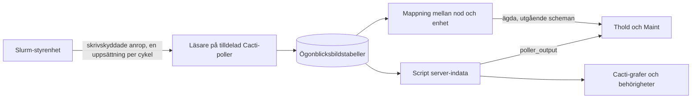

<!-- Source: README.md; SHA256: 16caa3e34c4d150a7fb1018f637e200a7580330f033b485047d8413bce09abba -->

<!-- translations:start -->
[English](../../../README.md) | [简体中文](../zh-CN/README.md) | [हिन्दी](../hi-IN/README.md) | [Español (España)](../es-ES/README.md) | [Español (Latinoamérica)](../es-419/README.md) | [العربية (السعودية)](../ar-SA/README.md) | [Afrikaans](../af-ZA/README.md) | [አማርኛ](../am-ET/README.md) | [العربية (مصر)](../ar-EG/README.md) | [العربية (المغرب)](../ar-MA/README.md) | [বাংলা](../bn-BD/README.md) | [Deutsch](../de-DE/README.md) | [فارسی](../fa-IR/README.md) | [Filipino](../fil-PH/README.md) | [Français](../fr-FR/README.md) | [Français (Maroc)](../fr-MA/README.md) | [Français (Sénégal)](../fr-SN/README.md) | [Hausa](../ha-NG/README.md) | [עברית](../he-IL/README.md) | [Bahasa Indonesia](../id-ID/README.md) | [Igbo](../ig-NG/README.md) | [Italiano](../it-IT/README.md) | [日本語](../ja-JP/README.md) | [한국어](../ko-KR/README.md) | [Malagasy](../mg-MG/README.md) | [मराठी](../mr-IN/README.md) | [Bahasa Melayu](../ms-MY/README.md) | [Nederlands](../nl-NL/README.md) | [Polski](../pl-PL/README.md) | [Português (Brasil)](../pt-BR/README.md) | [Русский](../ru-RU/README.md) | [Kinyarwanda](../rw-RW/README.md) | [Soomaali](../so-SO/README.md) | [Svenska](README.md) | [Kiswahili](../sw-KE/README.md) | [தமிழ்](../ta-IN/README.md) | [తెలుగు](../te-IN/README.md) | [ไทย](../th-TH/README.md) | [Türkçe](../tr-TR/README.md) | [Українська](../uk-UA/README.md) | [اردو](../ur-PK/README.md) | [Tiếng Việt](../vi-VN/README.md) | [isiXhosa](../xh-ZA/README.md) | [Yorùbá](../yo-NG/README.md) | [繁體中文](../zh-TW/README.md) | [isiZulu](../zu-ZA/README.md)
<!-- translations:end -->

# plugin_hpcsched

Ett insticksprogram för Cacti 1.2 som ritar grafer över tillståndet i en HPC-batchschemaläggare bredvid de enheter som Cacti redan övervakar: ködjup, väntande respektive körande jobb, varför jobb väntar, nodtillstånd och partitionsutnyttjande. Slurm är den första bakänden. Thold larmar på de resulterande datakällorna, och Maint kan styras av dränerade noder och underhållsreservationer.

> **Status: under utveckling, ingen utgåva ännu.** Milstolpe 2 (grundstruktur) är sammanslagen i `main`, och den här grenen lägger till milstolpe 3 (klustergrafer och vänteorsaker). Koden installeras, uppgraderas och avinstalleras via Cactis insticks-API och avvisar PHP lägre än 8.2. Den håller ett register över Slurm-kluster, där varje kluster tilldelas en Cacti-poller. En bakgrundsläsare på huvudpollern samlar in en ögonblicksbild per kluster och intervall, antingen genom att köra `squeue`, `scontrol` och `sshare` med `--json` eller genom att läsa `slurmrestd` över HTTPS, och lagrar antal jobb per tillstånd och vänteorsak, nodtillstånd, partitioner, reservationer och fair-share-användning tillsammans med deras aktualitet. Insticksprogrammet levererar Cacti-mallar och skapar eller mappar, efter bekräftelse av en administratör, en Cacti-enhet per kluster med grafer över jobb per tillstånd, väntande jobb per orsaksfamilj, noder per tillstånd, processorer och utnyttjande, för klustret och för varje partition, samt ögonblicksbildens ålder. En skrivskyddad översiktssida visar antal per kluster med deras aktualitet och en vy över vänteorsaker per kluster, och en hälsosida endast för administratörer visar vad varje insamling returnerade och om mallarna är installerade. Varje sida och åtgärd följer Cactis enhetsbehörigheter. Datakällorna är sådana som Thold kan larma på, men ingen Thold- eller Maint-integration har testats ännu; det tillhör milstolpe 4 och senare. Testsviten täcker syntetiska Slurm-kommandon och `slurmrestd`-svar, och CI testar även ett riktigt Slurm-kluster med sex noder i containrar enligt beskrivningen nedan. Läsaren har inte körts mot ett produktionskluster. Nedanför operatörsanmärkningarna beskriver denna README designen, inte levererat beteende.

Detta är ett oberoende projekt och är inte anknutet till Cacti-projektet.

## Åtkomstroller

| Roll | Åtkomst |
| --- | --- |
| HPC Scheduler View | Befintliga övervakningssidor. |
| HPC Scheduler Operator | Övervakning samt sidan Operations och personliga åtgärdsbekräftelser. |
| HPC Scheduler Admin | Operatörsåtkomst samt befintlig konfiguration och administrativa åtgärder. |

Efter att uppgraderingsfiler har kopierats öppnar du sidan Plugins som administratör för att registrera den nya behörighetssfären (realm). Tilldela Operator-sfären uttryckligen under **Configuration > Users** eller användargrupper. Uppgraderingar behåller befintliga sfär-ID:n och tilldelningar för View och Admin. Admin-åtkomst ärver Operator-åtkomst, och Operator-åtkomst ärver View-åtkomst vid varje begäran; detta lägger inte till lagrade behörigheter för användare eller grupper. Inställningar för insticksprogrammet kräver också HPC Scheduler Admin-åtkomst utöver Cactis Settings-behörighet.

Cactis enhetsbehörigheter begränsar fortfarande vilka rader och åtgärder som är tillgängliga för varje användare; ett kluster utan enhet visas på de administrativa sidorna för alla användare med insticksprogrammets behörighetssfär, men inte i operatörsvyerna, som endast listar kluster mappade till en enhet. Inloggningsuppgifter, konfiguration, mappning, borttagning och andra administrativa ändringar finns kvar på de administrativa sidorna. Bekräftelser gäller endast i den aktuella användarens session, i högst en timme och endast medan samma observation förblir aktuell. Nya eller ändrade observationer gör dem ogiltiga. De markerar aldrig en misslyckad mätning som felfri och dämpar aldrig larm.

## Operatörsanmärkningar för milstolpe 2

**Minsta privilegium.** Insticksprogrammet läser endast. Ge det en dedikerad Slurm-användare utan administratörs- eller operatörsroll (`AdminLevel=None` i `sacctmgr`). Med `PrivateData=jobs` (eller `nodes`, `reservations`, `usage`) i `slurm.conf` ser den användaren endast sina egna poster, vilket gör att antalen blir ofullständiga och insticksprogrammet kan inte upptäcka det. Att häva det för kontot innebär en operatörs- eller administratörsnivå, vilket också tillåter ändringar; den avvägningen är upp till respektive miljö. För klientkommandon behöver Cactis polleranvändare Slurm-klientbinärerna och en `slurm.conf` som når styrenheten; binärsökvägarna är absoluta inställningar under Configuration > Settings > HPC Scheduler. För `slurmrestd` måste URL:en vara `https://`, eller `http://` endast på en loopback-adress. TLS-certifikat verifieras och omdirigeringar följs inte. En valfri värdlista för slurmrestd under Configuration > Settings > HPC Scheduler begränsar vilka värdar och portar ett kluster får ange.

**Fjärrpollrar.** Den här utgåvan samlar endast in på Cactis huvudpoller. Ett kluster som tilldelats en fjärrdatainsamlare samlas inte in: läsaren där nekar med en loggad orsak och hälsosidan namnger klustret. Fjärrinsamling är fas 3.

**Minne.** Varje insamlingskörning avkodar ett schemaläggarsvar i taget, vilket tar ungefär 12 gånger svarets storlek i PHP-minne (uppmätt till cirka 10 gånger för jobbposter utformade som Slurms, plus själva texten). Körningen höjer sin PHP-minnesgräns till inställningen Collection Memory (1024 MiB som standard) och tillåter svar upp till (Collection Memory - 64) / 12 MiB, 80 MiB som standard, även när Maximum Answer Size är satt högre; hälsosidan varnar när så är fallet. Ett större svar gör att dess avsnitt misslyckas som för stort, och en körning som ändå får slut på minne registreras som misslyckad. Ett stort kluster kan behöva höja båda inställningarna; 100 000 verkliga jobbposter har inte mätts.

**Tokenfiler.** Ett `slurmrestd`-kluster anger en tokenfil; själva token lagras aldrig i databasen, visas aldrig på en sida och skrivs aldrig till loggen. Filen måste ligga i en av de tokenfilskataloger som angetts under Configuration > Settings > HPC Scheduler, nås utan symbolisk länk, och vara en vanlig fil som ägs av polleranvändaren och som endast den användaren kan skriva till, med en rad: token, eller `SLURM_JWT=<token>` så som `scontrol token` skriver ut den. Om inga tokenkataloger är inställda kan inget kluster använda `slurmrestd`. Dessa två inställningar finns på Cactis Settings-sida, så insticksprogrammets Admin-sfär ensam kan inte ändra dem; se till att varje tokenkatalog endast är skrivbar av root och polleranvändaren. En fil som gruppen eller andra användare kan läsa används fortfarande, och hälsosidan varnar. Hälsosidan varnar också när token löper ut inom den konfigurerade varningstiden.

För att rotera en token utan ett tidsfönster där läsaren ser en ofullständig fil skriver du den nya token bredvid den gamla och byter namn på den till rätt plats:

```sh
dir=/etc/cacti/hpcsched
tmp=$(mktemp "$dir/.token.XXXXXX")
scontrol token username=cactiread lifespan=2592000 > "$tmp"
chown cacti:cacti "$tmp"
chmod 0600 "$tmp"
mv -f "$tmp" "$dir/cluster1.token"
```

Nästa insamling läser den nya filen. Att generera token med `scontrol token` kräver en Slurm-administratör; kör det där det är tillåtet och kopiera filen till pollern.

## Operatörsanmärkningar för milstolpe 3

**Mallar.** Installation och uppgradering importerar HPC Schedulers enhets-, data- och grafmallar och kopierar partitionsdatafrågan till Cactis katalog `resource/script_server/`. Om den katalogen inte är skrivbar av användaren som installerar insticksprogrammet, om en annan fil med samma namn redan finns där och inte skrevs av insticksprogrammet, eller om namnet är en symbolisk länk, avbryts importen, filen lämnas orörd och hälsosidan anger vad som ska göras; Install Templates på hälsosidan försöker igen. En identisk kopia som skapats manuellt används men förblir din egen. Avinstallation tar endast bort frågefilen om insticksprogrammet skrev den och den är oförändrad, och behåller mallar, enheter och grafer.

**Klusterenheter.** HPC Clusters > Device visar vad en enhet kommer att lägga till (grafer, datakällor, RRD-filer och script server-anrop per pollning) innan något skapas. Create Device skapar en enhet med ett värdnamn i den reserverade domänen `.invalid` och utan tillgänglighetskontroll; Map Device kopplar i stället graferna till en befintlig enhet och lämnar dess inställningar orörda. Varje klustergraf och varje partitionsgraf har sin egen datakälla: sex för klustret och fem per partition, ett script server-anrop per klusterdatakälla och ett per värde för en partition (32) per pollning. Partitioner som läggs till senare indexeras när läsaren ser dem och får grafer från Cactis sida New Graphs; en borttagen partition slutar att pollas och behåller sina grafer. Om enheten tas bort avmappas klustret men behålls.

**Vad graferna räknar.** Väntande jobb exkluderar pausade (held) jobb, som har sin egen serie. En väntande jobbmatris (array) räknar sina återstående uppgifter. Ett jobb eller en nod i flera partitioner räknas en gång i klustergraferna och en gång i varje partition, så partitionsgrafer behöver inte summera till klustrets grafer. Vänteorsaker grupperas i elva familjer ([ADR 0011](../../decisions/0011-pending-reason-families-and-counting.md)); vyn för vänteorsaker listar de obearbetade orsakerna, inklusive de i Other. Varje jobb rapporterar endast den senaste orsaken som schemaläggaren granskade. Nämnaren för utnyttjande inkluderar dränerade, nere och andra otillgängliga noder. Inaktuell eller misslyckad data är `U`, aldrig noll; `age` förblir numerisk.

**Larm.** Thold kan larma på vilken som helst av dessa datakällor; sätt Thold-varaktigheter till minst ett insamlingsintervall och larma på `age` för att fånga upp en stoppad läsare. Den kompletta Thold-kontrollen från ände till ände tillhör milstolpe 4.

**Testad mot verklig Slurm-utdata.** CI startar ett Slurm-kluster med sex noder i containrar (26.05.5 vid varje ändring, 25.11.8 byggd från källkod vid push till `main`, veckovis och på begäran) och kontrollerar nodtillstånd, underhållsreservationen, vänteorsaker och jobbmatriser så som insticksprogrammet tolkar dem, och samlar sedan in från det klustret med insticksprogrammets egna kommando- och `slurmrestd`-transporter. Äldre utgåvor täcks endast av syntetiska testdata. Läsaren har fortfarande inte körts mot ett produktionskluster.

**Behörigheter.** Ett kluster på en enhet visas, exporteras och ändras endast för användare som Cacti tillåter för den enheten, på varje sida i insticksprogrammet; mappning av en enhet kräver också behörighet för målenheten. Ett kluster utan enhet är synligt för alla med insticksprogrammets behörighetssfär. Ett kluster som fortfarande är mappat till en enhet som togs bort medan insticksprogrammet var inaktiverat visas endast för användare med behörighetssfären HPC Scheduler Admin, som kan skapa eller mappa en enhet för det. Grafåtkomst styrs av Cactis egna behörigheter.

## Varför

Operatörer som kör Cacti ritar redan grafer för sina beräkningsnoder. Schemaläggarens vy saknas i dessa grafer, vilket lämnar två luckor:

- **Inget "varför startar inte arbetet".** Slurm registrerar en orsak för varje väntande jobb. En full kö bredvid grafer över overksamma noder säger inte om orsaken är prioritet, resursgränser, spärrar, beroenden eller dränerade noder.
- **Ingen koppling mellan schemaläggarens tillstånd och larm.** Thold larmar på en enhet som en administratör redan har dränerat, och administratörer skapar Maint-scheman för hand.

Insticksprogrammet samlar in en cachelagrad ögonblicksbild per kluster, publicerar den som vanliga Cacti-datakällor och grafer, mappar schemaläggarnoder till befintliga Cacti-enheter och kan placera dränerade noder och underhållsreservationer i Maint. Det återanvänder Cactis behörigheter, fjärrdatainsamlare, Thold och Maint, och är skrivskyddat mot schemaläggaren.

## Planerad omfattning

| Fas | Omfattning | Milstolpar |
|---|---|---|
| 0, efterforskning | Slurm-utgåvematris, bekräftelse av uppströmsbeteende, styrenhetsbelastning, testdata för nodnamngivning | [M1](https://github.com/somethingwithproof/plugin_hpcsched/milestone/1) |
| 1, klustergrafer | Ködjup, väntande och körande jobb, vänteorsaker, nodtillstånd, partitionsutnyttjande, Thold-larm, hälsosida, utgåva | [M2](https://github.com/somethingwithproof/plugin_hpcsched/milestone/2), [M3](https://github.com/somethingwithproof/plugin_hpcsched/milestone/3), [M4](https://github.com/somethingwithproof/plugin_hpcsched/milestone/4) |
| 2, noder och underhåll | Mappning mellan nod och enhet, tillstånd per nod, automatiska Maint-fönster för dränerade noder och underhållsreservationer | [M5](https://github.com/somethingwithproof/plugin_hpcsched/milestone/5) |
| 3, redovisning | Fair-share-användning, avgränsad redovisningsstatistik, fjärrdatainsamlare | [M6](https://github.com/somethingwithproof/plugin_hpcsched/milestone/6) |

Utanför omfattningen: alla skrivvägar mot schemaläggaren (skicka in, avbryta, pausa, dränera, återuppta), en egen larmmotor i insticksprogrammet, en rapport- eller internfaktureringsmotor, serier per användare och per jobb. Bakändar för PBS Pro, OpenPBS och LSF är under efterforskning.

## Kompatibilitetsmål

| Komponent | Mål |
|---|---|
| Cacti | 1.2.31 eller senare, inga ändringar i kärnan |
| PHP | 8.2 eller senare; `setup.php` förblir tolkningsbar på 8.0 så att en körtid som inte stöds får ett avvisande i stället för ett trasigt Cacti-gränssnitt |
| Slurm | 25.05, 25.11 och 26.05, de tre senaste utgåvorna ([ADR 0013](../../decisions/0013-three-latest-slurm-releases.md)); 25.11 och 26.05 testas mot ett levande kluster, 25.05 endast mot testdata. Klientkommandon är standardtransporten ([ADR 0012](../../decisions/0012-client-commands-default-transport.md)) och använder inställningen för dataparser: v0.0.43 som standard, vilken SchedMD tar bort i 27.05, eller v0.0.44 eller v0.0.45 på utgåvor som levererar dem. slurmrestd-kluster upptäcker den nyaste parsern som demonen tillhandahåller |
| Thold, Maint | Ingen ändring i Thold; Maint-integration är ett förslag som kräver godkännande från Maint-ansvariga |

## Design

- [docs/PLAN.md](../../PLAN.md) är den fullständiga planen: arkitektur, uppströmsfakta som den bygger på (med källor och en explicit lista över obekräftade antaganden), nodmappning, tillståndsmodell, säkerhetsgränser, prestandaberäkningar, testning och risker.
- [docs/decisions/](../../decisions) innehåller arkitekturbeslut (architecture decision records).
- [docs/REQUIREMENTS.md](../../REQUIREMENTS.md) kopplar varje krav-ID till sitt ärende.



## Hur arbetet spåras

- **Milstolpar** följer planens milstolpar. Var och en har ett epic-ärende som listar dess underärenden och avslutningsbevis.
- **Ärenden** typas med etikett: `type: requirement`, `type: research`, `type: decision`, `type: epic`. Kravärenden anger numrerade, testbara krav (`REQ-AREA-NNN`) och acceptanskriterier.
- **Etiketter** har också `area:`, `phase:`, `priority:` och `status:`. Se [CONTRIBUTING.md](../../../CONTRIBUTING.md#labels).
- [Projekttavlan](https://github.com/users/somethingwithproof/projects/10) visar alla ärenden över milstolpar.

## Bidra

Läs [CONTRIBUTING.md](../../../CONTRIBUTING.md). Commits kräver en DCO-signatur (DCO sign-off). Designdiskussioner sker i ärenden; öppna beslut har etiketten `type: decision`.

## Säkerhet

Rapportera sårbarheter privat; se [SECURITY.md](../../../SECURITY.md).

## Licens

GNU General Public License v2.0, samma licens som Cacti och dess insticksprogram. Se [LICENSE](../../../LICENSE).
