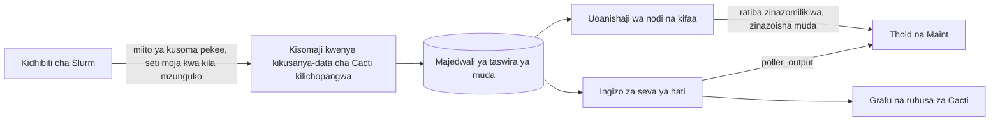

<!-- Source: README.md; SHA256: 16caa3e34c4d150a7fb1018f637e200a7580330f033b485047d8413bce09abba -->

<!-- translations:start -->
[English](../../../README.md) | [简体中文](../zh-CN/README.md) | [हिन्दी](../hi-IN/README.md) | [Español (España)](../es-ES/README.md) | [Español (Latinoamérica)](../es-419/README.md) | [العربية (السعودية)](../ar-SA/README.md) | [Afrikaans](../af-ZA/README.md) | [አማርኛ](../am-ET/README.md) | [العربية (مصر)](../ar-EG/README.md) | [العربية (المغرب)](../ar-MA/README.md) | [বাংলা](../bn-BD/README.md) | [Deutsch](../de-DE/README.md) | [فارسی](../fa-IR/README.md) | [Filipino](../fil-PH/README.md) | [Français](../fr-FR/README.md) | [Français (Maroc)](../fr-MA/README.md) | [Français (Sénégal)](../fr-SN/README.md) | [Hausa](../ha-NG/README.md) | [עברית](../he-IL/README.md) | [Bahasa Indonesia](../id-ID/README.md) | [Igbo](../ig-NG/README.md) | [Italiano](../it-IT/README.md) | [日本語](../ja-JP/README.md) | [한국어](../ko-KR/README.md) | [Malagasy](../mg-MG/README.md) | [मराठी](../mr-IN/README.md) | [Bahasa Melayu](../ms-MY/README.md) | [Nederlands](../nl-NL/README.md) | [Polski](../pl-PL/README.md) | [Português (Brasil)](../pt-BR/README.md) | [Русский](../ru-RU/README.md) | [Kinyarwanda](../rw-RW/README.md) | [Soomaali](../so-SO/README.md) | [Svenska](../sv-SE/README.md) | [Kiswahili](README.md) | [தமிழ்](../ta-IN/README.md) | [తెలుగు](../te-IN/README.md) | [ไทย](../th-TH/README.md) | [Türkçe](../tr-TR/README.md) | [Українська](../uk-UA/README.md) | [اردو](../ur-PK/README.md) | [Tiếng Việt](../vi-VN/README.md) | [isiXhosa](../xh-ZA/README.md) | [Yorùbá](../yo-NG/README.md) | [繁體中文](../zh-TW/README.md) | [isiZulu](../zu-ZA/README.md)
<!-- translations:end -->

# plugin_hpcsched

Programu-jalizi ya Cacti 1.2 inayochora hali ya kipanga-ratiba cha kazi za HPC kando ya vifaa ambavyo Cacti tayari inafuatilia: kina cha foleni, kazi zinazosubiri dhidi ya zinazoendelea, sababu za kazi kusubiri, hali za nodi, na matumizi ya vigawanyo. Slurm ndiyo mfumo wa nyuma wa kwanza. Thold hutoa arifa kutokana na vyanzo vya data vinavyozalishwa, na Maint inaweza kuendeshwa na nodi zilizokaushwa na uhifadhi wa matengenezo.

> **Hali: inaendelezwa, bado hakuna toleo rasmi.** Hatua ya 2 (msingi) imeunganishwa kwenye `main`, na tawi hili linaongeza hatua ya 3 (grafu za klasta na sababu za kusubiri). Msimbo husakinishwa, husasishwa, na kuondolewa kupitia API ya programu-jalizi ya Cacti na hukataa PHP iliyo chini ya 8.2. Unahifadhi sajili ya klasta za Slurm, kila moja ikiwa imepangiwa kikusanya-data kimoja cha Cacti. Kisomaji cha chinichini kwenye kikusanya-data kikuu hukusanya taswira ya muda moja kwa kila klasta kwa kila kipindi, ama kwa kuendesha `squeue`, `scontrol`, na `sshare` pamoja na `--json` au kwa kusoma `slurmrestd` kupitia HTTPS, na huhifadhi idadi ya kazi kulingana na hali na sababu ya kusubiri, hali za nodi, vigawanyo, uhifadhi wa rasilimali, na matumizi ya mgawo sawa pamoja na upya wake. Programu-jalizi hii huleta violezo vya Cacti na, baada ya uthibitisho wa msimamizi, huunda au huoanisha kifaa kimoja cha Cacti kwa kila klasta kikiwa na grafu za kazi kulingana na hali, kazi zinazosubiri kulingana na familia ya sababu, nodi kulingana na hali, CPU, na matumizi, kwa klasta na kwa kila kigawanyo, pamoja na umri wa taswira ya muda. Ukurasa wa muhtasari wa kusoma pekee huonyesha idadi kwa kila klasta pamoja na upya wake na mwonekano wa sababu za kusubiri kwa kila klasta, na ukurasa wa afya kwa wasimamizi pekee huonyesha kile ambacho kila ukusanyaji ulirejesha na kama violezo vimesakinishwa. Kila ukurasa na kitendo hufuata ruhusa za vifaa za Cacti. Vyanzo vya data ni vile ambavyo Thold inaweza kutoa arifa juu yake, lakini bado hakuna muunganisho wa Thold au Maint uliojaribiwa; hiyo ni hatua ya 4 na kuendelea. Mkusanyiko wa majaribio unashughulikia amri za Slurm bandia na majibu ya `slurmrestd`, na CI pia hujaribu klasta halisi ya Slurm yenye nodi sita ndani ya kontena kama ilivyoelezwa hapa chini. Kisomaji bado hakijaendeshwa dhidi ya klasta ya uzalishaji. Chini ya maelezo ya mwendeshaji, README hii inaelezea muundo, si tabia iliyotolewa tayari.

Huu ni mradi huru na hauhusiani na mradi wa Cacti.

## Majukumu ya ufikiaji

| Eneo | Ufikiaji |
| --- | --- |
| HPC Scheduler View | Kurasa za ufuatiliaji zilizopo. |
| HPC Scheduler Operator | Ufuatiliaji pamoja na ukurasa wa Uendeshaji na uthibitisho wa uchambuzi wa kibinafsi. |
| HPC Scheduler Admin | Ufikiaji wa Operator pamoja na usanidi uliopo na vitendo vya kiutawala. |

Baada ya kunakili faili za usasishaji, fungua ukurasa wa Plugins kama msimamizi ili
kusajili eneo jipya. Panga eneo la Operator waziwazi chini ya **Configuration > Users** au vikundi vya watumiaji.
Usasishaji huhifadhi vitambulisho na ruhusa zilizopo za maeneo ya View na Admin. Ufikiaji wa Admin
hurithi ufikiaji wa Operator, na ufikiaji wa Operator hurithi ufikiaji wa View kwa kila ombi;
hili haliongezi ruhusa zilizohifadhiwa kwa watumiaji au vikundi. Mipangilio ya programu-jalizi pia inahitaji
ufikiaji wa HPC Scheduler Admin pamoja na ruhusa ya Settings ya Cacti.

Ruhusa za vifaa za Cacti bado hupunguza safu mlalo na vitendo vinavyopatikana kwa kila mtumiaji; klasta isiyo na kifaa huorodheshwa kwenye kurasa za kiutawala kwa kila mtumiaji aliye na eneo la programu-jalizi, lakini si katika mionekano ya mwendeshaji, ambayo huorodhesha tu klasta zilizooanishwa na kifaa.
Vitambulisho vya siri, usanidi, uoanishaji, ufutaji na mabadiliko mengine ya kiutawala
hubaki katika kurasa za kiutawala. Uthibitisho hudumu katika kipindi cha sasa cha
mtumiaji pekee, kwa muda usiozidi saa moja na tu mradi uchunguzi uleule bado
ni mpya. Uchunguzi mpya au uliobadilika huufanya usitumike. Kamwe hauweki kipimo
kilichoshindwa kuwa chenye afya au kuzuia arifa.

## Maelezo ya mwendeshaji kwa hatua ya 2

**Ruhusa ndogo zaidi.** Programu-jalizi husoma pekee. Ipe mtumiaji mahususi wa Slurm asiye na jukumu la msimamizi au mwendeshaji (`AdminLevel=None` katika `sacctmgr`). Kukiwa na `PrivateData=jobs` (au `nodes`, `reservations`, `usage`) katika `slurm.conf`, mtumiaji huyo huona rekodi zake mwenyewe pekee, kwa hivyo hesabu hazikamiliki na programu-jalizi haiwezi kugundua hilo. Kuondoa kizuizi hicho kwa akaunti kunamaanisha kiwango cha mwendeshaji au msimamizi, ambacho pia kinaruhusu mabadiliko; uamuzi huo wa mizani ni wa kituo husika. Kwa amri za mteja, mtumiaji wa kikusanya-data cha Cacti anahitaji faili tumizi za mteja za Slurm na `slurm.conf` inayofikia kidhibiti; njia za faili tumizi ni mipangilio kamili chini ya Configuration > Settings > HPC Scheduler. Kwa `slurmrestd`, URL lazima iwe `https://`, au `http://` kwenye anwani ya loopback pekee. Vyeti vya TLS huthibitishwa na uelekezaji kwingine haufuatwi. Orodha ya hiari ya seva pangishi za slurmrestd chini ya Configuration > Settings > HPC Scheduler hupunguza seva pangishi na milango ambayo klasta inaweza kutaja.

**Vikusanya-data vya mbali.** Toleo hili hukusanya kwenye kikusanya-data kikuu cha Cacti pekee. Klasta iliyopangiwa kikusanya-data cha mbali haikusanywi: kisomaji huko hukataa na kurekodi sababu kwenye kumbukumbu na ukurasa wa afya hutaja klasta hiyo. Ukusanyaji wa mbali ni awamu ya 3.

**Kumbukumbu.** Kila mchakato wa ukusanyaji husimbua jibu moja la kipanga-ratiba kwa wakati mmoja, jambo ambalo huchukua takriban mara 12 ya ukubwa wa jibu katika kumbukumbu ya PHP (iliyopimwa kuwa takriban mara 10 kwa rekodi za kazi zilizo na muundo kama wa Slurm, pamoja na maandishi yenyewe). Mchakato huo huongeza kikomo chake cha kumbukumbu ya PHP hadi mpangilio wa Collection Memory (1024 MiB kwa chaguomsingi) na huruhusu majibu hadi (Collection Memory - 64) / 12 MiB, 80 MiB kwa chaguomsingi, hata wakati Maximum Answer Size imewekwa juu zaidi; ukurasa wa afya huonya inapokuwa hivyo. Jibu kubwa zaidi hushindwa katika sehemu yake kama kubwa mno, na mchakato ambao bado unakosa kumbukumbu hurekodiwa kuwa umeshindwa. Klasta kubwa inaweza kuhitaji mipangilio yote miwili iongezwe; rekodi halisi 100,000 za kazi bado hazijapimwa.

**Faili za tokeni.** Klasta ya `slurmrestd` hutaja faili ya tokeni; tokeni yenyewe haihifadhiwi kamwe kwenye hifadhidata, haionyeshwi kwenye ukurasa, wala haiandikwi kwenye kumbukumbu. Faili lazima iwe ndani ya mojawapo ya saraka za faili za tokeni zilizowekwa chini ya Configuration > Settings > HPC Scheduler, ifikiwe bila kiungo cha ishara, na iwe faili ya kawaida inayomilikiwa na mtumiaji wa kikusanya-data ambayo mtumiaji huyo pekee anaweza kuandika, ikiwa na mstari mmoja: tokeni, au `SLURM_JWT=<token>` kama `scontrol token` inavyoichapisha. Bila saraka za tokeni kuwekwa, hakuna klasta inayoweza kutumia `slurmrestd`. Mipangilio hii miwili iko kwenye ukurasa wa Settings wa Cacti, kwa hivyo eneo la Admin la programu-jalizi pekee haliwezi kuibadilisha; weka kila saraka ya tokeni iweze kuandikwa na root na mtumiaji wa kikusanya-data pekee. Faili ambayo kikundi au watumiaji wengine wanaweza kusoma bado hutumika, na ukurasa wa afya huonya. Ukurasa wa afya pia huonya wakati tokeni inaisha muda wake ndani ya muda wa onyo uliosanidiwa.

Ili kubadilisha tokeni kwa mzunguko bila kipindi ambapo kisomaji huona faili isiyokamilika, andika tokeni mpya kando ya ya zamani na uipe jina jipya mahali pake:

```sh
dir=/etc/cacti/hpcsched
tmp=$(mktemp "$dir/.token.XXXXXX")
scontrol token username=cactiread lifespan=2592000 > "$tmp"
chown cacti:cacti "$tmp"
chmod 0600 "$tmp"
mv -f "$tmp" "$dir/cluster1.token"
```

Ukusanyaji unaofuata husoma faili mpya. Kuzalisha tokeni kwa `scontrol token` kunahitaji msimamizi wa Slurm; iendeshe mahali ambapo hilo linaruhusiwa na unakili faili hiyo hadi kwenye kikusanya-data.

## Maelezo ya mwendeshaji kwa hatua ya 3

**Violezo.** Usakinishaji na usasishaji huingiza violezo vya kifaa, data, na grafu vya HPC Scheduler na kunakili hoja ya data ya kigawanyo kwenye saraka ya `resource/script_server/` ya Cacti. Ikiwa saraka hiyo haiwezi kuandikwa na mtumiaji anayesakinisha programu-jalizi, faili tofauti yenye jina lilelile tayari ipo hapo na haikuandikwa na programu-jalizi, au jina ni kiungo cha ishara, uingizaji husimama, faili huachwa ilivyo, na ukurasa wa afya husema la kufanya; Install Templates kwenye ukurasa wa afya hujaribu tena. Nakala inayofanana kabisa iliyotengenezwa kwa mkono hutumika lakini hubaki kuwa yako. Uondoaji hufuta faili ya hoja tu ikiwa programu-jalizi iliiandika na haijabadilishwa, na huhifadhi violezo, vifaa, na grafu.

**Vifaa vya klasta.** HPC Clusters > Device huonyesha kile ambacho kifaa kitaongeza (grafu, vyanzo vya data, faili za RRD, na miito ya seva ya hati kwa kila ukusanyaji) kabla chochote hakijaundwa. Create Device huunda kifaa chenye jina la seva pangishi katika kikoa kilichohifadhiwa cha `.invalid` na bila ukaguzi wa upatikanaji; Map Device badala yake huambatanisha grafu kwenye kifaa kilichopo na huacha mipangilio yake ilivyo. Kila grafu ya klasta na kila grafu ya kigawanyo ina chanzo chake cha data: sita kwa klasta na tano kwa kila kigawanyo, mwito mmoja wa seva ya hati kwa kila chanzo cha data cha klasta na mmoja kwa kila thamani ya kigawanyo (32) kwa kila ukusanyaji. Vigawanyo vinavyoongezwa baadaye huorodheshwa wakati kisomaji kinapoviona na hupata grafu kutoka ukurasa wa New Graphs wa Cacti; kigawanyo kilichoondolewa huacha kukusanywa na huhifadhi grafu zake. Kufuta kifaa huondoa uoanishaji wa klasta na kuihifadhi.

**Kile ambacho grafu huhesabu.** Zinazosubiri hazijumuishi kazi zilizoshikiliwa, ambazo zina mfululizo wake. Mkusanyiko wa kazi unaosubiri huhesabu kazi zake zilizobaki. Kazi au nodi katika vigawanyo kadhaa huhesabiwa mara moja katika grafu za klasta na mara moja katika kila kigawanyo, kwa hivyo grafu za vigawanyo hazihitaji kujumlisha sawa na za klasta. Sababu za kusubiri zimepangwa katika familia kumi na moja ([ADR 0011](../../decisions/0011-pending-reason-families-and-counting.md)); mwonekano wa sababu za kusubiri huorodhesha sababu ghafi, zikiwemo zile zilizo katika Other. Kila kazi huripoti tu sababu ya mwisho ambayo kipanga-ratiba kilikagua. Kigawo cha chini cha matumizi kinajumuisha nodi zilizokaushwa, zilizozimika, na nyingine zisizopatikana. Data ya zamani au iliyoshindwa ni `U`, kamwe si sufuri; `age` hubaki kuwa ya nambari.

**Arifa.** Thold inaweza kutoa arifa kwenye mojawapo ya vyanzo hivi vya data; weka muda wa Thold kuwa angalau kipindi kimoja cha ukusanyaji, na weka arifa kwenye `age` ili kugundua kisomaji kilichosimama. Ukaguzi wa mwanzo hadi mwisho wa Thold ni hatua ya 4.

**Imejaribiwa dhidi ya matokeo halisi ya Slurm.** CI huanzisha klasta ya Slurm yenye nodi sita ndani ya kontena (26.05.5 kwa kila badiliko, 25.11.8 ikijengwa kutoka msimbo chanzo kwenye uwasilishaji kwenda `main`, kila wiki, na kwa ombi) na hukagua hali za nodi, uhifadhi wa matengenezo, sababu za kusubiri, na mikusanyiko ya kazi kama programu-jalizi inavyozichanganua, kisha hukusanya kutoka klasta hiyo kwa kutumia amri ya programu-jalizi yenyewe na njia za usafirishaji za `slurmrestd`. Matoleo ya zamani yanashughulikiwa na mifano bandia pekee. Kisomaji bado hakijaendeshwa dhidi ya klasta ya uzalishaji.

**Ruhusa.** Klasta kwenye kifaa huonyeshwa, huhamishwa, na kubadilishwa kwa watumiaji ambao Cacti inawaruhusu kifaa hicho pekee, kwenye kila ukurasa wa programu-jalizi; kuoanisha kifaa pia kunahitaji ruhusa ya kifaa lengwa. Klasta isiyo na kifaa huonekana kwa kila mtu aliye na eneo la programu-jalizi. Klasta ambayo bado imeunganishwa na kifaa kilichofutwa wakati programu-jalizi ilikuwa imezimwa huonyeshwa tu kwa watumiaji walio na eneo la HPC Scheduler Admin, ambao wanaweza kuunda au kuoanisha kifaa kwa ajili yake. Ufikiaji wa grafu ni wa Cacti yenyewe.

## Kwa nini

Waendeshaji wanaoendesha Cacti tayari huchora grafu za nodi zao za ukokotoaji. Mtazamo wa kipanga-ratiba unakosekana katika grafu hizo, jambo ambalo huacha mapengo mawili:

- **Hakuna "kwa nini kazi haianzi".** Slurm hurekodi sababu kwa kila kazi inayosubiri. Foleni iliyojaa kando ya grafu za nodi zisizo na kazi haisemi kama chanzo ni kipaumbele, vikomo vya rasilimali, uzuiaji, utegemezi, au nodi zilizokaushwa.
- **Hakuna kiungo kati ya hali ya kipanga-ratiba na arifa.** Thold hutoa arifa kwenye kifaa ambacho msimamizi tayari amekikausha, na wasimamizi huunda ratiba za Maint kwa mkono.

Programu-jalizi hukusanya taswira ya muda moja iliyohifadhiwa kwa muda kwa kila klasta, huichapisha kama vyanzo vya data na grafu za kawaida za Cacti, huoanisha nodi za kipanga-ratiba na vifaa vilivyopo vya Cacti, na inaweza kuweka nodi zilizokaushwa na uhifadhi wa matengenezo kwenye Maint. Inatumia tena ruhusa za Cacti, vikusanya-data vya mbali, Thold, na Maint, na ni ya kusoma pekee kuelekea kipanga-ratiba.

## Upeo uliopangwa

| Awamu | Upeo | Hatua muhimu |
|---|---|---|
| 0, utafiti | Jedwali la matoleo ya Slurm, uthibitisho wa tabia ya mfumo wa juu, mzigo wa kidhibiti, mifano ya majina ya nodi | [M1](https://github.com/somethingwithproof/plugin_hpcsched/milestone/1) |
| 1, grafu za klasta | Kina cha foleni, kazi zinazosubiri na zinazoendelea, sababu za kusubiri, hali za nodi, matumizi ya vigawanyo, arifa za Thold, ukurasa wa afya, toleo | [M2](https://github.com/somethingwithproof/plugin_hpcsched/milestone/2), [M3](https://github.com/somethingwithproof/plugin_hpcsched/milestone/3), [M4](https://github.com/somethingwithproof/plugin_hpcsched/milestone/4) |
| 2, nodi na matengenezo | Uoanishaji wa nodi na kifaa, hali ya kila nodi, madirisha ya Maint ya kiotomatiki kwa nodi zilizokaushwa na uhifadhi wa matengenezo | [M5](https://github.com/somethingwithproof/plugin_hpcsched/milestone/5) |
| 3, uhasibu | Matumizi ya mgawo sawa, takwimu za uhasibu zenye mipaka, vikusanya-data vya mbali | [M6](https://github.com/somethingwithproof/plugin_hpcsched/milestone/6) |

Nje ya upeo: njia yoyote ya kuandika kwenye kipanga-ratiba (kuwasilisha, kughairi, kushikilia, kukausha, kuendeleza), injini ya arifa inayomilikiwa na programu-jalizi, injini ya kuripoti au kutoza gharama, mfululizo wa kila mtumiaji na kila kazi. Mifumo ya nyuma ya PBS Pro, OpenPBS, na LSF ni utafiti.

## Malengo ya uoanifu

| Kipengele | Lengo |
|---|---|
| Cacti | 1.2.31 au mpya zaidi, bila viraka vya msingi |
| PHP | 8.2 au mpya zaidi; `setup.php` hubaki ikichanganulika kwenye 8.0 ili mazingira yasiyotumika yapate kukataliwa badala ya kiolesura cha Cacti kilichoharibika |
| Slurm | 25.05, 25.11, na 26.05, matoleo matatu ya hivi karibuni zaidi ([ADR 0013](../../decisions/0013-three-latest-slurm-releases.md)); 25.11 na 26.05 hujaribiwa dhidi ya klasta hai, 25.05 dhidi ya mifano bandia pekee. Amri za mteja ndizo njia chaguomsingi ya usafirishaji ([ADR 0012](../../decisions/0012-client-commands-default-transport.md)) na hutumia mpangilio wa kichanganuzi cha data: v0.0.43 kwa chaguomsingi, ambacho SchedMD huondoa katika 27.05, au v0.0.44 au v0.0.45 kwenye matoleo yanayoviwasilisha. Klasta za slurmrestd hugundua kichanganuzi kipya zaidi ambacho huduma hiyo hutoa |
| Thold, Maint | Hakuna badiliko la Thold; muunganisho wa Maint ni pendekezo linalohitaji makubaliano ya wasimamizi wa Maint |

## Muundo

- [docs/PLAN.md](../../PLAN.md) ni mpango kamili: usanifu, ukweli wa mfumo wa juu unaotegemewa (pamoja na vyanzo na orodha wazi ya dhana ambazo hazijathibitishwa), uoanishaji wa nodi, kielelezo cha hali, mipaka ya usalama, hesabu za utendaji, majaribio, na hatari.
- [docs/decisions/](../../decisions) huhifadhi rekodi za maamuzi ya usanifu.
- [docs/REQUIREMENTS.md](../../REQUIREMENTS.md) huoanisha kila kitambulisho cha hitaji na suala lake.



## Jinsi kazi inavyofuatiliwa

- **Hatua muhimu** hufuata hatua muhimu za mpango. Kila moja ina suala kuu linaloorodhesha masuala yake madogo na ushahidi wa kukamilika.
- **Masuala** yanaainishwa kwa lebo: `type: requirement`, `type: research`, `type: decision`, `type: epic`. Masuala ya mahitaji hubainisha mahitaji yenye nambari yanayoweza kujaribiwa (`REQ-AREA-NNN`) na vigezo vya kukubalika.
- **Lebo** pia hubeba `area:`, `phase:`, `priority:`, na `status:`. Tazama [CONTRIBUTING.md](../../../CONTRIBUTING.md#labels).
- [Bodi ya mradi](https://github.com/users/somethingwithproof/projects/10) huonyesha masuala yote katika hatua muhimu zote.

## Kuchangia

Soma [CONTRIBUTING.md](../../../CONTRIBUTING.md). Ahadi za msimbo zinahitaji saini ya DCO. Majadiliano ya muundo hufanyika kwenye masuala; maamuzi yaliyo wazi hubeba lebo ya `type: decision`.

## Usalama

Ripoti udhaifu wa kiusalama kwa siri; tazama [SECURITY.md](../../../SECURITY.md).

## Leseni

GNU General Public License v2.0, leseni sawa na Cacti na programu-jalizi zake. Tazama [LICENSE](../../../LICENSE).
