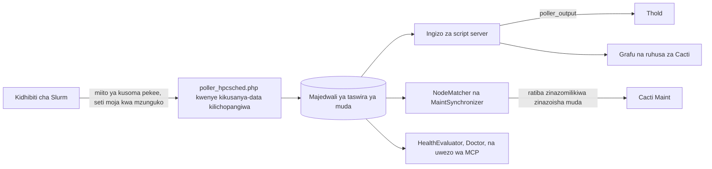

<!-- Source: README.md; SHA256: 938114d41dbd516f9dfcd94619c4fc73ef56b4da1dd693010588a93cce250534 -->

<!-- translations:start -->
[English](../../../README.md) | [简体中文](../zh-CN/README.md) | [हिन्दी](../hi-IN/README.md) | [Español (España)](../es-ES/README.md) | [Español (Latinoamérica)](../es-419/README.md) | [العربية (السعودية)](../ar-SA/README.md) | [Afrikaans](../af-ZA/README.md) | [አማርኛ](../am-ET/README.md) | [العربية (مصر)](../ar-EG/README.md) | [العربية (المغرب)](../ar-MA/README.md) | [বাংলা](../bn-BD/README.md) | [Bosanski](../bs-BA/README.md) | [Deutsch](../de-DE/README.md) | [فارسی](../fa-IR/README.md) | [Filipino](../fil-PH/README.md) | [Français](../fr-FR/README.md) | [Français (Maroc)](../fr-MA/README.md) | [Français (Sénégal)](../fr-SN/README.md) | [Hausa](../ha-NG/README.md) | [עברית](../he-IL/README.md) | [Hrvatski](../hr-HR/README.md) | [Bahasa Indonesia](../id-ID/README.md) | [Igbo](../ig-NG/README.md) | [Italiano](../it-IT/README.md) | [日本語](../ja-JP/README.md) | [한국어](../ko-KR/README.md) | [Malagasy](../mg-MG/README.md) | [मराठी](../mr-IN/README.md) | [Bahasa Melayu](../ms-MY/README.md) | [Nederlands](../nl-NL/README.md) | [Polski](../pl-PL/README.md) | [Português (Brasil)](../pt-BR/README.md) | [Русский](../ru-RU/README.md) | [Kinyarwanda](../rw-RW/README.md) | [Soomaali](../so-SO/README.md) | [Српски](../sr-RS/README.md) | [Svenska](../sv-SE/README.md) | [Kiswahili](README.md) | [தமிழ்](../ta-IN/README.md) | [తెలుగు](../te-IN/README.md) | [ไทย](../th-TH/README.md) | [Türkçe](../tr-TR/README.md) | [Українська](../uk-UA/README.md) | [اردو](../ur-PK/README.md) | [Tiếng Việt](../vi-VN/README.md) | [isiXhosa](../xh-ZA/README.md) | [Yorùbá](../yo-NG/README.md) | [繁體中文](../zh-TW/README.md) | [isiZulu](../zu-ZA/README.md)
<!-- translations:end -->

# plugin_hpcsched

Programu-jalizi ya Cacti 1.2 (`hpcsched`, toleo `0.1.0-dev`) inayochora hali ya kipanga-ratiba cha kazi za HPC kando ya vifaa ambavyo Cacti tayari inafuatilia: kina cha foleni, kazi zinazosubiri dhidi ya zinazoendelea, sababu za kazi kusubiri, hali za nodi, matumizi ya vigawanyo, na matumizi ya mgawo sawa (fair-share) katika kiwango cha akaunti. Slurm ndiyo mfumo wa nyuma uliotekelezwa. Thold hutoa arifa kutokana na vyanzo vya data vinavyozalishwa, na kisawazishaji cha hiari cha Maint huendesha madirisha ya Maint ya Cacti kutokana na nodi za ukokotoaji za Slurm zilizo katika hali ya drained, down, na zilizohifadhiwa kwa matengenezo.

> **Hali: inaendelezwa, bado hakuna toleo rasmi.** Tawi hili linatekeleza msingi wa programu-jalizi, grafu za klasta na vigawanyo, familia za sababu za kusubiri, ulinganishaji wa nodi za ukokotoaji za Slurm na vifaa vya Cacti, usawazishaji wa hiari wa madirisha ya Maint ya Cacti, muhtasari wa mgawo sawa katika kiwango cha akaunti, utekelezaji na urudufishaji wa vikusanya-data vya mbali, CLI ya Configuration-as-Code (CasC) na uendeshaji, na kulabu za mfumo wa ikolojia wa Cacti (CasC, Doctor, na MCP / Abilities API v2). Mkusanyiko wa majaribio unashughulikia amri za Slurm bandia na majibu ya `slurmrestd`, na CI hujaribu klasta halisi ya Slurm yenye nodi sita ndani ya kontena. Kisomaji hakijaendeshwa dhidi ya klasta ya uzalishaji, na jaribio la mwisho-hadi-mwisho la marudio ya Thold bado halipo katika CI.

Huu ni mradi huru na hauhusiani na mradi wa Cacti.

## Kilichotekelezwa

- **Mzunguko wa maisha na schema (v3)**: usakinishaji, usasishaji usiorudia athari (idempotent), uondoaji (ukihifadhi majedwali ya programu-jalizi kwa chaguo-msingi), na kiwango cha chini cha PHP 8.2 huku sehemu za kuingilia zikibaki kuweza kuchanganuliwa kwenye PHP 8.0. Schema v3 inaongeza `plugin_hpcsched_node_map` na `plugin_hpcsched_maint_link` kando ya majedwali ya cluster, run, section, job-count, node-count, node, partition, reservation, na share.
- **Ukusanyaji wa Slurm wa kusoma pekee kwenye vikusanya-data vikuu na vya mbali**: `poller_bottom` huanzisha `poller_hpcsched.php --cluster=N` chinichini kwenye kila kikusanya-data (`poller_id`) kwa ajili ya klasta zake zilizowezeshwa na zilizopangiwa. Kila mzunguko hukusanya taswira ya muda moja iliyohifadhiwa kwa muda kwa kila klasta kupitia amri za mteja (`squeue`, `scontrol`, `sshare` pamoja na `--json`) au `slurmrestd` kupitia HTTPS (HTTP ya loopback inaruhusiwa ikiwa na onyo la afya). `INFO` hutangaza `remote_collect:1, remote_poller:1`, na `replicate_out` hurudufisha fasili zisizo za siri za `plugin_hpcsched_cluster` kwenda kwa vikusanya-data vya mbali (`poller_id >= 2`); maudhui ya faili za tokeni hayasomwi wala hayarudufishwi kamwe.
- **Violezo vya Cacti na grafu za klasta**: huleta violezo vya vifaa, data, na grafu (`templates/hpcsched-templates.xml`) na hoja ya data ya script-server ya vigawanyo (`scripts/ss_hpcsched_cluster.php`, `scripts/ss_hpcsched_partitions.php`). Baada ya uthibitisho wa msimamizi, huunda au huoanisha kifaa kimoja cha Cacti kwa kila klasta kikiwa na grafu za kazi kulingana na hali, kazi zinazosubiri kulingana na familia ya sababu, nodi kulingana na hali, CPU, matumizi (klasta na kwa kila kigawanyo), na umri wa taswira ya muda.
- **Ulinganishaji wa nodi za Slurm na vifaa na usawazishaji wa Cacti Maint**: kilinganishi cha hatua nne cha muda wa mstari (`NodeMatcher`) huoanisha nodi za ukokotoaji za Slurm na rekodi zilizopo za `host` za Cacti (jina halisi la mwenyeji, anwani halisi, maelezo/jina mbadala halisi, au lebo ya kwanza ya DNS kwa majina yasiyo ya IP) na huweka alama `ambiguous` kwa ulinganishi mwingi au madai ya kifaa yanayorudiwa badala ya kukisia. `HostList::expand()` hupanua orodha za wenyeji za uhifadhi wa Slurm (hadi nodi 10,000). `MaintSynchronizer` huunda, huhuisha, na huondoa ratiba za mara moja za Cacti Maint zinazomilikiwa na programu-jalizi ambazo zinafuatiliwa katika `plugin_hpcsched_maint_link` kwa nodi zilizooanishwa zilizo katika hali ya `DRAIN`, `DRAINING`, `DOWN`, au uhifadhi amilifu wa `MAINT`/`MAINTENANCE` bila kubadilisha ratiba za Maint zilizoundwa na msimamizi.
- **Muhtasari wa mgawo sawa katika kiwango cha akaunti**: `collect_shares` inapowezeshwa, hukusanya safu mlalo za uhusiano wa akaunti za Slurm katika `plugin_hpcsched_share` (ikiondoa safu mlalo za watumiaji kulingana na [ADR 0010](../../decisions/0010-bound-series-cardinality.md)). `ShareSummary` na `ShareRepository` hukokotoa idadi ya akaunti/vigawanyo, jumla ya matumizi ghafi na halisi, vipengele vya chini/juu/wastani vya mgawo sawa, na akaunti za juu; idadi ya akaunti huonyeshwa katika `hpcsched-get-queue-summary`.
- **CLI ya CasC na uendeshaji (`cli/hpcsched.php`)**: uhamishaji wa usanidi wa YAML/XML, uthibitishaji, upangaji wa tofauti wa majaribio (dry-run), utekelezaji unaohitaji uthibitisho, matokeo ya afya yaliyopangiliwa, na usawazishaji wa hiari wa Maint (`sync-maint --dry-run` / `--apply`).
- **Kulabu za mfumo wa ikolojia (`setup.php`)**: `casc_register_providers`, `doctor_register_checks`, na `abilities_register`.

## Majukumu ya ufikiaji

| Eneo | Ufikiaji |
| --- | --- |
| HPC Scheduler View | Muhtasari wa klasta wa kusoma pekee na sababu za kusubiri (`hpcsched.php`). |
| HPC Scheduler Operator | Ufikiaji wa View pamoja na ukurasa wa Uendeshaji (`hpcsched_operator.php`) na uthibitisho wa uchambuzi wa kibinafsi. |
| HPC Scheduler Admin | Ufikiaji wa Operator pamoja na usimamizi wa klasta (`hpcsched_clusters.php`) na ukurasa wa afya (`hpcsched_health.php`). |

Baada ya kunakili faili za usasishaji, fungua ukurasa wa Plugins kama msimamizi ili kusajili maeneo mapya na kulabu. Panga eneo la Operator waziwazi chini ya **Configuration > Users** au vikundi vya watumiaji. Usasishaji huhifadhi vitambulisho na ruhusa zilizopo za maeneo ya View na Admin. Ufikiaji wa Admin hurithi ufikiaji wa Operator, na ufikiaji wa Operator hurithi ufikiaji wa View kwa kila ombi; hii haiongezi ruhusa zilizohifadhiwa kwa watumiaji au vikundi. Mipangilio ya programu-jalizi pia huhitaji ufikiaji wa HPC Scheduler Admin pamoja na ruhusa ya Settings ya Cacti.

Ruhusa za vifaa vya Cacti hupunguza safu mlalo na vitendo vinavyopatikana kwa kila mtumiaji. Klasta iliyooanishwa na kifaa cha Cacti huonyeshwa, huhamishwa, na hubadilishwa tu kwa watumiaji ambao Cacti huwaruhusu kifaa hicho; kuoanisha kifaa pia huhitaji ruhusa ya kifaa lengwa. Klasta isiyo na kifaa huorodheshwa kwenye kurasa za kiutawala kwa watumiaji wenye eneo la programu-jalizi, lakini si katika mionekano ya waendeshaji, ambayo huorodhesha klasta zilizooanishwa na kifaa pekee. Klasta ambayo kifaa chake kilichooanishwa kilifutwa wakati programu-jalizi ilikuwa imezimwa huonyeshwa tu kwa watumiaji wenye ufikiaji wa HPC Scheduler Admin. Uthibitisho hudumu tu katika kipindi cha sasa cha mtumiaji, kwa muda usiozidi saa moja na tu wakati uchunguzi huo huo unabaki mpya. Uchunguzi mpya au uliobadilika huubatilisha. Haubadilishi kamwe kipimo kilichoshindwa kuwa chenye afya wala hauzuii arifa.

## Maelezo ya mwendeshaji

### Usalama, upendeleo mdogo zaidi, na faili za tokeni

Programu-jalizi husoma pekee. Ipe mtumiaji mahususi wa Slurm asiye na jukumu la msimamizi au mwendeshaji (`AdminLevel=None` katika `sacctmgr`). Ikiwa `PrivateData=jobs` (au `nodes`, `reservations`, `usage`) imewekwa katika `slurm.conf`, mtumiaji huyo huona rekodi zake mwenyewe pekee, hivyo idadi hazitakuwa kamili na programu-jalizi haiwezi kugundua hilo. Kuondoa kizuizi hicho kwa akaunti kunahitaji kiwango cha mwendeshaji au msimamizi, ambacho pia kinaruhusu mabadiliko; uamuzi huo ni wa kituo husika.

Kwa amri za mteja, mtumiaji wa kikusanya-data cha Cacti anahitaji programu tumizi za mteja za Slurm (`squeue`, `scontrol`, na kwa hiari `sshare`) na `slurm.conf` inayofikia kidhibiti; njia za programu tumizi ni mipangilio kamili chini ya **Configuration > Settings > HPC Scheduler**.

Kwa `slurmrestd`, URL lazima iwe `https://`, au `http://` kwenye anwani ya loopback pekee. Vyeti vya TLS huthibitishwa na uelekezaji upya haufuatwi. Orodha ya hiari ya wenyeji wa `slurmrestd` chini ya **Configuration > Settings > HPC Scheduler** huzuia ni wenyeji na bandari zipi klasta inaweza kutaja.

Klasta ya `slurmrestd` hutaja faili ya tokeni; tokeni yenyewe haihifadhiwi kamwe katika hifadhidata, haionyeshwi kwenye ukurasa, haihamishwi na CasC, wala haiandikwi kwenye kumbukumbu. Faili lazima iwe ndani ya mojawapo ya Saraka za Faili za Tokeni zilizowekwa chini ya **Configuration > Settings > HPC Scheduler**, ifikiwe bila kiungo cha ishara (symbolic link), na iwe faili ya kawaida inayomilikiwa na mtumiaji wa kikusanya-data ambayo mtumiaji huyo pekee anaweza kuandika, ikishikilia mstari mmoja: tokeni au `SLURM_JWT=<token>` kama `scontrol token` inavyochapisha. Bila saraka zozote za tokeni zilizowekwa, hakuna klasta inayoweza kutumia `slurmrestd`. Weka kila saraka ya tokeni iweze kuandikwa na root na mtumiaji wa kikusanya-data pekee. Faili inayoweza kusomwa na kikundi au watumiaji wengine bado hutumika, na ukurasa wa afya hutoa onyo; pia hutoa onyo tokeni inapokaribia kuisha muda ndani ya dirisha la onyo lililowekwa.

Ili kubadilisha tokeni kwa njia ya atomiki:

```sh
dir=/etc/cacti/hpcsched
tmp=$(mktemp "$dir/.token.XXXXXX")
scontrol token username=cactiread lifespan=2592000 > "$tmp"
chown cacti:cacti "$tmp"
chmod 0600 "$tmp"
mv -f "$tmp" "$dir/cluster1.token"
```

Ukusanyaji unaofuata husoma faili mpya. Kuzalisha tokeni kwa `scontrol token` kunahitaji msimamizi wa Slurm; iendeshe panaporuhusiwa na unakili faili kwenda kwa kikusanya-data.

### Vikusanya-data vya mbali

`INFO` hutangaza `remote_collect:1, remote_poller:1`. `hpcsched_poller_bottom()` huanzisha `poller_hpcsched.php` kwenye kila kikusanya-data kwa klasta zilizowezeshwa zilizopangiwa kwa `poller_id` hiyo, na `hpcsched_replicate_out()` hurudufisha safu mlalo zisizo za siri za `plugin_hpcsched_cluster` kwenda kwa vikusanya-data vya mbali (`poller_id >= 2`). Faili za tokeni na programu tumizi za mteja za Slurm lazima ziwepo ndani ya kikusanya-data cha mbali kilichopangiwa; maudhui ya tokeni hayarudufishwi kamwe.

### Vikomo vya kumbukumbu

Kila mzunguko wa ukusanyaji husimbua jibu moja la kipanga-ratiba kwa wakati mmoja, jambo ambalo huchukua takriban mara 12 ya ukubwa wa jibu katika kumbukumbu ya PHP (iliyopimwa kuwa takriban mara 10 kwa rekodi za kazi zilizo na umbo kama la Slurm, pamoja na maandishi yenyewe). Kisomaji huongeza kikomo chake cha kumbukumbu ya PHP hadi mpangilio wa Collection Memory (1024 MiB kwa chaguo-msingi) na huruhusu majibu hadi `(Collection Memory - 64) / 12` MiB (80 MiB kwa chaguo-msingi), hata wakati Maximum Answer Size imewekwa juu zaidi; ukurasa wa afya huonya wakati Maximum Answer Size inapozidi kikomo hicho kilichokadiriwa. Jibu kubwa zaidi hushindwa katika sehemu yake kama kubwa mno, na mzunguko unaomaliza kumbukumbu bado hurekodi kushindwa kwa kumbukumbu na huachilia nafasi yake ya ukodishaji na mchakato kupitia kishughulikiaji cha kuzima. Klasta kubwa zinaweza kuhitaji mipangilio yote miwili kuongezwa; rekodi halisi za kazi 100,000 hazijapimwa.

### Violezo, vifaa vya klasta, na uhesabuji wa grafu

Usakinishaji na usasishaji huingiza violezo vya vifaa, data, na grafu vya HPC Scheduler na kunakili hoja ya data ya vigawanyo kwenda kwenye saraka ya `resource/script_server/` ya Cacti. Ikiwa saraka hiyo haiwezi kuandikwa, faili tofauti yenye jina lilelile ipo hapo, au lengo ni kiungo cha ishara, uingizaji husimama, huacha faili bila kuguswa, na huripoti hali hiyo kwenye ukurasa wa afya ambapo **Install Templates** hujaribu tena. Uondoaji huondoa faili ya hoja tu ikiwa programu-jalizi iliiandika na haijabadilishwa, na huhifadhi violezo, vifaa, na grafu.

**HPC Clusters > Device** huonyesha hakikisho la grafu, vyanzo vya data, faili za RRD, na miito ya script server kwa kila kura kabla ya kuunda chochote. **Create Device** huunda kifaa chenye jina la mwenyeji katika kikoa kilichohifadhiwa cha `.invalid` na bila ukaguzi wa upatikanaji; **Map Device** huambatisha grafu kwenye kifaa kilichopo bila kubadilisha mipangilio yake. Kila grafu ya klasta na grafu ya kigawanyo ina chanzo chake cha data: sita kwa klasta na tano kwa kila kigawanyo. Vigawanyo vinavyoongezwa baadaye huorodheshwa upya kiotomatiki kisomaji kinapogundua mabadiliko; vigawanyo vilivyoondolewa huacha kupigiwa kura na huhifadhi grafu zake. Kufuta kifaa huondoa uoanishaji wa klasta (na hufuta safu mlalo zozote zinazolingana za `plugin_hpcsched_node_map`) huku kikihifadhi rekodi ya klasta.

Kazi zinazosubiri hazijumuishi kazi zilizoshikiliwa (held), ambazo zina mfululizo wake wenyewe. Safu ya kazi inayosubiri huhesabu kazi zake zilizosalia. Kazi au nodi iliyo katika vigawanyo vingi huhesabiwa mara moja katika grafu za klasta na mara moja katika kila kigawanyo, hivyo jumla za vigawanyo si lazima zilingane na jumla ya klasta. Sababu za kusubiri zimepangwa katika familia kumi na moja ([ADR 0011](../../decisions/0011-pending-reason-families-and-counting.md)); mwonekano wa sababu za kusubiri huorodhesha sababu ghafi zikiwemo zile zilizo katika `Other`. Kigawanyo cha matumizi hujumuisha nodi zilizo katika hali ya drained, down, na zisizopatikana nyingine. Data iliyopitwa na wakati au iliyoshindwa huripotiwa kama `U`, kamwe si sifuri; `age` hubaki ya nambari.

Kwa arifa, sanidi Thold kwenye chanzo chochote cha data cha klasta au kigawanyo kwa muda wa angalau kipindi kimoja cha ukusanyaji, na weka arifa kwenye `age` ili kugundua kisomaji kilichosimama.

## CLI na kulabu za mfumo wa ikolojia

### Sehemu ya kuingilia ya kisomaji

`hpcsched_poller_bottom()` huanzisha `poller_hpcsched.php` kiotomatiki; inaweza pia kuendeshwa kwa mkono kwenye kikusanya-data kilichopangiwa kwa klasta:

```sh
php /path/to/cacti/plugins/hpcsched/poller_hpcsched.php --cluster=N [--force] [--debug]
```

`--force` huendeshwa hata programu-jalizi ikiwa imezimwa, kwa uchunguzi wa mstari wa amri.

### CLI ya Configuration-as-Code, afya, na usawazishaji wa Maint

```sh
php /path/to/cacti/plugins/hpcsched/cli/hpcsched.php export [--format=yaml|xml] [--file=PATH]
php /path/to/cacti/plugins/hpcsched/cli/hpcsched.php validate --file=PATH [--format=yaml|xml]
php /path/to/cacti/plugins/hpcsched/cli/hpcsched.php plan --file=PATH [--format=yaml|xml]
php /path/to/cacti/plugins/hpcsched/cli/hpcsched.php apply --file=PATH --confirm=PLAN_HASH [--format=yaml|xml]
php /path/to/cacti/plugins/hpcsched/cli/hpcsched.php health [--format=text|json]
php /path/to/cacti/plugins/hpcsched/cli/hpcsched.php sync-maint [--dry-run | --apply] [--cluster=ID] [--format=text|json]
```

- `export` huandika faili mpya kwa ruhusa `0600` (au stdout) na hubadilisha njia zilizowekwa za `token_file` na `[REDACTED]`. `plan` na `apply` hukataa sehemu za ndani za `jwt`, `secret`, na `password`, na huhifadhi njia zilizopo za ndani za `token_file` wakati `[REDACTED]` inapotolewa. `apply` huhitaji `--confirm=PLAN_HASH` halisi iliyochapishwa na `plan`.
- `health` hutathmini usasa wa schema, upya wa klasta, matokeo ya mizunguko, upatikanaji wa Maint, na maonyo bila kuwasiliana na vipanga-ratiba au kusoma faili za tokeni.
- `sync-maint` hutumia `--dry-run` kwa chaguo-msingi na huonyesha hakikisho au hutekeleza ratiba za Cacti Maint kwa nodi zilizooanishwa za Slurm zilizo katika `DRAIN`, `DRAINING`, `DOWN`, au uhifadhi amilifu wa `MAINT`/`MAINTENANCE` (upeo chaguo-msingi wa drain/down sekunde 3600, ukingo wa uhuishaji sekunde 600). Hukataa `--apply` ikiwa `plugin_maint_schedules` na `plugin_maint_hosts` hazipo, na husasisha au huondoa tu ratiba zilizorekodiwa katika `plugin_hpcsched_maint_link`.

### Kulabu za mfumo wa ikolojia

Programu-jalizi za Cacti zinazolingana au miunganisho ya mwenyeji inapokuwepo, `setup.php` husajili:

- `casc_register_providers`: huhamisha, huthibitisha, hupanga, na hutekeleza kwa uthibitisho usanidi wa `hpcsched` (`yaml` na `xml`, schema v1) pamoja na ufifishaji wa siri.
- `doctor_register_checks`: hutoa ukaguzi wanne wa uchunguzi wa kusoma pekee (`hpcsched.schema`, `hpcsched.cluster_freshness`, `hpcsched.token_health`, `hpcsched.maint_sync`).
- `abilities_register`: husajili uwezo tatu za kusoma pekee, zisizoharibu, na zisizorudia athari chini ya kategoria ya `hpcsched`, zilizodhibitiwa na eneo la HPC Scheduler View (na ruhusa za vifaa kwa muhtasari wa klasta): `hpcsched-list-clusters`, `hpcsched-get-queue-summary`, na `hpcsched-get-health`.

## Kwa nini

Waendeshaji wanaoendesha Cacti tayari huchora grafu za nodi zao za ukokotoaji. Mtazamo wa kipanga-ratiba unakosekana katika grafu hizo, jambo linaloacha mapengo mawili:

- **Hakuna jibu la "kwa nini kazi haianzi".** Slurm hurekodi sababu kwa kila kazi inayosubiri. Foleni iliyojaa kando ya grafu za nodi zisizofanya kazi haisemi ikiwa chanzo ni kipaumbele, vikomo vya rasilimali, ushikiliaji, utegemezi, au nodi zilizokaushwa.
- **Hakuna kiungo kati ya hali ya kipanga-ratiba na arifa.** Thold hutoa arifa kwenye kifaa ambacho msimamizi tayari amekikausha, na wasimamizi huunda ratiba za Maint kwa mkono.

Programu-jalizi hukusanya taswira ya muda moja iliyohifadhiwa kwa muda kwa kila klasta, huichapisha kama vyanzo vya data na grafu za kawaida za Cacti, huoanisha nodi za kipanga-ratiba na vifaa vilivyopo vya Cacti, na husawazisha madirisha ya Maint yanayoisha muda yanayomilikiwa na programu-jalizi kwa nodi zilizo katika hali ya drained, down, na zilizohifadhiwa kwa matengenezo. Hutumia tena ruhusa za Cacti, vikusanya-data vya mbali, Thold, na Maint, na hubaki kusoma pekee kikamilifu kuelekea kipanga-ratiba.

## Upeo na mipaka

Nje ya upeo: njia yoyote ya kuandika kwenye kipanga-ratiba (submit, cancel, hold, drain, resume), injini ya arifa inayomilikiwa na programu-jalizi, injini ya kuripoti au kutoza gharama, na mfululizo wa kila mtumiaji au kila kazi. Mifumo ya nyuma ya PBS Pro, OpenPBS, na LSF ni ya utafiti pekee.

## Mahitaji na uoanifu

| Sehemu | Lengo |
|---|---|
| Cacti | 1.2.31 au baadaye (`compat = 1.2.31`), hakuna viraka vya msingi |
| PHP | 8.2 au baadaye; sehemu za kuingilia hubaki kuweza kuchanganuliwa kwenye 8.0 na hukataa uanzishaji kwenye 8.1 ili mazingira yasiyoungwa mkono yapate kukataliwa badala ya kiolesura cha Cacti kilichovunjika |
| Slurm | 25.05, 25.11, na 26.05 ([ADR 0013](../../decisions/0013-three-latest-slurm-releases.md)); 26.05.5 hujaribiwa katika CI kwa kila badiliko dhidi ya klasta ya kontena yenye nodi sita, 25.11.8 kwenye `main`, kila wiki, na kwa ombi, na 25.05 dhidi ya data ya majaribio pekee. Amri za mteja hutumia kichanganuzi cha data `v0.0.43` kwa chaguo-msingi (`v0.0.44` na `v0.0.45` zinaweza kuchaguliwa); klasta za `slurmrestd` hugundua kichanganuzi kipya zaidi ambacho huduma hutoa |
| Thold, Maint | Hakuna mabadiliko ya Thold yanayohitajika; `sync-maint` huunganishwa na majedwali ya `plugin_maint_schedules` na `plugin_maint_hosts` ya Cacti Maint kwa kutumia jedwali la kiungo linalomilikiwa na programu-jalizi (`plugin_hpcsched_maint_link`) |

## Maendeleo na majaribio

Mtiririko wa kazi wa CI (`.github/workflows/plugin-ci-workflow.yml`) hujaribu PHP 8.2 hadi 8.5 dhidi ya Cacti `release/1.2.31` na `1.2.x`, ukaguzi wa sintaksia ya sehemu za kuingilia za PHP 8.0, kukataliwa kwa PHP 8.1, PHPStan, uthibitishaji wa gettext/tafsiri, utoaji leseni wa REUSE, ukaguzi wa mtiririko wa kazi, ukaguzi wa mtiririko wa vifaa vya klasta na mabadiliko ya uhamishaji wa violezo, na klasta halisi ya Slurm yenye nodi sita (`slurm-live`).

Ukiwa na kifaa cha majaribio cha pamoja cha Pest cha Cacti (`CACTI_PEST_BIN`) na hifadhidata ya Cacti ya muda mfupi:

```sh
# Unit tests
"$CACTI_PEST_BIN" --configuration=phpunit.xml

# Lifecycle integration tests (disposable database only)
CACTI_PATH=/path/to/cacti HPCSCHED_TEST_DATABASE=disposable "$CACTI_PEST_BIN" --configuration=phpunit-integration.xml

# Static analysis (against Cacti 1.2.31)
CACTI_PATH=/path/to/cacti phpstan analyse -c phpstan.neon --no-progress

# Translation template, catalogs, and localized README checks
sh locales/build_gettext.sh --check
```

## Muundo

- [docs/PLAN.md](../../PLAN.md) ni mpango wa usanifu na muundo: ukweli wa mfumo wa juu pamoja na vyanzo, uoanishaji wa nodi, muundo wa hali, mipaka ya usalama, hesabu ya utendaji, majaribio, na hatari.
- [docs/decisions/](../../decisions/) huhifadhi rekodi za maamuzi ya usanifu.
- [docs/REQUIREMENTS.md](../../REQUIREMENTS.md) huoanisha kila kitambulisho cha hitaji na suala lake.



## Jinsi kazi inavyofuatiliwa

- **Milestones** hufuata hatua za mpango. Kila moja ina suala kuu linaloorodhesha masuala yake madogo na ushahidi wa kumaliza.
- **Issues** hupangwa kwa lebo: `type: requirement`, `type: research`, `type: decision`, `type: epic`. Masuala ya mahitaji hueleza mahitaji yenye nambari yanayoweza kupimwa (`REQ-AREA-NNN`) na vigezo vya kukubalika.
- **Labels** pia hubeba `area:`, `phase:`, `priority:`, na `status:`. Tazama [CONTRIBUTING.md](../../../CONTRIBUTING.md#labels).
- [Bodi ya mradi](https://github.com/users/somethingwithproof/projects/10) huonyesha masuala yote katika hatua zote.

## Kuchangia

Soma [CONTRIBUTING.md](../../../CONTRIBUTING.md). Ahadi (commits) zinahitaji sahihi ya DCO (`git commit -s`). Majadiliano ya muundo hufanyika kwenye masuala; maamuzi yaliyo wazi hubeba lebo ya `type: decision`.

## Usalama

Ripoti udhaifu kwa faragha; tazama [SECURITY.md](../../../SECURITY.md).

## Leseni

GNU General Public License v2.0, leseni ileile ya Cacti na programu-jalizi zake. Tazama [LICENSE](../../../LICENSE).
