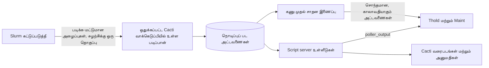

<!-- Source: README.md; SHA256: 16caa3e34c4d150a7fb1018f637e200a7580330f033b485047d8413bce09abba -->

<!-- translations:start -->
[English](../../../README.md) | [简体中文](../zh-CN/README.md) | [हिन्दी](../hi-IN/README.md) | [Español (España)](../es-ES/README.md) | [Español (Latinoamérica)](../es-419/README.md) | [العربية (السعودية)](../ar-SA/README.md) | [Afrikaans](../af-ZA/README.md) | [አማርኛ](../am-ET/README.md) | [العربية (مصر)](../ar-EG/README.md) | [العربية (المغرب)](../ar-MA/README.md) | [বাংলা](../bn-BD/README.md) | [Deutsch](../de-DE/README.md) | [فارسی](../fa-IR/README.md) | [Filipino](../fil-PH/README.md) | [Français](../fr-FR/README.md) | [Français (Maroc)](../fr-MA/README.md) | [Français (Sénégal)](../fr-SN/README.md) | [Hausa](../ha-NG/README.md) | [עברית](../he-IL/README.md) | [Bahasa Indonesia](../id-ID/README.md) | [Igbo](../ig-NG/README.md) | [Italiano](../it-IT/README.md) | [日本語](../ja-JP/README.md) | [한국어](../ko-KR/README.md) | [Malagasy](../mg-MG/README.md) | [मराठी](../mr-IN/README.md) | [Bahasa Melayu](../ms-MY/README.md) | [Nederlands](../nl-NL/README.md) | [Polski](../pl-PL/README.md) | [Português (Brasil)](../pt-BR/README.md) | [Русский](../ru-RU/README.md) | [Kinyarwanda](../rw-RW/README.md) | [Soomaali](../so-SO/README.md) | [Svenska](../sv-SE/README.md) | [Kiswahili](../sw-KE/README.md) | [தமிழ்](README.md) | [తెలుగు](../te-IN/README.md) | [ไทย](../th-TH/README.md) | [Türkçe](../tr-TR/README.md) | [Українська](../uk-UA/README.md) | [اردو](../ur-PK/README.md) | [Tiếng Việt](../vi-VN/README.md) | [isiXhosa](../xh-ZA/README.md) | [Yorùbá](../yo-NG/README.md) | [繁體中文](../zh-TW/README.md) | [isiZulu](../zu-ZA/README.md)
<!-- translations:end -->

# plugin_hpcsched

Cacti ஏற்கனவே கண்காணிக்கும் சாதனங்களுக்கு அருகில் ஒரு HPC தொகுப்புத் திட்டமிடுதலின் (batch scheduler) நிலையை வரைபடமாகக் காட்டும் Cacti 1.2 செருகுநிரல்: வரிசை ஆழம், நிலுவையில் உள்ள பணிகள் மற்றும் இயங்கும் பணிகள், பணிகள் ஏன் நிலுவையில் உள்ளன என்பதற்கான காரணங்கள், கணு நிலைகள் (node states), மற்றும் பிரிவு பயன்பாடு (partition utilization). Slurm இதன் முதல் பின்புலமாகும் (backend). இதிலிருந்து உருவாகும் தரவு மூலங்களின் அடிப்படையில் Thold எச்சரிக்கைகளை வழங்குகிறது, மேலும் வெளியேற்றப்பட்ட (drained) கணுக்கள் மற்றும் பராமரிப்பு முன்பதிவுகள் மூலம் Maint இயக்கப்படலாம்.

> **நிலை: உருவாக்கத்தில் உள்ளது, இன்னும் வெளியீடு இல்லை.** மைல்கல் 2 (அடித்தளம்) `main` கிளையில் இணைக்கப்பட்டுள்ளது, மேலும் இந்தக் கிளை மைல்கல் 3-ஐ (கிளஸ்டர் வரைபடங்கள் மற்றும் நிலுவைக் காரணங்கள்) சேர்க்கிறது. இந்தக் குறியீடு Cacti-இன் செருகுநிரல் API வழியாக நிறுவப்படுகிறது, மேம்படுத்தப்படுகிறது மற்றும் நிறுவல் நீக்கப்படுகிறது; மேலும் 8.2-க்குக் கீழே உள்ள PHP பதிப்புகளை ஏற்காது. இது Slurm கிளஸ்டர்களின் பதிவேட்டைப் பராமரிக்கிறது; ஒவ்வொன்றும் ஒரு Cacti வாக்கெடுப்பிக்கு (poller) ஒதுக்கப்பட்டுள்ளது. முதன்மை வாக்கெடுப்பியில் உள்ள ஒரு பின்னணிப் படிப்பான் (background reader), ஒவ்வொரு இடைவெளியிலும் ஒரு கிளஸ்டருக்கு ஒரு நொடிப்புப் படத்தை (snapshot) சேகரிக்கிறது; இதை `squeue`, `scontrol`, மற்றும் `sshare` கட்டளைகளை `--json` உடன் இயக்குவதன் மூலமோ அல்லது HTTPS வழியாக `slurmrestd`-ஐப் படிப்பதன் மூலமோ செய்கிறது. மேலும் நிலை மற்றும் நிலுவைக் காரணத்தின் அடிப்படையில் பணி எண்ணிக்கைகள், கணு நிலைகள், பிரிவுகள், முன்பதிவுகள் மற்றும் நியாயப் பகிர்வு (fair-share) பயன்பாடு ஆகியவற்றை அவற்றின் புதுமைத் தன்மையுடன் (freshness) சேமிக்கிறது. இந்தச் செருகுநிரல் Cacti வார்ப்புருக்களை (templates) வழங்குகிறது; மேலும் நிர்வாகியின் உறுதிப்படுத்தலின் பேரில், ஒவ்வொரு கிளஸ்டருக்கும் ஒரு Cacti சாதனத்தை உருவாக்குகிறது அல்லது இணைக்கிறது. இதில் கிளஸ்டருக்கும் ஒவ்வொரு பிரிவுக்கும் நிலை வாரியான பணிகள், காரணக் குடும்ப வாரியான நிலுவைப் பணிகள், நிலை வாரியான கணுக்கள், CPU-கள் மற்றும் பயன்பாடு ஆகியவற்றின் வரைபடங்களுடன் நொடிப்புப் படத்தின் வயதும் (snapshot age) அடங்கும். படிக்க-மட்டுமான மேலோட்டப் பக்கம் ஒவ்வொரு கிளஸ்டருக்கான எண்ணிக்கைகளையும் அவற்றின் புதுமைத் தன்மையையும், ஒவ்வொரு கிளஸ்டருக்கான நிலுவைக் காரணங்கள் காட்சியையும் காட்டுகிறது; மேலும் நிர்வாகிகளுக்கு மட்டுமான நலப் பக்கம் (health page) ஒவ்வொரு சேகரிப்பும் என்ன வழங்கியது என்பதையும் வார்ப்புருக்கள் நிறுவப்பட்டுள்ளனவா என்பதையும் காட்டுகிறது. ஒவ்வொரு பக்கமும் செயலும் Cacti-இன் சாதன அனுமதிகளைப் பின்பற்றுகின்றன. இந்தத் தரவு மூலங்கள் Thold எச்சரிக்கை அளிக்கக்கூடியவை; ஆனால் Thold அல்லது Maint ஒருங்கிணைப்பு எதுவும் இன்னும் சோதிக்கப்படவில்லை; அது மைல்கல் 4 மற்றும் அதற்குப் பிந்தையதாகும். சோதனைத் தொகுப்பு செயற்கையான Slurm கட்டளைகள் மற்றும் `slurmrestd` பதில்களை உள்ளடக்கியது; மேலும் கீழே விவரிக்கப்பட்டுள்ளபடி கொள்கலன்களில் (containers) உள்ள ஆறு-கணு Slurm கிளஸ்டரிலும் CI சோதனைகளை இயக்குகிறது. இந்தப் படிப்பான் இன்னும் ஒரு நேரடி உற்பத்தி (production) கிளஸ்டரில் இயக்கப்படவில்லை. இயக்கிகளுக்கான (operator) குறிப்புகளுக்குக் கீழே, இந்த README வெளியிடப்பட்ட செயல்பாட்டை அல்ல, வடிவமைப்பையே விவரிக்கிறது.

இது ஒரு சுயாதீனமான திட்டமாகும்; இது Cacti திட்டத்துடன் தொடர்புடையதல்ல.

## அணுகல் பாத்திரங்கள்

| பாத்திரப் பகுதி (Realm) | அணுகல் |
| --- | --- |
| HPC Scheduler View | தற்போதுள்ள கண்காணிப்புப் பக்கங்கள். |
| HPC Scheduler Operator | கண்காணிப்புடன் செயல்பாடுகள் பக்கமும் தனிப்பட்ட முன்னுரிமை ஒப்புதல்களும் (triage acknowledgments). |
| HPC Scheduler Admin | இயக்கி (Operator) அணுகலுடன் தற்போதுள்ள கட்டமைப்பு மற்றும் நிர்வாகச் செயல்கள். |

மேம்படுத்தல் கோப்புகளை நகலெடுத்த பிறகு, புதிய பாத்திரப் பகுதியைப் (realm) பதிவு செய்ய நிர்வாகியாக Plugins பக்கத்தைத் திறக்கவும். **Configuration > Users** அல்லது பயனர் குழுக்களின் கீழ் Operator பாத்திரப் பகுதியைத் தெளிவாக ஒதுக்கவும். மேம்படுத்தல்கள் தற்போதுள்ள View மற்றும் Admin பாத்திரப் பகுதி அடையாள எண்களையும் (IDs) அனுமதிகளையும் தக்கவைத்துக்கொள்கின்றன. ஒவ்வொரு கோரிக்கையிலும் Admin அணுகல் Operator அணுகலையும், Operator அணுகல் View அணுகலையும் மரபுரிமையாகப் பெறுகிறது; இது பயனர்கள் அல்லது குழுக்களுக்குச் சேமிக்கப்பட்ட அனுமதிகளைச் சேர்க்காது. செருகுநிரல் அமைப்புகளுக்கு Cacti-இன் Settings அனுமதியுடன் கூடுதலாக HPC Scheduler Admin அணுகலும் தேவைப்படுகிறது.

ஒவ்வொரு பயனருக்கும் கிடைக்கும் வரிசைகளையும் செயல்களையும் Cacti சாதன அனுமதிகள் தொடர்ந்து கட்டுப்படுத்துகின்றன; சாதனம் இல்லாத கிளஸ்டர், செருகுநிரல் பாத்திரப் பகுதியைக் கொண்ட ஒவ்வொரு பயனருக்கும் நிர்வாகப் பக்கங்களில் பட்டியலிடப்படும், ஆனால் சாதனத்துடன் இணைக்கப்பட்ட கிளஸ்டர்களை மட்டுமே பட்டியலிடும் இயக்கி (operator) காட்சிகளில் காட்டப்படாது. சான்றுகள் (credentials), கட்டமைப்பு, இணைத்தல், நீக்குதல் மற்றும் பிற நிர்வாக மாற்றங்கள் நிர்வாகப் பக்கங்களிலேயே தொடர்கின்றன. ஒப்புதல்கள் (acknowledgments) தற்போதைய பயனரின் அமர்வில் மட்டுமே, அதிகபட்சமாக ஒரு மணி நேரத்திற்கும், அதே அவதானிப்பு புதுமையாக இருக்கும் வரை மட்டுமே நீடிக்கும். புதிய அல்லது மாறிய அவதானிப்புகள் அவற்றைச் செல்லாததாக்கும். அவை ஒருபோதும் தோல்வியடைந்த அளவீட்டை நலமானதாகக் குறிக்காது அல்லது எச்சரிக்கைகளைத் தடுக்காது.

## மைல்கல் 2-க்கான இயக்கி குறிப்புகள்

**குறைந்தபட்ச சலுகை (Least privilege).** இந்தச் செருகுநிரல் படிக்க மட்டுமே செய்கிறது. நிர்வாகி அல்லது இயக்கிப் பாத்திரம் இல்லாத ஒரு பிரத்யேக Slurm பயனரை (`sacctmgr`-இல் `AdminLevel=None`) இதற்கு வழங்கவும். `slurm.conf`-இல் `PrivateData=jobs` (அல்லது `nodes`, `reservations`, `usage`) இருந்தால், அந்தப் பயனர் தனது சொந்தப் பதிவுகளை மட்டுமே காண்பார்; இதனால் எண்ணிக்கைகள் முழுமையற்றதாக இருக்கும், மேலும் செருகுநிரலால் அதைக் கண்டறிய முடியாது. அந்தக் கணக்கிற்கு அதை நீக்குவது என்பது இயக்கி அல்லது நிர்வாகி நிலையை வழங்குவதாகும், இது மாற்றங்களையும் அனுமதிக்கிறது; அந்தச் சமரசம் தளத்தின் முடிவாகும். கிளையன்ட் கட்டளைகளுக்கு, Cacti வாக்கெடுப்பிப் பயனருக்கு Slurm கிளையன்ட் இயங்கக்கூடிய கோப்புகளும் (binaries) கட்டுப்படுத்தியை அடையும் ஒரு `slurm.conf` கோப்பும் தேவை; இயங்கக்கூடிய கோப்புகளின் பாதைகள் Configuration > Settings > HPC Scheduler என்பதன் கீழ் முழுமையான (absolute) அமைப்புகளாக உள்ளன. `slurmrestd`-க்கு, URL ஆனது `https://` ஆகவோ அல்லது loopback முகவரியில் மட்டுமே `http://` ஆகவோ இருக்க வேண்டும். TLS சான்றிதழ்கள் சரிபார்க்கப்படுகின்றன மற்றும் திசைமாற்றங்கள் (redirects) பின்பற்றப்படுவதில்லை. Configuration > Settings > HPC Scheduler என்பதன் கீழ் உள்ள விருப்பத்தேர்வான slurmrestd புரவலன் பட்டியல் (host list), ஒரு கிளஸ்டர் குறிப்பிடக்கூடிய புரவலன்களையும் துறைகளையும் (ports) கட்டுப்படுத்துகிறது.

**தொலை வாக்கெடுப்பிகள் (Remote pollers).** இந்த வெளியீடு முதன்மை Cacti வாக்கெடுப்பியில் மட்டுமே சேகரிக்கிறது. தொலைத் தரவு சேகரிப்பானுக்கு ஒதுக்கப்பட்ட கிளஸ்டர் சேகரிக்கப்படாது: அங்குள்ள படிப்பான் பதிவு செய்யப்பட்ட காரணத்துடன் மறுத்துவிடும், மேலும் நலப் பக்கம் அந்தக் கிளஸ்டரின் பெயரைக் காட்டும். தொலை சேகரிப்பு கட்டம் 3-இல் உள்ளது.

**நினைவகம்.** ஒவ்வொரு சேகரிப்பு இயக்கமும் ஒரு நேரத்தில் ஒரு திட்டமிடுதல் பதிலை மட்டுமே குறிவிலக்கம் (decode) செய்கிறது; இதற்கு PHP நினைவகத்தில் பதிலின் அளவைப் போல சுமார் 12 மடங்கு தேவைப்படுகிறது (Slurm போன்ற பணிப் பதிவுகளுக்குச் சுமார் 10 மடங்கு, அத்துடன் உரையின் அளவும் என அளவிடப்பட்டது). இந்த இயக்கம் தனது PHP நினைவக வரம்பை Collection Memory அமைப்பிற்கு (இயல்புநிலையாக 1024 MiB) உயர்த்துகிறது; மேலும் Maximum Answer Size அதிகமாக அமைக்கப்பட்டிருந்தாலும் கூட (Collection Memory - 64) / 12 MiB வரை, அதாவது இயல்புநிலையாக 80 MiB வரையிலான பதில்களை மட்டுமே அனுமதிக்கிறது; அவ்வாறு அதிகமாக அமைக்கப்பட்டிருந்தால் நலப் பக்கம் எச்சரிக்கும். மிகப் பெரிய பதில் அதன் பகுதியை மிகப் பெரியது எனத் தோல்வியடையச் செய்கிறது, மேலும் நினைவகம் தீர்ந்துபோகும் இயக்கம் தோல்வியடைந்ததாகப் பதிவு செய்யப்படுகிறது. ஒரு பெரிய கிளஸ்டருக்கு இந்த இரண்டு அமைப்புகளையும் உயர்த்த வேண்டியிருக்கலாம்; 100,000 உண்மையான பணிப் பதிவுகள் அளவிடப்படவில்லை.

**டோக்கன் கோப்புகள்.** ஒரு `slurmrestd` கிளஸ்டர் ஒரு டோக்கன் கோப்பைக் குறிப்பிடுகிறது; டோக்கன் ஒருபோதும் தரவுத்தளத்தில் சேமிக்கப்படுவதில்லை, பக்கத்தில் காட்டப்படுவதில்லை, அல்லது பதிவில் எழுதப்படுவதில்லை. அந்தக் கோப்பு Configuration > Settings > HPC Scheduler என்பதன் கீழ் அமைக்கப்பட்ட டோக்கன் கோப்பு கோப்பகங்களில் ஒன்றிற்குள் இருக்க வேண்டும், குறியீட்டு இணைப்பு (symbolic link) இல்லாமல் அடையப்பட வேண்டும், மேலும் வாக்கெடுப்பிப் பயனருக்குச் சொந்தமானதாகவும் அந்தப் பயனர் மட்டுமே எழுதக்கூடியதாகவும் உள்ள சாதாரண கோப்பாக இருக்க வேண்டும்; அதில் ஒரே ஒரு வரி மட்டுமே இருக்க வேண்டும்: டோக்கன், அல்லது `scontrol token` அச்சிடுவது போல் `SLURM_JWT=<token>`. டோக்கன் கோப்பகங்கள் எதுவும் அமைக்கப்படவில்லை எனில், எந்த கிளஸ்டரும் `slurmrestd`-ஐப் பயன்படுத்த முடியாது. இந்த இரண்டு அமைப்புகளும் Cacti-இன் Settings பக்கத்தில் உள்ளன, எனவே செருகுநிரலின் Admin பாத்திரப் பகுதியால் மட்டுமே அவற்றை மாற்ற முடியாது; ஒவ்வொரு டோக்கன் கோப்பகத்தையும் root மற்றும் வாக்கெடுப்பிப் பயனர் மட்டுமே எழுதக்கூடியதாக வைத்திருக்கவும். குழு அல்லது பிற பயனர்கள் படிக்கக்கூடிய கோப்பும் பயன்படுத்தப்படும், ஆனால் நலப் பக்கம் எச்சரிக்கும். கட்டமைக்கப்பட்ட எச்சரிக்கை நேரத்திற்குள் டோக்கன் காலாவதியாகும்போது நலப் பக்கமும் எச்சரிக்கும்.

படிப்பான் ஒரு பகுதியளவு கோப்பைப் பார்க்கும் இடைவெளி இல்லாமல் டோக்கனைச் சுழற்ற (rotate), பழைய கோப்பிற்கு அருகில் புதிய டோக்கனை எழுதி, பழைய கோப்பின் இடத்திற்கு அதைப் பெயர் மாற்றவும்:

```sh
dir=/etc/cacti/hpcsched
tmp=$(mktemp "$dir/.token.XXXXXX")
scontrol token username=cactiread lifespan=2592000 > "$tmp"
chown cacti:cacti "$tmp"
chmod 0600 "$tmp"
mv -f "$tmp" "$dir/cluster1.token"
```

அடுத்த சேகரிப்பு புதிய கோப்பைப் படிக்கும். `scontrol token` மூலம் டோக்கன்களை உருவாக்க Slurm நிர்வாகி தேவை; அது அனுமதிக்கப்பட்ட இடத்தில் அதை இயக்கி, கோப்பை வாக்கெடுப்பிக்கு நகலெடுக்கவும்.

## மைல்கல் 3-க்கான இயக்கி குறிப்புகள்

**வார்ப்புருக்கள் (Templates).** நிறுவலும் மேம்படுத்தலும் HPC Scheduler சாதன, தரவு மற்றும் வரைபட வார்ப்புருக்களை இறக்குமதி செய்து, பிரிவு தரவு வினவலை (partition data query) Cacti-இன் `resource/script_server/` கோப்பகத்திற்கு நகலெடுக்கின்றன. செருகுநிரலை நிறுவும் பயனரால் அந்தக் கோப்பகத்தில் எழுத முடியாவிட்டால், அதே பெயரில் செருகுநிரலால் எழுதப்படாத வேறு கோப்பு ஏற்கனவே அங்கு இருந்தால், அல்லது அந்தப் பெயர் ஒரு குறியீட்டு இணைப்பாக இருந்தால், இறக்குமதி நின்றுவிடும், கோப்பு மாற்றப்படாமல் விடப்படும், மேலும் என்ன செய்ய வேண்டும் என்பதை நலப் பக்கம் கூறும்; நலப் பக்கத்தில் உள்ள Install Templates மீண்டும் முயற்சிக்கும். கையால் உருவாக்கப்பட்ட ஒத்த நகல் பயன்படுத்தப்படும், ஆனால் அது உங்களுடையதாகவே இருக்கும். நிறுவல் நீக்கம் (Uninstall) அந்த வினவல் கோப்பைச் செருகுநிரல் எழுதியிருந்தால் மற்றும் அது மாற்றப்படாமல் இருந்தால் மட்டுமே நீக்கும்; மேலும் வார்ப்புருக்கள், சாதனங்கள் மற்றும் வரைபடங்களைத் தக்கவைத்துக்கொள்ளும்.

**கிளஸ்டர் சாதனங்கள்.** எதையும் உருவாக்குவதற்கு முன்பே, ஒரு சாதனம் என்னென்ன சேர்க்கும் (வரைபடங்கள், தரவு மூலங்கள், RRD கோப்புகள் மற்றும் ஒவ்வொரு வாக்கெடுப்பிற்கும் script server அழைப்புகள்) என்பதை HPC Clusters > Device காட்டுகிறது. Create Device என்பது ஒதுக்கப்பட்ட `.invalid` களத்தில் (domain) ஒரு புரவலன் பெயருடனும், கிடைக்கும் தன்மைச் சோதனை (availability check) இல்லாமலும் ஒரு சாதனத்தை உருவாக்குகிறது; Map Device என்பது வரைபடங்களை ஏற்கனவே உள்ள ஒரு சாதனத்துடன் இணைத்து அதன் அமைப்புகளை மாற்றாமல் விடுகிறது. ஒவ்வொரு கிளஸ்டர் வரைபடத்திற்கும் ஒவ்வொரு பிரிவு வரைபடத்திற்கும் தனித்தனி தரவு மூலம் உள்ளது: கிளஸ்டருக்கு ஆறு மற்றும் ஒவ்வொரு பிரிவிற்கும் ஐந்து; ஒவ்வொரு வாக்கெடுப்பிலும் கிளஸ்டர் தரவு மூலத்திற்கு ஒரு script server அழைப்பும், ஒரு பிரிவின் ஒவ்வொரு மதிப்பிற்கும் (32) ஒரு அழைப்பும் நடைபெறும். பின்னர் சேர்க்கப்படும் பிரிவுகள் படிப்பான் அவற்றைக் காணும்போது அட்டவணைப்படுத்தப்பட்டு Cacti-இன் New Graphs பக்கத்திலிருந்து வரைபடங்களைப் பெறுகின்றன; நீக்கப்பட்ட பிரிவு வாக்கெடுக்கப்படுவது நிறுத்தப்பட்டு அதன் வரைபடங்கள் தக்கவைக்கப்படுகின்றன. சாதனத்தை நீக்குவது கிளஸ்டரின் இணைப்பை நீக்கி அதைத் தக்கவைத்துக்கொள்ளும்.

**வரைபடங்கள் கணக்கிடுபவை.** நிலுவையில் உள்ளவை என்பது நிறுத்தி வைக்கப்பட்ட (held) பணிகளைத் தவிர்த்துக் கணக்கிடப்படுகின்றன; நிறுத்தி வைக்கப்பட்ட பணிகளுக்குத் தனி வரிசை உள்ளது. நிலுவையில் உள்ள ஒரு அணி (array) அதன் மீதமுள்ள பணிகளைக் கணக்கிடுகிறது. பல பிரிவுகளில் உள்ள ஒரு பணி அல்லது கணு, கிளஸ்டர் வரைபடங்களில் ஒரு முறையும் ஒவ்வொரு பிரிவிலும் ஒரு முறையும் கணக்கிடப்படும்; எனவே பிரிவு வரைபடங்களின் கூட்டுத்தொகை கிளஸ்டர் வரைபடத்திற்குச் சமமாக இருக்க வேண்டியதில்லை. நிலுவைக் காரணங்கள் பதினொரு குடும்பங்களாக வகைப்படுத்தப்பட்டுள்ளன ([ADR 0011](../../decisions/0011-pending-reason-families-and-counting.md)); நிலுவைக் காரணங்கள் காட்சி Other பிரிவில் உள்ளவை உட்பட மூலக் காரணங்களைப் பட்டியலிடுகிறது. ஒவ்வொரு பணியும் திட்டமிடுதல் கடைசியாக ஆராய்ந்த காரணத்தை மட்டுமே தெரிவிக்கிறது. பயன்பாட்டுப் பகுதி எண்ணில் (denominator) வெளியேற்றப்பட்ட (drained), செயலற்ற (down) மற்றும் பிற கிடைக்காத கணுக்களும் அடங்கும். பழமையான அல்லது தோல்வியடைந்த தரவு `U` ஆக இருக்கும், ஒருபோதும் பூஜ்ஜியமாக இருக்காது; `age` எண்ணாகவே இருக்கும்.

**எச்சரிக்கை அளித்தல்.** இந்தத் தரவு மூலங்களில் எதிலும் Thold எச்சரிக்கை அளிக்க முடியும்; Thold கால அளவுகளைக் குறைந்தது ஒரு சேகரிப்பு இடைவெளியாக அமைக்கவும், மேலும் நின்றுபோன படிப்பானைக் கண்டறிய `age` மீது எச்சரிக்கை அமைக்கவும். முழுமையான (end-to-end) Thold சோதனை மைல்கல் 4-இல் உள்ளது.

**உண்மையான Slurm வெளியீட்டில் சோதிக்கப்பட்டது.** CI கொள்கலன்களில் ஆறு-கணு Slurm கிளஸ்டரைத் தொடங்குகிறது (ஒவ்வொரு மாற்றத்திலும் 26.05.5, `main`-இல் push செய்யப்படும்போதும் வாரந்தோறும் மற்றும் கோரிக்கையின் பேரிலும் மூலக் குறியீட்டிலிருந்து உருவாக்கப்பட்ட 25.11.8) மற்றும் செருகுநிரல் பகுப்பாய்வு செய்யும் கணு நிலைகள், பராமரிப்பு முன்பதிவு, நிலுவைக் காரணங்கள் மற்றும் அணிகளைச் சரிபார்க்கிறது; பின்னர் செருகுநிரலின் சொந்தக் கட்டளை மற்றும் `slurmrestd` போக்குவரத்துகள் (transports) மூலம் அந்தக் கிளஸ்டரிலிருந்து சேகரிக்கிறது. பழைய வெளியீடுகள் செயற்கை மாதிரிகள் (synthetic fixtures) மூலம் மட்டுமே சோதிக்கப்பட்டுள்ளன. இந்தப் படிப்பான் இன்னும் ஒரு நேரடி உற்பத்தி கிளஸ்டரில் இயக்கப்படவில்லை.

**அனுமதிகள்.** ஒவ்வொரு செருகுநிரல் பக்கத்திலும், Cacti எந்தப் பயனர்களுக்கு ஒரு சாதனத்தை அனுமதிக்கிறதோ அந்தப் பயனர்களுக்கு மட்டுமே அந்தச் சாதனத்தில் உள்ள கிளஸ்டர் காட்டப்படும், ஏற்றுமதி செய்யப்படும் மற்றும் மாற்றப்படும்; ஒரு சாதனத்தை இணைக்க இலக்கு சாதனத்திற்கான அனுமதியும் தேவை. சாதனம் இல்லாத கிளஸ்டர் செருகுநிரல் பாத்திரப் பகுதியைக் கொண்ட அனைவருக்கும் தெரியும். செருகுநிரல் முடக்கப்பட்டிருந்தபோது நீக்கப்பட்ட சாதனத்துடன் இன்னும் இணைக்கப்பட்டுள்ள கிளஸ்டர், HPC Scheduler Admin பாத்திரப் பகுதியைக் கொண்ட பயனர்களுக்கு மட்டுமே காட்டப்படும்; அவர்கள் அதற்கு ஒரு சாதனத்தை உருவாக்கலாம் அல்லது இணைக்கலாம். வரைபட அணுகல் Cacti-இன் சொந்த அனுமதிக்கு உட்பட்டது.

## ஏன்

Cacti-ஐ இயக்கும் இயக்கிகள் ஏற்கனவே தங்கள் கணினி கணுக்களை (compute nodes) வரைபடமாக்குகிறார்கள். அந்த வரைபடங்களில் திட்டமிடுதலின் பார்வை இல்லாததால் இரண்டு இடைவெளிகள் ஏற்படுகின்றன:

- **"வேலை ஏன் தொடங்கவில்லை" என்பதற்கான பதில் இல்லை.** நிலுவையில் உள்ள ஒவ்வொரு பணிக்கும் Slurm ஒரு காரணத்தைப் பதிவு செய்கிறது. சும்மா இருக்கும் கணு வரைபடங்களுக்கு அருகில் நிரம்பிய வரிசை இருப்பது, காரணம் முன்னுரிமையா, வள வரம்புகளுக்கா, நிறுத்தி வைப்புகளா, சார்புகளா (dependencies) அல்லது வெளியேற்றப்பட்ட கணுக்களா என்பதைக் கூறுவதில்லை.
- **திட்டமிடுதல் நிலைக்கும் எச்சரிக்கைக்கும் இடையே தொடர்பு இல்லை.** நிர்வாகி ஏற்கனவே வெளியேற்றிய சாதனத்திற்கு Thold எச்சரிக்கை அளிக்கிறது, மேலும் நிர்வாகிகள் Maint அட்டவணைகளைக் கையால் உருவாக்குகிறார்கள்.

இந்தச் செருகுநிரல் ஒரு கிளஸ்டருக்கு ஒரு தற்காலிக சேமிப்பு நொடிப்புப் படத்தைச் (cached snapshot) சேகரித்து, அதைச் சாதாரண Cacti தரவு மூலங்களாகவும் வரைபடங்களாகவும் வெளியிடுகிறது, திட்டமிடுதல் கணுக்களை ஏற்கனவே உள்ள Cacti சாதனங்களில் இணைக்கிறது, மேலும் வெளியேற்றப்பட்ட கணுக்களையும் பராமரிப்பு முன்பதிவுகளையும் Maint-இல் வைக்க முடியும். இது Cacti-இன் அனுமதிகள், தொலைத் தரவு சேகரிப்பான்கள், Thold மற்றும் Maint ஆகியவற்றை மீண்டும் பயன்படுத்துகிறது; மேலும் இது திட்டமிடுதலைப் பொறுத்தவரை படிக்க-மட்டுமே (read-only) ஆகும்.

## திட்டமிடப்பட்ட வரம்பு

| கட்டம் | வரம்பு | மைல்கற்கள் |
|---|---|---|
| 0, ஆய்வு | Slurm வெளியீட்டு அணி (matrix), மூலத் திட்ட (upstream) செயல்பாட்டு உறுதிப்படுத்தல், கட்டுப்படுத்தி சுமை, கணு பெயரிடும் மாதிரிகள் | [M1](https://github.com/somethingwithproof/plugin_hpcsched/milestone/1) |
| 1, கிளஸ்டர் வரைபடங்கள் | வரிசை ஆழம், நிலுவையில் உள்ள மற்றும் இயங்கும் பணிகள், நிலுவைக் காரணங்கள், கணு நிலைகள், பிரிவு பயன்பாடு, Thold எச்சரிக்கை, நலப் பக்கம், வெளியீடு | [M2](https://github.com/somethingwithproof/plugin_hpcsched/milestone/2), [M3](https://github.com/somethingwithproof/plugin_hpcsched/milestone/3), [M4](https://github.com/somethingwithproof/plugin_hpcsched/milestone/4) |
| 2, கணுக்கள் மற்றும் பராமரிப்பு | கணு-முதல்-சாதன இணைப்பு, கணு வாரியான நிலை, வெளியேற்றப்பட்ட கணுக்கள் மற்றும் பராமரிப்பு முன்பதிவுகளுக்கான தானியங்கி Maint சாளரங்கள் | [M5](https://github.com/somethingwithproof/plugin_hpcsched/milestone/5) |
| 3, கணக்கியல் | நியாயப் பகிர்வு (fair-share) பயன்பாடு, வரம்பிடப்பட்ட கணக்கியல் புள்ளிவிவரங்கள், தொலைத் தரவு சேகரிப்பான்கள் | [M6](https://github.com/somethingwithproof/plugin_hpcsched/milestone/6) |

வரம்பிற்கு அப்பாற்பட்டவை: எந்தவொரு திட்டமிடுதல் எழுதுதல் பாதையும் (சமர்ப்பித்தல், ரத்து செய்தல், நிறுத்தி வைத்தல், வெளியேற்றுதல், மீண்டும் தொடங்குதல்), செருகுநிரலுக்குச் சொந்தமான எச்சரிக்கை இயந்திரம், அறிக்கை அல்லது கட்டணப் பகிர்வு (chargeback) இயந்திரம், பயனர் வாரியான மற்றும் பணி வாரியான வரிசைகள். PBS Pro, OpenPBS, மற்றும் LSF பின்புலங்கள் ஆய்வில் உள்ளன.

## இணக்கத்தன்மை இலக்குகள்

| கூறு | இலக்கு |
|---|---|
| Cacti | 1.2.31 அல்லது அதற்குப் பிந்தையது, மையக் குறியீட்டு மாற்றங்கள் (core patches) இல்லை |
| PHP | 8.2 அல்லது அதற்குப் பிந்தையது; ஆதரிக்கப்படாத இயக்க நேரத்திற்கு (runtime) உடைந்த Cacti UI-க்குப் பதிலாக மறுப்புச் செய்தி கிடைக்கும் வகையில் `setup.php` ஆனது 8.0-இல் பகுப்பாய்வு செய்யக்கூடியதாகவே (parseable) இருக்கும் |
| Slurm | 25.05, 25.11, மற்றும் 26.05 ஆகிய மூன்று சமீபத்திய வெளியீடுகள் ([ADR 0013](../../decisions/0013-three-latest-slurm-releases.md)); 25.11 மற்றும் 26.05 நேரடி கிளஸ்டரில் சோதிக்கப்படுகின்றன, 25.05 மாதிரிகளில் (fixtures) மட்டுமே சோதிக்கப்படுகிறது. கிளையன்ட் கட்டளைகள் இயல்புநிலைப் போக்குவரத்தாகும் ([ADR 0012](../../decisions/0012-client-commands-default-transport.md)) மற்றும் அவை தரவு பகுப்பாய்வி அமைப்பைப் பயன்படுத்துகின்றன: இயல்புநிலையாக v0.0.43 (இதை SchedMD 27.05-இல் நீக்குகிறது), அல்லது அவற்றை வழங்கும் வெளியீடுகளில் v0.0.44 அல்லது v0.0.45. slurmrestd கிளஸ்டர்கள் டீமான் (daemon) வழங்கும் புதிய பகுப்பாய்வியைக் கண்டறிகின்றன |
| Thold, Maint | Thold-இல் மாற்றம் இல்லை; Maint ஒருங்கிணைப்பு என்பது Maint பராமரிப்பாளர்களின் ஒப்புதல் தேவைப்படும் ஒரு முன்மொழிவாகும் |

## வடிவமைப்பு

- [docs/PLAN.md](../../PLAN.md) என்பது முழுமையான திட்டமாகும்: கட்டமைப்பு, அது சார்ந்துள்ள மூலத் திட்ட (upstream) உண்மைகள் (ஆதாரங்கள் மற்றும் உறுதிப்படுத்தப்படாத அனுமானங்களின் தெளிவான பட்டியலுடன்), கணு இணைப்பு, நிலை மாதிரி, பாதுகாப்பு எல்லைகள், செயல்திறன் கணக்கீடு, சோதனை மற்றும் அபாயங்கள்.
- [docs/decisions/](../../decisions) என்பது கட்டமைப்பு முடிவுப் பதிவுகளைக் கொண்டுள்ளது.
- [docs/REQUIREMENTS.md](../../REQUIREMENTS.md) ஒவ்வொரு தேவை அடையாள எண்ணையும் (requirement ID) அதன் சிக்கலுடன் (issue) இணைக்கிறது.



## பணிகள் எவ்வாறு கண்காணிக்கப்படுகின்றன

- **மைல்கற்கள்** திட்டத்தின் மைல்கற்களைப் பின்பற்றுகின்றன. ஒவ்வொன்றிலும் அதன் துணைச் சிக்கல்களையும் நிறைவுச் சான்றுகளையும் பட்டியலிடும் ஒரு பெருஞ்சிக்கல் (epic issue) உள்ளது.
- **சிக்கல்கள் (Issues)** அடையாளச் சீட்டு (label) மூலம் வகைப்படுத்தப்படுகின்றன: `type: requirement`, `type: research`, `type: decision`, `type: epic`. தேவைச் சிக்கல்கள் எண்ணிடப்பட்ட, சோதிக்கக்கூடிய தேவைகளையும் (`REQ-AREA-NNN`) ஏற்பு அளவுகோல்களையும் குறிப்பிடுகின்றன.
- **அடையாளச் சீட்டுகள்** `area:`, `phase:`, `priority:`, மற்றும் `status:` ஆகியவற்றையும் கொண்டிருக்கும். [CONTRIBUTING.md](../../../CONTRIBUTING.md#labels)-ஐப் பார்க்கவும்.
- [திட்டப் பலகை](https://github.com/users/somethingwithproof/projects/10) அனைத்து மைல்கற்களிலும் உள்ள எல்லாச் சிக்கல்களையும் காட்டுகிறது.

## பங்களிப்பு

[CONTRIBUTING.md](../../../CONTRIBUTING.md)-ஐப் படிக்கவும். கமிட்டுகளுக்கு (Commits) DCO கையொப்பம் (sign-off) தேவை. வடிவமைப்பு விவாதம் சிக்கல்களில் (issues) நடைபெறுகிறது; திறந்த முடிவுகள் `type: decision` அடையாளச் சீட்டைக் கொண்டிருக்கும்.

## பாதுகாப்பு

பாதுகாப்புப் பாதிப்புகளைத் தனிப்பட்ட முறையில் தெரிவிக்கவும்; [SECURITY.md](../../../SECURITY.md)-ஐப் பார்க்கவும்.

## உரிமம்

GNU General Public License v2.0, இது Cacti மற்றும் அதன் செருகுநிரல்களின் அதே உரிமமாகும். [LICENSE](../../../LICENSE)-ஐப் பார்க்கவும்.
