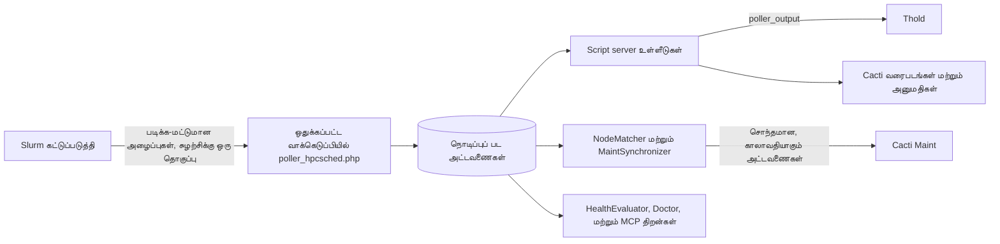

<!-- Source: README.md; SHA256: 938114d41dbd516f9dfcd94619c4fc73ef56b4da1dd693010588a93cce250534 -->

<!-- translations:start -->
[English](../../../README.md) | [简体中文](../zh-CN/README.md) | [हिन्दी](../hi-IN/README.md) | [Español (España)](../es-ES/README.md) | [Español (Latinoamérica)](../es-419/README.md) | [العربية (السعودية)](../ar-SA/README.md) | [Afrikaans](../af-ZA/README.md) | [አማርኛ](../am-ET/README.md) | [العربية (مصر)](../ar-EG/README.md) | [العربية (المغرب)](../ar-MA/README.md) | [বাংলা](../bn-BD/README.md) | [Bosanski](../bs-BA/README.md) | [Deutsch](../de-DE/README.md) | [فارسی](../fa-IR/README.md) | [Filipino](../fil-PH/README.md) | [Français](../fr-FR/README.md) | [Français (Maroc)](../fr-MA/README.md) | [Français (Sénégal)](../fr-SN/README.md) | [Hausa](../ha-NG/README.md) | [עברית](../he-IL/README.md) | [Hrvatski](../hr-HR/README.md) | [Bahasa Indonesia](../id-ID/README.md) | [Igbo](../ig-NG/README.md) | [Italiano](../it-IT/README.md) | [日本語](../ja-JP/README.md) | [한국어](../ko-KR/README.md) | [Malagasy](../mg-MG/README.md) | [मराठी](../mr-IN/README.md) | [Bahasa Melayu](../ms-MY/README.md) | [Nederlands](../nl-NL/README.md) | [Polski](../pl-PL/README.md) | [Português (Brasil)](../pt-BR/README.md) | [Русский](../ru-RU/README.md) | [Kinyarwanda](../rw-RW/README.md) | [Soomaali](../so-SO/README.md) | [Српски](../sr-RS/README.md) | [Svenska](../sv-SE/README.md) | [Kiswahili](../sw-KE/README.md) | [தமிழ்](README.md) | [తెలుగు](../te-IN/README.md) | [ไทย](../th-TH/README.md) | [Türkçe](../tr-TR/README.md) | [Українська](../uk-UA/README.md) | [اردو](../ur-PK/README.md) | [Tiếng Việt](../vi-VN/README.md) | [isiXhosa](../xh-ZA/README.md) | [Yorùbá](../yo-NG/README.md) | [繁體中文](../zh-TW/README.md) | [isiZulu](../zu-ZA/README.md)
<!-- translations:end -->

# plugin_hpcsched

Cacti ஏற்கனவே கண்காணிக்கும் சாதனங்களுக்கு அருகில் ஒரு HPC தொகுப்புத் திட்டமிடுதலின் (batch scheduler) நிலையை வரைபடமாகக் காட்டும் Cacti 1.2 செருகுநிரல் (`hpcsched`, பதிப்பு `0.1.0-dev`): வரிசை ஆழம், நிலுவையில் உள்ள பணிகள் மற்றும் இயங்கும் பணிகள், பணிகள் ஏன் நிலுவையில் உள்ளன என்பதற்கான காரணங்கள், கணு நிலைகள், பிரிவு பயன்பாடு (partition utilization), மற்றும் கணக்கு அளவிலான நியாயப் பகிர்வு (fair-share) பயன்பாடு. Slurm செயல்படுத்தப்பட்ட பின்புலமாகும். இதிலிருந்து உருவாகும் தரவு மூலங்களின் அடிப்படையில் Thold எச்சரிக்கைகளை வழங்குகிறது, மேலும் விருப்பத்தேர்வு Maint ஒத்திசைப்பி (synchronizer) வெளியேற்றப்பட்ட (drained), செயலிழந்த (down), மற்றும் பராமரிப்புக்காக முன்பதிவு செய்யப்பட்ட Slurm கணக்கீட்டுக் கணுக்களிலிருந்து Cacti Maint சாளரங்களை இயக்குகிறது.

> **நிலை: உருவாக்கத்தில் உள்ளது, இன்னும் வெளியீடு இல்லை.** இந்தக் கிளை செருகுநிரல் அடித்தளம், கிளஸ்டர் மற்றும் பிரிவு வரைபடங்கள், நிலுவைக் காரணக் குடும்பங்கள், Slurm கணக்கீட்டுக் கணு-Cacti சாதனப் பொருத்தம், விருப்பத்தேர்வு Cacti Maint சாளர ஒத்திசைவு, கணக்கு அளவிலான நியாயப் பகிர்வு சுருக்கங்கள், தொலைநிலைத் தரவு சேகரிப்பி இயக்கம் மற்றும் நகலெடுத்தல், Configuration-as-Code (CasC) மற்றும் செயல்பாட்டு CLI, மற்றும் Cacti சூழலியல் கொக்கிகள் (CasC, Doctor, மற்றும் MCP / Abilities API v2) ஆகியவற்றைச் செயல்படுத்துகிறது. சோதனைத் தொகுப்பு செயற்கையான Slurm கட்டளைகள் மற்றும் `slurmrestd` பதில்களை உள்ளடக்கியது, மேலும் CI கொள்கலன்களில் உள்ள ஆறு-கணு Slurm கிளஸ்டரையும் சோதிக்கிறது. படிப்பான் இன்னும் ஒரு உற்பத்தி கிளஸ்டரில் இயக்கப்படவில்லை, மேலும் முழுமையான Thold மறுஇயக்கச் சோதனை இன்னும் CI-இல் இல்லை.

இது ஒரு சுயாதீனமான திட்டமாகும்; இது Cacti திட்டத்துடன் தொடர்புடையதல்ல.

## செயல்படுத்தப்பட்டவை

- **வாழ்க்கைச் சுழற்சி மற்றும் திட்டம் (v3)**: நிறுவல், மாற்றமில்லாத மேம்படுத்தல் (idempotent upgrade), நிறுவல் நீக்கம் (இயல்புநிலையாகச் செருகுநிரல் அட்டவணைகளைத் தக்கவைத்தல்), மற்றும் நுழைவுப் புள்ளிகளை PHP 8.0-இல் பாகுபடுத்தக்கூடியதாக வைத்திருக்கும் அதே வேளையில் PHP 8.2 குறைந்தபட்சத் தேவை. திட்டம் v3 ஆனது cluster, run, section, job-count, node-count, node, partition, reservation, மற்றும் share அட்டவணைகளுடன் `plugin_hpcsched_node_map` மற்றும் `plugin_hpcsched_maint_link` ஆகியவற்றைச் சேர்க்கிறது.
- **முதன்மை மற்றும் தொலைநிலை வாக்கெடுப்பிகளில் படிக்க-மட்டுமான Slurm சேகரிப்பு**: `poller_bottom` ஒவ்வொரு வாக்கெடுப்பியிலும் (`poller_id`) அதற்கு ஒதுக்கப்பட்ட இயக்கப்பட்ட கிளஸ்டர்களுக்காகப் பின்னணியில் `poller_hpcsched.php --cluster=N`-ஐத் தொடங்குகிறது. ஒவ்வொரு இயக்கமும் கிளையண்ட் கட்டளைகள் (`squeue`, `scontrol`, `--json` உடன் `sshare`) அல்லது HTTPS வழியாக `slurmrestd` (நல எச்சரிக்கையுடன் loopback HTTP அனுமதிக்கப்படுகிறது) மூலம் ஒரு கிளஸ்டருக்கு ஒரு தற்காலிக சேமிப்பு நொடிப்புப் படத்தைச் (snapshot) சேகரிக்கிறது. `INFO` ஆனது `remote_collect:1, remote_poller:1` என அறிவிக்கிறது, மேலும் `replicate_out` ஆனது இரகசியமற்ற `plugin_hpcsched_cluster` வரையறைகளைத் தொலைநிலை சேகரிப்பிகளுக்கு (`poller_id >= 2`) நகலெடுக்கிறது; டோக்கன் கோப்பு உள்ளடக்கங்கள் ஒருபோதும் படிக்கப்படுவதோ நகலெடுக்கப்படுவதோ இல்லை.
- **Cacti வார்ப்புருக்கள் மற்றும் கிளஸ்டர் வரைபடங்கள்**: சாதன, தரவு, மற்றும் வரைபட வார்ப்புருக்களையும் (`templates/hpcsched-templates.xml`) பிரிவு script-server தரவு வினவலையும் (`scripts/ss_hpcsched_cluster.php`, `scripts/ss_hpcsched_partitions.php`) வழங்குகிறது. நிர்வாகியின் உறுதிப்படுத்தலின் பேரில், ஒவ்வொரு கிளஸ்டருக்கும் நிலை வாரியான பணிகள், காரணக் குடும்ப வாரியான நிலுவைப் பணிகள், நிலை வாரியான கணுக்கள், CPU-கள், பயன்பாடு (கிளஸ்டர் மற்றும் ஒவ்வொரு பிரிவுக்கும்), மற்றும் நொடிப்புப் படத்தின் வயது ஆகியவற்றின் வரைபடங்களுடன் ஒரு Cacti சாதனத்தை உருவாக்குகிறது அல்லது இணைக்கிறது.
- **Slurm கணு-சாதனப் பொருத்தம் மற்றும் Cacti Maint ஒத்திசைவு**: நான்கு அடுக்கு நேரியல் நேரப் பொருத்தி (`NodeMatcher`) Slurm கணக்கீட்டுக் கணுக்களைத் தற்போதுள்ள Cacti `host` பதிவுகளுடன் (துல்லியமான ஹோஸ்ட்பெயர், துல்லியமான முகவரி, துல்லியமான விளக்கம்/மாற்றுப்பெயர், அல்லது IP அல்லாத பெயர்களுக்கான முதல் DNS லேபிள்) பொருத்துகிறது மற்றும் யூகிப்பதற்குப் பதிலாகப் பல-பொருத்தங்கள் அல்லது நகல் சாதன உரிமைகோரல்களை `ambiguous` எனக் குறிக்கிறது. `HostList::expand()` Slurm முன்பதிவு ஹோஸ்ட் பட்டியல்களை (10,000 கணுக்கள் வரை) விரிவுபடுத்துகிறது. `MaintSynchronizer` நிர்வாகி உருவாக்கிய Maint அட்டவணைகளை மாற்றாமல், `DRAIN`, `DRAINING`, `DOWN`, அல்லது செயலில் உள்ள `MAINT`/`MAINTENANCE` முன்பதிவுகளில் உள்ள பொருத்தப்பட்ட கணுக்களுக்காக `plugin_hpcsched_maint_link`-இல் கண்காணிக்கப்படும் செருகுநிரலுக்குச் சொந்தமான ஒருமுறை Cacti Maint அட்டவணைகளை உருவாக்குகிறது, புதுப்பிக்கிறது மற்றும் நீக்குகிறது.
- **கணக்கு அளவிலான நியாயப் பகிர்வு சுருக்கங்கள்**: `collect_shares` இயக்கப்பட்டிருக்கும்போது, Slurm கணக்குத் தொடர்பு வரிசைகளை `plugin_hpcsched_share`-இல் சேகரிக்கிறது ([ADR 0010](../../decisions/0010-bound-series-cardinality.md) படி பயனர் வரிசைகளைத் தவிர்க்கிறது). `ShareSummary` மற்றும் `ShareRepository` கணக்கு/பிரிவு எண்ணிக்கைகள், மூல மற்றும் பயனுள்ள பயன்பாட்டு மொத்தங்கள், குறைந்தபட்ச/அதிகபட்ச/சராசரி நியாயப் பகிர்வு காரணிகள், மற்றும் முதன்மைக் கணக்குகளைக் கணக்கிடுகின்றன; கணக்கு எண்ணிக்கைகள் `hpcsched-get-queue-summary`-இல் வெளிப்படுத்தப்படுகின்றன.
- **CasC மற்றும் செயல்பாட்டு CLI (`cli/hpcsched.php`)**: YAML/XML கட்டமைப்பு ஏற்றுமதி, சரிபார்ப்பு, உலர்-இயக்க (dry-run) வேறுபாடு திட்டமிடல், உறுதிப்படுத்தல்-கட்டுப்படுத்தப்பட்ட பயன்பாடு, கட்டமைக்கப்பட்ட நல வெளியீடு, மற்றும் விருப்பத்தேர்வு Maint ஒத்திசைவு (`sync-maint --dry-run` / `--apply`).
- **சூழலியல் கொக்கிகள் (`setup.php`)**: `casc_register_providers`, `doctor_register_checks`, மற்றும் `abilities_register`.

## அணுகல் பாத்திரங்கள்

| பாத்திரப் பகுதி | அணுகல் |
| --- | --- |
| HPC Scheduler View | படிக்க-மட்டுமான கிளஸ்டர் மேலோட்டம் மற்றும் நிலுவைக் காரணங்கள் (`hpcsched.php`). |
| HPC Scheduler Operator | View அணுகலுடன் செயல்பாடுகள் பக்கம் (`hpcsched_operator.php`) மற்றும் தனிப்பட்ட முன்னுரிமை ஒப்புதல்கள். |
| HPC Scheduler Admin | Operator அணுகலுடன் கிளஸ்டர் நிர்வாகம் (`hpcsched_clusters.php`) மற்றும் நலப் பக்கம் (`hpcsched_health.php`). |

மேம்படுத்தல் கோப்புகளை நகலெடுத்த பிறகு, புதிய பாத்திரப் பகுதிகளையும் கொக்கிகளையும் பதிவு செய்ய நிர்வாகியாக Plugins பக்கத்தைத் திறக்கவும். **Configuration > Users** அல்லது பயனர் குழுக்களின் கீழ் Operator பாத்திரப் பகுதியைத் தெளிவாக ஒதுக்கவும். மேம்படுத்தல்கள் தற்போதுள்ள View மற்றும் Admin பாத்திரப் பகுதி அடையாள எண்களையும் அனுமதிகளையும் தக்கவைத்துக்கொள்கின்றன. ஒவ்வொரு கோரிக்கையிலும் Admin அணுகல் Operator அணுகலையும், Operator அணுகல் View அணுகலையும் மரபுரிமையாகப் பெறுகிறது; இது பயனர்கள் அல்லது குழுக்களுக்குச் சேமிக்கப்பட்ட அனுமதிகளைச் சேர்க்காது. செருகுநிரல் அமைப்புகளுக்கு Cacti-இன் Settings அனுமதியுடன் கூடுதலாக HPC Scheduler Admin அணுகலும் தேவைப்படுகிறது.

ஒவ்வொரு பயனருக்கும் கிடைக்கும் வரிசைகளையும் செயல்களையும் Cacti சாதன அனுமதிகள் கட்டுப்படுத்துகின்றன. Cacti சாதனத்துடன் இணைக்கப்பட்ட கிளஸ்டர் அந்தச் சாதனத்தை Cacti அனுமதிக்கும் பயனர்களுக்கு மட்டுமே காட்டப்படும், ஏற்றுமதி செய்யப்படும் மற்றும் மாற்றப்படும்; சாதனத்தை இணைப்பதற்கும் இலக்கு சாதனத்திற்கான அனுமதி தேவை. சாதனம் இல்லாத கிளஸ்டர் செருகுநிரல் பாத்திரப் பகுதியைக் கொண்ட பயனர்களுக்கு நிர்வாகப் பக்கங்களில் பட்டியலிடப்படும், ஆனால் சாதனத்துடன் இணைக்கப்பட்ட கிளஸ்டர்களை மட்டுமே பட்டியலிடும் இயக்கி காட்சிகளில் காட்டப்படாது. செருகுநிரல் முடக்கப்பட்டிருந்தபோது இணைக்கப்பட்ட சாதனம் நீக்கப்பட்ட கிளஸ்டர் HPC Scheduler Admin அணுகல் உள்ள பயனர்களுக்கு மட்டுமே காட்டப்படும். ஒப்புதல்கள் தற்போதைய பயனரின் அமர்வில் மட்டுமே, அதிகபட்சமாக ஒரு மணி நேரத்திற்கும், அதே அவதானிப்பு புதுமையாக இருக்கும் வரை மட்டுமே நீடிக்கும். புதிய அல்லது மாறிய அவதானிப்புகள் அவற்றைச் செல்லாததாக்கும். அவை ஒருபோதும் தோல்வியடைந்த அளவீட்டை நலமானதாகக் குறிக்காது அல்லது எச்சரிக்கைகளைத் தடுக்காது.

## இயக்கி குறிப்புகள்

### பாதுகாப்பு, குறைந்தபட்ச சலுகை, மற்றும் டோக்கன் கோப்புகள்

இந்தச் செருகுநிரல் படிக்க மட்டுமே செய்கிறது. நிர்வாகி அல்லது இயக்கிப் பாத்திரம் இல்லாத (`sacctmgr`-இல் `AdminLevel=None`) பிரத்யேக Slurm பயனரை இதற்கு வழங்கவும். `slurm.conf`-இல் `PrivateData=jobs` (அல்லது `nodes`, `reservations`, `usage`) இருந்தால், அந்தப் பயனர் தனது சொந்தப் பதிவுகளை மட்டுமே பார்ப்பார், எனவே எண்ணிக்கைகள் முழுமையற்றதாக இருக்கும், மேலும் செருகுநிரலால் அதைக் கண்டறிய முடியாது. அந்தக் கணக்கிற்கு அதை நீக்க இயக்கி அல்லது நிர்வாகி நிலை தேவைப்படுகிறது, அது மாற்றங்களையும் அனுமதிக்கிறது; அந்தச் சமரசம் தளத்தின் முடிவாகும்.

கிளையண்ட் கட்டளைகளுக்கு, Cacti வாக்கெடுப்பி பயனருக்கு Slurm கிளையண்ட் பைனரிகள் (`squeue`, `scontrol`, மற்றும் விருப்பமாக `sshare`) மற்றும் கட்டுப்படுத்தியை அடையும் `slurm.conf` தேவை; பைனரி பாதைகள் **Configuration > Settings > HPC Scheduler** கீழ் முழுமையான அமைப்புகளாக உள்ளன.

`slurmrestd`-க்கு, URL ஆனது `https://` ஆகவோ அல்லது loopback முகவரியில் மட்டும் `http://` ஆகவோ இருக்க வேண்டும். TLS சான்றிதழ்கள் சரிபார்க்கப்படுகின்றன மற்றும் திசைதிருப்பல்கள் பின்பற்றப்படுவதில்லை. **Configuration > Settings > HPC Scheduler** கீழ் உள்ள விருப்பத்தேர்வு `slurmrestd` ஹோஸ்ட் பட்டியல் ஒரு கிளஸ்டர் எந்த ஹோஸ்ட்களையும் போர்ட்களையும் குறிப்பிடலாம் என்பதைக் கட்டுப்படுத்துகிறது.

ஒரு `slurmrestd` கிளஸ்டர் ஒரு டோக்கன் கோப்பைக் குறிப்பிடுகிறது; டோக்கன் ஒருபோதும் தரவுத்தளத்தில் சேமிக்கப்படாது, பக்கத்தில் காட்டப்படாது, CasC ஆல் ஏற்றுமதி செய்யப்படாது, அல்லது பதிவில் எழுதப்படாது. கோப்பு **Configuration > Settings > HPC Scheduler** கீழ் கட்டமைக்கப்பட்ட Token File Directories ஒன்றில் இருக்க வேண்டும், குறியீட்டு இணைப்பு (symbolic link) இல்லாமல் அணுகப்பட வேண்டும், மேலும் வாக்கெடுப்பி பயனருக்குச் சொந்தமான மற்றும் அந்தப் பயனர் மட்டுமே எழுதக்கூடிய வழக்கமான கோப்பாக இருக்க வேண்டும்; அதில் `scontrol token` அச்சிடுவது போல் டோக்கன் அல்லது `SLURM_JWT=<token>` என்ற ஒரு வரி இருக்க வேண்டும். டோக்கன் கோப்பகங்கள் எதுவும் அமைக்கப்படாவிட்டால், எந்த கிளஸ்டரும் `slurmrestd`-ஐப் பயன்படுத்த முடியாது. ஒவ்வொரு டோக்கன் கோப்பகத்தையும் root மற்றும் வாக்கெடுப்பி பயனர் மட்டுமே எழுதக்கூடியதாக வைத்திருக்கவும். குழு அல்லது பிற பயனர்களால் படிக்கக்கூடிய கோப்பு இன்னும் பயன்படுத்தப்படும், மேலும் நலப் பக்கம் எச்சரிக்கும்; கட்டமைக்கப்பட்ட எச்சரிக்கை சாளரத்திற்குள் டோக்கன் காலாவதியாகும்போதும் அது எச்சரிக்கும்.

டோக்கனை அணுரீதியாக (atomically) சுழற்ற:

```sh
dir=/etc/cacti/hpcsched
tmp=$(mktemp "$dir/.token.XXXXXX")
scontrol token username=cactiread lifespan=2592000 > "$tmp"
chown cacti:cacti "$tmp"
chmod 0600 "$tmp"
mv -f "$tmp" "$dir/cluster1.token"
```

அடுத்த சேகரிப்பு புதிய கோப்பைப் படிக்கும். `scontrol token` உடன் டோக்கன்களை உருவாக்க Slurm நிர்வாகி தேவை; அனுமதிக்கப்பட்ட இடத்தில் அதை இயக்கி கோப்பை வாக்கெடுப்பிக்கு நகலெடுக்கவும்.

### தொலைநிலைத் தரவு சேகரிப்பிகள்

`INFO` ஆனது `remote_collect:1, remote_poller:1` என அறிவிக்கிறது. `hpcsched_poller_bottom()` அந்த `poller_id`-க்கு ஒதுக்கப்பட்ட இயக்கப்பட்ட கிளஸ்டர்களுக்காக ஒவ்வொரு வாக்கெடுப்பியிலும் `poller_hpcsched.php`-ஐத் தொடங்குகிறது, மேலும் `hpcsched_replicate_out()` இரகசியமற்ற `plugin_hpcsched_cluster` வரிசைகளைத் தொலைநிலை வாக்கெடுப்பிகளுக்கு (`poller_id >= 2`) நகலெடுக்கிறது. ஒதுக்கப்பட்ட தொலைநிலை வாக்கெடுப்பியில் டோக்கன் கோப்புகளும் Slurm கிளையண்ட் பைனரிகளும் உள்ளூரில் இருக்க வேண்டும்; டோக்கன் உள்ளடக்கங்கள் ஒருபோதும் நகலெடுக்கப்படுவதில்லை.

### நினைவக வரம்புகள்

ஒவ்வொரு சேகரிப்பு இயக்கமும் ஒரு நேரத்தில் ஒரு திட்டமிடுதல் பதிலை டிகோட் செய்கிறது, இதற்கு PHP நினைவகத்தில் பதிலின் அளவைப் போல் சுமார் 12 மடங்கு தேவைப்படுகிறது (Slurm போன்ற வடிவத்தில் உள்ள பணிப் பதிவுகளுக்கு உரையுடன் சேர்த்து சுமார் 10 மடங்காக அளவிடப்பட்டது). படிப்பான் தனது PHP நினைவக வரம்பை Collection Memory அமைப்பிற்கு (இயல்புநிலையாக 1024 MiB) உயர்த்துகிறது மற்றும் Maximum Answer Size அதிகமாக அமைக்கப்பட்டிருந்தாலும் `(Collection Memory - 64) / 12` MiB (இயல்புநிலையாக 80 MiB) வரையிலான பதில்களை அனுமதிக்கிறது; Maximum Answer Size அந்தப் பொருத்தப்பட்ட வரம்பை மீறும்போது நலப் பக்கம் எச்சரிக்கிறது. பெரிய பதில் அதன் பிரிவை மிகப் பெரியது எனத் தோல்வியடையச் செய்கிறது, மேலும் நினைவகம் தீர்ந்துவிடும் இயக்கம் நினைவகத் தோல்வியைப் பதிவுசெய்து பணிநிறுத்தக் கையாளுநர் வழியாக அதன் குத்தகை மற்றும் செயல்முறை இடத்தை விடுவிக்கிறது. பெரிய கிளஸ்டர்களுக்கு இரண்டு அமைப்புகளையும் உயர்த்த வேண்டியிருக்கலாம்; 100,000 உண்மையான பணிப் பதிவுகள் அளவிடப்படவில்லை.

### வார்ப்புருக்கள், கிளஸ்டர் சாதனங்கள், மற்றும் வரைபட எண்ணிக்கை

நிறுவல் மற்றும் மேம்படுத்தல் HPC Scheduler சாதன, தரவு, மற்றும் வரைபட வார்ப்புருக்களை இறக்குமதி செய்கின்றன மற்றும் பிரிவு தரவு வினவலை Cacti-இன் `resource/script_server/` கோப்பகத்திற்கு நகலெடுக்கின்றன. அந்தக் கோப்பகம் எழுத முடியாததாக இருந்தாலோ, அதே பெயரில் வேறு கோப்பு அங்கு இருந்தாலோ, அல்லது இலக்கு குறியீட்டு இணைப்பாக இருந்தாலோ, இறக்குமதி நின்றுவிடும், கோப்பைத் தொடாமல் விட்டுவிடும், மேலும் **Install Templates** மீண்டும் முயற்சிக்கும் நலப் பக்கத்தில் நிலையைப் புகாரளிக்கும். நிறுவல் நீக்கம் செருகுநிரல் எழுதிய கோப்பு மாற்றப்படாமல் இருந்தால் மட்டுமே வினவல் கோப்பை நீக்குகிறது, மேலும் வார்ப்புருக்கள், சாதனங்கள் மற்றும் வரைபடங்களைத் தக்கவைக்கிறது.

**HPC Clusters > Device** எதையும் உருவாக்கும் முன் ஒரு வாக்கெடுப்பிற்கான வரைபடங்கள், தரவு மூலங்கள், RRD கோப்புகள் மற்றும் script server அழைப்புகளை முன்னோட்டமிடுகிறது. **Create Device** ஒதுக்கப்பட்ட `.invalid` டொமைனில் ஹோஸ்ட்பெயருடன் மற்றும் கிடைக்கும் தன்மைச் சரிபார்ப்பு இல்லாமல் ஒரு சாதனத்தை உருவாக்குகிறது; **Map Device** அதன் அமைப்புகளை மாற்றாமல் ஏற்கனவே உள்ள சாதனத்தில் வரைபடங்களை இணைக்கிறது. ஒவ்வொரு கிளஸ்டர் வரைபடத்திற்கும் பிரிவு வரைபடத்திற்கும் அதன் சொந்தத் தரவு மூலம் உள்ளது: கிளஸ்டருக்கு ஆறு மற்றும் ஒரு பிரிவுக்கு ஐந்து. பின்னர் சேர்க்கப்படும் பிரிவுகள் படிப்பான் மாற்றத்தைக் கண்டறியும்போது தானாகவே மறுஅட்டவணைப்படுத்தப்படும்; நீக்கப்பட்ட பிரிவுகள் வாக்கெடுப்பப்படுவதை நிறுத்தி தங்கள் வரைபடங்களைத் தக்கவைக்கும். சாதனத்தை நீக்குவது கிளஸ்டர் பதிவைத் தக்கவைத்துக்கொண்டு கிளஸ்டர் இணைப்பை நீக்குகிறது (மற்றும் பொருந்தும் `plugin_hpcsched_node_map` வரிசைகளை அழிக்கிறது).

நிலுவையில் உள்ளவை நிறுத்தி வைக்கப்பட்ட (held) பணிகளைத் தவிர்க்கின்றன, அவற்றுக்குத் தனித் தொடர் உள்ளது. நிலுவையில் உள்ள பணி வரிசை அதன் மீதமுள்ள பணிகளை எண்ணுகிறது. பல பிரிவுகளில் உள்ள ஒரு பணி அல்லது கணு கிளஸ்டர் வரைபடங்களில் ஒரு முறையும் ஒவ்வொரு பிரிவிலும் ஒரு முறையும் எண்ணப்படுகிறது, எனவே பிரிவு மொத்தங்கள் கிளஸ்டர் மொத்தத்துடன் சமமாக இருக்க வேண்டியதில்லை. நிலுவைக் காரணங்கள் பதினொரு குடும்பங்களாகக் குழுவாக்கப்பட்டுள்ளன ([ADR 0011](../../decisions/0011-pending-reason-families-and-counting.md)); நிலுவைக் காரணங்கள் காட்சி `Other`-இல் உள்ளவை உட்பட மூலக் காரணங்களைப் பட்டியலிடுகிறது. பயன்பாட்டுப் பகுதி எண் (denominator) வெளியேற்றப்பட்ட, செயலிழந்த மற்றும் பிற கிடைக்காத கணுக்களை உள்ளடக்கியது. பழமையான அல்லது தோல்வியடைந்த தரவு பூஜ்ஜியமாக அல்லாமல் `U` எனப் புகாரளிக்கப்படுகிறது; `age` எண்ணாகவே இருக்கும்.

எச்சரிக்கைக்காக, குறைந்தபட்சம் ஒரு சேகரிப்பு இடைவெளி கால அளவுடன் கிளஸ்டர் அல்லது பிரிவு தரவு மூலங்களில் ஏதேனும் ஒன்றில் Thold-ஐ உள்ளமைக்கவும், மேலும் நின்றுபோன படிப்பானைக் கண்டறிய `age`-இல் எச்சரிக்கை அமைக்கவும்.

## CLI மற்றும் சூழலியல் கொக்கிகள்

### படிப்பான் நுழைவுப் புள்ளி

`hpcsched_poller_bottom()` தானாகவே `poller_hpcsched.php`-ஐத் தொடங்குகிறது; கிளஸ்டருக்கு ஒதுக்கப்பட்ட வாக்கெடுப்பியில் இதை கைமுறையாகவும் இயக்கலாம்:

```sh
php /path/to/cacti/plugins/hpcsched/poller_hpcsched.php --cluster=N [--force] [--debug]
```

கட்டளை வரி கண்டறிதலுக்காக, செருகுநிரல் முடக்கப்பட்டிருக்கும்போதும் `--force` இயங்கும்.

### Configuration-as-Code, நலம், மற்றும் Maint ஒத்திசைவு CLI

```sh
php /path/to/cacti/plugins/hpcsched/cli/hpcsched.php export [--format=yaml|xml] [--file=PATH]
php /path/to/cacti/plugins/hpcsched/cli/hpcsched.php validate --file=PATH [--format=yaml|xml]
php /path/to/cacti/plugins/hpcsched/cli/hpcsched.php plan --file=PATH [--format=yaml|xml]
php /path/to/cacti/plugins/hpcsched/cli/hpcsched.php apply --file=PATH --confirm=PLAN_HASH [--format=yaml|xml]
php /path/to/cacti/plugins/hpcsched/cli/hpcsched.php health [--format=text|json]
php /path/to/cacti/plugins/hpcsched/cli/hpcsched.php sync-maint [--dry-run | --apply] [--cluster=ID] [--format=text|json]
```

- `export` புதிய கோப்புகளை `0600` பயன்முறையில் (அல்லது stdout) எழுதுகிறது மற்றும் கட்டமைக்கப்பட்ட `token_file` பாதைகளை `[REDACTED]` உடன் மாற்றுகிறது. `plan` மற்றும் `apply` ஆகியவை வரிசை `jwt`, `secret`, மற்றும் `password` புலங்களை நிராகரிக்கின்றன, மேலும் `[REDACTED]` வழங்கப்படும்போது தற்போதுள்ள உள்ளூர் `token_file` பாதைகளைத் தக்கவைக்கின்றன. `apply`-க்கு `plan` அச்சிட்ட துல்லியமான `--confirm=PLAN_HASH` தேவை.
- `health` திட்டமிடுதல்களைத் தொடர்பு கொள்ளாமலோ அல்லது டோக்கன் கோப்புகளைப் படிக்காமலோ திட்டப் புதுப்பிப்பு, கிளஸ்டர் புதுமை, இயக்க முடிவுகள், Maint கிடைக்கும் தன்மை மற்றும் எச்சரிக்கைகளை மதிப்பீடு செய்கிறது.
- `sync-maint` இயல்புநிலையாக `--dry-run`-க்கு அமைகிறது மற்றும் `DRAIN`, `DRAINING`, `DOWN`, அல்லது செயலில் உள்ள `MAINT`/`MAINTENANCE` முன்பதிவுகளில் உள்ள பொருத்தப்பட்ட Slurm கணுக்களுக்கான Cacti Maint அட்டவணைகளை முன்னோட்டமிடுகிறது அல்லது பயன்படுத்துகிறது (இயல்புநிலை drain/down எல்லை 3600s, புதுப்பித்தல் வரம்பு 600s). `plugin_maint_schedules` மற்றும் `plugin_maint_hosts` இல்லையெனில் `--apply`-ஐ மறுக்கிறது, மேலும் `plugin_hpcsched_maint_link`-இல் பதிவுசெய்யப்பட்ட அட்டவணைகளை மட்டுமே புதுப்பிக்கிறது அல்லது நீக்குகிறது.

### சூழலியல் கொக்கிகள்

தொடர்புடைய Cacti செருகுநிரல்கள் அல்லது ஹோஸ்ட் ஒருங்கிணைப்புகள் இருக்கும்போது, `setup.php` பதிவு செய்கிறது:

- `casc_register_providers`: இரகசிய மறைப்புடன் `hpcsched` கட்டமைப்பை (`yaml` மற்றும் `xml`, schema v1) ஏற்றுமதி செய்கிறது, சரிபார்க்கிறது, திட்டமிடுகிறது மற்றும் உறுதிப்படுத்தல்-பயன்படுத்துகிறது.
- `doctor_register_checks`: நான்கு படிக்க-மட்டுமான கண்டறியும் சோதனைகளை வழங்குகிறது (`hpcsched.schema`, `hpcsched.cluster_freshness`, `hpcsched.token_health`, `hpcsched.maint_sync`).
- `abilities_register`: HPC Scheduler View பாத்திரப் பகுதியால் (மற்றும் கிளஸ்டர் சுருக்கங்களுக்கான சாதன அனுமதிகளால்) கட்டுப்படுத்தப்பட்ட `hpcsched` வகையின் கீழ் மூன்று படிக்க-மட்டுமான, அழிவில்லாத, மாற்றமில்லாத திறன்களைப் பதிவு செய்கிறது: `hpcsched-list-clusters`, `hpcsched-get-queue-summary`, மற்றும் `hpcsched-get-health`.

## ஏன்

Cacti-ஐ இயக்கும் இயக்கிகள் ஏற்கனவே தங்கள் கணக்கீட்டுக் கணுக்களை வரைபடமாக்குகிறார்கள். அந்த வரைபடங்களில் திட்டமிடுதலின் பார்வை விடுபட்டுள்ளது, இது இரண்டு இடைவெளிகளை விட்டுச்செல்கிறது:

- **"வேலை ஏன் தொடங்கவில்லை" என்பதற்குப் பதில் இல்லை.** நிலுவையில் உள்ள ஒவ்வொரு பணிக்கும் Slurm ஒரு காரணத்தைப் பதிவு செய்கிறது. செயலற்ற கணு வரைபடங்களுக்கு அருகில் உள்ள நிரம்பிய வரிசை, காரணம் முன்னுரிமையா, வள வரம்புகளா, நிறுத்தி வைப்புகளா, சார்புகளா, அல்லது வெளியேற்றப்பட்ட கணுக்களா என்பதைச் சொல்லாது.
- **திட்டமிடுதல் நிலைக்கும் எச்சரிக்கைக்கும் இடையே இணைப்பு இல்லை.** ஒரு நிர்வாகி ஏற்கனவே வெளியேற்றிய சாதனத்தில் Thold எச்சரிக்கிறது, மேலும் நிர்வாகிகள் கைமுறையாக Maint அட்டவணைகளை உருவாக்குகிறார்கள்.

இந்தச் செருகுநிரல் ஒரு கிளஸ்டருக்கு ஒரு தற்காலிக சேமிப்பு நொடிப்புப் படத்தைச் சேகரித்து, அதைச் சாதாரண Cacti தரவு மூலங்கள் மற்றும் வரைபடங்களாக வெளியிடுகிறது, திட்டமிடுதல் கணுக்களைத் தற்போதுள்ள Cacti சாதனங்களில் பொருத்துகிறது, மேலும் வெளியேற்றப்பட்ட, செயலிழந்த, மற்றும் பராமரிப்புக்காக முன்பதிவு செய்யப்பட்ட கணுக்களுக்குச் செருகுநிரலுக்குச் சொந்தமான காலாவதியாகும் Maint சாளரங்களை ஒத்திசைக்கிறது. இது Cacti-இன் அனுமதிகள், தொலைநிலைத் தரவு சேகரிப்பிகள், Thold, மற்றும் Maint ஆகியவற்றை மீண்டும் பயன்படுத்துகிறது, மேலும் திட்டமிடுதலைப் பொறுத்தவரை கண்டிப்பாகப் படிக்க-மட்டுமானதாகவே இருக்கும்.

## நோக்கம் மற்றும் எல்லைகள்

நோக்கத்திற்கு அப்பாற்பட்டவை: எந்தவொரு திட்டமிடுதல் எழுதும் பாதையும் (submit, cancel, hold, drain, resume), செருகுநிரலுக்குச் சொந்தமான எச்சரிக்கை இயந்திரம், அறிக்கை அல்லது கட்டண வசூல் இயந்திரம், மற்றும் பயனர் வாரியான அல்லது பணி வாரியான தொடர்கள். PBS Pro, OpenPBS, மற்றும் LSF பின்புலங்கள் ஆராய்ச்சிக்கு மட்டுமே.

## தேவைகள் மற்றும் இணக்கத்தன்மை

| கூறு | இலக்கு |
|---|---|
| Cacti | 1.2.31 அல்லது அதற்குப் பிந்தையது (`compat = 1.2.31`), மையத் திருத்தங்கள் இல்லை |
| PHP | 8.2 அல்லது அதற்குப் பிந்தையது; நுழைவுப் புள்ளிகள் 8.0-இல் பாகுபடுத்தக்கூடியதாக இருக்கும் மற்றும் 8.1-இல் செயல்படுத்தலை மறுக்கும், இதனால் ஆதரிக்கப்படாத இயக்கநேரம் உடைந்த Cacti UI-க்குப் பதிலாக மறுப்பைப் பெறும் |
| Slurm | 25.05, 25.11, மற்றும் 26.05 ([ADR 0013](../../decisions/0013-three-latest-slurm-releases.md)); 26.05.5 ஒவ்வொரு மாற்றத்திலும் ஆறு-கணு கொள்கலன் கிளஸ்டருக்கு எதிராக CI-இல் சோதிக்கப்படுகிறது, 25.11.8 `main`-இல், வாரந்தோறும், மற்றும் கோரிக்கையின் பேரில், மற்றும் 25.05 சோதனைத் தரவுகளுக்கு எதிராக மட்டுமே. கிளையண்ட் கட்டளைகள் இயல்புநிலையாகத் தரவுப் பாகுபடுத்தி `v0.0.43`-ஐப் பயன்படுத்துகின்றன (`v0.0.44` மற்றும் `v0.0.45` தேர்ந்தெடுக்கக்கூடியவை); `slurmrestd` கிளஸ்டர்கள் டீமான் வழங்கும் புதிய பாகுபடுத்தியைக் கண்டறிகின்றன |
| Thold, Maint | Thold மாற்றங்கள் எதுவும் தேவையில்லை; `sync-maint` செருகுநிரலுக்குச் சொந்தமான இணைப்பு அட்டவணையைப் (`plugin_hpcsched_maint_link`) பயன்படுத்தி Cacti Maint-இன் `plugin_maint_schedules` மற்றும் `plugin_maint_hosts` அட்டவணைகளுடன் ஒருங்கிணைக்கிறது |

## மேம்பாடு மற்றும் சோதனை

CI பணிப்பாய்வு (`.github/workflows/plugin-ci-workflow.yml`) Cacti `release/1.2.31` மற்றும் `1.2.x`-க்கு எதிராக PHP 8.2 முதல் 8.5 வரை, PHP 8.0 நுழைவுப் புள்ளி லின்டிங், PHP 8.1 மறுப்பு, PHPStan, gettext/மொழிபெயர்ப்பு சரிபார்ப்பு, REUSE உரிமம், பணிப்பாய்வு லின்டிங், கிளஸ்டர் சாதன ஓட்டம் மற்றும் வார்ப்புரு ஏற்றுமதி விலகல் சோதனைகள், மற்றும் நேரடி ஆறு-கணு Slurm கிளஸ்டர் (`slurm-live`) ஆகியவற்றைச் சோதிக்கிறது.

Cacti-இன் பூட்டப்பட்ட பகிரப்பட்ட Pest செருகுநிரல் சோதனைக் கருவி (`CACTI_PEST_BIN`) மற்றும் ஒருமுறை பயன்படுத்தும் Cacti தரவுத்தளத்துடன்:

```sh
# Unit tests
"$CACTI_PEST_BIN" --configuration=phpunit.xml

# Lifecycle integration tests (disposable database only)
CACTI_PATH=/path/to/cacti HPCSCHED_TEST_DATABASE=disposable "$CACTI_PEST_BIN" --configuration=phpunit-integration.xml

# Static analysis (against Cacti 1.2.31)
CACTI_PATH=/path/to/cacti phpstan analyse -c phpstan.neon --no-progress

# Translation template, catalogs, and localized README checks
sh locales/build_gettext.sh --check
```

## வடிவமைப்பு

- [docs/PLAN.md](../../PLAN.md) என்பது கட்டமைப்பு மற்றும் வடிவமைப்புத் திட்டம்: ஆதாரங்களுடன் மேல்நிலை உண்மைகள், கணுப் பொருத்தம், நிலை மாதிரி, பாதுகாப்பு எல்லைகள், செயல்திறன் கணக்கீடு, சோதனை, மற்றும் இடர்கள்.
- [docs/decisions/](../../decisions/) கட்டமைப்பு முடிவுப் பதிவுகளைக் கொண்டுள்ளது.
- [docs/REQUIREMENTS.md](../../REQUIREMENTS.md) ஒவ்வொரு தேவை ID-ஐயும் அதன் சிக்கலுடன் பொருத்துகிறது.



## வேலை எவ்வாறு கண்காணிக்கப்படுகிறது

- **மைல்கற்கள்** திட்டத்தின் மைல்கற்களைப் பின்பற்றுகின்றன. ஒவ்வொன்றும் அதன் துணை-சிக்கல்களையும் வெளியேறும் சான்றுகளையும் பட்டியலிடும் ஒரு காவியச் சிக்கலைக் கொண்டுள்ளது.
- **சிக்கல்கள்** லேபிளால் வகைப்படுத்தப்படுகின்றன: `type: requirement`, `type: research`, `type: decision`, `type: epic`. தேவைச் சிக்கல்கள் எண்ணிடப்பட்ட, சோதிக்கக்கூடிய தேவைகளையும் (`REQ-AREA-NNN`) ஏற்பு அளவுகோல்களையும் குறிப்பிடுகின்றன.
- **லேபிள்கள்** `area:`, `phase:`, `priority:`, மற்றும் `status:` ஆகியவற்றையும் கொண்டுள்ளன. [CONTRIBUTING.md](../../../CONTRIBUTING.md#labels)-ஐப் பார்க்கவும்.
- [திட்டப் பலகை](https://github.com/users/somethingwithproof/projects/10) அனைத்து மைல்கற்களிலும் உள்ள அனைத்து சிக்கல்களையும் காட்டுகிறது.

## பங்களித்தல்

[CONTRIBUTING.md](../../../CONTRIBUTING.md)-ஐப் படிக்கவும். மாற்றப் பதிவுகளுக்கு (commits) DCO கையொப்பம் (`git commit -s`) தேவை. வடிவமைப்பு விவாதம் சிக்கல்களில் நடைபெறுகிறது; திறந்த முடிவுகள் `type: decision` லேபிளைக் கொண்டிருக்கும்.

## பாதுகாப்பு

பாதிப்புகளைத் தனிப்பட்ட முறையில் புகாரளிக்கவும்; [SECURITY.md](../../../SECURITY.md)-ஐப் பார்க்கவும்.

## உரிமம்

GNU General Public License v2.0, Cacti மற்றும் அதன் செருகுநிரல்களின் அதே உரிமம். [LICENSE](../../../LICENSE)-ஐப் பார்க்கவும்.
