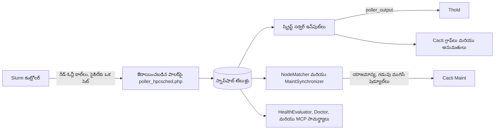

<!-- Source: README.md; SHA256: 938114d41dbd516f9dfcd94619c4fc73ef56b4da1dd693010588a93cce250534 -->

<!-- translations:start -->
[English](../../../README.md) | [简体中文](../zh-CN/README.md) | [हिन्दी](../hi-IN/README.md) | [Español (España)](../es-ES/README.md) | [Español (Latinoamérica)](../es-419/README.md) | [العربية (السعودية)](../ar-SA/README.md) | [Afrikaans](../af-ZA/README.md) | [አማርኛ](../am-ET/README.md) | [العربية (مصر)](../ar-EG/README.md) | [العربية (المغرب)](../ar-MA/README.md) | [Български](../bg-BG/README.md) | [বাংলা](../bn-BD/README.md) | [Bosanski](../bs-BA/README.md) | [Deutsch](../de-DE/README.md) | [Ελληνικά](../el-GR/README.md) | [فارسی](../fa-IR/README.md) | [Filipino](../fil-PH/README.md) | [Français](../fr-FR/README.md) | [Français (Maroc)](../fr-MA/README.md) | [Français (Sénégal)](../fr-SN/README.md) | [Hausa](../ha-NG/README.md) | [עברית](../he-IL/README.md) | [Hrvatski](../hr-HR/README.md) | [Bahasa Indonesia](../id-ID/README.md) | [Igbo](../ig-NG/README.md) | [Italiano](../it-IT/README.md) | [日本語](../ja-JP/README.md) | [ქართული](../ka-GE/README.md) | [한국어](../ko-KR/README.md) | [Latviešu](../lv-LV/README.md) | [Malagasy](../mg-MG/README.md) | [मराठी](../mr-IN/README.md) | [Bahasa Melayu](../ms-MY/README.md) | [Nederlands](../nl-NL/README.md) | [Polski](../pl-PL/README.md) | [Português (Brasil)](../pt-BR/README.md) | [Português (Portugal)](../pt-PT/README.md) | [Русский](../ru-RU/README.md) | [Kinyarwanda](../rw-RW/README.md) | [Soomaali](../so-SO/README.md) | [Српски](../sr-RS/README.md) | [Svenska](../sv-SE/README.md) | [Kiswahili](../sw-KE/README.md) | [தமிழ்](../ta-IN/README.md) | [తెలుగు](README.md) | [ไทย](../th-TH/README.md) | [Türkçe](../tr-TR/README.md) | [Українська](../uk-UA/README.md) | [اردو](../ur-PK/README.md) | [Tiếng Việt](../vi-VN/README.md) | [isiXhosa](../xh-ZA/README.md) | [Yorùbá](../yo-NG/README.md) | [繁體中文](../zh-TW/README.md) | [isiZulu](../zu-ZA/README.md)
<!-- translations:end -->

# plugin_hpcsched

Cacti ఇప్పటికే పర్యవేక్షిస్తున్న పరికరాల పక్కనే HPC బ్యాచ్ షెడ్యూలర్ స్థితిని గ్రాఫ్‌లుగా చూపే Cacti 1.2 ప్లగిన్ (`hpcsched`, వెర్షన్ `0.1.0-dev`): క్యూ లోతు, పెండింగ్ మరియు రన్నింగ్ జాబ్‌లు, జాబ్‌లు ఎందుకు పెండింగ్‌లో ఉన్నాయి, నోడ్ స్థితులు, పార్టిషన్ వినియోగం, మరియు ఖాతా-స్థాయి ఫెయిర్-షేర్ వినియోగం. Slurm అమలు చేయబడిన బ్యాకెండ్. దీని ద్వారా వచ్చే డేటా సోర్స్‌లపై Thold అలర్ట్‌లను ఇస్తుంది, మరియు ఆప్ట్-ఇన్ Maint సింక్రొనైజర్ డ్రెయిన్ చేయబడిన, డౌన్ అయిన, మరియు మెయింటెనెన్స్-రిజర్వ్ చేసిన Slurm కంప్యూట్ నోడ్‌ల నుండి Cacti Maint విండోలను నడుపుతుంది.

> **స్థితి: అభివృద్ధిలో ఉంది, ఇంకా విడుదల కాలేదు.** ఈ బ్రాంచ్ ప్లగిన్ ఫౌండేషన్, క్లస్టర్ మరియు పార్టిషన్ గ్రాఫ్‌లు, పెండింగ్ కారణ కుటుంబాలు, Slurm కంప్యూట్-నోడ్-నుండి-Cacti-పరికరం మ్యాచింగ్, ఆప్ట్-ఇన్ Cacti Maint విండో సింక్రొనైజేషన్, ఖాతా-స్థాయి ఫెయిర్-షేర్ సారాంశాలు, రిమోట్ డేటా కలెక్టర్ అమలు మరియు రెప్లికేషన్, Configuration-as-Code (CasC) మరియు ఆపరేషన్స్ CLI, మరియు Cacti పర్యావరణ వ్యవస్థ హుక్‌లను (CasC, Doctor, మరియు MCP / Abilities API v2) అమలు చేస్తుంది. టెస్ట్ సూట్ సింథటిక్ Slurm కమాండ్‌లు మరియు `slurmrestd` ప్రతిస్పందనలను కవర్ చేస్తుంది, మరియు CI కంటైనర్లలో లైవ్ ఆరు-నోడ్ Slurm క్లస్టర్‌ను పరీక్షిస్తుంది. రీడర్ ప్రొడక్షన్ క్లస్టర్‌పై అమలు చేయబడలేదు, మరియు ఎండ్-టు-ఎండ్ Thold రీప్లే టెస్ట్ ఇంకా CI లో లేదు.

ఇది ఒక స్వతంత్ర ప్రాజెక్ట్ మరియు Cacti ప్రాజెక్ట్‌తో అనుబంధం కలిగి లేదు.

## ఏమి అమలు చేయబడింది

- **జీవితచక్రం మరియు స్కీమా (v3)**: ఇన్‌స్టాల్, ఐడెంపోటెంట్ అప్‌గ్రేడ్, అన్‌ఇన్‌స్టాల్ (డిఫాల్ట్‌గా ప్లగిన్ టేబుళ్లను అలాగే ఉంచుతుంది), మరియు PHP 8.0 లో ఎంట్రీ పాయింట్‌లను పార్స్ చేయగల స్థితిలో ఉంచుతూ PHP 8.2 కనీస అవసరం. స్కీమా v3 cluster, run, section, job-count, node-count, node, partition, reservation, మరియు share టేబుళ్లతో పాటు `plugin_hpcsched_node_map` మరియు `plugin_hpcsched_maint_link` లను జోడిస్తుంది.
- **ప్రధాన మరియు రిమోట్ పాలర్‌లపై రీడ్-ఓన్లీ Slurm సేకరణ**: `poller_bottom` ప్రతి పాలర్ (`poller_id`) పై దానికి కేటాయించబడిన ఎనేబుల్డ్ క్లస్టర్‌ల కోసం బ్యాక్‌గ్రౌండ్‌లో `poller_hpcsched.php --cluster=N` ను ప్రారంభిస్తుంది. ప్రతి రన్ క్లయింట్ కమాండ్‌లు (`squeue`, `scontrol`, `--json` తో `sshare`) లేదా HTTPS ద్వారా `slurmrestd` (ఆరోగ్య హెచ్చరికతో లూప్‌బ్యాక్ HTTP అనుమతించబడుతుంది) ద్వారా ప్రతి క్లస్టర్‌కు ఒక క్యాష్ చేసిన స్నాప్‌షాట్‌ను సేకరిస్తుంది. `INFO` `remote_collect:1, remote_poller:1` ను ప్రకటిస్తుంది, మరియు `replicate_out` రహస్యం కాని `plugin_hpcsched_cluster` నిర్వచనాలను రిమోట్ కలెక్టర్‌లకు (`poller_id >= 2`) రెప్లికేట్ చేస్తుంది; టోకెన్ ఫైల్ కంటెంట్ ఎప్పుడూ చదవబడదు లేదా రెప్లికేట్ చేయబడదు.
- **Cacti టెంప్లేట్‌లు మరియు క్లస్టర్ గ్రాఫ్‌లు**: పరికరం, డేటా, మరియు గ్రాఫ్ టెంప్లేట్‌లను (`templates/hpcsched-templates.xml`) మరియు పార్టిషన్ స్క్రిప్ట్-సర్వర్ డేటా క్వెరీని (`scripts/ss_hpcsched_cluster.php`, `scripts/ss_hpcsched_partitions.php`) అందిస్తుంది. నిర్వాహకుడి నిర్ధారణపై, స్థితి వారీగా జాబ్‌లు, కారణ కుటుంబం వారీగా పెండింగ్ జాబ్‌లు, స్థితి వారీగా నోడ్‌లు, CPU లు, వినియోగం (క్లస్టర్ మరియు ప్రతి పార్టిషన్), మరియు స్నాప్‌షాట్ వయస్సు కోసం గ్రాఫ్‌లతో ప్రతి క్లస్టర్‌కు ఒక Cacti పరికరాన్ని సృష్టిస్తుంది లేదా మ్యాప్ చేస్తుంది.
- **Slurm నోడ్-నుండి-పరికరం మ్యాచింగ్ మరియు Cacti Maint సింక్**: నాలుగు-స్థాయి లీనియర్-టైమ్ మ్యాచర్ (`NodeMatcher`) Slurm కంప్యూట్ నోడ్‌లను ఇప్పటికే ఉన్న Cacti `host` రికార్డ్‌లకు (ఖచ్చితమైన హోస్ట్‌నేమ్, ఖచ్చితమైన చిరునామా, ఖచ్చితమైన వివరణ/మారుపేరు, లేదా IP కాని పేర్ల కోసం మొదటి DNS లేబుల్) మ్యాప్ చేస్తుంది మరియు ఊహించడానికి బదులుగా బహుళ-మ్యాచ్‌లు లేదా నకిలీ పరికర క్లెయిమ్‌లను `ambiguous` గా గుర్తిస్తుంది. `HostList::expand()` Slurm రిజర్వేషన్ హోస్ట్‌లిస్ట్‌లను (10,000 నోడ్‌ల వరకు) విస్తరిస్తుంది. `MaintSynchronizer` నిర్వాహకులు సృష్టించిన Maint షెడ్యూల్‌లను సవరించకుండా `DRAIN`, `DRAINING`, `DOWN`, లేదా యాక్టివ్ `MAINT`/`MAINTENANCE` రిజర్వేషన్‌లలో ఉన్న మ్యాప్ చేసిన నోడ్‌ల కోసం `plugin_hpcsched_maint_link` లో ట్రాక్ చేయబడిన ప్లగిన్ యాజమాన్యంలోని వన్-టైమ్ Cacti Maint షెడ్యూల్‌లను సృష్టిస్తుంది, పునరుద్ధరిస్తుంది మరియు తొలగిస్తుంది.
- **ఖాతా-స్థాయి ఫెయిర్-షేర్ సారాంశాలు**: `collect_shares` ఎనేబుల్ చేయబడినప్పుడు, Slurm ఖాతా అసోసియేషన్ వరుసలను `plugin_hpcsched_share` లోకి సేకరిస్తుంది ([ADR 0010](../../decisions/0010-bound-series-cardinality.md) ప్రకారం యూజర్ వరుసలను వదిలివేస్తుంది). `ShareSummary` మరియు `ShareRepository` ఖాతా/పార్టిషన్ గణనలు, ముడి మరియు ప్రభావవంతమైన వినియోగ మొత్తాలు, కనిష్ట/గరిష్ట/సగటు ఫెయిర్-షేర్ కారకాలు, మరియు అగ్ర ఖాతాలను గణిస్తాయి; ఖాతా గణనలు `hpcsched-get-queue-summary` లో చూపబడతాయి.
- **CasC మరియు ఆపరేషన్స్ CLI (`cli/hpcsched.php`)**: YAML/XML కాన్ఫిగరేషన్ ఎగుమతి, ధ్రువీకరణ, డ్రై-రన్ డిఫ్ ప్లానింగ్, నిర్ధారణ-గేటెడ్ అప్లై, నిర్మాణాత్మక ఆరోగ్య అవుట్‌పుట్, మరియు ఆప్ట్-ఇన్ Maint సింక్ (`sync-maint --dry-run` / `--apply`).
- **పర్యావరణ వ్యవస్థ హుక్‌లు (`setup.php`)**: `casc_register_providers`, `doctor_register_checks`, మరియు `abilities_register`.

## యాక్సెస్ పాత్రలు

| రియల్మ్ | యాక్సెస్ |
| --- | --- |
| HPC Scheduler View | రీడ్-ఓన్లీ క్లస్టర్ ఓవర్‌వ్యూ మరియు పెండింగ్ కారణాలు (`hpcsched.php`). |
| HPC Scheduler Operator | View యాక్సెస్‌తో పాటు ఆపరేషన్స్ పేజీ (`hpcsched_operator.php`) మరియు వ్యక్తిగత ట్రయాజ్ నిర్ధారణలు. |
| HPC Scheduler Admin | Operator యాక్సెస్‌తో పాటు క్లస్టర్ అడ్మినిస్ట్రేషన్ (`hpcsched_clusters.php`) మరియు హెల్త్ పేజీ (`hpcsched_health.php`). |

అప్‌గ్రేడ్ ఫైళ్లను కాపీ చేసిన తర్వాత, కొత్త రియల్మ్‌లు మరియు హుక్‌లను నమోదు చేయడానికి నిర్వాహకుడిగా Plugins పేజీని తెరవండి. **Configuration > Users** లేదా యూజర్ గ్రూప్‌ల క్రింద Operator రియల్మ్‌ను స్పష్టంగా కేటాయించండి. అప్‌గ్రేడ్‌లు ఇప్పటికే ఉన్న View మరియు Admin రియల్మ్ ID లు మరియు మంజూరులను అలాగే ఉంచుతాయి. ప్రతి అభ్యర్థనపై Admin యాక్సెస్ Operator యాక్సెస్‌ను వారసత్వంగా పొందుతుంది, మరియు Operator యాక్సెస్ View యాక్సెస్‌ను వారసత్వంగా పొందుతుంది; ఇది యూజర్‌లకు లేదా గ్రూప్‌లకు నిల్వ చేసిన మంజూరులను జోడించదు. ప్లగిన్ సెట్టింగ్‌లకు Cacti యొక్క Settings అనుమతితో పాటు HPC Scheduler Admin యాక్సెస్ కూడా అవసరం.

Cacti పరికర అనుమతులు ప్రతి వినియోగదారుకు అందుబాటులో ఉన్న వరుసలు మరియు చర్యలను పరిమితం చేస్తాయి. Cacti పరికరానికి మ్యాప్ చేయబడిన క్లస్టర్ Cacti ఆ పరికరాన్ని అనుమతించే వినియోగదారులకు మాత్రమే చూపబడుతుంది, ఎగుమతి చేయబడుతుంది మరియు మార్చబడుతుంది; పరికరాన్ని మ్యాప్ చేయడానికి లక్ష్య పరికరానికి అనుమతి కూడా అవసరం. పరికరం లేని క్లస్టర్ ప్లగిన్ రియల్మ్ ఉన్న వినియోగదారుల కోసం నిర్వాహక పేజీలలో జాబితా చేయబడుతుంది, కానీ పరికరానికి మ్యాప్ చేయబడిన క్లస్టర్‌లను మాత్రమే జాబితా చేసే ఆపరేటర్ వీక్షణలలో కాదు. ప్లగిన్ నిలిపివేయబడినప్పుడు మ్యాప్ చేయబడిన పరికరం తొలగించబడిన క్లస్టర్ HPC Scheduler Admin యాక్సెస్ ఉన్న వినియోగదారులకు మాత్రమే చూపబడుతుంది. నిర్ధారణలు ప్రస్తుత వినియోగదారు సెషన్‌లో మాత్రమే, గరిష్టంగా ఒక గంట పాటు మరియు అదే పరిశీలన తాజాగా ఉన్నంత వరకు మాత్రమే ఉంటాయి. కొత్త లేదా మారిన పరిశీలనలు వాటిని చెల్లుబాటు కాకుండా చేస్తాయి. అవి ఎప్పుడూ విఫలమైన కొలతను ఆరోగ్యకరమైనదిగా గుర్తించవు లేదా అలర్ట్‌లను అణచివేయవు.

## ఆపరేటర్ గమనికలు

### భద్రత, కనిష్ట అధికారాలు, మరియు టోకెన్ ఫైళ్లు

ప్లగిన్ కేవలం చదవడం మాత్రమే చేస్తుంది. నిర్వాహకుడు లేదా ఆపరేటర్ పాత్ర లేని (`sacctmgr` లో `AdminLevel=None`) ప్రత్యేక Slurm యూజర్‌ను దీనికి ఇవ్వండి. `slurm.conf` లో `PrivateData=jobs` (లేదా `nodes`, `reservations`, `usage`) ఉంటే, ఆ యూజర్ తన స్వంత రికార్డ్‌లను మాత్రమే చూస్తాడు, కాబట్టి గణనలు అసంపూర్ణంగా ఉంటాయి మరియు ప్లగిన్ దానిని గుర్తించలేదు. ఖాతా కోసం దానిని ఎత్తివేయడానికి ఆపరేటర్ లేదా నిర్వాహక స్థాయి అవసరం, అది మార్పులను కూడా అనుమతిస్తుంది; ఆ నిర్ణయం సైట్ యొక్క బాధ్యత.

క్లయింట్ కమాండ్‌ల కోసం, Cacti పాలర్ యూజర్‌కు Slurm క్లయింట్ బైనరీలు (`squeue`, `scontrol`, మరియు ఐచ్ఛికంగా `sshare`) మరియు కంట్రోలర్‌కు చేరుకునే `slurm.conf` అవసరం; బైనరీ పాత్‌లు **Configuration > Settings > HPC Scheduler** క్రింద పూర్తి సెట్టింగ్‌లుగా ఉంటాయి.

`slurmrestd` కోసం, URL తప్పనిసరిగా `https://` అయి ఉండాలి, లేదా లూప్‌బ్యాక్ చిరునామాలో మాత్రమే `http://` అయి ఉండాలి. TLS సర్టిఫికెట్‌లు ధృవీకరించబడతాయి మరియు రీడైరెక్ట్‌లు అనుసరించబడవు. **Configuration > Settings > HPC Scheduler** క్రింద ఐచ్ఛిక `slurmrestd` హోస్ట్ జాబితా క్లస్టర్ ఏ హోస్ట్‌లు మరియు పోర్ట్‌లను పేర్కొనవచ్చో పరిమితం చేస్తుంది.

`slurmrestd` క్లస్టర్ ఒక టోకెన్ ఫైల్‌ను పేర్కొంటుంది; టోకెన్ డేటాబేస్‌లో ఎప్పుడూ నిల్వ చేయబడదు, పేజీలో చూపబడదు, CasC ద్వారా ఎగుమతి చేయబడదు లేదా లాగ్‌లో వ్రాయబడదు. ఫైల్ తప్పనిసరిగా **Configuration > Settings > HPC Scheduler** క్రింద కాన్ఫిగర్ చేయబడిన Token File Directories లో ఒకదాని లోపల ఉండాలి, సింబాలిక్ లింక్ లేకుండా చేరుకోవాలి, మరియు పాలర్ యూజర్ యాజమాన్యంలోని సాధారణ ఫైల్ అయి ఉండాలి, దీనిని ఆ యూజర్ మాత్రమే వ్రాయగలడు, ఇందులో `scontrol token` ప్రింట్ చేసినట్లుగా టోకెన్ లేదా `SLURM_JWT=<token>` అనే ఒక వరుస ఉంటుంది. టోకెన్ డైరెక్టరీలు సెట్ చేయకపోతే, ఏ క్లస్టర్ కూడా `slurmrestd` ను ఉపయోగించలేదు. ప్రతి టోకెన్ డైరెక్టరీని root మరియు పాలర్ యూజర్ మాత్రమే వ్రాయగలిగేలా ఉంచండి. గ్రూప్ లేదా ఇతర వినియోగదారులకు చదవగలిగే ఫైల్ ఇప్పటికీ ఉపయోగించబడుతుంది, మరియు హెల్త్ పేజీ హెచ్చరిస్తుంది; కాన్ఫిగర్ చేయబడిన హెచ్చరిక విండోలోపు టోకెన్ గడువు ముగిసినప్పుడు కూడా ఇది హెచ్చరిస్తుంది.

టోకెన్‌ను ఆటోమిక్‌గా రొటేట్ చేయడానికి:

```sh
dir=/etc/cacti/hpcsched
tmp=$(mktemp "$dir/.token.XXXXXX")
scontrol token username=cactiread lifespan=2592000 > "$tmp"
chown cacti:cacti "$tmp"
chmod 0600 "$tmp"
mv -f "$tmp" "$dir/cluster1.token"
```

తదుపరి సేకరణ కొత్త ఫైల్‌ను చదువుతుంది. `scontrol token` తో టోకెన్‌లను రూపొందించడానికి Slurm నిర్వాహకుడు అవసరం; అనుమతించబడిన చోట దానిని అమలు చేసి ఫైల్‌ను పాలర్‌కు కాపీ చేయండి.

### రిమోట్ డేటా కలెక్టర్‌లు

`INFO` `remote_collect:1, remote_poller:1` ను ప్రకటిస్తుంది. `hpcsched_poller_bottom()` ఆ `poller_id` కి కేటాయించబడిన ఎనేబుల్డ్ క్లస్టర్‌ల కోసం ప్రతి పాలర్‌పై `poller_hpcsched.php` ను ప్రారంభిస్తుంది, మరియు `hpcsched_replicate_out()` రహస్యం కాని `plugin_hpcsched_cluster` వరుసలను రిమోట్ పాలర్‌లకు (`poller_id >= 2`) రెప్లికేట్ చేస్తుంది. కేటాయించబడిన రిమోట్ పాలర్‌పై టోకెన్ ఫైళ్లు మరియు Slurm క్లయింట్ బైనరీలు స్థానికంగా ఉండాలి; టోకెన్ కంటెంట్ ఎప్పుడూ రెప్లికేట్ చేయబడదు.

### మెమరీ పరిమితులు

ప్రతి సేకరణ రన్ ఒకేసారి ఒక షెడ్యూలర్ సమాధానాన్ని డీకోడ్ చేస్తుంది, దీనికి PHP మెమరీలో సమాధానం పరిమాణం కంటే సుమారు 12 రెట్లు పడుతుంది (Slurm వంటి ఆకారంలో ఉన్న జాబ్ రికార్డ్‌లకు టెక్స్ట్‌తో పాటు సుమారు 10 రెట్లుగా కొలవబడింది). రీడర్ తన PHP మెమరీ పరిమితిని Collection Memory సెట్టింగ్‌కు (డిఫాల్ట్‌గా 1024 MiB) పెంచుతుంది మరియు Maximum Answer Size ఎక్కువగా సెట్ చేయబడినప్పటికీ `(Collection Memory - 64) / 12` MiB (డిఫాల్ట్‌గా 80 MiB) వరకు సమాధానాలను అనుమతిస్తుంది; Maximum Answer Size ఆ అమర్చిన పరిమితిని మించినప్పుడు హెల్త్ పేజీ హెచ్చరిస్తుంది. పెద్ద సమాధానం తన విభాగాన్ని చాలా పెద్దదిగా విఫలం చేస్తుంది, మరియు ఇంకా మెమరీ అయిపోయిన రన్ మెమరీ వైఫల్యాన్ని నమోదు చేస్తుంది మరియు షట్‌డౌన్ హ్యాండ్లర్ ద్వారా దాని లీజు మరియు ప్రాసెస్ స్లాట్‌ను విడుదల చేస్తుంది. పెద్ద క్లస్టర్‌లకు రెండు సెట్టింగ్‌లను పెంచాల్సి రావచ్చు; 100,000 నిజమైన జాబ్ రికార్డ్‌లు కొలవబడలేదు.

### టెంప్లేట్‌లు, క్లస్టర్ పరికరాలు, మరియు గ్రాఫ్ గణన

ఇన్‌స్టాల్ మరియు అప్‌గ్రేడ్ HPC Scheduler పరికర, డేటా, మరియు గ్రాఫ్ టెంప్లేట్‌లను దిగుమతి చేస్తాయి మరియు పార్టిషన్ డేటా క్వెరీని Cacti యొక్క `resource/script_server/` డైరెక్టరీకి కాపీ చేస్తాయి. ఆ డైరెక్టరీ వ్రాయడానికి వీలులేకపోయినా, అదే పేరుతో వేరే ఫైల్ అక్కడ ఉన్నా, లేదా లక్ష్యం సింబాలిక్ లింక్ అయినా, దిగుమతి ఆగిపోతుంది, ఫైల్‌ను ముట్టుకోకుండా వదిలివేస్తుంది, మరియు **Install Templates** మళ్లీ ప్రయత్నించే హెల్త్ పేజీలో ఆ పరిస్థితిని నివేదిస్తుంది. అన్‌ఇన్‌స్టాల్ ప్లగిన్ వ్రాసిన క్వెరీ ఫైల్ మారకుండా ఉంటేనే దానిని తొలగిస్తుంది, మరియు టెంప్లేట్‌లు, పరికరాలు మరియు గ్రాఫ్‌లను అలాగే ఉంచుతుంది.

**HPC Clusters > Device** ఏదైనా సృష్టించే ముందు ప్రతి పోల్‌కు గ్రాఫ్‌లు, డేటా సోర్స్‌లు, RRD ఫైళ్లు మరియు స్క్రిప్ట్ సర్వర్ కాల్‌లను ప్రివ్యూ చేస్తుంది. **Create Device** రిజర్వ్ చేయబడిన `.invalid` డొమైన్‌లో హోస్ట్‌నేమ్‌తో మరియు లభ్యత తనిఖీ లేకుండా పరికరాన్ని తయారు చేస్తుంది; **Map Device** ఇప్పటికే ఉన్న పరికరం సెట్టింగ్‌లను మార్చకుండానే దానికి గ్రాఫ్‌లను జోడిస్తుంది. ప్రతి క్లస్టర్ గ్రాఫ్ మరియు పార్టిషన్ గ్రాఫ్‌కు దాని స్వంత డేటా సోర్స్ ఉంటుంది: క్లస్టర్‌కు ఆరు మరియు ప్రతి పార్టిషన్‌కు ఐదు. తర్వాత జోడించిన పార్టిషన్‌లు రీడర్ మార్పును గుర్తించినప్పుడు స్వయంచాలకంగా రీఇండెక్స్ చేయబడతాయి; తొలగించబడిన పార్టిషన్‌లు పోల్ చేయబడటం ఆగిపోయి వాటి గ్రాఫ్‌లను అలాగే ఉంచుతాయి. పరికరాన్ని తొలగించడం వలన క్లస్టర్ రికార్డ్‌ను ఉంచుతూనే క్లస్టర్ అన్‌మ్యాప్ అవుతుంది (మరియు సరిపోలే `plugin_hpcsched_node_map` వరుసలను క్లియర్ చేస్తుంది).

పెండింగ్‌లో హోల్డ్ చేయబడిన జాబ్‌లు మినహాయించబడతాయి, వాటికి వాటి స్వంత సిరీస్ ఉంటుంది. పెండింగ్ జాబ్ అరే దాని మిగిలిన టాస్క్‌లను లెక్కిస్తుంది. బహుళ పార్టిషన్‌లలోని జాబ్ లేదా నోడ్ క్లస్టర్ గ్రాఫ్‌లలో ఒకసారి మరియు ప్రతి పార్టిషన్‌లో ఒకసారి లెక్కించబడుతుంది, కాబట్టి పార్టిషన్ మొత్తాలు క్లస్టర్ మొత్తానికి సమానం కానవసరం లేదు. పెండింగ్ కారణాలు పదకొండు కుటుంబాలుగా వర్గీకరించబడ్డాయి ([ADR 0011](../../decisions/0011-pending-reason-families-and-counting.md)); పెండింగ్ కారణాల వీక్షణ `Other` లో ఉన్న వాటితో సహా ముడి కారణాలను జాబితా చేస్తుంది. వినియోగ హారంలో డ్రెయిన్ చేయబడిన, డౌన్ అయిన మరియు ఇతర అందుబాటులో లేని నోడ్‌లు ఉంటాయి. పాత లేదా విఫలమైన డేటా ఎప్పుడూ సున్నాగా కాకుండా `U` గా నివేదించబడుతుంది; `age` సంఖ్యాత్మకంగా ఉంటుంది.

అలర్టింగ్ కోసం, కనీసం ఒక సేకరణ విరామం వ్యవధితో ఏదైనా క్లస్టర్ లేదా పార్టిషన్ డేటా సోర్స్‌లపై Thold ను కాన్ఫిగర్ చేయండి, మరియు ఆగిపోయిన రీడర్‌ను గుర్తించడానికి `age` పై అలర్ట్ చేయండి.

## CLI మరియు పర్యావరణ వ్యవస్థ హుక్‌లు

### రీడర్ ఎంట్రీ పాయింట్

`hpcsched_poller_bottom()` స్వయంచాలకంగా `poller_hpcsched.php` ను ప్రారంభిస్తుంది; క్లస్టర్‌కు కేటాయించబడిన పాలర్‌పై దీనిని మాన్యువల్‌గా కూడా అమలు చేయవచ్చు:

```sh
php /path/to/cacti/plugins/hpcsched/poller_hpcsched.php --cluster=N [--force] [--debug]
```

కమాండ్-లైన్ నిర్ధారణ కోసం, ప్లగిన్ నిలిపివేయబడినప్పుడు కూడా `--force` అమలవుతుంది.

### Configuration-as-Code, ఆరోగ్యం, మరియు Maint సింక్ CLI

```sh
php /path/to/cacti/plugins/hpcsched/cli/hpcsched.php export [--format=yaml|xml] [--file=PATH]
php /path/to/cacti/plugins/hpcsched/cli/hpcsched.php validate --file=PATH [--format=yaml|xml]
php /path/to/cacti/plugins/hpcsched/cli/hpcsched.php plan --file=PATH [--format=yaml|xml]
php /path/to/cacti/plugins/hpcsched/cli/hpcsched.php apply --file=PATH --confirm=PLAN_HASH [--format=yaml|xml]
php /path/to/cacti/plugins/hpcsched/cli/hpcsched.php health [--format=text|json]
php /path/to/cacti/plugins/hpcsched/cli/hpcsched.php sync-maint [--dry-run | --apply] [--cluster=ID] [--format=text|json]
```

- `export` కొత్త ఫైళ్లను `0600` మోడ్‌తో (లేదా stdout) వ్రాస్తుంది మరియు కాన్ఫిగర్ చేసిన `token_file` పాత్‌లను `[REDACTED]` తో భర్తీ చేస్తుంది. `plan` మరియు `apply` ఇన్‌లైన్ `jwt`, `secret`, మరియు `password` ఫీల్డ్‌లను తిరస్కరిస్తాయి, మరియు `[REDACTED]` అందించబడినప్పుడు ఇప్పటికే ఉన్న స్థానిక `token_file` పాత్‌లను భద్రపరుస్తాయి. `apply` కి `plan` ప్రింట్ చేసిన ఖచ్చితమైన `--confirm=PLAN_HASH` అవసరం.
- `health` షెడ్యూలర్‌లను సంప్రదించకుండా లేదా టోకెన్ ఫైళ్లను చదవకుండా స్కీమా నవీకరణ, క్లస్టర్ తాజాదనం, రన్ ఫలితాలు, Maint లభ్యత మరియు హెచ్చరికలను మూల్యాంకనం చేస్తుంది.
- `sync-maint` డిఫాల్ట్‌గా `--dry-run` కు వెళుతుంది మరియు `DRAIN`, `DRAINING`, `DOWN`, లేదా యాక్టివ్ `MAINT`/`MAINTENANCE` రిజర్వేషన్‌లలో ఉన్న మ్యాప్ చేసిన Slurm నోడ్‌ల కోసం Cacti Maint షెడ్యూల్‌లను ప్రివ్యూ చేస్తుంది లేదా వర్తింపజేస్తుంది (డిఫాల్ట్ డ్రెయిన్/డౌన్ పరిధి 3600s, పునరుద్ధరణ మార్జిన్ 600s). `plugin_maint_schedules` మరియు `plugin_maint_hosts` లేకుంటే `--apply` ని తిరస్కరిస్తుంది, మరియు `plugin_hpcsched_maint_link` లో నమోదు చేయబడిన షెడ్యూల్‌లను మాత్రమే నవీకరిస్తుంది లేదా తొలగిస్తుంది.

### పర్యావరణ వ్యవస్థ హుక్‌లు

సంబంధిత Cacti ప్లగిన్‌లు లేదా హోస్ట్ ఇంటిగ్రేషన్‌లు ఉన్నప్పుడు, `setup.php` నమోదు చేస్తుంది:

- `casc_register_providers`: రహస్య తొలగింపుతో `hpcsched` కాన్ఫిగరేషన్‌ను (`yaml` మరియు `xml`, schema v1) ఎగుమతి చేస్తుంది, ధృవీకరిస్తుంది, ప్లాన్ చేస్తుంది మరియు నిర్ధారణతో వర్తింపజేస్తుంది.
- `doctor_register_checks`: నాలుగు రీడ్-ఓన్లీ డయాగ్నస్టిక్ తనిఖీలను అందిస్తుంది (`hpcsched.schema`, `hpcsched.cluster_freshness`, `hpcsched.token_health`, `hpcsched.maint_sync`).
- `abilities_register`: HPC Scheduler View రియల్మ్ ద్వారా (మరియు క్లస్టర్ సారాంశాల కోసం పరికర అనుమతుల ద్వారా) గేట్ చేయబడిన `hpcsched` వర్గం క్రింద మూడు రీడ్-ఓన్లీ, నాన్-డిస్ట్రక్టివ్, ఐడెంపోటెంట్ సామర్థ్యాలను నమోదు చేస్తుంది: `hpcsched-list-clusters`, `hpcsched-get-queue-summary`, మరియు `hpcsched-get-health`.

## ఎందుకు

Cacti ని నడిపే ఆపరేటర్లు ఇప్పటికే తమ కంప్యూట్ నోడ్‌లను గ్రాఫ్ చేస్తారు. ఆ గ్రాఫ్‌లలో షెడ్యూలర్ వీక్షణ లేదు, ఇది రెండు అంతరాలను వదిలివేస్తుంది:

- **"పని ఎందుకు ప్రారంభం కావడం లేదు" అనే సమాధానం లేదు.** Slurm ప్రతి పెండింగ్ జాబ్ కోసం ఒక కారణాన్ని నమోదు చేస్తుంది. ఖాళీగా ఉన్న నోడ్ గ్రాఫ్‌ల పక్కన నిండిన క్యూ కారణం ప్రాధాన్యత, వనరుల పరిమితులు, హోల్డ్‌లు, డిపెండెన్సీలు లేదా డ్రెయిన్ చేయబడిన నోడ్‌లా అనేది చెప్పదు.
- **షెడ్యూలర్ స్థితి మరియు అలర్టింగ్ మధ్య లింక్ లేదు.** నిర్వాహకుడు ఇప్పటికే డ్రెయిన్ చేసిన పరికరంపై Thold అలర్ట్ చేస్తుంది, మరియు నిర్వాహకులు చేతితో Maint షెడ్యూల్‌లను సృష్టిస్తారు.

ప్లగిన్ ప్రతి క్లస్టర్‌కు ఒక క్యాష్ చేసిన స్నాప్‌షాట్‌ను సేకరిస్తుంది, దానిని సాధారణ Cacti డేటా సోర్స్‌లు మరియు గ్రాఫ్‌లుగా ప్రచురిస్తుంది, షెడ్యూలర్ నోడ్‌లను ఇప్పటికే ఉన్న Cacti పరికరాలకు మ్యాప్ చేస్తుంది, మరియు డ్రెయిన్ చేయబడిన, డౌన్ అయిన మరియు మెయింటెనెన్స్-రిజర్వ్ చేసిన నోడ్‌ల కోసం ప్లగిన్ యాజమాన్యంలోని గడువు ముగిసే Maint విండోలను సింక్రొనైజ్ చేస్తుంది. ఇది Cacti అనుమతులు, రిమోట్ డేటా కలెక్టర్‌లు, Thold, మరియు Maint లను తిరిగి ఉపయోగిస్తుంది, మరియు షెడ్యూలర్ పట్ల ఖచ్చితంగా రీడ్-ఓన్లీగా ఉంటుంది.

## పరిధి మరియు హద్దులు

పరిధి వెలుపల ఉన్నవి: ఏదైనా షెడ్యూలర్ రైట్ పాత్ (submit, cancel, hold, drain, resume), ప్లగిన్ యాజమాన్యంలోని అలర్టింగ్ ఇంజిన్, రిపోర్టింగ్ లేదా ఛార్జ్‌బ్యాక్ ఇంజిన్, మరియు యూజర్-వారీగా లేదా జాబ్-వారీగా సిరీస్. PBS Pro, OpenPBS, మరియు LSF బ్యాకెండ్‌లు పరిశోధన కోసం మాత్రమే.

## అవసరాలు మరియు అనుకూలత

| భాగం | లక్ష్యం |
|---|---|
| Cacti | 1.2.31 లేదా ఆపై (`compat = 1.2.31`), కోర్ ప్యాచ్‌లు లేవు |
| PHP | 8.2 లేదా ఆపై; ఎంట్రీ పాయింట్‌లు 8.0 పై పార్స్ చేయదగినవిగా ఉంటాయి మరియు 8.1 పై యాక్టివేషన్‌ను తిరస్కరిస్తాయి, తద్వారా మద్దతు లేని రన్‌టైమ్ విరిగిన Cacti UI కి బదులుగా తిరస్కరణను పొందుతుంది |
| Slurm | 25.05, 25.11, మరియు 26.05 ([ADR 0013](../../decisions/0013-three-latest-slurm-releases.md)); 26.05.5 ప్రతి మార్పుపై ఆరు-నోడ్ కంటైనర్ క్లస్టర్‌కు వ్యతిరేకంగా CI లో పరీక్షించబడుతుంది, 25.11.8 `main` పై, వారానికోసారి మరియు అభ్యర్థనపై, మరియు 25.05 ఫిక్చర్‌లకు వ్యతిరేకంగా మాత్రమే. క్లయింట్ కమాండ్‌లు డిఫాల్ట్‌గా డేటా పార్సర్ `v0.0.43` ను ఉపయోగిస్తాయి (`v0.0.44` మరియు `v0.0.45` ఎంచుకోదగినవి); `slurmrestd` క్లస్టర్‌లు డీమన్ అందించే సరికొత్త పార్సర్‌ను కనుగొంటాయి |
| Thold, Maint | Thold మార్పులు అవసరం లేదు; `sync-maint` ప్లగిన్ యాజమాన్యంలోని లింక్ టేబుల్ (`plugin_hpcsched_maint_link`) ఉపయోగించి Cacti Maint యొక్క `plugin_maint_schedules` మరియు `plugin_maint_hosts` టేబుళ్లతో అనుసంధానించబడుతుంది |

## అభివృద్ధి మరియు పరీక్ష

CI వర్క్‌ఫ్లో (`.github/workflows/plugin-ci-workflow.yml`) Cacti `release/1.2.31` మరియు `1.2.x` లకు వ్యతిరేకంగా PHP 8.2 నుండి 8.5 వరకు, PHP 8.0 ఎంట్రీ-పాయింట్ లింటింగ్, PHP 8.1 తిరస్కరణ, PHPStan, gettext/అనువాద ధ్రువీకరణ, REUSE లైసెన్సింగ్, వర్క్‌ఫ్లో లింటింగ్, క్లస్టర్ పరికర ప్రవాహం మరియు టెంప్లేట్ ఎగుమతి డ్రిఫ్ట్ తనిఖీలు, మరియు లైవ్ ఆరు-నోడ్ Slurm క్లస్టర్ (`slurm-live`) లను పరీక్షిస్తుంది.

Cacti యొక్క లాక్ చేయబడిన షేర్డ్ Pest ప్లగిన్ హార్నెస్ (`CACTI_PEST_BIN`) మరియు డిస్పోజబుల్ Cacti డేటాబేస్‌తో:

```sh
# Unit tests
"$CACTI_PEST_BIN" --configuration=phpunit.xml

# Lifecycle integration tests (disposable database only)
CACTI_PATH=/path/to/cacti HPCSCHED_TEST_DATABASE=disposable "$CACTI_PEST_BIN" --configuration=phpunit-integration.xml

# Static analysis (against Cacti 1.2.31)
CACTI_PATH=/path/to/cacti phpstan analyse -c phpstan.neon --no-progress

# Translation template, catalogs, and localized README checks
sh locales/build_gettext.sh --check
```

## డిజైన్

- [docs/PLAN.md](../../PLAN.md) ఆర్కిటెక్చర్ మరియు డిజైన్ ప్లాన్: సోర్స్‌లతో అప్‌స్ట్రీమ్ వాస్తవాలు, నోడ్ మ్యాపింగ్, స్టేట్ మోడల్, భద్రతా హద్దులు, పనితీరు అంకగణితం, పరీక్ష, మరియు ప్రమాదాలు.
- [docs/decisions/](../../decisions/) ఆర్కిటెక్చర్ నిర్ణయ రికార్డులను కలిగి ఉంటుంది.
- [docs/REQUIREMENTS.md](../../REQUIREMENTS.md) ప్రతి అవసర ID ని దాని ఇష్యూకు మ్యాప్ చేస్తుంది.



## పని ఎలా ట్రాక్ చేయబడుతుంది

- **మైల్‌స్టోన్‌లు** ప్లాన్ మైల్‌స్టోన్‌లను అనుసరిస్తాయి. ప్రతి ఒక్కటి దాని ఉప-ఇష్యూలు మరియు ఎగ్జిట్ సాక్ష్యాలను జాబితా చేసే ఎపిక్ ఇష్యూను కలిగి ఉంటుంది.
- **ఇష్యూలు** లేబుల్ ద్వారా వర్గీకరించబడ్డాయి: `type: requirement`, `type: research`, `type: decision`, `type: epic`. అవసర ఇష్యూలు సంఖ్యలతో కూడిన, పరీక్షించదగిన అవసరాలను (`REQ-AREA-NNN`) మరియు ఆమోద ప్రమాణాలను పేర్కొంటాయి.
- **లేబుళ్లు** `area:`, `phase:`, `priority:`, మరియు `status:` లను కూడా కలిగి ఉంటాయి. [CONTRIBUTING.md](../../../CONTRIBUTING.md#labels) చూడండి.
- [ప్రాజెక్ట్ బోర్డ్](https://github.com/users/somethingwithproof/projects/10) అన్ని మైల్‌స్టోన్‌లలోని అన్ని ఇష్యూలను చూపుతుంది.

## సహకారం

[CONTRIBUTING.md](../../../CONTRIBUTING.md) చదవండి. కమిట్‌లకు DCO సైన్-ఆఫ్ (`git commit -s`) అవసరం. డిజైన్ చర్చ ఇష్యూలపై జరుగుతుంది; ఓపెన్ నిర్ణయాలు `type: decision` లేబుల్‌ను కలిగి ఉంటాయి.

## భద్రత

దుర్బలత్వాలను ప్రైవేట్‌గా నివేదించండి; [SECURITY.md](../../../SECURITY.md) చూడండి.

## లైసెన్స్

GNU General Public License v2.0, Cacti మరియు దాని ప్లగిన్‌ల మాదిరిగానే లైసెన్స్. [LICENSE](../../../LICENSE) చూడండి.
