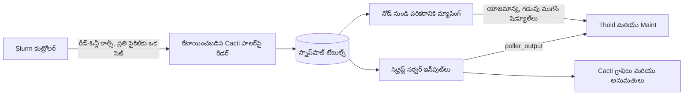

<!-- Source: README.md; SHA256: 16caa3e34c4d150a7fb1018f637e200a7580330f033b485047d8413bce09abba -->

<!-- translations:start -->
[English](../../../README.md) | [简体中文](../zh-CN/README.md) | [हिन्दी](../hi-IN/README.md) | [Español (España)](../es-ES/README.md) | [Español (Latinoamérica)](../es-419/README.md) | [العربية (السعودية)](../ar-SA/README.md) | [Afrikaans](../af-ZA/README.md) | [አማርኛ](../am-ET/README.md) | [العربية (مصر)](../ar-EG/README.md) | [العربية (المغرب)](../ar-MA/README.md) | [বাংলা](../bn-BD/README.md) | [Deutsch](../de-DE/README.md) | [فارسی](../fa-IR/README.md) | [Filipino](../fil-PH/README.md) | [Français](../fr-FR/README.md) | [Français (Maroc)](../fr-MA/README.md) | [Français (Sénégal)](../fr-SN/README.md) | [Hausa](../ha-NG/README.md) | [עברית](../he-IL/README.md) | [Bahasa Indonesia](../id-ID/README.md) | [Igbo](../ig-NG/README.md) | [Italiano](../it-IT/README.md) | [日本語](../ja-JP/README.md) | [한국어](../ko-KR/README.md) | [Malagasy](../mg-MG/README.md) | [मराठी](../mr-IN/README.md) | [Bahasa Melayu](../ms-MY/README.md) | [Nederlands](../nl-NL/README.md) | [Polski](../pl-PL/README.md) | [Português (Brasil)](../pt-BR/README.md) | [Русский](../ru-RU/README.md) | [Kinyarwanda](../rw-RW/README.md) | [Soomaali](../so-SO/README.md) | [Svenska](../sv-SE/README.md) | [Kiswahili](../sw-KE/README.md) | [தமிழ்](../ta-IN/README.md) | [తెలుగు](README.md) | [ไทย](../th-TH/README.md) | [Türkçe](../tr-TR/README.md) | [Українська](../uk-UA/README.md) | [اردو](../ur-PK/README.md) | [Tiếng Việt](../vi-VN/README.md) | [isiXhosa](../xh-ZA/README.md) | [Yorùbá](../yo-NG/README.md) | [繁體中文](../zh-TW/README.md) | [isiZulu](../zu-ZA/README.md)
<!-- translations:end -->

# plugin_hpcsched

Cacti ఇప్పటికే పర్యవేక్షిస్తున్న పరికరాల పక్కనే HPC బ్యాచ్ షెడ్యూలర్ స్థితిని గ్రాఫ్‌లుగా చూపే Cacti 1.2 ప్లగిన్: క్యూ లోతు, పెండింగ్ మరియు రన్నింగ్ జాబ్‌లు, జాబ్‌లు ఎందుకు పెండింగ్‌లో ఉన్నాయి, నోడ్ స్థితులు మరియు పార్టిషన్ వినియోగం. Slurm దీని మొదటి బ్యాకెండ్. దీని ద్వారా వచ్చే డేటా సోర్స్‌లపై Thold అలర్ట్‌లను ఇస్తుంది, అలాగే డ్రెయిన్ చేయబడిన నోడ్‌లు మరియు మెయింటెనెన్స్ రిజర్వేషన్‌ల ఆధారంగా Maint పనిచేయగలదు.

> **స్థితి: అభివృద్ధిలో ఉంది, ఇంకా విడుదల కాలేదు.** మైల్‌స్టోన్ 2 (ఫౌండేషన్) `main` పై విలీనం చేయబడింది, మరియు ఈ బ్రాంచ్ మైల్‌స్టోన్ 3 (క్లస్టర్ గ్రాఫ్‌లు మరియు పెండింగ్ కారణాలు) ను జోడిస్తుంది. ఈ కోడ్ Cacti ప్లగిన్ API ద్వారా ఇన్‌స్టాల్, అప్‌గ్రేడ్ మరియు అన్‌ఇన్‌స్టాల్ అవుతుంది మరియు 8.2 కంటే తక్కువ PHP ని తిరస్కరిస్తుంది. ఇది Slurm క్లస్టర్‌ల రిజిస్ట్రీని నిర్వహిస్తుంది, ప్రతి ఒక్కటి ఒక Cacti పాలర్‌కు కేటాయించబడుతుంది. ప్రధాన పాలర్‌లోని బ్యాక్‌గ్రౌండ్ రీడర్ ప్రతి వ్యవధికి ఒక క్లస్టర్‌కు ఒక స్నాప్‌షాట్‌ను సేకరిస్తుంది; దీనిని `squeue`, `scontrol`, మరియు `sshare` లను `--json` తో అమలు చేయడం ద్వారా లేదా HTTPS ద్వారా `slurmrestd` ని చదవడం ద్వారా చేస్తుంది, మరియు స్థితి మరియు పెండింగ్ కారణాల వారీగా జాబ్ గణనలు, నోడ్ స్థితులు, పార్టిషన్‌లు, రిజర్వేషన్‌లు మరియు ఫెయిర్-షేర్ వినియోగాన్ని వాటి తాజాదనంతో నిల్వ చేస్తుంది. ఈ ప్లగిన్ Cacti టెంప్లేట్‌లను అందిస్తుంది మరియు నిర్వాహకుడి నిర్ధారణపై, క్లస్టర్ కోసం మరియు ప్రతి పార్టిషన్ కోసం స్థితి వారీగా జాబ్‌లు, కారణ కుటుంబం వారీగా పెండింగ్ జాబ్‌లు, స్థితి వారీగా నోడ్‌లు, CPU లు మరియు వినియోగం యొక్క గ్రాఫ్‌లతో పాటు స్నాప్‌షాట్ వయస్సుతో ఒక క్లస్టర్‌కు ఒక Cacti పరికరాన్ని సృష్టిస్తుంది లేదా మ్యాప్ చేస్తుంది. రీడ్-ఓన్లీ ఓవర్‌వ్యూ పేజీ ప్రతి క్లస్టర్‌కు గణనలను వాటి తాజాదనంతో మరియు ప్రతి క్లస్టర్‌కు పెండింగ్ కారణాల వీక్షణను చూపుతుంది, మరియు అడ్మిన్-ఓన్లీ హెల్త్ పేజీ ప్రతి సేకరణ ఏమి తిరిగి ఇచ్చిందో మరియు టెంప్లేట్‌లు ఇన్‌స్టాల్ చేయబడ్డాయో లేదో చూపుతుంది. ప్రతి పేజీ మరియు చర్య Cacti పరికర అనుమతులను అనుసరిస్తుంది. ఈ డేటా సోర్స్‌లపై Thold అలర్ట్ చేయగలదు, కానీ ఇంకా Thold లేదా Maint ఇంటిగ్రేషన్ పరీక్షించబడలేదు; అది మైల్‌స్టోన్ 4 మరియు ఆ తర్వాత ఉంటుంది. టెస్ట్ సూట్ సింథటిక్ Slurm కమాండ్‌లు మరియు `slurmrestd` ప్రతిస్పందనలను కవర్ చేస్తుంది, మరియు CI దిగువ వివరించిన విధంగా కంటైనర్లలో నిజమైన ఆరు-నోడ్ Slurm క్లస్టర్‌ను కూడా పరీక్షిస్తుంది. రీడర్ ఇంకా ప్రొడక్షన్ క్లస్టర్‌పై అమలు చేయబడలేదు. ఆపరేటర్ గమనికల క్రింద, ఈ README డిజైన్‌ను వివరిస్తుంది, ఇప్పటికే విడుదల చేసిన ప్రవర్తనను కాదు.

ఇది ఒక స్వతంత్ర ప్రాజెక్ట్ మరియు Cacti ప్రాజెక్ట్‌తో అనుబంధం కలిగి లేదు.

## యాక్సెస్ పాత్రలు

| రియల్మ్ | యాక్సెస్ |
| --- | --- |
| HPC Scheduler View | ఇప్పటికే ఉన్న పర్యవేక్షణ పేజీలు. |
| HPC Scheduler Operator | పర్యవేక్షణతో పాటు ఆపరేషన్స్ పేజీ మరియు వ్యక్తిగత ట్రయాజ్ నిర్ధారణలు. |
| HPC Scheduler Admin | ఆపరేటర్ యాక్సెస్‌తో పాటు ఇప్పటికే ఉన్న కాన్ఫిగరేషన్ మరియు నిర్వాహక చర్యలు. |

అప్‌గ్రేడ్ ఫైళ్లను కాపీ చేసిన తర్వాత, కొత్త రియల్మ్‌ను నమోదు చేయడానికి నిర్వాహకుడిగా Plugins పేజీని తెరవండి. **Configuration > Users** లేదా యూజర్ గ్రూప్‌ల క్రింద Operator రియల్మ్‌ను స్పష్టంగా కేటాయించండి.
అప్‌గ్రేడ్‌లు ఇప్పటికే ఉన్న View మరియు Admin రియల్మ్ ID లు మరియు మంజూరులను అలాగే ఉంచుతాయి. ప్రతి అభ్యర్థనపై Admin యాక్సెస్ Operator యాక్సెస్‌ను వారసత్వంగా పొందుతుంది, మరియు Operator యాక్సెస్ View యాక్సెస్‌ను వారసత్వంగా పొందుతుంది; ఇది యూజర్‌లకు లేదా గ్రూప్‌లకు నిల్వ చేసిన మంజూరులను జోడించదు. ప్లగిన్ సెట్టింగ్‌లకు Cacti యొక్క Settings అనుమతితో పాటు HPC Scheduler Admin యాక్సెస్ కూడా అవసరం.

Cacti పరికర అనుమతులు ఇప్పటికీ ప్రతి యూజర్‌కు అందుబాటులో ఉన్న వరుసలు మరియు చర్యలను పరిమితం చేస్తాయి; పరికరం లేని క్లస్టర్ ప్లగిన్ రియల్మ్ ఉన్న ప్రతి యూజర్ కోసం నిర్వాహక పేజీలలో జాబితా చేయబడుతుంది, కానీ కేవలం పరికరానికి మ్యాప్ చేయబడిన క్లస్టర్‌లను మాత్రమే జాబితా చేసే ఆపరేటర్ వీక్షణలలో కాదు.
క్రెడెన్షియల్స్, కాన్ఫిగరేషన్, మ్యాపింగ్, తొలగింపు మరియు ఇతర నిర్వాహక మార్పులు నిర్వాహక పేజీలలోనే ఉంటాయి. నిర్ధారణలు ప్రస్తుత యూజర్ సెషన్‌లో మాత్రమే, గరిష్టంగా ఒక గంట పాటు మరియు అదే పరిశీలన తాజాగా ఉన్నంత వరకు మాత్రమే ఉంటాయి. కొత్త లేదా మారిన పరిశీలనలు వాటిని చెల్లుబాటు కాకుండా చేస్తాయి. అవి విఫలమైన కొలతను ఎప్పుడూ ఆరోగ్యకరమైనదిగా గుర్తించవు లేదా అలర్ట్‌లను అణచివేయవు.

## మైల్‌స్టోన్ 2 కోసం ఆపరేటర్ గమనికలు

**కనీస ఆధిక్యత.** ఈ ప్లగిన్ కేవలం చదవడానికి మాత్రమే. దీనికి నిర్వాహక లేదా ఆపరేటర్ పాత్ర లేని ప్రత్యేక Slurm యూజర్‌ను ఇవ్వండి (`sacctmgr` లో `AdminLevel=None`). `slurm.conf` లో `PrivateData=jobs` (లేదా `nodes`, `reservations`, `usage`) ఉంటే, ఆ యూజర్ తన సొంత రికార్డులను మాత్రమే చూస్తుంది, కాబట్టి గణనలు అసంపూర్ణంగా ఉంటాయి మరియు ప్లగిన్ దానిని గుర్తించలేదు. ఖాతా కోసం దానిని ఎత్తివేయడం అంటే ఆపరేటర్ లేదా నిర్వాహక స్థాయిని ఇవ్వడం, ఇది మార్పులను కూడా అనుమతిస్తుంది; ఆ నిర్ణయం సైట్ ఇష్టంపై ఆధారపడి ఉంటుంది. క్లయింట్ కమాండ్‌ల కోసం, Cacti పాలర్ యూజర్‌కు Slurm క్లయింట్ బైనరీలు మరియు కంట్రోలర్‌ను చేరుకునే `slurm.conf` అవసరం; Configuration > Settings > HPC Scheduler క్రింద బైనరీ పాత్‌లు ఖచ్చితమైన సెట్టింగ్‌లుగా ఉంటాయి. `slurmrestd` కోసం, URL తప్పనిసరిగా `https://` అయి ఉండాలి, లేదా లూప్‌బ్యాక్ చిరునామాపై మాత్రమే `http://` అయి ఉండాలి. TLS సర్టిఫికెట్‌లు ధృవీకరించబడతాయి మరియు రీడైరెక్ట్‌లు అనుసరించబడవు. Configuration > Settings > HPC Scheduler క్రింద ఉన్న ఐచ్ఛిక slurmrestd హోస్ట్ జాబితా ఒక క్లస్టర్ పేర్కొనగల హోస్ట్‌లు మరియు పోర్ట్‌లను పరిమితం చేస్తుంది.

**రిమోట్ పాలర్లు.** ఈ విడుదల ప్రధాన Cacti పాలర్‌పై మాత్రమే సేకరిస్తుంది. రిమోట్ డేటా కలెక్టర్‌కు కేటాయించబడిన క్లస్టర్ సేకరించబడదు: అక్కడి రీడర్ లాగ్ చేయబడిన కారణంతో నిరాకరిస్తుంది మరియు హెల్త్ పేజీ ఆ క్లస్టర్ పేరును చూపుతుంది. రిమోట్ సేకరణ అనేది దశ 3.

**మెమరీ.** ప్రతి సేకరణ రన్ ఒకేసారి ఒక షెడ్యూలర్ సమాధానాన్ని డీకోడ్ చేస్తుంది, దీనికి PHP మెమరీలో సమాధానం పరిమాణం కంటే సుమారు 12 రెట్లు అవసరం అవుతుంది (Slurm ఆకారంలో ఉన్న జాబ్ రికార్డుల కోసం సుమారు 10 రెట్లు, మరియు టెక్స్ట్ స్వయంగా కొలవబడింది). ఈ రన్ దాని PHP మెమరీ పరిమితిని Collection Memory సెట్టింగ్‌కు (డిఫాల్ట్‌గా 1024 MiB) పెంచుతుంది మరియు Maximum Answer Size ఎక్కువగా సెట్ చేయబడినప్పటికీ, (Collection Memory - 64) / 12 MiB, డిఫాల్ట్‌గా 80 MiB వరకు సమాధానాలను అనుమతిస్తుంది; అలా ఉన్నప్పుడు హెల్త్ పేజీ హెచ్చరిస్తుంది. పెద్ద సమాధానం చాలా పెద్దదిగా ఉండటం వల్ల దాని విభాగంలో విఫలమవుతుంది, మరియు ఇంకా మెమరీ అయిపోయే రన్ విఫలమైనదిగా నమోదు చేయబడుతుంది. పెద్ద క్లస్టర్‌కు రెండు సెట్టింగ్‌లను పెంచాల్సి రావచ్చు; 100,000 నిజమైన జాబ్ రికార్డులు ఇంకా కొలవబడలేదు.

**టోకెన్ ఫైళ్లు.** ఒక `slurmrestd` క్లస్టర్ ఒక టోకెన్ ఫైల్ పేరును పేర్కొంటుంది; టోకెన్ ఎప్పుడూ డేటాబేస్‌లో నిల్వ చేయబడదు, పేజీలో చూపబడదు లేదా లాగ్‌లో వ్రాయబడదు. ఆ ఫైల్ Configuration > Settings > HPC Scheduler క్రింద సెట్ చేయబడిన టోకెన్ ఫైల్ డైరెక్టరీలలో ఒకదానిలో ఉండాలి, సింబాలిక్ లింక్ లేకుండా చేరుకోగలగాలి, మరియు పాలర్ యూజర్ యాజమాన్యంలోని సాధారణ ఫైల్ అయి ఉండి ఆ యూజర్ మాత్రమే వ్రాయగలిగేదిగా ఉండాలి; అందులో ఒకే వరుస ఉండాలి: టోకెన్, లేదా `scontrol token` ప్రింట్ చేసే విధంగా `SLURM_JWT=<token>`. టోకెన్ డైరెక్టరీలు ఏవీ సెట్ చేయకపోతే, ఏ క్లస్టర్ కూడా `slurmrestd` ని ఉపయోగించలేదు. ఈ రెండు సెట్టింగ్‌లు Cacti యొక్క Settings పేజీలో ఉంటాయి, కాబట్టి ప్లగిన్ యొక్క Admin రియల్మ్ మాత్రమే వాటిని మార్చలేదు; ప్రతి టోకెన్ డైరెక్టరీని కేవలం root మరియు పాలర్ యూజర్ మాత్రమే వ్రాయగలిగేలా ఉంచండి. గ్రూప్ లేదా ఇతర యూజర్‌లు చదవగలిగే ఫైల్ ఇప్పటికీ ఉపయోగించబడుతుంది, మరియు హెల్త్ పేజీ హెచ్చరిస్తుంది. కాన్ఫిగర్ చేయబడిన హెచ్చరిక సమయంలోపు టోకెన్ గడువు ముగిసినప్పుడు కూడా హెల్త్ పేజీ హెచ్చరిస్తుంది.

రీడర్ పాక్షిక ఫైల్‌ను చూసే సమయం లేకుండా టోకెన్‌ను రొటేట్ చేయడానికి, పాత దాని పక్కన కొత్త టోకెన్‌ను వ్రాసి, దాని స్థానంలోకి పేరు మార్చండి:

```sh
dir=/etc/cacti/hpcsched
tmp=$(mktemp "$dir/.token.XXXXXX")
scontrol token username=cactiread lifespan=2592000 > "$tmp"
chown cacti:cacti "$tmp"
chmod 0600 "$tmp"
mv -f "$tmp" "$dir/cluster1.token"
```

తదుపరి సేకరణ కొత్త ఫైల్‌ను చదువుతుంది. `scontrol token` తో టోకెన్‌లను రూపొందించడానికి Slurm నిర్వాహకుడు అవసరం; అనుమతి ఉన్న చోట దానిని అమలు చేసి ఫైల్‌ను పాలర్‌కు కాపీ చేయండి.

## మైల్‌స్టోన్ 3 కోసం ఆపరేటర్ గమనికలు

**టెంప్లేట్‌లు.** ఇన్‌స్టాల్ మరియు అప్‌గ్రేడ్ HPC Scheduler పరికరం, డేటా మరియు గ్రాఫ్ టెంప్లేట్‌లను దిగుమతి చేస్తాయి మరియు పార్టిషన్ డేటా క్వెరీని Cacti యొక్క `resource/script_server/` డైరెక్టరీకి కాపీ చేస్తాయి. ప్లగిన్‌ను ఇన్‌స్టాల్ చేసే యూజర్ ఆ డైరెక్టరీలో వ్రాయలేకపోతే, అదే పేరుతో వేరే ఫైల్ ఇప్పటికే ఉండి అది ప్లగిన్ ద్వారా వ్రాయబడకపోతే, లేదా ఆ పేరు సింబాలిక్ లింక్ అయితే, దిగుమతి ఆగిపోతుంది, ఫైల్ అలాగే ఉంచబడుతుంది, మరియు ఏమి చేయాలో హెల్త్ పేజీ చెబుతుంది; హెల్త్ పేజీలోని Install Templates మళ్ళీ ప్రయత్నిస్తుంది. చేతితో తయారు చేసిన ఒకేలాంటి కాపీ ఉపయోగించబడుతుంది కానీ మీదిగానే ఉంటుంది. అన్‌ఇన్‌స్టాల్ చేయడం వల్ల క్వెరీ ఫైల్‌ను ప్లగిన్ వ్రాసి, అది మారకుండా ఉంటేనే తొలగిస్తుంది, మరియు టెంప్లేట్‌లు, పరికరాలు మరియు గ్రాఫ్‌లను అలాగే ఉంచుతుంది.

**క్లస్టర్ పరికరాలు.** ఏదైనా సృష్టించబడకముందే, ఒక పరికరం ఏమి జోడిస్తుందో (గ్రాఫ్‌లు, డేటా సోర్స్‌లు, RRD ఫైళ్లు మరియు ప్రతి పోల్‌కు స్క్రిప్ట్ సర్వర్ కాల్‌లు) HPC Clusters > Device చూపుతుంది. Create Device రిజర్వ్ చేయబడిన `.invalid` డొమైన్‌లో హోస్ట్ పేరుతో మరియు లభ్యత తనిఖీ లేకుండా ఒక పరికరాన్ని సృష్టిస్తుంది; బదులుగా Map Device గ్రాఫ్‌లను ఇప్పటికే ఉన్న పరికరానికి జతచేస్తుంది మరియు దాని సెట్టింగ్‌లను అలాగే ఉంచుతుంది. ప్రతి క్లస్టర్ గ్రాఫ్ మరియు ప్రతి పార్టిషన్ గ్రాఫ్‌కు దాని స్వంత డేటా సోర్స్ ఉంటుంది: క్లస్టర్ కోసం ఆరు మరియు ప్రతి పార్టిషన్ కోసం ఐదు, ప్రతి క్లస్టర్ డేటా సోర్స్‌కు ఒక స్క్రిప్ట్ సర్వర్ కాల్ మరియు ప్రతి పోల్‌కు ఒక పార్టిషన్ విలువకు (32) ఒకటి చొప్పున ఉంటాయి. రీడర్ తర్వాత జోడించబడిన పార్టిషన్‌లను చూసినప్పుడు అవి ఇండెక్స్ చేయబడతాయి మరియు Cacti యొక్క New Graphs పేజీ నుండి గ్రాఫ్‌లను పొందుతాయి; తొలగించబడిన పార్టిషన్ పోల్ చేయబడటం ఆగిపోతుంది మరియు దాని గ్రాఫ్‌లను అలాగే ఉంచుతుంది. పరికరాన్ని తొలగించడం వల్ల క్లస్టర్ అన్‌మ్యాప్ అవుతుంది మరియు అది అలాగే ఉంటుంది.

**గ్రాఫ్‌లు ఏమి లెక్కిస్తాయి.** పెండింగ్ అనేది హోల్డ్ చేయబడిన జాబ్‌లను మినహాయిస్తుంది, వాటికి వాటి స్వంత సిరీస్ ఉంటుంది. పెండింగ్ అర్రే దాని మిగిలిన టాస్క్‌లను లెక్కిస్తుంది. అనేక పార్టిషన్‌లలో ఉన్న ఒక జాబ్ లేదా నోడ్ క్లస్టర్ గ్రాఫ్‌లలో ఒకసారి మరియు ప్రతి పార్టిషన్‌లో ఒకసారి లెక్కించబడుతుంది, కాబట్టి పార్టిషన్ గ్రాఫ్‌ల మొత్తం క్లస్టర్ గ్రాఫ్‌లతో సరిపోలాల్సిన అవసరం లేదు. పెండింగ్ కారణాలు పదకొండు కుటుంబాలుగా వర్గీకరించబడ్డాయి ([ADR 0011](../../decisions/0011-pending-reason-families-and-counting.md)); పెండింగ్ కారణాల వీక్షణ Other లో ఉన్న వాటితో సహా ముడి కారణాలను జాబితా చేస్తుంది. ప్రతి జాబ్ షెడ్యూలర్ పరిశీలించిన చివరి కారణాన్ని మాత్రమే నివేదిస్తుంది. వినియోగ హారంలో డ్రెయిన్ చేయబడిన, డౌన్ అయిన మరియు ఇతర అందుబాటులో లేని నోడ్‌లు ఉంటాయి. పాత లేదా విఫలమైన డేటా `U` గా ఉంటుంది, ఎప్పుడూ సున్నా కాదు; `age` సంఖ్యాత్మకంగా ఉంటుంది.

**అలర్టింగ్.** వీటిలో ఏ డేటా సోర్స్‌పై అయినా Thold అలర్ట్ చేయగలదు; Thold వ్యవధులను కనీసం ఒక సేకరణ వ్యవధికి సెట్ చేయండి, మరియు ఆగిపోయిన రీడర్‌ను గుర్తించడానికి `age` పై అలర్ట్ సెట్ చేయండి. ఎండ్-టు-ఎండ్ Thold తనిఖీ మైల్‌స్టోన్ 4 లో ఉంటుంది.

**నిజమైన Slurm అవుట్‌పుట్‌పై పరీక్షించబడింది.** CI కంటైనర్లలో ఆరు-నోడ్ Slurm క్లస్టర్‌ను ప్రారంభిస్తుంది (ప్రతి మార్పుపై 26.05.5, `main` పై పుష్‌లు, వారానికొకసారి మరియు అభ్యర్థనపై సోర్స్ నుండి నిర్మించబడిన 25.11.8) మరియు నోడ్ స్థితులు, నిర్వహణ రిజర్వేషన్, పెండింగ్ కారణాలు మరియు అర్రేలను ప్లగిన్ పార్స్ చేసే విధంగా తనిఖీ చేస్తుంది, ఆపై ప్లగిన్ యొక్క స్వంత కమాండ్ మరియు `slurmrestd` ట్రాన్స్‌పోర్ట్‌లతో ఆ క్లస్టర్ నుండి సేకరిస్తుంది. పాత విడుదలలు సింథటిక్ ఫిక్చర్‌ల ద్వారా మాత్రమే కవర్ చేయబడతాయి. రీడర్ ఇంకా ప్రొడక్షన్ క్లస్టర్‌పై అమలు చేయబడలేదు.

**అనుమతులు.** పరికరంలో ఉన్న క్లస్టర్ ప్రతి ప్లగిన్ పేజీలో Cacti ఆ పరికరానికి అనుమతించిన యూజర్‌లకు మాత్రమే చూపబడుతుంది, ఎగుమతి చేయబడుతుంది మరియు మార్చబడుతుంది; పరికరాన్ని మ్యాప్ చేయడానికి లక్ష్య పరికరం కోసం కూడా అనుమతి అవసరం. పరికరం లేని క్లస్టర్ ప్లగిన్ రియల్మ్ ఉన్న ప్రతి ఒక్కరికీ కనిపిస్తుంది. ప్లగిన్ నిలిపివేయబడినప్పుడు తొలగించబడిన పరికరానికి ఇప్పటికీ మ్యాప్ చేయబడిన క్లస్టర్ HPC Scheduler Admin రియల్మ్ ఉన్న యూజర్‌లకు మాత్రమే చూపబడుతుంది, వారు దాని కోసం ఒక పరికరాన్ని సృష్టించవచ్చు లేదా మ్యాప్ చేయవచ్చు. గ్రాఫ్ యాక్సెస్ అనేది Cacti కి చెందినది.

## ఎందుకు

Cacti ని నడిపే ఆపరేటర్లు ఇప్పటికే తమ కంప్యూట్ నోడ్‌లను గ్రాఫ్ చేస్తున్నారు. ఆ గ్రాఫ్‌లలో షెడ్యూలర్ వీక్షణ లేదు, ఇది రెండు అంతరాలను మిగిల్చింది:

- **"పని ఎందుకు ప్రారంభం కావడం లేదు" అనేది లేకపోవడం.** Slurm ప్రతి పెండింగ్ జాబ్‌కు ఒక కారణాన్ని నమోదు చేస్తుంది. ఖాళీగా ఉన్న నోడ్ గ్రాఫ్‌ల పక్కన నిండిన క్యూ ఉండటం వల్ల కారణం ప్రాధాన్యత, వనరుల పరిమితులు, హోల్డ్‌లు, డిపెండెన్సీలు లేదా డ్రెయిన్ చేసిన నోడ్‌లా అనేది తెలియదు.
- **షెడ్యూలర్ స్థితి మరియు అలర్టింగ్ మధ్య లింక్ లేకపోవడం.** నిర్వాహకుడు ఇప్పటికే డ్రెయిన్ చేసిన పరికరంపై Thold అలర్ట్ ఇస్తుంది, మరియు నిర్వాహకులు చేతితో Maint షెడ్యూల్‌లను సృష్టిస్తారు.

ప్లగిన్ ప్రతి క్లస్టర్‌కు ఒక కాష్ చేసిన స్నాప్‌షాట్‌ను సేకరిస్తుంది, దానిని సాధారణ Cacti డేటా సోర్స్‌లు మరియు గ్రాఫ్‌లుగా ప్రచురిస్తుంది, షెడ్యూలర్ నోడ్‌లను ఇప్పటికే ఉన్న Cacti పరికరాలకు మ్యాప్ చేస్తుంది మరియు డ్రెయిన్ చేసిన నోడ్‌లు మరియు నిర్వహణ రిజర్వేషన్‌లను Maint లో ఉంచగలదు. ఇది Cacti యొక్క అనుమతులు, రిమోట్ డేటా కలెక్టర్లు, Thold మరియు Maint లను తిరిగి ఉపయోగిస్తుంది, మరియు షెడ్యూలర్ పట్ల రీడ్-ఓన్లీగా ఉంటుంది.

## ప్రణాళికాబద్ధమైన పరిధి

| దశ | పరిధి | మైల్‌స్టోన్‌లు |
|---|---|---|
| 0, పరిశోధన | Slurm విడుదల మాతృక, అప్‌స్ట్రీమ్ ప్రవర్తన నిర్ధారణ, కంట్రోలర్ లోడ్, నోడ్ నామకరణ ఫిక్చర్‌లు | [M1](https://github.com/somethingwithproof/plugin_hpcsched/milestone/1) |
| 1, క్లస్టర్ గ్రాఫ్‌లు | క్యూ లోతు, పెండింగ్ మరియు రన్నింగ్ జాబ్‌లు, పెండింగ్ కారణాలు, నోడ్ స్థితులు, పార్టిషన్ వినియోగం, Thold అలర్టింగ్, హెల్త్ పేజీ, విడుదల | [M2](https://github.com/somethingwithproof/plugin_hpcsched/milestone/2), [M3](https://github.com/somethingwithproof/plugin_hpcsched/milestone/3), [M4](https://github.com/somethingwithproof/plugin_hpcsched/milestone/4) |
| 2, నోడ్‌లు మరియు నిర్వహణ | నోడ్-టు-పరికరం మ్యాపింగ్, ప్రతి-నోడ్ స్థితి, డ్రెయిన్ చేసిన నోడ్‌లు మరియు నిర్వహణ రిజర్వేషన్‌ల కోసం ఆటోమేటిక్ Maint విండోలు | [M5](https://github.com/somethingwithproof/plugin_hpcsched/milestone/5) |
| 3, అకౌంటింగ్ | ఫెయిర్-షేర్ వినియోగం, పరిమిత అకౌంటింగ్ గణాంకాలు, రిమోట్ డేటా కలెక్టర్లు | [M6](https://github.com/somethingwithproof/plugin_hpcsched/milestone/6) |

పరిధి వెలుపల ఉన్నవి: ఏదైనా షెడ్యూలర్ వ్రాత మార్గం (సబ్మిట్, క్యాన్సిల్, హోల్డ్, డ్రెయిన్, రెస్యూమ్), ప్లగిన్-యాజమాన్య అలర్టింగ్ ఇంజిన్, రిపోర్టింగ్ లేదా ఛార్జ్‌బ్యాక్ ఇంజిన్, ప్రతి-యూజర్ మరియు ప్రతి-జాబ్ సిరీస్. PBS Pro, OpenPBS, మరియు LSF బ్యాకెండ్‌లు పరిశోధనలో ఉన్నాయి.

## అనుకూలత లక్ష్యాలు

| భాగం | లక్ష్యం |
|---|---|
| Cacti | 1.2.31 లేదా ఆ తర్వాత, కోర్ ప్యాచ్‌లు లేవు |
| PHP | 8.2 లేదా ఆ తర్వాత; మద్దతు లేని రన్‌టైమ్‌కు Cacti UI పాడైపోయే బదులు తిరస్కరణ వచ్చేలా `setup.php` 8.0 పై కూడా పార్స్ చేయదగినదిగా ఉంటుంది |
| Slurm | 25.05, 25.11, మరియు 26.05, మూడు తాజా విడుదలలు ([ADR 0013](../../decisions/0013-three-latest-slurm-releases.md)); 25.11 మరియు 26.05 లైవ్ క్లస్టర్‌పై పరీక్షించబడ్డాయి, 25.05 కేవలం ఫిక్చర్‌లపై మాత్రమే. క్లయింట్ కమాండ్‌లు డిఫాల్ట్ ట్రాన్స్‌పోర్ట్ ([ADR 0012](../../decisions/0012-client-commands-default-transport.md)) మరియు డేటా పార్సర్ సెట్టింగ్‌ను ఉపయోగిస్తాయి: డిఫాల్ట్‌గా v0.0.43, దీనిని SchedMD 27.05 లో తొలగిస్తుంది, లేదా వాటిని అందించే విడుదలలపై v0.0.44 లేదా v0.0.45. slurmrestd క్లస్టర్‌లు డీమన్ అందించే సరికొత్త పార్సర్‌ను కనుగొంటాయి |
| Thold, Maint | Thold లో మార్పు లేదు; Maint ఇంటిగ్రేషన్ అనేది Maint మెయింటైనర్ల అంగీకారం అవసరమైన ఒక ప్రతిపాదన |

## డిజైన్

- [docs/PLAN.md](../../PLAN.md) పూర్తి ప్రణాళిక: ఆర్కిటెక్చర్, ఇది ఆధారపడే అప్‌స్ట్రీమ్ వాస్తవాలు (మూలాలు మరియు నిర్ధారించని అంచనాల స్పష్టమైన జాబితాతో), నోడ్ మ్యాపింగ్, స్థితి మోడల్, భద్రతా సరిహద్దులు, పనితీరు గణితం, పరీక్ష మరియు ప్రమాదాలు.
- [docs/decisions/](../../decisions) ఆర్కిటెక్చర్ నిర్ణయ రికార్డులను కలిగి ఉంటుంది.
- [docs/REQUIREMENTS.md](../../REQUIREMENTS.md) ప్రతి అవసర ID ని దాని ఇష్యూకు మ్యాప్ చేస్తుంది.



## పని ఎలా ట్రాక్ చేయబడుతుంది

- **మైల్‌స్టోన్‌లు** ప్రణాళిక యొక్క మైల్‌స్టోన్‌లను అనుసరిస్తాయి. ప్రతి ఒక్కటి దాని సబ్-ఇష్యూలు మరియు ఎగ్జిట్ సాక్ష్యాలను జాబితా చేసే ఎపిక్ ఇష్యూను కలిగి ఉంటుంది.
- **ఇష్యూలు** లేబుల్ ద్వారా టైప్ చేయబడ్డాయి: `type: requirement`, `type: research`, `type: decision`, `type: epic`. అవసర ఇష్యూలు సంఖ్యలతో కూడిన, పరీక్షించదగిన అవసరాలు (`REQ-AREA-NNN`) మరియు అంగీకార ప్రమాణాలను పేర్కొంటాయి.
- **లేబుల్స్** కూడా `area:`, `phase:`, `priority:`, మరియు `status:` లను కలిగి ఉంటాయి. [CONTRIBUTING.md](../../../CONTRIBUTING.md#labels) చూడండి.
- [ప్రాజెక్ట్ బోర్డ్](https://github.com/users/somethingwithproof/projects/10) మైల్‌స్టోన్‌లలోని అన్ని ఇష్యూలను చూపుతుంది.

## సహకారం

[CONTRIBUTING.md](../../../CONTRIBUTING.md) చదవండి. కమిట్‌లకు DCO సైన్-ఆఫ్ అవసరం. డిజైన్ చర్చ ఇష్యూలపై జరుగుతుంది; ఓపెన్ నిర్ణయాలు `type: decision` లేబుల్‌ను కలిగి ఉంటాయి.

## భద్రత

దుర్బలత్వాలను ప్రైవేట్‌గా నివేదించండి; [SECURITY.md](../../../SECURITY.md) చూడండి.

## లైసెన్స్

GNU General Public License v2.0, Cacti మరియు దాని ప్లగిన్‌ల వలె అదే లైసెన్స్. [LICENSE](../../../LICENSE) చూడండి.
