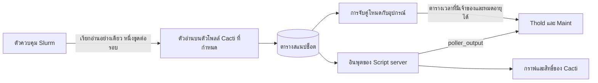

<!-- Source: README.md; SHA256: 16caa3e34c4d150a7fb1018f637e200a7580330f033b485047d8413bce09abba -->

<!-- translations:start -->
[English](../../../README.md) | [简体中文](../zh-CN/README.md) | [हिन्दी](../hi-IN/README.md) | [Español (España)](../es-ES/README.md) | [Español (Latinoamérica)](../es-419/README.md) | [العربية (السعودية)](../ar-SA/README.md) | [Afrikaans](../af-ZA/README.md) | [አማርኛ](../am-ET/README.md) | [العربية (مصر)](../ar-EG/README.md) | [العربية (المغرب)](../ar-MA/README.md) | [বাংলা](../bn-BD/README.md) | [Bosanski](../bs-BA/README.md) | [Deutsch](../de-DE/README.md) | [فارسی](../fa-IR/README.md) | [Filipino](../fil-PH/README.md) | [Français](../fr-FR/README.md) | [Français (Maroc)](../fr-MA/README.md) | [Français (Sénégal)](../fr-SN/README.md) | [Hausa](../ha-NG/README.md) | [עברית](../he-IL/README.md) | [Hrvatski](../hr-HR/README.md) | [Bahasa Indonesia](../id-ID/README.md) | [Igbo](../ig-NG/README.md) | [Italiano](../it-IT/README.md) | [日本語](../ja-JP/README.md) | [한국어](../ko-KR/README.md) | [Malagasy](../mg-MG/README.md) | [मराठी](../mr-IN/README.md) | [Bahasa Melayu](../ms-MY/README.md) | [Nederlands](../nl-NL/README.md) | [Polski](../pl-PL/README.md) | [Português (Brasil)](../pt-BR/README.md) | [Русский](../ru-RU/README.md) | [Kinyarwanda](../rw-RW/README.md) | [Soomaali](../so-SO/README.md) | [Српски](../sr-RS/README.md) | [Svenska](../sv-SE/README.md) | [Kiswahili](../sw-KE/README.md) | [தமிழ்](../ta-IN/README.md) | [తెలుగు](../te-IN/README.md) | [ไทย](README.md) | [Türkçe](../tr-TR/README.md) | [Українська](../uk-UA/README.md) | [اردو](../ur-PK/README.md) | [Tiếng Việt](../vi-VN/README.md) | [isiXhosa](../xh-ZA/README.md) | [Yorùbá](../yo-NG/README.md) | [繁體中文](../zh-TW/README.md) | [isiZulu](../zu-ZA/README.md)
<!-- translations:end -->

# plugin_hpcsched

ปลั๊กอินสำหรับ Cacti 1.2 ที่สร้างกราฟแสดงสถานะของตัวจัดตารางงานแบบแบตช์สำหรับ HPC ควบคู่ไปกับอุปกรณ์ที่ Cacti เฝ้าติดตามอยู่แล้ว ได้แก่ ความลึกของคิว งานที่รอคิวเทียบกับงานที่กำลังรัน สาเหตุที่งานรอคิว สถานะของโหนด และอัตราการใช้งานพาร์ติชัน โดยรองรับ Slurm เป็นแบ็กเอนด์แรก สามารถใช้ Thold แจ้งเตือนจากแหล่งข้อมูลที่ได้ และใช้โหนดที่ถูกระบายงาน (drained) รวมถึงการจองเวลาบำรุงรักษามาขับเคลื่อน Maint ได้

> **สถานะ: อยู่ระหว่างการพัฒนา ยังไม่มีรุ่นเผยแพร่อย่างเป็นทางการ** ไมล์สโตนที่ 2 (โครงสร้างพื้นฐาน) ถูกรวมเข้าสู่สาขา `main` แล้ว และสาขานี้เพิ่มไมล์สโตนที่ 3 (กราฟระดับคลัสเตอร์และสาเหตุการรอคิว) โค้ดสามารถติดตั้ง อัปเกรด และถอนการติดตั้งผ่าน API ปลั๊กอินของ Cacti ได้ และจะปฏิเสธการทำงานบน PHP ที่ต่ำกว่า 8.2 ปลั๊กอินจะเก็บทะเบียนคลัสเตอร์ Slurm โดยแต่ละคลัสเตอร์จะถูกกำหนดให้ตัวโพลล์ของ Cacti หนึ่งตัว ตัวอ่านเบื้องหลังบนตัวโพลล์หลักจะเก็บสแนปช็อตหนึ่งครั้งต่อคลัสเตอร์ต่อช่วงเวลา โดยเรียกใช้ `squeue`, `scontrol` และ `sshare` พร้อมแฟล็ก `--json` หรืออ่านจาก `slurmrestd` ผ่าน HTTPS แล้วบันทึกจำนวนงานแยกตามสถานะและสาเหตุการรอคิว สถานะโหนด พาร์ติชัน การจอง และการใช้งานแบบแบ่งปันอย่างเป็นธรรม (fair-share) พร้อมความสดใหม่ของข้อมูล ปลั๊กอินมาพร้อมเทมเพลตของ Cacti และเมื่อผู้ดูแลระบบยืนยัน จะสร้างหรือจับคู่อุปกรณ์ของ Cacti หนึ่งรายการต่อคลัสเตอร์ พร้อมกราฟแสดงจำนวนงานตามสถานะ งานที่รอคิวตามกลุ่มสาเหตุ โหนดตามสถานะ CPU และอัตราการใช้งาน สำหรับทั้งคลัสเตอร์และแต่ละพาร์ติชัน รวมถึงอายุของสแนปช็อต หน้าภาพรวมแบบอ่านอย่างเดียวจะแสดงจำนวนต่อคลัสเตอร์พร้อมความสดใหม่ของข้อมูลและมุมมองสาเหตุการรอคิวต่อคลัสเตอร์ ส่วนหน้าสุขภาพระบบสำหรับผู้ดูแลระบบเท่านั้นจะแสดงผลลัพธ์จากการเก็บข้อมูลแต่ละครั้งและสถานะการติดตั้งเทมเพลต ทุกหน้าและการดำเนินการจะปฏิบัติตามสิทธิ์ระดับอุปกรณ์ของ Cacti แหล่งข้อมูลเหล่านี้สามารถใช้ตั้งค่าแจ้งเตือนใน Thold ได้ แต่ยังไม่มีการทดสอบการเชื่อมต่อกับ Thold หรือ Maint จริง ซึ่งอยู่ในไมล์สโตนที่ 4 เป็นต้นไป ชุดทดสอบครอบคลุมคำสั่ง Slurm จำลองและผลตอบกลับจาก `slurmrestd` อีกทั้ง CI ยังทดสอบกับคลัสเตอร์ Slurm จริงขนาด 6 โหนดในคอนเทนเนอร์ตามที่อธิบายไว้ด้านล่าง ตัวอ่านข้อมูลยังไม่เคยทำงานกับคลัสเตอร์ระดับการใช้งานจริง ถัดจากบันทึกสำหรับผู้ปฏิบัติงานลงไป README นี้จะอธิบายถึงการออกแบบ ไม่ใช่พฤติกรรมที่เปิดใช้งานจริงแล้ว

นี่คือโครงการอิสระและไม่มีส่วนเกี่ยวข้องกับโครงการ Cacti

## บทบาทการเข้าถึง

| สิทธิ์ (Realm) | การเข้าถึง |
| --- | --- |
| HPC Scheduler View | หน้าเฝ้าติดตามที่มีอยู่แล้ว |
| HPC Scheduler Operator | การเฝ้าติดตาม รวมถึงหน้าปฏิบัติการ (Operations) และการรับทราบการคัดกรองปัญหาส่วนบุคคล |
| HPC Scheduler Admin | สิทธิ์ระดับ Operator รวมถึงการตั้งค่าและการดำเนินการระดับผู้ดูแลระบบที่มีอยู่แล้ว |

หลังจากคัดลอกไฟล์อัปเกรดแล้ว ให้เปิดหน้า Plugins ในฐานะผู้ดูแลระบบเพื่อลงทะเบียนสิทธิ์ (realm) ใหม่ กำหนดสิทธิ์ Operator อย่างชัดเจนภายใต้ **Configuration > Users** หรือกลุ่มผู้ใช้ การอัปเกรดจะยังคงรหัสและสิทธิ์ที่มอบให้ของ View และ Admin เดิมไว้ สิทธิ์ Admin จะสืบทอดสิทธิ์ Operator และสิทธิ์ Operator จะสืบทอดสิทธิ์ View ในแต่ละคำขอ ทั้งนี้ไม่ได้เพิ่มการมอบสิทธิ์ที่จัดเก็บไว้ให้กับผู้ใช้หรือกลุ่ม การตั้งค่าปลั๊กอินยังต้องใช้สิทธิ์ HPC Scheduler Admin ร่วมกับสิทธิ์ Settings ของ Cacti ด้วย

สิทธิ์ระดับอุปกรณ์ของ Cacti ยังคงจำกัดแถวและการดำเนินการที่ผู้ใช้แต่ละคนเข้าถึงได้ คลัสเตอร์ที่ไม่มีอุปกรณ์จะแสดงในหน้าผู้ดูแลระบบสำหรับผู้ใช้ทุกคนที่มีสิทธิ์ของปลั๊กอิน แต่จะไม่แสดงในมุมมองของผู้ปฏิบัติงานซึ่งแสดงเฉพาะคลัสเตอร์ที่จับคู่กับอุปกรณ์ไว้เท่านั้น ข้อมูลรับรอง การตั้งค่า การจับคู่ การลบ และการเปลี่ยนแปลงเชิงบริหารอื่นๆ ยังคงอยู่ในหน้าผู้ดูแลระบบ การรับทราบ (acknowledgment) จะคงอยู่เฉพาะในเซสชันปัจจุบันของผู้ใช้ นานสูงสุดหนึ่งชั่วโมง และเฉพาะตราบเท่าที่ค่าที่สังเกตได้เดิมยังคงสดใหม่ การสังเกตการณ์ใหม่หรือที่เปลี่ยนแปลงจะทำให้การรับทราบสิ้นสุดลง และจะไม่มีการทำเครื่องหมายว่าการวัดที่ล้มเหลวเป็นปกติหรือระงับการแจ้งเตือน

## บันทึกสำหรับผู้ปฏิบัติงานสำหรับไมล์สโตนที่ 2

**สิทธิ์น้อยที่สุดเท่าที่จำเป็น** ปลั๊กอินนี้ทำหน้าที่อ่านข้อมูลเท่านั้น ควรกำหนดผู้ใช้ Slurm เฉพาะที่ไม่มีบทบาทผู้ดูแลระบบหรือผู้ปฏิบัติงาน (`AdminLevel=None` ใน `sacctmgr`) หากตั้งค่า `PrivateData=jobs` (หรือ `nodes`, `reservations`, `usage`) ใน `slurm.conf` ผู้ใช้นั้นจะมองเห็นเฉพาะระเบียนของตนเอง ทำให้จำนวนที่นับได้ไม่ครบถ้วนและปลั๊กอินไม่สามารถตรวจพบได้ การยกเว้นข้อจำกัดดังกล่าวสำหรับบัญชีนั้นหมายถึงการให้ระดับผู้ปฏิบัติงานหรือผู้ดูแลระบบ ซึ่งอนุญาตให้แก้ไขได้ด้วย จึงขึ้นอยู่กับการตัดสินใจของแต่ละหน่วยงาน สำหรับคำสั่งไคลเอนต์ ผู้ใช้ที่เป็นตัวโพลล์ของ Cacti ต้องเข้าถึงไบนารีไคลเอนต์ของ Slurm และไฟล์ `slurm.conf` ที่เชื่อมต่อไปยังตัวควบคุมได้ โดยเส้นทางไบนารีจะตั้งค่าเป็นเส้นทางสัมบูรณ์ภายใต้ Configuration > Settings > HPC Scheduler สำหรับ `slurmrestd` URL ต้องเป็น `https://` หรือ `http://` เฉพาะบนแอดเดรส loopback เท่านั้น ระบบจะตรวจสอบใบรับรอง TLS และไม่ติดตามการเปลี่ยนเส้นทาง (redirect) รายการโฮสต์ของ slurmrestd ที่เลือกกรอกได้ภายใต้ Configuration > Settings > HPC Scheduler จะจำกัดโฮสต์และพอร์ตที่คลัสเตอร์สามารถระบุได้

**ตัวโพลล์ระยะไกล** รุ่นนี้เก็บข้อมูลเฉพาะบนตัวโพลล์หลักของ Cacti เท่านั้น คลัสเตอร์ที่กำหนดให้กับตัวเก็บข้อมูลระยะไกลจะไม่ถูกเก็บข้อมูล ตัวอ่านที่นั่นจะปฏิเสธการทำงานพร้อมบันทึกสาเหตุลงในล็อก และหน้าสุขภาพระบบจะระบุชื่อคลัสเตอร์ดังกล่าว การเก็บข้อมูลระยะไกลอยู่ในระยะที่ 3

**หน่วยความจำ** การเก็บข้อมูลแต่ละรอบจะถอดรหัสผลตอบกลับจากตัวจัดตารางงานทีละรายการ ซึ่งใช้หน่วยความจำ PHP ประมาณ 12 เท่าของขนาดผลตอบกลับ (วัดได้ประมาณ 10 เท่าสำหรับระเบียนงานที่มีโครงสร้างแบบ Slurm บวกกับตัวข้อความเอง) การทำงานจะเพิ่มขีดจำกัดหน่วยความจำ PHP ไปที่ค่าการตั้งค่า Collection Memory (ค่าเริ่มต้น 1024 MiB) และอนุญาตผลตอบกลับได้สูงสุด (Collection Memory - 64) / 12 MiB หรือค่าเริ่มต้น 80 MiB แม้ว่าจะตั้งค่า Maximum Answer Size ไว้สูงกว่านั้นก็ตาม โดยหน้าสุขภาพระบบจะแจ้งเตือนเมื่อเกิดกรณีนี้ ผลตอบกลับที่ใหญ่กว่านั้นจะทำให้ส่วนของตนล้มเหลวเนื่องจากขนาดใหญ่เกินไป และรอบที่ยังใช้หน่วยความจำเกินขีดจำกัดจะถูกบันทึกว่าล้มเหลว คลัสเตอร์ขนาดใหญ่อาจต้องเพิ่มค่าการตั้งค่าทั้งสองนี้ ทั้งนี้ยังไม่ได้วัดผลกับระเบียนงานจริงจำนวน 100,000 รายการ

**ไฟล์โทเคน** คลัสเตอร์แบบ `slurmrestd` จะระบุไฟล์โทเคน ตัวโทเคนเองจะไม่ถูกบันทึกลงในฐานข้อมูล ไม่แสดงบนหน้าเว็บ และไม่เขียนลงในล็อก ไฟล์ต้องอยู่ภายในไดเรกทอรีไฟล์โทเคนใดไดเรกทอรีหนึ่งที่กำหนดไว้ภายใต้ Configuration > Settings > HPC Scheduler เข้าถึงได้โดยไม่ผ่าน symbolic link และเป็นไฟล์ปกติที่มีผู้ใช้ตัวโพลล์เป็นเจ้าของซึ่งมีเพียงผู้ใช้นั้นเท่านั้นที่เขียนได้ ภายในมีเพียงหนึ่งบรรทัดคือโทเคน หรือ `SLURM_JWT=<token>` ตามที่คำสั่ง `scontrol token` พิมพ์ออกมา หากไม่ได้กำหนดไดเรกทอรีโทเคนไว้ จะไม่มีคลัสเตอร์ใดสามารถใช้ `slurmrestd` ได้ การตั้งค่าทั้งสองนี้อยู่ในหน้า Settings ของ Cacti ดังนั้นสิทธิ์ Admin ของปลั๊กอินเพียงอย่างเดียวจึงไม่สามารถเปลี่ยนแปลงได้ ควรตั้งสิทธิ์ให้แต่ละไดเรกทอรีโทเคนเขียนได้เฉพาะ root และผู้ใช้ตัวโพลล์เท่านั้น ไฟล์ที่กลุ่มหรือผู้ใช้รายอื่นสามารถอ่านได้ยังคงถูกนำไปใช้ แต่หน้าสุขภาพระบบจะแจ้งเตือน หน้าสุขภาพระบบยังแจ้งเตือนเมื่อโทเคนใกล้หมดอายุภายในระยะเวลาแจ้งเตือนที่กำหนดไว้ด้วย

หากต้องการหมุนเวียนโทเคนโดยไม่ให้มีช่วงเวลาที่ตัวอ่านมองเห็นไฟล์ที่ไม่สมบูรณ์ ให้เขียนโทเคนใหม่ไว้ข้างๆ ไฟล์เดิมแล้วเปลี่ยนชื่อมาแทนที่:

```sh
dir=/etc/cacti/hpcsched
tmp=$(mktemp "$dir/.token.XXXXXX")
scontrol token username=cactiread lifespan=2592000 > "$tmp"
chown cacti:cacti "$tmp"
chmod 0600 "$tmp"
mv -f "$tmp" "$dir/cluster1.token"
```

การเก็บข้อมูลรอบถัดไปจะอ่านไฟล์ใหม่ การสร้างโทเคนด้วย `scontrol token` ต้องใช้สิทธิ์ผู้ดูแลระบบ Slurm ให้รันคำสั่งในเครื่องที่ได้รับอนุญาตแล้วคัดลอกไฟล์มายังตัวโพลล์

## บันทึกสำหรับผู้ปฏิบัติงานสำหรับไมล์สโตนที่ 3

**เทมเพลต** การติดตั้งและการอัปเกรดจะนำเข้าเทมเพลตอุปกรณ์ ข้อมูล และกราฟของ HPC Scheduler และคัดลอก data query ของพาร์ติชันไปยังไดเรกทอรี `resource/script_server/` ของ Cacti หากไดเรกทอรีนั้นไม่สามารถเขียนได้โดยผู้ใช้ที่ติดตั้งปลั๊กอิน มีไฟล์ชื่อเดียวกันที่แตกต่างกันอยู่แล้วซึ่งไม่ได้เขียนโดยปลั๊กอิน หรือชื่อนั้นเป็น symbolic link การนำเข้าจะหยุดลง ไฟล์เดิมจะไม่ถูกแตะต้อง และหน้าสุขภาพระบบจะบอกวิธีแก้ไข โดยปุ่ม Install Templates บนหน้าสุขภาพระบบจะลองทำซ้ำอีกครั้ง สำเนาที่เหมือนกันซึ่งผู้ใช้สร้างขึ้นเองจะถูกนำมาใช้แต่ยังคงเป็นของผู้ใช้ต่อไป การถอนการติดตั้งจะลบไฟล์ query ออกเฉพาะเมื่อปลั๊กอินเป็นผู้เขียนและไฟล์ยังไม่ถูกแก้ไข และจะยังคงเทมเพลต อุปกรณ์ และกราฟไว้

**อุปกรณ์คลัสเตอร์** หน้า HPC Clusters > Device จะแสดงสิ่งที่อุปกรณ์จะเพิ่มเข้ามา (กราฟ แหล่งข้อมูล ไฟล์ RRD และการเรียก script server ต่อรอบโพลล์) ก่อนที่จะมีการสร้างจริง Create Device จะสร้างอุปกรณ์ที่มีชื่อโฮสต์ในโดเมนสงวน `.invalid` และไม่มีการตรวจสอบความพร้อมใช้งาน ส่วน Map Device จะแนบกราฟเข้ากับอุปกรณ์ที่มีอยู่แล้วโดยไม่แตะต้องค่าการตั้งค่าเดิมของอุปกรณ์นั้น กราฟระดับคลัสเตอร์แต่ละกราฟและกราฟระดับพาร์ติชันแต่ละกราฟจะมีแหล่งข้อมูลของตนเอง ได้แก่ 6 รายการสำหรับคลัสเตอร์ และ 5 รายการต่อพาร์ติชัน มีการเรียก script server หนึ่งครั้งต่อแหล่งข้อมูลคลัสเตอร์ และหนึ่งครั้งต่อค่าของพาร์ติชัน (32) ต่อรอบโพลล์ พาร์ติชันที่เพิ่มเข้ามาภายหลังจะถูกทำดัชนีเมื่อตัวอ่านพบเห็น และสร้างกราฟได้จากหน้า New Graphs ของ Cacti ส่วนพาร์ติชันที่ถูกลบออกจะหยุดถูกโพลล์แต่ยังคงกราฟไว้ การลบอุปกรณ์จะยกเลิกการจับคู่คลัสเตอร์และยังคงคลัสเตอร์ไว้

**สิ่งที่กราฟนับ** สถานะ Pending ไม่รวมงานที่ถูกพัก (held) ซึ่งมีชุดข้อมูลแยกต่างหาก งานแบบอาร์เรย์ที่รอคิวจะนับตามงานย่อยที่เหลืออยู่ งานหรือโหนดที่อยู่ในหลายพาร์ติชันจะถูกนับหนึ่งครั้งในกราฟระดับคลัสเตอร์และหนึ่งครั้งในแต่ละพาร์ติชัน ดังนั้นผลรวมของกราฟพาร์ติชันจึงไม่จำเป็นต้องเท่ากับของคลัสเตอร์ สาเหตุการรอคิวถูกจัดกลุ่มเป็น 11 ตระกูล ([ADR 0011](../../decisions/0011-pending-reason-families-and-counting.md)) มุมมองสาเหตุการรอคิวจะแสดงรายการสาเหตุดิบ รวมถึงรายการที่อยู่ใน Other งานแต่ละงานจะรายงานเฉพาะสาเหตุล่าสุดที่ตัวจัดตารางงานตรวจสอบ ตัวส่วนของอัตราการใช้งานรวมโหนดที่ถูก drained, down และโหนดที่ไม่พร้อมใช้งานอื่นๆ ด้วย ข้อมูลที่ล้าสมัยหรือล้มเหลวจะมีค่าเป็น `U` ไม่ใช่ศูนย์ ส่วน `age` จะยังคงเป็นตัวเลข

**การแจ้งเตือน** Thold สามารถแจ้งเตือนจากแหล่งข้อมูลเหล่านี้ได้ทุกตัว ควรตั้งระยะเวลาใน Thold อย่างน้อยเท่ากับหนึ่งช่วงเวลาการเก็บข้อมูล และตั้งแจ้งเตือนบน `age` เพื่อตรวจจับกรณีที่ตัวอ่านหยุดทำงาน การตรวจสอบ Thold แบบครบวงจรอยู่ในไมล์สโตนที่ 4

**ทดสอบกับผลลัพธ์จริงจาก Slurm** CI จะเริ่มคลัสเตอร์ Slurm ขนาด 6 โหนดในคอนเทนเนอร์ (รุ่น 26.05.5 ในทุกการเปลี่ยนแปลง และรุ่น 25.11.8 ที่สร้างจากซอร์สโค้ดเมื่อพุชไปยัง `main`, รายสัปดาห์ และเมื่อร้องขอ) แล้วตรวจสอบสถานะโหนด การจองเวลาบำรุงรักษา สาเหตุการรอคิว และงานแบบอาร์เรย์ตามที่ปลั๊กอินแยกวิเคราะห์ จากนั้นจึงเก็บข้อมูลจากคลัสเตอร์นั้นด้วยทรานสปอร์ตคำสั่งและ `slurmrestd` ของปลั๊กอินเอง รุ่นที่เก่ากว่านี้ครอบคลุมเฉพาะด้วยชุดข้อมูลทดสอบจำลองเท่านั้น ตัวอ่านข้อมูลยังคงไม่เคยทำงานกับคลัสเตอร์ระดับการใช้งานจริง

**สิทธิ์การเข้าถึง** คลัสเตอร์ที่อยู่บนอุปกรณ์จะถูกแสดง ส่งออก และแก้ไขได้เฉพาะสำหรับผู้ใช้ที่ Cacti อนุญาตให้เข้าถึงอุปกรณ์นั้นในทุกหน้าของปลั๊กอิน การจับคู่อุปกรณ์ยังต้องมีสิทธิ์สำหรับอุปกรณ์เป้าหมายด้วย คลัสเตอร์ที่ไม่มีอุปกรณ์จะมองเห็นได้สำหรับทุกคนที่มีสิทธิ์ของปลั๊กอิน คลัสเตอร์ที่ยังคงจับคู่กับอุปกรณ์ที่ถูกลบไปขณะปิดใช้งานปลั๊กอินจะแสดงเฉพาะต่อผู้ใช้ที่มีสิทธิ์ HPC Scheduler Admin ซึ่งสามารถสร้างหรือจับคู่อุปกรณ์ใหม่ให้ได้ ส่วนสิทธิ์การเข้าถึงกราฟเป็นไปตามระบบของ Cacti เอง

## เหตุผล

ผู้ปฏิบัติงานที่ใช้ Cacti มักสร้างกราฟของโหนดประมวลผลอยู่แล้ว แต่ยังขาดมุมมองจากตัวจัดตารางงานในกราฟเหล่านั้น ซึ่งทำให้เกิดช่องว่างสองประการ:

- **ไม่ทราบว่า "เหตุใดงานจึงยังไม่เริ่มทำงาน"** Slurm บันทึกสาเหตุสำหรับงานที่รอคิวแต่ละงาน การเห็นคิวเต็มข้างกราฟโหนดที่ว่างไม่ได้บอกว่าสาเหตุเกิดจากลำดับความสำคัญ ขีดจำกัดทรัพยากร การพักงาน การขึ้นต่อกันของงาน หรือโหนดที่ถูกระบายงาน
- **ไม่มีการเชื่อมโยงระหว่างสถานะตัวจัดตารางงานกับการแจ้งเตือน** Thold แจ้งเตือนบนอุปกรณ์ที่ผู้ดูแลระบบระบายงานออกไปแล้ว และผู้ดูแลระบบต้องสร้างตาราง Maint ด้วยตนเอง

ปลั๊กอินนี้จะเก็บสแนปช็อตที่แคชไว้หนึ่งชุดต่อคลัสเตอร์ เผยแพร่เป็นแหล่งข้อมูลและกราฟปกติของ Cacti จับคู่โหนดของตัวจัดตารางงานเข้ากับอุปกรณ์ Cacti ที่มีอยู่ และสามารถนำโหนดที่ถูกระบายงานและการจองเวลาบำรุงรักษาเข้าสู่ Maint ได้ โดยใช้สิทธิ์ของ Cacti ตัวเก็บข้อมูลระยะไกล Thold และ Maint ร่วมกัน และทำงานแบบอ่านอย่างเดียวต่อตัวจัดตารางงาน

## ขอบเขตที่วางแผนไว้

| ระยะ | ขอบเขต | ไมล์สโตน |
|---|---|---|
| 0, การวิจัย | ตารางรุ่น Slurm, การยืนยันพฤติกรรมต้นน้ำ, โหลดของตัวควบคุม, ชุดข้อมูลจำลองการตั้งชื่อโหนด | [M1](https://github.com/somethingwithproof/plugin_hpcsched/milestone/1) |
| 1, กราฟคลัสเตอร์ | ความลึกของคิว, งานที่รอคิวและกำลังรัน, สาเหตุการรอคิว, สถานะโหนด, การใช้งานพาร์ติชัน, การแจ้งเตือน Thold, หน้าสุขภาพระบบ, การเผยแพร่รุ่น | [M2](https://github.com/somethingwithproof/plugin_hpcsched/milestone/2), [M3](https://github.com/somethingwithproof/plugin_hpcsched/milestone/3), [M4](https://github.com/somethingwithproof/plugin_hpcsched/milestone/4) |
| 2, โหนดและการบำรุงรักษา | การจับคู่โหนดกับอุปกรณ์, สถานะรายโหนด, ช่วงเวลา Maint อัตโนมัติสำหรับโหนดที่ถูกระบายงานและการจองเวลาบำรุงรักษา | [M5](https://github.com/somethingwithproof/plugin_hpcsched/milestone/5) |
| 3, การบัญชีการใช้งาน | การใช้งานแบบแบ่งปันอย่างเป็นธรรม, สถิติการบัญชีที่มีขอบเขต, ตัวเก็บข้อมูลระยะไกล | [M6](https://github.com/somethingwithproof/plugin_hpcsched/milestone/6) |

นอกขอบเขต: เส้นทางการเขียนใดๆ ไปยังตัวจัดตารางงาน (การส่งงาน ยกเลิก พักงาน ระบายงาน สั่งทำงานต่อ) ระบบแจ้งเตือนที่เป็นของปลั๊กอินเอง ระบบรายงานหรือคิดค่าใช้จ่าย รวมถึงชุดข้อมูลรายผู้ใช้และรายงานย่อย ส่วนแบ็กเอนด์ PBS Pro, OpenPBS และ LSF อยู่ในขั้นวิจัย

## เป้าหมายความเข้ากันได้

| องค์ประกอบ | เป้าหมาย |
|---|---|
| Cacti | 1.2.31 หรือใหม่กว่า โดยไม่ต้องแก้ไขโค้ดแกนกลาง |
| PHP | 8.2 หรือใหม่กว่า; `setup.php` ยังคงแยกวิเคราะห์ได้บน 8.0 เพื่อให้รันไทม์ที่ไม่รองรับได้รับข้อความปฏิเสธแทนที่หน้าเว็บ Cacti จะพัง |
| Slurm | 25.05, 25.11 และ 26.05 ซึ่งเป็นสามรุ่นล่าสุด ([ADR 0013](../../decisions/0013-three-latest-slurm-releases.md)); รุ่น 25.11 และ 26.05 ทดสอบกับคลัสเตอร์จริง ส่วน 25.05 ทดสอบกับชุดข้อมูลจำลองเท่านั้น คำสั่งไคลเอนต์เป็นทรานสปอร์ตเริ่มต้น ([ADR 0012](../../decisions/0012-client-commands-default-transport.md)) และใช้การตั้งค่าตัวแยกวิเคราะห์ข้อมูล: v0.0.43 เป็นค่าเริ่มต้น ซึ่ง SchedMD จะถอดออกในรุ่น 27.05 หรือใช้ v0.0.44 หรือ v0.0.45 ในรุ่นที่มีมาให้ คลัสเตอร์แบบ slurmrestd จะค้นหาตัวแยกวิเคราะห์รุ่นใหม่ล่าสุดที่ดีมอนให้บริการ |
| Thold, Maint | ไม่มีการแก้ไข Thold; การเชื่อมต่อกับ Maint เป็นข้อเสนอที่ต้องได้รับความเห็นชอบจากผู้ดูแล Maint |

## การออกแบบ

- [docs/PLAN.md](../../PLAN.md) คือแผนฉบับเต็ม ประกอบด้วยสถาปัตยกรรม ข้อเท็จจริงต้นน้ำที่ใช้อ้างอิง (พร้อมแหล่งที่มาและรายการสมมติฐานที่ยังไม่ได้ยืนยันอย่างชัดเจน) การจับคู่โหนด แบบจำลองสถานะ ขอบเขตความปลอดภัย การคำนวณประสิทธิภาพ การทดสอบ และความเสี่ยง
- [docs/decisions/](../../decisions) เก็บบันทึกการตัดสินใจด้านสถาปัตยกรรม
- [docs/REQUIREMENTS.md](../../REQUIREMENTS.md) จับคู่รหัสข้อกำหนดแต่ละรายการเข้ากับ Issue ที่เกี่ยวข้อง



## การติดตามงาน

- **ไมล์สโตน** สอดคล้องกับไมล์สโตนในแผน โดยแต่ละรายการมี Issue หลัก (epic) ที่ระบุ Issue ย่อยและหลักฐานยืนยันความสำเร็จ
- **Issue** แบ่งประเภทด้วยป้ายกำกับ: `type: requirement`, `type: research`, `type: decision`, `type: epic` โดย Issue ประเภทข้อกำหนดจะระบุข้อกำหนดที่มีหมายเลขและทดสอบได้ (`REQ-AREA-NNN`) พร้อมเกณฑ์การยอมรับ
- **ป้ายกำกับ** ยังระบุ `area:`, `phase:`, `priority:` และ `status:` ด้วย ดูรายละเอียดที่ [CONTRIBUTING.md](../../../CONTRIBUTING.md#labels)
- [กระดานโครงการ](https://github.com/users/somethingwithproof/projects/10) แสดง Issue ทั้งหมดในทุกไมล์สโตน

## การมีส่วนร่วม

อ่าน [CONTRIBUTING.md](../../../CONTRIBUTING.md) คอมมิตจำเป็นต้องมีการลงนามรับรอง DCO (DCO sign-off) การอภิปรายด้านการออกแบบเกิดขึ้นใน Issue และการตัดสินใจที่ยังไม่สรุปจะติดป้ายกำกับ `type: decision`

## ความปลอดภัย

รายงานช่องโหว่แบบส่วนตัว ดูรายละเอียดที่ [SECURITY.md](../../../SECURITY.md)

## สัญญาอนุญาต

GNU General Public License v2.0 ซึ่งเป็นสัญญาอนุญาตเดียวกับ Cacti และปลั๊กอินของ Cacti ดูรายละเอียดที่ [LICENSE](../../../LICENSE)
