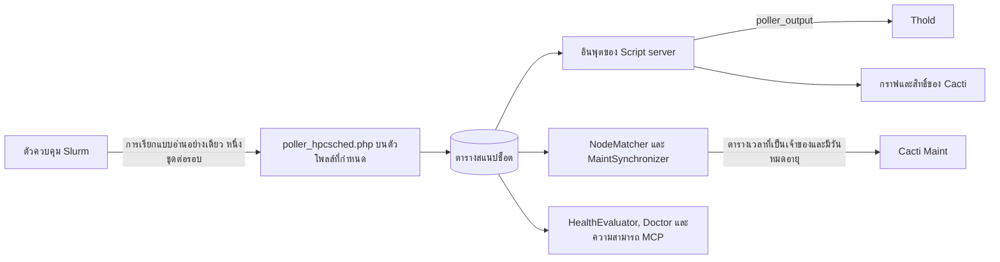

<!-- Source: README.md; SHA256: 938114d41dbd516f9dfcd94619c4fc73ef56b4da1dd693010588a93cce250534 -->

<!-- translations:start -->
[English](../../../README.md) | [简体中文](../zh-CN/README.md) | [हिन्दी](../hi-IN/README.md) | [Español (España)](../es-ES/README.md) | [Español (Latinoamérica)](../es-419/README.md) | [العربية (السعودية)](../ar-SA/README.md) | [Afrikaans](../af-ZA/README.md) | [አማርኛ](../am-ET/README.md) | [العربية (مصر)](../ar-EG/README.md) | [العربية (المغرب)](../ar-MA/README.md) | [Български](../bg-BG/README.md) | [বাংলা](../bn-BD/README.md) | [Bosanski](../bs-BA/README.md) | [Deutsch](../de-DE/README.md) | [Ελληνικά](../el-GR/README.md) | [فارسی](../fa-IR/README.md) | [Filipino](../fil-PH/README.md) | [Français](../fr-FR/README.md) | [Français (Maroc)](../fr-MA/README.md) | [Français (Sénégal)](../fr-SN/README.md) | [Hausa](../ha-NG/README.md) | [עברית](../he-IL/README.md) | [Hrvatski](../hr-HR/README.md) | [Bahasa Indonesia](../id-ID/README.md) | [Igbo](../ig-NG/README.md) | [Italiano](../it-IT/README.md) | [日本語](../ja-JP/README.md) | [ქართული](../ka-GE/README.md) | [한국어](../ko-KR/README.md) | [Latviešu](../lv-LV/README.md) | [Malagasy](../mg-MG/README.md) | [मराठी](../mr-IN/README.md) | [Bahasa Melayu](../ms-MY/README.md) | [Nederlands](../nl-NL/README.md) | [Polski](../pl-PL/README.md) | [Português (Brasil)](../pt-BR/README.md) | [Português (Portugal)](../pt-PT/README.md) | [Русский](../ru-RU/README.md) | [Kinyarwanda](../rw-RW/README.md) | [Soomaali](../so-SO/README.md) | [Српски](../sr-RS/README.md) | [Svenska](../sv-SE/README.md) | [Kiswahili](../sw-KE/README.md) | [தமிழ்](../ta-IN/README.md) | [తెలుగు](../te-IN/README.md) | [ไทย](README.md) | [Türkçe](../tr-TR/README.md) | [Українська](../uk-UA/README.md) | [اردو](../ur-PK/README.md) | [Tiếng Việt](../vi-VN/README.md) | [isiXhosa](../xh-ZA/README.md) | [Yorùbá](../yo-NG/README.md) | [繁體中文](../zh-TW/README.md) | [isiZulu](../zu-ZA/README.md)
<!-- translations:end -->

# plugin_hpcsched

ปลั๊กอินสำหรับ Cacti 1.2 (`hpcsched` เวอร์ชัน `0.1.0-dev`) ที่สร้างกราฟแสดงสถานะของตัวจัดตารางงานแบบแบตช์สำหรับ HPC ควบคู่ไปกับอุปกรณ์ที่ Cacti เฝ้าติดตามอยู่แล้ว ได้แก่ ความลึกของคิว งานที่รอคิวเทียบกับงานที่กำลังรัน สาเหตุที่งานรอคิว สถานะของโหนด อัตราการใช้งานพาร์ติชัน และการใช้งานแบบแบ่งปันอย่างเป็นธรรม (fair-share) ในระดับบัญชี โดยรองรับ Slurm เป็นแบ็กเอนด์ที่ใช้งานจริง สามารถใช้ Thold แจ้งเตือนจากแหล่งข้อมูลที่ได้ และตัวซิงโครไนซ์ Maint แบบเลือกเปิดใช้งานจะขับเคลื่อนหน้าต่างเวลาของ Cacti Maint จากโหนดคำนวณของ Slurm ที่อยู่ในสถานะ drained, down และที่ถูกจองเพื่อการบำรุงรักษา

> **สถานะ: อยู่ระหว่างการพัฒนา ยังไม่มีรุ่นเผยแพร่อย่างเป็นทางการ** สาขานี้ดำเนินการโครงสร้างพื้นฐานของปลั๊กอิน กราฟระดับคลัสเตอร์และพาร์ติชัน กลุ่มสาเหตุการรอคิว การจับคู่โหนดคำนวณ Slurm กับอุปกรณ์ Cacti การซิงโครไนซ์หน้าต่างเวลา Cacti Maint แบบเลือกเปิดใช้งาน สรุปการใช้งาน fair-share ระดับบัญชี การทำงานและการทำสำเนาของตัวเก็บข้อมูลระยะไกล CLI สำหรับ Configuration-as-Code (CasC) และการปฏิบัติการ รวมถึงฮุกของระบบนิเวศ Cacti (CasC, Doctor และ MCP / Abilities API v2) ชุดทดสอบครอบคลุมคำสั่ง Slurm จำลองและผลตอบกลับจาก `slurmrestd` อีกทั้ง CI ยังทดสอบกับคลัสเตอร์ Slurm จริงขนาด 6 โหนดในคอนเทนเนอร์ ตัวอ่านข้อมูลยังไม่เคยทำงานกับคลัสเตอร์ระดับการใช้งานจริง และการทดสอบการเล่นซ้ำ Thold แบบครบวงจรยังไม่อยู่ใน CI

นี่คือโครงการอิสระและไม่มีส่วนเกี่ยวข้องกับโครงการ Cacti

## สิ่งที่ดำเนินการแล้ว

- **วงจรชีวิตและสคีมา (v3)**: การติดตั้ง การอัปเกรดแบบทำซ้ำได้ผลลัพธ์เดิม (idempotent) การถอนการติดตั้ง (คงตารางของปลั๊กอินไว้เป็นค่าเริ่มต้น) และข้อกำหนดขั้นต่ำ PHP 8.2 โดยที่จุดเริ่มต้นการทำงานยังสามารถวิเคราะห์ไวยากรณ์บน PHP 8.0 ได้ สคีมา v3 เพิ่ม `plugin_hpcsched_node_map` และ `plugin_hpcsched_maint_link` ควบคู่ไปกับตาราง cluster, run, section, job-count, node-count, node, partition, reservation และ share
- **การเก็บข้อมูล Slurm แบบอ่านอย่างเดียวบนตัวโพลล์หลักและระยะไกล**: `poller_bottom` จะเริ่ม `poller_hpcsched.php --cluster=N` ในพื้นหลังบนตัวโพลล์แต่ละตัว (`poller_id`) สำหรับคลัสเตอร์ที่เปิดใช้งานซึ่งกำหนดไว้ให้ตัวโพลล์นั้น การทำงานแต่ละครั้งจะเก็บสแนปช็อตที่แคชไว้หนึ่งรายการต่อคลัสเตอร์ผ่านคำสั่งไคลเอนต์ (`squeue`, `scontrol`, `sshare` พร้อม `--json`) หรือ `slurmrestd` ผ่าน HTTPS (อนุญาต HTTP บน loopback พร้อมคำเตือนด้านสุขภาพ) `INFO` ประกาศ `remote_collect:1, remote_poller:1` และ `replicate_out` จะทำสำเนาคำจำกัดความ `plugin_hpcsched_cluster` ที่ไม่เป็นความลับไปยังตัวเก็บข้อมูลระยะไกล (`poller_id >= 2`) โดยไม่มีการอ่านหรือทำสำเนาเนื้อหาของไฟล์โทเค็น
- **เทมเพลต Cacti และกราฟระดับคลัสเตอร์**: มาพร้อมเทมเพลตอุปกรณ์ ข้อมูล และกราฟ (`templates/hpcsched-templates.xml`) และคิวรีข้อมูลแบบ script-server สำหรับพาร์ติชัน (`scripts/ss_hpcsched_cluster.php`, `scripts/ss_hpcsched_partitions.php`) เมื่อผู้ดูแลระบบยืนยัน จะสร้างหรือจับคู่อุปกรณ์ Cacti หนึ่งรายการต่อคลัสเตอร์ พร้อมกราฟแสดงงานตามสถานะ งานที่รอคิวตามกลุ่มสาเหตุ โหนดตามสถานะ CPU อัตราการใช้งาน (ทั้งคลัสเตอร์และแต่ละพาร์ติชัน) และอายุของสแนปช็อต
- **การจับคู่โหนด Slurm กับอุปกรณ์และการซิงค์ Cacti Maint**: ตัวจับคู่เวลาเชิงเส้นสี่ระดับ (`NodeMatcher`) จับคู่โหนดคำนวณ Slurm กับระเบียน `host` ของ Cacti ที่มีอยู่ (ชื่อโฮสต์ตรงกัน ที่อยู่ตรงกัน คำอธิบาย/นามแฝงตรงกัน หรือป้ายชื่อ DNS แรกสำหรับชื่อที่ไม่ใช่ IP) และทำเครื่องหมายการจับคู่หลายรายการหรือการอ้างสิทธิ์อุปกรณ์ซ้ำว่า `ambiguous` แทนการคาดเดา `HostList::expand()` ขยายรายการโฮสต์การจองของ Slurm (ได้สูงสุด 10,000 โหนด) `MaintSynchronizer` สร้าง ต่ออายุ และลบตารางเวลา Cacti Maint แบบครั้งเดียวที่เป็นของปลั๊กอินซึ่งติดตามใน `plugin_hpcsched_maint_link` สำหรับโหนดที่จับคู่แล้วซึ่งอยู่ในสถานะ `DRAIN`, `DRAINING`, `DOWN` หรือการจอง `MAINT`/`MAINTENANCE` ที่กำลังทำงานอยู่ โดยไม่แก้ไขตารางเวลา Maint ที่ผู้ดูแลระบบสร้างขึ้น
- **สรุป fair-share ระดับบัญชี**: เมื่อเปิดใช้งาน `collect_shares` จะเก็บแถวความสัมพันธ์ของบัญชี Slurm ลงใน `plugin_hpcsched_share` (ตัดแถวผู้ใช้ออกตาม [ADR 0010](../../decisions/0010-bound-series-cardinality.md)) `ShareSummary` และ `ShareRepository` คำนวณจำนวนบัญชี/พาร์ติชัน ผลรวมการใช้งานดิบและใช้งานจริง ค่า fair-share ต่ำสุด/สูงสุด/เฉลี่ย และบัญชีอันดับต้นๆ โดยเปิดเผยจำนวนบัญชีใน `hpcsched-get-queue-summary`
- **CLI สำหรับ CasC และการปฏิบัติการ (`cli/hpcsched.php`)**: การส่งออกการตั้งค่า YAML/XML การตรวจสอบความถูกต้อง การวางแผนส่วนต่างแบบทดลองทำงาน (dry-run) การนำไปใช้ที่ต้องมีการยืนยัน ผลลัพธ์ด้านสุขภาพที่มีโครงสร้าง และการซิงค์ Maint แบบเลือกเปิดใช้งาน (`sync-maint --dry-run` / `--apply`)
- **ฮุกของระบบนิเวศ (`setup.php`)**: `casc_register_providers`, `doctor_register_checks` และ `abilities_register`

## บทบาทการเข้าถึง

| สิทธิ์ (Realm) | การเข้าถึง |
| --- | --- |
| HPC Scheduler View | ภาพรวมคลัสเตอร์แบบอ่านอย่างเดียวและสาเหตุการรอคิว (`hpcsched.php`) |
| HPC Scheduler Operator | สิทธิ์ View รวมถึงหน้าปฏิบัติการ (`hpcsched_operator.php`) และการรับทราบการคัดกรองปัญหาส่วนบุคคล |
| HPC Scheduler Admin | สิทธิ์ Operator รวมถึงการจัดการคลัสเตอร์ (`hpcsched_clusters.php`) และหน้าสุขภาพระบบ (`hpcsched_health.php`) |

หลังจากคัดลอกไฟล์อัปเกรดแล้ว ให้เปิดหน้า Plugins ในฐานะผู้ดูแลระบบเพื่อลงทะเบียนสิทธิ์ (realm) และฮุกใหม่ กำหนดสิทธิ์ Operator อย่างชัดเจนภายใต้ **Configuration > Users** หรือกลุ่มผู้ใช้ การอัปเกรดจะยังคงรหัสและสิทธิ์ที่มอบให้ของ View และ Admin เดิมไว้ สิทธิ์ Admin จะสืบทอดสิทธิ์ Operator และสิทธิ์ Operator จะสืบทอดสิทธิ์ View ในแต่ละคำขอ ทั้งนี้ไม่ได้เพิ่มการมอบสิทธิ์ที่จัดเก็บไว้ให้กับผู้ใช้หรือกลุ่ม การตั้งค่าปลั๊กอินยังต้องใช้สิทธิ์ HPC Scheduler Admin ร่วมกับสิทธิ์ Settings ของ Cacti ด้วย

สิทธิ์ระดับอุปกรณ์ของ Cacti จำกัดแถวและการดำเนินการที่ผู้ใช้แต่ละคนเข้าถึงได้ คลัสเตอร์ที่จับคู่กับอุปกรณ์ Cacti จะแสดง ส่งออก และแก้ไขได้เฉพาะสำหรับผู้ใช้ที่ Cacti อนุญาตให้เข้าถึงอุปกรณ์นั้น และการจับคู่อุปกรณ์ก็ต้องใช้สิทธิ์สำหรับอุปกรณ์เป้าหมายด้วย คลัสเตอร์ที่ไม่มีอุปกรณ์จะแสดงในหน้าผู้ดูแลระบบสำหรับผู้ใช้ที่มีสิทธิ์ของปลั๊กอิน แต่จะไม่แสดงในมุมมองของผู้ปฏิบัติงานซึ่งแสดงเฉพาะคลัสเตอร์ที่จับคู่กับอุปกรณ์ไว้เท่านั้น คลัสเตอร์ที่อุปกรณ์ที่จับคู่ไว้ถูกลบขณะปลั๊กอินถูกปิดใช้งานจะแสดงเฉพาะผู้ใช้ที่มีสิทธิ์ HPC Scheduler Admin การรับทราบ (acknowledgment) จะคงอยู่เฉพาะในเซสชันปัจจุบันของผู้ใช้ นานสูงสุดหนึ่งชั่วโมง และเฉพาะตราบเท่าที่ค่าที่สังเกตได้เดิมยังคงสดใหม่ การสังเกตการณ์ใหม่หรือที่เปลี่ยนแปลงจะทำให้การรับทราบสิ้นสุดลง และจะไม่มีการทำเครื่องหมายว่าการวัดที่ล้มเหลวเป็นปกติหรือระงับการแจ้งเตือน

## บันทึกสำหรับผู้ปฏิบัติงาน

### ความปลอดภัย สิทธิ์น้อยที่สุด และไฟล์โทเค็น

ปลั๊กอินทำหน้าที่อ่านอย่างเดียวเท่านั้น ให้กำหนดผู้ใช้ Slurm เฉพาะที่ไม่มีบทบาทผู้ดูแลระบบหรือผู้ปฏิบัติงาน (`AdminLevel=None` ใน `sacctmgr`) หากมีการตั้งค่า `PrivateData=jobs` (หรือ `nodes`, `reservations`, `usage`) ใน `slurm.conf` ผู้ใช้นั้นจะเห็นเฉพาะระเบียนของตนเอง ทำให้จำนวนไม่ครบถ้วนและปลั๊กอินไม่สามารถตรวจพบได้ การยกเว้นข้อจำกัดนั้นสำหรับบัญชีต้องใช้ระดับผู้ปฏิบัติงานหรือผู้ดูแลระบบ ซึ่งจะอนุญาตให้แก้ไขเปลี่ยนแปลงได้ด้วย การแลกเปลี่ยนดังกล่าวเป็นการตัดสินใจของแต่ละไซต์งาน

สำหรับคำสั่งไคลเอนต์ ผู้ใช้ตัวโพลล์ของ Cacti จำเป็นต้องมีไบนารีไคลเอนต์ของ Slurm (`squeue`, `scontrol` และเลือกใช้ `sshare` ได้) และไฟล์ `slurm.conf` ที่เข้าถึงตัวควบคุมได้ โดยเส้นทางไบนารีเป็นการตั้งค่าแบบสัมบูรณ์ภายใต้ **Configuration > Settings > HPC Scheduler**

สำหรับ `slurmrestd` URL ต้องเป็น `https://` หรือ `http://` บนที่อยู่ loopback เท่านั้น มีการตรวจสอบใบรับรอง TLS และไม่ติดตามการเปลี่ยนเส้นทาง (redirects) รายการโฮสต์ `slurmrestd` ที่เลือกกำหนดได้ภายใต้ **Configuration > Settings > HPC Scheduler** จะจำกัดว่าคลัสเตอร์สามารถระบุโฮสต์และพอร์ตใดได้บ้าง

คลัสเตอร์แบบ `slurmrestd` จะระบุไฟล์โทเค็น โดยตัวโทเค็นเองจะไม่ถูกเก็บในฐานข้อมูล ไม่แสดงบนหน้าเว็บ ไม่ถูกส่งออกโดย CasC และไม่ถูกเขียนลงในบันทึก ไฟล์ต้องอยู่ภายในหนึ่งใน Token File Directories ที่ตั้งค่าไว้ภายใต้ **Configuration > Settings > HPC Scheduler** เข้าถึงได้โดยไม่มีลิงก์สัญลักษณ์ (symbolic link) และเป็นไฟล์ปกติที่ผู้ใช้ตัวโพลล์เป็นเจ้าของซึ่งผู้ใช้นั้นเท่านั้นที่เขียนได้ โดยมีข้อมูลหนึ่งบรรทัดคือโทเค็น หรือ `SLURM_JWT=<token>` ตามที่ `scontrol token` พิมพ์ออกมา หากไม่ได้กำหนดไดเรกทอรีโทเค็นไว้ จะไม่มีคลัสเตอร์ใดใช้ `slurmrestd` ได้ ควรกำหนดให้ทุกไดเรกทอรีโทเค็นเขียนได้เฉพาะ root และผู้ใช้ตัวโพลล์เท่านั้น ไฟล์ที่กลุ่มหรือผู้ใช้อื่นอ่านได้จะยังคงถูกใช้งานและหน้าสุขภาพจะแจ้งเตือน นอกจากนี้ยังแจ้งเตือนเมื่อโทเค็นกำลังจะหมดอายุภายในช่วงเวลาเตือนที่ตั้งไว้

วิธีหมุนเวียนโทเค็นแบบอะตอมิก:

```sh
dir=/etc/cacti/hpcsched
tmp=$(mktemp "$dir/.token.XXXXXX")
scontrol token username=cactiread lifespan=2592000 > "$tmp"
chown cacti:cacti "$tmp"
chmod 0600 "$tmp"
mv -f "$tmp" "$dir/cluster1.token"
```

การเก็บข้อมูลครั้งถัดไปจะอ่านไฟล์ใหม่ การสร้างโทเค็นด้วย `scontrol token` ต้องใช้สิทธิ์ผู้ดูแลระบบ Slurm ให้รันในจุดที่ได้รับอนุญาตแล้วคัดลอกไฟล์ไปยังตัวโพลล์

### ตัวเก็บข้อมูลระยะไกล

`INFO` ประกาศ `remote_collect:1, remote_poller:1` `hpcsched_poller_bottom()` จะเปิดใช้ `poller_hpcsched.php` บนตัวโพลล์แต่ละตัวสำหรับคลัสเตอร์ที่เปิดใช้งานซึ่งกำหนดไว้ให้ `poller_id` นั้น และ `hpcsched_replicate_out()` จะทำสำเนาแถว `plugin_hpcsched_cluster` ที่ไม่เป็นความลับไปยังตัวโพลล์ระยะไกล (`poller_id >= 2`) ไฟล์โทเค็นและไบนารีไคลเอนต์ Slurm ต้องมีอยู่ในเครื่องของตัวโพลล์ระยะไกลที่ได้รับมอบหมาย โดยเนื้อหาโทเค็นจะไม่ถูกทำสำเนา

### ขีดจำกัดหน่วยความจำ

การเก็บข้อมูลแต่ละครั้งจะถอดรหัสคำตอบจากตัวจัดตารางงานทีละหนึ่งรายการ ซึ่งใช้หน่วยความจำ PHP ประมาณ 12 เท่าของขนาดคำตอบ (วัดได้ประมาณ 10 เท่าสำหรับระเบียนงานที่มีรูปแบบคล้ายของ Slurm รวมกับข้อความต้นฉบับ) ตัวอ่านจะเพิ่มขีดจำกัดหน่วยความจำ PHP ให้เท่ากับการตั้งค่า Collection Memory (ค่าเริ่มต้น 1024 MiB) และอนุญาตคำตอบได้สูงสุด `(Collection Memory - 64) / 12` MiB (ค่าเริ่มต้น 80 MiB) แม้ว่า Maximum Answer Size จะตั้งไว้สูงกว่าก็ตาม โดยหน้าสุขภาพจะเตือนเมื่อ Maximum Answer Size เกินขีดจำกัดที่คำนวณได้นั้น คำตอบที่ใหญ่กว่านั้นจะทำให้ส่วนของตนล้มเหลวว่ามีขนาดใหญ่เกินไป และการทำงานที่หน่วยความจำหมดจะบันทึกความล้มเหลวด้านหน่วยความจำพร้อมปล่อยสิทธิ์การเช่าและสล็อตกระบวนการผ่านตัวจัดการการปิดระบบ คลัสเตอร์ขนาดใหญ่อาจต้องเพิ่มการตั้งค่าทั้งสองอย่าง ยังไม่มีการวัดผลกับระเบียนงานจริง 100,000 รายการ

### เทมเพลต อุปกรณ์คลัสเตอร์ และการนับกราฟ

การติดตั้งและการอัปเกรดจะนำเข้าเทมเพลตอุปกรณ์ ข้อมูล และกราฟของ HPC Scheduler และคัดลอกคิวรีข้อมูลพาร์ติชันไปยังไดเรกทอรี `resource/script_server/` ของ Cacti หากไดเรกทอรีนั้นไม่สามารถเขียนได้ มีไฟล์อื่นชื่อเดียวกันอยู่ที่นั่น หรือเป้าหมายเป็นลิงก์สัญลักษณ์ การนำเข้าจะหยุดลง คงไฟล์เดิมไว้ไม่เปลี่ยนแปลง และรายงานสภาวะบนหน้าสุขภาพซึ่งสามารถกด **Install Templates** เพื่อลองใหม่ได้ การถอนการติดตั้งจะลบไฟล์คิวรีออกเฉพาะเมื่อปลั๊กอินเป็นผู้เขียนและไฟล์ยังไม่ถูกแก้ไข โดยจะคงเทมเพลต อุปกรณ์ และกราฟไว้

**HPC Clusters > Device** จะแสดงตัวอย่างกราฟ แหล่งข้อมูล ไฟล์ RRD และการเรียก script server ต่อรอบการโพลล์ก่อนสร้างสิ่งใด **Create Device** จะสร้างอุปกรณ์ที่มีชื่อโฮสต์ในโดเมนสงวน `.invalid` และไม่มีการตรวจสอบความพร้อมใช้งาน ส่วน **Map Device** จะแนบกราฟเข้ากับอุปกรณ์ที่มีอยู่แล้วโดยไม่เปลี่ยนการตั้งค่าของอุปกรณ์นั้น กราฟคลัสเตอร์และกราฟพาร์ติชันแต่ละรายการมีแหล่งข้อมูลของตนเอง: หกรายการสำหรับคลัสเตอร์และห้ารายการต่อพาร์ติชัน พาร์ติชันที่เพิ่มเข้ามาภายหลังจะถูกจัดทำดัชนีใหม่โดยอัตโนมัติเมื่อตัวอ่านตรวจพบการเปลี่ยนแปลง ส่วนพาร์ติชันที่ถูกลบจะหยุดการโพลล์และคงกราฟไว้ การลบอุปกรณ์จะยกเลิกการจับคู่คลัสเตอร์ (และล้างแถว `plugin_hpcsched_node_map` ที่ตรงกัน) โดยยังคงระเบียนคลัสเตอร์ไว้

งานที่รอคิวจะไม่นับรวมงานที่ถูกพักไว้ (held) ซึ่งมีชุดข้อมูลของตนเอง อาร์เรย์งานที่รอคิวจะนับงานย่อยที่เหลืออยู่ งานหรือโหนดที่อยู่ในหลายพาร์ติชันจะถูกนับหนึ่งครั้งในกราฟคลัสเตอร์และหนึ่งครั้งในแต่ละพาร์ติชัน ดังนั้นผลรวมของพาร์ติชันจึงไม่จำเป็นต้องเท่ากับผลรวมของคลัสเตอร์ สาเหตุการรอคิวถูกจัดกลุ่มเป็นสิบเอ็ดกลุ่ม ([ADR 0011](../../decisions/0011-pending-reason-families-and-counting.md)) มุมมองสาเหตุการรอคิวจะแสดงรายการสาเหตุดิบ รวมถึงสาเหตุที่อยู่ใน `Other` ตัวหารของอัตราการใช้งานจะรวมโหนดที่ถูก drained, down และโหนดที่ไม่พร้อมใช้งานอื่นๆ ข้อมูลที่ล้าสมัยหรือล้มเหลวจะรายงานเป็น `U` และไม่เป็นศูนย์ ส่วน `age` จะยังคงเป็นตัวเลข

สำหรับการแจ้งเตือน ให้ตั้งค่า Thold บนแหล่งข้อมูลใดๆ ของคลัสเตอร์หรือพาร์ติชันโดยกำหนดระยะเวลาอย่างน้อยหนึ่งช่วงการเก็บข้อมูล และแจ้งเตือนบน `age` เพื่อตรวจจับตัวอ่านที่หยุดทำงาน

## CLI และฮุกของระบบนิเวศ

### จุดเริ่มต้นการทำงานของตัวอ่าน

`hpcsched_poller_bottom()` จะเริ่ม `poller_hpcsched.php` โดยอัตโนมัติ นอกจากนี้ยังสามารถรันด้วยตนเองบนตัวโพลล์ที่กำหนดให้กับคลัสเตอร์ได้:

```sh
php /path/to/cacti/plugins/hpcsched/poller_hpcsched.php --cluster=N [--force] [--debug]
```

`--force` จะทำงานแม้ในขณะที่ปลั๊กอินถูกปิดใช้งาน เพื่อใช้ในการวินิจฉัยผ่านบรรทัดคำสั่ง

### CLI สำหรับ Configuration-as-Code สุขภาพ และการซิงค์ Maint

```sh
php /path/to/cacti/plugins/hpcsched/cli/hpcsched.php export [--format=yaml|xml] [--file=PATH]
php /path/to/cacti/plugins/hpcsched/cli/hpcsched.php validate --file=PATH [--format=yaml|xml]
php /path/to/cacti/plugins/hpcsched/cli/hpcsched.php plan --file=PATH [--format=yaml|xml]
php /path/to/cacti/plugins/hpcsched/cli/hpcsched.php apply --file=PATH --confirm=PLAN_HASH [--format=yaml|xml]
php /path/to/cacti/plugins/hpcsched/cli/hpcsched.php health [--format=text|json]
php /path/to/cacti/plugins/hpcsched/cli/hpcsched.php sync-maint [--dry-run | --apply] [--cluster=ID] [--format=text|json]
```

- `export` จะเขียนไฟล์ใหม่ด้วยโหมด `0600` (หรือออกทาง stdout) และแทนที่เส้นทาง `token_file` ที่ตั้งค่าไว้ด้วย `[REDACTED]` ส่วน `plan` และ `apply` จะปฏิเสธฟิลด์ `jwt`, `secret` และ `password` แบบอินไลน์ และคงเส้นทาง `token_file` ในเครื่องที่มีอยู่ไว้เมื่อมีการส่ง `[REDACTED]` มาให้ โดย `apply` ต้องระบุ `--confirm=PLAN_HASH` ให้ตรงตามที่ `plan` พิมพ์ออกมา
- `health` ประเมินความทันสมัยของสคีมา ความสดใหม่ของคลัสเตอร์ ผลลัพธ์ของการทำงาน ความพร้อมใช้งานของ Maint และคำเตือนต่างๆ โดยไม่ติดต่อตัวจัดตารางงานหรืออ่านไฟล์โทเค็น
- `sync-maint` มีค่าเริ่มต้นเป็น `--dry-run` และแสดงตัวอย่างหรือนำตารางเวลา Cacti Maint ไปใช้สำหรับโหนด Slurm ที่จับคู่แล้วซึ่งอยู่ใน `DRAIN`, `DRAINING`, `DOWN` หรือการจอง `MAINT`/`MAINTENANCE` ที่กำลังทำงานอยู่ (ขอบเขตเริ่มต้นของ drain/down คือ 3600 วินาที ระยะขอบการต่ออายุ 600 วินาที) โดยจะปฏิเสธ `--apply` หากไม่มี `plugin_maint_schedules` และ `plugin_maint_hosts` และจะอัปเดตหรือลบเฉพาะตารางเวลาที่บันทึกไว้ใน `plugin_hpcsched_maint_link` เท่านั้น

### ฮุกของระบบนิเวศ

เมื่อมีปลั๊กอินของ Cacti หรือการผสานรวมโฮสต์ที่เกี่ยวข้องอยู่ `setup.php` จะลงทะเบียน:

- `casc_register_providers`: ส่งออก ตรวจสอบ วางแผน และนำไปใช้เมื่อยืนยันสำหรับการตั้งค่า `hpcsched` (`yaml` และ `xml`, สคีมา v1) พร้อมการปิดบังความลับ
- `doctor_register_checks`: ให้การตรวจสอบวินิจฉัยแบบอ่านอย่างเดียวสี่รายการ (`hpcsched.schema`, `hpcsched.cluster_freshness`, `hpcsched.token_health`, `hpcsched.maint_sync`)
- `abilities_register`: ลงทะเบียนความสามารถแบบอ่านอย่างเดียว ไม่ทำลายข้อมูล และทำซ้ำได้ผลลัพธ์เดิมสามรายการภายใต้หมวดหมู่ `hpcsched` ซึ่งควบคุมโดยสิทธิ์ HPC Scheduler View (และสิทธิ์อุปกรณ์สำหรับสรุปคลัสเตอร์): `hpcsched-list-clusters`, `hpcsched-get-queue-summary` และ `hpcsched-get-health`

## เหตุผล

ผู้ปฏิบัติงานที่ใช้ Cacti อยู่แล้วต่างก็สร้างกราฟให้กับโหนดคำนวณของตน แต่กราฟเหล่านั้นขาดมุมมองของตัวจัดตารางงาน ซึ่งทำให้เกิดช่องว่างสองประการ:

- **ไม่ทราบว่า "เหตุใดงานจึงไม่เริ่มทำงาน"** Slurm บันทึกสาเหตุสำหรับงานที่รอคิวทุกงาน คิวที่เต็มอยู่ข้างกราฟของโหนดที่ว่างอยู่ไม่ได้บอกว่าสาเหตุเกิดจากลำดับความสำคัญ ขีดจำกัดทรัพยากร การพักงาน การพึ่งพากัน หรือโหนดที่ถูกระบายงาน
- **ไม่มีการเชื่อมโยงระหว่างสถานะของตัวจัดตารางงานและการแจ้งเตือน** Thold แจ้งเตือนบนอุปกรณ์ที่ผู้ดูแลระบบได้ระบายงานออกไปแล้ว และผู้ดูแลระบบต้องสร้างตารางเวลา Maint ด้วยตนเอง

ปลั๊กอินจะเก็บสแนปช็อตที่แคชไว้หนึ่งรายการต่อคลัสเตอร์ เผยแพร่เป็นแหล่งข้อมูลและกราฟของ Cacti ตามปกติ จับคู่โหนดของตัวจัดตารางงานกับอุปกรณ์ Cacti ที่มีอยู่ และซิงโครไนซ์หน้าต่างเวลา Maint ที่มีวันหมดอายุซึ่งเป็นของปลั๊กอินสำหรับโหนดที่ถูก drained, down และที่ถูกจองเพื่อการบำรุงรักษา ปลั๊กอินใช้สิทธิ์ของ Cacti ตัวเก็บข้อมูลระยะไกล Thold และ Maint ซ้ำ และคงสถานะเป็นแบบอ่านอย่างเดียวต่อตัวจัดตารางงานอย่างเคร่งครัด

## ขอบเขตและข้อจำกัด

อยู่นอกขอบเขต: เส้นทางการเขียนใดๆ ไปยังตัวจัดตารางงาน (submit, cancel, hold, drain, resume) กลไกการแจ้งเตือนที่เป็นของปลั๊กอินเอง กลไกการออกรายงานหรือการคิดค่าใช้จ่าย และชุดข้อมูลรายผู้ใช้หรือรายงาน แบ็กเอนด์ PBS Pro, OpenPBS และ LSF มีไว้เพื่อการวิจัยเท่านั้น

## ข้อกำหนดและความเข้ากันได้

| องค์ประกอบ | เป้าหมาย |
|---|---|
| Cacti | 1.2.31 หรือใหม่กว่า (`compat = 1.2.31`) ไม่ต้องแก้ไขแกนหลัก |
| PHP | 8.2 หรือใหม่กว่า; จุดเริ่มต้นการทำงานยังวิเคราะห์ไวยากรณ์บน 8.0 ได้และปฏิเสธการเปิดใช้งานบน 8.1 เพื่อให้รันไทม์ที่ไม่รองรับได้รับการปฏิเสธแทนที่จะทำให้ UI ของ Cacti เสียหาย |
| Slurm | 25.05, 25.11 และ 26.05 ([ADR 0013](../../decisions/0013-three-latest-slurm-releases.md)); 26.05.5 ได้รับการทดสอบใน CI ทุกครั้งที่มีการเปลี่ยนแปลงกับคลัสเตอร์คอนเทนเนอร์ 6 โหนด, 25.11.8 ทดสอบบน `main` รายสัปดาห์และตามคำขอ และ 25.05 ทดสอบกับข้อมูลจำลองเท่านั้น คำสั่งไคลเอนต์ใช้ตัวแยกวิเคราะห์ข้อมูล `v0.0.43` เป็นค่าเริ่มต้น (เลือก `v0.0.44` และ `v0.0.45` ได้); คลัสเตอร์ `slurmrestd` จะค้นหาตัวแยกวิเคราะห์รุ่นใหม่ที่สุดที่ daemon ให้บริการ |
| Thold, Maint | ไม่ต้องเปลี่ยนแปลง Thold; `sync-maint` ผสานรวมกับตาราง `plugin_maint_schedules` และ `plugin_maint_hosts` ของ Cacti Maint โดยใช้ตารางเชื่อมโยงที่เป็นของปลั๊กอิน (`plugin_hpcsched_maint_link`) |

## การพัฒนาและการทดสอบ

เวิร์กโฟลว์ของ CI (`.github/workflows/plugin-ci-workflow.yml`) ทดสอบ PHP 8.2 ถึง 8.5 กับ Cacti `release/1.2.31` และ `1.2.x` การตรวจสอบไวยากรณ์จุดเริ่มต้น PHP 8.0 การปฏิเสธ PHP 8.1 PHPStan การตรวจสอบ gettext/คำแปล การตรวจสอบสิทธิ์ REUSE การตรวจสอบเวิร์กโฟลว์ การตรวจสอบขั้นตอนอุปกรณ์คลัสเตอร์และความคลาดเคลื่อนของการส่งออกเทมเพลต และคลัสเตอร์ Slurm จริงขนาด 6 โหนด (`slurm-live`)

เมื่อใช้ชุดทดสอบปลั๊กอิน Pest ที่ล็อกไว้ของ Cacti (`CACTI_PEST_BIN`) และฐานข้อมูล Cacti แบบใช้แล้วทิ้ง:

```sh
# Unit tests
"$CACTI_PEST_BIN" --configuration=phpunit.xml

# Lifecycle integration tests (disposable database only)
CACTI_PATH=/path/to/cacti HPCSCHED_TEST_DATABASE=disposable "$CACTI_PEST_BIN" --configuration=phpunit-integration.xml

# Static analysis (against Cacti 1.2.31)
CACTI_PATH=/path/to/cacti phpstan analyse -c phpstan.neon --no-progress

# Translation template, catalogs, and localized README checks
sh locales/build_gettext.sh --check
```

## การออกแบบ

- [docs/PLAN.md](../../PLAN.md) คือแผนสถาปัตยกรรมและการออกแบบ: ข้อเท็จจริงต้นทางพร้อมแหล่งอ้างอิง การจับคู่โหนด โมเดลสถานะ ขอบเขตความปลอดภัย การคำนวณประสิทธิภาพ การทดสอบ และความเสี่ยง
- [docs/decisions/](../../decisions/) เก็บบันทึกการตัดสินใจด้านสถาปัตยกรรม
- [docs/REQUIREMENTS.md](../../REQUIREMENTS.md) จับคู่รหัสข้อกำหนดแต่ละรายการกับปัญหา (issue) ของตนเอง



## การติดตามงาน

- **ไมล์สโตน** เป็นไปตามไมล์สโตนของแผนงาน แต่ละรายการจะมีปัญหาหลัก (epic issue) ที่แสดงรายการปัญหาย่อยและหลักฐานการปิดงาน
- **ปัญหา (Issues)** ถูกจัดประเภทด้วยป้ายกำกับ: `type: requirement`, `type: research`, `type: decision`, `type: epic` ปัญหาด้านข้อกำหนดจะระบุข้อกำหนดที่มีหมายเลขและทดสอบได้ (`REQ-AREA-NNN`) พร้อมเกณฑ์การยอมรับ
- **ป้ายกำกับ (Labels)** ยังระบุ `area:`, `phase:`, `priority:` และ `status:` ดู [CONTRIBUTING.md](../../../CONTRIBUTING.md#labels)
- [บอร์ดโครงการ](https://github.com/users/somethingwithproof/projects/10) แสดงปัญหาทั้งหมดในทุกไมล์สโตน

## การมีส่วนร่วม

อ่าน [CONTRIBUTING.md](../../../CONTRIBUTING.md) คอมมิตต้องมีการลงนามรับรอง DCO (`git commit -s`) การอภิปรายด้านการออกแบบเกิดขึ้นบนปัญหา ส่วนการตัดสินใจที่ยังเปิดอยู่จะมีป้ายกำกับ `type: decision`

## ความปลอดภัย

รายงานช่องโหว่แบบส่วนตัว ดู [SECURITY.md](../../../SECURITY.md)

## สัญญาอนุญาต

GNU General Public License v2.0 ซึ่งเป็นสัญญาอนุญาตเดียวกับ Cacti และปลั๊กอินของ Cacti ดู [LICENSE](../../../LICENSE)
