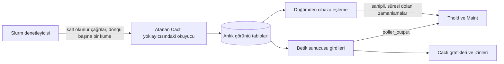

<!-- Source: README.md; SHA256: 16caa3e34c4d150a7fb1018f637e200a7580330f033b485047d8413bce09abba -->

<!-- translations:start -->
[English](../../../README.md) | [简体中文](../zh-CN/README.md) | [हिन्दी](../hi-IN/README.md) | [Español (España)](../es-ES/README.md) | [Español (Latinoamérica)](../es-419/README.md) | [العربية (السعودية)](../ar-SA/README.md) | [Afrikaans](../af-ZA/README.md) | [አማርኛ](../am-ET/README.md) | [العربية (مصر)](../ar-EG/README.md) | [العربية (المغرب)](../ar-MA/README.md) | [বাংলা](../bn-BD/README.md) | [Deutsch](../de-DE/README.md) | [فارسی](../fa-IR/README.md) | [Filipino](../fil-PH/README.md) | [Français](../fr-FR/README.md) | [Français (Maroc)](../fr-MA/README.md) | [Français (Sénégal)](../fr-SN/README.md) | [Hausa](../ha-NG/README.md) | [עברית](../he-IL/README.md) | [Bahasa Indonesia](../id-ID/README.md) | [Igbo](../ig-NG/README.md) | [Italiano](../it-IT/README.md) | [日本語](../ja-JP/README.md) | [한국어](../ko-KR/README.md) | [Malagasy](../mg-MG/README.md) | [मराठी](../mr-IN/README.md) | [Bahasa Melayu](../ms-MY/README.md) | [Nederlands](../nl-NL/README.md) | [Polski](../pl-PL/README.md) | [Português (Brasil)](../pt-BR/README.md) | [Русский](../ru-RU/README.md) | [Kinyarwanda](../rw-RW/README.md) | [Soomaali](../so-SO/README.md) | [Svenska](../sv-SE/README.md) | [Kiswahili](../sw-KE/README.md) | [தமிழ்](../ta-IN/README.md) | [తెలుగు](../te-IN/README.md) | [ไทย](../th-TH/README.md) | [Türkçe](README.md) | [Українська](../uk-UA/README.md) | [اردو](../ur-PK/README.md) | [Tiếng Việt](../vi-VN/README.md) | [isiXhosa](../xh-ZA/README.md) | [Yorùbá](../yo-NG/README.md) | [繁體中文](../zh-TW/README.md) | [isiZulu](../zu-ZA/README.md)
<!-- translations:end -->

# plugin_hpcsched

Zaten Cacti'nin izlediği cihazların yanında bir HPC toplu iş zamanlayıcısının durumunu grafikleştiren bir Cacti 1.2 eklentisidir: kuyruk derinliği, bekleyen ve çalışan işler, işlerin neden beklediği, düğüm durumları ve bölüm (partition) kullanımı. İlk arka uç Slurm'dur. Thold, elde edilen veri kaynakları üzerinde uyarı verebilir; Maint ise boşaltılmış (drained) düğümler ve bakım rezervasyonları tarafından yönlendirilebilir.

> **Durum: geliştirme aşamasında, henüz sürüm yayınlanmadı.** Kilometre taşı 2 (temel yapı) `main` dalına birleştirilmiştir ve bu dal kilometre taşı 3'ü (küme grafikleri ve bekleme nedenleri) ekler. Kod, Cacti'nin eklenti API'si üzerinden kurulur, yükseltilir ve kaldırılır; 8.2'nin altındaki PHP sürümlerini reddeder. Her biri bir Cacti yoklayıcısına (poller) atanmış Slurm kümelerinin bir kaydını tutar. Ana yoklayıcıdaki arka plan okuyucusu, her aralıkta küme başına bir anlık görüntü toplar; bunu `--json` ile `squeue`, `scontrol` ve `sshare` çalıştırarak ya da HTTPS üzerinden `slurmrestd` okuyarak yapar ve iş sayılarını durum ile bekleme nedenine göre, düğüm durumlarını, bölümleri, rezervasyonları ve adil paylaşım (fair-share) kullanımını güncellik bilgileriyle birlikte depolar. Eklenti, Cacti şablonlarını içerir ve yöneticinin onayıyla küme başına bir Cacti cihazı oluşturur ya da mevcut bir cihazla eşler; hem küme hem de her bölüm için duruma göre işler, neden ailesine göre bekleyen işler, duruma göre düğümler, CPU'lar ve kullanım oranları ile anlık görüntü yaşını gösteren grafikler üretir. Salt okunur genel bakış sayfası küme başına sayıları güncellikleriyle birlikte ve küme başına bekleme nedenleri görünümünü sunar; yalnızca yöneticilere açık sağlık sayfası ise her toplama işleminin ne döndürdüğünü ve şablonların kurulu olup olmadığını gösterir. Her sayfa ve eylem Cacti'nin cihaz izinlerini izler. Veri kaynakları Thold'un üzerinde uyarı oluşturabileceği türdendir, ancak henüz hiçbir Thold veya Maint entegrasyonu test edilmemiştir; bu, kilometre taşı 4 ve sonrasının kapsamındadır. Test paketi yapay Slurm komutlarını ve `slurmrestd` yanıtlarını kapsar; ayrıca CI aşağıda açıklandığı gibi kapsayıcılar içinde gerçek bir altı düğümlü Slurm kümesini de çalıştırarak sınar. Okuyucu henüz bir üretim kümesine karşı çalıştırılmamıştır. Operatör notlarının altındaki kısımlarda bu README, yayınlanmış davranışı değil tasarımı açıklamaktadır.

Bu bağımsız bir projedir ve Cacti projesiyle herhangi bir bağlantısı yoktur.

## Erişim rolleri

| Yetki Alanı | Erişim |
| --- | --- |
| HPC Scheduler View | Mevcut izleme sayfaları. |
| HPC Scheduler Operator | İzleme sayfalarına ek olarak Operations sayfası ve kişisel önceliklendirme (triage) onayları. |
| HPC Scheduler Admin | Operator erişimine ek olarak mevcut yapılandırma ve yönetimsel eylemler. |

Yükseltme dosyalarını kopyaladıktan sonra yeni yetki alanını kaydetmek için yönetici olarak Plugins sayfasını açın. Operator yetki alanını **Configuration > Users** veya kullanıcı grupları altında açıkça atayın. Yükseltmeler mevcut View ve Admin yetki alanı kimliklerini ve izinlerini korur. Her istekte Admin erişimi Operator erişimini, Operator erişimi ise View erişimini devralır; bu durum kullanıcılara veya gruplara depolanmış ek izinler eklemez. Eklenti ayarları ayrıca Cacti'nin Settings iznine ek olarak HPC Scheduler Admin erişimi gerektirir.

Cacti cihaz izinleri her kullanıcıya sunulan satırları ve eylemleri sınırlamaya devam eder; cihazı olmayan bir küme, eklenti yetki alanına sahip her kullanıcı için yönetimsel sayfalarda listelenir, ancak yalnızca bir cihaza eşlenmiş kümeleri listeleyen operatör görünümlerinde yer almaz. Kimlik bilgileri, yapılandırma, eşleme, silme ve diğer yönetimsel değişiklikler yönetimsel sayfalarda kalır. Onaylar yalnızca geçerli kullanıcının oturumunda, en fazla bir saat boyunca ve yalnızca aynı gözlem güncel kaldığı sürece geçerlidir. Yeni veya değişmiş gözlemler bunları geçersiz kılar. Başarısız bir ölçümü asla sağlıklı olarak işaretlemez veya uyarıları bastırmazlar.

## Kilometre taşı 2 için operatör notları

**En az ayrıcalık.** Eklenti yalnızca okuma yapar. Ona yönetici veya operatör rolü olmayan özel bir Slurm kullanıcısı verin (`sacctmgr` içinde `AdminLevel=None`). `slurm.conf` içinde `PrivateData=jobs` (veya `nodes`, `reservations`, `usage`) varsa, bu kullanıcı yalnızca kendi kayıtlarını görür; bu nedenle sayımlar eksik kalır ve eklenti bunu tespit edemez. Hesap için bu kısıtlamayı kaldırmak operatör veya yönetici düzeyi vermek anlamına gelir ve bu da değişiklik yapılmasına olanak tanır; bu ödünleşim tesisin kendi kararıdır. İstemci komutları için Cacti yoklayıcı kullanıcısının Slurm istemci ikili dosyalarına ve denetleyiciye ulaşan bir `slurm.conf` dosyasına ihtiyacı vardır; ikili dosya yolları Configuration > Settings > HPC Scheduler altında mutlak yol ayarlarıdır. `slurmrestd` için URL `https://` veya yalnızca loopback adresinde `http://` olmalıdır. TLS sertifikaları doğrulanır ve yönlendirmeler izlenmez. Configuration > Settings > HPC Scheduler altındaki isteğe bağlı bir slurmrestd ana bilgisayar listesi, bir kümenin belirtebileceği ana bilgisayarları ve bağlantı noktalarını sınırlar.

**Uzak yoklayıcılar.** Bu sürüm yalnızca ana Cacti yoklayıcısında toplama yapar. Uzak bir veri toplayıcıya atanan bir kümeden veri toplanmaz: oradaki okuyucu günlüğe kaydedilen bir nedenle işlemi reddeder ve sağlık sayfası kümenin adını gösterir. Uzaktan toplama aşama 3'ün kapsamındadır.

**Bellek.** Her toplama çalıştırması aynı anda tek bir zamanlayıcı yanıtının kodunu çözer; bu işlem PHP belleğinde yanıt boyutunun yaklaşık 12 katını kaplar (Slurm'unkine benzer yapıdaki iş kayıtları için yaklaşık 10 katı artı metnin kendisi olarak ölçülmüştür). Çalıştırma, PHP bellek sınırını Collection Memory ayarına (varsayılan olarak 1024 MiB) yükseltir ve Maximum Answer Size daha yüksek ayarlanmış olsa bile (Collection Memory - 64) / 12 MiB, yani varsayılan olarak 80 MiB'a kadar olan yanıtlara izin verir; bu durum gerçekleştiğinde sağlık sayfası uyarı verir. Daha büyük bir yanıt kendi bölümünü çok büyük olduğu için başarısız kılar ve yine de belleği tükenen bir çalıştırma başarısız olarak kaydedilir. Büyük bir küme her iki ayarın da yükseltilmesini gerektirebilir; 100.000 gerçek iş kaydı ölçülmemiştir.

**Belirteç dosyaları.** Bir `slurmrestd` kümesi bir belirteç dosyası belirtir; belirtecin kendisi asla veritabanında depolanmaz, bir sayfada gösterilmez veya günlüğe yazılmaz. Dosya, Configuration > Settings > HPC Scheduler altında ayarlanan belirteç dosyası dizinlerinden birinin içinde bulunmalı, sembolik bağlantı olmadan ulaşılabilmeli ve yalnızca yoklayıcı kullanıcısının yazabileceği, yoklayıcı kullanıcısına ait, tek bir satır içeren normal bir dosya olmalıdır: belirteç ya da `scontrol token` çıktısının verdiği şekilde `SLURM_JWT=<token>`. Hiç belirteç dizini ayarlanmamışsa hiçbir küme `slurmrestd` kullanamaz. Bu iki ayar Cacti'nin Settings sayfasındadır, dolayısıyla eklentinin Admin yetki alanı tek başına bunları değiştiremez; her belirteç dizinini yalnızca root ve yoklayıcı kullanıcısı tarafından yazılabilir tutun. Grup veya diğer kullanıcılar tarafından okunabilen bir dosya yine de kullanılır ve sağlık sayfası uyarı verir. Sağlık sayfası ayrıca belirtecin süresi yapılandırılan uyarı süresi içinde dolduğunda da uyarı verir.

Okuyucunun kısmi bir dosya gördüğü bir zaman aralığı olmadan belirteci döndürmek için yeni belirteci eskisinin yanına yazın ve yerine yeniden adlandırın:

```sh
dir=/etc/cacti/hpcsched
tmp=$(mktemp "$dir/.token.XXXXXX")
scontrol token username=cactiread lifespan=2592000 > "$tmp"
chown cacti:cacti "$tmp"
chmod 0600 "$tmp"
mv -f "$tmp" "$dir/cluster1.token"
```

Bir sonraki toplama yeni dosyayı okur. `scontrol token` ile belirteç oluşturmak bir Slurm yöneticisi gerektirir; bunu izin verilen yerde çalıştırın ve dosyayı yoklayıcıya kopyalayın.

## Kilometre taşı 3 için operatör notları

**Şablonlar.** Kurulum ve yükseltme, HPC Scheduler cihaz, veri ve grafik şablonlarını içe aktarır ve bölüm veri sorgusunu Cacti'nin `resource/script_server/` dizinine kopyalar. Bu dizin eklentiyi kuran kullanıcı tarafından yazılabilir değilse, aynı ada sahip farklı bir dosya zaten oradaysa ve eklenti tarafından yazılmamışsa ya da bu ad bir sembolik bağlantıysa, içe aktarma durur, dosyaya dokunulmaz ve sağlık sayfası ne yapılması gerektiğini bildirir; sağlık sayfasındaki Install Templates yeniden dener. Elle yapılmış birebir aynı bir kopya kullanılır ancak size ait kalır. Kaldırma işlemi sorgu dosyasını yalnızca eklenti yazmışsa ve dosya değiştirilmemişse siler; şablonları, cihazları ve grafikleri ise korur.

**Küme cihazları.** HPC Clusters > Device, herhangi bir şey oluşturulmadan önce bir cihazın neler ekleyeceğini (grafikler, veri kaynakları, RRD dosyaları ve yoklama başına betik sunucusu çağrıları) gösterir. Create Device, ayrılmış `.invalid` etki alanında bir ana bilgisayar adına sahip ve erişilebilirlik denetimi olmayan bir cihaz oluşturur; Map Device ise bunun yerine grafikleri mevcut bir cihaza ekler ve ayarlarına dokunmaz. Her küme grafiğinin ve her bölüm grafiğinin kendi veri kaynağı vardır: küme için altı ve bölüm başına beş adet; yoklama başına küme veri kaynağı başına bir ve bir bölümün her değeri için bir (32) betik sunucusu çağrısı yapılır. Daha sonra eklenen bölümler okuyucu onları gördüğünde indekslenir ve Cacti'nin New Graphs sayfasından grafiklerini alır; kaldırılan bir bölümün yoklanması durur ve grafikleri korunur. Cihazı silmek kümenin eşlemesini kaldırır ve kümeyi korur.

**Grafiklerin saydıkları.** Bekleyen işler, kendi serisine sahip olan bekletilen (held) işleri hariç tutar. Bekleyen bir iş dizisi (array), kalan görevlerini sayar. Birden fazla bölümdeki bir iş veya düğüm, küme grafiklerinde bir kez ve her bölümde bir kez sayılır; bu nedenle bölüm grafiklerinin toplamının kümeninkine eşit olması gerekmez. Bekleme nedenleri on bir ailede gruplandırılmıştır ([ADR 0011](../../decisions/0011-pending-reason-families-and-counting.md)); bekleme nedenleri görünümü Other içindekiler dahil ham nedenleri listeler. Her iş yalnızca zamanlayıcının incelediği son nedeni bildirir. Kullanım paydası boşaltılmış (drained), çalışmayan (down) ve diğer kullanılamayan düğümleri içerir. Bayat veya başarısız veriler asla sıfır değil `U` olur; `age` sayısal kalır.

**Uyarı verme.** Thold bu veri kaynaklarından herhangi biri üzerinde uyarı verebilir; Thold sürelerini en az bir toplama aralığına ayarlayın ve durmuş bir okuyucuyu yakalamak için `age` üzerinde uyarı oluşturun. Uçtan uca Thold denetimi kilometre taşı 4'tür.

**Gerçek Slurm çıktısına karşı test edilmiştir.** CI, kapsayıcılar içinde altı düğümlü bir Slurm kümesi başlatır (her değişiklikte 26.05.5; `main` dalına gönderimlerde, haftalık olarak ve istek üzerine kaynaktan derlenen 25.11.8) ve düğüm durumlarını, bakım rezervasyonunu, bekleme nedenlerini ve iş dizilerini eklentinin ayrıştırdığı şekliyle denetler; ardından eklentinin kendi komut ve `slurmrestd` aktarım katmanlarıyla bu kümeden veri toplar. Daha eski sürümler yalnızca yapay test verileriyle (fixtures) kapsanmaktadır. Okuyucu hâlâ bir üretim kümesine karşı çalıştırılmamıştır.

**İzinler.** Bir cihaz üzerindeki küme, her eklenti sayfasında yalnızca Cacti'nin o cihaza izin verdiği kullanıcılara gösterilir, dışa aktarılır ve bu kullanıcılar tarafından değiştirilir; bir cihazı eşlemek de hedef cihaz için izin gerektirir. Cihazı olmayan bir küme, eklenti yetki alanına sahip herkese görünür. Eklenti devre dışıyken silinmiş bir cihazla hâlâ eşli olan bir küme yalnızca HPC Scheduler Admin yetki alanına sahip kullanıcılara gösterilir; bu kullanıcılar küme için bir cihaz oluşturabilir veya eşleyebilir. Grafik erişimi Cacti'nin kendi kurallarına tabidir.

## Neden

Cacti çalıştıran operatörler hesaplama düğümlerini zaten grafikleştirir. Zamanlayıcının görünümü bu grafiklerde eksiktir ve bu da iki boşluk bırakır:

- **"İş neden başlamıyor" bilgisinin olmaması.** Slurm her bekleyen iş için bir neden kaydeder. Boşta duran düğüm grafiklerinin yanındaki dolu bir kuyruk, nedenin öncelik, kaynak sınırları, bekletmeler, bağımlılıklar veya boşaltılmış düğümler olup olmadığını söylemez.
- **Zamanlayıcı durumu ile uyarı verme arasında bağlantı olmaması.** Thold, bir yöneticinin zaten boşalttığı bir cihaz için uyarı verir ve yöneticiler Maint zamanlamalarını elle oluşturur.

Eklenti, küme başına önbelleğe alınmış bir anlık görüntü toplar, bunu olağan Cacti veri kaynakları ve grafikleri olarak yayınlar, zamanlayıcı düğümlerini mevcut Cacti cihazlarıyla eşler ve boşaltılmış düğümleri ile bakım rezervasyonlarını Maint içine yerleştirebilir. Cacti'nin izinlerini, uzak veri toplayıcılarını, Thold'u ve Maint'i yeniden kullanır ve zamanlayıcıya karşı salt okunurdur.

## Planlanan kapsam

| Aşama | Kapsam | Kilometre Taşları |
|---|---|---|
| 0, araştırma | Slurm sürüm matrisi, üst akış davranış doğrulaması, denetleyici yükü, düğüm adlandırma test verileri | [M1](https://github.com/somethingwithproof/plugin_hpcsched/milestone/1) |
| 1, küme grafikleri | Kuyruk derinliği, bekleyen ve çalışan işler, bekleme nedenleri, düğüm durumları, bölüm kullanımı, Thold uyarısı, sağlık sayfası, sürüm | [M2](https://github.com/somethingwithproof/plugin_hpcsched/milestone/2), [M3](https://github.com/somethingwithproof/plugin_hpcsched/milestone/3), [M4](https://github.com/somethingwithproof/plugin_hpcsched/milestone/4) |
| 2, düğümler ve bakım | Düğümden cihaza eşleme, düğüm başına durum, boşaltılmış düğümler ve bakım rezervasyonları için otomatik Maint pencereleri | [M5](https://github.com/somethingwithproof/plugin_hpcsched/milestone/5) |
| 3, muhasebe | Adil paylaşım (fair-share) kullanımı, sınırlı muhasebe istatistikleri, uzak veri toplayıcılar | [M6](https://github.com/somethingwithproof/plugin_hpcsched/milestone/6) |

Kapsam dışı: herhangi bir zamanlayıcı yazma yolu (gönderme, iptal etme, bekletme, boşaltma, sürdürme), eklentiye ait bir uyarı motoru, bir raporlama veya ücretlendirme motoru, kullanıcı başına ve iş başına seriler. PBS Pro, OpenPBS ve LSF arka uçları araştırma aşamasındadır.

## Uyumluluk hedefleri

| Bileşen | Hedef |
|---|---|
| Cacti | 1.2.31 veya üzeri, çekirdek yaması olmadan |
| PHP | 8.2 veya üzeri; desteklenmeyen bir çalışma zamanının bozuk bir Cacti arayüzü yerine reddedilme mesajı alması için `setup.php` 8.0 üzerinde ayrıştırılabilir kalır |
| Slurm | 25.05, 25.11 ve 26.05, en son üç sürüm ([ADR 0013](../../decisions/0013-three-latest-slurm-releases.md)); 25.11 ve 26.05 canlı bir kümeye karşı, 25.05 ise yalnızca test verilerine karşı test edilir. İstemci komutları varsayılan aktarım katmanıdır ([ADR 0012](../../decisions/0012-client-commands-default-transport.md)) ve veri ayrıştırıcı ayarını kullanır: varsayılan olarak SchedMD'nin 27.05'te kaldıracağı v0.0.43 ya da bunları içeren sürümlerde v0.0.44 veya v0.0.45. slurmrestd kümeleri, arka plan programının sunduğu en yeni ayrıştırıcıyı keşfeder |
| Thold, Maint | Thold değişikliği yok; Maint entegrasyonu, Maint bakımcılarının onayını gerektiren bir öneridir |

## Tasarım

- [docs/PLAN.md](../../PLAN.md) tam plandır: mimari, dayandığı üst akış gerçekleri (kaynakları ve doğrulanmamış varsayımların açık bir listesiyle), düğüm eşleme, durum modeli, güvenlik sınırları, performans aritmetiği, testler ve riskler.
- [docs/decisions/](../../decisions) mimari karar kayıtlarını barındırır.
- [docs/REQUIREMENTS.md](../../REQUIREMENTS.md) her gereksinim kimliğini ilgili iş kaydıyla eşler.



## Çalışmaların izlenme biçimi

- **Kilometre taşları**, plandaki kilometre taşlarını izler. Her birinin alt iş kayıtlarını ve çıkış kanıtlarını listeleyen bir epik iş kaydı vardır.
- **İş kayıtları** etiketlerle türlendirilir: `type: requirement`, `type: research`, `type: decision`, `type: epic`. Gereksinim iş kayıtları numaralandırılmış, test edilebilir gereksinimleri (`REQ-AREA-NNN`) ve kabul ölçütlerini belirtir.
- **Etiketler** ayrıca `area:`, `phase:`, `priority:` ve `status:` taşır. Bkz. [CONTRIBUTING.md](../../../CONTRIBUTING.md#labels).
- [Proje panosu](https://github.com/users/somethingwithproof/projects/10) kilometre taşları genelindeki tüm iş kayıtlarını gösterir.

## Katkıda bulunma

[CONTRIBUTING.md](../../../CONTRIBUTING.md) dosyasını okuyun. Commit'ler bir DCO imzası gerektirir. Tasarım tartışmaları iş kayıtları üzerinde yapılır; açık kararlar `type: decision` etiketini taşır.

## Güvenlik

Güvenlik açıklarını gizli olarak bildirin; bkz. [SECURITY.md](../../../SECURITY.md).

## Lisans

Cacti ve eklentileriyle aynı lisans olan GNU General Public License v2.0. Bkz. [LICENSE](../../../LICENSE).
