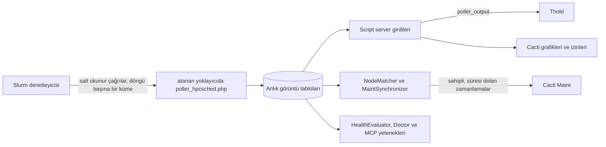

<!-- Source: README.md; SHA256: 938114d41dbd516f9dfcd94619c4fc73ef56b4da1dd693010588a93cce250534 -->

<!-- translations:start -->
[English](../../../README.md) | [简体中文](../zh-CN/README.md) | [हिन्दी](../hi-IN/README.md) | [Español (España)](../es-ES/README.md) | [Español (Latinoamérica)](../es-419/README.md) | [العربية (السعودية)](../ar-SA/README.md) | [Afrikaans](../af-ZA/README.md) | [አማርኛ](../am-ET/README.md) | [العربية (مصر)](../ar-EG/README.md) | [العربية (المغرب)](../ar-MA/README.md) | [Български](../bg-BG/README.md) | [বাংলা](../bn-BD/README.md) | [Bosanski](../bs-BA/README.md) | [Deutsch](../de-DE/README.md) | [Ελληνικά](../el-GR/README.md) | [فارسی](../fa-IR/README.md) | [Filipino](../fil-PH/README.md) | [Français](../fr-FR/README.md) | [Français (Maroc)](../fr-MA/README.md) | [Français (Sénégal)](../fr-SN/README.md) | [Hausa](../ha-NG/README.md) | [עברית](../he-IL/README.md) | [Hrvatski](../hr-HR/README.md) | [Bahasa Indonesia](../id-ID/README.md) | [Igbo](../ig-NG/README.md) | [Italiano](../it-IT/README.md) | [日本語](../ja-JP/README.md) | [ქართული](../ka-GE/README.md) | [한국어](../ko-KR/README.md) | [Latviešu](../lv-LV/README.md) | [Malagasy](../mg-MG/README.md) | [मराठी](../mr-IN/README.md) | [Bahasa Melayu](../ms-MY/README.md) | [Nederlands](../nl-NL/README.md) | [Polski](../pl-PL/README.md) | [Português (Brasil)](../pt-BR/README.md) | [Português (Portugal)](../pt-PT/README.md) | [Русский](../ru-RU/README.md) | [Kinyarwanda](../rw-RW/README.md) | [Soomaali](../so-SO/README.md) | [Српски](../sr-RS/README.md) | [Svenska](../sv-SE/README.md) | [Kiswahili](../sw-KE/README.md) | [தமிழ்](../ta-IN/README.md) | [తెలుగు](../te-IN/README.md) | [ไทย](../th-TH/README.md) | [Türkçe](README.md) | [Українська](../uk-UA/README.md) | [اردو](../ur-PK/README.md) | [Tiếng Việt](../vi-VN/README.md) | [isiXhosa](../xh-ZA/README.md) | [Yorùbá](../yo-NG/README.md) | [繁體中文](../zh-TW/README.md) | [isiZulu](../zu-ZA/README.md)
<!-- translations:end -->

# plugin_hpcsched

Zaten Cacti'nin izlediği cihazların yanında bir HPC toplu iş zamanlayıcısının durumunu grafikleştiren bir Cacti 1.2 eklentisidir (`hpcsched`, sürüm `0.1.0-dev`): kuyruk derinliği, bekleyen ve çalışan işler, işlerin neden beklediği, düğüm durumları, bölüm (partition) kullanımı ve hesap düzeyinde adil paylaşım (fair-share) kullanımı. Uygulanan arka uç Slurm'dur. Thold, elde edilen veri kaynakları üzerinde uyarı verebilir ve isteğe bağlı Maint eşitleyicisi, boşaltılmış (drained), kapalı (down) ve bakım için ayrılmış Slurm hesaplama düğümlerinden Cacti Maint pencerelerini yönetir.

> **Durum: geliştirme aşamasında, henüz sürüm yayınlanmadı.** Bu dal; eklenti temelini, küme ve bölüm grafiklerini, bekleme nedeni ailelerini, Slurm hesaplama düğümü ile Cacti cihazı eşleştirmesini, isteğe bağlı Cacti Maint pencere eşitlemesini, hesap düzeyinde adil paylaşım özetlerini, uzak veri toplayıcı yürütme ve çoğaltmasını, Configuration-as-Code (CasC) ve operasyon CLI'sini ve Cacti ekosistem kancalarını (CasC, Doctor ve MCP / Abilities API v2) uygular. Test paketi yapay Slurm komutlarını ve `slurmrestd` yanıtlarını kapsar; CI ise kapsayıcılar içinde çalışan altı düğümlü bir Slurm kümesini test eder. Okuyucu henüz bir üretim kümesine karşı çalıştırılmamıştır ve uçtan uca bir Thold yeniden oynatma testi henüz CI'da yer almamaktadır.

Bu bağımsız bir projedir ve Cacti projesiyle herhangi bir bağlantısı yoktur.

## Neler uygulandı

- **Yaşam döngüsü ve şema (v3)**: kurulum, idempotent yükseltme, kaldırma (varsayılan olarak eklenti tablolarını korur) ve giriş noktalarını PHP 8.0'da ayrıştırılabilir tutarken PHP 8.2 alt sınırı. Şema v3; cluster, run, section, job-count, node-count, node, partition, reservation ve share tablolarının yanına `plugin_hpcsched_node_map` ve `plugin_hpcsched_maint_link` tablolarını ekler.
- **Ana ve uzak yoklayıcılarda salt okunur Slurm toplama**: `poller_bottom`, her yoklayıcıda (`poller_id`) kendisine atanmış etkin kümeler için arka planda `poller_hpcsched.php --cluster=N` komutunu başlatır. Her çalışma, istemci komutları (`squeue`, `scontrol`, `--json` ile `sshare`) veya HTTPS üzerinden `slurmrestd` (sağlık uyarısıyla geri döngü HTTP'ye izin verilir) aracılığıyla küme başına önbelleğe alınmış bir anlık görüntü toplar. `INFO`, `remote_collect:1, remote_poller:1` bildirir ve `replicate_out`, gizli olmayan `plugin_hpcsched_cluster` tanımlarını uzak toplayıcılara (`poller_id >= 2`) çoğaltır; belirteç (token) dosyası içerikleri hiçbir zaman okunmaz veya çoğaltılmaz.
- **Cacti şablonları ve küme grafikleri**: cihaz, veri ve grafik şablonlarını (`templates/hpcsched-templates.xml`) ve bölüm script-server veri sorgusunu (`scripts/ss_hpcsched_cluster.php`, `scripts/ss_hpcsched_partitions.php`) içerir. Yönetici onayıyla, küme başına bir Cacti cihazı oluşturur veya eşler; duruma göre işler, neden ailesine göre bekleyen işler, duruma göre düğümler, CPU'lar, kullanım (küme ve bölüm başına) ve anlık görüntü yaşı için grafikler sağlar.
- **Slurm düğüm-cihaz eşleştirme ve Cacti Maint eşitleme**: dört katmanlı doğrusal zamanlı eşleyici (`NodeMatcher`), Slurm hesaplama düğümlerini mevcut Cacti `host` kayıtlarıyla eşler (tam ana bilgisayar adı, tam adres, tam açıklama/takma ad veya IP olmayan adlar için ilk DNS etiketi) ve tahmin yürütmek yerine çoklu eşleşmeleri veya mükerrer cihaz taleplerini `ambiguous` olarak işaretler. `HostList::expand()` Slurm rezervasyon ana bilgisayar listelerini (10.000 düğüme kadar) genişletir. `MaintSynchronizer`, yönetici tarafından oluşturulan Maint zamanlamalarını değiştirmeden `DRAIN`, `DRAINING`, `DOWN` durumundaki veya etkin `MAINT`/`MAINTENANCE` rezervasyonlarındaki eşlenmiş düğümler için `plugin_hpcsched_maint_link` içinde izlenen eklentiye ait tek seferlik Cacti Maint zamanlamalarını oluşturur, yeniler ve kaldırır.
- **Hesap düzeyinde adil paylaşım özetleri**: `collect_shares` etkinleştirildiğinde, Slurm hesap ilişkilendirme satırlarını `plugin_hpcsched_share` tablosuna toplar ([ADR 0010](../../decisions/0010-bound-series-cardinality.md) uyarınca kullanıcı satırlarını atlar). `ShareSummary` ve `ShareRepository` hesap/bölüm sayılarını, ham ve etkin kullanım toplamlarını, en düşük/en yüksek/ortalama adil paylaşım faktörlerini ve en üstteki hesapları hesaplar; hesap sayıları `hpcsched-get-queue-summary` içinde sunulur.
- **CasC ve operasyon CLI'si (`cli/hpcsched.php`)**: YAML/XML yapılandırma dışa aktarma, doğrulama, deneme amaçlı (dry-run) fark planlama, onay kapılı uygulama, yapılandırılmış sağlık çıktısı ve isteğe bağlı Maint eşitleme (`sync-maint --dry-run` / `--apply`).
- **Ekosistem kancaları (`setup.php`)**: `casc_register_providers`, `doctor_register_checks` ve `abilities_register`.

## Erişim rolleri

| Yetki Alanı | Erişim |
| --- | --- |
| HPC Scheduler View | Salt okunur küme genel bakışı ve bekleme nedenleri (`hpcsched.php`). |
| HPC Scheduler Operator | View erişimine ek olarak Operations sayfası (`hpcsched_operator.php`) ve kişisel önceliklendirme onayları. |
| HPC Scheduler Admin | Operator erişimine ek olarak küme yönetimi (`hpcsched_clusters.php`) ve sağlık sayfası (`hpcsched_health.php`). |

Yükseltme dosyalarını kopyaladıktan sonra yeni yetki alanlarını ve kancaları kaydetmek için yönetici olarak Plugins sayfasını açın. Operator yetki alanını **Configuration > Users** veya kullanıcı grupları altında açıkça atayın. Yükseltmeler mevcut View ve Admin yetki alanı kimliklerini ve izinlerini korur. Her istekte Admin erişimi Operator erişimini, Operator erişimi ise View erişimini devralır; bu durum kullanıcılara veya gruplara depolanmış ek izinler eklemez. Eklenti ayarları ayrıca Cacti'nin Settings iznine ek olarak HPC Scheduler Admin erişimi gerektirir.

Cacti cihaz izinleri her kullanıcıya sunulan satırları ve eylemleri sınırlar. Bir Cacti cihazına eşlenmiş küme, yalnızca Cacti'nin o cihaza izin verdiği kullanıcılara gösterilir, dışa aktarılır ve bu kullanıcılar tarafından değiştirilebilir; bir cihazı eşlemek için hedef cihaza yönelik izin de gerekir. Cihazı olmayan bir küme, eklenti yetki alanına sahip kullanıcılar için yönetimsel sayfalarda listelenir, ancak yalnızca bir cihaza eşlenmiş kümeleri listeleyen operatör görünümlerinde yer almaz. Eklenti devre dışıyken eşlenmiş cihazı silinen bir küme yalnızca HPC Scheduler Admin erişimine sahip kullanıcılara gösterilir. Onaylar yalnızca geçerli kullanıcının oturumunda, en fazla bir saat boyunca ve yalnızca aynı gözlem güncel kaldığı sürece geçerlidir. Yeni veya değişmiş gözlemler bunları geçersiz kılar. Başarısız bir ölçümü asla sağlıklı olarak işaretlemez veya uyarıları bastırmazlar.

## Operatör notları

### Güvenlik, en az ayrıcalık ve belirteç dosyaları

Eklenti yalnızca okuma yapar. Ona yönetici veya operatör rolü olmayan özel bir Slurm kullanıcısı verin (`sacctmgr` içinde `AdminLevel=None`). `slurm.conf` içinde `PrivateData=jobs` (veya `nodes`, `reservations`, `usage`) varsa, bu kullanıcı yalnızca kendi kayıtlarını görür; bu nedenle sayımlar eksik kalır ve eklenti bunu algılayamaz. Hesap için bu kısıtlamayı kaldırmak, değişikliklere de olanak tanıyan operatör veya yönetici düzeyi gerektirir; bu denge sitenin kararına bağlıdır.

İstemci komutları için, Cacti yoklayıcı kullanıcısının Slurm istemci ikili dosyalarına (`squeue`, `scontrol` ve isteğe bağlı olarak `sshare`) ve denetleyiciye ulaşan bir `slurm.conf` dosyasına ihtiyacı vardır; ikili dosya yolları **Configuration > Settings > HPC Scheduler** altındaki mutlak ayarlardır.

`slurmrestd` için URL mutlaka `https://` veya yalnızca geri döngü adresinde `http://` olmalıdır. TLS sertifikaları doğrulanır ve yönlendirmeler izlenmez. **Configuration > Settings > HPC Scheduler** altındaki isteğe bağlı `slurmrestd` ana bilgisayar listesi, bir kümenin hangi ana bilgisayarları ve bağlantı noktalarını adlandırabileceğini kısıtlar.

Bir `slurmrestd` kümesi bir belirteç (token) dosyasını adlandırır; belirtecin kendisi hiçbir zaman veritabanında saklanmaz, bir sayfada gösterilmez, CasC tarafından dışa aktarılmaz veya günlüğe yazılmaz. Dosya, **Configuration > Settings > HPC Scheduler** altında yapılandırılan Token File Directories dizinlerinden birinin içinde olmalı, sembolik bağlantı olmadan erişilmeli ve yoklayıcı kullanıcısına ait olup yalnızca o kullanıcının yazabileceği, tek satır içeren normal bir dosya olmalıdır: belirteç veya `scontrol token` komutunun yazdırdığı biçimde `SLURM_JWT=<token>`. Hiçbir belirteç dizini ayarlanmamışsa hiçbir küme `slurmrestd` kullanamaz. Her belirteç dizinini yalnızca root ve yoklayıcı kullanıcısı tarafından yazılabilir tutun. Grup veya diğer kullanıcılar tarafından okunabilen bir dosya yine de kullanılır ve sağlık sayfası uyarır; belirtecin süresi yapılandırılan uyarı penceresi içinde dolduğunda da uyarır.

Bir belirteci atomik olarak döndürmek için:

```sh
dir=/etc/cacti/hpcsched
tmp=$(mktemp "$dir/.token.XXXXXX")
scontrol token username=cactiread lifespan=2592000 > "$tmp"
chown cacti:cacti "$tmp"
chmod 0600 "$tmp"
mv -f "$tmp" "$dir/cluster1.token"
```

Bir sonraki toplama işlemi yeni dosyayı okur. `scontrol token` ile belirteç oluşturmak Slurm yöneticisi gerektirir; izin verilen yerde çalıştırın ve dosyayı yoklayıcıya kopyalayın.

### Uzak veri toplayıcılar

`INFO`, `remote_collect:1, remote_poller:1` bildirir. `hpcsched_poller_bottom()`, ilgili `poller_id` değerine atanmış etkin kümeler için her yoklayıcıda `poller_hpcsched.php` betiğini başlatır ve `hpcsched_replicate_out()`, gizli olmayan `plugin_hpcsched_cluster` satırlarını uzak yoklayıcılara (`poller_id >= 2`) çoğaltır. Belirteç dosyaları ve Slurm istemci ikili dosyaları atanmış uzak yoklayıcıda yerel olarak bulunmalıdır; belirteç içerikleri hiçbir zaman çoğaltılmaz.

### Bellek sınırları

Her toplama çalışması aynı anda bir zamanlayıcı yanıtını çözer; bu da PHP belleğinde yanıt boyutunun yaklaşık 12 katı yer kaplar (Slurm benzeri iş kayıtları için metnin kendisiyle birlikte yaklaşık 10 katı olarak ölçülmüştür). Okuyucu, PHP bellek sınırını Collection Memory ayarına (varsayılan olarak 1024 MiB) yükseltir ve Maximum Answer Size daha yüksek ayarlanmış olsa bile `(Collection Memory - 64) / 12` MiB (varsayılan olarak 80 MiB) boyutuna kadar yanıtlara izin verir; Maximum Answer Size bu uyarlanmış sınırı aştığında sağlık sayfası uyarır. Daha büyük bir yanıt kendi bölümünü çok büyük olarak başarısız kılar ve yine de bellek tüketen bir çalışma bellek hatası kaydedip bir kapanma işleyicisi aracılığıyla kiralama ve işlem yuvasını serbest bırakır. Büyük kümelerde her iki ayarın da yükseltilmesi gerekebilir; 100.000 gerçek iş kaydı ölçülmemiştir.

### Şablonlar, küme cihazları ve grafik sayımı

Kurulum ve yükseltme, HPC Scheduler cihaz, veri ve grafik şablonlarını içe aktarır ve bölüm veri sorgusunu Cacti'nin `resource/script_server/` dizinine kopyalar. Bu dizin yazılabilir değilse, orada aynı ada sahip farklı bir dosya varsa veya hedef bir sembolik bağlantıysa içe aktarma durur, dosyaya dokunulmaz ve **Install Templates** seçeneğinin yeniden denediği sağlık sayfasında durum bildirilir. Kaldırma işlemi, sorgu dosyasını yalnızca eklenti yazmışsa ve dosya değiştirilmemişse kaldırır; şablonları, cihazları ve grafikleri korur.

**HPC Clusters > Device**, herhangi bir şey oluşturmadan önce yoklama başına grafikleri, veri kaynaklarını, RRD dosyalarını ve script server çağrılarını önizler. **Create Device** ayrılmış `.invalid` etki alanında bir ana bilgisayar adına sahip ve kullanılabilirlik denetimi olmayan bir cihaz oluşturur; **Map Device** ise ayarlarını değiştirmeden grafikleri mevcut bir cihaza bağlar. Her küme grafiğinin ve bölüm grafiğinin kendi veri kaynağı vardır: küme için altı ve bölüm başına beş adet. Sonradan eklenen bölümler, okuyucu bir değişiklik algıladığında otomatik olarak yeniden dizinlenir; kaldırılan bölümlerin yoklanması durur ve grafikleri korunur. Bir cihazı silmek, küme kaydını korurken kümenin eşlemesini kaldırır (ve eşleşen `plugin_hpcsched_node_map` satırlarını temizler).

Bekleyen işler, kendi serilerine sahip olan bekletilen (held) işleri hariç tutar. Bekleyen bir iş dizisi kalan görevlerini sayar. Birden fazla bölümdeki bir iş veya düğüm, küme grafiklerinde bir kez ve her bölümde bir kez sayılır; bu nedenle bölüm toplamlarının küme toplamına eşit olması gerekmez. Bekleme nedenleri on bir ailede gruplandırılmıştır ([ADR 0011](../../decisions/0011-pending-reason-families-and-counting.md)); bekleme nedenleri görünümü `Other` içindekiler dahil ham nedenleri listeler. Kullanım paydası boşaltılmış, kapalı ve diğer kullanılamayan düğümleri içerir. Eski veya başarısız veriler asla sıfır olarak değil `U` olarak bildirilir; `age` sayısal kalır.

Uyarılar için, en az bir toplama aralığı süresine sahip herhangi bir küme veya bölüm veri kaynağında Thold yapılandırın ve durmuş bir okuyucuyu algılamak için `age` üzerinde uyarı oluşturun.

## CLI ve ekosistem kancaları

### Okuyucu giriş noktası

`hpcsched_poller_bottom()`, `poller_hpcsched.php` betiğini otomatik olarak başlatır; kümenin atandığı yoklayıcıda el ile de çalıştırılabilir:

```sh
php /path/to/cacti/plugins/hpcsched/poller_hpcsched.php --cluster=N [--force] [--debug]
```

`--force`, komut satırı tanısı için eklenti devre dışıyken bile çalışır.

### Configuration-as-Code, sağlık ve Maint eşitleme CLI'si

```sh
php /path/to/cacti/plugins/hpcsched/cli/hpcsched.php export [--format=yaml|xml] [--file=PATH]
php /path/to/cacti/plugins/hpcsched/cli/hpcsched.php validate --file=PATH [--format=yaml|xml]
php /path/to/cacti/plugins/hpcsched/cli/hpcsched.php plan --file=PATH [--format=yaml|xml]
php /path/to/cacti/plugins/hpcsched/cli/hpcsched.php apply --file=PATH --confirm=PLAN_HASH [--format=yaml|xml]
php /path/to/cacti/plugins/hpcsched/cli/hpcsched.php health [--format=text|json]
php /path/to/cacti/plugins/hpcsched/cli/hpcsched.php sync-maint [--dry-run | --apply] [--cluster=ID] [--format=text|json]
```

- `export`, yeni dosyaları `0600` kipiyle (veya stdout'a) yazar ve yapılandırılmış `token_file` yollarını `[REDACTED]` ile değiştirir. `plan` ve `apply`, satır içi `jwt`, `secret` ve `password` alanlarını reddeder ve `[REDACTED]` sağlandığında mevcut yerel `token_file` yollarını korur. `apply`, `plan` tarafından yazdırılan tam `--confirm=PLAN_HASH` değerini gerektirir.
- `health`, zamanlayıcılarla iletişim kurmadan veya belirteç dosyalarını okumadan şema güncelliğini, küme güncelliğini, çalışma sonuçlarını, Maint kullanılabilirliğini ve uyarıları değerlendirir.
- `sync-maint` varsayılan olarak `--dry-run` kullanır ve `DRAIN`, `DRAINING`, `DOWN` durumundaki veya etkin `MAINT`/`MAINTENANCE` rezervasyonlarındaki eşlenmiş Slurm düğümleri için Cacti Maint zamanlamalarını önizler veya uygular (varsayılan boşaltma/kapalı ufku 3600 sn, yenileme payı 600 sn). `plugin_maint_schedules` ve `plugin_maint_hosts` yoksa `--apply` seçeneğini reddeder ve yalnızca `plugin_hpcsched_maint_link` içinde kayıtlı zamanlamaları günceller veya kaldırır.

### Ekosistem kancaları

İlgili Cacti eklentileri veya ana bilgisayar entegrasyonları mevcut olduğunda `setup.php` şunları kaydeder:

- `casc_register_providers`: `hpcsched` yapılandırmasını (`yaml` ve `xml`, şema v1) gizli veri sansürleme ile dışa aktarır, doğrular, planlar ve onaylı olarak uygular.
- `doctor_register_checks`: dört salt okunur tanılama denetimi sağlar (`hpcsched.schema`, `hpcsched.cluster_freshness`, `hpcsched.token_health`, `hpcsched.maint_sync`).
- `abilities_register`: `hpcsched` kategorisi altında HPC Scheduler View yetki alanı (ve küme özetleri için cihaz izinleri) tarafından denetlenen üç salt okunur, yıkıcı olmayan, idempotent yetenek kaydeder: `hpcsched-list-clusters`, `hpcsched-get-queue-summary` ve `hpcsched-get-health`.

## Neden

Cacti çalıştıran operatörler hesaplama düğümlerinin grafiklerini zaten çizmektedir. Bu grafiklerde zamanlayıcının görünümü eksiktir ve bu da iki boşluk bırakır:

- **"İş neden başlamıyor" yanıtının olmaması.** Slurm bekleyen her iş için bir neden kaydeder. Boşta duran düğüm grafiklerinin yanındaki dolu bir kuyruk, nedenin öncelik, kaynak sınırları, bekletmeler, bağımlılıklar veya boşaltılmış düğümler olup olmadığını söylemez.
- **Zamanlayıcı durumu ile uyarı sistemi arasında bağlantı olmaması.** Thold, yöneticinin zaten boşalttığı bir cihazda uyarı verir ve yöneticiler Maint zamanlamalarını elle oluşturur.

Eklenti, küme başına önbelleğe alınmış bir anlık görüntü toplar, bunu sıradan Cacti veri kaynakları ve grafikleri olarak yayınlar, zamanlayıcı düğümlerini mevcut Cacti cihazlarıyla eşler ve boşaltılmış, kapalı ve bakım için ayrılmış düğümler için eklentiye ait süresi dolan Maint pencerelerini eşitler. Cacti'nin izinlerini, uzak veri toplayıcılarını, Thold'u ve Maint'i yeniden kullanır ve zamanlayıcıya karşı kesinlikle salt okunur kalır.

## Kapsam ve sınırlar

Kapsam dışı: herhangi bir zamanlayıcı yazma yolu (submit, cancel, hold, drain, resume), eklentiye ait bir uyarı motoru, bir raporlama veya maliyetlendirme motoru ve kullanıcı başına veya iş başına seriler. PBS Pro, OpenPBS ve LSF arka uçları yalnızca araştırma amaçlıdır.

## Gereksinimler ve uyumluluk

| Bileşen | Hedef |
|---|---|
| Cacti | 1.2.31 veya üzeri (`compat = 1.2.31`), çekirdek yaması yok |
| PHP | 8.2 veya üzeri; giriş noktaları 8.0 üzerinde ayrıştırılabilir kalır ve 8.1 üzerinde etkinleştirmeyi reddeder, böylece desteklenmeyen bir çalışma zamanı bozuk bir Cacti kullanıcı arayüzü yerine ret yanıtı alır |
| Slurm | 25.05, 25.11 ve 26.05 ([ADR 0013](../../decisions/0013-three-latest-slurm-releases.md)); 26.05.5 her değişiklikte altı düğümlü bir kapsayıcı kümesine karşı CI'da test edilir, 25.11.8 `main` üzerinde, haftalık ve istek üzerine test edilir, 25.05 ise yalnızca test verilerine karşı sınanır. İstemci komutları varsayılan olarak `v0.0.43` veri ayrıştırıcısını kullanır (`v0.0.44` ve `v0.0.45` seçilebilir); `slurmrestd` kümeleri artalan programının sunduğu en yeni ayrıştırıcıyı keşfeder |
| Thold, Maint | Thold değişikliği gerekmez; `sync-maint`, eklentiye ait bir bağlantı tablosu (`plugin_hpcsched_maint_link`) kullanarak Cacti Maint'in `plugin_maint_schedules` ve `plugin_maint_hosts` tablolarıyla entegre olur |

## Geliştirme ve test

CI iş akışı (`.github/workflows/plugin-ci-workflow.yml`); Cacti `release/1.2.31` ve `1.2.x` sürümlerine karşı PHP 8.2 ile 8.5 arasını, PHP 8.0 giriş noktası lint denetimini, PHP 8.1 reddini, PHPStan'ı, gettext/çeviri doğrulamasını, REUSE lisanslamasını, iş akışı lint denetimini, küme cihazı akışını ve şablon dışa aktarma sapma denetimlerini ve canlı altı düğümlü bir Slurm kümesini (`slurm-live`) test eder.

Cacti'nin kilitli paylaşılan Pest eklenti test düzeneği (`CACTI_PEST_BIN`) ve tek kullanımlık bir Cacti veritabanı ile:

```sh
# Unit tests
"$CACTI_PEST_BIN" --configuration=phpunit.xml

# Lifecycle integration tests (disposable database only)
CACTI_PATH=/path/to/cacti HPCSCHED_TEST_DATABASE=disposable "$CACTI_PEST_BIN" --configuration=phpunit-integration.xml

# Static analysis (against Cacti 1.2.31)
CACTI_PATH=/path/to/cacti phpstan analyse -c phpstan.neon --no-progress

# Translation template, catalogs, and localized README checks
sh locales/build_gettext.sh --check
```

## Tasarım

- [docs/PLAN.md](../../PLAN.md) mimari ve tasarım planıdır: kaynaklarıyla birlikte yukarı akış gerçekleri, düğüm eşleme, durum modeli, güvenlik sınırları, performans aritmetiği, test ve riskler.
- [docs/decisions/](../../decisions/) mimari karar kayıtlarını içerir.
- [docs/REQUIREMENTS.md](../../REQUIREMENTS.md) her gereksinim kimliğini ilgili sorunuyla eşler.



## İşin izlenme biçimi

- **Kilometre taşları** planın kilometre taşlarını takip eder. Her birinin alt sorunlarını ve çıkış kanıtlarını listeleyen bir epik sorunu vardır.
- **Sorunlar** etiketlerle türlerine ayrılır: `type: requirement`, `type: research`, `type: decision`, `type: epic`. Gereksinim sorunları numaralandırılmış, test edilebilir gereksinimleri (`REQ-AREA-NNN`) ve kabul ölçütlerini belirtir.
- **Etiketler** ayrıca `area:`, `phase:`, `priority:` ve `status:` bilgilerini taşır. Bkz. [CONTRIBUTING.md](../../../CONTRIBUTING.md#labels).
- [Proje panosu](https://github.com/users/somethingwithproof/projects/10) tüm kilometre taşlarındaki tüm sorunları gösterir.

## Katkıda bulunma

[CONTRIBUTING.md](../../../CONTRIBUTING.md) dosyasını okuyun. Commit'ler bir DCO imzası (`git commit -s`) gerektirir. Tasarım tartışmaları sorunlar üzerinde yapılır; açık kararlar `type: decision` etiketini taşır.

## Güvenlik

Güvenlik açıklarını gizli olarak bildirin; bkz. [SECURITY.md](../../../SECURITY.md).

## Lisans

GNU General Public License v2.0, Cacti ve eklentileriyle aynı lisans. Bkz. [LICENSE](../../../LICENSE).
