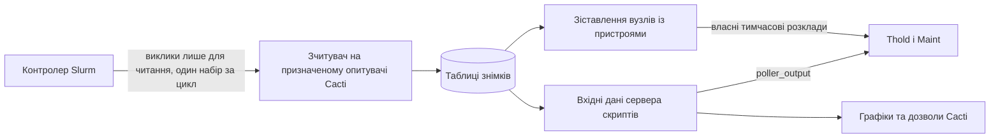

<!-- Source: README.md; SHA256: 16caa3e34c4d150a7fb1018f637e200a7580330f033b485047d8413bce09abba -->

<!-- translations:start -->
[English](../../../README.md) | [简体中文](../zh-CN/README.md) | [हिन्दी](../hi-IN/README.md) | [Español (España)](../es-ES/README.md) | [Español (Latinoamérica)](../es-419/README.md) | [العربية (السعودية)](../ar-SA/README.md) | [Afrikaans](../af-ZA/README.md) | [አማርኛ](../am-ET/README.md) | [العربية (مصر)](../ar-EG/README.md) | [العربية (المغرب)](../ar-MA/README.md) | [বাংলা](../bn-BD/README.md) | [Deutsch](../de-DE/README.md) | [فارسی](../fa-IR/README.md) | [Filipino](../fil-PH/README.md) | [Français](../fr-FR/README.md) | [Français (Maroc)](../fr-MA/README.md) | [Français (Sénégal)](../fr-SN/README.md) | [Hausa](../ha-NG/README.md) | [עברית](../he-IL/README.md) | [Bahasa Indonesia](../id-ID/README.md) | [Igbo](../ig-NG/README.md) | [Italiano](../it-IT/README.md) | [日本語](../ja-JP/README.md) | [한국어](../ko-KR/README.md) | [Malagasy](../mg-MG/README.md) | [मराठी](../mr-IN/README.md) | [Bahasa Melayu](../ms-MY/README.md) | [Nederlands](../nl-NL/README.md) | [Polski](../pl-PL/README.md) | [Português (Brasil)](../pt-BR/README.md) | [Русский](../ru-RU/README.md) | [Kinyarwanda](../rw-RW/README.md) | [Soomaali](../so-SO/README.md) | [Svenska](../sv-SE/README.md) | [Kiswahili](../sw-KE/README.md) | [தமிழ்](../ta-IN/README.md) | [తెలుగు](../te-IN/README.md) | [ไทย](../th-TH/README.md) | [Türkçe](../tr-TR/README.md) | [Українська](README.md) | [اردو](../ur-PK/README.md) | [Tiếng Việt](../vi-VN/README.md) | [isiXhosa](../xh-ZA/README.md) | [Yorùbá](../yo-NG/README.md) | [繁體中文](../zh-TW/README.md) | [isiZulu](../zu-ZA/README.md)
<!-- translations:end -->

# plugin_hpcsched

Плагін для Cacti 1.2, який будує графіки стану планувальника пакетних завдань HPC поруч із пристроями, які Cacti вже відстежує: глибина черги, завдання в очікуванні та на виконанні, причини очікування завдань, стани вузлів і використання розділів. Slurm є першим бекендом. Thold формує сповіщення на основі отриманих джерел даних, а Maint може керуватися через виведені з експлуатації вузли та резервування для технічного обслуговування.

> **Статус: у розробці, релізів ще немає.** Етап 2 (основа) об’єднано в `main`, а ця гілка додає етап 3 (графіки кластера та причини очікування). Код встановлюється, оновлюється та видаляється через API плагінів Cacti й відмовляється працювати з PHP версії нижче 8.2. Він підтримує реєстр кластерів Slurm, кожен із яких призначено одному опитувачу Cacti. Фоновий зчитувач на головному опитувачі збирає один знімок на кластер за інтервал — або запускаючи `squeue`, `scontrol` і `sshare` з `--json`, або опитуючи `slurmrestd` через HTTPS — і зберігає кількість завдань за станом і причиною очікування, стани вузлів, розділи, резервування та використання fair-share разом з їхньою актуальністю. Плагін постачає шаблони Cacti та після підтвердження адміністратором створює або зіставляє один пристрій Cacti на кластер із графіками завдань за станом, завдань в очікуванні за сімейством причин, вузлів за станом, ЦП і використання — для всього кластера й для кожного розділу, а також вік знімка. Оглядова сторінка лише для читання показує показники за кластерами з їхньою актуальністю та подання причин очікування для кожного кластера, а сторінка стану лише для адміністраторів показує, що повернув кожен збір і чи встановлено шаблони. Кожна сторінка й дія дотримуються прав доступу Cacti до пристроїв. Джерела даних придатні для сповіщень у Thold, однак інтеграцію з Thold або Maint ще не протестовано — це заплановано на етап 4 і далі. Набір тестів охоплює синтетичні команди Slurm та відповіді `slurmrestd`, а CI також перевіряє роботу зі справжнім шестивузловим кластером Slurm у контейнерах, як описано нижче. Зчитувач ще не запускався на продуктивному кластері. Нижче за примітками для операторів у цьому README описано проєктну архітектуру, а не вже випущену функціональність.

Це незалежний проєкт, який не пов’язаний із проєктом Cacti.

## Ролі доступу

| Область | Доступ |
| --- | --- |
| HPC Scheduler View | Наявні сторінки моніторингу. |
| HPC Scheduler Operator | Моніторинг, а також сторінка Operations та персональні підтвердження під час первинного розбору. |
| HPC Scheduler Admin | Доступ оператора, а також наявні налаштування та адміністративні дії. |

Після копіювання файлів оновлення відкрийте сторінку Plugins з правами адміністратора, щоб зареєструвати нову область доступу. Призначте область Operator явно в розділі **Configuration > Users** або для груп користувачів. Оновлення зберігають наявні ідентифікатори та права доступу для областей View і Admin. Доступ Admin успадковує доступ Operator, а доступ Operator успадковує доступ View під час кожного запиту; це не додає збережених прав користувачам або групам. Налаштування плагіна також вимагають доступу HPC Scheduler Admin на додачу до дозволу Settings у Cacti.

Дозволи Cacti на пристрої все одно обмежують рядки та дії, доступні кожному користувачеві; кластер без пристрою відображається на адміністративних сторінках для кожного користувача з областю доступу плагіна, але не в операторських поданнях, які показують лише кластери, зіставлені з пристроєм. Облікові дані, конфігурація, зіставлення, видалення та інші адміністративні зміни залишаються на адміністративних сторінках. Підтвердження діють лише в поточній сесії користувача, щонайбільше одну годину й лише доки те саме спостереження залишається актуальним. Нові або змінені спостереження роблять їх недійсними. Вони ніколи не позначають невдале вимірювання як справне та не пригнічують сповіщення.

## Примітки для операторів щодо етапу 2

**Мінімальні привілеї.** Плагін працює лише на читання. Виділіть йому окремого користувача Slurm без ролі адміністратора чи оператора (`AdminLevel=None` у `sacctmgr`). Якщо в `slurm.conf` увімкнено `PrivateData=jobs` (або `nodes`, `reservations`, `usage`), цей користувач бачить лише власні записи, тому підрахунки будуть неповними, і плагін не зможе цього виявити. Зняття цього обмеження для облікового запису означає рівень оператора або адміністратора, що також дозволяє вносити зміни; цей компроміс залишається на розсуд адміністрації майданчика. Для клієнтських команд користувачеві опитувача Cacti потрібні клієнтські бінарні файли Slurm та `slurm.conf`, що забезпечує доступ до контролера; шляхи до бінарних файлів задаються абсолютними налаштуваннями в Configuration > Settings > HPC Scheduler. Для `slurmrestd` URL має починатися з `https://`, або з `http://` лише для loopback-адреси. Сертифікати TLS перевіряються, а перенаправлення не відстежуються. Необов’язковий список хостів slurmrestd у Configuration > Settings > HPC Scheduler обмежує хости та порти, які може вказувати кластер.

**Віддалені опитувачі.** Цей випуск збирає дані лише на головному опитувачі Cacti. Кластер, призначений віддаленому збирачу даних, не опитується: зчитувач там відмовляє із записом причини в журнал, а сторінка стану називає цей кластер. Віддалений збір заплановано на фазу 3.

**Пам’ять.** Кожен цикл збору декодує по одній відповіді планувальника за раз, що займає в пам’яті PHP приблизно в 12 разів більше за розмір відповіді (за вимірюваннями — близько 10 разів для записів завдань у форматі Slurm плюс сам текст). Під час виконання ліміт пам’яті PHP підвищується до значення налаштування Collection Memory (за замовчуванням 1024 МіБ) і допускає відповіді обсягом до (Collection Memory - 64) / 12 МіБ, тобто 80 МіБ за замовчуванням, навіть якщо Maximum Answer Size встановлено вищим; сторінка стану попереджає про це. Більша відповідь завершує відповідний розділ із помилкою перевищення розміру, а запуск, якому все одно забракло пам’яті, фіксується як невдалий. Для великого кластера може знадобитися збільшити обидва налаштування; роботу зі 100 000 реальних записів завдань не вимірювали.

**Файли токенів.** Кластер `slurmrestd` вказує файл токена; сам токен ніколи не зберігається в базі даних, не показується на сторінці та не записується в журнал. Файл має розташовуватися в одному з каталогів файлів токенів, заданих у Configuration > Settings > HPC Scheduler, без використання символічних посилань на шляху, бути звичайним файлом, що належить користувачеві опитувача, із правом запису лише для цього користувача та містити один рядок: сам токен або `SLURM_JWT=<token>` у форматі, який виводить `scontrol token`. Якщо каталоги токенів не задано, жоден кластер не зможе використовувати `slurmrestd`. Ці два налаштування розташовані на сторінці Settings у Cacti, тож сама лише область Admin плагіна не дає змоги їх змінити; зберігайте право запису до кожного каталогу токенів лише для root і користувача опитувача. Файл, який можуть читати група або інші користувачі, усе одно використовується, але сторінка стану попереджає про це. Сторінка стану також попереджає, коли термін дії токена спливає в межах налаштованого часу попередження.

Щоб виконати ротацію токена без інтервалу, у якому зчитувач побачить частково записаний файл, запишіть новий токен поруч зі старим і перейменуйте його на місце старого:

```sh
dir=/etc/cacti/hpcsched
tmp=$(mktemp "$dir/.token.XXXXXX")
scontrol token username=cactiread lifespan=2592000 > "$tmp"
chown cacti:cacti "$tmp"
chmod 0600 "$tmp"
mv -f "$tmp" "$dir/cluster1.token"
```

Наступний збір прочитає новий файл. Генерація токенів за допомогою `scontrol token` потребує прав адміністратора Slurm; виконуйте її там, де це дозволено, і копіюйте файл на опитувач.

## Примітки для операторів щодо етапу 3

**Шаблони.** Встановлення та оновлення імпортують шаблони пристрою, даних і графіків HPC Scheduler та копіюють запит даних розділів до каталогу Cacti `resource/script_server/`. Якщо цей каталог недоступний для запису користувачеві, який встановлює плагін, там уже є інший файл із такою самою назвою, створений не плагіном, або це символічне посилання, імпорт зупиняється, файл залишається без змін, а сторінка стану повідомляє, що потрібно зробити; кнопка Install Templates на сторінці стану повторює спробу. Ідентична копія, створена вручну, використовується, але залишається під вашим керуванням. Видалення плагіна прибирає файл запиту лише тоді, коли його створив плагін і він не змінювався, та зберігає шаблони, пристрої й графіки.

**Пристрої кластерів.** Сторінка HPC Clusters > Device показує, що саме додасть пристрій (графіки, джерела даних, файли RRD і виклики сервера скриптів за одне опитування), перш ніж будь-що буде створено. Create Device створює пристрій з іменем хоста в зарезервованому домені `.invalid` і без перевірки доступності; натомість Map Device прикріплює графіки до наявного пристрою та не змінює його налаштувань. Кожен графік кластера та кожен графік розділу має власне джерело даних: шість для кластера і п’ять на розділ, один виклик сервера скриптів на джерело даних кластера й один на значення розділу (32) за опитування. Додані пізніше розділи індексуються, щойно зчитувач їх бачить, і отримують графіки зі сторінки New Graphs у Cacti; видалений розділ припиняє опитуватися, але зберігає свої графіки. Видалення пристрою скасовує зіставлення кластера, не видаляючи сам кластер.

**Що підраховують графіки.** Показник очікування (Pending) не включає призупинені (held) завдання, для яких є окремий ряд. Масив завдань у стані очікування підраховує кількість завдань, що залишилися. Завдання або вузол у кількох розділах враховується один раз на графіках кластера й по одному разу в кожному розділі, тому сума за графіками розділів не зобов’язана збігатися зі значенням для кластера. Причини очікування згруповано в одинадцять сімейств ([ADR 0011](../../decisions/0011-pending-reason-families-and-counting.md)); подання причин очікування містить перелік необроблених причин, включно з тими, що належать до Other. Кожне завдання повідомляє лише останню причину, яку перевірив планувальник. Знаменник показника використання включає вузли у стані drain, down та інші недоступні вузли. Застарілі або невдало зібрані дані позначаються як `U`, ніколи не як нуль; `age` залишається числовим.

**Сповіщення.** Thold може формувати сповіщення на основі будь-якого з цих джерел даних; встановлюйте тривалість у Thold щонайменше на один інтервал збору та налаштуйте сповіщення за `age`, щоб виявляти зупинку зчитувача. Наскрізну перевірку Thold заплановано на етап 4.

**Перевірено на реальному виводі Slurm.** CI запускає шестивузловий кластер Slurm у контейнерах (26.05.5 на кожну зміну, 25.11.8 зібрано з вихідного коду під час push у `main`, щотижня та за запитом) і перевіряє стани вузлів, резервування для технічного обслуговування, причини очікування та масиви завдань у тому вигляді, як їх розбирає плагін, після чого збирає дані з цього кластера за допомогою власних транспортів плагіна — командного та `slurmrestd`. Старіші випуски покрито лише синтетичними фікстурами. Зчитувач досі не запускався на продуктивному кластері.

**Дозволи.** Кластер, прив’язаний до пристрою, показується, експортується та змінюється на кожній сторінці плагіна лише для тих користувачів, яким Cacti дозволяє доступ до цього пристрою; зіставлення пристрою також потребує дозволу на цільовий пристрій. Кластер без пристрою видимий усім користувачам з областю доступу плагіна. Кластер, який досі зіставлений із пристроєм, видаленим у той час, коли плагін був вимкнений, показується лише користувачам з областю HPC Scheduler Admin, які можуть створити або зіставити для нього пристрій. Доступ до графіків регулюється самим Cacti.

## Навіщо

Оператори, які використовують Cacti, вже будують графіки для своїх обчислювальних вузлів. На цих графіках бракує бачення з боку планувальника, через що виникають дві прогалини:

- **Немає відповіді на питання «чому робота не запускається».** Slurm записує причину для кожного завдання в черзі очікування. Заповнена черга поруч із графіками простою вузлів не пояснює, у чому причина: у пріоритеті, обмеженнях ресурсів, призупиненнях (holds), залежностях чи виведених з експлуатації вузлах.
- **Немає зв’язку між станом планувальника та сповіщеннями.** Thold надсилає сповіщення щодо пристрою, який адміністратор уже вивів з експлуатації, а розклади Maint адміністратори створюють вручну.

Плагін збирає один кешований знімок на кластер, публікує його як звичайні джерела даних та графіки Cacti, зіставляє вузли планувальника з наявними пристроями Cacti та може додавати виведені з експлуатації вузли й резервування для технічного обслуговування в Maint. Він повторно використовує дозволи Cacti, віддалені збирачі даних, Thold і Maint та працює з планувальником лише в режимі читання.

## Запланований обсяг

| Фаза | Обсяг | Етапи |
|---|---|---|
| 0, дослідження | Матриця випусків Slurm, підтвердження поведінки основної гілки розробки (upstream), навантаження на контролер, фікстури іменування вузлів | [M1](https://github.com/somethingwithproof/plugin_hpcsched/milestone/1) |
| 1, графіки кластера | Глибина черги, завдання в очікуванні та на виконанні, причини очікування, стани вузлів, використання розділів, сповіщення Thold, сторінка стану, реліз | [M2](https://github.com/somethingwithproof/plugin_hpcsched/milestone/2), [M3](https://github.com/somethingwithproof/plugin_hpcsched/milestone/3), [M4](https://github.com/somethingwithproof/plugin_hpcsched/milestone/4) |
| 2, вузли та обслуговування | Зіставлення вузлів із пристроями, стан окремих вузлів, автоматичні вікна Maint для виведених з експлуатації вузлів і резервувань на обслуговування | [M5](https://github.com/somethingwithproof/plugin_hpcsched/milestone/5) |
| 3, облік | Використання fair-share, обмежена статистика обліку, віддалені збирачі даних | [M6](https://github.com/somethingwithproof/plugin_hpcsched/milestone/6) |

Поза межами проєкту: будь-які операції запису в планувальник (надсилання, скасування, призупинення, виведення з експлуатації, відновлення роботи), власний рушій сповіщень у плагіні, рушій звітності чи розподілу витрат, а також ряди даних за окремими користувачами та завданнями. Підтримка бекендів PBS Pro, OpenPBS і LSF перебуває на етапі дослідження.

## Цільова сумісність

| Компонент | Цільова версія |
|---|---|
| Cacti | 1.2.31 або новіша, без патчів ядра |
| PHP | 8.2 або новіша; `setup.php` залишається синтаксично придатним для розбору на 8.0, щоб непідтримуване середовище виконання отримувало відмову замість зламаного інтерфейсу Cacti |
| Slurm | 25.05, 25.11 та 26.05 — три останні випуски ([ADR 0013](../../decisions/0013-three-latest-slurm-releases.md)); 25.11 і 26.05 перевіряються на живому кластері, 25.05 — лише на фікстурах. Клієнтські команди є транспортом за замовчуванням ([ADR 0012](../../decisions/0012-client-commands-default-transport.md)) і використовують налаштування парсера даних: за замовчуванням v0.0.43, який SchedMD видаляє в 27.05, або v0.0.44 чи v0.0.45 у випусках, що їх постачають. Кластери slurmrestd визначають найновіший парсер, який обслуговує демон |
| Thold, Maint | Без змін у Thold; інтеграція з Maint є пропозицією, яка потребує погодження з мейнтейнерами Maint |

## Архітектура

- [docs/PLAN.md](../../PLAN.md) — повний план: архітектура, факти з основних проєктів (upstream), на які він спирається (із джерелами та явним переліком непідтверджених припущень), зіставлення вузлів, модель станів, межі безпеки, розрахунки продуктивності, тестування та ризики.
- [docs/decisions/](../../decisions) містить записи архітектурних рішень.
- [docs/REQUIREMENTS.md](../../REQUIREMENTS.md) зіставляє кожен ідентифікатор вимоги з відповідним issue.



## Як відстежується робота

- **Етапи (Milestones)** відповідають етапам плану. Кожен має епік-issue з переліком підзавдань і свідчень завершення.
- **Issues** типізовано мітками: `type: requirement`, `type: research`, `type: decision`, `type: epic`. Issue з вимогами описують нумеровані тестовані вимоги (`REQ-AREA-NNN`) та критерії приймання.
- **Мітки** також містять `area:`, `phase:`, `priority:` і `status:`. Див. [CONTRIBUTING.md](../../../CONTRIBUTING.md#labels).
- На [дошці проєкту](https://github.com/users/somethingwithproof/projects/10) показано всі issues за етапами.

## Внесок у проєкт

Прочитайте [CONTRIBUTING.md](../../../CONTRIBUTING.md). Коміти потребують підпису DCO. Обговорення проєктних питань відбувається в issues; відкриті рішення мають мітку `type: decision`.

## Безпека

Повідомляйте про вразливості приватно; див. [SECURITY.md](../../../SECURITY.md).

## Ліцензія

GNU General Public License v2.0 — та сама ліцензія, що й у Cacti та його плагінів. Див. [LICENSE](../../../LICENSE).
