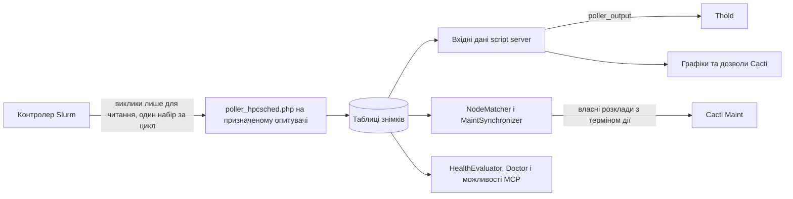

<!-- Source: README.md; SHA256: 938114d41dbd516f9dfcd94619c4fc73ef56b4da1dd693010588a93cce250534 -->

<!-- translations:start -->
[English](../../../README.md) | [简体中文](../zh-CN/README.md) | [हिन्दी](../hi-IN/README.md) | [Español (España)](../es-ES/README.md) | [Español (Latinoamérica)](../es-419/README.md) | [العربية (السعودية)](../ar-SA/README.md) | [Afrikaans](../af-ZA/README.md) | [አማርኛ](../am-ET/README.md) | [العربية (مصر)](../ar-EG/README.md) | [العربية (المغرب)](../ar-MA/README.md) | [Български](../bg-BG/README.md) | [বাংলা](../bn-BD/README.md) | [Bosanski](../bs-BA/README.md) | [Deutsch](../de-DE/README.md) | [Ελληνικά](../el-GR/README.md) | [فارسی](../fa-IR/README.md) | [Filipino](../fil-PH/README.md) | [Français](../fr-FR/README.md) | [Français (Maroc)](../fr-MA/README.md) | [Français (Sénégal)](../fr-SN/README.md) | [Hausa](../ha-NG/README.md) | [עברית](../he-IL/README.md) | [Hrvatski](../hr-HR/README.md) | [Bahasa Indonesia](../id-ID/README.md) | [Igbo](../ig-NG/README.md) | [Italiano](../it-IT/README.md) | [日本語](../ja-JP/README.md) | [ქართული](../ka-GE/README.md) | [한국어](../ko-KR/README.md) | [Latviešu](../lv-LV/README.md) | [Malagasy](../mg-MG/README.md) | [मराठी](../mr-IN/README.md) | [Bahasa Melayu](../ms-MY/README.md) | [Nederlands](../nl-NL/README.md) | [Polski](../pl-PL/README.md) | [Português (Brasil)](../pt-BR/README.md) | [Português (Portugal)](../pt-PT/README.md) | [Русский](../ru-RU/README.md) | [Kinyarwanda](../rw-RW/README.md) | [Soomaali](../so-SO/README.md) | [Српски](../sr-RS/README.md) | [Svenska](../sv-SE/README.md) | [Kiswahili](../sw-KE/README.md) | [தமிழ்](../ta-IN/README.md) | [తెలుగు](../te-IN/README.md) | [ไทย](../th-TH/README.md) | [Türkçe](../tr-TR/README.md) | [Українська](README.md) | [اردو](../ur-PK/README.md) | [Tiếng Việt](../vi-VN/README.md) | [isiXhosa](../xh-ZA/README.md) | [Yorùbá](../yo-NG/README.md) | [繁體中文](../zh-TW/README.md) | [isiZulu](../zu-ZA/README.md)
<!-- translations:end -->

# plugin_hpcsched

Плагін для Cacti 1.2 (`hpcsched`, версія `0.1.0-dev`), який будує графіки стану планувальника пакетних завдань HPC поруч із пристроями, які Cacti вже відстежує: глибина черги, завдання в очікуванні та на виконанні, причини очікування завдань, стани вузлів, використання розділів і використання fair-share на рівні облікових записів. Slurm є реалізованим бекендом. Thold формує сповіщення на основі отриманих джерел даних, а опційний синхронізатор Maint керує вікнами Cacti Maint на основі обчислювальних вузлів Slurm у стані drained, down і зарезервованих для обслуговування.

> **Статус: у розробці, релізів ще немає.** Ця гілка реалізує основу плагіна, графіки кластера та розділів, сімейства причин очікування, зіставлення обчислювальних вузлів Slurm із пристроями Cacti, опційну синхронізацію вікон Cacti Maint, зведення fair-share на рівні облікових записів, виконання та реплікацію на віддалених збирачах даних, CLI для Configuration-as-Code (CasC) і операцій, а також хуки екосистеми Cacti (CasC, Doctor та MCP / Abilities API v2). Набір тестів охоплює синтетичні команди Slurm і відповіді `slurmrestd`, а CI перевіряє роботу на живому шестивузловому кластері Slurm у контейнерах. Зчитувач ще не запускався на продуктивному кластері, а наскрізний тест відтворення Thold ще не додано в CI.

Це незалежний проєкт, який не пов’язаний із проєктом Cacti.

## Що реалізовано

- **Життєвий цикл і схема (v3)**: встановлення, ідемпотентне оновлення, видалення (за замовчуванням зберігає таблиці плагіна) та мінімальна вимога PHP 8.2 при збереженні синтаксичної сумісності точок входу з PHP 8.0. Схема v3 додає `plugin_hpcsched_node_map` і `plugin_hpcsched_maint_link` поруч із таблицями cluster, run, section, job-count, node-count, node, partition, reservation і share.
- **Збір даних Slurm лише для читання на головному та віддалених опитувачах**: `poller_bottom` запускає `poller_hpcsched.php --cluster=N` у фоновому режимі на кожному опитувачі (`poller_id`) для призначених йому ввімкнених кластерів. Кожен запуск збирає один кешований знімок на кластер через клієнтські команди (`squeue`, `scontrol`, `sshare` з `--json`) або `slurmrestd` через HTTPS (HTTP на loopback дозволено з попередженням стану). `INFO` оголошує `remote_collect:1, remote_poller:1`, а `replicate_out` реплікує несекретні визначення `plugin_hpcsched_cluster` на віддалені збирачі (`poller_id >= 2`); вміст файлів токенів ніколи не зчитується і не реплікується.
- **Шаблони Cacti та графіки кластера**: постачає шаблони пристроїв, даних і графіків (`templates/hpcsched-templates.xml`) та запит даних script-server для розділів (`scripts/ss_hpcsched_cluster.php`, `scripts/ss_hpcsched_partitions.php`). Після підтвердження адміністратором створює або зіставляє один пристрій Cacti на кластер із графіками завдань за станом, завдань в очікуванні за сімейством причин, вузлів за станом, ЦП, використання (кластера та кожного розділу) і віку знімка.
- **Зіставлення вузлів Slurm із пристроями та синхронізація Cacti Maint**: чотирирівневий зіставник із лінійною складністю (`NodeMatcher`) зіставляє обчислювальні вузли Slurm із наявними записами `host` у Cacti (точне ім’я хоста, точна адреса, точний опис/псевдонім або перша мітка DNS для імен, що не є IP) і позначає множинні збіги чи повторні претензії на пристрій як `ambiguous` замість вгадування. `HostList::expand()` розгортає списки хостів резервування Slurm (до 10 000 вузлів). `MaintSynchronizer` створює, поновлює та видаляє разові розклади Cacti Maint, що належать плагіну й відстежуються в `plugin_hpcsched_maint_link`, для зіставлених вузлів у стані `DRAIN`, `DRAINING`, `DOWN` або в активних резервуваннях `MAINT`/`MAINTENANCE`, не змінюючи розклади Maint, створені адміністратором.
- **Зведення fair-share на рівні облікових записів**: коли ввімкнено `collect_shares`, збирає рядки асоціацій облікових записів Slurm у `plugin_hpcsched_share` (відкидаючи рядки користувачів згідно з [ADR 0010](../../decisions/0010-bound-series-cardinality.md)). `ShareSummary` та `ShareRepository` обчислюють кількість облікових записів і розділів, загальне сире та ефективне використання, мінімальний/максимальний/середній коефіцієнти fair-share і провідні облікові записи; кількість облікових записів надається в `hpcsched-get-queue-summary`.
- **CLI для CasC та операцій (`cli/hpcsched.php`)**: експорт конфігурації YAML/XML, валідація, пробне планування змін (dry-run), застосування з підтвердженням, структурований вивід стану та опційна синхронізація Maint (`sync-maint --dry-run` / `--apply`).
- **Хуки екосистеми (`setup.php`)**: `casc_register_providers`, `doctor_register_checks` і `abilities_register`.

## Ролі доступу

| Область | Доступ |
| --- | --- |
| HPC Scheduler View | Огляд кластера лише для читання та причини очікування (`hpcsched.php`). |
| HPC Scheduler Operator | Доступ View, а також сторінка операцій (`hpcsched_operator.php`) та персональні підтвердження під час первинного розбору. |
| HPC Scheduler Admin | Доступ Operator, а також адміністрування кластерів (`hpcsched_clusters.php`) і сторінка стану (`hpcsched_health.php`). |

Після копіювання файлів оновлення відкрийте сторінку Plugins з правами адміністратора, щоб зареєструвати нові області доступу та хуки. Призначте область Operator явно в розділі **Configuration > Users** або для груп користувачів. Оновлення зберігають наявні ідентифікатори та права доступу для областей View і Admin. Доступ Admin успадковує доступ Operator, а доступ Operator успадковує доступ View під час кожного запиту; це не додає збережених прав користувачам або групам. Налаштування плагіна також вимагають доступу HPC Scheduler Admin на додачу до дозволу Settings у Cacti.

Дозволи Cacti на пристрої обмежують рядки та дії, доступні кожному користувачеві. Кластер, зіставлений із пристроєм Cacti, відображається, експортується та змінюється лише для користувачів, яким Cacti дозволяє цей пристрій; зіставлення пристрою також вимагає дозволу на цільовий пристрій. Кластер без пристрою відображається на адміністративних сторінках для користувачів з областю доступу плагіна, але не в операторських поданнях, які показують лише кластери, зіставлені з пристроєм. Кластер, зіставлений пристрій якого було видалено, коли плагін був вимкнений, відображається лише користувачам із доступом HPC Scheduler Admin. Підтвердження діють лише в поточній сесії користувача, щонайбільше одну годину й лише доки те саме спостереження залишається актуальним. Нові або змінені спостереження роблять їх недійсними. Вони ніколи не позначають невдале вимірювання як справне та не пригнічують сповіщення.

## Примітки для операторів

### Безпека, найменші привілеї та файли токенів

Плагін працює лише на читання. Виділіть йому окремого користувача Slurm без ролі адміністратора чи оператора (`AdminLevel=None` у `sacctmgr`). Якщо в `slurm.conf` задано `PrivateData=jobs` (або `nodes`, `reservations`, `usage`), цей користувач бачить лише власні записи, тож підрахунки будуть неповними, і плагін не зможе цього виявити. Зняття цього обмеження для облікового запису потребує рівня оператора або адміністратора, що також дозволяє вносити зміни; цей компроміс залишається на розсуд майданчика.

Для клієнтських команд користувачеві опитувача Cacti потрібні клієнтські бінарні файли Slurm (`squeue`, `scontrol` і опційно `sshare`) та файл `slurm.conf`, що забезпечує доступ до контролера; шляхи до бінарних файлів задаються як абсолютні в налаштуваннях **Configuration > Settings > HPC Scheduler**.

Для `slurmrestd` URL має починатися з `https://`, або `http://` лише для loopback-адреси. Сертифікати TLS перевіряються, а перенаправлення не виконуються. Опційний список хостів `slurmrestd` у **Configuration > Settings > HPC Scheduler** обмежує, які хости та порти може вказувати кластер.

Кластер `slurmrestd` вказує файл токена; сам токен ніколи не зберігається в базі даних, не показується на сторінці, не експортується через CasC і не записується в журнал. Файл повинен міститися в одному з каталогів Token File Directories, налаштованих у **Configuration > Settings > HPC Scheduler**, бути доступним без символічних посилань і являти собою звичайний файл, що належить користувачеві опитувача й доступний на запис лише цьому користувачеві, з одним рядком: самим токеном або `SLURM_JWT=<token>`, як його виводить `scontrol token`. Якщо каталоги токенів не налаштовані, жоден кластер не зможе використовувати `slurmrestd`. Забезпечте, щоб кожен каталог токенів був доступний на запис лише для root і користувача опитувача. Файл, доступний для читання групі чи іншим користувачам, усе одно використовується, але сторінка стану видає попередження; вона також попереджає, коли термін дії токена спливає в межах налаштованого вікна попереджень.

Щоб атомарно ротувати токен:

```sh
dir=/etc/cacti/hpcsched
tmp=$(mktemp "$dir/.token.XXXXXX")
scontrol token username=cactiread lifespan=2592000 > "$tmp"
chown cacti:cacti "$tmp"
chmod 0600 "$tmp"
mv -f "$tmp" "$dir/cluster1.token"
```

Наступний збір зчитає новий файл. Генерація токенів за допомогою `scontrol token` потребує прав адміністратора Slurm; виконайте команду там, де це дозволено, та скопіюйте файл на опитувач.

### Віддалені збирачі даних

`INFO` оголошує `remote_collect:1, remote_poller:1`. `hpcsched_poller_bottom()` запускає `poller_hpcsched.php` на кожному опитувачі для ввімкнених кластерів, призначених цьому `poller_id`, а `hpcsched_replicate_out()` реплікує несекретні рядки `plugin_hpcsched_cluster` на віддалені опитувачі (`poller_id >= 2`). Файли токенів і клієнтські бінарні файли Slurm мають існувати локально на призначеному віддаленому опитувачі; вміст токенів ніколи не реплікується.

### Обмеження пам’яті

Кожен запуск збору декодує одну відповідь планувальника за раз, що займає в пам’яті PHP приблизно в 12 разів більше за розмір відповіді (за вимірами близько 10 разів для записів завдань у форматі Slurm плюс сам текст). Зчитувач підвищує свій ліміт пам’яті PHP до значення налаштування Collection Memory (за замовчуванням 1024 MiB) і дозволяє відповіді розміром до `(Collection Memory - 64) / 12` MiB (за замовчуванням 80 MiB), навіть якщо Maximum Answer Size встановлено вищим; сторінка стану попереджає, коли Maximum Answer Size перевищує це розраховане обмеження. Більша відповідь завершує свою секцію з помилкою перевищення розміру, а запуск, який усе одно вичерпує пам’ять, фіксує збій пам’яті та звільняє своє блокування й слот процесу через обробник завершення роботи. Для великих кластерів може знадобитися підвищити обидва налаштування; 100 000 реальних записів завдань не вимірювалися.

### Шаблони, пристрої кластерів і підрахунок графіків

Встановлення та оновлення імпортують шаблони пристроїв, даних і графіків HPC Scheduler та копіюють запит даних розділів у каталог `resource/script_server/` Cacti. Якщо цей каталог недоступний для запису, там уже є інший файл із таким самим ім’ям або ціль є символічним посиланням, імпорт зупиняється, залишає файл без змін і повідомляє про це на сторінці стану, де **Install Templates** дозволяє повторити спробу. Видалення прибирає файл запиту лише тоді, коли його створив плагін і файл не змінювався, та зберігає шаблони, пристрої й графіки.

**HPC Clusters > Device** перед створенням будь-чого показує попередній перегляд графіків, джерел даних, файлів RRD і викликів script server за одне опитування. **Create Device** створює пристрій з іменем хоста в зарезервованому домені `.invalid` без перевірки доступності; **Map Device** прив’язує графіки до наявного пристрою без зміни його налаштувань. Кожен графік кластера та графік розділу має власне джерело даних: шість для кластера та по п’ять на кожен розділ. Додані пізніше розділи переіндексуються автоматично, коли зчитувач виявляє зміну; видалені розділи перестають опитуватися та зберігають свої графіки. Видалення пристрою скасовує зіставлення кластера (та очищає відповідні рядки `plugin_hpcsched_node_map`), зберігаючи запис кластера.

Завдання в очікуванні не включають утримувані (held) завдання, які мають власну серію. Масив завдань в очікуванні рахує свої решту задач. Завдання або вузол у кількох розділах враховується один раз на графіках кластера й один раз у кожному розділі, тому суми за розділами не зобов’язані дорівнювати загальному підсумку кластера. Причини очікування згруповані в одинадцять сімейств ([ADR 0011](../../decisions/0011-pending-reason-families-and-counting.md)); подання причин очікування містить сирі причини, включно з тими, що належать до `Other`. Знаменник використання включає вузли у стані drained, down та інші недоступні вузли. Застарілі або помилкові дані передаються як `U`, ніколи не як нуль; `age` залишається числовим.

Для сповіщень налаштуйте Thold на будь-якому джерелі даних кластера або розділу з тривалістю щонайменше в один інтервал збору та налаштуйте сповіщення на `age`, щоб виявляти зупинку зчитувача.

## CLI та хуки екосистеми

### Точка входу зчитувача

`hpcsched_poller_bottom()` запускає `poller_hpcsched.php` автоматично; його також можна запустити вручну на призначеному для кластера опитувачі:

```sh
php /path/to/cacti/plugins/hpcsched/poller_hpcsched.php --cluster=N [--force] [--debug]
```

`--force` запускається навіть тоді, коли плагін вимкнено, для діагностики з командного рядка.

### CLI для Configuration-as-Code, стану та синхронізації Maint

```sh
php /path/to/cacti/plugins/hpcsched/cli/hpcsched.php export [--format=yaml|xml] [--file=PATH]
php /path/to/cacti/plugins/hpcsched/cli/hpcsched.php validate --file=PATH [--format=yaml|xml]
php /path/to/cacti/plugins/hpcsched/cli/hpcsched.php plan --file=PATH [--format=yaml|xml]
php /path/to/cacti/plugins/hpcsched/cli/hpcsched.php apply --file=PATH --confirm=PLAN_HASH [--format=yaml|xml]
php /path/to/cacti/plugins/hpcsched/cli/hpcsched.php health [--format=text|json]
php /path/to/cacti/plugins/hpcsched/cli/hpcsched.php sync-maint [--dry-run | --apply] [--cluster=ID] [--format=text|json]
```

- `export` записує нові файли з правами `0600` (або в stdout) і замінює налаштовані шляхи `token_file` на `[REDACTED]`. `plan` і `apply` відхиляють вбудовані поля `jwt`, `secret` та `password` і зберігають наявні локальні шляхи `token_file`, якщо передано `[REDACTED]`. `apply` вимагає точного значення `--confirm=PLAN_HASH`, виведеного командою `plan`.
- `health` оцінює актуальність схеми, свіжість кластерів, результати запусків, доступність Maint і попередження без звернення до планувальників або читання файлів токенів.
- `sync-maint` за замовчуванням використовує `--dry-run` і показує попередній перегляд або застосовує розклади Cacti Maint для зіставлених вузлів Slurm у стані `DRAIN`, `DRAINING`, `DOWN` або в активних резервуваннях `MAINT`/`MAINTENANCE` (типовий горизонт drain/down 3600 с, запас поновлення 600 с). Команда відмовляється виконувати `--apply`, якщо відсутні `plugin_maint_schedules` і `plugin_maint_hosts`, та оновлює чи видаляє лише розклади, зафіксовані в `plugin_hpcsched_maint_link`.

### Хуки екосистеми

За наявності відповідних плагінів Cacti або інтеграцій хоста `setup.php` реєструє:

- `casc_register_providers`: експортує, перевіряє, планує та застосовує з підтвердженням конфігурацію `hpcsched` (`yaml` і `xml`, схема v1) із приховуванням секретів.
- `doctor_register_checks`: надає чотири діагностичні перевірки лише для читання (`hpcsched.schema`, `hpcsched.cluster_freshness`, `hpcsched.token_health`, `hpcsched.maint_sync`).
- `abilities_register`: реєструє три неруйнівні, ідемпотентні можливості лише для читання в категорії `hpcsched`, обмежені областю доступу HPC Scheduler View (та дозволами на пристрої для зведень кластерів): `hpcsched-list-clusters`, `hpcsched-get-queue-summary` і `hpcsched-get-health`.

## Чому

Оператори, які використовують Cacti, вже будують графіки для своїх обчислювальних вузлів. На цих графіках бракує бачення з боку планувальника, що залишає дві прогалини:

- **Немає відповіді на питання «чому робота не запускається».** Slurm фіксує причину для кожного завдання в очікуванні. Переповнена черга поруч із графіками вільних вузлів не показує, чи причиною є пріоритет, обмеження ресурсів, утримання, залежності або виведені з експлуатації вузли.
- **Немає зв’язку між станом планувальника та сповіщеннями.** Thold надсилає сповіщення про пристрій, який адміністратор уже вивів з експлуатації, а розклади Maint адміністратори створюють вручну.

Плагін збирає один кешований знімок на кластер, публікує його як звичайні джерела даних і графіки Cacti, зіставляє вузли планувальника з наявними пристроями Cacti та синхронізує вікна Maint із терміном дії, що належать плагіну, для вузлів у стані drained, down і зарезервованих для обслуговування. Він повторно використовує права доступу Cacti, віддалені збирачі даних, Thold і Maint та залишається суворо лише для читання щодо планувальника.

## Межі та обмеження

Поза межами: будь-який шлях запису в планувальник (submit, cancel, hold, drain, resume), власний рушій сповіщень плагіна, рушій звітності або білінгу та серії за окремими користувачами чи завданнями. Бекенди PBS Pro, OpenPBS та LSF призначені лише для досліджень.

## Вимоги та сумісність

| Компонент | Ціль |
|---|---|
| Cacti | 1.2.31 або новіша (`compat = 1.2.31`), без патчів ядра |
| PHP | 8.2 або новіша; точки входу залишаються синтаксично сумісними з 8.0 і відхиляють активацію на 8.1, щоб непідтримуване середовище отримувало відмову замість зламаного інтерфейсу Cacti |
| Slurm | 25.05, 25.11 і 26.05 ([ADR 0013](../../decisions/0013-three-latest-slurm-releases.md)); 26.05.5 тестується в CI для кожної зміни на шестивузловому контейнерному кластері, 25.11.8 на `main`, щотижня та за запитом, а 25.05 лише на фікстурах. Клієнтські команди за замовчуванням використовують парсер даних `v0.0.43` (доступні також `v0.0.44` і `v0.0.45`); кластери `slurmrestd` визначають найновіший парсер, який підтримує демон |
| Thold, Maint | Зміни в Thold не потрібні; `sync-maint` інтегрується з таблицями `plugin_maint_schedules` і `plugin_maint_hosts` модуля Cacti Maint за допомогою таблиці зв’язку, що належить плагіну (`plugin_hpcsched_maint_link`) |

## Розробка та тестування

Робочий процес CI (`.github/workflows/plugin-ci-workflow.yml`) тестує PHP від 8.2 до 8.5 із Cacti `release/1.2.31` та `1.2.x`, перевірку синтаксису точок входу для PHP 8.0, відмову на PHP 8.1, PHPStan, перевірку gettext/перекладів, ліцензування REUSE, перевірку робочих процесів, перевірку потоку пристрою кластера та розбіжностей експорту шаблонів, а також живий шестивузловий кластер Slurm (`slurm-live`).

Із зафіксованим спільним тестовим середовищем Pest для плагінів Cacti (`CACTI_PEST_BIN`) і одноразовою базою даних Cacti:

```sh
# Unit tests
"$CACTI_PEST_BIN" --configuration=phpunit.xml

# Lifecycle integration tests (disposable database only)
CACTI_PATH=/path/to/cacti HPCSCHED_TEST_DATABASE=disposable "$CACTI_PEST_BIN" --configuration=phpunit-integration.xml

# Static analysis (against Cacti 1.2.31)
CACTI_PATH=/path/to/cacti phpstan analyse -c phpstan.neon --no-progress

# Translation template, catalogs, and localized README checks
sh locales/build_gettext.sh --check
```

## Проєктування

- [docs/PLAN.md](../../PLAN.md) це план архітектури та проєктування: вихідні факти з джерелами, зіставлення вузлів, модель станів, межі безпеки, розрахунки продуктивності, тестування та ризики.
- [docs/decisions/](../../decisions/) містить записи архітектурних рішень.
- [docs/REQUIREMENTS.md](../../REQUIREMENTS.md) пов’язує кожен ідентифікатор вимоги з відповідним завданням (issue).



## Як відстежується робота

- **Етапи (Milestones)** відповідають етапам плану. Кожен має головне завдання (epic), у якому перелічено підзавдання та докази завершення.
- **Завдання (Issues)** класифікуються за мітками: `type: requirement`, `type: research`, `type: decision`, `type: epic`. Завдання вимог містять нумеровані вимоги, які можна перевірити (`REQ-AREA-NNN`), та критерії приймання.
- **Мітки (Labels)** також містять `area:`, `phase:`, `priority:` і `status:`. Див. [CONTRIBUTING.md](../../../CONTRIBUTING.md#labels).
- [Дошка проєкту](https://github.com/users/somethingwithproof/projects/10) показує всі завдання в усіх етапах.

## Участь у розробці

Прочитайте [CONTRIBUTING.md](../../../CONTRIBUTING.md). Коміти потребують підпису DCO (`git commit -s`). Обговорення проєктування відбувається в завданнях; відкриті рішення мають мітку `type: decision`.

## Безпека

Повідомляйте про вразливості конфіденційно; див. [SECURITY.md](../../../SECURITY.md).

## Ліцензія

GNU General Public License v2.0, та сама ліцензія, що й у Cacti та її плагінів. Див. [LICENSE](../../../LICENSE).
