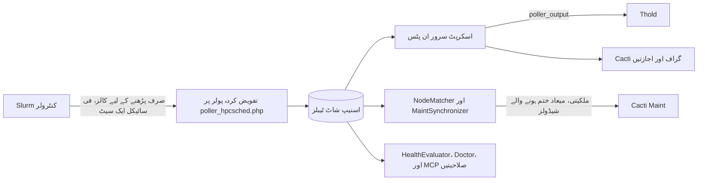

<!-- Source: README.md; SHA256: 938114d41dbd516f9dfcd94619c4fc73ef56b4da1dd693010588a93cce250534 -->

<!-- translations:start -->
[English](../../../README.md) | [简体中文](../zh-CN/README.md) | [हिन्दी](../hi-IN/README.md) | [Español (España)](../es-ES/README.md) | [Español (Latinoamérica)](../es-419/README.md) | [العربية (السعودية)](../ar-SA/README.md) | [Afrikaans](../af-ZA/README.md) | [አማርኛ](../am-ET/README.md) | [العربية (مصر)](../ar-EG/README.md) | [العربية (المغرب)](../ar-MA/README.md) | [বাংলা](../bn-BD/README.md) | [Bosanski](../bs-BA/README.md) | [Deutsch](../de-DE/README.md) | [فارسی](../fa-IR/README.md) | [Filipino](../fil-PH/README.md) | [Français](../fr-FR/README.md) | [Français (Maroc)](../fr-MA/README.md) | [Français (Sénégal)](../fr-SN/README.md) | [Hausa](../ha-NG/README.md) | [עברית](../he-IL/README.md) | [Hrvatski](../hr-HR/README.md) | [Bahasa Indonesia](../id-ID/README.md) | [Igbo](../ig-NG/README.md) | [Italiano](../it-IT/README.md) | [日本語](../ja-JP/README.md) | [한국어](../ko-KR/README.md) | [Malagasy](../mg-MG/README.md) | [मराठी](../mr-IN/README.md) | [Bahasa Melayu](../ms-MY/README.md) | [Nederlands](../nl-NL/README.md) | [Polski](../pl-PL/README.md) | [Português (Brasil)](../pt-BR/README.md) | [Русский](../ru-RU/README.md) | [Kinyarwanda](../rw-RW/README.md) | [Soomaali](../so-SO/README.md) | [Српски](../sr-RS/README.md) | [Svenska](../sv-SE/README.md) | [Kiswahili](../sw-KE/README.md) | [தமிழ்](../ta-IN/README.md) | [తెలుగు](../te-IN/README.md) | [ไทย](../th-TH/README.md) | [Türkçe](../tr-TR/README.md) | [Українська](../uk-UA/README.md) | [اردو](README.md) | [Tiếng Việt](../vi-VN/README.md) | [isiXhosa](../xh-ZA/README.md) | [Yorùbá](../yo-NG/README.md) | [繁體中文](../zh-TW/README.md) | [isiZulu](../zu-ZA/README.md)
<!-- translations:end -->

# plugin_hpcsched

Cacti 1.2 کا ایک پلگ ان (`hpcsched`، ورژن `0.1.0-dev`) جو Cacti کے پہلے سے زیرِ نگرانی آلات کے ساتھ HPC بیچ شیڈولر کی کیفیت کا گراف بناتا ہے: قطار کی گہرائی، زیرِ التواء بمقابلہ جاری جابز، جابز کے زیرِ التواء ہونے کی وجوہات، نوڈز کی کیفیت، پارٹیشن کا استعمال، اور اکاؤنٹ کی سطح پر فیئر شیئر (fair-share) کا استعمال۔ Slurm نافذ شدہ بیک اینڈ ہے۔ حاصل ہونے والے ڈیٹا سورسز پر Thold الرٹ دیتا ہے، اور ایک اختیاری Maint ہم آہنگ کار (synchronizer) ڈرین کیے گئے، بند (down)، اور مینٹیننس کے لیے مخصوص Slurm کمپیوٹ نوڈز سے Cacti Maint ونڈوز چلاتا ہے۔

> **کیفیت: زیرِ تکمیل، ابھی کوئی ریلیز جاری نہیں ہوئی۔** یہ برانچ پلگ ان کی بنیاد، کلسٹر اور پارٹیشن گراف، زیرِ التواء وجوہات کے خاندان، Slurm کمپیوٹ نوڈ سے Cacti ڈیوائس کی میچنگ، اختیاری Cacti Maint ونڈو ہم آہنگی، اکاؤنٹ کی سطح پر فیئر شیئر کے خلاصے، ریموٹ ڈیٹا کلکٹر کی کارروائی اور نقل (replication)، Configuration-as-Code (CasC) اور آپریشنز CLI، اور Cacti ماحولیاتی نظام کے ہُکس (CasC، Doctor، اور MCP / Abilities API v2) نافذ کرتی ہے۔ ٹیسٹ سوئٹ مصنوعی Slurm کمانڈز اور `slurmrestd` جوابات کا احاطہ کرتا ہے، اور CI کنٹینرز میں ایک زندہ چھ نوڈز والے Slurm کلسٹر پر جانچ کرتا ہے۔ ریڈر ابھی کسی پروڈکشن کلسٹر پر نہیں چلایا گیا، اور مکمل اینڈ ٹو اینڈ Thold ری پلے ٹیسٹ ابھی CI میں شامل نہیں ہے۔

یہ ایک آزاد پروجیکٹ ہے اور Cacti پروجیکٹ سے منسلک نہیں ہے۔

## کیا نافذ کیا گیا ہے

- **لائف سائیکل اور اسکیما (v3)**: انسٹالیشن، آئڈیمپوٹینٹ اپ گریڈ، ان انسٹالیشن (بطورِ ڈیفالٹ پلگ ان ٹیبلز محفوظ رکھتے ہوئے)، اور کم از کم PHP 8.2 جبکہ انٹری پوائنٹس کو PHP 8.0 پر قابلِ تجزیہ رکھا گیا ہے۔ اسکیما v3 میں cluster، run، section، job-count، node-count، node، partition، reservation، اور share ٹیبلز کے ساتھ `plugin_hpcsched_node_map` اور `plugin_hpcsched_maint_link` شامل کیے گئے ہیں۔
- **مرکزی اور ریموٹ پولرز پر صرف پڑھنے کے لیے Slurm ڈیٹا جمع کرنا**: `poller_bottom` ہر پولر (`poller_id`) پر اس کے تفویض کردہ فعال کلسٹرز کے لیے پس منظر میں `poller_hpcsched.php --cluster=N` شروع کرتا ہے۔ ہر عمل کلائنٹ کمانڈز (`squeue`، `scontrol`، `--json` کے ساتھ `sshare`) یا HTTPS کے ذریعے `slurmrestd` (صحت کی تنبیہ کے ساتھ loopback HTTP کی اجازت ہے) کے ذریعے فی کلسٹر ایک کیش شدہ اسنیپ شاٹ اکٹھا کرتا ہے۔ `INFO` میں `remote_collect:1, remote_poller:1` کا اعلان کیا جاتا ہے، اور `replicate_out` غیر خفیہ `plugin_hpcsched_cluster` تعریفوں کو ریموٹ کلکٹرز (`poller_id >= 2`) پر نقل کرتا ہے؛ ٹوکن فائل کا مواد کبھی پڑھا یا نقل نہیں کیا جاتا۔
- **Cacti ٹیمپلیٹس اور کلسٹر گراف**: ڈیوائس، ڈیٹا، اور گراف ٹیمپلیٹس (`templates/hpcsched-templates.xml`) اور پارٹیشن اسکرپٹ سرور ڈیٹا کوئری (`scripts/ss_hpcsched_cluster.php`، `scripts/ss_hpcsched_partitions.php`) فراہم کرتا ہے۔ منتظم کی تصدیق پر، فی کلسٹر ایک Cacti ڈیوائس بناتا یا میپ کرتا ہے جس میں کیفیت کے لحاظ سے جابز، وجہ کے زمرے کے لحاظ سے زیرِ التواء جابز، کیفیت کے لحاظ سے نوڈز، CPUs، استعمال (کلسٹر اور فی پارٹیشن)، اور اسنیپ شاٹ کی عمر کے گراف شامل ہوتے ہیں۔
- **Slurm نوڈ سے ڈیوائس کی میچنگ اور Cacti Maint ہم آہنگی**: چار سطحی لکیری وقت کا میچر (`NodeMatcher`) Slurm کمپیوٹ نوڈز کو موجودہ Cacti `host` ریکارڈز سے ملاتا ہے (درست ہوسٹ نام، درست پتہ، درست تفصیل/عرفیت، یا غیر IP ناموں کے لیے پہلا DNS لیبل) اور اندازہ لگانے کے بجائے متعدد میچز یا دوہرے ڈیوائس دعووں کو `ambiguous` کے طور پر نشان زد کرتا ہے۔ `HostList::expand()` Slurm ریزرویشن ہوسٹ لسٹس (10,000 نوڈز تک) کو پھیلاتا ہے۔ `MaintSynchronizer` منتظم کے بنائے ہوئے Maint شیڈولز میں تبدیلی کیے بغیر `DRAIN`، `DRAINING`، `DOWN`، یا فعال `MAINT`/`MAINTENANCE` ریزرویشنز میں موجود میپ شدہ نوڈز کے لیے `plugin_hpcsched_maint_link` میں ٹریک کیے گئے پلگ ان کی ملکیت والے یک بار کے Cacti Maint شیڈولز بناتا، تجدید کرتا اور ہٹاتا ہے۔
- **اکاؤنٹ کی سطح پر فیئر شیئر کے خلاصے**: جب `collect_shares` فعال ہو تو Slurm اکاؤنٹ ایسوسی ایشن کی قطاروں کو `plugin_hpcsched_share` میں اکٹھا کرتا ہے ([ADR 0010](../../decisions/0010-bound-series-cardinality.md) کے مطابق صارف کی قطاریں چھوڑ دی جاتی ہیں)۔ `ShareSummary` اور `ShareRepository` اکاؤنٹ/پارٹیشن کی گنتی، خام اور مؤثر استعمال کے مجموعے، کم از کم/زیادہ سے زیادہ/اوسط فیئر شیئر عوامل، اور نمایاں اکاؤنٹس کا حساب لگاتے ہیں؛ اکاؤنٹ کی گنتی `hpcsched-get-queue-summary` میں فراہم کی جاتی ہے۔
- **CasC اور آپریشنز CLI (`cli/hpcsched.php`)**: YAML/XML کنفیگریشن برآمدگی، توثیق، ڈرائی رن فرق کی منصوبہ بندی، تصدیق سے مشروط نفاذ، ساختہ صحت کا آؤٹ پٹ، اور اختیاری Maint ہم آہنگی (`sync-maint --dry-run` / `--apply`)۔
- **ماحولیاتی نظام کے ہُکس (`setup.php`)**: `casc_register_providers`، `doctor_register_checks`، اور `abilities_register`۔

## رسائی کے کردار

| دائرہ اختیار | رسائی |
| --- | --- |
| HPC Scheduler View | صرف پڑھنے کے لیے کلسٹر کا مجموعی جائزہ اور زیرِ التواء وجوہات (`hpcsched.php`)۔ |
| HPC Scheduler Operator | View رسائی کے علاوہ آپریشنز صفحہ (`hpcsched_operator.php`) اور ذاتی ٹرائیج توثیقات۔ |
| HPC Scheduler Admin | Operator رسائی کے علاوہ کلسٹر انتظام (`hpcsched_clusters.php`) اور صحت کا صفحہ (`hpcsched_health.php`)۔ |

اپ گریڈ فائلیں کاپی کرنے کے بعد، نئے دائرہ اختیار اور ہُکس کو رجسٹر کرنے کے لیے بطور منتظم Plugins صفحہ کھولیں۔ **Configuration > Users** یا یوزر گروپس کے تحت Operator دائرہ اختیار واضح طور پر تفویض کریں۔ اپ گریڈ موجودہ View اور Admin دائرہ اختیار کی IDs اور عطا کردہ اجازتوں کو برقرار رکھتے ہیں۔ ہر درخواست پر Admin رسائی Operator رسائی کی حامل ہوتی ہے، اور Operator رسائی View رسائی کی حامل ہوتی ہے؛ اس سے صارفین یا گروپس میں محفوظ شدہ اجازتوں کا اضافہ نہیں ہوتا۔ پلگ ان کی ترتیبات کے لیے Cacti کی Settings اجازت کے علاوہ HPC Scheduler Admin رسائی بھی درکار ہوتی ہے۔

Cacti ڈیوائس اجازت نامے ہر صارف کو دستیاب قطاروں اور کارروائیوں کو محدود کرتے ہیں۔ Cacti ڈیوائس سے میپ کیا گیا کلسٹر صرف انہی صارفین کو دکھایا، برآمد کیا اور تبدیل کیا جاتا ہے جنہیں Cacti اس ڈیوائس کی اجازت دیتا ہے؛ ڈیوائس کو میپ کرنے کے لیے ہدف ڈیوائس کی اجازت بھی درکار ہوتی ہے۔ بغیر ڈیوائس والا کلسٹر پلگ ان دائرہ اختیار رکھنے والے صارفین کے لیے انتظامی صفحات پر درج ہوتا ہے، لیکن آپریٹر کے مناظر میں نہیں جو صرف ڈیوائس سے میپ شدہ کلسٹرز دکھاتے ہیں۔ جس کلسٹر کی میپ شدہ ڈیوائس پلگ ان کے غیر فعال ہونے کے دوران حذف کر دی گئی ہو وہ صرف HPC Scheduler Admin رسائی والے صارفین کو دکھایا جاتا ہے۔ توثیقات صرف موجودہ صارف کے سیشن میں، زیادہ سے زیادہ ایک گھنٹے کے لیے اور صرف اس وقت تک برقرار رہتی ہیں جب تک وہی مشاہدہ تازہ رہے۔ نئے یا بدلے ہوئے مشاہدات انہیں منسوخ کر دیتے ہیں۔ وہ کبھی ناکام پیمائش کو صحت مند قرار نہیں دیتیں اور نہ الرٹس کو روکتی ہیں۔

## آپریٹر نوٹس

### سیکیورٹی، کم از کم مراعات، اور ٹوکن فائلیں

یہ پلگ ان صرف پڑھتا ہے۔ اسے بغیر کسی منتظم یا آپریٹر کردار کے ایک مخصوص Slurm صارف تفویض کریں (`sacctmgr` میں `AdminLevel=None`)۔ اگر `slurm.conf` میں `PrivateData=jobs` (یا `nodes`، `reservations`، `usage`) مقرر ہو تو وہ صارف صرف اپنے ریکارڈ دیکھتا ہے، اس لیے گنتی نامکمل رہتی ہے اور پلگ ان اس کا پتہ نہیں لگا سکتا۔ اکاؤنٹ کے لیے اسے ہٹانے کے لیے آپریٹر یا منتظم کی سطح درکار ہوتی ہے، جو تبدیلیوں کی اجازت بھی دیتی ہے؛ یہ توازن سائٹ کا اپنا فیصلہ ہے۔

کلائنٹ کمانڈز کے لیے، Cacti پولر صارف کو Slurm کلائنٹ بائنریز (`squeue`، `scontrol`، اور اختیاری طور پر `sshare`) اور کنٹرولر تک رسائی رکھنے والی `slurm.conf` درکار ہوتی ہے؛ بائنری پاتھ **Configuration > Settings > HPC Scheduler** کے تحت مکمل ترتیبات ہیں۔

`slurmrestd` کے لیے، URL لازماً `https://` ہونا چاہیے، یا صرف loopback پتے پر `http://` ہونا چاہیے۔ TLS سرٹیفکیٹس کی تصدیق کی جاتی ہے اور ری ڈائریکٹس کی پیروی نہیں کی جاتی۔ **Configuration > Settings > HPC Scheduler** کے تحت ایک اختیاری `slurmrestd` ہوسٹ فہرست اس بات کو محدود کرتی ہے کہ کلسٹر کن ہوسٹس اور پورٹس کا نام لے سکتا ہے۔

ایک `slurmrestd` کلسٹر ایک ٹوکن فائل کی نشاندہی کرتا ہے؛ ٹوکن بذات خود کبھی ڈیٹا بیس میں محفوظ نہیں ہوتا، صفحے پر نہیں دکھایا جاتا، CasC سے برآمد نہیں ہوتا، اور نہ لاگ میں لکھا جاتا ہے۔ فائل لازماً **Configuration > Settings > HPC Scheduler** کے تحت ترتیب دی گئی Token File Directories میں سے کسی ایک کے اندر ہونی چاہیے، علامتی لنک (symbolic link) کے بغیر قابل رسائی ہو، اور پولر صارف کی ملکیت والی ایک عام فائل ہو جسے صرف وہی صارف لکھ سکے، جس میں ایک سطر ہو: ٹوکن یا `SLURM_JWT=<token>` جیسا کہ `scontrol token` پرنٹ کرتا ہے۔ اگر کوئی ٹوکن ڈائریکٹری سیٹ نہ ہو تو کوئی بھی کلسٹر `slurmrestd` استعمال نہیں کر سکتا۔ ہر ٹوکن ڈائریکٹری کو صرف root اور پولر صارف کے لیے قابلِ تحریر رکھیں۔ گروپ یا دیگر صارفین کے پڑھنے کے قابل فائل پھر بھی استعمال ہوتی ہے، اور صحت کا صفحہ تنبیہ کرتا ہے؛ یہ اس وقت بھی تنبیہ کرتا ہے جب ٹوکن ترتیب دی گئی تنبیہ کی مدت کے اندر ختم ہونے والا ہو۔

ٹوکن کو ایٹمی طور پر تبدیل (rotate) کرنے کے لیے:

```sh
dir=/etc/cacti/hpcsched
tmp=$(mktemp "$dir/.token.XXXXXX")
scontrol token username=cactiread lifespan=2592000 > "$tmp"
chown cacti:cacti "$tmp"
chmod 0600 "$tmp"
mv -f "$tmp" "$dir/cluster1.token"
```

اگلی کلیکشن نئی فائل پڑھے گی۔ `scontrol token` سے ٹوکن بنانا Slurm منتظم کا متقاضی ہے؛ اسے جہاں اجازت ہو وہاں چلائیں اور فائل کو پولر پر کاپی کریں۔

### ریموٹ ڈیٹا کلکٹرز

`INFO` میں `remote_collect:1, remote_poller:1` کا اعلان ہوتا ہے۔ `hpcsched_poller_bottom()` ہر پولر پر اس `poller_id` کو تفویض کردہ فعال کلسٹرز کے لیے `poller_hpcsched.php` چلاتا ہے، اور `hpcsched_replicate_out()` غیر خفیہ `plugin_hpcsched_cluster` قطاروں کو ریموٹ پولرز (`poller_id >= 2`) پر نقل کرتا ہے۔ تفویض کردہ ریموٹ پولر پر ٹوکن فائلیں اور Slurm کلائنٹ بائنریز مقامی طور پر موجود ہونی چاہئیں؛ ٹوکن کا مواد کبھی نقل نہیں کیا جاتا۔

### میموری کی حدود

ہر کلیکشن رن ایک وقت میں ایک شیڈولر جواب کو ڈی کوڈ کرتا ہے، جو PHP میموری میں جواب کے حجم کا تقریباً 12 گنا لیتا ہے (Slurm جیسی شکل کے جاب ریکارڈز کے لیے متن سمیت تقریباً 10 گنا ماپا گیا)۔ ریڈر اپنی PHP میموری کی حد کو Collection Memory ترتیب (بطور ڈیفالٹ 1024 MiB) تک بڑھاتا ہے اور `(Collection Memory - 64) / 12` MiB (بطور ڈیفالٹ 80 MiB) تک کے جوابات کی اجازت دیتا ہے، چاہے Maximum Answer Size اس سے زیادہ مقرر ہو؛ جب Maximum Answer Size اس متعین حد سے تجاوز کر جائے تو صحت کا صفحہ تنبیہ کرتا ہے۔ بڑا جواب اپنے حصے کو بہت بڑا قرار دے کر ناکام کر دیتا ہے، اور اگر کوئی رن پھر بھی میموری ختم کر دے تو وہ میموری کی ناکامی ریکارڈ کرتا ہے اور شٹ ڈاؤن ہینڈلر کے ذریعے اپنا لیز اور پراسیس سلاٹ آزاد کر دیتا ہے۔ بڑے کلسٹرز کے لیے دونوں ترتیبات بڑھانے کی ضرورت پڑ سکتی ہے؛ 100,000 حقیقی جاب ریکارڈز کی پیمائش نہیں کی گئی۔

### ٹیمپلیٹس، کلسٹر ڈیوائسز، اور گراف کی گنتی

انسٹال اور اپ گریڈ HPC Scheduler ڈیوائس، ڈیٹا، اور گراف ٹیمپلیٹس درآمد کرتے ہیں اور پارٹیشن ڈیٹا کوئری کو Cacti کی `resource/script_server/` ڈائریکٹری میں کاپی کرتے ہیں۔ اگر وہ ڈائریکٹری قابلِ تحریر نہ ہو، وہاں اسی نام کی کوئی مختلف فائل موجود ہو، یا ہدف علامتی لنک ہو تو درآمد رک جاتی ہے، فائل کو جوں کا توں چھوڑ دیتی ہے، اور صحت کے صفحے پر اس صورتحال کی اطلاع دیتی ہے جہاں **Install Templates** دوبارہ کوشش کرتا ہے۔ ان انسٹال کوئری فائل کو صرف اسی صورت میں ہٹاتا ہے جب اسے پلگ ان نے لکھا ہو اور اس میں تبدیلی نہ ہوئی ہو، اور ٹیمپلیٹس، ڈیوائسز اور گراف برقرار رکھتا ہے۔

**HPC Clusters > Device** کچھ بھی بنانے سے پہلے فی پول گراف، ڈیٹا سورسز، RRD فائلیں، اور اسکرپٹ سرور کالز کا پیش نظارہ دکھاتا ہے۔ **Create Device** مخصوص `.invalid` ڈومین میں ہوسٹ نام کے ساتھ اور دستیابی کی جانچ کے بغیر ایک ڈیوائس بناتا ہے؛ **Map Device** موجودہ ڈیوائس کی ترتیبات بدلے بغیر گراف کو اس سے منسلک کرتا ہے۔ ہر کلسٹر گراف اور پارٹیشن گراف کا اپنا ڈیٹا سورس ہوتا ہے: کلسٹر کے لیے چھ اور فی پارٹیشن پانچ۔ بعد میں شامل کیے گئے پارٹیشنز جب ریڈر تبدیلی کا پتہ لگاتا ہے تو خود بخود دوبارہ انڈیکس ہو جاتے ہیں؛ ہٹائے گئے پارٹیشنز پول ہونا بند ہو جاتے ہیں اور ان کے گراف باقی رہتے ہیں۔ ڈیوائس حذف کرنے سے کلسٹر ریکارڈ برقرار رہتے ہوئے کلسٹر کی میپنگ ختم ہو جاتی ہے (اور متعلقہ `plugin_hpcsched_node_map` قطاریں صاف ہو جاتی ہیں)۔

زیرِ التواء میں روکی گئی (held) جابز شامل نہیں ہوتیں، جن کی اپنی سیریز ہوتی ہے۔ زیرِ التواء جاب ارے اپنے باقی ماندہ کاموں کو گنتی ہے۔ متعدد پارٹیشنز میں موجود جاب یا نوڈ کلسٹر گراف میں ایک بار اور ہر پارٹیشن میں ایک بار گنا جاتا ہے، اس لیے پارٹیشن کے مجموعے کا کلسٹر کے مجموعے کے برابر ہونا ضروری نہیں۔ زیرِ التواء وجوہات کو گیارہ خاندانوں میں تقسیم کیا گیا ہے ([ADR 0011](../../decisions/0011-pending-reason-families-and-counting.md))؛ زیرِ التواء وجوہات کا منظر `Other` میں شامل وجوہات سمیت خام وجوہات کی فہرست دکھاتا ہے۔ استعمال کے تقسیم کار (denominator) میں ڈرین کیے گئے، بند، اور دیگر غیر دستیاب نوڈز شامل ہوتے ہیں۔ پرانا یا ناکام ڈیٹا کبھی صفر کے بجائے `U` کے طور پر رپورٹ ہوتا ہے؛ `age` عددی رہتا ہے۔

الرٹنگ کے لیے، کم از کم ایک کلیکشن وقفے کی مدت کے ساتھ کسی بھی کلسٹر یا پارٹیشن ڈیٹا سورس پر Thold ترتیب دیں، اور رکے ہوئے ریڈر کا پتہ لگانے کے لیے `age` پر الرٹ لگائیں۔

## CLI اور ماحولیاتی نظام کے ہُکس

### ریڈر انٹری پوائنٹ

`hpcsched_poller_bottom()` خود بخود `poller_hpcsched.php` شروع کرتا ہے؛ اسے کلسٹر کے تفویض کردہ پولر پر دستی طور پر بھی چلایا جا سکتا ہے:

```sh
php /path/to/cacti/plugins/hpcsched/poller_hpcsched.php --cluster=N [--force] [--debug]
```

کمانڈ لائن تشخیص کے لیے، `--force` پلگ ان کے غیر فعال ہونے پر بھی چلتا ہے۔

### Configuration-as-Code، صحت، اور Maint ہم آہنگی CLI

```sh
php /path/to/cacti/plugins/hpcsched/cli/hpcsched.php export [--format=yaml|xml] [--file=PATH]
php /path/to/cacti/plugins/hpcsched/cli/hpcsched.php validate --file=PATH [--format=yaml|xml]
php /path/to/cacti/plugins/hpcsched/cli/hpcsched.php plan --file=PATH [--format=yaml|xml]
php /path/to/cacti/plugins/hpcsched/cli/hpcsched.php apply --file=PATH --confirm=PLAN_HASH [--format=yaml|xml]
php /path/to/cacti/plugins/hpcsched/cli/hpcsched.php health [--format=text|json]
php /path/to/cacti/plugins/hpcsched/cli/hpcsched.php sync-maint [--dry-run | --apply] [--cluster=ID] [--format=text|json]
```

- `export` نئی فائلیں موڈ `0600` (یا stdout) پر لکھتا ہے اور ترتیب دیے گئے `token_file` پاتھس کو `[REDACTED]` سے بدل دیتا ہے۔ `plan` اور `apply` ان لائن `jwt`، `secret`، اور `password` فیلڈز کو مسترد کرتے ہیں، اور جب `[REDACTED]` فراہم کیا جائے تو موجودہ مقامی `token_file` پاتھس کو محفوظ رکھتے ہیں۔ `apply` کے لیے `plan` کا پرنٹ کردہ عین `--confirm=PLAN_HASH` درکار ہوتا ہے۔
- `health` شیڈولرز سے رابطہ کیے بغیر یا ٹوکن فائلیں پڑھے بغیر اسکیما کی تازگی، کلسٹر کی تازگی، رن کے نتائج، Maint کی دستیابی، اور تنبیہات کا جائزہ لیتا ہے۔
- `sync-maint` بطور ڈیفالٹ `--dry-run` استعمال کرتا ہے اور `DRAIN`، `DRAINING`، `DOWN`، یا فعال `MAINT`/`MAINTENANCE` ریزرویشنز میں موجود میپ شدہ Slurm نوڈز کے لیے Cacti Maint شیڈولز کا پیش نظارہ دکھاتا یا انہیں نافذ کرتا ہے (ڈیفالٹ ڈرین/ڈاؤن حد 3600 سیکنڈ، تجدید کی گنجائش 600 سیکنڈ)۔ اگر `plugin_maint_schedules` اور `plugin_maint_hosts` موجود نہ ہوں تو یہ `--apply` سے انکار کر دیتا ہے، اور صرف `plugin_hpcsched_maint_link` میں درج شیڈولز کو اپ ڈیٹ یا حذف کرتا ہے۔

### ماحولیاتی نظام کے ہُکس

جب متعلقہ Cacti پلگ انز یا ہوسٹ انضمامات موجود ہوں تو `setup.php` درج ذیل کو رجسٹر کرتا ہے:

- `casc_register_providers`: خفیہ معلومات کی اخفا کاری کے ساتھ `hpcsched` کنفیگریشن (`yaml` اور `xml`، اسکیما v1) کو برآمد، تصدیق، منصوبہ بندی اور تصدیقی نفاذ کرتا ہے۔
- `doctor_register_checks`: چار صرف پڑھنے کے قابل تشخیصی جانچیں فراہم کرتا ہے (`hpcsched.schema`، `hpcsched.cluster_freshness`، `hpcsched.token_health`، `hpcsched.maint_sync`)۔
- `abilities_register`: `hpcsched` زمرے کے تحت تین صرف پڑھنے کے قابل، غیر تخریبی، آئڈیمپوٹینٹ صلاحیتیں رجسٹر کرتا ہے، جن پر HPC Scheduler View دائرہ اختیار (اور کلسٹر خلاصوں کے لیے ڈیوائس اجازت ناموں) کی پابندی لاگو ہوتی ہے: `hpcsched-list-clusters`، `hpcsched-get-queue-summary`، اور `hpcsched-get-health`۔

## کیوں

Cacti چلانے والے آپریٹرز پہلے ہی اپنے کمپیوٹ نوڈز کے گراف بناتے ہیں۔ ان گراف میں شیڈولر کا منظر غائب ہوتا ہے، جس سے دو خلا پیدا ہوتے ہیں:

- **"کام شروع کیوں نہیں ہو رہا" کا کوئی جواب نہیں۔** Slurm ہر زیرِ التواء جاب کی وجہ ریکارڈ کرتا ہے۔ خالی نوڈ گراف کے ساتھ بھری ہوئی قطار یہ نہیں بتاتی کہ وجہ ترجیح، وسائل کی حدود، روک، انحصار، یا ڈرین کیے گئے نوڈز ہیں۔
- **شیڈولر کی کیفیت اور الرٹنگ کے درمیان کوئی ربط نہیں۔** Thold اس ڈیوائس پر الرٹ کرتا ہے جسے منتظم پہلے ہی ڈرین کر چکا ہے، اور منتظمین Maint شیڈولز دستی طور پر بناتے ہیں۔

پلگ ان فی کلسٹر ایک کیش شدہ اسنیپ شاٹ اکٹھا کرتا ہے، اسے عام Cacti ڈیٹا سورسز اور گراف کے طور پر شائع کرتا ہے، شیڈولر نوڈز کو موجودہ Cacti آلات سے میپ کرتا ہے، اور ڈرین کیے گئے، بند، اور مینٹیننس کے لیے مخصوص نوڈز کے لیے پلگ ان کی ملکیت والی میعاد ختم ہونے والی Maint ونڈوز کو ہم آہنگ کرتا ہے۔ یہ Cacti کی اجازتوں، ریموٹ ڈیٹا کلکٹرز، Thold، اور Maint کو دوبارہ استعمال کرتا ہے، اور شیڈولر کے لیے سختی سے صرف پڑھنے کے قابل رہتا ہے۔

## دائرہ کار اور حدود

دائرہ کار سے باہر: شیڈولر میں لکھنے کا کوئی بھی راستہ (submit، cancel، hold، drain، resume)، پلگ ان کی ملکیت والا الرٹنگ انجن، رپورٹنگ یا چارج بیک انجن، اور فی صارف یا فی جاب سیریز۔ PBS Pro، OpenPBS، اور LSF بیک اینڈز صرف تحقیق کے لیے ہیں۔

## ضروریات اور مطابقت

| جزو | ہدف |
|---|---|
| Cacti | 1.2.31 یا اس کے بعد (`compat = 1.2.31`)، کوئی کور پیچ نہیں |
| PHP | 8.2 یا اس کے بعد؛ انٹری پوائنٹس 8.0 پر قابلِ تجزیہ رہتے ہیں اور 8.1 پر فعال ہونے سے انکار کرتے ہیں تاکہ غیر معاون رن ٹائم کو ٹوٹے ہوئے Cacti UI کے بجائے انکار ملے |
| Slurm | 25.05، 25.11، اور 26.05 ([ADR 0013](../../decisions/0013-three-latest-slurm-releases.md))؛ 26.05.5 کی جانچ ہر تبدیلی پر CI میں چھ نوڈز والے کنٹینر کلسٹر کے خلاف ہوتی ہے، 25.11.8 کی `main` پر، ہفتہ وار اور درخواست پر، اور 25.05 کی صرف فکسچرز کے خلاف۔ کلائنٹ کمانڈز بطور ڈیفالٹ ڈیٹا پارسر `v0.0.43` استعمال کرتی ہیں (`v0.0.44` اور `v0.0.45` قابلِ انتخاب ہیں)؛ `slurmrestd` کلسٹرز ڈیمن کی پیش کردہ تازہ ترین پارسر دریافت کرتے ہیں |
| Thold، Maint | Thold میں کسی تبدیلی کی ضرورت نہیں؛ `sync-maint` پلگ ان کی ملکیت والے لنک ٹیبل (`plugin_hpcsched_maint_link`) کے ذریعے Cacti Maint کے `plugin_maint_schedules` اور `plugin_maint_hosts` ٹیبلز کے ساتھ مربوط ہوتا ہے |

## ترقی اور جانچ

CI ورک فلو (`.github/workflows/plugin-ci-workflow.yml`) Cacti `release/1.2.31` اور `1.2.x` کے خلاف PHP 8.2 سے 8.5، PHP 8.0 انٹری پوائنٹ لنٹنگ، PHP 8.1 انکار، PHPStan، gettext/ترجمہ توثیق، REUSE لائسنسنگ، ورک فلو لنٹنگ، کلسٹر ڈیوائس فلو اور ٹیمپلیٹ ایکسپورٹ انحراف کی جانچ، اور ایک زندہ چھ نوڈز والے Slurm کلسٹر (`slurm-live`) کی جانچ کرتا ہے۔

Cacti کے مقفل مشترکہ Pest پلگ ان ہارنس (`CACTI_PEST_BIN`) اور ایک عارضی Cacti ڈیٹا بیس کے ساتھ:

```sh
# Unit tests
"$CACTI_PEST_BIN" --configuration=phpunit.xml

# Lifecycle integration tests (disposable database only)
CACTI_PATH=/path/to/cacti HPCSCHED_TEST_DATABASE=disposable "$CACTI_PEST_BIN" --configuration=phpunit-integration.xml

# Static analysis (against Cacti 1.2.31)
CACTI_PATH=/path/to/cacti phpstan analyse -c phpstan.neon --no-progress

# Translation template, catalogs, and localized README checks
sh locales/build_gettext.sh --check
```

## ڈیزائن

- [docs/PLAN.md](../../PLAN.md) فن تعمیر اور ڈیزائن کا منصوبہ ہے: ماخذات کے ساتھ اپ اسٹریم حقائق، نوڈ میپنگ، اسٹیٹ ماڈل، سیکیورٹی حدود، کارکردگی کا حساب، جانچ، اور خطرات۔
- [docs/decisions/](../../decisions/) میں فن تعمیر کے فیصلوں کے ریکارڈ موجود ہیں۔
- [docs/REQUIREMENTS.md](../../REQUIREMENTS.md) ہر تقاضا ID کو اس کے متعلقہ مسئلے سے جوڑتا ہے۔



## کام کیسے ٹریک کیا جاتا ہے

- **مائل اسٹونز** منصوبے کے مراحل کی پیروی کرتے ہیں۔ ہر ایک کا ایک ایپک مسئلہ ہوتا ہے جو اس کے ذیلی مسائل اور اختتامی شواہد کی فہرست دیتا ہے۔
- **مسائل (Issues)** لیبل کے ذریعے درجہ بند ہیں: `type: requirement`، `type: research`، `type: decision`، `type: epic`۔ تقاضوں کے مسائل نمبر شدہ، قابلِ جانچ تقاضے (`REQ-AREA-NNN`) اور قبولیت کے معیارات بیان کرتے ہیں۔
- **لیبلز** میں `area:`، `phase:`، `priority:`، اور `status:` بھی شامل ہیں۔ [CONTRIBUTING.md](../../../CONTRIBUTING.md#labels) دیکھیں۔
- [پروجیکٹ بورڈ](https://github.com/users/somethingwithproof/projects/10) تمام مائل اسٹونز کے تمام مسائل دکھاتا ہے۔

## تعاون

[CONTRIBUTING.md](../../../CONTRIBUTING.md) پڑھیں۔ کمٹس کے لیے DCO سائن آف (`git commit -s`) درکار ہے۔ ڈیزائن پر گفتگو مسائل میں ہوتی ہے؛ کھلے فیصلوں پر `type: decision` لیبل ہوتا ہے۔

## سیکیورٹی

کمزوریوں کی اطلاع نجی طور پر دیں؛ [SECURITY.md](../../../SECURITY.md) دیکھیں۔

## لائسنس

GNU General Public License v2.0، وہی لائسنس جو Cacti اور اس کے پلگ انز کا ہے۔ [LICENSE](../../../LICENSE) دیکھیں۔
