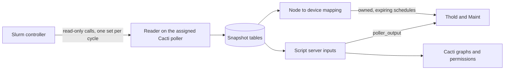

<!-- Source: README.md; SHA256: 16caa3e34c4d150a7fb1018f637e200a7580330f033b485047d8413bce09abba -->

<!-- translations:start -->
[English](../../../README.md) | [简体中文](../zh-CN/README.md) | [हिन्दी](../hi-IN/README.md) | [Español (España)](../es-ES/README.md) | [Español (Latinoamérica)](../es-419/README.md) | [العربية (السعودية)](../ar-SA/README.md) | [Afrikaans](../af-ZA/README.md) | [አማርኛ](../am-ET/README.md) | [العربية (مصر)](../ar-EG/README.md) | [العربية (المغرب)](../ar-MA/README.md) | [বাংলা](../bn-BD/README.md) | [Bosanski](../bs-BA/README.md) | [Deutsch](../de-DE/README.md) | [فارسی](../fa-IR/README.md) | [Filipino](../fil-PH/README.md) | [Français](../fr-FR/README.md) | [Français (Maroc)](../fr-MA/README.md) | [Français (Sénégal)](../fr-SN/README.md) | [Hausa](../ha-NG/README.md) | [עברית](../he-IL/README.md) | [Hrvatski](../hr-HR/README.md) | [Bahasa Indonesia](../id-ID/README.md) | [Igbo](../ig-NG/README.md) | [Italiano](../it-IT/README.md) | [日本語](../ja-JP/README.md) | [한국어](../ko-KR/README.md) | [Malagasy](../mg-MG/README.md) | [मराठी](../mr-IN/README.md) | [Bahasa Melayu](../ms-MY/README.md) | [Nederlands](../nl-NL/README.md) | [Polski](../pl-PL/README.md) | [Português (Brasil)](../pt-BR/README.md) | [Русский](../ru-RU/README.md) | [Kinyarwanda](../rw-RW/README.md) | [Soomaali](../so-SO/README.md) | [Српски](../sr-RS/README.md) | [Svenska](../sv-SE/README.md) | [Kiswahili](../sw-KE/README.md) | [தமிழ்](../ta-IN/README.md) | [తెలుగు](../te-IN/README.md) | [ไทย](../th-TH/README.md) | [Türkçe](../tr-TR/README.md) | [Українська](../uk-UA/README.md) | [اردو](README.md) | [Tiếng Việt](../vi-VN/README.md) | [isiXhosa](../xh-ZA/README.md) | [Yorùbá](../yo-NG/README.md) | [繁體中文](../zh-TW/README.md) | [isiZulu](../zu-ZA/README.md)
<!-- translations:end -->

# plugin_hpcsched

Cacti 1.2 کا ایک پلگ ان جو Cacti کے پہلے سے زیرِ نگرانی آلات (devices) کے ساتھ HPC بیچ شیڈولر کی کیفیت کا گراف بناتا ہے: قطار کی گہرائی (queue depth)، زیرِ التواء (pending) بمقابلہ جاری (running) جابز، جابز کے زیرِ التواء ہونے کی وجوہات، نوڈز کی کیفیت، اور پارٹیشن کا استعمال۔ Slurm پہلا بیک اینڈ ہے۔ حاصل ہونے والے ڈیٹا سورسز پر Thold الرٹ کرتا ہے، اور ڈرین کیے گئے (drained) نوڈز اور مینٹیننس ریزرویشنز کے ذریعے Maint کو چلایا جا سکتا ہے۔

> **کیفیت: زیرِ تکمیل، ابھی کوئی ریلیز جاری نہیں ہوئی۔** مائیل اسٹون 2 (بنیاد) `main` میں ضم (merge) ہو چکا ہے، اور یہ برانچ مائیل اسٹون 3 (کلسٹر گراف اور زیرِ التواء ہونے کی وجوہات) شامل کرتی ہے۔ یہ کوڈ Cacti کے پلگ ان API کے ذریعے انسٹال، اپ گریڈ اور ان انسٹال ہوتا ہے اور 8.2 سے کم PHP ورژن کو مسترد کر دیتا ہے۔ یہ Slurm کلسٹرز کی ایک رجسٹری رکھتا ہے، جن میں سے ہر ایک کسی ایک Cacti پولر (poller) کو تفویض ہوتا ہے۔ مرکزی پولر پر ایک بیک گراؤنڈ ریڈر فی وقفہ ہر کلسٹر کے لیے ایک اسنیپ شاٹ اکٹھا کرتا ہے، یا تو `--json` کے ساتھ `squeue`، `scontrol` اور `sshare` چلا کر یا HTTPS پر `slurmrestd` کو پڑھ کر، اور کیفیت اور زیرِ التواء وجہ کے لحاظ سے جابز کی تعداد، نوڈ کی کیفیات، پارٹیشنز، ریزرویشنز، اور فیئر شیئر (fair-share) استعمال کو ان کی تازگی (freshness) کے ساتھ محفوظ کرتا ہے۔ پلگ ان Cacti ٹیمپلیٹس فراہم کرتا ہے اور منتظم کی تصدیق پر فی کلسٹر ایک Cacti ڈیوائس بناتا یا میپ (map) کرتا ہے جس میں کلسٹر اور ہر پارٹیشن کے لیے کیفیت کے لحاظ سے جابز، وجہ کے زمرے (reason family) کے لحاظ سے زیرِ التواء جابز، کیفیت کے لحاظ سے نوڈز، CPUs، اور استعمال کے گراف، اور اسنیپ شاٹ کی عمر (age) شامل ہوتی ہے۔ صرف پڑھنے کے لیے (read-only) ایک مجموعی جائزہ صفحہ ہر کلسٹر کی تعداد اس کی تازگی کے ساتھ اور فی کلسٹر زیرِ التواء وجوہات کا منظر دکھاتا ہے، اور صرف منتظم کے لیے ایک ہیلتھ (health) صفحہ دکھاتا ہے کہ ہر کلیکشن نے کیا واپس کیا اور آیا ٹیمپلیٹس انسٹال ہیں یا نہیں۔ ہر صفحہ اور کارروائی Cacti کے ڈیوائس اجازت ناموں (permissions) کی پابندی کرتی ہے۔ یہ ڈیٹا سورسز ایسے ہیں جن پر Thold الرٹ کر سکتا ہے، لیکن ابھی تک Thold یا Maint کے کسی انضمام (integration) کا تجربہ نہیں کیا گیا؛ وہ مائیل اسٹون 4 اور اس کے بعد کا کام ہے۔ ٹیسٹ سوئٹ مصنوعی Slurm کمانڈز اور `slurmrestd` کے جوابات کا احاطہ کرتا ہے، اور CI کنٹینرز میں ایک حقیقی چھ نوڈز والے Slurm کلسٹر پر بھی جانچ کرتا ہے جیسا کہ ذیل میں بیان کیا گیا ہے۔ ریڈر ابھی تک کسی پروڈکشن کلسٹر پر نہیں چلایا گیا۔ آپریٹر نوٹس کے نیچے، یہ README ڈیزائن کو بیان کرتا ہے، نہ کہ جاری کردہ رویے کو۔

یہ ایک آزاد پروجیکٹ ہے اور Cacti پروجیکٹ سے منسلک نہیں ہے۔

## رسائی کے کردار (Access roles)

| دائرہ اختیار (Realm) | رسائی |
| --- | --- |
| HPC Scheduler View | موجودہ مانیٹرنگ صفحات۔ |
| HPC Scheduler Operator | مانیٹرنگ کے علاوہ Operations صفحہ اور ذاتی ٹرائیج (triage) توثیقات۔ |
| HPC Scheduler Admin | آپریٹر کی رسائی کے علاوہ موجودہ کنفیگریشن اور انتظامی کارروائیاں۔ |

اپ گریڈ فائلیں کاپی کرنے کے بعد، نئے دائرہ اختیار (realm) کو رجسٹر کرنے کے لیے بطور منتظم Plugins صفحہ کھولیں۔ **Configuration > Users** یا یوزر گروپس کے تحت Operator دائرہ اختیار واضح طور پر تفویض کریں۔
اپ گریڈ موجودہ View اور Admin دائرہ اختیار کی IDs اور عطا کردہ اجازتوں (grants) کو برقرار رکھتے ہیں۔ ہر درخواست (request) پر Admin رسائی Operator رسائی کی حامل ہوتی ہے، اور Operator رسائی View رسائی کی حامل ہوتی ہے؛ اس سے صارفین یا گروپس میں محفوظ شدہ اجازتوں کا اضافہ نہیں ہوتا۔ پلگ ان کی ترتیبات (settings) کے لیے Cacti کی Settings اجازت کے علاوہ HPC Scheduler Admin رسائی بھی درکار ہوتی ہے۔

Cacti کے ڈیوائس اجازت نامے اب بھی ہر صارف کو دستیاب قطاروں اور کارروائیوں کو محدود کرتے ہیں؛ بغیر ڈیوائس والا کلسٹر پلگ ان کے دائرہ اختیار والے ہر صارف کے لیے انتظامی صفحات پر درج ہوتا ہے، لیکن آپریٹر کے مناظر میں نہیں، جو صرف کسی ڈیوائس سے میپ کیے گئے کلسٹرز کو درج کرتے ہیں۔
اسناد (credentials)، کنفیگریشن، میپنگ، حذف کرنے اور دیگر انتظامی تبدیلیاں انتظامی صفحات ہی میں رہتی ہیں۔ توثیقات (acknowledgments) صرف موجودہ صارف کے سیشن میں، زیادہ سے زیادہ ایک گھنٹے کے لیے اور صرف اس وقت تک برقرار رہتی ہیں جب تک وہی مشاہدہ تازہ رہے۔ نئے یا تبدیل شدہ مشاہدات انہیں کالعدم قرار دے دیتے ہیں۔ وہ کبھی بھی ناکام پیمائش کو صحت مند قرار نہیں دیتیں اور نہ ہی الرٹس کو روکتی ہیں۔

## مائیل اسٹون 2 کے لیے آپریٹر نوٹس

**کم از کم استحقاق (Least privilege)۔** یہ پلگ ان صرف پڑھتا ہے۔ اسے ایک مخصوص Slurm صارف دیں جس کے پاس کوئی منتظم یا آپریٹر کردار نہ ہو (`sacctmgr` میں `AdminLevel=None`)۔ `slurm.conf` میں `PrivateData=jobs` (یا `nodes`، `reservations`، `usage`) کے ساتھ، وہ صارف صرف اپنے ریکارڈز دیکھتا ہے، لہٰذا تعداد نامکمل ہوتی ہے اور پلگ ان اس کا پتہ نہیں لگا سکتا۔ اس اکاؤنٹ کے لیے یہ پابندی ہٹانے کا مطلب آپریٹر یا منتظم کی سطح دینا ہے، جو تبدیلیوں کی اجازت بھی دیتی ہے؛ اس توازن کا فیصلہ سائٹ خود کرے گی۔ کلائنٹ کمانڈز کے لیے، Cacti پولر صارف کو Slurm کلائنٹ بائنریز اور ایک ایسے `slurm.conf` کی ضرورت ہوتی ہے جو کنٹرولر تک پہنچ سکے؛ بائنری پاتھس Configuration > Settings > HPC Scheduler کے تحت مطلق ترتیبات (absolute settings) ہیں۔ `slurmrestd` کے لیے، URL لازماً `https://` ہونا چاہیے، یا صرف لوپ بیک (loopback) پتے پر `http://` ہونا چاہیے۔ TLS سرٹیفکیٹس کی تصدیق کی جاتی ہے اور ری ڈائریکٹس (redirects) کی پیروی نہیں کی جاتی۔ Configuration > Settings > HPC Scheduler کے تحت ایک اختیاری slurmrestd ہوسٹ لسٹ ان ہوسٹس اور پورٹس کو محدود کرتی ہے جن کا نام کوئی کلسٹر لے سکتا ہے۔

**ریموٹ پولرز۔** یہ ریلیز صرف مرکزی Cacti پولر پر ڈیٹا اکٹھا کرتی ہے۔ کسی ریموٹ ڈیٹا کلیکٹر کو تفویض کردہ کلسٹر سے ڈیٹا اکٹھا نہیں کیا جاتا: وہاں کا ریڈر لاگ میں وجہ درج کر کے انکار کر دیتا ہے اور ہیلتھ صفحہ اس کلسٹر کا نام ظاہر کرتا ہے۔ ریموٹ کلیکشن فیز 3 میں ہے۔

**میموری۔** ہر کلیکشن رن ایک وقت میں ایک شیڈولر جواب کو ڈی کوڈ کرتا ہے، جو PHP میموری میں جواب کے حجم سے تقریباً 12 گنا جگہ لیتا ہے (Slurm جیسے جاب ریکارڈز کے لیے تقریباً 10 گنا پیمائش کی گئی ہے، اور اس کے علاوہ خود متن)۔ یہ رن اپنی PHP میموری کی حد کو Collection Memory ترتیب (بطور ڈیفالٹ 1024 MiB) تک بڑھا دیتا ہے اور (Collection Memory - 64) / 12 MiB تک کے جوابات کی اجازت دیتا ہے، جو بطور ڈیفالٹ 80 MiB ہے، چاہے Maximum Answer Size اس سے زیادہ سیٹ ہو؛ جب ایسا ہو تو ہیلتھ صفحہ خبردار کرتا ہے۔ اس سے بڑا جواب اپنے حصے کو بہت بڑا ہونے کی وجہ سے ناکام کر دیتا ہے، اور اگر کوئی رن پھر بھی میموری سے باہر ہو جائے تو اسے ناکام ریکارڈ کیا جاتا ہے۔ کسی بڑے کلسٹر کو دونوں ترتیبات بڑھانے کی ضرورت پڑ سکتی ہے؛ 100,000 حقیقی جاب ریکارڈز کی پیمائش ابھی نہیں کی گئی۔

**ٹوکن فائلیں۔** ایک `slurmrestd` کلسٹر ایک ٹوکن فائل کا نام بتاتا ہے؛ ٹوکن خود کبھی ڈیٹا بیس میں محفوظ نہیں کیا جاتا، کسی صفحے پر نہیں دکھایا جاتا، اور نہ ہی لاگ میں لکھا جاتا ہے۔ فائل لازماً Configuration > Settings > HPC Scheduler کے تحت سیٹ کی گئی ٹوکن فائل ڈائریکٹریز میں سے کسی ایک کے اندر ہونی چاہیے، سمبولک لنک (symbolic link) کے بغیر اس تک رسائی ممکن ہو، اور یہ پولر صارف کی ملکیت میں ایک ریگولر فائل ہونی چاہیے جسے صرف وہی صارف لکھ سکے، اور اس میں ایک سطر ہو: ٹوکن، یا `SLURM_JWT=<token>` جیسا کہ `scontrol token` اسے پرنٹ کرتا ہے۔ اگر کوئی ٹوکن ڈائریکٹری سیٹ نہ ہو، تو کوئی کلسٹر `slurmrestd` استعمال نہیں کر سکتا۔ یہ دونوں ترتیبات Cacti کے Settings صفحے پر ہیں، اس لیے صرف پلگ ان کا Admin دائرہ اختیار انہیں تبدیل نہیں کر سکتا؛ ہر ٹوکن ڈائریکٹری کو صرف root اور پولر صارف کے لیے قابلِ تحریر رکھیں۔ وہ فائل جسے گروپ یا دیگر صارفین پڑھ سکتے ہوں پھر بھی استعمال کی جاتی ہے، اور ہیلتھ صفحہ اس پر تنبیہ کرتا ہے۔ جب ٹوکن مقررہ تنبیہ کے وقت کے اندر ختم ہونے والا ہو تب بھی ہیلتھ صفحہ خبردار کرتا ہے۔

ایسے وقفے کے بغیر ٹوکن تبدیل (rotate) کرنے کے لیے جس میں ریڈر کو ادھوری فائل نظر آئے، نیا ٹوکن پرانے کے ساتھ لکھیں اور اسے پرانی کی جگہ نام بدل کر منتقل (rename) کر دیں:

```sh
dir=/etc/cacti/hpcsched
tmp=$(mktemp "$dir/.token.XXXXXX")
scontrol token username=cactiread lifespan=2592000 > "$tmp"
chown cacti:cacti "$tmp"
chmod 0600 "$tmp"
mv -f "$tmp" "$dir/cluster1.token"
```

اگلی کلیکشن نئی فائل پڑھ لیتی ہے۔ `scontrol token` کے ساتھ ٹوکن بنانے کے لیے Slurm منتظم درکار ہوتا ہے؛ اسے وہاں چلائیں جہاں اس کی اجازت ہو اور فائل کو پولر پر کاپی کریں۔

## مائیل اسٹون 3 کے لیے آپریٹر نوٹس

**ٹیمپلیٹس۔** انسٹال اور اپ گریڈ HPC Scheduler ڈیوائس، ڈیٹا، اور گراف ٹیمپلیٹس امپورٹ کرتے ہیں اور پارٹیشن ڈیٹا کیوری (data query) کو Cacti کی `resource/script_server/` ڈائریکٹری میں کاپی کرتے ہیں۔ اگر پلگ ان انسٹال کرنے والا صارف اس ڈائریکٹری میں لکھنے کا مجاز نہ ہو، اسی نام کی کوئی مختلف فائل پہلے سے وہاں موجود ہو اور اسے پلگ ان نے نہ لکھا ہو، یا وہ نام ایک سمبولک لنک ہو، تو امپورٹ رک جاتا ہے، فائل کو ویسا ہی چھوڑ دیا جاتا ہے، اور ہیلتھ صفحہ بتاتا ہے کہ کیا کرنا ہے؛ ہیلتھ صفحے پر موجود Install Templates دوبارہ کوشش کرتا ہے۔ ہاتھ سے بنائی گئی ایک جیسی کاپی استعمال کی جاتی ہے لیکن آپ ہی کی رہتی ہے۔ ان انسٹال کیوری فائل کو صرف تب ہٹاتا ہے جب پلگ ان نے اسے لکھا ہو اور اس میں کوئی تبدیلی نہ ہوئی ہو، اور ٹیمپلیٹس، ڈیوائسز، اور گرافس کو برقرار رکھتا ہے۔

**کلسٹر ڈیوائسز۔** HPC Clusters > Device کچھ بھی بنانے سے پہلے یہ دکھاتا ہے کہ ایک ڈیوائس کیا شامل کرے گی (گرافس، ڈیٹا سورسز، RRD فائلیں، اور فی پول اسکرپٹ سرور کالز)۔ Create Device مخصوص کردہ `.invalid` ڈومین میں ایک ہوسٹ نام کے ساتھ اور بغیر کسی دستیابی (availability) جانچ کے ڈیوائس بناتا ہے؛ اس کے برعکس Map Device گرافس کو کسی موجودہ ڈیوائس سے منسلک کرتا ہے اور اس کی ترتیبات کو نہیں چھیڑتا۔ ہر کلسٹر گراف اور ہر پارٹیشن گراف کا اپنا ڈیٹا سورس ہوتا ہے: کلسٹر کے لیے چھ اور فی پارٹیشن پانچ، فی کلسٹر ڈیٹا سورس ایک اسکرپٹ سرور کال اور فی پول ایک پارٹیشن کی ہر قدر (32) کے لیے ایک کال۔ بعد میں شامل ہونے والی پارٹیشنز کو اس وقت انڈیکس کیا جاتا ہے جب ریڈر انہیں دیکھتا ہے اور انہیں Cacti کے New Graphs صفحے سے گرافس ملتے ہیں؛ ہٹائی گئی پارٹیشن کی پولنگ رک جاتی ہے اور اس کے گرافس برقرار رہتے ہیں۔ ڈیوائس کو حذف کرنے سے کلسٹر ان میپ (unmap) ہو جاتا ہے اور باقی رہتا ہے۔

**گرافس کیا گنتے ہیں۔** زیرِ التواء (pending) میں روکی گئی (held) جابز شامل نہیں ہیں، جن کی اپنی سیریز ہوتی ہے۔ زیرِ التواء ایرے (array) اپنے باقی ماندہ ٹاسکس گنتا ہے۔ متعدد پارٹیشنز میں موجود کوئی جاب یا نوڈ کلسٹر گرافس میں ایک بار اور ہر پارٹیشن میں ایک بار شمار ہوتا ہے، اس لیے پارٹیشن گرافس کا مجموعہ کلسٹر کے برابر ہونا ضروری نہیں ہے۔ زیرِ التواء وجوہات کو گیارہ زمروں (families) میں تقسیم کیا گیا ہے ([ADR 0011](../../decisions/0011-pending-reason-families-and-counting.md))؛ زیرِ التواء وجوہات کا منظر خام (raw) وجوہات کی فہرست دکھاتا ہے، بشمول Other میں موجود وجوہات۔ ہر جاب صرف وہ آخری وجہ رپورٹ کرتی ہے جس کا شیڈولر نے جائزہ لیا۔ استعمال (utilization) کے تقسیم کنندہ (denominator) میں ڈرین کیے گئے، بند (down)، اور دیگر غیر دستیاب نوڈز شامل ہوتے ہیں۔ باسی یا ناکام ڈیٹا `U` ہوتا ہے، کبھی صفر نہیں؛ `age` عددی رہتا ہے۔

**الرٹنگ۔** Thold ان میں سے کسی بھی ڈیٹا سورس پر الرٹ کر سکتا ہے؛ Thold کے دورانیے کو کم از کم ایک کلیکشن وقفے پر سیٹ کریں، اور بند ہو جانے والے ریڈر کو پکڑنے کے لیے `age` پر الرٹ لگائیں۔ مکمل (end-to-end) Thold جانچ مائیل اسٹون 4 میں ہے۔

**حقیقی Slurm آؤٹ پٹ پر تجربہ شدہ۔** CI کنٹینرز میں چھ نوڈز والا Slurm کلسٹر شروع کرتا ہے (ہر تبدیلی پر 26.05.5، `main` پر پش، ہفتہ وار، اور درخواست پر سورس سے تیار کردہ 25.11.8) اور نوڈ کی کیفیات، مینٹیننس ریزرویشن، زیرِ التواء وجوہات، اور ایرے کی جانچ ویسے ہی کرتا ہے جیسے پلگ ان انہیں پارس کرتا ہے، پھر پلگ ان کے اپنے کمانڈ اور `slurmrestd` ٹرانسپورٹس کے ساتھ اس کلسٹر سے ڈیٹا اکٹھا کرتا ہے۔ پرانے ریلیزز کا احاطہ صرف مصنوعی فکسچرز کے ذریعے کیا گیا ہے۔ ریڈر ابھی تک کسی پروڈکشن کلسٹر پر نہیں چلایا گیا۔

**اجازت نامے (Permissions)۔** کسی ڈیوائس پر موجود کلسٹر کو پلگ ان کے ہر صفحے پر صرف ان صارفین کے لیے دکھایا، ایکسپورٹ کیا، اور تبدیل کیا جاتا ہے جنہیں Cacti اس ڈیوائس کی اجازت دیتا ہے؛ ڈیوائس کو میپ کرنے کے لیے ہدف ڈیوائس کی اجازت بھی درکار ہوتی ہے۔ بغیر ڈیوائس والا کلسٹر پلگ ان کے دائرہ اختیار والے ہر شخص کو نظر آتا ہے۔ کوئی کلسٹر جو اب بھی کسی ایسی ڈیوائس سے میپ ہو جسے پلگ ان کے غیر فعال ہونے کے دوران حذف کر دیا گیا تھا، صرف ان صارفین کو دکھایا جاتا ہے جن کے پاس HPC Scheduler Admin کا دائرہ اختیار ہو، جو اس کے لیے ڈیوائس بنا یا میپ کر سکتے ہیں۔ گراف کی رسائی Cacti کی اپنی ہے۔

## کیوں

وہ آپریٹرز جو Cacti چلاتے ہیں پہلے ہی اپنے کمپیوٹ نوڈز کے گراف بناتے ہیں۔ ان گرافس میں شیڈولر کا منظر غائب ہوتا ہے، جس سے دو خلا رہ جاتے ہیں:

- **"کام کیوں شروع نہیں ہو رہا" کا کوئی جواب نہیں۔** Slurm ہر زیرِ التواء جاب کے لیے ایک وجہ ریکارڈ کرتا ہے۔ فارغ نوڈ گرافس کے ساتھ بھری ہوئی قطار یہ نہیں بتاتی کہ اس کی وجہ ترجیح (priority)، وسائل کی حدود، روکی گئی جابز (holds)، انحصار (dependencies)، یا ڈرین کیے گئے نوڈز ہیں۔
- **شیڈولر کی کیفیت اور الرٹنگ کے درمیان کوئی ربط نہیں۔** Thold اس ڈیوائس پر الرٹ کرتا ہے جسے منتظم پہلے ہی ڈرین کر چکا ہوتا ہے، اور منتظمین Maint کے شیڈول ہاتھ سے بناتے ہیں۔

یہ پلگ ان فی کلسٹر ایک کیشڈ (cached) اسنیپ شاٹ اکٹھا کرتا ہے، اسے عام Cacti ڈیٹا سورسز اور گرافس کے طور پر شائع کرتا ہے، شیڈولر نوڈز کو موجودہ Cacti ڈیوائسز پر میپ کرتا ہے، اور ڈرین کیے گئے نوڈز اور مینٹیننس ریزرویشنز کو Maint میں شامل کر سکتا ہے۔ یہ Cacti کے اجازت ناموں، ریموٹ ڈیٹا کلیکٹرز، Thold، اور Maint کا دوبارہ استعمال کرتا ہے، اور شیڈولر کے لیے صرف پڑھنے کی حد تک (read-only) ہے۔

## منصوبہ بند دائرہ کار

| مرحلہ | دائرہ کار | مائیل اسٹونز |
|---|---|---|
| 0، تحقیق | Slurm ریلیز میٹرکس، اپ اسٹریم رویے کی تصدیق، کنٹرولر لوڈ، نوڈ نام رکھنے کے فکسچرز | [M1](https://github.com/somethingwithproof/plugin_hpcsched/milestone/1) |
| 1، کلسٹر گرافس | قطار کی گہرائی، زیرِ التواء اور جاری جابز، زیرِ التواء وجوہات، نوڈ کی کیفیات، پارٹیشن کا استعمال، Thold الرٹنگ، ہیلتھ صفحہ، ریلیز | [M2](https://github.com/somethingwithproof/plugin_hpcsched/milestone/2)، [M3](https://github.com/somethingwithproof/plugin_hpcsched/milestone/3)، [M4](https://github.com/somethingwithproof/plugin_hpcsched/milestone/4) |
| 2، نوڈز اور مینٹیننس | نوڈ سے ڈیوائس میپنگ، فی نوڈ کیفیت، ڈرین کیے گئے نوڈز اور مینٹیننس ریزرویشنز کے لیے خودکار Maint ونڈوز | [M5](https://github.com/somethingwithproof/plugin_hpcsched/milestone/5) |
| 3، اکاؤنٹنگ | فیئر شیئر استعمال، محدود اکاؤنٹنگ شماریات، ریموٹ ڈیٹا کلیکٹرز | [M6](https://github.com/somethingwithproof/plugin_hpcsched/milestone/6) |

دائرہ کار سے باہر: شیڈولر میں کوئی بھی تحریری راستہ (submit، cancel، hold، drain، resume)، پلگ ان کی ملکیت والا الرٹنگ انجن، رپورٹنگ یا چارج بیک انجن، فی صارف اور فی جاب سیریز۔ PBS Pro، OpenPBS، اور LSF بیک اینڈز تحقیق کے مرحلے میں ہیں۔

## مطابقت کے اہداف

| جزو | ہدف |
|---|---|
| Cacti | 1.2.31 یا جدید تر، بغیر کسی کور پیچ (core patches) کے |
| PHP | 8.2 یا جدید تر؛ `setup.php` 8.0 پر پارس ہونے کے قابل رہتا ہے تاکہ غیر معاون رن ٹائم کو ٹوٹے ہوئے Cacti UI کے بجائے انکار کا پیغام ملے |
| Slurm | 25.05، 25.11، اور 26.05، تین تازہ ترین ریلیزز ([ADR 0013](../../decisions/0013-three-latest-slurm-releases.md))؛ 25.11 اور 26.05 کو لائیو کلسٹر پر ٹیسٹ کیا گیا ہے، 25.05 کو صرف فکسچرز پر۔ کلائنٹ کمانڈز بطور ڈیفالٹ ٹرانسپورٹ ہیں ([ADR 0012](../../decisions/0012-client-commands-default-transport.md)) اور ڈیٹا پارسر کی ترتیب استعمال کرتی ہیں: بطور ڈیفالٹ v0.0.43، جسے SchedMD 27.05 میں ہٹا دیتا ہے، یا ان ریلیزز پر v0.0.44 یا v0.0.45 جو انہیں فراہم کرتی ہیں۔ slurmrestd کلسٹرز ڈیمن کی جانب سے فراہم کردہ جدید ترین پارسر خود دریافت کر لیتے ہیں |
| Thold، Maint | Thold میں کوئی تبدیلی نہیں؛ Maint کا انضمام ایک تجویز ہے جس کے لیے Maint کے منتظمین (maintainers) کی رضامندی درکار ہے |

## ڈیزائن

- [docs/PLAN.md](../../PLAN.md) مکمل منصوبہ ہے: آرکیٹیکچر، اپ اسٹریم حقائق جن پر یہ منحصر ہے (مآخذ اور غیر مصدقہ مفروضوں کی واضح فہرست کے ساتھ)، نوڈ میپنگ، اسٹیٹ ماڈل، سیکیورٹی حدود، کارکردگی کا حساب کتاب، ٹیسٹنگ، اور خطرات۔
- [docs/decisions/](../../decisions) میں آرکیٹیکچر فیصلوں کے ریکارڈز (ADRs) موجود ہیں۔
- [docs/REQUIREMENTS.md](../../REQUIREMENTS.md) ہر تقاضے کی ID کو اس کے متعلقہ ایشو سے میپ کرتا ہے۔



## کام کو کیسے ٹریک کیا جاتا ہے

- **مائیل اسٹونز** منصوبے کے مائیل اسٹونز کی پیروی کرتے ہیں۔ ہر ایک کا اپنا ایپک (epic) ایشو ہے جس میں اس کے ذیلی ایشوز اور اختتامی شواہد درج ہیں۔
- **ایشوز** کو لیبل کے ذریعے درجہ بند کیا گیا ہے: `type: requirement`، `type: research`، `type: decision`، `type: epic`۔ تقاضے کے ایشوز نمبر شدہ، قابلِ جانچ تقاضے (`REQ-AREA-NNN`) اور قبولیت کے معیار بیان کرتے ہیں۔
- **لیبلز** میں `area:`، `phase:`، `priority:`، اور `status:` بھی شامل ہوتے ہیں۔ دیکھیں [CONTRIBUTING.md](../../../CONTRIBUTING.md#labels)۔
- [پروجیکٹ بورڈ](https://github.com/users/somethingwithproof/projects/10) تمام مائیل اسٹونز کے تمام ایشوز دکھاتا ہے۔

## شراکت داری

[CONTRIBUTING.md](../../../CONTRIBUTING.md) پڑھیں۔ کمٹس (commits) کے لیے DCO sign-off درکار ہے۔ ڈیزائن پر بحث ایشوز پر ہوتی ہے؛ کھلے فیصلوں پر `type: decision` لیبل لگا ہوتا ہے۔

## سیکیورٹی

کمزوریوں (vulnerabilities) کی نجی طور پر اطلاع دیں؛ دیکھیں [SECURITY.md](../../../SECURITY.md)۔

## لائسنس

GNU General Public License v2.0، وہی لائسنس جو Cacti اور اس کے پلگ انز کا ہے۔ دیکھیں [LICENSE](../../../LICENSE)۔
