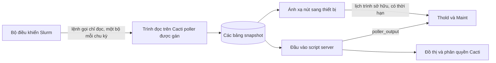

<!-- Source: README.md; SHA256: 16caa3e34c4d150a7fb1018f637e200a7580330f033b485047d8413bce09abba -->

<!-- translations:start -->
[English](../../../README.md) | [简体中文](../zh-CN/README.md) | [हिन्दी](../hi-IN/README.md) | [Español (España)](../es-ES/README.md) | [Español (Latinoamérica)](../es-419/README.md) | [العربية (السعودية)](../ar-SA/README.md) | [Afrikaans](../af-ZA/README.md) | [አማርኛ](../am-ET/README.md) | [العربية (مصر)](../ar-EG/README.md) | [العربية (المغرب)](../ar-MA/README.md) | [বাংলা](../bn-BD/README.md) | [Deutsch](../de-DE/README.md) | [فارسی](../fa-IR/README.md) | [Filipino](../fil-PH/README.md) | [Français](../fr-FR/README.md) | [Français (Maroc)](../fr-MA/README.md) | [Français (Sénégal)](../fr-SN/README.md) | [Hausa](../ha-NG/README.md) | [עברית](../he-IL/README.md) | [Bahasa Indonesia](../id-ID/README.md) | [Igbo](../ig-NG/README.md) | [Italiano](../it-IT/README.md) | [日本語](../ja-JP/README.md) | [한국어](../ko-KR/README.md) | [Malagasy](../mg-MG/README.md) | [मराठी](../mr-IN/README.md) | [Bahasa Melayu](../ms-MY/README.md) | [Nederlands](../nl-NL/README.md) | [Polski](../pl-PL/README.md) | [Português (Brasil)](../pt-BR/README.md) | [Русский](../ru-RU/README.md) | [Kinyarwanda](../rw-RW/README.md) | [Soomaali](../so-SO/README.md) | [Svenska](../sv-SE/README.md) | [Kiswahili](../sw-KE/README.md) | [தமிழ்](../ta-IN/README.md) | [తెలుగు](../te-IN/README.md) | [ไทย](../th-TH/README.md) | [Türkçe](../tr-TR/README.md) | [Українська](../uk-UA/README.md) | [اردو](../ur-PK/README.md) | [Tiếng Việt](README.md) | [isiXhosa](../xh-ZA/README.md) | [Yorùbá](../yo-NG/README.md) | [繁體中文](../zh-TW/README.md) | [isiZulu](../zu-ZA/README.md)
<!-- translations:end -->

# plugin_hpcsched

Một plugin của Cacti 1.2 giúp vẽ đồ thị trạng thái của trình lập lịch tác vụ theo lô HPC bên cạnh các thiết bị mà Cacti đang giám sát: độ sâu hàng đợi, các tác vụ đang chờ so với đang chạy, lý do tác vụ đang chờ, trạng thái nút và mức độ sử dụng phân vùng. Slurm là backend đầu tiên. Thold có thể cảnh báo dựa trên các nguồn dữ liệu thu được, và Maint có thể được điều phối bởi các nút bị rút tải (drained) và các lịch bảo trì.

> **Trạng thái: đang phát triển, chưa có bản phát hành.** Mốc Milestone 2 (nền tảng) đã được hợp nhất vào `main`, và nhánh này bổ sung mốc Milestone 3 (đồ thị cụm và lý do chờ). Mã nguồn cài đặt, nâng cấp và gỡ cài đặt thông qua API plugin của Cacti và từ chối PHP dưới phiên bản 8.2. Plugin duy trì một sổ đăng ký các cụm Slurm, mỗi cụm được gán cho một Cacti poller. Một trình đọc chạy nền trên poller chính sẽ thu thập một ảnh chụp nhanh cho mỗi cụm theo từng chu kỳ, bằng cách chạy `squeue`, `scontrol` và `sshare` với `--json` hoặc đọc `slurmrestd` qua HTTPS, sau đó lưu trữ số lượng tác vụ theo trạng thái và lý do chờ, trạng thái nút, phân vùng, lịch đặt trước và mức sử dụng fair-share kèm theo độ mới của dữ liệu. Plugin cung cấp sẵn các mẫu Cacti và khi có xác nhận của quản trị viên, sẽ tạo hoặc ánh xạ một thiết bị Cacti cho mỗi cụm cùng với các đồ thị về tác vụ theo trạng thái, tác vụ chờ theo nhóm lý do, nút theo trạng thái, CPU và mức độ sử dụng cho toàn cụm và từng phân vùng, cộng thêm độ tuổi của ảnh chụp nhanh. Trang tổng quan chỉ đọc hiển thị số lượng theo từng cụm kèm độ mới của dữ liệu và chế độ xem lý do chờ theo từng cụm, còn trang tình trạng chỉ dành cho quản trị viên hiển thị kết quả trả về của mỗi lần thu thập và cho biết các mẫu đã được cài đặt hay chưa. Mọi trang và thao tác đều tuân theo quyền truy cập thiết bị của Cacti. Các nguồn dữ liệu đều tương thích để Thold thiết lập cảnh báo, nhưng việc tích hợp với Thold hoặc Maint vẫn chưa được kiểm thử; phần đó thuộc mốc Milestone 4 trở về sau. Bộ kiểm thử bao phủ các lệnh Slurm và phản hồi `slurmrestd` giả lập, đồng thời CI cũng chạy thử trên một cụm Slurm sáu nút thực tế trong container như mô tả bên dưới. Trình đọc chưa từng chạy trên cụm sản xuất. Bên dưới phần ghi chú vận hành là phần mô tả thiết kế trong README này, không phải hành vi đã phát hành.

Đây là một dự án độc lập và không trực thuộc dự án Cacti.

## Vai trò truy cập

| Quyền hạn (Realm) | Quyền truy cập |
| --- | --- |
| HPC Scheduler View | Các trang giám sát hiện có. |
| HPC Scheduler Operator | Quyền giám sát cộng thêm trang Operations và xác nhận phân loại cá nhân. |
| HPC Scheduler Admin | Quyền Operator cộng thêm phần cấu hình hiện có và các thao tác quản trị. |

Sau khi sao chép các tệp nâng cấp, hãy mở trang Plugins với tư cách quản trị viên để đăng ký
quyền hạn mới. Gán quyền Operator một cách tường minh trong mục **Configuration > Users** hoặc các nhóm người dùng.
Việc nâng cấp vẫn giữ nguyên ID và các quyền đã cấp của realm View và Admin hiện có. Quyền Admin
kế thừa quyền Operator, và quyền Operator kế thừa quyền View trên mỗi yêu cầu;
điều này không ghi thêm các quyền được lưu trữ vào người dùng hay nhóm. Phần cài đặt plugin cũng yêu cầu
quyền HPC Scheduler Admin bên cạnh quyền Settings của Cacti.

Quyền truy cập thiết bị của Cacti vẫn giới hạn các hàng dữ liệu và thao tác khả dụng đối với từng người dùng; một cụm chưa gắn với thiết bị được liệt kê trên các trang quản trị cho mọi người dùng có realm của plugin, nhưng không hiển thị trong các chế độ xem của operator vốn chỉ liệt kê các cụm đã ánh xạ tới một thiết bị.
Thông tin xác thực, cấu hình, ánh xạ, xóa và các thay đổi quản trị khác
vẫn nằm ở các trang quản trị. Các xác nhận chỉ tồn tại trong phiên làm việc hiện tại
của người dùng, tối đa một giờ và chỉ trong khi cùng một quan sát đó còn
mới. Quan sát mới hoặc có thay đổi sẽ làm mất hiệu lực của chúng. Chúng không bao giờ đánh dấu một phép đo lỗi
là bình thường hoặc tắt cảnh báo.

## Ghi chú vận hành cho Milestone 2

**Đặc quyền tối thiểu.** Plugin chỉ thực hiện thao tác đọc. Hãy cấp cho nó một người dùng Slurm riêng không có vai trò quản trị viên hoặc operator (`AdminLevel=None` trong `sacctmgr`). Khi bật `PrivateData=jobs` (hoặc `nodes`, `reservations`, `usage`) trong `slurm.conf`, người dùng đó chỉ nhìn thấy các bản ghi của chính mình, dẫn đến số liệu bị thiếu và plugin không thể phát hiện điều đó. Việc nới lỏng giới hạn đó cho tài khoản đồng nghĩa với việc cấp mức operator hoặc administrator, vốn cũng cho phép thực hiện thay đổi; sự đánh đổi này do từng hệ thống quyết định. Đối với lệnh máy khách, người dùng Cacti poller cần có các tệp nhị phân máy khách Slurm và một tệp `slurm.conf` có thể kết nối tới controller; đường dẫn tệp nhị phân là các thiết lập tuyệt đối trong Configuration > Settings > HPC Scheduler. Đối với `slurmrestd`, URL phải là `https://`, hoặc chỉ `http://` trên địa chỉ loopback. Chứng chỉ TLS được xác minh và chuyển hướng không được đi theo. Danh sách máy chủ slurmrestd tùy chọn trong Configuration > Settings > HPC Scheduler giới hạn các máy chủ và cổng mà một cụm có thể chỉ định.

**Poller từ xa.** Bản phát hành này chỉ thu thập dữ liệu trên Cacti poller chính. Cụm được gán cho một bộ thu thập dữ liệu từ xa sẽ không được thu thập: trình đọc tại đó sẽ từ chối kèm lý do được ghi nhật ký và trang tình trạng sẽ nêu tên cụm đó. Thu thập từ xa thuộc giai đoạn 3.

**Bộ nhớ.** Mỗi lượt thu thập giải mã từng phản hồi của trình lập lịch một, tiêu tốn lượng bộ nhớ PHP gấp khoảng 12 lần kích thước phản hồi (đo được khoảng 10 lần đối với các bản ghi tác vụ có cấu trúc như của Slurm, cộng thêm chính chuỗi văn bản đó). Quá trình chạy sẽ nâng giới hạn bộ nhớ PHP lên mức thiết lập Collection Memory (mặc định 1024 MiB) và cho phép phản hồi tối đa (Collection Memory - 64) / 12 MiB, mặc định 80 MiB, ngay cả khi Maximum Answer Size được đặt cao hơn; trang tình trạng sẽ cảnh báo khi xảy ra điều này. Phản hồi lớn hơn sẽ khiến phần tương ứng thất bại vì quá lớn, và lượt chạy vẫn bị hết bộ nhớ sẽ được ghi nhận là thất bại. Một cụm lớn có thể cần tăng cả hai thiết lập; 100.000 bản ghi tác vụ thực tế chưa được đo kiểm.

**Tệp token.** Một cụm `slurmrestd` chỉ định một tệp token; bản thân token không bao giờ được lưu trong cơ sở dữ liệu, hiển thị trên trang hay ghi vào nhật ký. Tệp phải nằm bên trong một trong các thư mục tệp token được thiết lập trong Configuration > Settings > HPC Scheduler, có thể truy cập mà không qua liên kết tượng trưng, và phải là tệp thông thường thuộc sở hữu của người dùng poller mà chỉ người dùng đó mới có quyền ghi, chứa một dòng: token hoặc `SLURM_JWT=<token>` theo đúng định dạng `scontrol token` in ra. Nếu không thiết lập thư mục token nào, sẽ không có cụm nào dùng được `slurmrestd`. Hai thiết lập này nằm trên trang Settings của Cacti, nên chỉ riêng realm Admin của plugin không thể thay đổi chúng; hãy giữ mỗi thư mục token chỉ cho phép root và người dùng poller ghi. Tệp mà nhóm hoặc người dùng khác có thể đọc vẫn được sử dụng, và trang tình trạng sẽ cảnh báo. Trang tình trạng cũng cảnh báo khi token sắp hết hạn trong khoảng thời gian cảnh báo đã cấu hình.

Để xoay vòng token mà không tạo ra khoảng thời gian trình đọc nhìn thấy tệp chưa ghi xong, hãy ghi token mới ngay cạnh tệp cũ rồi đổi tên đè vào vị trí đó:

```sh
dir=/etc/cacti/hpcsched
tmp=$(mktemp "$dir/.token.XXXXXX")
scontrol token username=cactiread lifespan=2592000 > "$tmp"
chown cacti:cacti "$tmp"
chmod 0600 "$tmp"
mv -f "$tmp" "$dir/cluster1.token"
```

Lần thu thập tiếp theo sẽ đọc tệp mới. Việc tạo token bằng `scontrol token` đòi hỏi quyền quản trị viên Slurm; hãy chạy lệnh ở nơi được phép rồi sao chép tệp sang máy poller.

## Ghi chú vận hành cho Milestone 3

**Mẫu (Templates).** Quá trình cài đặt và nâng cấp sẽ nhập các mẫu thiết bị, dữ liệu và đồ thị của HPC Scheduler, đồng thời sao chép truy vấn dữ liệu phân vùng vào thư mục `resource/script_server/` của Cacti. Nếu thư mục đó không cho phép người dùng cài đặt plugin ghi, đã có một tệp khác cùng tên ở đó không phải do plugin ghi, hoặc tên đó là một liên kết tượng trưng, quá trình nhập sẽ dừng lại, giữ nguyên tệp hiện có và trang tình trạng sẽ hướng dẫn cách xử lý; nút Install Templates trên trang tình trạng cho phép thử lại. Bản sao giống hệt được tạo thủ công vẫn được sử dụng nhưng thuộc quyền quản lý của bạn. Gỡ cài đặt chỉ xóa tệp truy vấn nếu tệp đó do plugin ghi và chưa bị chỉnh sửa, đồng thời giữ lại các mẫu, thiết bị và đồ thị.

**Thiết bị cụm.** Mục HPC Clusters > Device hiển thị những gì một thiết bị sẽ thêm vào (đồ thị, nguồn dữ liệu, tệp RRD và số lần gọi script server mỗi lượt poll) trước khi tạo bất kỳ thành phần nào. Create Device tạo một thiết bị có tên máy chủ thuộc miền dành riêng `.invalid` và không kiểm tra tính khả dụng; thay vào đó, Map Device gắn các đồ thị vào một thiết bị hiện có và giữ nguyên các thiết lập của thiết bị đó. Mỗi đồ thị cụm và mỗi đồ thị phân vùng có nguồn dữ liệu riêng: sáu cho cụm và năm cho mỗi phân vùng, tương ứng một lần gọi script server cho mỗi nguồn dữ liệu cụm và một lần cho mỗi giá trị của phân vùng (32) trong mỗi lượt poll. Các phân vùng được thêm sau này sẽ được đánh chỉ mục khi trình đọc nhìn thấy chúng và có đồ thị từ trang New Graphs của Cacti; phân vùng bị xóa sẽ ngừng được poll và vẫn giữ các đồ thị cũ. Xóa thiết bị sẽ hủy ánh xạ cụm nhưng vẫn giữ lại cụm đó.

**Những gì đồ thị đếm.** Trạng thái chờ loại trừ các tác vụ đang bị giữ, vốn có chuỗi dữ liệu riêng. Một mảng tác vụ đang chờ chỉ đếm số tác vụ con còn lại. Một tác vụ hoặc nút nằm trong nhiều phân vùng được đếm một lần trong đồ thị cấp cụm và một lần trong mỗi phân vùng, do đó tổng từ các đồ thị phân vùng không nhất thiết bằng đồ thị của cụm. Các lý do chờ được gom vào mười một nhóm ([ADR 0011](../../decisions/0011-pending-reason-families-and-counting.md)); chế độ xem lý do chờ liệt kê các lý do thô, bao gồm cả các lý do thuộc nhóm Other. Mỗi tác vụ chỉ báo cáo lý do cuối cùng mà trình lập lịch đã xem xét. Mẫu số của mức sử dụng bao gồm các nút đang rút tải, ngừng hoạt động và các nút không khả dụng khác. Dữ liệu cũ hoặc thu thập thất bại có giá trị là `U`, không bao giờ là số không; `age` vẫn giữ dạng số.

**Cảnh báo.** Thold có thể cảnh báo trên bất kỳ nguồn dữ liệu nào trong số này; hãy đặt thời lượng của Thold tối thiểu bằng một chu kỳ thu thập và thiết lập cảnh báo trên `age` để phát hiện trình đọc bị dừng. Kiểm tra tích hợp đầu-cuối với Thold thuộc mốc Milestone 4.

**Đã kiểm thử với đầu ra Slurm thực tế.** CI khởi chạy một cụm Slurm sáu nút trong container (26.05.5 trên mọi thay đổi, 25.11.8 được biên dịch từ mã nguồn khi push lên `main`, hằng tuần và theo yêu cầu) và kiểm tra trạng thái nút, lịch bảo trì, lý do chờ và mảng tác vụ theo cách plugin phân tích cú pháp, sau đó thu thập dữ liệu từ cụm đó bằng chính các phương thức truyền tải lệnh và `slurmrestd` của plugin. Các bản phát hành cũ hơn chỉ được kiểm thử bằng dữ liệu giả lập. Trình đọc vẫn chưa từng chạy trên cụm sản xuất.

**Phân quyền.** Một cụm gắn trên thiết bị chỉ được hiển thị, xuất và thay đổi đối với những người dùng được Cacti cấp quyền truy cập thiết bị đó, trên mọi trang của plugin; việc ánh xạ thiết bị cũng đòi hỏi quyền đối với thiết bị đích. Một cụm chưa gắn với thiết bị hiển thị với tất cả mọi người có realm của plugin. Một cụm vẫn đang ánh xạ tới một thiết bị đã bị xóa trong lúc plugin bị vô hiệu hóa chỉ hiển thị cho người dùng có realm HPC Scheduler Admin, những người có thể tạo hoặc ánh xạ một thiết bị mới cho cụm đó. Quyền truy cập đồ thị do Cacti quản lý.

## Lý do xây dựng

Những người vận hành Cacti đã vẽ đồ thị cho các nút tính toán của họ. Góc nhìn từ trình lập lịch lại còn thiếu trong các đồ thị đó, để lại hai khoảng trống:

- **Không biết "tại sao công việc chưa bắt đầu chạy".** Slurm ghi lại lý do cho mỗi tác vụ đang chờ. Một hàng đợi đầy bên cạnh đồ thị nút nhàn rỗi không cho biết nguyên nhân là do độ ưu tiên, giới hạn tài nguyên, trạng thái giữ, phụ thuộc hay các nút bị rút tải.
- **Không có liên kết giữa trạng thái trình lập lịch và hệ thống cảnh báo.** Thold phát cảnh báo trên một thiết bị mà quản trị viên đã chủ động rút tải, và quản trị viên phải tạo lịch Maint bằng tay.

Plugin thu thập một ảnh chụp nhanh được lưu đệm cho mỗi cụm, xuất bản thành các nguồn dữ liệu và đồ thị Cacti thông thường, ánh xạ các nút của trình lập lịch vào các thiết bị Cacti hiện có, đồng thời có thể đưa các nút bị rút tải và lịch bảo trì vào Maint. Plugin tái sử dụng hệ thống phân quyền, bộ thu thập dữ liệu từ xa, Thold và Maint của Cacti, và chỉ thực hiện thao tác đọc đối với trình lập lịch.

## Phạm vi dự kiến

| Giai đoạn | Phạm vi | Các mốc |
|---|---|---|
| 0, nghiên cứu | Ma trận phiên bản Slurm, xác nhận hành vi thượng nguồn, tải controller, dữ liệu mẫu đặt tên nút | [M1](https://github.com/somethingwithproof/plugin_hpcsched/milestone/1) |
| 1, đồ thị cụm | Độ sâu hàng đợi, tác vụ chờ và đang chạy, lý do chờ, trạng thái nút, mức sử dụng phân vùng, cảnh báo Thold, trang tình trạng, phát hành | [M2](https://github.com/somethingwithproof/plugin_hpcsched/milestone/2), [M3](https://github.com/somethingwithproof/plugin_hpcsched/milestone/3), [M4](https://github.com/somethingwithproof/plugin_hpcsched/milestone/4) |
| 2, nút và bảo trì | Ánh xạ nút sang thiết bị, trạng thái từng nút, cửa sổ Maint tự động cho nút bị rút tải và lịch bảo trì | [M5](https://github.com/somethingwithproof/plugin_hpcsched/milestone/5) |
| 3, hạch toán | Mức sử dụng fair-share, thống kê hạch toán có giới hạn, bộ thu thập dữ liệu từ xa | [M6](https://github.com/somethingwithproof/plugin_hpcsched/milestone/6) |

Ngoài phạm vi: mọi luồng ghi vào trình lập lịch (gửi tác vụ, hủy, giữ, rút tải, tiếp tục), công cụ cảnh báo riêng của plugin, công cụ báo cáo hoặc tính phí, chuỗi dữ liệu theo từng người dùng và từng tác vụ. Các backend PBS Pro, OpenPBS và LSF hiện đang ở giai đoạn nghiên cứu.

## Mục tiêu tương thích

| Thành phần | Mục tiêu |
|---|---|
| Cacti | 1.2.31 trở lên, không cần vá nhân |
| PHP | 8.2 trở lên; `setup.php` vẫn phân tích cú pháp được trên 8.0 để môi trường không được hỗ trợ nhận thông báo từ chối thay vì làm hỏng giao diện Cacti |
| Slurm | 25.05, 25.11 và 26.05, ba bản phát hành mới nhất ([ADR 0013](../../decisions/0013-three-latest-slurm-releases.md)); 25.11 và 26.05 được kiểm thử trên cụm thực tế, 25.05 chỉ kiểm thử với dữ liệu mẫu. Lệnh máy khách là phương thức truyền tải mặc định ([ADR 0012](../../decisions/0012-client-commands-default-transport.md)) và sử dụng thiết lập trình phân tích dữ liệu: mặc định v0.0.43 (sẽ bị SchedMD gỡ bỏ ở bản 27.05), hoặc v0.0.44 hay v0.0.45 trên các bản phát hành có hỗ trợ. Các cụm slurmrestd tự động phát hiện trình phân tích mới nhất mà daemon phục vụ |
| Thold, Maint | Không thay đổi Thold; việc tích hợp Maint là một đề xuất cần có sự đồng thuận từ những người duy trì Maint |

## Thiết kế

- [docs/PLAN.md](../../PLAN.md) là bản kế hoạch đầy đủ: kiến trúc, các dữ kiện thượng nguồn mà hệ thống phụ thuộc vào (kèm nguồn tham chiếu và danh sách rõ ràng các giả định chưa được xác nhận), ánh xạ nút, mô hình trạng thái, ranh giới bảo mật, tính toán hiệu năng, kiểm thử và rủi ro.
- [docs/decisions/](../../decisions) lưu giữ các bản ghi quyết định kiến trúc.
- [docs/REQUIREMENTS.md](../../REQUIREMENTS.md) ánh xạ từng ID yêu cầu tới issue tương ứng.



## Cách theo dõi công việc

- **Các mốc** bám theo các mốc của bản kế hoạch. Mỗi mốc có một issue tổng liệt kê các issue con và bằng chứng hoàn thành.
- **Các issue** được phân loại bằng nhãn: `type: requirement`, `type: research`, `type: decision`, `type: epic`. Các issue yêu cầu nêu rõ các yêu cầu được đánh số và có thể kiểm thử (`REQ-AREA-NNN`) cùng tiêu chí nghiệm thu.
- **Nhãn** cũng mang các tiền tố `area:`, `phase:`, `priority:` và `status:`. Xem [CONTRIBUTING.md](../../../CONTRIBUTING.md#labels).
- [Bảng dự án](https://github.com/users/somethingwithproof/projects/10) hiển thị tất cả các issue qua từng mốc.

## Đóng góp

Đọc [CONTRIBUTING.md](../../../CONTRIBUTING.md). Các commit cần có xác nhận ký tên DCO. Thảo luận thiết kế diễn ra trên các issue; các quyết định đang mở mang nhãn `type: decision`.

## Bảo mật

Báo cáo lỗ hổng bảo mật một cách riêng tư; xem [SECURITY.md](../../../SECURITY.md).

## Giấy phép

Giấy phép Công cộng GNU phiên bản 2.0, cùng giấy phép với Cacti và các plugin của nó. Xem [LICENSE](../../../LICENSE).
