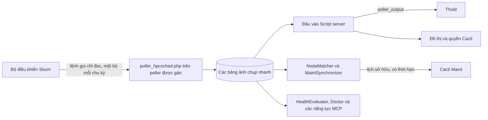

<!-- Source: README.md; SHA256: 938114d41dbd516f9dfcd94619c4fc73ef56b4da1dd693010588a93cce250534 -->

<!-- translations:start -->
[English](../../../README.md) | [简体中文](../zh-CN/README.md) | [हिन्दी](../hi-IN/README.md) | [Español (España)](../es-ES/README.md) | [Español (Latinoamérica)](../es-419/README.md) | [العربية (السعودية)](../ar-SA/README.md) | [Afrikaans](../af-ZA/README.md) | [አማርኛ](../am-ET/README.md) | [العربية (مصر)](../ar-EG/README.md) | [العربية (المغرب)](../ar-MA/README.md) | [Български](../bg-BG/README.md) | [বাংলা](../bn-BD/README.md) | [Bosanski](../bs-BA/README.md) | [Deutsch](../de-DE/README.md) | [Ελληνικά](../el-GR/README.md) | [فارسی](../fa-IR/README.md) | [Filipino](../fil-PH/README.md) | [Français](../fr-FR/README.md) | [Français (Maroc)](../fr-MA/README.md) | [Français (Sénégal)](../fr-SN/README.md) | [Hausa](../ha-NG/README.md) | [עברית](../he-IL/README.md) | [Hrvatski](../hr-HR/README.md) | [Bahasa Indonesia](../id-ID/README.md) | [Igbo](../ig-NG/README.md) | [Italiano](../it-IT/README.md) | [日本語](../ja-JP/README.md) | [ქართული](../ka-GE/README.md) | [한국어](../ko-KR/README.md) | [Latviešu](../lv-LV/README.md) | [Malagasy](../mg-MG/README.md) | [मराठी](../mr-IN/README.md) | [Bahasa Melayu](../ms-MY/README.md) | [Nederlands](../nl-NL/README.md) | [Polski](../pl-PL/README.md) | [Português (Brasil)](../pt-BR/README.md) | [Português (Portugal)](../pt-PT/README.md) | [Русский](../ru-RU/README.md) | [Kinyarwanda](../rw-RW/README.md) | [Soomaali](../so-SO/README.md) | [Српски](../sr-RS/README.md) | [Svenska](../sv-SE/README.md) | [Kiswahili](../sw-KE/README.md) | [தமிழ்](../ta-IN/README.md) | [తెలుగు](../te-IN/README.md) | [ไทย](../th-TH/README.md) | [Türkçe](../tr-TR/README.md) | [Українська](../uk-UA/README.md) | [اردو](../ur-PK/README.md) | [Tiếng Việt](README.md) | [isiXhosa](../xh-ZA/README.md) | [Yorùbá](../yo-NG/README.md) | [繁體中文](../zh-TW/README.md) | [isiZulu](../zu-ZA/README.md)
<!-- translations:end -->

# plugin_hpcsched

Một plugin của Cacti 1.2 (`hpcsched`, phiên bản `0.1.0-dev`) giúp vẽ đồ thị trạng thái của trình lập lịch tác vụ theo lô HPC bên cạnh các thiết bị mà Cacti đang giám sát: độ sâu hàng đợi, các tác vụ đang chờ so với đang chạy, lý do tác vụ đang chờ, trạng thái nút, mức độ sử dụng phân vùng và mức sử dụng fair-share theo cấp tài khoản. Slurm là backend đã được triển khai. Thold cảnh báo dựa trên các nguồn dữ liệu thu được, và trình đồng bộ hóa Maint tùy chọn sẽ điều khiển các khoảng thời gian bảo trì Cacti Maint từ các nút tính toán Slurm đang ở trạng thái drained, down và được đặt lịch bảo trì.

> **Trạng thái: đang phát triển, chưa có bản phát hành.** Nhánh này triển khai nền tảng plugin, đồ thị cụm và phân vùng, các nhóm lý do chờ, ánh xạ nút tính toán Slurm sang thiết bị Cacti, đồng bộ hóa cửa sổ Cacti Maint tùy chọn, tổng hợp fair-share theo cấp tài khoản, thực thi và sao chép trên trình thu thập dữ liệu từ xa, CLI Configuration-as-Code (CasC) và vận hành, cùng các hook hệ sinh thái Cacti (CasC, Doctor và MCP / Abilities API v2). Bộ kiểm thử bao phủ các lệnh Slurm và phản hồi `slurmrestd` giả lập, và CI kiểm thử một cụm Slurm sáu nút chạy thực tế trong container. Trình đọc chưa từng chạy trên cụm sản xuất, và kiểm thử phát lại Thold đầu cuối hiện chưa có trong CI.

Đây là một dự án độc lập và không trực thuộc dự án Cacti.

## Những gì đã được triển khai

- **Vòng đời và lược đồ (v3)**: cài đặt, nâng cấp bất biến (idempotent), gỡ cài đặt (mặc định giữ lại các bảng của plugin), và yêu cầu tối thiểu PHP 8.2 trong khi vẫn giữ các điểm vào có thể phân tích cú pháp được trên PHP 8.0. Lược đồ v3 bổ sung `plugin_hpcsched_node_map` và `plugin_hpcsched_maint_link` bên cạnh các bảng cluster, run, section, job-count, node-count, node, partition, reservation và share.
- **Thu thập Slurm chỉ đọc trên poller chính và poller từ xa**: `poller_bottom` khởi chạy `poller_hpcsched.php --cluster=N` ở chế độ nền trên mỗi poller (`poller_id`) cho các cụm đã bật được gán cho nó. Mỗi lượt chạy thu thập một ảnh chụp nhanh được lưu đệm cho mỗi cụm thông qua các lệnh máy khách (`squeue`, `scontrol`, `sshare` với `--json`) hoặc `slurmrestd` qua HTTPS (cho phép HTTP trên loopback kèm cảnh báo tình trạng). `INFO` khai báo `remote_collect:1, remote_poller:1`, và `replicate_out` sao chép các định nghĩa `plugin_hpcsched_cluster` không chứa bí mật sang các trình thu thập từ xa (`poller_id >= 2`); nội dung tệp token không bao giờ bị đọc hay sao chép.
- **Mẫu Cacti và đồ thị cụm**: cung cấp sẵn các mẫu thiết bị, dữ liệu và đồ thị (`templates/hpcsched-templates.xml`) cùng truy vấn dữ liệu script-server cho phân vùng (`scripts/ss_hpcsched_cluster.php`, `scripts/ss_hpcsched_partitions.php`). Khi có xác nhận của quản trị viên, sẽ tạo hoặc ánh xạ một thiết bị Cacti cho mỗi cụm với các đồ thị cho tác vụ theo trạng thái, tác vụ chờ theo nhóm lý do, nút theo trạng thái, CPU, mức sử dụng (toàn cụm và từng phân vùng), và độ tuổi của ảnh chụp nhanh.
- **Ánh xạ nút Slurm sang thiết bị và đồng bộ hóa Cacti Maint**: bộ khớp thời gian tuyến tính bốn tầng (`NodeMatcher`) ánh xạ các nút tính toán Slurm với các bản ghi `host` hiện có của Cacti (tên máy chủ chính xác, địa chỉ chính xác, mô tả/bí danh chính xác, hoặc nhãn DNS đầu tiên cho các tên không phải IP) và đánh dấu các trường hợp khớp nhiều hoặc trùng lặp yêu cầu thiết bị là `ambiguous` thay vì đoán. `HostList::expand()` mở rộng danh sách máy chủ đặt lịch của Slurm (tối đa 10.000 nút). `MaintSynchronizer` tạo, gia hạn và xóa các lịch Cacti Maint một lần thuộc sở hữu của plugin được theo dõi trong `plugin_hpcsched_maint_link` cho các nút đã ánh xạ đang ở trạng thái `DRAIN`, `DRAINING`, `DOWN`, hoặc các đặt lịch `MAINT`/`MAINTENANCE` đang hoạt động mà không làm thay đổi các lịch Maint do quản trị viên tạo.
- **Tổng hợp fair-share theo cấp tài khoản**: khi bật `collect_shares`, thu thập các hàng liên kết tài khoản Slurm vào `plugin_hpcsched_share` (loại bỏ các hàng người dùng theo [ADR 0010](../../decisions/0010-bound-series-cardinality.md)). `ShareSummary` và `ShareRepository` tính toán số lượng tài khoản/phân vùng, tổng mức sử dụng thô và hiệu dụng, hệ số fair-share tối thiểu/tối đa/trung bình, và các tài khoản hàng đầu; số lượng tài khoản được hiển thị trong `hpcsched-get-queue-summary`.
- **CLI CasC và vận hành (`cli/hpcsched.php`)**: xuất cấu hình YAML/XML, xác thực, lập kế hoạch khác biệt chạy thử (dry-run), áp dụng có cổng xác nhận, đầu ra tình trạng có cấu trúc, và đồng bộ hóa Maint tùy chọn (`sync-maint --dry-run` / `--apply`).
- **Hook hệ sinh thái (`setup.php`)**: `casc_register_providers`, `doctor_register_checks`, và `abilities_register`.

## Vai trò truy cập

| Quyền hạn (Realm) | Quyền truy cập |
| --- | --- |
| HPC Scheduler View | Tổng quan cụm chỉ đọc và lý do chờ (`hpcsched.php`). |
| HPC Scheduler Operator | Quyền View cộng thêm trang Vận hành (`hpcsched_operator.php`) và xác nhận phân loại cá nhân. |
| HPC Scheduler Admin | Quyền Operator cộng thêm quản trị cụm (`hpcsched_clusters.php`) và trang tình trạng (`hpcsched_health.php`). |

Sau khi sao chép các tệp nâng cấp, hãy mở trang Plugins với tư cách quản trị viên để đăng ký các quyền hạn và hook mới. Gán quyền Operator một cách tường minh trong **Configuration > Users** hoặc các nhóm người dùng. Việc nâng cấp vẫn giữ nguyên ID và các quyền đã cấp của realm View và Admin hiện có. Quyền Admin kế thừa quyền Operator, và quyền Operator kế thừa quyền View trên từng yêu cầu; điều này không thêm các quyền được lưu trữ vào người dùng hoặc nhóm. Cài đặt plugin cũng yêu cầu quyền HPC Scheduler Admin bên cạnh quyền Settings của Cacti.

Quyền truy cập thiết bị của Cacti giới hạn các hàng và thao tác khả dụng đối với từng người dùng. Một cụm được ánh xạ tới thiết bị Cacti chỉ được hiển thị, xuất và thay đổi đối với những người dùng mà Cacti cho phép truy cập thiết bị đó; việc ánh xạ thiết bị cũng yêu cầu quyền đối với thiết bị đích. Một cụm không có thiết bị được liệt kê trên các trang quản trị cho người dùng có quyền hạn của plugin, nhưng không xuất hiện trong các chế độ xem của người vận hành vốn chỉ liệt kê các cụm đã ánh xạ tới một thiết bị. Một cụm có thiết bị đã ánh xạ bị xóa trong khi plugin bị tắt chỉ hiển thị cho người dùng có quyền HPC Scheduler Admin. Xác nhận chỉ có hiệu lực trong phiên làm việc hiện tại của người dùng, tối đa một giờ và chỉ khi cùng một quan sát đó vẫn còn mới. Các quan sát mới hoặc đã thay đổi sẽ làm mất hiệu lực của chúng. Chúng không bao giờ đánh dấu một phép đo lỗi là bình thường hoặc tắt cảnh báo.

## Ghi chú vận hành

### Bảo mật, đặc quyền tối thiểu và tệp token

Plugin này chỉ đọc. Hãy cấp cho nó một người dùng Slurm riêng không có vai trò quản trị viên hay người vận hành (`AdminLevel=None` trong `sacctmgr`). Nếu có `PrivateData=jobs` (hoặc `nodes`, `reservations`, `usage`) trong `slurm.conf`, người dùng đó chỉ nhìn thấy các bản ghi của chính mình, khiến số liệu bị thiếu và plugin không thể phát hiện điều đó. Việc gỡ bỏ giới hạn đó cho tài khoản đòi hỏi cấp người vận hành hoặc quản trị viên, đồng thời cũng cho phép thực hiện thay đổi; sự đánh đổi đó do từng hệ thống tự quyết định.

Đối với các lệnh máy khách, người dùng poller của Cacti cần các tệp thực thi máy khách Slurm (`squeue`, `scontrol`, và tùy chọn `sshare`) cùng tệp `slurm.conf` có thể kết nối tới bộ điều khiển; đường dẫn tệp thực thi là các thiết lập tuyệt đối trong **Configuration > Settings > HPC Scheduler**.

Đối với `slurmrestd`, URL bắt buộc phải là `https://`, hoặc `http://` chỉ trên địa chỉ loopback. Chứng chỉ TLS được xác minh và chuyển hướng không được đi theo. Danh sách máy chủ `slurmrestd` tùy chọn trong **Configuration > Settings > HPC Scheduler** giới hạn những máy chủ và cổng nào mà một cụm có thể chỉ định.

Một cụm `slurmrestd` chỉ định một tệp token; bản thân token không bao giờ được lưu trong cơ sở dữ liệu, hiển thị trên trang, xuất bởi CasC, hay ghi vào nhật ký. Tệp phải nằm trong một trong các Token File Directories được cấu hình trong **Configuration > Settings > HPC Scheduler**, có thể truy cập mà không qua liên kết tượng trưng (symbolic link), và là tệp thông thường thuộc sở hữu của người dùng poller mà chỉ người dùng đó mới có quyền ghi, chứa một dòng duy nhất: token hoặc `SLURM_JWT=<token>` như đầu ra của `scontrol token`. Nếu không thiết lập thư mục token nào, không cụm nào có thể sử dụng `slurmrestd`. Hãy giữ cho mỗi thư mục token chỉ có root và người dùng poller mới có quyền ghi. Tệp có thể đọc bởi nhóm hoặc người dùng khác vẫn được sử dụng, và trang tình trạng sẽ cảnh báo; trang này cũng cảnh báo khi token sắp hết hạn trong khoảng thời gian cảnh báo đã cấu hình.

Để xoay vòng token một cách nguyên tử:

```sh
dir=/etc/cacti/hpcsched
tmp=$(mktemp "$dir/.token.XXXXXX")
scontrol token username=cactiread lifespan=2592000 > "$tmp"
chown cacti:cacti "$tmp"
chmod 0600 "$tmp"
mv -f "$tmp" "$dir/cluster1.token"
```

Lần thu thập tiếp theo sẽ đọc tệp mới. Việc tạo token bằng `scontrol token` đòi hỏi quản trị viên Slurm; hãy chạy lệnh ở nơi được phép rồi sao chép tệp sang poller.

### Trình thu thập dữ liệu từ xa

`INFO` khai báo `remote_collect:1, remote_poller:1`. `hpcsched_poller_bottom()` khởi chạy `poller_hpcsched.php` trên mỗi poller cho các cụm đã bật được gán cho `poller_id` đó, và `hpcsched_replicate_out()` sao chép các hàng `plugin_hpcsched_cluster` không chứa bí mật sang các poller từ xa (`poller_id >= 2`). Các tệp token và tệp thực thi máy khách Slurm phải tồn tại cục bộ trên poller từ xa được chỉ định; nội dung token không bao giờ được sao chép.

### Giới hạn bộ nhớ

Mỗi lượt thu thập giải mã từng phản hồi của trình lập lịch một, tiêu tốn khoảng 12 lần kích thước phản hồi trong bộ nhớ PHP (đo được khoảng 10 lần cho các bản ghi tác vụ có cấu trúc giống Slurm, cộng thêm chính văn bản đó). Trình đọc nâng giới hạn bộ nhớ PHP của nó lên thiết lập Collection Memory (mặc định là 1024 MiB) và cho phép phản hồi tối đa `(Collection Memory - 64) / 12` MiB (mặc định 80 MiB), ngay cả khi Maximum Answer Size được đặt cao hơn; trang tình trạng sẽ cảnh báo khi Maximum Answer Size vượt quá ngưỡng phù hợp đó. Phản hồi lớn hơn sẽ khiến phần của nó thất bại vì quá lớn, và lượt chạy vẫn bị cạn kiệt bộ nhớ sẽ ghi nhận lỗi bộ nhớ đồng thời giải phóng quyền thuê và khe tiến trình thông qua trình xử lý tắt máy. Các cụm lớn có thể cần tăng cả hai thiết lập; 100.000 bản ghi tác vụ thực tế chưa được đo đạc.

### Mẫu, thiết bị cụm và cách đếm đồ thị

Quá trình cài đặt và nâng cấp sẽ nhập các mẫu thiết bị, dữ liệu và đồ thị HPC Scheduler đồng thời sao chép truy vấn dữ liệu phân vùng vào thư mục `resource/script_server/` của Cacti. Nếu thư mục đó không có quyền ghi, đã có tệp khác cùng tên ở đó, hoặc đích là liên kết tượng trưng, quá trình nhập sẽ dừng lại, giữ nguyên tệp và báo cáo tình trạng trên trang tình trạng nơi **Install Templates** cho phép thử lại. Quá trình gỡ cài đặt chỉ xóa tệp truy vấn nếu plugin đã ghi tệp đó và tệp chưa bị thay đổi, đồng thời giữ lại các mẫu, thiết bị và đồ thị.

**HPC Clusters > Device** xem trước các đồ thị, nguồn dữ liệu, tệp RRD và các lệnh gọi script server cho mỗi lượt thăm dò trước khi tạo bất cứ thứ gì. **Create Device** tạo một thiết bị có tên máy chủ thuộc miền dành riêng `.invalid` và không kiểm tra tính khả dụng; **Map Device** gắn các đồ thị vào một thiết bị hiện có mà không thay đổi cài đặt của thiết bị đó. Mỗi đồ thị cụm và đồ thị phân vùng có nguồn dữ liệu riêng: sáu cho cụm và năm cho mỗi phân vùng. Các phân vùng được thêm sau này sẽ tự động lập chỉ mục lại khi trình đọc phát hiện thay đổi; các phân vùng bị xóa sẽ ngừng được thăm dò và giữ nguyên đồ thị của chúng. Xóa một thiết bị sẽ hủy ánh xạ cụm (và xóa mọi hàng `plugin_hpcsched_node_map` tương ứng) trong khi vẫn giữ lại bản ghi cụm.

Tác vụ đang chờ không bao gồm các tác vụ bị giữ (held), vốn có chuỗi dữ liệu riêng. Một mảng tác vụ đang chờ đếm các tác vụ con còn lại của nó. Một tác vụ hoặc nút nằm trong nhiều phân vùng được đếm một lần trong đồ thị cụm và một lần trong mỗi phân vùng, do đó tổng của các phân vùng không nhất thiết phải bằng tổng của cụm. Lý do chờ được nhóm thành mười một họ ([ADR 0011](../../decisions/0011-pending-reason-families-and-counting.md)); chế độ xem lý do chờ liệt kê các lý do thô bao gồm cả những lý do trong `Other`. Mẫu số mức sử dụng bao gồm các nút ở trạng thái drained, down và các nút không khả dụng khác. Dữ liệu cũ hoặc lỗi được báo cáo là `U`, không bao giờ là số không; `age` vẫn là dạng số.

Để cảnh báo, hãy cấu hình Thold trên bất kỳ nguồn dữ liệu nào của cụm hoặc phân vùng với thời lượng ít nhất một chu kỳ thu thập, và đặt cảnh báo trên `age` để phát hiện trình đọc bị dừng.

## CLI và các hook hệ sinh thái

### Điểm vào của trình đọc

`hpcsched_poller_bottom()` khởi chạy `poller_hpcsched.php` tự động; cũng có thể chạy thủ công trên poller được gán cho cụm:

```sh
php /path/to/cacti/plugins/hpcsched/poller_hpcsched.php --cluster=N [--force] [--debug]
```

`--force` chạy ngay cả khi plugin đang bị tắt, phục vụ chẩn đoán qua dòng lệnh.

### CLI Configuration-as-Code, tình trạng và đồng bộ hóa Maint

```sh
php /path/to/cacti/plugins/hpcsched/cli/hpcsched.php export [--format=yaml|xml] [--file=PATH]
php /path/to/cacti/plugins/hpcsched/cli/hpcsched.php validate --file=PATH [--format=yaml|xml]
php /path/to/cacti/plugins/hpcsched/cli/hpcsched.php plan --file=PATH [--format=yaml|xml]
php /path/to/cacti/plugins/hpcsched/cli/hpcsched.php apply --file=PATH --confirm=PLAN_HASH [--format=yaml|xml]
php /path/to/cacti/plugins/hpcsched/cli/hpcsched.php health [--format=text|json]
php /path/to/cacti/plugins/hpcsched/cli/hpcsched.php sync-maint [--dry-run | --apply] [--cluster=ID] [--format=text|json]
```

- `export` ghi các tệp mới với quyền `0600` (hoặc stdout) và thay thế các đường dẫn `token_file` đã cấu hình bằng `[REDACTED]`. `plan` và `apply` từ chối các trường nội tuyến `jwt`, `secret` và `password`, đồng thời giữ nguyên các đường dẫn `token_file` cục bộ hiện có khi `[REDACTED]` được cung cấp. `apply` yêu cầu chính xác `--confirm=PLAN_HASH` do `plan` in ra.
- `health` đánh giá tính cập nhật của lược đồ, độ mới của cụm, kết quả chạy, tính khả dụng của Maint và các cảnh báo mà không liên hệ với trình lập lịch hay đọc tệp token.
- `sync-maint` mặc định sử dụng `--dry-run` và xem trước hoặc áp dụng các lịch Cacti Maint cho các nút Slurm đã ánh xạ ở trạng thái `DRAIN`, `DRAINING`, `DOWN`, hoặc các đặt lịch `MAINT`/`MAINTENANCE` đang hoạt động (chân trời drain/down mặc định 3600 giây, biên gia hạn 600 giây). Lệnh từ chối `--apply` nếu thiếu `plugin_maint_schedules` và `plugin_maint_hosts`, và chỉ cập nhật hoặc xóa các lịch được ghi nhận trong `plugin_hpcsched_maint_link`.

### Các hook hệ sinh thái

Khi có các plugin Cacti hoặc tích hợp máy chủ tương ứng, `setup.php` đăng ký:

- `casc_register_providers`: xuất, xác thực, lập kế hoạch và áp dụng có xác nhận cấu hình `hpcsched` (`yaml` và `xml`, lược đồ v1) kèm ẩn bí mật.
- `doctor_register_checks`: cung cấp bốn kiểm tra chẩn đoán chỉ đọc (`hpcsched.schema`, `hpcsched.cluster_freshness`, `hpcsched.token_health`, `hpcsched.maint_sync`).
- `abilities_register`: đăng ký ba năng lực chỉ đọc, không phá hủy, bất biến trong danh mục `hpcsched`, được kiểm soát bởi quyền hạn HPC Scheduler View (và quyền thiết bị đối với tổng hợp cụm): `hpcsched-list-clusters`, `hpcsched-get-queue-summary`, và `hpcsched-get-health`.

## Lý do thực hiện

Người vận hành chạy Cacti vốn đã vẽ đồ thị cho các nút tính toán của họ. Các đồ thị đó thiếu góc nhìn của trình lập lịch, để lại hai khoảng trống:

- **Không rõ "tại sao công việc chưa bắt đầu".** Slurm ghi lại lý do cho từng tác vụ đang chờ. Một hàng đợi đầy bên cạnh đồ thị các nút rảnh không cho biết nguyên nhân là do mức độ ưu tiên, giới hạn tài nguyên, trạng thái giữ, phụ thuộc, hay các nút bị rút tải.
- **Không có liên kết giữa trạng thái trình lập lịch và cảnh báo.** Thold cảnh báo trên một thiết bị mà quản trị viên đã rút tải rồi, và quản trị viên phải tạo lịch Maint thủ công.

Plugin thu thập một ảnh chụp nhanh được lưu đệm cho mỗi cụm, xuất bản dưới dạng nguồn dữ liệu và đồ thị Cacti thông thường, ánh xạ các nút của trình lập lịch vào các thiết bị Cacti hiện có, và đồng bộ hóa các cửa sổ Maint có thời hạn thuộc sở hữu của plugin cho các nút ở trạng thái drained, down và đặt lịch bảo trì. Plugin tái sử dụng quyền của Cacti, trình thu thập dữ liệu từ xa, Thold và Maint, đồng thời hoàn toàn chỉ đọc đối với trình lập lịch.

## Phạm vi và giới hạn

Ngoài phạm vi: bất kỳ đường dẫn ghi nào vào trình lập lịch (submit, cancel, hold, drain, resume), công cụ cảnh báo riêng của plugin, công cụ báo cáo hoặc tính phí, và chuỗi dữ liệu theo từng người dùng hoặc từng tác vụ. Các backend PBS Pro, OpenPBS và LSF chỉ dành cho nghiên cứu.

## Yêu cầu và khả năng tương thích

| Thành phần | Mục tiêu |
|---|---|
| Cacti | 1.2.31 trở lên (`compat = 1.2.31`), không cần bản vá lõi |
| PHP | 8.2 trở lên; các điểm vào vẫn phân tích cú pháp được trên 8.0 và từ chối kích hoạt trên 8.1 để môi trường thực thi không được hỗ trợ nhận được từ chối thay vì làm hỏng giao diện Cacti |
| Slurm | 25.05, 25.11 và 26.05 ([ADR 0013](../../decisions/0013-three-latest-slurm-releases.md)); 26.05.5 được kiểm thử trong CI trên mọi thay đổi với cụm container sáu nút, 25.11.8 trên `main`, hàng tuần và theo yêu cầu, còn 25.05 chỉ kiểm thử với dữ liệu mẫu. Các lệnh máy khách mặc định dùng trình phân tích dữ liệu `v0.0.43` (có thể chọn `v0.0.44` và `v0.0.45`); các cụm `slurmrestd` tự phát hiện trình phân tích mới nhất mà daemon cung cấp |
| Thold, Maint | Không cần thay đổi Thold; `sync-maint` tích hợp với các bảng `plugin_maint_schedules` và `plugin_maint_hosts` của Cacti Maint bằng một bảng liên kết thuộc sở hữu của plugin (`plugin_hpcsched_maint_link`) |

## Phát triển và kiểm thử

Quy trình CI (`.github/workflows/plugin-ci-workflow.yml`) kiểm thử PHP 8.2 đến 8.5 với Cacti `release/1.2.31` và `1.2.x`, kiểm tra cú pháp điểm vào PHP 8.0, từ chối PHP 8.1, PHPStan, xác minh gettext/bản dịch, cấp phép REUSE, kiểm tra quy trình làm việc, kiểm tra luồng thiết bị cụm và sai lệch xuất mẫu, và một cụm Slurm sáu nút chạy thực tế (`slurm-live`).

Với bộ kiểm thử plugin Pest dùng chung đã khóa của Cacti (`CACTI_PEST_BIN`) và một cơ sở dữ liệu Cacti dùng một lần:

```sh
# Unit tests
"$CACTI_PEST_BIN" --configuration=phpunit.xml

# Lifecycle integration tests (disposable database only)
CACTI_PATH=/path/to/cacti HPCSCHED_TEST_DATABASE=disposable "$CACTI_PEST_BIN" --configuration=phpunit-integration.xml

# Static analysis (against Cacti 1.2.31)
CACTI_PATH=/path/to/cacti phpstan analyse -c phpstan.neon --no-progress

# Translation template, catalogs, and localized README checks
sh locales/build_gettext.sh --check
```

## Thiết kế

- [docs/PLAN.md](../../PLAN.md) là kế hoạch kiến trúc và thiết kế: dữ kiện thượng nguồn kèm nguồn trích dẫn, ánh xạ nút, mô hình trạng thái, ranh giới bảo mật, tính toán hiệu năng, kiểm thử và rủi ro.
- [docs/decisions/](../../decisions/) lưu trữ các bản ghi quyết định kiến trúc.
- [docs/REQUIREMENTS.md](../../REQUIREMENTS.md) ánh xạ từng mã yêu cầu tới issue tương ứng.



## Cách theo dõi công việc

- **Mốc (Milestones)** tuân theo các mốc của kế hoạch. Mỗi mốc có một issue tổng (epic) liệt kê các issue con và bằng chứng hoàn thành.
- **Vấn đề (Issues)** được phân loại theo nhãn: `type: requirement`, `type: research`, `type: decision`, `type: epic`. Các issue yêu cầu nêu rõ các yêu cầu được đánh số, có thể kiểm thử (`REQ-AREA-NNN`) và tiêu chí nghiệm thu.
- **Nhãn (Labels)** cũng mang các tiền tố `area:`, `phase:`, `priority:` và `status:`. Xem [CONTRIBUTING.md](../../../CONTRIBUTING.md#labels).
- [Bảng dự án](https://github.com/users/somethingwithproof/projects/10) hiển thị tất cả các issue qua các mốc.

## Đóng góp

Đọc [CONTRIBUTING.md](../../../CONTRIBUTING.md). Các commit cần chữ ký DCO (`git commit -s`). Thảo luận thiết kế diễn ra trên các issue; các quyết định đang mở mang nhãn `type: decision`.

## Bảo mật

Báo cáo lỗ hổng một cách riêng tư; xem [SECURITY.md](../../../SECURITY.md).

## Giấy phép

GNU General Public License v2.0, cùng giấy phép với Cacti và các plugin của nó. Xem [LICENSE](../../../LICENSE).
