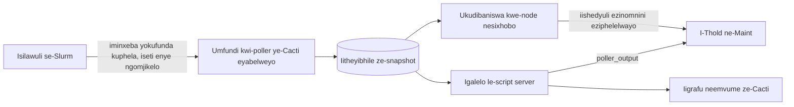

<!-- Source: README.md; SHA256: 16caa3e34c4d150a7fb1018f637e200a7580330f033b485047d8413bce09abba -->

<!-- translations:start -->
[English](../../../README.md) | [简体中文](../zh-CN/README.md) | [हिन्दी](../hi-IN/README.md) | [Español (España)](../es-ES/README.md) | [Español (Latinoamérica)](../es-419/README.md) | [العربية (السعودية)](../ar-SA/README.md) | [Afrikaans](../af-ZA/README.md) | [አማርኛ](../am-ET/README.md) | [العربية (مصر)](../ar-EG/README.md) | [العربية (المغرب)](../ar-MA/README.md) | [বাংলা](../bn-BD/README.md) | [Deutsch](../de-DE/README.md) | [فارسی](../fa-IR/README.md) | [Filipino](../fil-PH/README.md) | [Français](../fr-FR/README.md) | [Français (Maroc)](../fr-MA/README.md) | [Français (Sénégal)](../fr-SN/README.md) | [Hausa](../ha-NG/README.md) | [עברית](../he-IL/README.md) | [Bahasa Indonesia](../id-ID/README.md) | [Igbo](../ig-NG/README.md) | [Italiano](../it-IT/README.md) | [日本語](../ja-JP/README.md) | [한국어](../ko-KR/README.md) | [Malagasy](../mg-MG/README.md) | [मराठी](../mr-IN/README.md) | [Bahasa Melayu](../ms-MY/README.md) | [Nederlands](../nl-NL/README.md) | [Polski](../pl-PL/README.md) | [Português (Brasil)](../pt-BR/README.md) | [Русский](../ru-RU/README.md) | [Kinyarwanda](../rw-RW/README.md) | [Soomaali](../so-SO/README.md) | [Svenska](../sv-SE/README.md) | [Kiswahili](../sw-KE/README.md) | [தமிழ்](../ta-IN/README.md) | [తెలుగు](../te-IN/README.md) | [ไทย](../th-TH/README.md) | [Türkçe](../tr-TR/README.md) | [Українська](../uk-UA/README.md) | [اردو](../ur-PK/README.md) | [Tiếng Việt](../vi-VN/README.md) | [isiXhosa](README.md) | [Yorùbá](../yo-NG/README.md) | [繁體中文](../zh-TW/README.md) | [isiZulu](../zu-ZA/README.md)
<!-- translations:end -->

# plugin_hpcsched

Iplagin ye-Cacti 1.2 ezoba iigrafu zemeko yesicwangcisi seebhetshi ze-HPC ecaleni kwezixhobo i-Cacti esele izibeka iliso: ubunzulu bomgca wokulinda, imisebenzi elindileyo xa ithelekiswa neqhutywayo, isizathu sokuba imisebenzi ilinde, iimeko zee-node, nokusetyenziswa kwee-partition. I-Slurm yi-backend yokuqala. I-Thold ithumela izilumkiso kwimithombo yedatha evelayo, kwaye i-Maint inokuqhutywa zii-node ezikhuphelwe ngaphandle kunye neendawo ezigcinelwe ulondolozo.

> **Imeko: isaphuhliswa, akukho khupho okwangoku.** Inqanaba lesi-2 (isiseko) lidityanisiwe kwi-`main`, kwaye eli sebe longeza inqanaba lesi-3 (iigrafu ze-cluster nezizathu zokulinda). Ikhowudi iyafakwa, iphuculwe, kwaye isuswe nge-API yeplagin ye-Cacti kwaye ayiyamkeli i-PHP engaphantsi kwe-8.2. Igcina irejista yee-cluster ze-Slurm, nganye yabelwe i-poller ye-Cacti enye. Umfundi ongasemva kwi-poller engundoqo uqokelela i-snapshot enye kwi-cluster nganye kwisithuba ngasinye, ngokuqhuba i-`squeue`, i-`scontrol`, ne-`sshare` nge-`--json` okanye ngokufunda i-`slurmrestd` nge-HTTPS, aze agcine amanani emisebenzi ngokwemeko nangokwesizathu sokulinda, iimeko zee-node, ii-partition, ukugcinwa kweendawo, kunye nokusetyenziswa kwe-fair-share kunye nobutsha bazo. Iplagin iza nee-template ze-Cacti kwaye, ngokuqinisekiswa ngumlawuli, idala okanye idibanise isixhobo esinye se-Cacti kwi-cluster nganye sineegrafu zemisebenzi ngokwemeko, imisebenzi elindileyo ngokosapho lwezizathu, ii-node ngokwemeko, ii-CPU, nokusetyenziswa, kwi-cluster nakwi-partition nganye, kunye nobudala be-snapshot. Iphepha lesishwankathelo elifundwayo kuphela libonisa amanani kwi-cluster nganye kunye nobutsha bawo kunye nemboniselo yezizathu zokulinda kwi-cluster nganye, kwaye iphepha lempilo elenzelwe umlawuli kuphela libonisa oko kubuyiswe luqokelelo ngalunye nokuba ii-template zifakiwe na. Onke amaphepha nezenzo zilandela iimvume zezixhobo ze-Cacti. Imithombo yedatha yeyokuba i-Thold inokuthumela izilumkiso kuyo, kodwa akukho kudityaniswa kwe-Thold okanye i-Maint okuvavanyiweyo okwangoku; oko kwinqanaba lesi-4 nangaphaya. Uthotho lweemvavanyo lubandakanya imiyalelo eyenziweyo ye-Slurm kunye neempendulo ze-`slurmrestd`, kwaye i-CI ikwaqhuba i-cluster yokwenene ye-Slurm enee-node ezintandathu kwii-container njengoko kuchazwe ngezantsi. Umfundi akazange aqhutywe kwi-cluster yokuvelisa. Ngaphantsi kwamanqaku omsebenzisi, le README ichaza uyilo, hayi ukuziphatha okukhutshiweyo.

Le yiprojekthi ezimeleyo kwaye ayidibananga neprojekthi ye-Cacti.

## Iindima zofikelelo

| Indawo yomsebenzi | Ufikelelo |
| --- | --- |
| HPC Scheduler View | Amaphepha okubeka iliso asele ekho. |
| HPC Scheduler Operator | Ukubeka iliso kunye nephepha leMisebenzi kunye neziqinisekiso zokuhluza zomntu siqu. |
| HPC Scheduler Admin | Ufikelelo loMsebenzisi kunye noqwalaselo olukhoyo kunye nezenzo zolawulo. |

Emva kokukopa iifayile zophuculo, vula iphepha le-Plugins njengomlawuli ukubhalisa
indawo entsha yomsebenzi. Yabela indawo ye-Operator ngokucacileyo phantsi kwe-**Configuration > Users** okanye amaqela abasebenzisi.
Uphuculo lugcina ii-ID zeendawo ze-View ne-Admin ezikhoyo kunye neemvume. Ufikelelo lwe-Admin
lufumana ufikelelo lwe-Operator, kwaye ufikelelo lwe-Operator lufumana ufikelelo lwe-View kwisicelo ngasinye;
oku akongezi iimvume ezigciniweyo kubasebenzisi okanye kumaqela. Iisetingi zeplagin nazo zifuna
ufikelelo lwe-HPC Scheduler Admin ukongeza kwimvume ye-Settings ye-Cacti.

Iimvume zezixhobo ze-Cacti zisayinciphisa imiqolo nezenzo ezifumaneka kumsebenzisi ngamnye; i-cluster engenasixhobo idweliswa kumaphepha olawulo kubo bonke abasebenzisi abanendawo yeplagin, kodwa hayi kwiimboniselo zomsebenzisi, ezidwelisa kuphela ii-cluster ezidityaniswe nesixhobo.
Iziqinisekiso, uqwalaselo, ukudibanisa, ukucima kunye nolunye utshintsho lolawulo
zihlala kumaphepha olawulo. Iziqinisekiso zihlala kuphela kwiseshoni yomsebenzisi
wangoku, ubuninzi beyure enye kwaye kuphela xa kwalo mqapheli usahlala
umtsha. Imiqapheli emitsha okanye etshintshileyo iyaziphelelisa. Azize ziphawule umlinganiselo
owahlulekileyo njengosempilweni okanye zicinezele izilumkiso.

## Amanqaku omsebenzisi enqanaba lesi-2

**Ilungelo elincinci.** Iplagin ifunda kuphela. Yinike umsebenzisi ozinikeleyo we-Slurm ongenandima yomlawuli okanye yomsebenzisi (`AdminLevel=None` kwi-`sacctmgr`). Nge-`PrivateData=jobs` (okanye `nodes`, `reservations`, `usage`) kwi-`slurm.conf`, loo msebenzisi ubona iirekhodi zakhe kuphela, ngoko ke amanani akaphelelanga kwaye iplagin ayinakukubhaqa oko. Ukuphakamisa oko kwi-akhawunti kuthetha inqanaba lomsebenzisi okanye lomlawuli, okukwavumela notshintsho; loo mbuyiselo sisigqibo sesiza. Kwimiyalelo yeklayenti, umsebenzisi we-poller ye-Cacti ufuna iibhayinari zeklayenti ye-Slurm kunye ne-`slurm.conf` efikelela kwisilawuli; iindlela zeebhayinari ziisetingi ezipheleleyo phantsi kwe-Configuration > Settings > HPC Scheduler. Kwi-`slurmrestd`, i-URL kufuneka ibe yi-`https://`, okanye `http://` kwidilesi ye-loopback kuphela. Izatifikethi ze-TLS ziyangqinwa kwaye uthumelo kwenye indawo alulandelwa. Uluhlu olukhethekileyo lwee-host ze-slurmrestd phantsi kwe-Configuration > Settings > HPC Scheduler luthintela ii-host kunye nee-port ezinokuxelwa yi-cluster.

**Ii-poller ezikude.** Olu khupho luqokelela kuphela kwi-poller engundoqo ye-Cacti. I-cluster eyabelwe umqokeleli wedatha okude ayiqokelelwa: umfundi apho uyala ngesizathu esibhalwe kwilog kwaye iphepha lempilo liyayixela i-cluster. Uqokelelo olukude sisigaba sesi-3.

**Imemori.** Uqhutywo ngalunye loqokelelo lucazulula impendulo enye yesicwangcisi ngexesha, nto leyo ethatha malunga nezihlandlo ezili-12 zobungakanani bempendulo kwimemori ye-PHP (kulinganiselwe malunga nezihlandlo ezili-10 kwiirekhodi zemisebenzi ezimilise okweze-Slurm, kunye nombhalo ngokwawo). Uqhutywo luphakamisa umda wememori ye-PHP ukuya kwisetingi ye-Collection Memory (i-1024 MiB ngokungagqibekanga) kwaye luvumela iimpendulo ukuya ku-(Collection Memory - 64) / 12 MiB, i-80 MiB ngokungagqibekanga, nangona i-Maximum Answer Size ibekwe phezulu; iphepha lempilo liyalumkisa xa kunjalo. Impendulo enkulu iyasilela kwicandelo layo njengenkulu kakhulu, kwaye uqhutywo olusaphelelwa yimemori lubhalwa njengolusileleyo. I-cluster enkulu ingadinga ukunyuswa kwezi setingi zombini; iirekhodi zemisebenzi ezili-100,000 zokwenene azikalinganiswa.

**Iifayile ze-token.** I-cluster ye-`slurmrestd` ichaza ifayile ye-token; i-token ngokwayo ayize igcinwe kwisiseko sedatha, iboniswe kwiphepha, okanye ibhalwe kwilog. Ifayile kufuneka ibe phakathi kolawulo lweefayile ze-token olubekwe phantsi kwe-Configuration > Settings > HPC Scheduler, ifikelelwe ngaphandle kwe-symbolic link, kwaye ibe yifayile eqhelekileyo engumnini wayo umsebenzisi we-poller ekuphela kwaloo msebenzisi onokubhala kuyo, ibambe umgca omnye: i-token, okanye `SLURM_JWT=<token>` njengoko i-`scontrol token` iyiprinta. Xa kungekho lawulo lwee-token lubekiweyo, akukho cluster inokusebenzisa i-`slurmrestd`. Ezi setingi zimbini zikwiphepha le-Settings le-Cacti, ngoko ke indawo ye-Admin yeplagin yodwa ayinakuzitshintsha; gcina ulawulo ngalunye lwe-token lubhalwa kuphela ngu-root kunye nomsebenzisi we-poller. Ifayile enokufundwa liqela okanye abanye abasebenzisi isasetyenziswa, kwaye iphepha lempilo liyalumkisa. Iphepha lempilo likwalumkisa xa i-token iphelelwa lixesha ngaphakathi kwexesha lesilumkiso eliqwalaselweyo.

Ukujikelezisa i-token ngaphandle kwesithuba apho umfundi abona ifayile engaphelelanga, bhala i-token entsha ecaleni kwendala uze uyithiye igama endaweni yayo:

```sh
dir=/etc/cacti/hpcsched
tmp=$(mktemp "$dir/.token.XXXXXX")
scontrol token username=cactiread lifespan=2592000 > "$tmp"
chown cacti:cacti "$tmp"
chmod 0600 "$tmp"
mv -f "$tmp" "$dir/cluster1.token"
```

Uqokelelo olulandelayo lufunda ifayile entsha. Ukuvelisa ii-token nge-`scontrol token` kufuna umlawuli we-Slurm; yiqhube apho oko kuvunyelweyo uze ukopele ifayile kwi-poller.

## Amanqaku omsebenzisi enqanaba lesi-3

**Ii-template.** Ukufaka nokuphucula kungenisa izixhobo ze-HPC Scheduler, idatha, kunye nee-template zeegrafu kwaye kukopa umbuzo wedatha ye-partition kulawulo lwe-Cacti lwe-`resource/script_server/`. Ukuba olo lawulo alubhaleki ngumsebenzisi ofaka iplagin, ifayile eyahlukileyo enegama elifanayo sele ilapho kwaye ayibhalwanga yiplagin, okanye igama liyi-symbolic link, ukungeniswa kuyayeka, ifayile ishiywa injalo, kwaye iphepha lempilo lichaza into emayenziwe; i-Install Templates kwiphepha lempilo iyazama kwakhona. Ikopi efanayo eyenziwe ngesandla iyasetyenziswa kodwa ihlala iyeyakho. Ukukhupha iplagin kususa ifayile yombuzo kuphela ukuba iplagin yayibhalile kwaye ingatshintshwanga, kwaye kugcina ii-template, izixhobo, kunye neegrafu.

**Izixhobo ze-cluster.** I-HPC Clusters > Device ibonisa oko isixhobo siya kukongeza (iigrafu, imithombo yedatha, iifayile ze-RRD, kunye neminxeba ye-script server kwi-poll nganye) phambi kokuba kudalwe nantoni na. I-Create Device yenza isixhobo esinegama le-host kwi-domain egciniweyo ye-`.invalid` ngaphandle kovavanyo lokufumaneka; i-Map Device endaweni yoko iqhotyoshela iigrafu kwisixhobo esisele sikho kwaye ishiya iisetingi zaso zinjalo. Igrafu nganye ye-cluster kunye negrafu nganye ye-partition inomthombo wayo wedatha: emithandathu kwi-cluster kunye nemihlanu kwi-partition nganye, umnxeba omnye we-script server kumthombo ngamnye wedatha ye-cluster kunye nomnye kwixabiso ngalinye le-partition (32) kwi-poll nganye. Ii-partition ezongezwe kamva zifakwa kwisalathiso xa umfundi ezibona kwaye zifumana iigrafu kwiphepha le-New Graphs le-Cacti; i-partition esusiweyo iyayeka uku-poll-wa kwaye igcina iigrafu zayo. Ukucima isixhobo kususa ukudityaniswa kwe-cluster kwaye kuyigcine.

**Oko kubalwa ziigrafu.** Okulindileyo akuyibandakanyi imisebenzi ebanjiweyo, enothotho lwayo. I-array elindileyo ibala imisebenzi yayo eseleyo. Umsebenzi okanye i-node ekwii-partition ezininzi ibalwa kanye kwiigrafu ze-cluster kwaye kanye kwi-partition nganye, ngoko ke iigrafu zee-partition akuyomfuneko ukuba zidibanise zilingane nezee-cluster. Izizathu zokulinda zihlelwa zibe ziintsapho ezilishumi elinanye ([ADR 0011](../../decisions/0011-pending-reason-families-and-counting.md)); imboniselo yezizathu zokulinda idwelisa izizathu ezingahlelwanga, kubandakanya ezo zikwi-Other. Umsebenzi ngamnye ubika kuphela isizathu sokugqibela esihlolwe sisicwangcisi. Isahluli sokusetyenziswa sibandakanya ii-node ezikhuphelwe ngaphandle, eziphantsi, nezinye ezingafumanekiyo. Idatha ephelelwe lixesha okanye esileleyo yi-`U`, ayize ibe nguziro; i-`age` ihlala ilinani.

**Izilumkiso.** I-Thold inokuthumela izilumkiso kuyo nayiphi na kule mithombo yedatha; setha ubude bexesha be-Thold bube sisithuba esinye soqokelelo ubuncinci, kwaye uthumele isilumkiso kwi-`age` ukubhaqa umfundi omileyo. Uvavanyo olupheleleyo lwe-Thold linqanaba lesi-4.

**Kuvavanywe kwiziphumo zokwenene ze-Slurm.** I-CI iqalisa i-cluster ye-Slurm enee-node ezintandathu kwii-container (26.05.5 kutshintsho ngalunye, 25.11.8 eyakhiwe kwikhowudi engundoqo xa kutyhalwa kwi-`main`, ngeveki, naxa kuceliwe) kwaye ihlola iimeko zee-node, ukugcinwa kolondolozo, izizathu zokulinda, kunye nee-array njengoko iplagin izicazulula, emva koko iqokelela kuloo cluster ngomyalelo weplagin ngokwayo kunye neendlela zothutho ze-`slurmrestd`. Ukukhutshwa okudala kugqunywa kuphela zii-fixture ezenziweyo. Umfundi akakaze aqhutywe kwi-cluster yokuvelisa.

**Iimvume.** I-cluster ekwisixhobo iyaboniswa, ithunyelwe ngaphandle, kwaye itshintshwe kuphela kubasebenzisi i-Cacti ebavumele eso sixhobo, kwiphepha ngalinye leplagin; ukudibanisa isixhobo kukwafuna imvume yesixhobo ekujoliswe kuso. I-cluster engenasixhobo iyabonakala kuye wonke umntu onendawo yeplagin. I-cluster esadityaniswe nesixhobo esacinywa ngelixa iplagin yayicinyiwe iboniswa kuphela kubasebenzisi abanendawo ye-HPC Scheduler Admin, abanokudala okanye badibanise isixhobo sayo. Ufikelelo kwiigrafu lolwe-Cacti ngokwayo.

## Kutheni

Abasebenzisi abaqhuba i-Cacti sele bezoba iigrafu zee-compute node zabo. Imboniselo yesicwangcisi ayikho kwezo grafu, nto leyo eshiya izikhewu ezibini:

- **Akukho "kutheni umsebenzi ungaqali".** I-Slurm ibhala isizathu somsebenzi ngamnye olindileyo. Umgca ogcweleyo ecaleni kweegrafu zee-node ezingasebenziyo awutsho ukuba unobangela ngumbaluleko, yimida yezibonelelo, kukubanjwa, kukuxhomekeka, okanye zii-node ezikhuphelwe ngaphandle.
- **Akukho ludibaniso phakathi kwemeko yesicwangcisi nezilumkiso.** I-Thold ithumela izilumkiso kwisixhobo umlawuli asele esikhuphele ngaphandle, kwaye abalawuli benza iishedyuli ze-Maint ngesandla.

Iplagin iqokelela i-snapshot enye egciniweyo kwi-cluster nganye, iyipapashe njengemithombo yedatha neegrafu eziqhelekileyo ze-Cacti, idibanise ii-node zesicwangcisi kwizixhobo ze-Cacti ezikhoyo, kwaye inokufaka ii-node ezikhuphelwe ngaphandle neendawo ezigcinelwe ulondolozo kwi-Maint. Isebenzisa kwakhona iimvume ze-Cacti, abaqokeleli bedatha abakude, i-Thold, kunye ne-Maint, kwaye ifunda kuphela kwisicwangcisi.

## Umda ocwangcisiweyo

| Isigaba | Umda | Amanqanaba |
|---|---|---|
| 0, uphando | Umatriksi wokukhutshwa kwe-Slurm, ukuqinisekiswa kokuziphatha kwe-upstream, umthwalo wesilawuli, ii-fixture zokuthiya ii-node | [M1](https://github.com/somethingwithproof/plugin_hpcsched/milestone/1) |
| 1, iigrafu ze-cluster | Ubunzulu bomgca wokulinda, imisebenzi elindileyo neqhutywayo, izizathu zokulinda, iimeko zee-node, ukusetyenziswa kwee-partition, izilumkiso ze-Thold, iphepha lempilo, ukukhutshwa | [M2](https://github.com/somethingwithproof/plugin_hpcsched/milestone/2), [M3](https://github.com/somethingwithproof/plugin_hpcsched/milestone/3), [M4](https://github.com/somethingwithproof/plugin_hpcsched/milestone/4) |
| 2, ii-node nolondolozo | Ukudibaniswa kwe-node nesixhobo, imeko ye-node nganye, iifestile ze-Maint ezizenzekelayo zee-node ezikhuphelwe ngaphandle neendawo ezigcinelwe ulondolozo | [M5](https://github.com/somethingwithproof/plugin_hpcsched/milestone/5) |
| 3, i-accounting | Ukusetyenziswa kwe-fair-share, iinkcukacha-manani ze-accounting ezilinganiselweyo, abaqokeleli bedatha abakude | [M6](https://github.com/somethingwithproof/plugin_hpcsched/milestone/6) |

Okungaphandle komda: nayiphi na indlela yokubhala kwisicwangcisi (ukuthumela, ukurhoxisa, ukubamba, ukukhuphela ngaphandle, ukuqhubeka), injini yezilumkiso yeeplagin, injini yokunika ingxelo okanye ye-chargeback, uthotho lomsebenzisi ngamnye nomsebenzi ngamnye. Ii-backend ze-PBS Pro, i-OpenPBS, kunye ne-LSF zisaphandwa.

## Iinjongo zokuhambelana

| Ilungu | Injongo |
|---|---|
| Cacti | 1.2.31 okanye kamva, akukho zipetshi zengundoqo |
| PHP | 8.2 okanye kamva; i-`setup.php` ihlala icazululeka kwi-8.0 ukuze ixesha lokuqhuba elingaxhaswayo lifumane ukwaliwa endaweni ye-UI ye-Cacti eyaphukileyo |
| Slurm | 25.05, 25.11, kunye ne-26.05, ukukhutshwa okuthathu kwamva nje ([ADR 0013](../../decisions/0013-three-latest-slurm-releases.md)); i-25.11 ne-26.05 zivavanywe kwi-cluster esebenzayo, i-25.05 kwii-fixture kuphela. Imiyalelo yeklayenti yindlela yothutho engagqibekanga ([ADR 0012](../../decisions/0012-client-commands-default-transport.md)) kwaye isebenzisa isetingi ye-data parser: v0.0.43 ngokungagqibekanga, leyo i-SchedMD iyisusayo kwi-27.05, okanye v0.0.44 okanye v0.0.45 kwiinguqulelo ezizithumelayo. Ii-cluster ze-slurmrestd zifumanisa eyona parser intsha inikezelwa yi-daemon |
| Thold, Maint | Akukho tshintsho kwi-Thold; ukudityaniswa kwe-Maint sisiphakamiso esifuna imvumelwano yabalondolozi be-Maint |

## Uyilo

- I-[docs/PLAN.md](../../PLAN.md) sisicwangciso esipheleleyo: ubunjineli boyilo, iinyani ze-upstream ezixhomekeke kuzo (kunye nemithombo kunye noluhlu olucacileyo lweengcamango ezingaqinisekiswanga), ukudibaniswa kwee-node, imodeli yemeko, imida yokhuseleko, izibalo zokusebenza, uvavanyo, kunye nemingcipheko.
- I-[docs/decisions/](../../decisions) igcina iirekhodi zezigqibo zobunjineli boyilo.
- I-[docs/REQUIREMENTS.md](../../REQUIREMENTS.md) idibanisa i-ID nganye yemfuneko kumbandela wayo.



## Indlela umsebenzi olandelelwa ngayo

- **Amanqanaba** alandela amanqanaba esicwangciso. Elinye nelinye linombandela we-epic odwelisa imiba yawo engaphantsi kunye nobungqina bokuphuma.
- **Imiba** ihlelwa ngokweleyibhile: `type: requirement`, `type: research`, `type: decision`, `type: epic`. Imiba yeemfuneko ichaza iimfuneko ezineenombolo, ezivavanyekayo (`REQ-AREA-NNN`) kunye neendlela zokwamkela.
- **Iileyibhile** zikwaphatha `area:`, `phase:`, `priority:`, kunye ne-`status:`. Bona i-[CONTRIBUTING.md](../../../CONTRIBUTING.md#labels).
- I-[bhodi yeprojekthi](https://github.com/users/somethingwithproof/projects/10) ibonisa yonke imiba kuwo onke amanqanaba.

## Ukufaka isandla

Funda i-[CONTRIBUTING.md](../../../CONTRIBUTING.md). Ii-commit zifuna isayini ye-DCO. Ingxoxo yoyilo yenzeka kwimiba; izigqibo ezivulekileyo zithwala ileyibhile ye-`type: decision`.

## Ukhuseleko

Xela ubuthathaka bokhuseleko ngasese; bona i-[SECURITY.md](../../../SECURITY.md).

## Ilayisensi

GNU General Public License v2.0, ilayisensi efanayo neye-Cacti kunye neeplagin zayo. Bona i-[LICENSE](../../../LICENSE).
