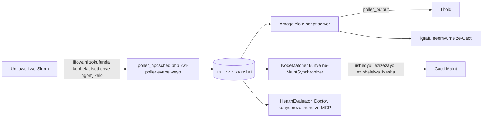

<!-- Source: README.md; SHA256: 938114d41dbd516f9dfcd94619c4fc73ef56b4da1dd693010588a93cce250534 -->

<!-- translations:start -->
[English](../../../README.md) | [简体中文](../zh-CN/README.md) | [हिन्दी](../hi-IN/README.md) | [Español (España)](../es-ES/README.md) | [Español (Latinoamérica)](../es-419/README.md) | [العربية (السعودية)](../ar-SA/README.md) | [Afrikaans](../af-ZA/README.md) | [አማርኛ](../am-ET/README.md) | [العربية (مصر)](../ar-EG/README.md) | [العربية (المغرب)](../ar-MA/README.md) | [বাংলা](../bn-BD/README.md) | [Bosanski](../bs-BA/README.md) | [Deutsch](../de-DE/README.md) | [فارسی](../fa-IR/README.md) | [Filipino](../fil-PH/README.md) | [Français](../fr-FR/README.md) | [Français (Maroc)](../fr-MA/README.md) | [Français (Sénégal)](../fr-SN/README.md) | [Hausa](../ha-NG/README.md) | [עברית](../he-IL/README.md) | [Hrvatski](../hr-HR/README.md) | [Bahasa Indonesia](../id-ID/README.md) | [Igbo](../ig-NG/README.md) | [Italiano](../it-IT/README.md) | [日本語](../ja-JP/README.md) | [한국어](../ko-KR/README.md) | [Malagasy](../mg-MG/README.md) | [मराठी](../mr-IN/README.md) | [Bahasa Melayu](../ms-MY/README.md) | [Nederlands](../nl-NL/README.md) | [Polski](../pl-PL/README.md) | [Português (Brasil)](../pt-BR/README.md) | [Русский](../ru-RU/README.md) | [Kinyarwanda](../rw-RW/README.md) | [Soomaali](../so-SO/README.md) | [Српски](../sr-RS/README.md) | [Svenska](../sv-SE/README.md) | [Kiswahili](../sw-KE/README.md) | [தமிழ்](../ta-IN/README.md) | [తెలుగు](../te-IN/README.md) | [ไทย](../th-TH/README.md) | [Türkçe](../tr-TR/README.md) | [Українська](../uk-UA/README.md) | [اردو](../ur-PK/README.md) | [Tiếng Việt](../vi-VN/README.md) | [isiXhosa](README.md) | [Yorùbá](../yo-NG/README.md) | [繁體中文](../zh-TW/README.md) | [isiZulu](../zu-ZA/README.md)
<!-- translations:end -->

# plugin_hpcsched

Iplagin ye-Cacti 1.2 (`hpcsched`, inguqulelo `0.1.0-dev`) ezoba iigrafu zemeko yesicwangcisi seebhetshi ze-HPC ecaleni kwezixhobo i-Cacti esele izibeka iliso: ubunzulu bomgca wokulinda, imisebenzi elindileyo xa ithelekiswa neqhutywayo, isizathu sokuba imisebenzi ilinde, iimeko zee-node, ukusetyenziswa kwee-partition, kunye nokusetyenziswa kwe-fair-share kwinqanaba le-akhawunti. I-Slurm yi-backend ephunyeziweyo. I-Thold ithumela izilumkiso kwimithombo yedatha evelayo, kwaye umlungelelanisi we-Maint wokuzikhethela uqhuba iifestile ze-Cacti Maint ukusuka kwii-node zekhompyutha ze-Slurm ezikwimeko ye-drained, down, nezigcinelwe ulondolozo.

> **Imeko: isaphuhliswa, akukho khupho okwangoku.** Eli sebe liphumeza isiseko seplagin, iigrafu ze-cluster nee-partition, iintsapho zezizathu zokulinda, ukudityaniswa kwee-node zekhompyutha ze-Slurm nezixhobo ze-Cacti, ungqamaniso lwefestile ye-Cacti Maint yokuzikhethela, izishwankathelo ze-fair-share kwinqanaba le-akhawunti, ukuqhutywa nokuphindaphindwa kwabaqokeleli bedatha abakude, i-CLI ye-Configuration-as-Code (CasC) neyokusebenza, kunye neehuku ze-ecosystem ye-Cacti (CasC, Doctor, ne-MCP / Abilities API v2). Uthotho lweemvavanyo lubandakanya imiyalelo eyenziweyo ye-Slurm kunye neempendulo ze-`slurmrestd`, kwaye i-CI ivavanya i-cluster ye-Slurm ephilayo enee-node ezintandathu kwii-container. Umfundi akazange aqhutywe kwi-cluster yokuvelisa, kwaye uvavanyo olupheleleyo lokuphindaphinda lwe-Thold alukabi kwi-CI.

Le yiprojekthi ezimeleyo kwaye ayidibananga neprojekthi ye-Cacti.

## Okuphunyeziweyo

- **Umjikelo wobomi neskimu (v3)**: ukufaka, ukuphucula okungenampembelelo ephindaphindekayo (idempotent), ukususa (ukugcina iitafile zeplagin ngokungagqibekanga), kunye nemfuno esezantsi ye-PHP 8.2 ngelixa iindawo zokungena zisahlalutyeka kwi-PHP 8.0. Iskimu v3 yongeza i-`plugin_hpcsched_node_map` kunye ne-`plugin_hpcsched_maint_link` ecaleni kweetafile ze-cluster, run, section, job-count, node-count, node, partition, reservation, kunye ne-share.
- **Uqokelelo lwe-Slurm lokufunda kuphela kwii-poller ezingundoqo nezakude**: i-`poller_bottom` iqalisa i-`poller_hpcsched.php --cluster=N` ngasemva kwi-poller nganye (`poller_id`) kwii-cluster zayo ezivuliweyo neyabelwe zona. Uqhutywo ngalunye luqokelela i-snapshot enye egciniweyo nge-cluster nganye ngemiyalelo yomxhasi (`squeue`, `scontrol`, `sshare` nge-`--json`) okanye i-`slurmrestd` nge-HTTPS (i-HTTP ye-loopback ivumelekile ngesilumkiso sempilo). I-`INFO` ibhengeza `remote_collect:1, remote_poller:1`, kwaye i-`replicate_out` iphindaphinda iinkcazelo ezingezizo ezemfihlo ze-`plugin_hpcsched_cluster` kubuqokeleli abakude (`poller_id >= 2`); imixholo yeefayile ze-token ayikhe ifundwe okanye iphindaphindwe.
- **Iitemplate ze-Cacti neegrafu ze-cluster**: izisa iitemplate zezixhobo, zedatha, nezeegrafu (`templates/hpcsched-templates.xml`) kunye nombuzo wedatha we-script-server wee-partition (`scripts/ss_hpcsched_cluster.php`, `scripts/ss_hpcsched_partitions.php`). Ngokuqinisekiswa ngumlawuli, idala okanye idibanise isixhobo esinye se-Cacti nge-cluster nganye sineegrafu zemisebenzi ngokwemeko, imisebenzi elindileyo ngokosapho lwezizathu, ii-node ngokwemeko, ii-CPU, ukusetyenziswa (kwe-cluster nakwi-partition nganye), kunye nobudala be-snapshot.
- **Ukudityaniswa kwee-node ze-Slurm nezixhobo nokungqamaniswa kwe-Cacti Maint**: isidibanisi sexesha elilandelelanayo samanqanaba amane (`NodeMatcher`) sidibanisa ii-node zekhompyutha ze-Slurm neerekhodi ezikhoyo ze-`host` ze-Cacti (igama elichanekileyo lomamkeli, idilesi echanekileyo, inkcazo/igama lesiteketiso elichanekileyo, okanye ilebhile yokuqala ye-DNS kumagama angekho IP) kwaye siphawula ukudibana okuninzi okanye amabango aphindaphindiweyo esixhobo njenge-`ambiguous` kunokuqikelela. I-`HostList::expand()` yandisa izintlu zabamkeli zokugcinwa kweendawo ze-Slurm (ukuya kwii-node ezili-10,000). I-`MaintSynchronizer` idala, ihlaziya, kwaye isuse iishedyuli zexesha elinye ze-Cacti Maint ezizezeplagin ezilandelwa kwi-`plugin_hpcsched_maint_link` kwii-node ezidityanisiweyo ezikwi-`DRAIN`, `DRAINING`, `DOWN`, okanye kwiindawo ezigciniweyo ezisebenzayo ze-`MAINT`/`MAINTENANCE` ngaphandle kokutshintsha iishedyuli ze-Maint ezidalwe ngumlawuli.
- **Izishwankathelo ze-fair-share kwinqanaba le-akhawunti**: xa i-`collect_shares` ivuliwe, iqokelela imigca yobudlelwane be-akhawunti ye-Slurm kwi-`plugin_hpcsched_share` (ishiya ngaphandle imigca yabasebenzisi ngokwe-[ADR 0010](../../decisions/0010-bound-series-cardinality.md)). I-`ShareSummary` kunye ne-`ShareRepository` zibala amanani ee-akhawunti/ee-partition, iitala zokusetyenziswa ezikrwada nezisebenzayo, izinto ezincinci/ezinkulu/eziqhelekileyo ze-fair-share, kunye nee-akhawunti eziphambili; amanani ee-akhawunti avezwa kwi-`hpcsched-get-queue-summary`.
- **I-CLI ye-CasC neyokusebenza (`cli/hpcsched.php`)**: ukukhuphela uqwalaselo lwe-YAML/XML, ukuqinisekisa, ukucwangcisa umahluko we-dry-run, ukusetyenziswa okuvalelwe ngokuqinisekiswa, imveliso yempilo ecwangcisiweyo, kunye nongqamaniso lwe-Maint lokuzikhethela (`sync-maint --dry-run` / `--apply`).
- **Iihuku ze-ecosystem (`setup.php`)**: `casc_register_providers`, `doctor_register_checks`, kunye ne-`abilities_register`.

## Iindima zofikelelo

| Indawo yomsebenzi | Ufikelelo |
| --- | --- |
| HPC Scheduler View | Isishwankathelo se-cluster sokufunda kuphela kunye nezizathu zokulinda (`hpcsched.php`). |
| HPC Scheduler Operator | Ufikelelo lwe-View kunye nephepha leMisebenzi (`hpcsched_operator.php`) kunye neziqinisekiso zokuhluza zomntu siqu. |
| HPC Scheduler Admin | Ufikelelo lwe-Operator kunye nolawulo lwee-cluster (`hpcsched_clusters.php`) kunye nephepha lempilo (`hpcsched_health.php`). |

Emva kokukopa iifayile zophuculo, vula iphepha le-Plugins njengomlawuli ukubhalisa iindawo ezintsha zomsebenzi neehuku. Yabela indawo ye-Operator ngokucacileyo phantsi kwe-**Configuration > Users** okanye amaqela abasebenzisi. Uphuculo lugcina ii-ID zeendawo ze-View ne-Admin ezikhoyo kunye neemvume zawo. Ufikelelo lwe-Admin lufumana ufikelelo lwe-Operator ngelifa, kwaye ufikelelo lwe-Operator lufumana ufikelelo lwe-View ngelifa kwisicelo ngasinye; oku akongezi iimvume ezigciniweyo kubasebenzisi okanye kumaqela. Iisetingi zeplagin zikwafuna ufikelelo lwe-HPC Scheduler Admin ukongeza kwimvume ye-Settings ye-Cacti.

Iimvume zezixhobo ze-Cacti zithintela imigca nezenzo ezifumaneka kumsebenzisi ngamnye. I-cluster edityaniswe nesixhobo se-Cacti iboniswa, ikhutshelwe, kwaye itshintshwe kuphela kubasebenzisi i-Cacti ebavumela eso sixhobo; ukudibanisa isixhobo kukwafuna imvume yesixhobo ekujoliswe kuso. I-cluster engenasixhobo idweliswa kumaphepha olawulo kubasebenzisi abanendawo yeplagin, kodwa hayi kwiimboniselo zomsebenzisi ezidwelisa kuphela ii-cluster ezidityaniswe nesixhobo. I-cluster esixhobo sayo esidityanisiweyo sasuswa ngelixa iplagin yayicinyiwe iboniswa kuphela kubasebenzisi abanofikelelo lwe-HPC Scheduler Admin. Iziqinisekiso zihlala kuphela kwiseshoni yangoku yomsebenzisi, okona kude iyure enye kwaye kuphela ngelixa olo qwalaselo lunye luselutsha. Uqwalaselo olutsha okanye olutshintshileyo luyaziphelisa. Azikhe ziphawule umlinganiselo owahlulekileyo njengosempilweni okanye zicinezele izilumkiso.

## Amanqaku omsebenzisi

### Ukhuseleko, ilungelo elincinci kakhulu, kunye neefayile ze-token

Iplagin ifunda kuphela. Yinike umsebenzisi okhethekileyo we-Slurm ongenayo indima yomlawuli okanye yomsebenzisi (`AdminLevel=None` kwi-`sacctmgr`). Nge-`PrivateData=jobs` (okanye `nodes`, `reservations`, `usage`) kwi-`slurm.conf`, loo msebenzisi ubona iirekhodi zakhe kuphela, ngoko amanani awaphelelanga kwaye iplagin ayikwazi ukukufumanisa oko. Ukuphakamisa oko kwi-akhawunti kufuna inqanaba lomsebenzisi okanye lomlawuli, okukwavumela utshintsho; olo khetho lulolwesiza.

Kwimiyalelo yomxhasi, umsebenzisi we-poller ye-Cacti ufuna ii-binary zomxhasi we-Slurm (`squeue`, `scontrol`, kwaye ngokuzikhethela `sshare`) kunye ne-`slurm.conf` efikelela kumlawuli; iindlela zee-binary ziisetingi ezipheleleyo phantsi kwe-**Configuration > Settings > HPC Scheduler**.

Kwi-`slurmrestd`, i-URL kufuneka ibe yi-`https://`, okanye i-`http://` kwidilesi ye-loopback kuphela. Izatifiketi ze-TLS ziyangqinwa kwaye uthumelo kwenye indawo alulandelwa. Uluhlu lwabamkeli be-`slurmrestd` lokuzikhethela phantsi kwe-**Configuration > Settings > HPC Scheduler** luthintela ukuba ngabaphi abamkeli namazibuko i-cluster enokukwazi ukuwakhankanya.

I-cluster ye-`slurmrestd` ikhankanya ifayile ye-token; i-token ngokwayo ayikhe igcinwe kwidathabheyisi, iboniswe kwiphepha, ikhutshelwe yi-CasC, okanye ibhalwe kwilog. Ifayile kufuneka ibe ngaphakathi kwenye ye-Token File Directories eqwalaselwe phantsi kwe-**Configuration > Settings > HPC Scheduler**, ifikeleleke ngaphandle kwekhonkco elingumqondiso (symbolic link), kwaye ibe yifayile eqhelekileyo ephethwe ngumsebenzisi we-poller enokubhalwa nguloo msebenzisi kuphela, ephethe umgca omnye: i-token okanye i-`SLURM_JWT=<token>` njengoko i-`scontrol token` iyishicilela. Ngaphandle kweefolda ze-token ezimisiweyo, akukho cluster inokusebenzisa i-`slurmrestd`. Gcina ifolda nganye ye-token ibhalwa kuphela ngu-root nangumsebenzisi we-poller. Ifayile efundekayo liqela okanye ngabanye abasebenzisi isasetyenziswa, kwaye iphepha lempilo liyalumkisa; likwalumkisa xa i-token iphelelwa lixesha ngaphakathi kwefestile yesilumkiso emiselweyo.

Ukujikelezisa i-token ngendlela ye-atomiki:

```sh
dir=/etc/cacti/hpcsched
tmp=$(mktemp "$dir/.token.XXXXXX")
scontrol token username=cactiread lifespan=2592000 > "$tmp"
chown cacti:cacti "$tmp"
chmod 0600 "$tmp"
mv -f "$tmp" "$dir/cluster1.token"
```

Uqokelelo olulandelayo lufunda ifayile entsha. Ukuvelisa ii-token nge-`scontrol token` kufuna umlawuli we-Slurm; yiqhube apho kuvumelekileyo kwaye ukope ifayile ukuya kwi-poller.

### Abaqokeleli bedatha abakude

I-`INFO` ibhengeza `remote_collect:1, remote_poller:1`. I-`hpcsched_poller_bottom()` iqalisa i-`poller_hpcsched.php` kwi-poller nganye kwii-cluster ezivuliweyo ezabelwe loo `poller_id`, kwaye i-`hpcsched_replicate_out()` iphindaphinda imigca engeyiyo eyemfihlo ye-`plugin_hpcsched_cluster` ukuya kwii-poller ezikude (`poller_id >= 2`). Iifayile ze-token kunye nee-binary zomxhasi we-Slurm kufuneka zibekho kwindawo ekuyo i-poller ekude eyabelweyo; imixholo ye-token ayikhe iphindaphindwe.

### Imida yememori

Uqhutywo ngalunye loqokelelo lucacisa impendulo enye yesicwangcisi ngexesha, nto leyo ethatha malunga ne-12 lamaxesha obukhulu bempendulo kwimemori ye-PHP (ilinganiswe malunga ne-10 lamaxesha kwiirekhodi zemisebenzi ezimilise okweze-Slurm, kunye nombhalo ngokwawo). Umfundi unyusa umda wawo wememori ye-PHP ukuya kwisetingi ye-Collection Memory (1024 MiB ngokungagqibekanga) kwaye uvumela iimpendulo ukuya kuthi ga kwi-`(Collection Memory - 64) / 12` MiB (80 MiB ngokungagqibekanga), naxa i-Maximum Answer Size imiselwe phezulu; iphepha lempilo liyalumkisa xa i-Maximum Answer Size idlula loo mda ulinganisiweyo. Impendulo enkulu kunoko iyehluleka kwicandelo layo njengenkulu kakhulu, kwaye uqhutywo olusaphelelwa yimemori lubhala ukusilela kwememori kwaye lukhulule indawo yalo yoqeshiso nenkqubo ngesiphathi sokuvala. Ii-cluster ezinkulu zinokufuna ukuba zombini ezi setingi zinyuswe; iirekhodi zemisebenzi zokwenene ezili-100,000 azikalinganiswa.

### Iitemplate, izixhobo ze-cluster, kunye nokubalwa kweegrafu

Ukufaka nokuphucula kungenisa iitemplate zezixhobo, zedatha, nezeegrafu ze-HPC Scheduler kwaye kukope umbuzo wedatha wee-partition kwifolda ye-Cacti ye-`resource/script_server/`. Ukuba loo folda ayibhaleki, kukho enye ifayile yegama elifanayo apho, okanye into ekujoliswe kuyo likhonkco elingumqondiso, ungeniso luyayeka, lushiye ifayile ingachukunyiswanga, kwaye luxele imeko kwiphepha lempilo apho i-**Install Templates** izama kwakhona. Ukususa kuphela kususa ifayile yombuzo ukuba ibhalwe yiplagin kwaye ayitshintshwanga, kwaye kugcina iitemplate, izixhobo, neegrafu.

I-**HPC Clusters > Device** ijonga kwangaphambili iigrafu, imithombo yedatha, iifayile ze-RRD, kunye neefowuni ze-script server ngokuvota ngakunye phambi kokudala nantoni na. I-**Create Device** yenza isixhobo esinegama lomamkeli kwi-domain egciniweyo ye-`.invalid` kwaye ngaphandle kokuhlolwa kokufumaneka; i-**Map Device** incamathisela iigrafu kwisixhobo esikhoyo ngaphandle kokutshintsha iisetingi zaso. Igrafu nganye ye-cluster negrafu ye-partition inomthombo wayo wedatha: mithandathu kwi-cluster kwaye mihlanu kwi-partition nganye. Ii-partition ezongezwa kamva zibhaliswa kwakhona ngokuzenzekelayo xa umfundi efumanisa utshintsho; ii-partition ezisusiweyo ziyayeka ukuvotwa kwaye zigcine iigrafu zazo. Ukususa isixhobo kukhulula udibaniso lwe-cluster (kwaye kusule nayiphi na imigca ehambelanayo ye-`plugin_hpcsched_node_map`) ngelixa kugcinwa irekhodi ye-cluster.

Okulindileyo akubandakanyi imisebenzi ebanjiweyo (held), enoluhlu lwayo. Uluhlu lwemisebenzi elindileyo lubala imisebenzi yalo eseleyo. Umsebenzi okanye i-node ekwii-partition ezininzi ibalwa kanye kwiigrafu ze-cluster kwaye kanye kwi-partition nganye, ngoko iitala zee-partition akuyomfuneko ukuba zilingane nethala ye-cluster. Izizathu zokulinda zihlelwe kwiintsapho ezilishumi elinanye ([ADR 0011](../../decisions/0011-pending-reason-families-and-counting.md)); imboniselo yezizathu zokulinda idwelisa izizathu ezikrwada kuquka ezo zikwi-`Other`. Umahluli wokusetyenziswa uquka ii-node ezikwi-drained, down, nezinye ezingafumanekiyo. Idatha endala okanye eyahlulekileyo ixelwa njenge-`U`, ingakhe ibe nguzero; i-`age` ihlala ilinani.

Kwizilumkiso, qwalasela i-Thold kuyo nayiphi na imithombo yedatha ye-cluster okanye ye-partition ngexesha elingaphantsi kwethuba elinye loqokelelo, kwaye ulumkise kwi-`age` ukufumanisa umfundi omileyo.

## I-CLI kunye neehuku ze-ecosystem

### Indawo yokungena yomfundi

I-`hpcsched_poller_bottom()` iqalisa i-`poller_hpcsched.php` ngokuzenzekelayo; inokuqhutywa ngesandla kwakhona kwi-poller eyabelwe i-cluster:

```sh
php /path/to/cacti/plugins/hpcsched/poller_hpcsched.php --cluster=N [--force] [--debug]
```

I-`--force` isebenza naxa iplagin icinyiwe, ukwenzela uxilongo lomgca womyalelo.

### I-CLI ye-Configuration-as-Code, impilo, kunye nongqamaniso lwe-Maint

```sh
php /path/to/cacti/plugins/hpcsched/cli/hpcsched.php export [--format=yaml|xml] [--file=PATH]
php /path/to/cacti/plugins/hpcsched/cli/hpcsched.php validate --file=PATH [--format=yaml|xml]
php /path/to/cacti/plugins/hpcsched/cli/hpcsched.php plan --file=PATH [--format=yaml|xml]
php /path/to/cacti/plugins/hpcsched/cli/hpcsched.php apply --file=PATH --confirm=PLAN_HASH [--format=yaml|xml]
php /path/to/cacti/plugins/hpcsched/cli/hpcsched.php health [--format=text|json]
php /path/to/cacti/plugins/hpcsched/cli/hpcsched.php sync-maint [--dry-run | --apply] [--cluster=ID] [--format=text|json]
```

- I-`export` ibhala iifayile ezintsha ngemo ye-`0600` (okanye i-stdout) kwaye itshintshe iindlela eziqwalaselweyo ze-`token_file` nge-`[REDACTED]`. I-`plan` ne-`apply` ziyazala iindawo ezifakwe ngaphakathi ze-`jwt`, `secret`, ne-`password`, kwaye zigcine iindlela ezikhoyo zasekhaya ze-`token_file` xa kunikwe i-`[REDACTED]`. I-`apply` ifuna i-`--confirm=PLAN_HASH` echanekileyo eshicilelwe yi-`plan`.
- I-`health` ivavanya ukuhlaziyeka kweskimu, ubutsha be-cluster, iziphumo zoqhutywo, ukufumaneka kwe-Maint, kunye nezilumkiso ngaphandle kokuqhagamshelana nezicwangcisi okanye ukufunda iifayile ze-token.
- I-`sync-maint` ngokungagqibekanga isebenzisa i-`--dry-run` kwaye ijonga kwangaphambili okanye isebenzise iishedyuli ze-Cacti Maint kwii-node ze-Slurm ezidityanisiweyo ezikwi-`DRAIN`, `DRAINING`, `DOWN`, okanye kwiindawo ezigciniweyo ezisebenzayo ze-`MAINT`/`MAINTENANCE` (umda oqhelekileyo we-drain/down yimizuzwana engama-3600, umda wohlaziyo yimizuzwana engama-600). Iyala i-`--apply` ukuba i-`plugin_maint_schedules` ne-`plugin_maint_hosts` azikho, kwaye ihlaziya okanye isuse kuphela iishedyuli ezibhalwe kwi-`plugin_hpcsched_maint_link`.

### Iihuku ze-ecosystem

Xa iplagin ze-Cacti ezihambelanayo okanye unxibelelwano lomamkeli zikhona, i-`setup.php` ibhalisa:

- `casc_register_providers`: ikhuphela, iqinisekisa, icwangcisa, kwaye isebenzise ngokuqinisekiswa uqwalaselo lwe-`hpcsched` (`yaml` kunye ne-`xml`, iskimu v1) ngokufihlwa kweemfihlo.
- `doctor_register_checks`: inika iitsheki ezine zoxilongo zokufunda kuphela (`hpcsched.schema`, `hpcsched.cluster_freshness`, `hpcsched.token_health`, `hpcsched.maint_sync`).
- `abilities_register`: ibhalisa izakhono ezithathu zokufunda kuphela, ezingonakalisiyo, ezingenampembelelo ephindaphindekayo phantsi kodidi lwe-`hpcsched`, ezilawulwa yindawo ye-HPC Scheduler View (kunye neemvume zezixhobo zezishwankathelo ze-cluster): `hpcsched-list-clusters`, `hpcsched-get-queue-summary`, kunye ne-`hpcsched-get-health`.

## Kutheni

Abasebenzisi abaqhuba i-Cacti sele bezoba iigrafu zee-node zabo zekhompyutha. Imboniselo yesicwangcisi ayikho kwezo grafu, nto leyo eshiya izikhewu ezibini:

- **Akukho "kutheni umsebenzi ungaqali".** I-Slurm irekhoda isizathu somsebenzi ngamnye olindileyo. Umgca wokulinda ozele ecaleni kweegrafu zee-node ezingasebenziyo awutsho ukuba unobangela yinkqubo ephambili, imida yezibonelelo, ukubanjwa, ukuxhomekeka, okanye ii-node ezikhutshiweyo.
- **Akukho khonkco phakathi kwemeko yesicwangcisi kunye nezilumkiso.** I-Thold ilumkisa ngesixhobo umlawuli sele esikhuphile, kwaye abalawuli badala iishedyuli ze-Maint ngesandla.

Iplagin iqokelela i-snapshot enye egciniweyo nge-cluster nganye, iyipapashe njengemithombo yedatha eqhelekileyo ye-Cacti neegrafu, idibanise ii-node zesicwangcisi nezixhobo ezikhoyo ze-Cacti, kwaye ingqamanise iifestile ze-Maint ezizezeplagin eziphelelwa lixesha kwii-node ezikwi-drained, down, nezigcinelwe ulondolozo. Isebenzisa kwakhona iimvume ze-Cacti, abaqokeleli bedatha abakude, i-Thold, ne-Maint, kwaye ihlala ifundwa kuphela ngokungqongqo malunga nesicwangcisi.

## Umda nemida yesicwangciso

Ngaphandle komda: nayiphi na indlela yokubhala kwisicwangcisi (submit, cancel, hold, drain, resume), injini yezilumkiso yayo yeplagin, injini yokunika ingxelo okanye yokubiza iindleko, kunye noluhlu ngomsebenzisi okanye ngomsebenzi ngamnye. Ii-backend ze-PBS Pro, OpenPBS, ne-LSF zezophando kuphela.

## Iimfuno nokuhambelana

| Ilungu | Injongo |
|---|---|
| Cacti | 1.2.31 okanye kamva (`compat = 1.2.31`), akukho ziqwenga zokungena ezingundoqo |
| PHP | 8.2 okanye kamva; iindawo zokungena zihlala zihlalutyeka kwi-8.0 kwaye zala ukuvuselelwa kwi-8.1 ukuze ixesha lokuqhuba elingaxhaswayo lifumane ukwaliwa endaweni ye-UI ye-Cacti eyaphukileyo |
| Slurm | 25.05, 25.11, kunye ne-26.05 ([ADR 0013](../../decisions/0013-three-latest-slurm-releases.md)); 26.05.5 ivavanywa kwi-CI kulo lonke utshintsho ngokuchasene ne-cluster ye-container enee-node ezintandathu, 25.11.8 kwi-`main`, ngeveki, nangokwesicelo, kwaye 25.05 ngokuchasene needatha zokuvavanya kuphela. Imiyalelo yomxhasi ngokungagqibekanga isebenzisa umhlalutyi wedatha we-`v0.0.43` (i-`v0.0.44` ne-`v0.0.45` ziyakhetheka); ii-cluster ze-`slurmrestd` zifumanisa umhlalutyi omtsha kakhulu obonelelwa yidemoni |
| Thold, Maint | Akukho tshintsho lwe-Thold lufunekayo; i-`sync-maint` idityaniswa neetafile ze-`plugin_maint_schedules` ne-`plugin_maint_hosts` ze-Cacti Maint isebenzisa itafile yekhonkco eyeyoplagin (`plugin_hpcsched_maint_link`) |

## Uphuhliso novavanyo

Umsebenzi we-CI (`.github/workflows/plugin-ci-workflow.yml`) uvavanya i-PHP 8.2 ukuya kwi-8.5 ngokuchasene ne-Cacti `release/1.2.31` ne-`1.2.x`, ukuhlola indawo yokungena ye-PHP 8.0, ukwaliwa kwe-PHP 8.1, i-PHPStan, ukuqinisekiswa kwe-gettext/uguqulelo, ilayisensi ye-REUSE, ukuhlola komsebenzi, ukuqukuqela kwesixhobo se-cluster kunye nokuhlola kokutenxa kokukhutshwa kwetemplate, kunye ne-cluster ye-Slurm ephilayo enee-node ezintandathu (`slurm-live`).

Ngesixhobo sovavanyo esivaliweyo esabelwanayo se-Pest yeplagin ye-Cacti (`CACTI_PEST_BIN`) kunye nedathabheyisi ye-Cacti elahlayo:

```sh
# Unit tests
"$CACTI_PEST_BIN" --configuration=phpunit.xml

# Lifecycle integration tests (disposable database only)
CACTI_PATH=/path/to/cacti HPCSCHED_TEST_DATABASE=disposable "$CACTI_PEST_BIN" --configuration=phpunit-integration.xml

# Static analysis (against Cacti 1.2.31)
CACTI_PATH=/path/to/cacti phpstan analyse -c phpstan.neon --no-progress

# Translation template, catalogs, and localized README checks
sh locales/build_gettext.sh --check
```

## Uyilo

- I-[docs/PLAN.md](../../PLAN.md) sisicwangciso sobunjineli noyilo: iinyani eziphezulu kunye nemithombo, ukudityaniswa kwee-node, imodeli yemeko, imida yokhuseleko, ukubalwa kokusebenza, uvavanyo, kunye nemingcipheko.
- I-[docs/decisions/](../../decisions/) igcina iirekhodi zezigqibo zobunjineli.
- I-[docs/REQUIREMENTS.md](../../REQUIREMENTS.md) idibanisa i-ID nganye yemfuno nomba wayo.



## Indlela umsebenzi olandelwa ngayo

- **Imikhomba-ndlela (Milestones)** ilandela imikhomba-ndlela yesicwangciso. Ngamnye unomba omkhulu odwelisa imiba yawo engaphantsi nobungqina bokuphuma.
- **Imiba (Issues)** ihlelwa ngeleyibhile: `type: requirement`, `type: research`, `type: decision`, `type: epic`. Imiba yeemfuno ichaza iimfuno ezinamanani ezivavanyekayo (`REQ-AREA-NNN`) kunye nemigaqo yokwamkela.
- **Iileyibhile (Labels)** zikwaphatha `area:`, `phase:`, `priority:`, kunye ne-`status:`. Jonga i-[CONTRIBUTING.md](../../../CONTRIBUTING.md#labels).
- I-[bhodi yeprojekthi](https://github.com/users/somethingwithproof/projects/10) ibonisa yonke imiba kuyo yonke imikhomba-ndlela.

## Ukufaka isandla

Funda i-[CONTRIBUTING.md](../../../CONTRIBUTING.md). Ii-commit zifuna isignisha ye-DCO (`git commit -s`). Ingxoxo yoyilo yenzeka kwimiba; izigqibo ezivulekileyo ziphethe ileyibhile ye-`type: decision`.

## Ukhuseleko

Xela ubuthathaka ngokufihlakeleyo; jonga i-[SECURITY.md](../../../SECURITY.md).

## Ilayisensi

GNU General Public License v2.0, ilayisensi efanayo neye-Cacti neeplagin zayo. Jonga i-[LICENSE](../../../LICENSE).
