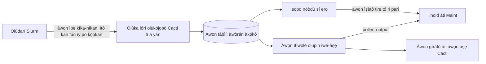

<!-- Source: README.md; SHA256: 16caa3e34c4d150a7fb1018f637e200a7580330f033b485047d8413bce09abba -->

<!-- translations:start -->
[English](../../../README.md) | [简体中文](../zh-CN/README.md) | [हिन्दी](../hi-IN/README.md) | [Español (España)](../es-ES/README.md) | [Español (Latinoamérica)](../es-419/README.md) | [العربية (السعودية)](../ar-SA/README.md) | [Afrikaans](../af-ZA/README.md) | [አማርኛ](../am-ET/README.md) | [العربية (مصر)](../ar-EG/README.md) | [العربية (المغرب)](../ar-MA/README.md) | [বাংলা](../bn-BD/README.md) | [Deutsch](../de-DE/README.md) | [فارسی](../fa-IR/README.md) | [Filipino](../fil-PH/README.md) | [Français](../fr-FR/README.md) | [Français (Maroc)](../fr-MA/README.md) | [Français (Sénégal)](../fr-SN/README.md) | [Hausa](../ha-NG/README.md) | [עברית](../he-IL/README.md) | [Bahasa Indonesia](../id-ID/README.md) | [Igbo](../ig-NG/README.md) | [Italiano](../it-IT/README.md) | [日本語](../ja-JP/README.md) | [한국어](../ko-KR/README.md) | [Malagasy](../mg-MG/README.md) | [मराठी](../mr-IN/README.md) | [Bahasa Melayu](../ms-MY/README.md) | [Nederlands](../nl-NL/README.md) | [Polski](../pl-PL/README.md) | [Português (Brasil)](../pt-BR/README.md) | [Русский](../ru-RU/README.md) | [Kinyarwanda](../rw-RW/README.md) | [Soomaali](../so-SO/README.md) | [Svenska](../sv-SE/README.md) | [Kiswahili](../sw-KE/README.md) | [தமிழ்](../ta-IN/README.md) | [తెలుగు](../te-IN/README.md) | [ไทย](../th-TH/README.md) | [Türkçe](../tr-TR/README.md) | [Українська](../uk-UA/README.md) | [اردو](../ur-PK/README.md) | [Tiếng Việt](../vi-VN/README.md) | [isiXhosa](../xh-ZA/README.md) | [Yorùbá](README.md) | [繁體中文](../zh-TW/README.md) | [isiZulu](../zu-ZA/README.md)
<!-- translations:end -->

# plugin_hpcsched

Àfikún Cacti 1.2 kan tí ó ń ya gíráfù ipò olùṣètò iṣẹ́ ìdìpọ̀ HPC lẹ́gbẹ̀ẹ́ àwọn ẹ̀rọ tí Cacti ti ń ṣàkíyèsí tẹ́lẹ̀: ìjìnlẹ̀ ìlà ìdúró, àwọn iṣẹ́ tó ń dúró lọ́wọ́ sí àwọn tó ń ṣiṣẹ́, ìdí tí àwọn iṣẹ́ fi ń dúró, ipò àwọn nóòdù, àti ìlò ìpín. Slurm ni ẹ̀rọ ìpìlẹ̀ àkọ́kọ́. Thold ń fi ìkìlọ̀ ránṣẹ́ lórí àwọn orísun dátà tó jáde, a sì lè darí Maint pẹ̀lú àwọn nóòdù tí a dẹ́kun iṣẹ́ wọn àti àwọn ìpamọ́ ààyè ìtọ́jú.

> **Ipò: ó ṣì wà lábẹ́ ìdàgbàsókè, kò tíì sí ìtẹ̀jáde kankan.** Ìpele 2 (ìpìlẹ̀) ti darapọ̀ sórí `main`, ẹ̀ka yìí sì fi ìpele 3 kún un (àwọn gíráfù kúlọ́sítà àti àwọn ìdí ìdúró). Kóòdù náà ń fi sori ẹ̀rọ, ó ń ṣe àtúnṣe ìgbéga, ó sì ń yọ kúrò nípasẹ̀ API àfikún Cacti, ó sì ń kọ̀ láti ṣiṣẹ́ lórí PHP tó kéré sí 8.2. Ó ń pa àkọsílẹ̀ àwọn kúlọ́sítà Slurm mọ́, tí a yàn kọ̀ọ̀kan fún olùkójọpọ̀ Cacti kan. Olùka abẹ́lẹ̀ lórí olùkójọpọ̀ àkọ́kọ́ ń gba àwòrán àkókò kan fún kúlọ́sítà kọ̀ọ̀kan ní àkókò ìdánudúró kọ̀ọ̀kan, yálà nípa ṣíṣe `squeue`, `scontrol`, àti `sshare` pẹ̀lú `--json` tàbí nípa kíkà `slurmrestd` lórí HTTPS, ó sì ń tọ́jú iye iṣẹ́ nípa ipò àti ìdí ìdúró, ipò àwọn nóòdù, àwọn ìpín, àwọn ìpamọ́ ààyè, àti ìlò pípín déédéé pẹ̀lú ìjẹ́-tuntun wọn. Àfikún náà ń kó àwọn àdàkọ Cacti wá, lórí ìfọwọ́sí alákòóso sì ń ṣẹ̀dá tàbí so ẹ̀rọ Cacti kan pọ̀ mọ́ kúlọ́sítà kọ̀ọ̀kan pẹ̀lú àwọn gíráfù iṣẹ́ nípa ipò, àwọn iṣẹ́ tó ń dúró nípa ìdílé ìdí, àwọn nóòdù nípa ipò, àwọn CPU, àti ìlò, fún kúlọ́sítà àti fún ìpín kọ̀ọ̀kan, pẹ̀lú ọjọ́-orí àwòrán àkókò náà. Ojú-ewé àkópọ̀ kíka-nìkan ń fi iye hàn fún kúlọ́sítà kọ̀ọ̀kan pẹ̀lú ìjẹ́-tuntun wọn àti ojú ìwòye ìdí ìdúró fún kúlọ́sítà kọ̀ọ̀kan, ojú-ewé ìlera fún alákòóso nìkan sì ń fi ohun tí ìkójọpọ̀ kọ̀ọ̀kan mú padà àti bóyá a ti fi àwọn àdàkọ sílẹ̀ hàn. Gbogbo ojú-ewé àti ìgbésẹ̀ ń tẹ̀lé àṣẹ ẹ̀rọ Cacti. Àwọn orísun dátà jẹ́ èyí tí Thold lè fi ìkìlọ̀ ṣọ́, ṣùgbọ́n a kò tíì dán ìbáṣepọ̀ Thold tàbí Maint kankan wò; ìyẹn ni ìpele 4 àti lẹ́yìn rẹ̀. Àkójọ ìdánwò náà bo àwọn àṣẹ Slurm àfọwọ́ṣe àti àwọn ìdáhùn `slurmrestd`, CI sì tún ń dán kúlọ́sítà Slurm alánóòdù mẹ́fà gidi wò nínú àwọn àpótí gẹ́gẹ́ bí a ṣe ṣàlàyé rẹ̀ nísàlẹ̀. Olùka náà kò tíì ṣiṣẹ́ lórí kúlọ́sítà iṣẹ́ gidi. Nísàlẹ̀ àwọn àkíyèsí olùṣiṣẹ́, README yìí ṣàlàyé ètò ìgbékalẹ̀, kì í ṣe ìhùwàsí tí a ti fi ránṣẹ́.

Èyí jẹ́ iṣẹ́ àdáni, kò sì ní ìbáṣepọ̀ kankan pẹ̀lú iṣẹ́ Cacti.

## Àwọn ipa ààyè

| Agbègbè àṣẹ | Ààyè |
| --- | --- |
| HPC Scheduler View | Àwọn ojú-ewé àkíyèsí tó wà tẹ́lẹ̀. |
| HPC Scheduler Operator | Àkíyèsí pẹ̀lú ojú-ewé Àwọn Iṣẹ́ àti ìjẹ́rìísí ìtúpalẹ̀ ti ara ẹni. |
| HPC Scheduler Admin | Ààyè Olùṣiṣẹ́ pẹ̀lú ètò àti àwọn ìgbésẹ̀ ìṣàkóso tó wà tẹ́lẹ̀. |

Lẹ́yìn tí o bá da àwọn fáìlì ìgbéga kọjá, ṣí ojú-ewé Plugins gẹ́gẹ́ bí alákòóso láti forúkọsílẹ̀
agbègbè àṣẹ tuntun náà. Yan agbègbè àṣẹ Operator ní pàtó lábẹ́ **Configuration > Users** tàbí àwọn ẹgbẹ́ olùlò.
Àwọn ìgbéga ń pa àwọn ID àti àṣẹ agbègbè View àti Admin tó wà tẹ́lẹ̀ mọ́. Ààyè Admin
ń jogún ààyè Operator, ààyè Operator sì ń jogún ààyè View lórí ìbéèrè kọ̀ọ̀kan;
èyí kì í fi àwọn àṣẹ tó wà ní ìpamọ́ kún àwọn olùlò tàbí àwọn ẹgbẹ́. Àwọn ètò àfikún tún nílò
ààyè HPC Scheduler Admin ní àfikún sí àṣẹ Settings ti Cacti.

Àwọn àṣẹ ẹ̀rọ Cacti ṣì ń dín àwọn ìlà àti ìgbésẹ̀ tó wà fún olùlò kọ̀ọ̀kan kù; kúlọ́sítà tí kò ní ẹ̀rọ ni a ṣàkójọ lórí àwọn ojú-ewé ìṣàkóso fún gbogbo olùlò tó ní agbègbè àfikún náà, ṣùgbọ́n kì í ṣe nínú àwọn ojú ìwòye olùṣiṣẹ́, tí ó ń ṣàkójọ àwọn kúlọ́sítà tí a so mọ́ ẹ̀rọ nìkan.
Àwọn ẹ̀rí ìdánimọ̀, ètò, ìsopọ̀, ìparẹ́ àti àwọn àyípadà ìṣàkóso mìíràn
wà nínú àwọn ojú-ewé ìṣàkóso. Àwọn ìjẹ́rìísí wà ní ìṣẹ́ nìkan nínú ìgbà iṣẹ́ olùlò
lọ́wọ́lọ́wọ́, fún wákàtí kan ní pọ́ọ̀pọ́ jù lọ àti nígbà tí àkíyèsí kan náà ṣì wà
ní tuntun nìkan. Àwọn àkíyèsí tuntun tàbí tí ó yí padà ń sọ wọ́n di aláìnílárí. Wọn kì í fi hàn pé ìwọ̀n
tó kùnà wà ní ìlera tàbí pa àwọn ìkìlọ̀ mọ́.

## Àwọn àkíyèsí olùṣiṣẹ́ fún ìpele 2

**Àǹfààní tó kéré jù lọ.** Àfikún náà ń kà nìkan. Fún un ní olùlò Slurm àkànṣe tí kò ní ipa alákòóso tàbí olùṣiṣẹ́ (`AdminLevel=None` nínú `sacctmgr`). Pẹ̀lú `PrivateData=jobs` (tàbí `nodes`, `reservations`, `usage`) nínú `slurm.conf`, olùlò yẹn ń rí àwọn àkọsílẹ̀ tirẹ̀ nìkan, nítorí náà àwọn ìka náà kò pé, àfikún náà kò sì lè mọ̀. Gbígbé ìyẹn sókè fún àkọọ́lẹ̀ náà túmọ̀ sí ìpele olùṣiṣẹ́ tàbí alákòóso, èyí tó tún gba àyè láti ṣe àyípadà; ìpinnu yẹn jẹ́ ti ibi iṣẹ́ náà. Fún àwọn àṣẹ oníbàárà, olùlò olùkójọpọ̀ Cacti nílò àwọn fáìlì aláṣẹ oníbàárà Slurm àti `slurm.conf` kan tó dé ọ̀dọ̀ olùdarí; àwọn ọ̀nà fáìlì aláṣẹ jẹ́ àwọn ètò pàtó lábẹ́ Configuration > Settings > HPC Scheduler. Fún `slurmrestd`, URL náà gbọ́dọ̀ jẹ́ `https://`, tàbí `http://` lórí àdírẹ́sì loopback nìkan. A ń ṣe àyẹ̀wò àwọn ìwé-ẹ̀rí TLS, a kò sì ń tẹ̀lé àwọn ìdarí-síwájú. Àtòjọ olùgbàlejò slurmrestd àṣàyàn lábẹ́ Configuration > Settings > HPC Scheduler ń fi ààlà sí àwọn olùgbàlejò àti àwọn ibùdókọ̀ tí kúlọ́sítà lè dárúkọ.

**Àwọn olùkójọpọ̀ òkèèrè.** Ìtẹ̀jáde yìí ń kó jọ lórí olùkójọpọ̀ Cacti àkọ́kọ́ nìkan. Kúlọ́sítà tí a yàn fún olùkójọpọ̀ dátà òkèèrè kò ní jẹ́ kíkójọ: olùka níbẹ̀ ń kọ̀ pẹ̀lú ìdí tí a kọ sílẹ̀ nínú àkọọ́lẹ̀, ojú-ewé ìlera sì ń dárúkọ kúlọ́sítà náà. Ìkójọpọ̀ òkèèrè jẹ́ ìgbésẹ̀ 3.

**Ìrántí.** Ìṣíṣẹ́ ìkójọpọ̀ kọ̀ọ̀kan ń tú ìdáhùn olùṣètò iṣẹ́ kan lẹ́ẹ̀kan ṣoṣo, èyí tó ń gba tó ìlọ́po 12 ìwọ̀n ìdáhùn náà nínú ìrántí PHP (tí a wọ̀n sí tó ìlọ́po 10 fún àwọn àkọsílẹ̀ iṣẹ́ tí a ṣe bíi ti Slurm, pẹ̀lú ọ̀rọ̀ náà fúnra rẹ̀). Ìṣíṣẹ́ náà ń gbé ààlà ìrántí PHP rẹ̀ sókè sí ètò Collection Memory (1024 MiB ní àkọ́ṣe) ó sì ń gba àwọn ìdáhùn títí dé (Collection Memory - 64) / 12 MiB láàyè, 80 MiB ní àkọ́ṣe, àní nígbà tí a bá ṣètò Maximum Answer Size ga jù bẹ́ẹ̀ lọ; ojú-ewé ìlera ń kìlọ̀ nígbà tó bá rí bẹ́ẹ̀. Ìdáhùn tó tóbi jù ń kùnà apá tirẹ̀ bíi tó tóbi jù, ìṣíṣẹ́ tí ìrántí rẹ̀ ṣì tán sì ń jẹ́ àkọsílẹ̀ bíi èyí tó kùnà. Kúlọ́sítà ńlá lè nílò kí a gbé àwọn ètò méjèèjì sókè; a kò tíì wọ̀n àkọsílẹ̀ iṣẹ́ gidi 100,000.

**Àwọn fáìlì àmì ìdánimọ̀.** Kúlọ́sítà `slurmrestd` kan ń dárúkọ fáìlì àmì ìdánimọ̀ kan; a kò tọ́jú àmì ìdánimọ̀ fúnra rẹ̀ sínú ibùdó dátà, a kò fi hàn lórí ojú-ewé, bẹ́ẹ̀ ni a kò kọ ọ́ sínú àkọọ́lẹ̀. Fáìlì náà gbọ́dọ̀ wà nínú ọ̀kan lára àwọn fọ́dà fáìlì àmì ìdánimọ̀ tí a ṣètò lábẹ́ Configuration > Settings > HPC Scheduler, tí a dé láìlo ìjápọ̀ àmì, kí ó sì jẹ́ fáìlì déédéé tí olùlò olùkójọpọ̀ ni tí olùlò yẹn nìkan sì lè kọ sí, tó ní ìlà kan: àmì ìdánimọ̀ náà, tàbí `SLURM_JWT=<token>` gẹ́gẹ́ bí `scontrol token` ṣe ń tẹ̀ ẹ́ jáde. Láìsí àwọn fọ́dà àmì ìdánimọ̀ tí a ṣètò, kò sí kúlọ́sítà tó lè lo `slurmrestd`. Àwọn ètò méjèèjì yìí wà lórí ojú-ewé Settings ti Cacti, nítorí náà agbègbè àṣẹ Admin ti àfikún náà nìkan kò lè yí wọn padà; pa fọ́dà àmì ìdánimọ̀ kọ̀ọ̀kan mọ́ kí root àti olùlò olùkójọpọ̀ nìkan lè kọ sí i. Fáìlì tí ẹgbẹ́ tàbí àwọn olùlò mìíràn lè kà ṣì ń jẹ́ lílò, ojú-ewé ìlera sì ń kìlọ̀. Ojú-ewé ìlera náà tún ń kìlọ̀ nígbà tí àmì ìdánimọ̀ bá fẹ́ parí láàárín àkókò ìkìlọ̀ tí a ṣètò.

Láti yí àmì ìdánimọ̀ padà láìní fèrèsé tí olùka yóò ti rí fáìlì àìpé, kọ àmì ìdánimọ̀ tuntun sí ẹ̀gbẹ́ èyí àtijọ́ kí o sì tún orúkọ rẹ̀ sọ sí ipò rẹ̀:

```sh
dir=/etc/cacti/hpcsched
tmp=$(mktemp "$dir/.token.XXXXXX")
scontrol token username=cactiread lifespan=2592000 > "$tmp"
chown cacti:cacti "$tmp"
chmod 0600 "$tmp"
mv -f "$tmp" "$dir/cluster1.token"
```

Ìkójọpọ̀ tó tẹ̀lé yóò ka fáìlì tuntun náà. Ṣíṣẹ̀dá àwọn àmì ìdánimọ̀ pẹ̀lú `scontrol token` nílò alákòóso Slurm kan; ṣe é níbi tí a ti gbà láàyè kí o sì da fáìlì náà kọjá sí olùkójọpọ̀.

## Àwọn àkíyèsí olùṣiṣẹ́ fún ìpele 3

**Àwọn àdàkọ.** Fífisí àti ìgbéga ń kó àwọn àdàkọ ẹ̀rọ, dátà, àti gíráfù HPC Scheduler wọlé, wọ́n sì ń da ìbéèrè dátà ìpín kọjá sí fọ́dà `resource/script_server/` ti Cacti. Bí olùlò tó ń fi àfikún náà sí kò bá lè kọ sí fọ́dà yẹn, bí fáìlì mìíràn tó ní orúkọ kan náà ti wà níbẹ̀ tẹ́lẹ̀ tí kì í sì í ṣe àfikún náà ló kọ ọ́, tàbí orúkọ náà jẹ́ ìjápọ̀ àmì, ìkówọlé náà yóò dúró, a ó fi fáìlì náà sílẹ̀, ojú-ewé ìlera yóò sì sọ ohun tí a ó ṣe; Install Templates lórí ojú-ewé ìlera ń gbìyànjú lẹ́ẹ̀kan sí i. Ẹ̀dà tó jọra tí a ṣe pẹ̀lú ọwọ́ ni a ó lò ṣùgbọ́n yóò jẹ́ tirẹ. Yíyọkúrò ń pa fáìlì ìbéèrè náà rẹ́ nìkan bí àfikún náà bá kọ ọ́ tí kò sì yí padà, ó sì ń pa àwọn àdàkọ, àwọn ẹ̀rọ, àti àwọn gíráfù mọ́.

**Àwọn ẹ̀rọ kúlọ́sítà.** HPC Clusters > Device ń fi ohun tí ẹ̀rọ kan yóò fi kún un hàn (àwọn gíráfù, àwọn orísun dátà, àwọn fáìlì RRD, àti àwọn ìpè olupin ìwé-àṣẹ fún ìkójọpọ̀ kọ̀ọ̀kan) kí a tó ṣẹ̀dá ohunkóhun. Create Device ń ṣe ẹ̀rọ kan pẹ̀lú orúkọ olùgbàlejò nínú àgbègbè `.invalid` tí a yà sọ́tọ̀ àti láìsí àyẹ̀wò wíwà; Map Device dípò rẹ̀ ń so àwọn gíráfù náà mọ́ ẹ̀rọ tó wà tẹ́lẹ̀, ó sì ń fi àwọn ètò rẹ̀ sílẹ̀. Gíráfù kúlọ́sítà kọ̀ọ̀kan àti gíráfù ìpín kọ̀ọ̀kan ní orísun dátà tirẹ̀: mẹ́fà fún kúlọ́sítà náà àti márùn-ún fún ìpín kọ̀ọ̀kan, ìpè olupin ìwé-àṣẹ kan fún orísun dátà kúlọ́sítà kọ̀ọ̀kan àti ọ̀kan fún iye ìpín kan (32) fún ìkójọpọ̀ kọ̀ọ̀kan. Àwọn ìpín tí a fi kún un lẹ́yìn ni a ń tò sínú àtọ́ka nígbà tí olùka bá rí wọn, wọ́n sì ń gba àwọn gíráfù láti ojú-ewé New Graphs ti Cacti; ìpín tí a yọ kúrò ń dẹ́kun jíjẹ́ kíkójọ, ó sì ń pa àwọn gíráfù rẹ̀ mọ́. Pípa ẹ̀rọ náà rẹ́ ń tú ìsopọ̀ kúlọ́sítà náà kúrò, ó sì ń pa á mọ́.

**Ohun tí àwọn gíráfù ń kà.** Àwọn tó ń dúró yọ àwọn iṣẹ́ tí a dá dúró kúrò, tí wọ́n ní ìtòjọ tiwọn. Àkójọpọ̀ iṣẹ́ tó ń dúró ń ka àwọn iṣẹ́ kéékèèké tó ṣẹ́ kù. Iṣẹ́ tàbí nóòdù kan nínú ọ̀pọ̀ ìpín ń kà ní ẹ̀ẹ̀kan nínú àwọn gíráfù kúlọ́sítà àti ní ẹ̀ẹ̀kan nínú ìpín kọ̀ọ̀kan, nítorí náà àwọn gíráfù ìpín kò nílò láti ṣàfikún sí ti kúlọ́sítà náà. A pín àwọn ìdí ìdúró sí ìdílé mọ́kànlá ([ADR 0011](../../decisions/0011-pending-reason-families-and-counting.md)); ojú ìwòye àwọn ìdí ìdúró ń ṣàkójọ àwọn ìdí àìtúnṣe, pẹ̀lú àwọn tó wà nínú Other. Iṣẹ́ kọ̀ọ̀kan ń jábọ̀ ìdí ìkẹyìn tí olùṣètò iṣẹ́ yẹ̀ wò nìkan. Olùpín ìsàlẹ̀ ìlò ní àwọn nóòdù tí a dẹ́kun iṣẹ́ wọn, tó wà ní ìsàlẹ̀, àti àwọn nóòdù mìíràn tí kò sí. Dátà tó ti pẹ́ jù tàbí tó kùnà jẹ́ `U`, kì í ṣe òdo láé; `age` ń dúró ní nọ́ńbà.

**Ìkìlọ̀.** Thold lè fi ìkìlọ̀ ránṣẹ́ lórí èyíkéyìí nínú àwọn orísun dátà yìí; ṣètò àkókò ìdúró Thold sí ó kéré tán àkókò ìkójọpọ̀ kan, kí o sì ṣètò ìkìlọ̀ lórí `age` láti mú olùka tó ti dá dúró. Àyẹ̀wò Thold láti òpin dé òpin ni ìpele 4.

**Tí a dán wò lórí àbájáde Slurm gidi.** CI ń bẹ̀rẹ̀ kúlọ́sítà Slurm alánóòdù mẹ́fà kan nínú àwọn àpótí (26.05.5 lórí gbogbo àyípadà, 25.11.8 tí a kọ́ láti orísun lórí àwọn ìtì sórí `main`, lọ́sọ̀ọ̀sẹ̀, àti lórí ìbéèrè) ó sì ń ṣàyẹ̀wò ipò àwọn nóòdù, ìpamọ́ ààyè ìtọ́jú, àwọn ìdí ìdúró, àti àwọn àkójọpọ̀ bí àfikún náà ṣe ń tú wọn, lẹ́yìn náà ó ń kó jọ láti kúlọ́sítà yẹn pẹ̀lú àṣẹ àfikún náà fúnra rẹ̀ àti àwọn ọ̀nà ìgbéjáde `slurmrestd`. Àwọn ìtẹ̀jáde àtijọ́ jẹ́ àkóso nípa àwọn àpẹẹrẹ ìdánwò àfọwọ́ṣe nìkan. Olùka náà kò ṣì tíì ṣiṣẹ́ lórí kúlọ́sítà iṣẹ́ gidi.

**Àwọn àṣẹ.** Kúlọ́sítà kan lórí ẹ̀rọ ni a ń fi hàn, tẹ̀ jáde, àti yí padà fún àwọn olùlò tí Cacti gbà láàyè fún ẹ̀rọ yẹn nìkan, lórí gbogbo ojú-ewé àfikún; sísopọ̀ ẹ̀rọ kan tún nílò àṣẹ fún ẹ̀rọ àfojúsùn náà. Kúlọ́sítà tí kò ní ẹ̀rọ ṣe é rí fún gbogbo ènìyàn tó ní agbègbè àṣẹ àfikún náà. Kúlọ́sítà kan tí a ṣì so mọ́ ẹ̀rọ tí a pa rẹ́ nígbà tí àfikún náà wà ní àìṣiṣẹ́ ni a ń fi hàn fún àwọn olùlò tó ní agbègbè àṣẹ HPC Scheduler Admin nìkan, àwọn tí wọ́n lè ṣẹ̀dá tàbí so ẹ̀rọ kan pọ̀ fún un. Ààyè gíráfù jẹ́ ti Cacti fúnra rẹ̀.

## Ìdí rẹ̀

Àwọn olùṣiṣẹ́ tí wọ́n ń lo Cacti ti ń ya gíráfù àwọn nóòdù ìṣirò wọn tẹ́lẹ̀. Ìwòye olùṣètò iṣẹ́ náà ṣòro láti rí nínú àwọn gíráfù wọ̀nyẹn, èyí tó fi àlàfo méjì sílẹ̀:

- **Kò sí "ìdí tí iṣẹ́ kò fi bẹ̀rẹ̀".** Slurm ń kọ ìdí kan sílẹ̀ fún iṣẹ́ kọ̀ọ̀kan tó ń dúró. Ìlà ìdúró tó kún lẹ́gbẹ̀ẹ́ àwọn gíráfù nóòdù tí kò ṣiṣẹ́ kò sọ bóyá ìdí rẹ̀ jẹ́ ìṣáájú, àwọn ààlà ohun èlò, àwọn ìdádúró, àwọn ìgbẹ́kẹ̀lé, tàbí àwọn nóòdù tí a dẹ́kun iṣẹ́ wọn.
- **Kò sí ìjápọ̀ láàárín ipò olùṣètò iṣẹ́ àti ìkìlọ̀.** Thold ń fi ìkìlọ̀ ránṣẹ́ lórí ẹ̀rọ tí alákòóso kan ti dẹ́kun iṣẹ́ rẹ̀ tẹ́lẹ̀, àwọn alákòóso sì ń ṣẹ̀dá àwọn ìṣètò Maint pẹ̀lú ọwọ́.

Àfikún náà ń gba àwòrán àkókò kan tí a fi pamọ́ fún kúlọ́sítà kọ̀ọ̀kan, ó ń tẹ̀ ẹ́ jáde gẹ́gẹ́ bí àwọn orísun dátà àti àwọn gíráfù Cacti déédéé, ó ń so àwọn nóòdù olùṣètò iṣẹ́ pọ̀ mọ́ àwọn ẹ̀rọ Cacti tó wà tẹ́lẹ̀, ó sì lè gbé àwọn nóòdù tí a dẹ́kun iṣẹ́ wọn àti àwọn ìpamọ́ ààyè ìtọ́jú sínú Maint. Ó ń tún àwọn àṣẹ Cacti, àwọn olùkójọpọ̀ dátà òkèèrè, Thold, àti Maint lò, ó sì jẹ́ kíka-nìkan sí olùṣètò iṣẹ́ náà.

## Ààlà iṣẹ́ tí a ṣètò

| Ìgbésẹ̀ | Ààlà iṣẹ́ | Àwọn ìpele |
|---|---|---|
| 0, ìwádìí | Àtẹ ìtẹ̀jáde Slurm, ìjẹ́rìísí ìhùwàsí òkè, ẹrù olùdarí, àwọn àpẹẹrẹ ìdánwò ìsọrúkọ nóòdù | [M1](https://github.com/somethingwithproof/plugin_hpcsched/milestone/1) |
| 1, àwọn gíráfù kúlọ́sítà | Ìjìnlẹ̀ ìlà ìdúró, àwọn iṣẹ́ tó ń dúró àti tó ń ṣiṣẹ́, àwọn ìdí ìdúró, ipò àwọn nóòdù, ìlò ìpín, ìkìlọ̀ Thold, ojú-ewé ìlera, ìtẹ̀jáde | [M2](https://github.com/somethingwithproof/plugin_hpcsched/milestone/2), [M3](https://github.com/somethingwithproof/plugin_hpcsched/milestone/3), [M4](https://github.com/somethingwithproof/plugin_hpcsched/milestone/4) |
| 2, àwọn nóòdù àti ìtọ́jú | Ìsopọ̀ nóòdù sí ẹ̀rọ, ipò fún nóòdù kọ̀ọ̀kan, àwọn fèrèsé Maint aládàáṣe fún àwọn nóòdù tí a dẹ́kun iṣẹ́ wọn àti àwọn ìpamọ́ ààyè ìtọ́jú | [M5](https://github.com/somethingwithproof/plugin_hpcsched/milestone/5) |
| 3, ìṣirò àkọọ́lẹ̀ | Ìlò pípín déédéé, àwọn ìṣirò àkọọ́lẹ̀ tó ní ààlà, àwọn olùkójọpọ̀ dátà òkèèrè | [M6](https://github.com/somethingwithproof/plugin_hpcsched/milestone/6) |

Ó kọjá ààlà: ọ̀nà kíkọ olùṣètò iṣẹ́ èyíkéyìí (fífisílẹ̀, píparẹ́, dídá dúró, dídẹ́kun iṣẹ́, títún bẹ̀rẹ̀), ẹ̀rọ ìkìlọ̀ ti àfikún fúnra rẹ̀, ẹ̀rọ ìjáìròyìn tàbí ìṣirò owó, àwọn ìtòjọ fún olùlò kọ̀ọ̀kan àti fún iṣẹ́ kọ̀ọ̀kan. Àwọn ẹ̀rọ ìpìlẹ̀ PBS Pro, OpenPBS, àti LSF jẹ́ ìwádìí.

## Àwọn àfojúsùn ìbámu

| Apá | Àfojúsùn |
|---|---|
| Cacti | 1.2.31 tàbí tuntun jù bẹ́ẹ̀ lọ, kò sí àtúnṣe kóòdù ààrin |
| PHP | 8.2 tàbí tuntun jù bẹ́ẹ̀ lọ; `setup.php` ṣì lè jẹ́ títúmọ̀ lórí 8.0 kí àyíká ìṣiṣẹ́ tí a kò ṣètìlẹ́yìn fún rí ìkọ̀sílẹ̀ dípò UI Cacti tó bà jẹ́ |
| Slurm | 25.05, 25.11, àti 26.05, àwọn ìtẹ̀jáde mẹ́ta tó ṣẹ̀ṣẹ̀ jù lọ ([ADR 0013](../../decisions/0013-three-latest-slurm-releases.md)); 25.11 àti 26.05 ni a dán wò lórí kúlọ́sítà ààyè, 25.05 lórí àwọn àpẹẹrẹ ìdánwò nìkan. Àwọn àṣẹ oníbàárà ni ọ̀nà ìgbéjáde àkọ́ṣe ([ADR 0012](../../decisions/0012-client-commands-default-transport.md)) wọ́n sì ń lo ètò atúmọ̀ dátà: v0.0.43 ní àkọ́ṣe, èyí tí SchedMD yóò yọ kúrò ní 27.05, tàbí v0.0.44 tàbí v0.0.45 lórí àwọn ìtẹ̀jáde tó kó wọn wá. Àwọn kúlọ́sítà slurmrestd ń ṣàwárí atúmọ̀ tuntun jù lọ tí daemon náà ń sìn |
| Thold, Maint | Kò sí àyípadà Thold; ìbáṣepọ̀ Maint jẹ́ àbá tó nílò ìfọwọ́sí àwọn olùtọ́jú Maint |

## Ìgbékalẹ̀

- [docs/PLAN.md](../../PLAN.md) ni ètò kíkún: ìmọ̀ ìgbékalẹ̀, àwọn òtítọ́ òkè tí ó gbẹ́kẹ̀ lé (pẹ̀lú àwọn orísun àti àtòjọ àwọn àbá tí kò tíì jẹ́rìísí ní gbangba), ìsopọ̀ nóòdù, àwòṣe ipò, àwọn ààlà ààbò, ìṣirò iṣẹ́-ṣíṣe, ìdánwò, àti àwọn ewu.
- [docs/decisions/](../../decisions) ní àwọn àkọsílẹ̀ ìpinnu ìgbékalẹ̀.
- [docs/REQUIREMENTS.md](../../REQUIREMENTS.md) ń so gbogbo ID ìbéèrè pọ̀ mọ́ ọ̀rọ̀ rẹ̀.



## Báwo ni a ṣe ń tọpa iṣẹ́

- **Àwọn ìpele** ń tẹ̀lé àwọn ìpele ètò náà. Kọ̀ọ̀kan ní ọ̀rọ̀ pàtàkì kan tó ń ṣàkójọ àwọn ọ̀rọ̀ abẹ́ rẹ̀ àti ẹ̀rí ìjáde.
- **Àwọn ọ̀rọ̀** ni a pín nípa àmì: `type: requirement`, `type: research`, `type: decision`, `type: epic`. Àwọn ọ̀rọ̀ ìbéèrè ń sọ àwọn ìbéèrè tí a nọ́ńbà tí ó ṣe é dán wò (`REQ-AREA-NNN`) àti àwọn ìlànà ìtẹ́wọ́gbà.
- **Àwọn àmì** tún ń gbé `area:`, `phase:`, `priority:`, àti `status:`. Wo [CONTRIBUTING.md](../../../CONTRIBUTING.md#labels).
- [Pátákó iṣẹ́](https://github.com/users/somethingwithproof/projects/10) ń fi gbogbo àwọn ọ̀rọ̀ hàn káàkiri àwọn ìpele.

## Ìkópa

Ka [CONTRIBUTING.md](../../../CONTRIBUTING.md). Àwọn àfipamọ́ nílò ìfọwọ́sí DCO. Ìjíròrò ìgbékalẹ̀ ń ṣẹlẹ̀ lórí àwọn ọ̀rọ̀; àwọn ìpinnu tí ó ṣí sílẹ̀ ń gbé àmì `type: decision`.

## Ààbò

Jábọ̀ àwọn àléébù ní ìkọ̀kọ̀; wo [SECURITY.md](../../../SECURITY.md).

## Ìwé àṣẹ

GNU General Public License v2.0, ìwé àṣẹ kan náà bíi ti Cacti àti àwọn àfikún rẹ̀. Wo [LICENSE](../../../LICENSE).
