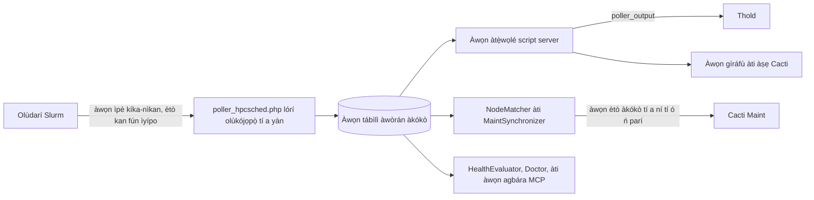

<!-- Source: README.md; SHA256: 938114d41dbd516f9dfcd94619c4fc73ef56b4da1dd693010588a93cce250534 -->

<!-- translations:start -->
[English](../../../README.md) | [简体中文](../zh-CN/README.md) | [हिन्दी](../hi-IN/README.md) | [Español (España)](../es-ES/README.md) | [Español (Latinoamérica)](../es-419/README.md) | [العربية (السعودية)](../ar-SA/README.md) | [Afrikaans](../af-ZA/README.md) | [አማርኛ](../am-ET/README.md) | [العربية (مصر)](../ar-EG/README.md) | [العربية (المغرب)](../ar-MA/README.md) | [Български](../bg-BG/README.md) | [বাংলা](../bn-BD/README.md) | [Bosanski](../bs-BA/README.md) | [Deutsch](../de-DE/README.md) | [Ελληνικά](../el-GR/README.md) | [فارسی](../fa-IR/README.md) | [Filipino](../fil-PH/README.md) | [Français](../fr-FR/README.md) | [Français (Maroc)](../fr-MA/README.md) | [Français (Sénégal)](../fr-SN/README.md) | [Hausa](../ha-NG/README.md) | [עברית](../he-IL/README.md) | [Hrvatski](../hr-HR/README.md) | [Bahasa Indonesia](../id-ID/README.md) | [Igbo](../ig-NG/README.md) | [Italiano](../it-IT/README.md) | [日本語](../ja-JP/README.md) | [ქართული](../ka-GE/README.md) | [한국어](../ko-KR/README.md) | [Latviešu](../lv-LV/README.md) | [Malagasy](../mg-MG/README.md) | [मराठी](../mr-IN/README.md) | [Bahasa Melayu](../ms-MY/README.md) | [Nederlands](../nl-NL/README.md) | [Polski](../pl-PL/README.md) | [Português (Brasil)](../pt-BR/README.md) | [Português (Portugal)](../pt-PT/README.md) | [Русский](../ru-RU/README.md) | [Kinyarwanda](../rw-RW/README.md) | [Soomaali](../so-SO/README.md) | [Српски](../sr-RS/README.md) | [Svenska](../sv-SE/README.md) | [Kiswahili](../sw-KE/README.md) | [தமிழ்](../ta-IN/README.md) | [తెలుగు](../te-IN/README.md) | [ไทย](../th-TH/README.md) | [Türkçe](../tr-TR/README.md) | [Українська](../uk-UA/README.md) | [اردو](../ur-PK/README.md) | [Tiếng Việt](../vi-VN/README.md) | [isiXhosa](../xh-ZA/README.md) | [Yorùbá](README.md) | [繁體中文](../zh-TW/README.md) | [isiZulu](../zu-ZA/README.md)
<!-- translations:end -->

# plugin_hpcsched

Àfikún Cacti 1.2 kan (`hpcsched`, ẹ̀dà `0.1.0-dev`) tí ó ń ya gíráfù ipò olùṣètò iṣẹ́ ìdìpọ̀ HPC lẹ́gbẹ̀ẹ́ àwọn ẹ̀rọ tí Cacti ti ń ṣàkíyèsí tẹ́lẹ̀: ìjìnlẹ̀ ìlà ìdúró, àwọn iṣẹ́ tó ń dúró lọ́wọ́ sí àwọn tó ń ṣiṣẹ́, ìdí tí àwọn iṣẹ́ fi ń dúró, ipò àwọn nóòdù, ìlò ìpín, àti ìlò pípín déédéé ní ìpele àkọọ́lẹ̀. Slurm ni ẹ̀rọ ìpìlẹ̀ tí a ṣe. Thold ń fi ìkìlọ̀ ránṣẹ́ lórí àwọn orísun dátà tó jáde, olùbámu Maint àṣàyàn sì ń darí àwọn fèrèsé Maint Cacti láti inú àwọn nóòdù ìṣirò Slurm tí a dẹ́kun iṣẹ́ wọn, tí wọ́n wà ní ìsàlẹ̀, àti tí a pa mọ́ fún ìtọ́jú.

> **Ipò: ó ṣì wà lábẹ́ ìdàgbàsókè, kò tíì sí ìtẹ̀jáde kankan.** Ẹ̀ka yìí ṣe ìpìlẹ̀ àfikún, àwọn gíráfù kúlọ́sítà àti ìpín, àwọn ìdílé ìdí ìdúró, ìbámu nóòdù ìṣirò Slurm sí ẹ̀rọ Cacti, ìbámu fèrèsé Maint Cacti àṣàyàn, àwọn àkópọ̀ pípín déédéé ní ìpele àkọọ́lẹ̀, ìṣiṣẹ́ àti ìṣàdàkọ olùkójọpọ̀ dátà òkèèrè, CLI Configuration-as-Code (CasC) àti ìṣiṣẹ́, àti àwọn ìkọ́ ètò ìṣe Cacti (CasC, Doctor, àti MCP / Abilities API v2). Àkójọ ìdánwò náà bo àwọn àṣẹ Slurm àfọwọ́ṣe àti àwọn ìdáhùn `slurmrestd`, CI sì ń dán kúlọ́sítà Slurm alánóòdù mẹ́fà tó wà láàyè wò nínú àwọn àpótí. Olùka náà kò tíì ṣiṣẹ́ lórí kúlọ́sítà iṣẹ́ gidi, ìdánwò àtúnṣe Thold láti ìbẹ̀rẹ̀ dé òpin sì kò tíì wà nínú CI.

Èyí jẹ́ iṣẹ́ àdáni, kò sì ní ìbáṣepọ̀ kankan pẹ̀lú iṣẹ́ Cacti.

## Ohun tí a ti ṣe

- **Ìgbésí-ayé àti ìtòlẹ́sẹẹsẹ (v3)**: fífi sori ẹ̀rọ, ìgbéga tí kì í ṣe àtúnyípadà (idempotent), yíyọ kúrò (fífi àwọn tábìlì àfikún sílẹ̀ nípa àìyípadà), àti ààlà ìsàlẹ̀ PHP 8.2 nígbà tí àwọn ibi ìbẹ̀rẹ̀ bá ṣì lè túmọ̀ lórí PHP 8.0. Ìtòlẹ́sẹẹsẹ v3 fi `plugin_hpcsched_node_map` àti `plugin_hpcsched_maint_link` kún un lẹ́gbẹ̀ẹ́ àwọn tábìlì cluster, run, section, job-count, node-count, node, partition, reservation, àti share.
- **Ìkójọpọ̀ Slurm kíka-nìkan lórí àwọn olùkójọpọ̀ àkọ́kọ́ àti òkèèrè**: `poller_bottom` ń bẹ̀rẹ̀ `poller_hpcsched.php --cluster=N` ní abẹ́lẹ̀ lórí olùkójọpọ̀ kọ̀ọ̀kan (`poller_id`) fún àwọn kúlọ́sítà tí a mú ṣiṣẹ́ tí a yàn án fún. Ìṣiṣẹ́ kọ̀ọ̀kan ń gba àwòrán àkókò kan tí a fi pamọ́ fún kúlọ́sítà kọ̀ọ̀kan nípasẹ̀ àwọn àṣẹ oníbàárà (`squeue`, `scontrol`, `sshare` pẹ̀lú `--json`) tàbí `slurmrestd` lórí HTTPS (HTTP loopback gba ààyè pẹ̀lú ìkìlọ̀ ìlera). `INFO` ń kéde `remote_collect:1, remote_poller:1`, `replicate_out` sì ń ṣàdàkọ àwọn ìtumọ̀ `plugin_hpcsched_cluster` tí kì í ṣe àṣírí sí àwọn olùkójọpọ̀ òkèèrè (`poller_id >= 2`); a kì í ka tàbí ṣàdàkọ àkóónú fáìlì token láé.
- **Àwọn àdàkọ Cacti àti àwọn gíráfù kúlọ́sítà**: ń kó àwọn àdàkọ ẹ̀rọ, dátà, àti gíráfù (`templates/hpcsched-templates.xml`) àti ìbéèrè dátà script-server ìpín (`scripts/ss_hpcsched_cluster.php`, `scripts/ss_hpcsched_partitions.php`) wá. Lórí ìfọwọ́sí alákòóso, ó ń ṣẹ̀dá tàbí so ẹ̀rọ Cacti kan pọ̀ mọ́ kúlọ́sítà kọ̀ọ̀kan pẹ̀lú àwọn gíráfù fún àwọn iṣẹ́ nípa ipò, àwọn iṣẹ́ tó ń dúró nípa ìdílé ìdí, àwọn nóòdù nípa ipò, àwọn CPU, ìlò (kúlọ́sítà àti fún ìpín kọ̀ọ̀kan), àti ọjọ́-orí àwòrán àkókò náà.
- **Ìbámu nóòdù Slurm sí ẹ̀rọ àti ìbámu Cacti Maint**: olùbámu àkókò títọ́ ìpele mẹ́rin (`NodeMatcher`) ń so àwọn nóòdù ìṣirò Slurm pọ̀ mọ́ àwọn àkọsílẹ̀ `host` Cacti tó wà tẹ́lẹ̀ (orúkọ agbàlejò gangan, àdírẹ́sì gangan, àpèjúwe/orúkọ àdàpè gangan, tàbí àmì DNS àkọ́kọ́ fún àwọn orúkọ tí kì í ṣe IP) ó sì ń sàmì sí àwọn ìbámu púpọ̀ tàbí àwọn ìbéèrè ẹ̀rọ tí a tún sọ gẹ́gẹ́ bí `ambiguous` dípò ìrònú. `HostList::expand()` ń fẹ̀ àwọn àkójọ agbàlejò ìpamọ́ ààyè Slurm (títí dé 10,000 nóòdù). `MaintSynchronizer` ń ṣẹ̀dá, tún ṣe, ó sì ń yọ àwọn ètò àkókò Cacti Maint ẹ̀ẹ̀kan tí àfikún ní tí a tọpa nínú `plugin_hpcsched_maint_link` kúrò fún àwọn nóòdù tí a so pọ̀ tí ó wà ní `DRAIN`, `DRAINING`, `DOWN`, tàbí àwọn ìpamọ́ ààyè `MAINT`/`MAINTENANCE` tó ń ṣiṣẹ́ láìyí àwọn ètò àkókò Maint tí alákòóso ṣẹ̀dá padà.
- **Àwọn àkópọ̀ pípín déédéé ní ìpele àkọọ́lẹ̀**: nígbà tí a bá mú `collect_shares` ṣiṣẹ́, ó ń kó àwọn ìlà ìbáṣepọ̀ àkọọ́lẹ̀ Slurm sínú `plugin_hpcsched_share` (ó ń yọ àwọn ìlà olùlò kúrò gẹ́gẹ́ bí [ADR 0010](../../decisions/0010-bound-series-cardinality.md)). `ShareSummary` àti `ShareRepository` ń ṣírò iye àkọọ́lẹ̀/ìpín, àpapọ̀ ìlò tútù àti tó gbéṣẹ́, àwọn ohun ìṣirò pípín déédéé tó kéré jù/tó pọ̀ jù/ìpíndọ́gba, àti àwọn àkọọ́lẹ̀ àkọ́kọ́; a fi iye àkọọ́lẹ̀ hàn nínú `hpcsched-get-queue-summary`.
- **CLI CasC àti ìṣiṣẹ́ (`cli/hpcsched.php`)**: ìkójáde ìṣètò YAML/XML, ìdánilójú, ìwéwèé ìyàtọ̀ àdánwò (dry-run), ìmúlò tí a dènà pẹ̀lú ìfọwọ́sí, àbájáde ìlera tí a ṣètò, àti ìbámu Maint àṣàyàn (`sync-maint --dry-run` / `--apply`).
- **Àwọn ìkọ́ ètò ìṣe (`setup.php`)**: `casc_register_providers`, `doctor_register_checks`, àti `abilities_register`.

## Àwọn ipa ààyè

| Agbègbè àṣẹ | Ààyè |
| --- | --- |
| HPC Scheduler View | Àkópọ̀ kúlọ́sítà kíka-nìkan àti àwọn ìdí ìdúró (`hpcsched.php`). |
| HPC Scheduler Operator | Ààyè View pẹ̀lú ojú-ewé Àwọn Iṣẹ́ (`hpcsched_operator.php`) àti ìjẹ́rìísí ìtúpalẹ̀ ti ara ẹni. |
| HPC Scheduler Admin | Ààyè Operator pẹ̀lú ìṣàkóso kúlọ́sítà (`hpcsched_clusters.php`) àti ojú-ewé ìlera (`hpcsched_health.php`). |

Lẹ́yìn tí o bá da àwọn fáìlì ìgbéga kọjá, ṣí ojú-ewé Plugins gẹ́gẹ́ bí alákòóso láti forúkọsílẹ̀ àwọn agbègbè àṣẹ tuntun àti àwọn ìkọ́. Yan agbègbè àṣẹ Operator ní pàtó lábẹ́ **Configuration > Users** tàbí àwọn ẹgbẹ́ olùlò. Àwọn ìgbéga ń pa àwọn ID àti àṣẹ agbègbè View àti Admin tó wà tẹ́lẹ̀ mọ́. Ààyè Admin ń jogún ààyè Operator, ààyè Operator sì ń jogún ààyè View lórí ìbéèrè kọ̀ọ̀kan; èyí kì í fi àwọn àṣẹ tí a tọ́jú kún un fún àwọn olùlò tàbí àwọn ẹgbẹ́. Àwọn ètò àfikún tún nílò ààyè HPC Scheduler Admin ní àfikún sí àṣẹ Settings ti Cacti.

Àwọn àṣẹ ẹ̀rọ Cacti ń dín àwọn ìlà àti ìgbésẹ̀ tó wà fún olùlò kọ̀ọ̀kan kù. Kúlọ́sítà tí a so pọ̀ mọ́ ẹ̀rọ Cacti kan ni a ń fi hàn, gbé jáde, tí a sì ń yí padà nìkan fún àwọn olùlò tí Cacti gba ààyè fún ẹ̀rọ náà; sísopọ̀ ẹ̀rọ tún nílò àṣẹ fún ẹ̀rọ ibi àfojúsùn náà. Kúlọ́sítà tí kò ní ẹ̀rọ ni a ṣe àkójọ rẹ̀ lórí àwọn ojú-ewé ìṣàkóso fún àwọn olùlò tí ó ní agbègbè àṣẹ àfikún, ṣùgbọ́n kì í ṣe nínú àwọn ojú ìwòye olùṣiṣẹ́, tí ó ń fi àwọn kúlọ́sítà tí a so pọ̀ mọ́ ẹ̀rọ nìkan hàn. Kúlọ́sítà tí a pa ẹ̀rọ tí a so pọ̀ mọ́ ọn rẹ́ nígbà tí àfikún wà ní pípa ni a ń fi hàn nìkan fún àwọn olùlò tí ó ní ààyè HPC Scheduler Admin. Àwọn ìjẹ́rìísí ń pẹ́ nìkan nínú ìgbà iṣẹ́ olùlò lọ́wọ́lọ́wọ́, fún wákàtí kan lọ́pọ̀ jù àti nìkan níwọ̀n ìgbà tí àkíyèsí kan náà bá wà ní tuntun. Àwọn àkíyèsí tuntun tàbí tí a yí padà ń sọ wọ́n di aláìlẹ́sẹ̀. Wọn kì í sàmì sí ìwọ̀n tí ó kùnà gẹ́gẹ́ bí aláàánú tàbí dènà àwọn ìkìlọ̀ láé.

## Àwọn àkíyèsí olùṣiṣẹ́

### Ààbò, àǹfààní tí ó kéré jùlọ, àti àwọn fáìlì token

Àfikún náà ń ka nìkan. Fún un ní olùlò Slurm pàtó tí kò ní ipa alákòóso tàbí olùṣiṣẹ́ (`AdminLevel=None` nínú `sacctmgr`). Pẹ̀lú `PrivateData=jobs` (tàbí `nodes`, `reservations`, `usage`) nínú `slurm.conf`, olùlò náà ń rí àwọn àkọsílẹ̀ tirẹ̀ nìkan, nítorí náà àwọn iye kò ní pé, àfikún náà kò sì lè ṣàwárí rẹ̀. Yíyọ ìdíwọ́ yẹn fún àkọọ́lẹ̀ náà nílò ìpele olùṣiṣẹ́ tàbí alákòóso, èyí tí ó tún ń gba ààyè fún àwọn àyípadà; ìpinnu ìdúnàádúrà yẹn wà lọ́wọ́ ibùdó iṣẹ́.

Fún àwọn àṣẹ oníbàárà, olùlò olùkójọpọ̀ Cacti nílò àwọn fáìlì ìṣiṣẹ́ oníbàárà Slurm (`squeue`, `scontrol`, àti `sshare` bí àṣàyàn) àti `slurm.conf` tí ó dé ọ̀dọ̀ olùdarí; àwọn ọ̀nà fáìlì ìṣiṣẹ́ jẹ́ àwọn ètò pátápátá lábẹ́ **Configuration > Settings > HPC Scheduler**.

Fún `slurmrestd`, URL gbọ́dọ̀ jẹ́ `https://`, tàbí `http://` lórí àdírẹ́sì loopback nìkan. A ń ṣàyẹ̀wò àwọn ìwé-ẹ̀rí TLS, a kò sì tẹ̀lé àwọn àtúndarí. Àkójọ agbàlejò `slurmrestd` àṣàyàn lábẹ́ **Configuration > Settings > HPC Scheduler** ń dín irú àwọn agbàlejò àti àwọn ibùdó tí kúlọ́sítà lè dárúkọ kù.

Kúlọ́sítà `slurmrestd` kan ń dárúkọ fáìlì token kan; a kì í tọ́jú token fúnra rẹ̀ sínú ibi ìpamọ́ dátà, a kì í fi hàn lórí ojú-ewé, a kì í kó o jáde nípasẹ̀ CasC, tàbí kọ ọ́ sínú àkọsílẹ̀ ìṣẹ̀lẹ̀ láé. Fáìlì náà gbọ́dọ̀ wà nínú ọ̀kan lára àwọn Token File Directories tí a ṣètò lábẹ́ **Configuration > Settings > HPC Scheduler**, tí a dé láìsí ìsopọ̀ àmì (symbolic link), kí ó sì jẹ́ fáìlì déédéé tí ó jẹ́ ti olùlò olùkójọpọ̀ tí olùlò náà nìkan lè kọ sínú rẹ̀, tí ó ní ìlà kan ṣoṣo: token náà tàbí `SLURM_JWT=<token>` bí `scontrol token` ṣe ń tẹ̀ ẹ́ jáde. Láìsí àwọn àpò token tí a ṣètò, kò sí kúlọ́sítà tí ó lè lo `slurmrestd`. Pa àpò token kọ̀ọ̀kan mọ́ kí root àti olùlò olùkójọpọ̀ nìkan lè kọ sínú rẹ̀. Fáìlì tí ẹgbẹ́ tàbí àwọn olùlò míràn lè ka ṣì ń ṣiṣẹ́, ojú-ewé ìlera sì ń kìlọ̀; ó tún ń kìlọ̀ nígbà tí token bá fẹ́ parí láàárín fèrèsé ìkìlọ̀ tí a ṣètò.

Láti yí token padà ní ọ̀nà àtọ́mìkì:

```sh
dir=/etc/cacti/hpcsched
tmp=$(mktemp "$dir/.token.XXXXXX")
scontrol token username=cactiread lifespan=2592000 > "$tmp"
chown cacti:cacti "$tmp"
chmod 0600 "$tmp"
mv -f "$tmp" "$dir/cluster1.token"
```

Ìkójọpọ̀ tó tẹ̀lé e ń ka fáìlì tuntun náà. Mímú àwọn token jáde pẹ̀lú `scontrol token` nílò alákòóso Slurm; ṣiṣẹ́ rẹ̀ níbi tí a ti gba ààyè kí o sì da fáìlì náà lọ sí olùkójọpọ̀.

### Àwọn olùkójọpọ̀ dátà òkèèrè

`INFO` ń kéde `remote_collect:1, remote_poller:1`. `hpcsched_poller_bottom()` ń bẹ̀rẹ̀ `poller_hpcsched.php` lórí olùkójọpọ̀ kọ̀ọ̀kan fún àwọn kúlọ́sítà tí a mú ṣiṣẹ́ tí a yàn fún `poller_id` náà, `hpcsched_replicate_out()` sì ń ṣàdàkọ àwọn ìlà `plugin_hpcsched_cluster` tí kì í ṣe àṣírí sí àwọn olùkójọpọ̀ òkèèrè (`poller_id >= 2`). Àwọn fáìlì token àti àwọn fáìlì ìṣiṣẹ́ oníbàárà Slurm gbọ́dọ̀ wà ní agbègbè lórí olùkójọpọ̀ òkèèrè tí a yàn; a kì í ṣàdàkọ àkóónú token láé.

### Àwọn ààlà ìrántí

Ìṣiṣẹ́ ìkójọpọ̀ kọ̀ọ̀kan ń tú ìdáhùn olùṣètò kan ní ìgbà kan, èyí tí ó gba nǹkan bí ìlọ́po 12 ìwọ̀n ìdáhùn náà nínú ìrántí PHP (tí a wọ̀n ní nǹkan bí ìlọ́po 10 fún àwọn àkọsílẹ̀ iṣẹ́ tí ó rí bí ti Slurm, pẹ̀lú ọ̀rọ̀ náà fúnra rẹ̀). Olùka náà ń gbé ààlà ìrántí PHP rẹ̀ sókè sí ètò Collection Memory (1024 MiB nípa àìyípadà) ó sì ń gba àwọn ìdáhùn títí dé `(Collection Memory - 64) / 12` MiB (80 MiB nípa àìyípadà), àní nígbà tí a bá ṣètò Maximum Answer Size ga jù bẹ́ẹ̀ lọ; ojú-ewé ìlera ń kìlọ̀ nígbà tí Maximum Answer Size bá kọjá ààlà tí a ṣe déédéé yẹn. Ìdáhùn tí ó tóbi jù bẹ́ẹ̀ lọ ń mú apá rẹ̀ kùnà gẹ́gẹ́ bí èyí tí ó tóbi jù, ìṣiṣẹ́ tí ìrántí rẹ̀ bá ṣì tán sì ń ṣe àkọsílẹ̀ ìkùnà ìrántí ó sì ń tú ààyè ìyáwó àti ìlànà rẹ̀ sílẹ̀ nípasẹ̀ olùtọ́jú ìtìpa. Àwọn kúlọ́sítà ńlá lè nílò kí a gbé àwọn ètò méjèèjì sókè; a kò tíì wọ̀n àwọn àkọsílẹ̀ iṣẹ́ gidi 100,000.

### Àwọn àdàkọ, àwọn ẹ̀rọ kúlọ́sítà, àti kíkà gíráfù

Fífi sori ẹ̀rọ àti ìgbéga ń kó àwọn àdàkọ ẹ̀rọ, dátà, àti gíráfù HPC Scheduler wọlé wọ́n sì ń da ìbéèrè dátà ìpín lọ sí àpò `resource/script_server/` ti Cacti. Tí àpò náà kò bá ṣeé kọ sínú rẹ̀, fáìlì mìíràn tí orúkọ rẹ̀ jọra bá wà níbẹ̀, tàbí ibi àfojúsùn bá jẹ́ ìsopọ̀ àmì, ìkówọlé náà ń dáwọ́ dúró, ó fi fáìlì náà sílẹ̀ láìfọwọ́kàn án, ó sì ń ròyìn ipò náà lórí ojú-ewé ìlera níbi tí **Install Templates** ti ń gbìyànjú lẹ́ẹ̀kan sí i. Yíyọ kúrò ń yọ fáìlì ìbéèrè náà kúrò nìkan tí àfikún bá kọ ọ́ tí kò sì yí padà, ó sì ń pa àwọn àdàkọ, àwọn ẹ̀rọ, àti àwọn gíráfù mọ́.

**HPC Clusters > Device** ń ṣàkóso àwòkọ́kọ́ àwọn gíráfù, àwọn orísun dátà, àwọn fáìlì RRD, àti àwọn ìpè script server fún ìdìbò kọ̀ọ̀kan kí ó tó ṣẹ̀dá ohunkóhun. **Create Device** ń ṣe ẹ̀rọ kan tí orúkọ agbàlejò rẹ̀ wà nínú ìpín `.invalid` tí a pa mọ́ láìsí àyẹ̀wò ìwà-nítòsí; **Map Device** ń so àwọn gíráfù pọ̀ mọ́ ẹ̀rọ tó wà tẹ́lẹ̀ láìyí àwọn ètò rẹ̀ padà. Gíráfù kúlọ́sítà àti gíráfù ìpín kọ̀ọ̀kan ní orísun dátà tirẹ̀: mẹ́fà fún kúlọ́sítà àti márùn-ún fún ìpín kọ̀ọ̀kan. Àwọn ìpín tí a fi kún un lẹ́yìn-ọ̀-rẹyìn ni a tún ṣe àtọ́ka rẹ̀ fúnra rẹ̀ nígbà tí olùka bá ṣàwárí àyípadà; àwọn ìpín tí a yọ kúrò ń dáwọ́ ìdìbò dúró wọ́n sì ń pa àwọn gíráfù wọn mọ́. Pípa ẹ̀rọ rẹ́ ń yọ ìsopọ̀ kúlọ́sítà kúrò (ó sì ń pa àwọn ìlà `plugin_hpcsched_node_map` tó báramu rẹ́) nígbà tí ó ń pa àkọsílẹ̀ kúlọ́sítà mọ́.

Àwọn iṣẹ́ tó ń dúró yọ àwọn iṣẹ́ tí a dá dúró (held) kúrò, tí wọ́n ní ìtòlẹ́sẹẹsẹ tiwọn. Àtòjọ iṣẹ́ tó ń dúró ń ka àwọn iṣẹ́ kéékèèké rẹ̀ tó kù. Iṣẹ́ tàbí nóòdù kan nínú àwọn ìpín púpọ̀ ni a ń kà ní ẹ̀ẹ̀kan nínú àwọn gíráfù kúlọ́sítà àti ní ẹ̀ẹ̀kan nínú ìpín kọ̀ọ̀kan, nítorí náà àpapọ̀ ìpín kò ní láti dọ́gba pẹ̀lú àpapọ̀ kúlọ́sítà. Àwọn ìdí ìdúró ni a pín sí ìdílé mọ́kànlá ([ADR 0011](../../decisions/0011-pending-reason-families-and-counting.md)); ojú ìwòye ìdí ìdúró ń ṣe àkójọ àwọn ìdí tútù pẹ̀lú àwọn tó wà nínú `Other`. Olùpín ìsàlẹ̀ ìlò pẹ̀lú àwọn nóòdù tí a dẹ́kun iṣẹ́ wọn, tí wọ́n wà ní ìsàlẹ̀, àti àwọn tí kò sí níbẹ̀ mìíràn. Dátà tí ó ti gbó tàbí tí ó kùnà ni a ròyìn gẹ́gẹ́ bí `U`, kì í ṣe òdo láé; `age` ń wà ní nọ́mbà.

Fún ìkìlọ̀, ṣètò Thold lórí èyíkéyìí nínú àwọn orísun dátà kúlọ́sítà tàbí ìpín pẹ̀lú àkókò tí ó kéré jù ìgbà ìkójọpọ̀ kan, kí o sì ṣètò ìkìlọ̀ lórí `age` láti ṣàwárí olùka tí ó ti dáwọ́ dúró.

## CLI àti àwọn ìkọ́ ètò ìṣe

### Ibùdó ìbẹ̀rẹ̀ olùka

`hpcsched_poller_bottom()` ń bẹ̀rẹ̀ `poller_hpcsched.php` fúnra rẹ̀; a tún lè ṣiṣẹ́ rẹ̀ lọ́wọ́ lórí olùkójọpọ̀ tí a yàn fún kúlọ́sítà náà:

```sh
php /path/to/cacti/plugins/hpcsched/poller_hpcsched.php --cluster=N [--force] [--debug]
```

`--force` ń ṣiṣẹ́ àní nígbà tí àfikún bá wà ní pípa, fún àyẹ̀wò ìlà àṣẹ.

### CLI Configuration-as-Code, ìlera, àti ìbámu Maint

```sh
php /path/to/cacti/plugins/hpcsched/cli/hpcsched.php export [--format=yaml|xml] [--file=PATH]
php /path/to/cacti/plugins/hpcsched/cli/hpcsched.php validate --file=PATH [--format=yaml|xml]
php /path/to/cacti/plugins/hpcsched/cli/hpcsched.php plan --file=PATH [--format=yaml|xml]
php /path/to/cacti/plugins/hpcsched/cli/hpcsched.php apply --file=PATH --confirm=PLAN_HASH [--format=yaml|xml]
php /path/to/cacti/plugins/hpcsched/cli/hpcsched.php health [--format=text|json]
php /path/to/cacti/plugins/hpcsched/cli/hpcsched.php sync-maint [--dry-run | --apply] [--cluster=ID] [--format=text|json]
```

- `export` ń kọ àwọn fáìlì tuntun pẹ̀lú àṣẹ `0600` (tàbí stdout) ó sì ń fi `[REDACTED]` rọ́pò àwọn ọ̀nà `token_file` tí a ṣètò. `plan` àti `apply` ń kọ̀ àwọn pápá inú-ìlà `jwt`, `secret`, àti `password`, wọ́n sì ń pa àwọn ọ̀nà `token_file` agbègbè tó wà tẹ́lẹ̀ mọ́ nígbà tí a bá fi `[REDACTED]` sílẹ̀. `apply` nílò `--confirm=PLAN_HASH` gangan tí `plan` tẹ̀ jáde.
- `health` ń ṣe àyẹ̀wò ìgbà ìtòlẹ́sẹẹsẹ, ìjẹ́-tuntun kúlọ́sítà, àbájáde ìṣiṣẹ́, wíwà Maint, àti àwọn ìkìlọ̀ láìkàn sí àwọn olùṣètò tàbí kíkà àwọn fáìlì token.
- `sync-maint` ń lo `--dry-run` nípa àìyípadà ó sì ń ṣe àwòkọ́kọ́ tàbí mú àwọn ètò àkókò Cacti Maint ṣẹ fún àwọn nóòdù Slurm tí a so pọ̀ tí ó wà ní `DRAIN`, `DRAINING`, `DOWN`, tàbí àwọn ìpamọ́ ààyè `MAINT`/`MAINTENANCE` tó ń ṣiṣẹ́ (ìwọ̀n àkókò drain/down àìyípadà ìṣẹ́jú-àáyá 3600, ààlà ìtúnṣe ìṣẹ́jú-àáyá 600). Ó ń kọ̀ `--apply` tí `plugin_maint_schedules` àti `plugin_maint_hosts` kò bá sí, ó sì ń ṣe àtúnṣe tàbí yọ àwọn ètò àkókò tí a kọ sílẹ̀ nínú `plugin_hpcsched_maint_link` nìkan kúrò.

### Àwọn ìkọ́ ètò ìṣe

Nígbà tí àwọn àfikún Cacti tàbí àwọn ìṣọ̀kan agbàlejò tó báramu bá wà, `setup.php` ń forúkọsílẹ̀:

- `casc_register_providers`: ń kó jáde, ṣe ìdánilójú, ṣètò, ó sì ń lo ìṣètò `hpcsched` pẹ̀lú ìfọwọ́sí (`yaml` àti `xml`, ìtòlẹ́sẹẹsẹ v1) pẹ̀lú ìdábòbò àṣírí.
- `doctor_register_checks`: ń pèsè àwọn àyẹ̀wò ìṣàwárí kíka-nìkan mẹ́rin (`hpcsched.schema`, `hpcsched.cluster_freshness`, `hpcsched.token_health`, `hpcsched.maint_sync`).
- `abilities_register`: ń forúkọsílẹ̀ àwọn agbára kíka-nìkan, aláìparun, aláìyípadà mẹ́ta lábẹ́ ẹ̀ka `hpcsched`, tí agbègbè àṣẹ HPC Scheduler View (àti àwọn àṣẹ ẹ̀rọ fún àwọn àkópọ̀ kúlọ́sítà) ṣàkóso: `hpcsched-list-clusters`, `hpcsched-get-queue-summary`, àti `hpcsched-get-health`.

## Ìdí rẹ̀

Àwọn olùṣiṣẹ́ tí ó ń lo Cacti ti ń ya gíráfù àwọn nóòdù ìṣirò wọn tẹ́lẹ̀. Ojú ìwòye olùṣètò kò sí nínú àwọn gíráfù wọ̀nyẹn, èyí tí ó fi àlàfo méjì sílẹ̀:

- **Kò sí "ìdí tí iṣẹ́ kò fi bẹ̀rẹ̀".** Slurm ń kọ ìdí fún iṣẹ́ kọ̀ọ̀kan tó ń dúró. Ìlà ìdúró tí ó kún lẹ́gbẹ̀ẹ́ àwọn gíráfù nóòdù tí kò ṣiṣẹ́ kò sọ bóyá ohun tó fà á ni ìtẹ̀síwájú, àwọn ààlà ohun èlò, ìdádúró, ìgbẹ́kẹ̀lé, tàbí àwọn nóòdù tí a dẹ́kun iṣẹ́ wọn.
- **Kò sí ìsopọ̀ láàárín ipò olùṣètò àti ìkìlọ̀.** Thold ń kìlọ̀ lórí ẹ̀rọ kan tí alákòóso ti dẹ́kun iṣẹ́ rẹ̀ tẹ́lẹ̀, àwọn alákòóso sì ń ṣẹ̀dá àwọn ètò àkókò Maint lọ́wọ́.

Àfikún náà ń gba àwòrán àkókò kan tí a fi pamọ́ fún kúlọ́sítà kọ̀ọ̀kan, ó ń tẹ̀ ẹ́ jáde gẹ́gẹ́ bí àwọn orísun dátà àti gíráfù Cacti déédéé, ó ń so àwọn nóòdù olùṣètò pọ̀ mọ́ àwọn ẹ̀rọ Cacti tó wà tẹ́lẹ̀, ó sì ń bá àwọn fèrèsé Maint tí ó ń parí tí àfikún ní mu fún àwọn nóòdù tí a dẹ́kun iṣẹ́ wọn, tí wọ́n wà ní ìsàlẹ̀, àti tí a pa mọ́ fún ìtọ́jú. Ó ń tún àwọn àṣẹ Cacti, àwọn olùkójọpọ̀ dátà òkèèrè, Thold, àti Maint lò, ó sì ń wà ní kíka-nìkan pátápátá sí olùṣètò.

## Ààlà àti òpin

Lóde ààlà: èyíkéyìí ọ̀nà kíkọ sí olùṣètò (submit, cancel, hold, drain, resume), ẹ̀rọ ìkìlọ̀ tí àfikún ní, ẹ̀rọ ìròyìn tàbí gbígbà owó, àti àwọn ìtòlẹ́sẹẹsẹ fún olùlò kọ̀ọ̀kan tàbí iṣẹ́ kọ̀ọ̀kan. Àwọn ẹ̀rọ ìpìlẹ̀ PBS Pro, OpenPBS, àti LSF jẹ́ fún ìwádìí nìkan.

## Àwọn ohun tí a béèrè àti ìbámu

| Apá | Àfojúsùn |
|---|---|
| Cacti | 1.2.31 tàbí lẹ́yìn rẹ̀ (`compat = 1.2.31`), kò sí àtúnṣe kòkó |
| PHP | 8.2 tàbí lẹ́yìn rẹ̀; àwọn ibi ìbẹ̀rẹ̀ ṣì lè túmọ̀ lórí 8.0 wọ́n sì ń kọ̀ ìṣíṣẹ́ lórí 8.1 kí àkókò ìṣiṣẹ́ tí a kò ṣètìlẹ́yìn fún lè gba ìkọ̀sílẹ̀ dípò UI Cacti tí ó bàjẹ́ |
| Slurm | 25.05, 25.11, àti 26.05 ([ADR 0013](../../decisions/0013-three-latest-slurm-releases.md)); 26.05.5 ni a dán wò nínú CI lórí gbogbo àyípadà sí kúlọ́sítà àpótí alánóòdù mẹ́fà, 25.11.8 lórí `main`, lọ́sọ̀ọ̀sẹ̀, àti lórí ìbéèrè, àti 25.05 sí àwọn ohun èlò ìdánwò nìkan. Àwọn àṣẹ oníbàárà ń lo olùtúmọ̀ dátà `v0.0.43` nípa àìyípadà (`v0.0.44` àti `v0.0.45` ṣeé yàn); àwọn kúlọ́sítà `slurmrestd` ń ṣàwárí olùtúmọ̀ tuntun jùlọ tí daemon ń pèsè |
| Thold, Maint | Kò sí àyípadà Thold tí a nílò; `sync-maint` ń darapọ̀ mọ́ àwọn tábìlì `plugin_maint_schedules` àti `plugin_maint_hosts` ti Cacti Maint nípa lílo tábìlì ìsopọ̀ tí àfikún ní (`plugin_hpcsched_maint_link`) |

## Ìdàgbàsókè àti ìdánwò

Ìṣàn iṣẹ́ CI (`.github/workflows/plugin-ci-workflow.yml`) ń dán PHP 8.2 títí dé 8.5 wò sí Cacti `release/1.2.31` àti `1.2.x`, àyẹ̀wò ibi ìbẹ̀rẹ̀ PHP 8.0, ìkọ̀sílẹ̀ PHP 8.1, PHPStan, ìdánilójú gettext/ìtúmọ̀, ìwé-àṣẹ REUSE, àyẹ̀wò ìṣàn iṣẹ́, ìṣàn ẹ̀rọ kúlọ́sítà àti àwọn àyẹ̀wò ìyàtọ̀ ìkójáde àdàkọ, àti kúlọ́sítà Slurm alánóòdù mẹ́fà tó wà láàyè (`slurm-live`).

Pẹ̀lú ohun èlò ìdánwò àfikún Pest tí a pín tí a tì mọ́ ti Cacti (`CACTI_PEST_BIN`) àti ibi ìpamọ́ dátà Cacti tí a lè dà nù:

```sh
# Unit tests
"$CACTI_PEST_BIN" --configuration=phpunit.xml

# Lifecycle integration tests (disposable database only)
CACTI_PATH=/path/to/cacti HPCSCHED_TEST_DATABASE=disposable "$CACTI_PEST_BIN" --configuration=phpunit-integration.xml

# Static analysis (against Cacti 1.2.31)
CACTI_PATH=/path/to/cacti phpstan analyse -c phpstan.neon --no-progress

# Translation template, catalogs, and localized README checks
sh locales/build_gettext.sh --check
```

## Ètò ìgbékalẹ̀

- [docs/PLAN.md](../../PLAN.md) jẹ́ ètò ìgbékalẹ̀ àti ìṣe: àwọn òtítọ́ òkè pẹ̀lú àwọn orísun, ìbámu nóòdù, àpẹẹrẹ ipò, àwọn ààlà ààbò, ìṣirò iṣẹ́, ìdánwò, àti àwọn ewu.
- [docs/decisions/](../../decisions/) ń tọ́jú àwọn àkọsílẹ̀ ìpinnu ìgbékalẹ̀.
- [docs/REQUIREMENTS.md](../../REQUIREMENTS.md) ń so ID ìbéèrè kọ̀ọ̀kan pọ̀ mọ́ ọ̀ràn rẹ̀.



## Báwo ni a ṣe ń tọpa iṣẹ́

- **Àwọn ìpele (Milestones)** ń tẹ̀lé àwọn ìpele ètò náà. Ọ̀kọ̀ọ̀kan ní ọ̀ràn ńlá (epic) tí ó ṣe àkójọ àwọn ọ̀ràn abẹ́ rẹ̀ àti ẹ̀rí ìjáde.
- **Àwọn ọ̀ràn (Issues)** ni a pín sí ẹ̀ka nípa àmì: `type: requirement`, `type: research`, `type: decision`, `type: epic`. Àwọn ọ̀ràn ìbéèrè ń sọ àwọn ìbéèrè tí a nọ́mbà tí a lè dán wò (`REQ-AREA-NNN`) àti àwọn ìlànà ìtẹ́wọ́gbà.
- **Àwọn àmì (Labels)** tún gbé `area:`, `phase:`, `priority:`, àti `status:`. Wo [CONTRIBUTING.md](../../../CONTRIBUTING.md#labels).
- [Pátákó iṣẹ́](https://github.com/users/somethingwithproof/projects/10) ń fi gbogbo àwọn ọ̀ràn hàn káàkiri gbogbo àwọn ìpele.

## Ìkópa

Ka [CONTRIBUTING.md](../../../CONTRIBUTING.md). Àwọn ìfiránṣẹ́ (commits) nílò ìfọwọ́sí DCO (`git commit -s`). Ìjíròrò ètò ń ṣẹlẹ̀ lórí àwọn ọ̀ràn; àwọn ìpinnu tí ó ṣí sílẹ̀ gbé àmì `type: decision`.

## Ààbò

Ròyìn àwọn àìlera ní ìkọ̀kọ̀; wo [SECURITY.md](../../../SECURITY.md).

## Ìwé-àṣẹ

GNU General Public License v2.0, ìwé-àṣẹ kan náà pẹ̀lú Cacti àti àwọn àfikún rẹ̀. Wo [LICENSE](../../../LICENSE).
