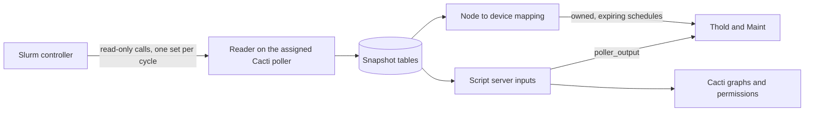

<!-- Source: README.md; SHA256: 16caa3e34c4d150a7fb1018f637e200a7580330f033b485047d8413bce09abba -->

<!-- translations:start -->
[English](../../../README.md) | [简体中文](README.md) | [हिन्दी](../hi-IN/README.md) | [Español (España)](../es-ES/README.md) | [Español (Latinoamérica)](../es-419/README.md) | [العربية (السعودية)](../ar-SA/README.md) | [Afrikaans](../af-ZA/README.md) | [አማርኛ](../am-ET/README.md) | [العربية (مصر)](../ar-EG/README.md) | [العربية (المغرب)](../ar-MA/README.md) | [বাংলা](../bn-BD/README.md) | [Bosanski](../bs-BA/README.md) | [Deutsch](../de-DE/README.md) | [فارسی](../fa-IR/README.md) | [Filipino](../fil-PH/README.md) | [Français](../fr-FR/README.md) | [Français (Maroc)](../fr-MA/README.md) | [Français (Sénégal)](../fr-SN/README.md) | [Hausa](../ha-NG/README.md) | [עברית](../he-IL/README.md) | [Hrvatski](../hr-HR/README.md) | [Bahasa Indonesia](../id-ID/README.md) | [Igbo](../ig-NG/README.md) | [Italiano](../it-IT/README.md) | [日本語](../ja-JP/README.md) | [한국어](../ko-KR/README.md) | [Malagasy](../mg-MG/README.md) | [मराठी](../mr-IN/README.md) | [Bahasa Melayu](../ms-MY/README.md) | [Nederlands](../nl-NL/README.md) | [Polski](../pl-PL/README.md) | [Português (Brasil)](../pt-BR/README.md) | [Русский](../ru-RU/README.md) | [Kinyarwanda](../rw-RW/README.md) | [Soomaali](../so-SO/README.md) | [Српски](../sr-RS/README.md) | [Svenska](../sv-SE/README.md) | [Kiswahili](../sw-KE/README.md) | [தமிழ்](../ta-IN/README.md) | [తెలుగు](../te-IN/README.md) | [ไทย](../th-TH/README.md) | [Türkçe](../tr-TR/README.md) | [Українська](../uk-UA/README.md) | [اردو](../ur-PK/README.md) | [Tiếng Việt](../vi-VN/README.md) | [isiXhosa](../xh-ZA/README.md) | [Yorùbá](../yo-NG/README.md) | [繁體中文](../zh-TW/README.md) | [isiZulu](../zu-ZA/README.md)
<!-- translations:end -->

<a id="plugin_hpcsched"></a>
# plugin_hpcsched

这是一个 Cacti 1.2 插件，将 HPC 批处理调度器的状态与 Cacti 已监控的设备一起绘图：队列深度、等待和运行中的任务、任务等待原因、节点状态以及分区利用率。Slurm 是第一个后端。Thold 可对生成的数据源告警，Maint 则可由已排空节点和维护预留驱动。

> **状态：开发中，尚未发布。** 里程碑 2（基础）已合并到 `main`，此分支添加里程碑 3（集群图表和等待原因）。代码通过 Cacti 插件 API 安装、升级和卸载，并拒绝 PHP 8.2 以下版本。它维护 Slurm 集群注册表，每个集群分配给一个 Cacti 采集器。主采集器上的后台读取器在每个间隔为每个集群采集一个快照，方式是使用 `--json` 运行 `squeue`、`scontrol` 和 `sshare`，或通过 HTTPS 读取 `slurmrestd`，然后按状态和等待原因保存任务计数、节点状态、分区、预留、公平份额用量及其时效性。插件提供 Cacti 模板，经管理员确认后为每个集群创建或映射一个 Cacti 设备，绘制集群及各分区的任务状态、等待原因类别、节点状态、CPU 和利用率，以及快照年龄。只读概览页显示各集群计数及其时效性，并提供每个集群的等待原因视图；仅管理员可访问的健康状态页显示每次采集的返回结果及模板安装状态。所有页面和操作遵循 Cacti 设备权限。数据源可供 Thold 告警，但尚未测试与 Thold 或 Maint 的集成；这是里程碑 4 及之后的工作。测试套件覆盖合成 Slurm 命令和 `slurmrestd` 响应，CI 还会测试下文所述的容器内真实六节点 Slurm 集群。读取器尚未针对生产集群运行。操作员说明之后的 README 内容描述的是设计，而非已交付行为。

这是独立项目，不隶属于 Cacti 项目。

<a id="access-roles"></a>
## 访问角色

| 权限域 | 访问权限 |
| --- | --- |
| HPC Scheduler View | 现有监控页面。 |
| HPC Scheduler Operator | 监控、运维页面以及个人排查确认。 |
| HPC Scheduler Admin | 操作员访问权限及现有配置和管理操作。 |

复制升级文件后，以管理员身份打开插件页面，注册新权限域。在**配置 > 用户**或用户组中明确授予 Operator 权限域。升级保留现有 View 和 Admin 权限域的 ID 及授权。每次请求时，Admin 继承 Operator 访问权限，Operator 继承 View 访问权限；这不会向用户或组添加持久化授权。插件设置除需要 Cacti 的设置权限外，还需要 HPC Scheduler Admin 权限。

Cacti 设备权限仍限制每位用户可访问的行和操作；没有设备的集群会列在管理页面上，所有拥有插件权限域的用户都能看到，但不会出现在运维页面中，运维页面只列出已映射到设备的集群。凭据、配置、映射、删除和其他管理更改仍在管理页面中执行。确认记录仅在当前用户会话中有效，最多一小时，并且仅在同一观测结果仍然新鲜时有效。新出现或更改的观测结果会使确认失效。确认绝不会将失败的测量标记为健康，也不会抑制告警。

<a id="operator-notes-for-milestone-2"></a>
## 里程碑 2 操作员说明

**最小权限。** 插件只读取。请使用专门的 Slurm 用户，不授予管理员或操作员角色（在 `sacctmgr` 中设置 `AdminLevel=None`）。如果 `slurm.conf` 设置了 `PrivateData=jobs`（或 `nodes`、`reservations`、`usage`），该用户只能看到自己的记录，因此计数不完整，插件无法检测这一情况。解除此限制需要操作员或管理员级别，这同时允许更改；需由站点自行权衡。对于客户端命令，Cacti 采集器用户需要 Slurm 客户端二进制文件和可连接控制器的 `slurm.conf`；二进制文件绝对路径在“配置 > 设置 > HPC Scheduler”中设置。对于 `slurmrestd`，URL 必须使用 `https://`，只有环回地址允许 `http://`。插件验证 TLS 证书，不跟随重定向。“配置 > 设置 > HPC Scheduler”中的可选 slurmrestd 主机列表可限制集群指定的主机和端口。

**远程采集器。** 此版本仅在 Cacti 主采集器上采集。分配给远程数据采集器的集群不会被采集：远端读取器拒绝执行并记录原因，健康状态页面标出该集群。远程采集属于第 3 阶段。

**内存。** 每次采集一次解码一个调度器响应，需要约响应大小 12 倍的 PHP 内存（对形状类似 Slurm 的任务记录，实测约 10 倍，再加响应文本本身）。运行时将 PHP 内存上限提高到“采集内存”设置值（默认 1024 MiB），并允许最大 (采集内存 - 64) / 12 MiB 的响应，默认 80 MiB；即使“最大响应大小”设置得更高，也使用此限制，并在健康状态页警告。更大的响应会使对应部分因过大而失败；仍然耗尽内存的运行也会记为失败。大型集群可能需要同时提高两个设置；尚未测量 100,000 条真实任务记录的情况。

**令牌文件。** `slurmrestd` 集群指定令牌文件；令牌本身绝不存入数据库、显示在页面上或写入日志。文件必须位于“配置 > 设置 > HPC Scheduler”指定的令牌文件目录之一，路径不能经过符号链接，必须是属于采集器用户且仅该用户可写的普通文件。文件包含一行：令牌本身，或 `scontrol token` 输出的 `SLURM_JWT=<token>`。如果未设置令牌目录，任何集群都不能使用 `slurmrestd`。这两个设置位于 Cacti 设置页，仅有插件 Admin 权限域无法更改；请将每个令牌目录限制为仅 root 和采集器用户可写。组或其他用户可读的文件仍会被使用，但健康状态页会警告。令牌在配置的警告时间内过期时，健康状态页也会警告。

轮换令牌时，为避免读取器看到不完整文件，请在旧文件旁写入新令牌，再重命名到目标位置：

```sh
dir=/etc/cacti/hpcsched
tmp=$(mktemp "$dir/.token.XXXXXX")
scontrol token username=cactiread lifespan=2592000 > "$tmp"
chown cacti:cacti "$tmp"
chmod 0600 "$tmp"
mv -f "$tmp" "$dir/cluster1.token"
```

下次采集会读取新文件。使用 `scontrol token` 生成令牌需要 Slurm 管理员权限；请在允许的位置运行，再将文件复制到采集器。

<a id="operator-notes-for-milestone-3"></a>
## 里程碑 3 操作员说明

**模板。** 安装和升级会导入 HPC Scheduler 设备、数据和图表模板，并将分区数据查询复制到 Cacti 的 `resource/script_server/` 目录。如果安装插件的用户无法写入该目录、目录中已有非插件创建的同名不同文件，或该名称是符号链接，导入会停止，保留原文件，健康状态页说明处理方法；可在健康状态页使用“安装模板”重试。手动复制的相同文件会被使用，但所有权仍归您。卸载仅在查询文件由插件写入且未修改时删除该文件，并保留模板、设备和图表。

**集群设备。** “HPC 集群 > 设备”在创建前显示将添加的内容（图表、数据源、RRD 文件以及每次采集的脚本服务器调用数）。“创建设备”使用保留的 `.invalid` 域主机名并关闭可用性检查；“映射设备”则将图表附加到现有设备，不改变其设置。每个集群图表和分区图表都有独立数据源：集群六个，每分区五个；每次采集对每个集群数据源调用脚本服务器一次，对分区的每个值（32 个）调用一次。之后添加的分区在读取器发现时建立索引，可在 Cacti 的“新建图表”页创建图表；移除的分区停止采集但保留图表。删除设备会取消集群映射并保留集群。

**图表统计内容。** 等待任务不包括被保留任务，后者有独立序列。等待中的任务数组按剩余任务数计数。属于多个分区的任务或节点在集群图表中计一次，在每个分区中各计一次，因此分区图表之和不一定等于集群图表。等待原因分为十一个类别（[ADR 0011](../../decisions/0011-pending-reason-families-and-counting.md)）；等待原因视图列出原始原因，包括归入“其他”的原因。每个任务仅报告调度器最近检查的原因。利用率的分母包含已排空、已停止和其他不可用节点。过期或失败数据为 `U`，绝不是零；`age` 始终为数值。

**告警。** Thold 可对这些任意数据源告警；Thold 持续时间应至少为一个采集间隔，并对 `age` 设置告警以检测停止的读取器。端到端 Thold 检查属于里程碑 4。

**针对真实 Slurm 输出测试。** CI 在容器中启动六节点 Slurm 集群（每次更改使用 26.05.5；向 `main` 推送、每周及按需运行时从源码构建 25.11.8），检查插件解析出的节点状态、维护预留、等待原因和任务数组，然后使用插件自身的命令及 `slurmrestd` 传输方式采集该集群。更早版本仅由合成测试数据覆盖。读取器仍未在生产集群上运行。

**权限。** 在每个插件页面中，关联到设备的集群仅向 Cacti 授权访问该设备的用户显示、导出或允许更改；映射设备还需要目标设备权限。无设备的集群对拥有插件权限域的所有用户可见。插件禁用期间设备被删除、但集群仍保留映射时，只有 HPC Scheduler Admin 用户可见，并可为其创建或映射设备。图表访问由 Cacti 自身控制。

<a id="why"></a>
## 原因

使用 Cacti 的操作员已经为计算节点绘图，但缺少调度器视角，留下两个缺口：

- **无法解释“任务为何不启动”。** Slurm 为每个等待任务记录原因。满队列旁的空闲节点图表无法说明原因是优先级、资源限制、保留、依赖关系还是已排空节点。
- **调度器状态与告警脱节。** Thold 对管理员已排空的设备告警，管理员需要手动创建 Maint 计划。

插件为每个集群采集一个缓存快照，将其发布为普通 Cacti 数据源和图表，将调度器节点映射到现有 Cacti 设备，并可把已排空节点和维护预留加入 Maint。它复用 Cacti 权限、远程数据采集器、Thold 和 Maint，对调度器只读。

<a id="planned-scope"></a>
## 计划范围

| 阶段 | 范围 | 里程碑 |
|---|---|---|
| 0，研究 | Slurm 版本矩阵、上游行为确认、控制器负载、节点命名测试数据 | [M1](https://github.com/somethingwithproof/plugin_hpcsched/milestone/1) |
| 1，集群图表 | 队列深度、等待和运行任务、等待原因、节点状态、分区利用率、Thold 告警、健康状态页面、发布 | [M2](https://github.com/somethingwithproof/plugin_hpcsched/milestone/2)、[M3](https://github.com/somethingwithproof/plugin_hpcsched/milestone/3)、[M4](https://github.com/somethingwithproof/plugin_hpcsched/milestone/4) |
| 2，节点和维护 | 节点到设备映射、逐节点状态、已排空节点和维护预留的自动 Maint 窗口 | [M5](https://github.com/somethingwithproof/plugin_hpcsched/milestone/5) |
| 3，记账 | 公平份额用量、有界记账统计、远程数据采集器 | [M6](https://github.com/somethingwithproof/plugin_hpcsched/milestone/6) |

范围之外：任何调度器写入路径（提交、取消、保留、排空、恢复）、插件自有告警引擎、报表或费用分摊引擎，以及按用户或任务建立序列。PBS Pro、OpenPBS 和 LSF 后端仍属研究。

<a id="compatibility-targets"></a>
## 兼容性目标

| 组件 | 目标 |
|---|---|
| Cacti | 1.2.31 或更高版本，无需核心补丁 |
| PHP | 8.2 或更高版本；`setup.php` 在 8.0 中仍可解析，以便对不受支持的运行时明确拒绝，而不是损坏 Cacti 界面 |
| Slurm | 25.05、25.11 和 26.05，即最近三个版本（[ADR 0013](../../decisions/0013-three-latest-slurm-releases.md)）；25.11 和 26.05 针对运行中的集群测试，25.05 仅用测试数据。默认传输方式为客户端命令（[ADR 0012](../../decisions/0012-client-commands-default-transport.md)），使用数据解析器设置：默认 v0.0.43（SchedMD 将在 27.05 移除），或在支持的版本上使用 v0.0.44、v0.0.45。slurmrestd 集群会发现守护进程提供的最新解析器 |
| Thold、Maint | 无需修改 Thold；Maint 集成是一项需获得 Maint 维护者同意的提案 |

<a id="design"></a>
## 设计

- [docs/PLAN.md](../../PLAN.md) 是完整计划：架构、依赖的上游事实（含来源和明确的未验证假设清单）、节点映射、状态模型、安全边界、性能计算、测试和风险。
- [docs/decisions/](../../decisions) 保存架构决策记录。
- [docs/REQUIREMENTS.md](../../REQUIREMENTS.md) 将每个需求 ID 映射到对应议题。



<a id="how-work-is-tracked"></a>
## 工作跟踪方式

- **里程碑**遵循计划。每个里程碑都有一个史诗议题，列出子议题和完成证据。
- **议题**按标签分类：`type: requirement`、`type: research`、`type: decision`、`type: epic`。需求议题包含带编号的可测试需求（`REQ-AREA-NNN`）和验收标准。
- **标签**还包括 `area:`、`phase:`、`priority:` 和 `status:`。参阅 [CONTRIBUTING.md](../../../CONTRIBUTING.md#labels)。
- [项目看板](https://github.com/users/somethingwithproof/projects/10) 显示各里程碑的全部议题。

<a id="contributing"></a>
## 贡献

请阅读 [CONTRIBUTING.md](../../../CONTRIBUTING.md)。提交需要 DCO 签署。设计讨论在议题中进行；未决决策带有 `type: decision` 标签。

<a id="security"></a>
## 安全

请私下报告漏洞；参阅 [SECURITY.md](../../../SECURITY.md)。

<a id="license"></a>
## 许可证

GNU 通用公共许可证 v2.0，与 Cacti 及其插件相同。参阅 [LICENSE](../../../LICENSE)。
