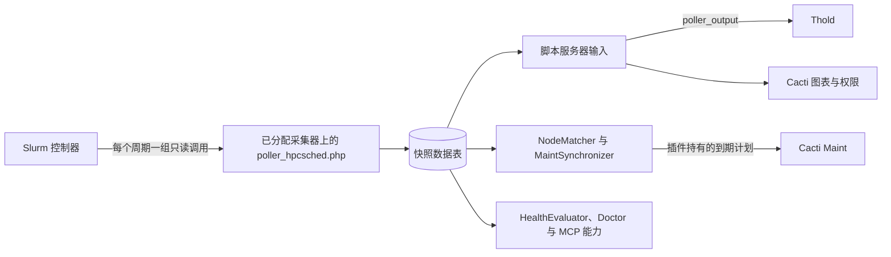

<!-- Source: README.md; SHA256: 938114d41dbd516f9dfcd94619c4fc73ef56b4da1dd693010588a93cce250534 -->

<!-- translations:start -->
[English](../../../README.md) | [简体中文](README.md) | [हिन्दी](../hi-IN/README.md) | [Español (España)](../es-ES/README.md) | [Español (Latinoamérica)](../es-419/README.md) | [العربية (السعودية)](../ar-SA/README.md) | [Afrikaans](../af-ZA/README.md) | [አማርኛ](../am-ET/README.md) | [العربية (مصر)](../ar-EG/README.md) | [العربية (المغرب)](../ar-MA/README.md) | [বাংলা](../bn-BD/README.md) | [Bosanski](../bs-BA/README.md) | [Deutsch](../de-DE/README.md) | [فارسی](../fa-IR/README.md) | [Filipino](../fil-PH/README.md) | [Français](../fr-FR/README.md) | [Français (Maroc)](../fr-MA/README.md) | [Français (Sénégal)](../fr-SN/README.md) | [Hausa](../ha-NG/README.md) | [עברית](../he-IL/README.md) | [Hrvatski](../hr-HR/README.md) | [Bahasa Indonesia](../id-ID/README.md) | [Igbo](../ig-NG/README.md) | [Italiano](../it-IT/README.md) | [日本語](../ja-JP/README.md) | [한국어](../ko-KR/README.md) | [Malagasy](../mg-MG/README.md) | [मराठी](../mr-IN/README.md) | [Bahasa Melayu](../ms-MY/README.md) | [Nederlands](../nl-NL/README.md) | [Polski](../pl-PL/README.md) | [Português (Brasil)](../pt-BR/README.md) | [Русский](../ru-RU/README.md) | [Kinyarwanda](../rw-RW/README.md) | [Soomaali](../so-SO/README.md) | [Српски](../sr-RS/README.md) | [Svenska](../sv-SE/README.md) | [Kiswahili](../sw-KE/README.md) | [தமிழ்](../ta-IN/README.md) | [తెలుగు](../te-IN/README.md) | [ไทย](../th-TH/README.md) | [Türkçe](../tr-TR/README.md) | [Українська](../uk-UA/README.md) | [اردو](../ur-PK/README.md) | [Tiếng Việt](../vi-VN/README.md) | [isiXhosa](../xh-ZA/README.md) | [Yorùbá](../yo-NG/README.md) | [繁體中文](../zh-TW/README.md) | [isiZulu](../zu-ZA/README.md)
<!-- translations:end -->

# plugin_hpcsched

这是一个 Cacti 1.2 插件（`hpcsched`，版本 `0.1.0-dev`），用于将 HPC 批处理调度器的状态与 Cacti 已监控的设备一同绘图：队列深度、等待与运行中的作业、作业等待原因、节点状态、分区利用率以及账户级公平份额使用情况。Slurm 是已实现的后端。Thold 可针对生成的数据源发出告警，而可选启用的 Maint 同步器则可根据已排空（drained）、宕机（down）以及处于维护预留状态的 Slurm 计算节点来驱动 Cacti Maint 维护窗口。

> **状态：开发中，尚未发布。** 本分支实现了插件基础框架、集群和分区图表、等待原因分类、Slurm 计算节点与 Cacti 设备的匹配、可选启用的 Cacti Maint 窗口同步、账户级公平份额汇总、远程数据采集器执行与复制、配置即代码（CasC）及运维 CLI，以及 Cacti 生态挂钩（CasC、Doctor 和 MCP / Abilities API v2）。测试套件覆盖合成 Slurm 命令与 `slurmrestd` 响应，CI 也在容器中运行并测试了一个真实的六节点 Slurm 集群。读取器尚未在生产集群上运行过，端到端 Thold 回放测试也尚未加入 CI。

这是一个独立项目，与 Cacti 项目没有隶属关系。

## 已实现功能

- **生命周期与数据库模式（v3）**：支持安装、幂等升级、卸载（默认保留插件表），最低要求 PHP 8.2，同时保证入口文件可在 PHP 8.0 上解析。v3 模式在集群、运行记录、分段、作业计数、节点计数、节点、分区、预留和份额表之外，新增了 `plugin_hpcsched_node_map` 和 `plugin_hpcsched_maint_link`。
- **主采集器与远程采集器上的只读 Slurm 采集**：`poller_bottom` 会在每个采集器（`poller_id`）上为分配给它的已启用集群在后台启动 `poller_hpcsched.php --cluster=N`。每次运行通过客户端命令（带 `--json` 的 `squeue`、`scontrol`、`sshare`）或经由 HTTPS 的 `slurmrestd`（允许回环地址 HTTP 并给出健康警告）为每个集群采集一份缓存快照。`INFO` 声明了 `remote_collect:1, remote_poller:1`，`replicate_out` 会将不含机密的 `plugin_hpcsched_cluster` 定义复制到远程采集器（`poller_id >= 2`）；令牌文件内容绝不会被读取用于复制或被同步。
- **Cacti 模板与集群图表**：附带设备、数据和图表模板（`templates/hpcsched-templates.xml`）以及分区脚本服务器数据查询（`scripts/ss_hpcsched_cluster.php`、`scripts/ss_hpcsched_partitions.php`）。经管理员确认后，为每个集群创建或映射一个 Cacti 设备，生成按状态统计的作业、按原因家族统计的等待作业、按状态统计的节点、CPU、利用率（集群级及各分区级）以及快照年龄图表。
- **Slurm 节点到设备的匹配与 Cacti Maint 同步**：四层线性时间匹配器（`NodeMatcher`）将 Slurm 计算节点映射到现有 Cacti `host` 记录（精确主机名、精确地址、精确描述/别名，或非 IP 名称的首个 DNS 标签），对于多重匹配或重复认领同一设备的情况会标记为 `ambiguous` 而非猜测。`HostList::expand()` 可展开 Slurm 预留主机列表（最多 10,000 个节点）。`MaintSynchronizer` 会为处于 `DRAIN`、`DRAINING`、`DOWN` 或活动 `MAINT`/`MAINTENANCE` 预留中的已映射节点创建、续期和移除由插件持有并在 `plugin_hpcsched_maint_link` 中跟踪的一次性 Cacti Maint 计划，且不会修改管理员手动创建的 Maint 计划。
- **账户级公平份额汇总**：启用 `collect_shares` 时，将 Slurm 账户关联行采集到 `plugin_hpcsched_share` 中（按 [ADR 0010](../../decisions/0010-bound-series-cardinality.md) 丢弃用户行）。`ShareSummary` 和 `ShareRepository` 计算账户/分区数量、原始与有效使用量总计、最小/最大/平均公平份额因子以及排名靠前的账户；账户数量通过 `hpcsched-get-queue-summary` 暴露。
- **CasC 与运维 CLI（`cli/hpcsched.php`）**：支持 YAML/XML 配置导出、校验、空运行差异规划（dry-run diff）、带确认哈希的应用、结构化健康状态输出以及可选启用的 Maint 同步（`sync-maint --dry-run` / `--apply`）。
- **生态挂钩（`setup.php`）**：`casc_register_providers`、`doctor_register_checks` 和 `abilities_register`。

## 访问角色

| 权限域 | 访问权限 |
| --- | --- |
| HPC Scheduler View | 只读集群概览与等待原因（`hpcsched.php`）。 |
| HPC Scheduler Operator | 包含 View 权限，外加操作页面（`hpcsched_operator.php`）和个人分诊确认。 |
| HPC Scheduler Admin | 包含 Operator 权限，外加集群管理（`hpcsched_clusters.php`）和健康状态页面（`hpcsched_health.php`）。 |

复制升级文件后，请以管理员身份打开 Plugins 页面以注册新的权限域和挂钩。在 **Configuration > Users** 或用户组中显式分配 Operator 权限域。升级会保留现有的 View 和 Admin 权限域 ID 与授权。每次请求时 Admin 访问权限会继承 Operator 访问权限，Operator 访问权限会继承 View 访问权限；这不会向用户或用户组写入额外的持久化授权。除 Cacti 的 Settings 权限外，修改插件设置还需要 HPC Scheduler Admin 访问权限。

Cacti 设备权限会限制每位用户可见的行与可执行的操作。已映射到某台 Cacti 设备的集群仅对 Cacti 允许访问该设备的用户显示、导出或修改；映射设备时同样需要目标设备的权限。未映射设备的集群会列在具有插件权限域的用户的管理页面上，但不会出现在仅列出已映射设备集群的操作员视图中。在插件禁用期间其映射设备被删除的集群，仅对具有 HPC Scheduler Admin 访问权限的用户可见。确认标记仅在当前用户会话内有效，最长持续一小时，且仅在同一观测结果仍保持新鲜时有效。新的或发生变化的观测结果会使其失效。确认标记绝不会将失败的测量标为健康或抑制告警。

## 操作员说明

### 安全性、最小权限与令牌文件

插件只执行读取操作。请为其分配一个不带管理员或操作员角色的专用 Slurm 用户（在 `sacctmgr` 中设为 `AdminLevel=None`）。如果在 `slurm.conf` 中设置了 `PrivateData=jobs`（或 `nodes`、`reservations`、`usage`），该用户将只能看到自己的记录，从而导致计数不完整且插件无法检测到这一点。为该账户解除此限制需要赋予操作员或管理员级别，而这同时会允许变更操作；这一权衡由站点自行决定。

对于客户端命令，Cacti 采集器用户需要 Slurm 客户端二进制文件（`squeue`、`scontrol`，以及可选的 `sshare`）和能够连接控制器的 `slurm.conf`；二进制文件路径在 **Configuration > Settings > HPC Scheduler** 下以绝对路径配置。

对于 `slurmrestd`，URL 必须为 `https://`，或仅在回环地址上使用 `http://`。系统会校验证书且不跟随重定向。**Configuration > Settings > HPC Scheduler** 下的可选 `slurmrestd` 主机列表可限制集群能够指定的主机和端口。

使用 `slurmrestd` 的集群需指定一个令牌文件；令牌本身绝不会存入数据库、显示在页面上、由 CasC 导出或写入日志。该文件必须位于 **Configuration > Settings > HPC Scheduler** 下配置的令牌文件目录之一内，路径不得经过符号链接，必须是由采集器用户拥有且仅该用户可写的常规文件，文件内容为单行：令牌本身或 `scontrol token` 输出的 `SLURM_JWT=<token>` 格式。若未设置任何令牌目录，则没有任何集群可以使用 `slurmrestd`。请确保每个令牌目录仅对 root 和采集器用户可写。如果文件对所属组或其他用户可读，插件仍会使用它，并在健康页面发出警告；当令牌将在配置的预警窗口内过期时，健康页面也会发出警告。

原子轮换令牌的方法如下：

```sh
dir=/etc/cacti/hpcsched
tmp=$(mktemp "$dir/.token.XXXXXX")
scontrol token username=cactiread lifespan=2592000 > "$tmp"
chown cacti:cacti "$tmp"
chmod 0600 "$tmp"
mv -f "$tmp" "$dir/cluster1.token"
```

下一次采集将读取新文件。使用 `scontrol token` 生成令牌需要 Slurm 管理员权限；请在允许的环境运行该命令并将文件复制到采集器上。

### 远程数据采集器

`INFO` 声明了 `remote_collect:1, remote_poller:1`。`hpcsched_poller_bottom()` 会在每个采集器上针对分配给该 `poller_id` 的已启用集群启动 `poller_hpcsched.php`，`hpcsched_replicate_out()` 会将不含机密的 `plugin_hpcsched_cluster` 行复制到远程采集器（`poller_id >= 2`）。令牌文件和 Slurm 客户端二进制文件必须本地存在于所分配的远程采集器上；令牌内容绝不会被复制。

### 内存限制

每次采集运行一次解码一个调度器响应，这大约需要响应大小 12 倍的 PHP 内存（针对 Slurm 结构的作业记录实测约为 10 倍，再加上文本本身）。读取器会将其 PHP 内存限制提高到 Collection Memory 设置值（默认 1024 MiB），并允许最大 `(Collection Memory - 64) / 12` MiB（默认 80 MiB）的响应，即使 Maximum Answer Size 设置得更高亦如此；当 Maximum Answer Size 超过该适配上限时，健康页面会发出警告。更大的响应会使对应分段因过大而失败，而仍耗尽内存的运行会通过关闭处理程序记录内存失败并释放其租约与进程槽位。大型集群可能需要同时调高这两项设置；尚未对 100,000 条真实作业记录进行实测。

### 模板、集群设备与图表计数

安装和升级时会导入 HPC Scheduler 设备、数据和图表模板，并将分区数据查询复制到 Cacti 的 `resource/script_server/` 目录。如果该目录不可写、已存在同名但内容不同的文件，或者目标位置是符号链接，导入会停止，保持原文件不变，并在健康页面报告该情况，管理员可在健康页面点击 **Install Templates** 重试。卸载时仅当该查询文件由本插件写入且未被修改时才会将其移除，而模板、设备和图表均会保留。

**HPC Clusters > Device** 会在创建任何对象前预览每次轮询的图表、数据源、RRD 文件和脚本服务器调用数量。**Create Device** 会创建一个主机名位于保留域名 `.invalid` 中且不启用可用性检查的设备；**Map Device** 则将图表关联到现有设备而不修改其设置。每个集群图表和分区图表都有各自的数据源：集群有 6 个，每个分区有 5 个。后续新增的分区会在读取器检测到变化时自动重新索引；被移除的分区会停止轮询并保留其现有图表。删除设备会解除集群映射（并清除匹配的 `plugin_hpcsched_node_map` 行），同时保留集群记录。

等待中的作业（Pending）不包含被挂起（held）的作业，后者有自己的数据序列。处于等待状态的作业数组按其剩余任务数计数。位于多个分区中的作业或节点在集群图表中只计一次，在每个所属分区中各计一次，因此各分区之和不一定等于集群总计。等待原因被归入十一个家族（参见 [ADR 0011](../../decisions/0011-pending-reason-families-and-counting.md)）；等待原因视图会列出原始原因，包括归在 `Other` 中的原因。利用率的分母包含已排空、宕机以及其他不可用节点。过期或失败的数据会报告为 `U`，绝不报告为零；`age` 保持为数值。

如需配置告警，请在任意集群或分区数据源上配置 Thold，持续时间至少设为一个采集间隔，并对 `age` 设置告警以检测读取器停止运行。

## CLI 与生态挂钩

### 读取器入口点

`hpcsched_poller_bottom()` 会自动启动 `poller_hpcsched.php`；也可以在集群所分配的采集器上手动运行：

```sh
php /path/to/cacti/plugins/hpcsched/poller_hpcsched.php --cluster=N [--force] [--debug]
```

`--force` 允许在插件处于禁用状态时运行，用于命令行诊断。

### 配置即代码、健康状态与 Maint 同步 CLI

```sh
php /path/to/cacti/plugins/hpcsched/cli/hpcsched.php export [--format=yaml|xml] [--file=PATH]
php /path/to/cacti/plugins/hpcsched/cli/hpcsched.php validate --file=PATH [--format=yaml|xml]
php /path/to/cacti/plugins/hpcsched/cli/hpcsched.php plan --file=PATH [--format=yaml|xml]
php /path/to/cacti/plugins/hpcsched/cli/hpcsched.php apply --file=PATH --confirm=PLAN_HASH [--format=yaml|xml]
php /path/to/cacti/plugins/hpcsched/cli/hpcsched.php health [--format=text|json]
php /path/to/cacti/plugins/hpcsched/cli/hpcsched.php sync-maint [--dry-run | --apply] [--cluster=ID] [--format=text|json]
```

- `export` 以 `0600` 权限创建新文件（或输出到标准输出），并将配置中的 `token_file` 路径替换为 `[REDACTED]`。`plan` 和 `apply` 拒绝内联 `jwt`、`secret` 和 `password` 字段，并在传入 `[REDACTED]` 时保留现有的本地 `token_file` 路径。`apply` 需要精确传入 `plan` 输出的 `--confirm=PLAN_HASH`。
- `health` 评估数据库模式是否为最新、集群数据新鲜度、运行结果、Maint 可用性以及各项警告，过程中不连接调度器也不读取令牌文件。
- `sync-maint` 默认执行 `--dry-run`，用于预览或应用针对处于 `DRAIN`、`DRAINING`、`DOWN` 或活动 `MAINT`/`MAINTENANCE` 预留中的已映射 Slurm 节点的 Cacti Maint 计划（默认排空/宕机视野 3600 秒，续期间隔 600 秒）。若缺少 `plugin_maint_schedules` 和 `plugin_maint_hosts`，则会拒绝执行 `--apply`，且仅更新或移除记录在 `plugin_hpcsched_maint_link` 中的计划。

### 生态挂钩

当相应的 Cacti 插件或宿主集成存在时，`setup.php` 会注册以下挂钩：

- `casc_register_providers`：提供带机密脱敏的 `hpcsched` 配置（`yaml` 和 `xml`，schema v1）导出、校验、规划和确认应用功能。
- `doctor_register_checks`：提供四项只读诊断检查（`hpcsched.schema`、`hpcsched.cluster_freshness`、`hpcsched.token_health`、`hpcsched.maint_sync`）。
- `abilities_register`：在 `hpcsched` 分类下注册三项只读、非破坏性且幂等的能力，受 HPC Scheduler View 权限域（集群汇总另受设备权限）限制：`hpcsched-list-clusters`、`hpcsched-get-queue-summary` 和 `hpcsched-get-health`。

## 为什么做这个插件

运行 Cacti 的运维人员已经在为计算节点绘制图表，但这些图表中缺少调度器视角，留下了两处空白：

- **不知道“作业为何没有启动”。** Slurm 会为每个等待中的作业记录原因。满载的队列与空闲节点图表并列时，无法直接看出原因在于优先级、资源限制、挂起、依赖关系还是节点已排空。
- **调度器状态与告警之间缺乏联动。** Thold 会对管理员已经排空的设备继续告警，管理员也不得不手动创建 Maint 维护计划。

本插件为每个集群采集一份缓存快照，将其发布为常规的 Cacti 数据源和图表，将调度器节点映射到现有的 Cacti 设备，并为已排空、宕机和处于维护预留的节点同步由插件持有并会到期的 Maint 窗口。它复用了 Cacti 的权限体系、远程数据采集器、Thold 和 Maint，并对调度器保持严格只读。

## 范围与边界

不在范围内：任何调度器写入路径（提交、取消、挂起、排空、恢复）、插件自建告警引擎、报表或计费引擎，以及按用户或按作业的数据序列。PBS Pro、OpenPBS 和 LSF 后端目前仅处于研究阶段。

## 需求与兼容性

| 组件 | 目标 |
|---|---|
| Cacti | 1.2.31 或更高版本（`compat = 1.2.31`），无需核心补丁 |
| PHP | 8.2 或更高版本；入口文件在 8.0 上保持可解析，并在 8.1 上拒绝激活，以便不受支持的运行时收到明确的拒绝提示而非损坏 Cacti 界面 |
| Slurm | 25.05、25.11 和 26.05（[ADR 0013](../../decisions/0013-three-latest-slurm-releases.md)）；每次变更都会在 CI 中针对六节点容器集群测试 26.05.5，在 `main` 分支、每周及按需测试 25.11.8，25.05 仅针对测试夹具测试。客户端命令默认使用数据解析器 `v0.0.43`（可选择 `v0.0.44` 和 `v0.0.45`）；`slurmrestd` 集群会自动发现守护进程提供的最新解析器 |
| Thold、Maint | 无需修改 Thold；`sync-maint` 通过插件自有的关联表（`plugin_hpcsched_maint_link`）与 Cacti Maint 的 `plugin_maint_schedules` 和 `plugin_maint_hosts` 表集成 |

## 开发与测试

CI 工作流（`.github/workflows/plugin-ci-workflow.yml`）覆盖 PHP 8.2 至 8.5 搭配 Cacti `release/1.2.31` 和 `1.2.x`、PHP 8.0 入口语法检查、PHP 8.1 拒绝激活测试、PHPStan、gettext/翻译校验、REUSE 许可检查、工作流语法检查、集群设备流程与模板导出漂移检查，以及真实六节点 Slurm 容器集群测试（`slurm-live`）。

使用 Cacti 锁定的共享 Pest 插件测试工具（`CACTI_PEST_BIN`）和一次性 Cacti 数据库：

```sh
# Unit tests
"$CACTI_PEST_BIN" --configuration=phpunit.xml

# Lifecycle integration tests (disposable database only)
CACTI_PATH=/path/to/cacti HPCSCHED_TEST_DATABASE=disposable "$CACTI_PEST_BIN" --configuration=phpunit-integration.xml

# Static analysis (against Cacti 1.2.31)
CACTI_PATH=/path/to/cacti phpstan analyse -c phpstan.neon --no-progress

# Translation template, catalogs, and localized README checks
sh locales/build_gettext.sh --check
```

## 设计文档

- [docs/PLAN.md](../../PLAN.md) 是架构与设计方案：附带来源的上游事实、节点映射、状态模型、安全边界、性能测算、测试及风险。
- [docs/decisions/](../../decisions/) 存放架构决策记录（ADR）。
- [docs/REQUIREMENTS.md](../../REQUIREMENTS.md) 将每个需求 ID 映射到对应的 issue。



## 工作跟踪方式

- **里程碑（Milestones）** 对应设计方案中的里程碑。每个里程碑都有一个 epic issue，列出其子 issue 和退出证据。
- **Issues** 按标签分类：`type: requirement`、`type: research`、`type: decision`、`type: epic`。需求 issue 陈述带编号的可测试需求（`REQ-AREA-NNN`）和验收标准。
- **标签（Labels）** 还包括 `area:`、`phase:`、`priority:` 和 `status:`。参见 [CONTRIBUTING.md](../../../CONTRIBUTING.md#labels)。
- [项目看板](https://github.com/users/somethingwithproof/projects/10)展示了所有里程碑下的全部 issue。

## 参与贡献

请阅读 [CONTRIBUTING.md](../../../CONTRIBUTING.md)。提交需要附带 DCO 签署（`git commit -s`）。设计讨论在 issue 中进行；尚未定案的决策带有 `type: decision` 标签。

## 安全

请私下报告安全漏洞；参见 [SECURITY.md](../../../SECURITY.md)。

## 许可证

GNU General Public License v2.0，与 Cacti 及其插件采用相同的许可证。参见 [LICENSE](../../../LICENSE)。
