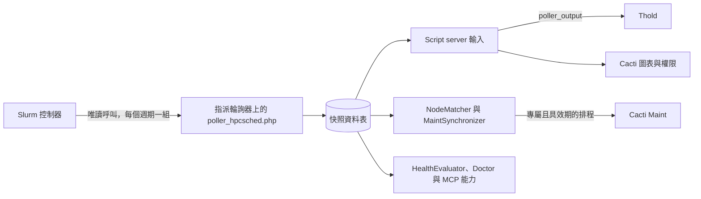

<!-- Source: README.md; SHA256: 938114d41dbd516f9dfcd94619c4fc73ef56b4da1dd693010588a93cce250534 -->

<!-- translations:start -->
[English](../../../README.md) | [简体中文](../zh-CN/README.md) | [हिन्दी](../hi-IN/README.md) | [Español (España)](../es-ES/README.md) | [Español (Latinoamérica)](../es-419/README.md) | [العربية (السعودية)](../ar-SA/README.md) | [Afrikaans](../af-ZA/README.md) | [አማርኛ](../am-ET/README.md) | [العربية (مصر)](../ar-EG/README.md) | [العربية (المغرب)](../ar-MA/README.md) | [বাংলা](../bn-BD/README.md) | [Bosanski](../bs-BA/README.md) | [Deutsch](../de-DE/README.md) | [فارسی](../fa-IR/README.md) | [Filipino](../fil-PH/README.md) | [Français](../fr-FR/README.md) | [Français (Maroc)](../fr-MA/README.md) | [Français (Sénégal)](../fr-SN/README.md) | [Hausa](../ha-NG/README.md) | [עברית](../he-IL/README.md) | [Hrvatski](../hr-HR/README.md) | [Bahasa Indonesia](../id-ID/README.md) | [Igbo](../ig-NG/README.md) | [Italiano](../it-IT/README.md) | [日本語](../ja-JP/README.md) | [한국어](../ko-KR/README.md) | [Malagasy](../mg-MG/README.md) | [मराठी](../mr-IN/README.md) | [Bahasa Melayu](../ms-MY/README.md) | [Nederlands](../nl-NL/README.md) | [Polski](../pl-PL/README.md) | [Português (Brasil)](../pt-BR/README.md) | [Русский](../ru-RU/README.md) | [Kinyarwanda](../rw-RW/README.md) | [Soomaali](../so-SO/README.md) | [Српски](../sr-RS/README.md) | [Svenska](../sv-SE/README.md) | [Kiswahili](../sw-KE/README.md) | [தமிழ்](../ta-IN/README.md) | [తెలుగు](../te-IN/README.md) | [ไทย](../th-TH/README.md) | [Türkçe](../tr-TR/README.md) | [Українська](../uk-UA/README.md) | [اردو](../ur-PK/README.md) | [Tiếng Việt](../vi-VN/README.md) | [isiXhosa](../xh-ZA/README.md) | [Yorùbá](../yo-NG/README.md) | [繁體中文](README.md) | [isiZulu](../zu-ZA/README.md)
<!-- translations:end -->

# plugin_hpcsched

一個 Cacti 1.2 外掛程式（`hpcsched`，版本 `0.1.0-dev`），可在 Cacti 已監控的裝置旁繪製 HPC 批次排程器的狀態圖表：佇列深度、待執行與執行中作業數、作業處於待執行狀態的原因、節點狀態、分區使用率，以及帳號層級的公平分享（fair-share）使用量。Slurm 為已實作的後端支援。Thold 可針對產生的資料來源發出警報，而選用的 Maint 同步器則會根據處於已排空（drained）、離線（down）及維護保留狀態的 Slurm 運算節點來驅動 Cacti Maint 維護視窗。

> **狀態：開發中，尚未發布正式版本。** 此分支實作了外掛基礎架構、叢集與分區圖表、待執行原因分類、Slurm 運算節點與 Cacti 裝置的對應、選用的 Cacti Maint 維護視窗同步、帳號層級的公平分享摘要、遠端資料收集器執行與複寫、組態即程式碼（CasC）與維運 CLI，以及 Cacti 生態系統掛鉤（CasC、Doctor 與 MCP / Abilities API v2）。測試套件涵蓋合成的 Slurm 指令與 `slurmrestd` 回應，且 CI 會在容器中測試一個運作中的六節點 Slurm 叢集。此讀取器尚未在正式營運叢集上執行過，且端對端的 Thold 重播測試目前尚未納入 CI。

這是一個獨立專案，與 Cacti 專案沒有任何隸屬關係。

## 已實作項目

- **生命週期與結構描述（v3）**：安裝、冪等升級、解除安裝（預設保留外掛資料表），以及 PHP 8.2 最低版本要求，同時讓進入點維持可於 PHP 8.0 上解析。結構描述 v3 在 cluster、run、section、job-count、node-count、node、partition、reservation 與 share 資料表之外，新增了 `plugin_hpcsched_node_map` 與 `plugin_hpcsched_maint_link`。
- **主輪詢器與遠端輪詢器上的唯讀 Slurm 收集**：`poller_bottom` 會在每個輪詢器（`poller_id`）的背景啟動 `poller_hpcsched.php --cluster=N`，以處理指派給它且已啟用的叢集。每次執行皆透過用戶端指令（搭配 `--json` 的 `squeue`、`scontrol`、`sshare`）或透過 HTTPS 連線 `slurmrestd`（允許回環位址上的 HTTP，但會顯示健康狀態警告），為每個叢集收集一份快取快照。`INFO` 宣告 `remote_collect:1, remote_poller:1`，且 `replicate_out` 會將非機密性的 `plugin_hpcsched_cluster` 定義複寫至遠端收集器（`poller_id >= 2`）；權杖（token）檔案內容永遠不會被讀取或複寫。
- **Cacti 範本與叢集圖表**：隨附裝置、資料與圖表範本（`templates/hpcsched-templates.xml`）及分區 script-server 資料查詢（`scripts/ss_hpcsched_cluster.php`、`scripts/ss_hpcsched_partitions.php`）。在管理員確認後，為每個叢集建立或對應一個 Cacti 裝置，並提供依狀態分類的作業、依原因類別分類的待執行作業、依狀態分類的節點、CPU、使用率（叢集及各分區）以及快照存在時間（age）等圖表。
- **Slurm 節點對應至裝置與 Cacti Maint 同步**：四層線性時間比對器（`NodeMatcher`）將 Slurm 運算節點對應至現有的 Cacti `host` 記錄（完全相符的主機名稱、完全相符的位址、完全相符的描述/別名，或非 IP 名稱的第一個 DNS 標籤），並將多重比對或重複佔用裝置的情況標記為 `ambiguous`，而非進行猜測。`HostList::expand()` 可展開 Slurm 保留主機清單（最多 10,000 個節點）。`MaintSynchronizer` 會針對已對應且處於 `DRAIN`、`DRAINING`、`DOWN` 或啟用中 `MAINT`/`MAINTENANCE` 保留狀態的節點，建立、續期與移除追蹤於 `plugin_hpcsched_maint_link` 中的外掛專屬一次性 Cacti Maint 排程，而不會修改管理員手動建立的 Maint 排程。
- **帳號層級的公平分享摘要**：啟用 `collect_shares` 時，會將 Slurm 帳號關聯資料列收集至 `plugin_hpcsched_share`（依 [ADR 0010](../../decisions/0010-bound-series-cardinality.md) 捨棄使用者資料列）。`ShareSummary` 與 `ShareRepository` 計算帳號/分區數量、原始與有效使用量總計、最小/最大/平均公平分享係數，以及排名居前的帳號；帳號數量會透過 `hpcsched-get-queue-summary` 公開。
- **CasC 與維運 CLI（`cli/hpcsched.php`）**：YAML/XML 組態匯出、驗證、試算（dry-run）差異規劃、需經確認的套用、結構化健康狀態輸出，以及選用的 Maint 同步（`sync-maint --dry-run` / `--apply`）。
- **生態系統掛鉤（`setup.php`）**：`casc_register_providers`、`doctor_register_checks` 與 `abilities_register`。

## 存取角色

| 權限領域 | 存取權限 |
| --- | --- |
| HPC Scheduler View | 唯讀的叢集總覽與待執行原因（`hpcsched.php`）。 |
| HPC Scheduler Operator | View 存取權限，外加操作頁面（`hpcsched_operator.php`）與個人分類確認標記。 |
| HPC Scheduler Admin | Operator 存取權限，外加叢集管理（`hpcsched_clusters.php`）與健康狀態頁面（`hpcsched_health.php`）。 |

複製升級檔案後，請以管理員身分開啟「Plugins（外掛程式）」頁面以註冊新的權限領域與掛鉤。請在 **Configuration > Users**（設定 > 使用者）或使用者群組下明確指派 Operator 權限領域。升級會保留現有的 View 與 Admin 權限領域 ID 及授權。在每次請求時，Admin 權限會繼承 Operator 權限，而 Operator 權限會繼承 View 權限；這不會在使用者或群組中新增已儲存的授權。外掛設定除了需要 Cacti 的 Settings（設定）權限外，還需要 HPC Scheduler Admin 存取權限。

Cacti 裝置權限會限制每位使用者可見的資料列與可執行的操作。已對應至 Cacti 裝置的叢集僅會對 Cacti 允許存取該裝置的使用者顯示、匯出及變更；對應裝置同樣需要目標裝置的權限。尚未關聯裝置的叢集會在管理頁面上列出給具備此外掛權限領域的使用者，但不會出現在操作人員檢視頁面中，因為該檢視僅列出已對應至裝置的叢集。若叢集所對應的裝置在外掛停用期間遭到刪除，該叢集僅會顯示給具備 HPC Scheduler Admin 存取權限的使用者。確認標記僅在目前使用者的工作階段中有效，最長不超過一小時，且僅在相同的觀測結果仍維持新鮮時有效。新的或已變更的觀測結果會使其失效。這些標記絕不會將失敗的量測標記為健康或抑制警報。

## 操作人員注意事項

### 安全性、最小權限與權杖檔案

此外掛僅執行讀取操作。請為其配置一個沒有管理員或操作人員角色的專用 Slurm 使用者（在 `sacctmgr` 中設定 `AdminLevel=None`）。若 `slurm.conf` 中設有 `PrivateData=jobs`（或 `nodes`、`reservations`、`usage`），該使用者只會看到自己的記錄，導致計數不完整且外掛無法偵測此情形。若要為該帳號解除該限制，則需要操作人員或管理員層級，而該層級亦允許進行修改；此權衡需由各站點自行決定。

針對用戶端指令，Cacti 輪詢器使用者需要 Slurm 用戶端二進位檔（`squeue`、`scontrol`，以及選用的 `sshare`）與可連線至控制器的 `slurm.conf`；二進位檔路徑為 **Configuration > Settings > HPC Scheduler** 下的絕對路徑設定。

針對 `slurmrestd`，URL 必須為 `https://`，或僅限於回環位址上的 `http://`。系統會驗證 TLS 憑證且不會跟隨重新導向。位於 **Configuration > Settings > HPC Scheduler** 下的選用 `slurmrestd` 主機清單可限制叢集能夠指定的主機與連接埠。

`slurmrestd` 叢集會指定一個權杖檔案；權杖本身永遠不會儲存於資料庫中、顯示在頁面上、透過 CasC 匯出，或寫入記錄檔。該檔案必須位於 **Configuration > Settings > HPC Scheduler** 下所設定的 Token File Directories 之一，不得透過符號連結（symbolic link）存取，且必須是由輪詢器使用者擁有並僅該使用者可寫入的一般檔案，內容為單行：權杖本身或 `scontrol token` 輸出的 `SLURM_JWT=<token>` 格式。若未設定任何權杖目錄，則沒有任何叢集可使用 `slurmrestd`。請確保每個權杖目錄僅限 root 與輪詢器使用者可寫入。群組或其他使用者可讀取的檔案仍會被使用，但健康狀態頁面會發出警告；當權杖將在設定的警告視窗內過期時，該頁面也會發出警告。

若要以原子方式輪替權杖：

```sh
dir=/etc/cacti/hpcsched
tmp=$(mktemp "$dir/.token.XXXXXX")
scontrol token username=cactiread lifespan=2592000 > "$tmp"
chown cacti:cacti "$tmp"
chmod 0600 "$tmp"
mv -f "$tmp" "$dir/cluster1.token"
```

下一次收集就會讀取新檔案。使用 `scontrol token` 產生權杖需要 Slurm 管理員權限；請在獲得允許的環境執行該指令並將檔案複製至輪詢器。

### 遠端資料收集器

`INFO` 宣告 `remote_collect:1, remote_poller:1`。`hpcsched_poller_bottom()` 會在每個輪詢器上針對指派給該 `poller_id` 且已啟用的叢集啟動 `poller_hpcsched.php`，而 `hpcsched_replicate_out()` 會將非機密性的 `plugin_hpcsched_cluster` 資料列複寫至遠端輪詢器（`poller_id >= 2`）。權杖檔案與 Slurm 用戶端二進位檔必須存在於受指派的遠端輪詢器本機端；權杖內容永遠不會被複寫。

### 記憶體限制

每次收集執行一次會解碼一個排程器回應，這在 PHP 記憶體中約佔回應大小的 12 倍（針對類似 Slurm 格式的作業記錄實測約為 10 倍，加上文字本身）。讀取器會將其 PHP 記憶體上限提高至 Collection Memory 設定值（預設為 1024 MiB），並允許最大 `(Collection Memory - 64) / 12` MiB（預設為 80 MiB）的回應，即使 Maximum Answer Size 設定得更高亦同；當 Maximum Answer Size 超過該適配上限時，健康狀態頁面會發出警告。超過上限的回應會使其區段因過大而失敗，而仍然耗盡記憶體的執行會記錄記憶體失敗，並透過關閉處理常式釋放其租約與程序槽位。大型叢集可能需要同時提高這兩項設定；尚未針對 100,000 筆真實作業記錄進行實測。

### 範本、叢集裝置與圖表計數

安裝與升級會匯入 HPC Scheduler 的裝置、資料與圖表範本，並將分區資料查詢複製到 Cacti 的 `resource/script_server/` 目錄。若該目錄無法寫入、該處已存在同名的不同檔案，或目標為符號連結，匯入便會停止並保持檔案原狀，同時在健康狀態頁面回報該狀況，管理員可透過該頁面的 **Install Templates** 重試。解除安裝僅會在查詢檔案是由外掛寫入且未經修改時才將其移除，並會保留範本、裝置與圖表。

**HPC Clusters > Device** 會在建立任何項目之前預覽每次輪詢的圖表、資料來源、RRD 檔案及 script server 呼叫次數。**Create Device** 會建立一個主機名稱位於保留網域 `.invalid` 且不進行可用性檢查的裝置；**Map Device** 則會將圖表附加至現有裝置而不更改其設定。每個叢集圖表與分區圖表都有各自的資料來源：叢集為六個，每個分區為五個。後續新增的分區會在讀取器偵測到變更時自動重新編製索引；已移除的分區會停止輪詢並保留其圖表。刪除裝置會取消叢集的對應關係（並清除任何相符的 `plugin_hpcsched_node_map` 資料列），同時保留叢集記錄。

待執行（Pending）作業不包含遭保留（held）的作業，後者擁有獨立的資料數列。待執行作業陣列會計算其剩餘任務數。同時屬於多個分區的作業或節點會在叢集圖表中計算一次，並在每個所屬分區中各計算一次，因此各分區總和不一定等於叢集總數。待執行原因分為十一大類別（[ADR 0011](../../decisions/0011-pending-reason-families-and-counting.md)）；待執行原因檢視會列出原始原因，包括屬於 `Other` 的項目。使用率分母包含處於 drained、down 及其他不可用狀態的節點。過期或失敗的資料會回報為 `U`，絕不以零表示；`age` 則保持為數值。

若要設定警報，請在任一叢集或分區資料來源上設定 Thold，持續時間至少為一個收集間隔，並針對 `age` 設定警報以偵測停止運作的讀取器。

## CLI 與生態系統掛鉤

### 讀取器進入點

`hpcsched_poller_bottom()` 會自動啟動 `poller_hpcsched.php`；也可以在指派給該叢集的輪詢器上手動執行：

```sh
php /path/to/cacti/plugins/hpcsched/poller_hpcsched.php --cluster=N [--force] [--debug]
```

`--force` 即使在外掛停用時也能執行，供命令列診斷之用。

### 組態即程式碼、健康狀態與 Maint 同步 CLI

```sh
php /path/to/cacti/plugins/hpcsched/cli/hpcsched.php export [--format=yaml|xml] [--file=PATH]
php /path/to/cacti/plugins/hpcsched/cli/hpcsched.php validate --file=PATH [--format=yaml|xml]
php /path/to/cacti/plugins/hpcsched/cli/hpcsched.php plan --file=PATH [--format=yaml|xml]
php /path/to/cacti/plugins/hpcsched/cli/hpcsched.php apply --file=PATH --confirm=PLAN_HASH [--format=yaml|xml]
php /path/to/cacti/plugins/hpcsched/cli/hpcsched.php health [--format=text|json]
php /path/to/cacti/plugins/hpcsched/cli/hpcsched.php sync-maint [--dry-run | --apply] [--cluster=ID] [--format=text|json]
```

- `export` 會以 `0600` 權限寫入新檔案（或輸出至 stdout），並將已設定的 `token_file` 路徑替換為 `[REDACTED]`。`plan` 與 `apply` 會拒絕內嵌的 `jwt`、`secret` 與 `password` 欄位，並在提供 `[REDACTED]` 時保留現有的本機 `token_file` 路徑。`apply` 需要與 `plan` 所印出內容完全相符的 `--confirm=PLAN_HASH`。
- `health` 會在不聯繫排程器或不讀取權杖檔案的情況下，評估結構描述是否為最新、叢集資料新鮮度、執行結果、Maint 可用性與各項警告。
- `sync-maint` 預設為 `--dry-run`，並預覽或套用針對已對應且處於 `DRAIN`、`DRAINING`、`DOWN` 或啟用中 `MAINT`/`MAINTENANCE` 保留狀態之 Slurm 節點的 Cacti Maint 排程（預設 drain/down 預測範圍為 3600 秒，續期邊際為 600 秒）。若缺少 `plugin_maint_schedules` 與 `plugin_maint_hosts`，則會拒絕 `--apply`，且僅會更新或移除記錄於 `plugin_hpcsched_maint_link` 中的排程。

### 生態系統掛鉤

當對應的 Cacti 外掛或主機整合存在時，`setup.php` 會註冊：

- `casc_register_providers`：在進行機密遮罩的前提下，匯出、驗證、規劃並經確認後套用 `hpcsched` 組態（`yaml` 與 `xml`，結構描述 v1）。
- `doctor_register_checks`：提供四項唯讀診斷檢查（`hpcsched.schema`、`hpcsched.cluster_freshness`、`hpcsched.token_health`、`hpcsched.maint_sync`）。
- `abilities_register`：在 `hpcsched` 類別下註冊三項唯讀、非破壞性且冪等的能力，並受 HPC Scheduler View 權限領域（以及叢集摘要的裝置權限）管制：`hpcsched-list-clusters`、`hpcsched-get-queue-summary` 與 `hpcsched-get-health`。

## 開發緣由

使用 Cacti 的維運人員已經為他們的運算節點繪製了圖表。然而這些圖表缺乏排程器的視角，造成了兩項缺口：

- **無法得知「為何作業沒有開始執行」。** Slurm 會為每個待執行作業記錄原因。在閒置節點圖表旁看見滿滿的佇列，並無法說明原因是優先順序、資源上限、保留狀態、相依性，還是已排空的節點。
- **排程器狀態與警報之間缺乏連結。** Thold 會針對管理員已排空的裝置發出警報，且管理員必須手動建立 Maint 排程。

此外掛為每個叢集收集一份快取快照，將其發佈為一般的 Cacti 資料來源與圖表，將排程器節點對應至現有的 Cacti 裝置，並針對處於 drained、down 及維護保留狀態的節點同步由外掛擁有且具效期限制的 Maint 視窗。它重複利用了 Cacti 的權限機制、遠端資料收集器、Thold 與 Maint，並對排程器保持嚴格唯讀。

## 範疇與邊界

不在範疇內：任何對排程器的寫入路徑（submit、cancel、hold、drain、resume）、外掛自建的警報引擎、報表或計費引擎，以及依個別使用者或個別作業區分的資料數列。PBS Pro、OpenPBS 與 LSF 後端僅止於研究階段。

## 系統需求與相容性

| 元件 | 目標 |
|---|---|
| Cacti | 1.2.31 或更新版本（`compat = 1.2.31`），無需核心修補程式 |
| PHP | 8.2 或更新版本；進入點維持可於 8.0 解析，並會在 8.1 上拒絕啟用，使不支援的執行環境收到拒絕訊息而非導致 Cacti UI 毀損 |
| Slurm | 25.05、25.11 與 26.05（[ADR 0013](../../decisions/0013-three-latest-slurm-releases.md)）；26.05.5 會在每次變更時於 CI 中針對六節點容器叢集進行測試，25.11.8 於 `main`、每週及依請求進行測試，而 25.05 僅針對測試夾具進行測試。用戶端指令預設使用資料剖析器 `v0.0.43`（可選用 `v0.0.44` 與 `v0.0.45`）；`slurmrestd` 叢集會自動探索背景服務所提供的最新剖析器 |
| Thold、Maint | 不需修改 Thold；`sync-maint` 透過外掛專屬的關聯資料表（`plugin_hpcsched_maint_link`）與 Cacti Maint 的 `plugin_maint_schedules` 及 `plugin_maint_hosts` 資料表整合 |

## 開發與測試

CI 工作流程（`.github/workflows/plugin-ci-workflow.yml`）會測試 PHP 8.2 至 8.5 搭配 Cacti `release/1.2.31` 與 `1.2.x`、PHP 8.0 進入點語法檢查、PHP 8.1 拒絕啟用、PHPStan、gettext/翻譯驗證、REUSE 授權條款檢查、工作流程語法檢查、叢集裝置流程與範本匯出漂移檢查，以及一個運作中的六節點 Slurm 叢集（`slurm-live`）。

使用 Cacti 已鎖定版本的共用 Pest 外掛測試框架（`CACTI_PEST_BIN`）與拋棄式 Cacti 資料庫：

```sh
# Unit tests
"$CACTI_PEST_BIN" --configuration=phpunit.xml

# Lifecycle integration tests (disposable database only)
CACTI_PATH=/path/to/cacti HPCSCHED_TEST_DATABASE=disposable "$CACTI_PEST_BIN" --configuration=phpunit-integration.xml

# Static analysis (against Cacti 1.2.31)
CACTI_PATH=/path/to/cacti phpstan analyse -c phpstan.neon --no-progress

# Translation template, catalogs, and localized README checks
sh locales/build_gettext.sh --check
```

## 設計架構

- [docs/PLAN.md](../../PLAN.md) 為架構與設計計畫：附有來源出處的上游事實、節點對應、狀態模型、安全邊界、效能算術、測試與風險。
- [docs/decisions/](../../decisions/) 保存架構決策記錄（ADR）。
- [docs/REQUIREMENTS.md](../../REQUIREMENTS.md) 將每個需求 ID 對應至其議題。



## 工作追蹤方式

- **里程碑（Milestones）** 遵循設計計畫中的里程碑。每個里程碑都有一個史詩（epic）議題，列出其子議題與完成佐證。
- **議題（Issues）** 依標籤分類：`type: requirement`、`type: research`、`type: decision`、`type: epic`。需求議題會敘明具編號且可測試的需求（`REQ-AREA-NNN`）與驗收條件。
- **標籤（Labels）** 亦包含 `area:`、`phase:`、`priority:` 與 `status:`。請參閱 [CONTRIBUTING.md](../../../CONTRIBUTING.md#labels)。
- [專案看板](https://github.com/users/somethingwithproof/projects/10) 顯示跨所有里程碑的所有議題。

## 參與貢獻

請閱讀 [CONTRIBUTING.md](../../../CONTRIBUTING.md)。提交（commits）需要 DCO 簽署（`git commit -s`）。設計討論在議題上進行；尚未定案的決策帶有 `type: decision` 標籤。

## 安全性

請私下回報安全漏洞；請參閱 [SECURITY.md](../../../SECURITY.md)。

## 授權條款

GNU General Public License v2.0，與 Cacti 及其外掛程式採用相同授權條款。請參閱 [LICENSE](../../../LICENSE)。
