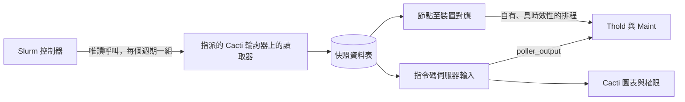

<!-- Source: README.md; SHA256: 16caa3e34c4d150a7fb1018f637e200a7580330f033b485047d8413bce09abba -->

<!-- translations:start -->
[English](../../../README.md) | [简体中文](../zh-CN/README.md) | [हिन्दी](../hi-IN/README.md) | [Español (España)](../es-ES/README.md) | [Español (Latinoamérica)](../es-419/README.md) | [العربية (السعودية)](../ar-SA/README.md) | [Afrikaans](../af-ZA/README.md) | [አማርኛ](../am-ET/README.md) | [العربية (مصر)](../ar-EG/README.md) | [العربية (المغرب)](../ar-MA/README.md) | [বাংলা](../bn-BD/README.md) | [Bosanski](../bs-BA/README.md) | [Deutsch](../de-DE/README.md) | [فارسی](../fa-IR/README.md) | [Filipino](../fil-PH/README.md) | [Français](../fr-FR/README.md) | [Français (Maroc)](../fr-MA/README.md) | [Français (Sénégal)](../fr-SN/README.md) | [Hausa](../ha-NG/README.md) | [עברית](../he-IL/README.md) | [Hrvatski](../hr-HR/README.md) | [Bahasa Indonesia](../id-ID/README.md) | [Igbo](../ig-NG/README.md) | [Italiano](../it-IT/README.md) | [日本語](../ja-JP/README.md) | [한국어](../ko-KR/README.md) | [Malagasy](../mg-MG/README.md) | [मराठी](../mr-IN/README.md) | [Bahasa Melayu](../ms-MY/README.md) | [Nederlands](../nl-NL/README.md) | [Polski](../pl-PL/README.md) | [Português (Brasil)](../pt-BR/README.md) | [Русский](../ru-RU/README.md) | [Kinyarwanda](../rw-RW/README.md) | [Soomaali](../so-SO/README.md) | [Српски](../sr-RS/README.md) | [Svenska](../sv-SE/README.md) | [Kiswahili](../sw-KE/README.md) | [தமிழ்](../ta-IN/README.md) | [తెలుగు](../te-IN/README.md) | [ไทย](../th-TH/README.md) | [Türkçe](../tr-TR/README.md) | [Українська](../uk-UA/README.md) | [اردو](../ur-PK/README.md) | [Tiếng Việt](../vi-VN/README.md) | [isiXhosa](../xh-ZA/README.md) | [Yorùbá](../yo-NG/README.md) | [繁體中文](README.md) | [isiZulu](../zu-ZA/README.md)
<!-- translations:end -->

# plugin_hpcsched

一個 Cacti 1.2 外掛程式，可在 Cacti 已監控的裝置旁繪製 HPC 批次排程器的狀態圖表：佇列深度、待執行與執行中作業數、作業處於待執行狀態的原因、節點狀態及分區使用率。Slurm 為第一個後端支援。Thold 可針對產生的資料來源發出警報，而 Maint 則可由已排空（drained）的節點與維護保留時段所驅動。

> **狀態：開發中，尚未發布正式版本。** 里程碑 2（基礎架構）已合併至 `main`，本分支則新增了里程碑 3（叢集圖表與待執行原因）。程式碼透過 Cacti 的外掛 API 進行安裝、升級與解除安裝，並拒絕在低於 8.2 版本的 PHP 上執行。它維護一份 Slurm 叢集登錄清單，每個叢集皆指派給一個 Cacti 輪詢器。位於主輪詢器上的背景讀取器會在每個間隔為每個叢集收集一份快照，方式為執行帶有 `--json` 參數的 `squeue`、`scontrol` 與 `sshare`，或透過 HTTPS 讀取 `slurmrestd`，並儲存依狀態與待執行原因分類的作業數、節點狀態、分區、保留時段、公平分享使用量及其資料新鮮度。此外掛隨附 Cacti 範本，並在管理員確認後，為每個叢集建立或對應一個 Cacti 裝置，包含叢集及各分區的依狀態分類作業圖表、依原因類別分類的待執行作業圖表、依狀態分類的節點圖表、CPU 與使用率圖表，以及快照存在時間（age）。唯讀的總覽頁面會顯示每個叢集的計數及其資料新鮮度，以及各叢集的待執行原因檢視；僅限管理員使用的健康狀態頁面則會顯示每次收集所回傳的結果與範本是否已安裝。所有頁面與操作皆遵循 Cacti 的裝置權限。所產生的資料來源可供 Thold 發出警報，但尚未測試任何 Thold 或 Maint 整合；這部分屬於里程碑 4 及後續階段。測試套件涵蓋合成的 Slurm 指令與 `slurmrestd` 回應，且 CI 也會在容器中測試一個真實的六節點 Slurm 叢集，詳情如下。此讀取器尚未在正式營運叢集上執行過。在操作人員注意事項之後的內容，本 README 描述的是整體設計，而非已交付的實際行為。

這是一個獨立專案，與 Cacti 專案沒有任何隸屬關係。

## 存取角色

| 權限領域 | 存取權限 |
| --- | --- |
| HPC Scheduler View | 現有的監控頁面。 |
| HPC Scheduler Operator | 監控頁面，外加操作頁面與個人分類確認標記。 |
| HPC Scheduler Admin | 操作人員存取權限，外加現有的設定與管理操作。 |

複製升級檔案後，請以管理員身分開啟「Plugins（外掛程式）」頁面以註冊新的權限領域。請在 **Configuration > Users**（設定 > 使用者）或使用者群組下明確指派 Operator 權限領域。升級會保留現有的 View 與 Admin 權限領域 ID 及授權。在每次請求時，Admin 權限會繼承 Operator 權限，而 Operator 權限會繼承 View 權限；這不會在使用者或群組中新增已儲存的授權。外掛設定除了需要 Cacti 的 Settings（設定）權限外，還需要 HPC Scheduler Admin 存取權限。

Cacti 裝置權限仍會限制每位使用者可見的資料列與可執行的操作；尚未關聯裝置的叢集會在管理頁面上列出給所有具備此外掛權限領域的使用者，但不會出現在操作人員檢視頁面中，因為該檢視僅列出已對應至裝置的叢集。
憑證、設定、對應、刪除及其他管理變更仍保留在管理頁面中。確認標記僅在目前使用者的工作階段中有效，最長不超過一小時，且僅在相同的觀測資料仍維持新鮮狀態時有效。新的或已變更的觀測資料會使該確認標記失效。確認標記絕不會將失敗的量測標記為健康狀態，也不會抑制警報。

## 里程碑 2 操作人員注意事項

**最小權限原則。** 此外掛僅執行讀取操作。請為其指派一個不具備管理員或操作員角色的專用 Slurm 使用者（在 `sacctmgr` 中設為 `AdminLevel=None`）。若 `slurm.conf` 中設有 `PrivateData=jobs`（或 `nodes`、`reservations`、`usage`），該使用者將只能看到自己的記錄，導致計數不完整且外掛無法偵測到此狀況。若要為該帳號解除此限制，就必須授予操作員或管理員層級的權限，但這同時也會允許進行變更操作；這項權衡由各站點自行決定。若使用用戶端指令，Cacti 輪詢器使用者需要 Slurm 用戶端執行檔以及能連線至控制器的 `slurm.conf`；執行檔路徑為 Configuration > Settings > HPC Scheduler 下的絕對路徑設定。若使用 `slurmrestd`，URL 必須為 `https://`，或僅限於迴路（loopback）位址使用 `http://`。系統會驗證 TLS 憑證且不會跟隨重新導向。Configuration > Settings > HPC Scheduler 下可選填的 slurmrestd 主機清單可限制叢集所指定的主機與連接埠。

**遠端輪詢器。** 本版本僅在主 Cacti 輪詢器上進行收集。指派給遠端資料收集器的叢集不會進行收集：該處的讀取器會拒絕執行並將原因記錄至日誌，而健康狀態頁面會列出該叢集名稱。遠端收集功能屬於第 3 階段。

**記憶體。** 每次收集執行時會一次解碼一個排程器回應，這在 PHP 記憶體中約需消耗回應大小的 12 倍（實測類似 Slurm 格式的作業記錄約為 10 倍，再加上文字本身）。執行期間會將 PHP 記憶體上限提升至 Collection Memory（收集記憶體）設定值（預設為 1024 MiB），並允許最大至 (Collection Memory - 64) / 12 MiB（預設為 80 MiB）的回應，即使 Maximum Answer Size（最大回應大小）設得更高亦然；當設得更高時，健康狀態頁面會發出警告。超過上限的回應會使該區段因過大而失敗，而仍發生記憶體不足的執行則會記錄為失敗。大型叢集可能需要同時調高這兩項設定；目前尚未針對 100,000 筆真實作業記錄進行實測。

**權杖檔案。** `slurmrestd` 叢集會指定一個權杖檔案；權杖本身絕不會儲存於資料庫、顯示於網頁上，或寫入日誌。該檔案必須位於 Configuration > Settings > HPC Scheduler 下所設定的其中一個權杖檔案目錄內，且路徑中不得包含符號連結，並必須是由輪詢器使用者擁有、且僅該使用者可寫入的一般檔案，內容包含單行：權杖本身，或是如 `scontrol token` 輸出的 `SLURM_JWT=<token>` 格式。若未設定任何權杖目錄，則沒有任何叢集能使用 `slurmrestd`。這兩項設定位於 Cacti 的 Settings（設定）頁面，因此僅憑外掛的 Admin 權限領域無法變更它們；請確保每個權杖目錄僅允許 root 與輪詢器使用者寫入。若檔案可由群組或其他使用者讀取，系統仍會使用該檔案，但健康狀態頁面會發出警告。當權杖將在設定的警告時間內過期時，健康狀態頁面也會發出警告。

若要輪替權杖而不產生讀取器讀到不完整檔案的空窗期，請將新權杖寫在舊檔案旁，再以重新命名方式覆蓋至目標位置：

```sh
dir=/etc/cacti/hpcsched
tmp=$(mktemp "$dir/.token.XXXXXX")
scontrol token username=cactiread lifespan=2592000 > "$tmp"
chown cacti:cacti "$tmp"
chmod 0600 "$tmp"
mv -f "$tmp" "$dir/cluster1.token"
```

下一次收集時就會讀取新檔案。使用 `scontrol token` 產生權杖需要 Slurm 管理員權限；請在允許執行的環境中執行該指令，再將檔案複製到輪詢器上。

## 里程碑 3 操作人員注意事項

**範本。** 安裝與升級會匯入 HPC Scheduler 的裝置、資料與圖表範本，並將分區資料查詢檔案複製到 Cacti 的 `resource/script_server/` 目錄。如果安裝外掛的使用者對該目錄沒有寫入權限、該處已存在非本外掛所寫入的同名不同檔案，或該名稱為符號連結，匯入程序將會中止、原檔案會保持不動，且健康狀態頁面會說明應採取的步驟；健康狀態頁面上的「Install Templates（安裝範本）」可重新嘗試匯入。若手動放置了內容完全相同的複本，系統會使用該檔案但仍將其保留為您所有。解除安裝時，僅當查詢檔案是由本外掛寫入且未經修改時才會予以移除，並會保留範本、裝置與圖表。

**叢集裝置。** 在實際建立任何項目之前，HPC Clusters > Device（HPC 叢集 > 裝置）會顯示該裝置將新增的項目（圖表、資料來源、RRD 檔案以及每次輪詢的指令碼伺服器呼叫次數）。「Create Device（建立裝置）」會建立一個使用保留 `.invalid` 網域主機名稱且不進行可用性檢查的裝置；而「Map Device（對應裝置）」則會將圖表附加至現有裝置並維持其原本設定不變。每個叢集圖表與每個分區圖表皆有各自的資料來源：叢集有 6 個，每個分區有 5 個；每次輪詢會為每個叢集資料來源發出 1 次指令碼伺服器呼叫，並為分區的每個值（32 個）發出 1 次呼叫。後續新增的分區會在讀取器偵測到時建立索引，並可從 Cacti 的「New Graphs（新增圖表）」頁面取得圖表；已移除的分區會停止輪詢並保留其圖表。刪除裝置會解除叢集的對應關係，但會保留該叢集。

**圖表計算方式。** 待執行作業（Pending）不包含已擱置（held）的作業，擱置作業有其獨立的資料數列。待執行的陣列作業會計算其剩餘的工作（tasks）數量。同時屬於多個分區的作業或節點，在叢集圖表中只會計算一次，而在每個所屬分區中則各計算一次，因此各分區圖表的加總未必等於叢集圖表的數值。待執行原因分為十一大類別（[ADR 0011](../../decisions/0011-pending-reason-families-and-counting.md)）；待執行原因檢視會列出原始原因，包含歸類在「Other（其他）」中的項目。每項作業僅回報排程器最後檢查過的原因。使用率的分母包含已排空（drained）、離線（down）及其他不可用的節點。過期或失敗的資料會記為 `U`，絕不記為零；`age` 則維持數值。

**警報。** Thold 可針對上述任何資料來源發出警報；請將 Thold 的持續時間設為至少一個收集間隔，並針對 `age` 設定警報以捕捉停止運作的讀取器。端對端的 Thold 檢查屬於里程碑 4 的範疇。

**以真實 Slurm 輸出進行測試。** CI 會在容器中啟動一個六節點的 Slurm 叢集（每次變更皆測試 26.05.5；推送至 `main`、每週及依要求時會從原始碼建置並測試 25.11.8），檢查外掛對節點狀態、維護保留時段、待執行原因與作業陣列的解析結果，接著透過外掛自身的指令傳輸與 `slurmrestd` 傳輸從該叢集進行收集。較舊的版本僅透過合成測試資料（fixtures）涵蓋。讀取器仍尚未在正式營運叢集上執行過。

**權限。** 在所有外掛頁面上，已關聯至裝置的叢集僅對 Cacti 允許存取該裝置的使用者顯示、匯出及變更；對應裝置時也必須具備目標裝置的權限。未關聯裝置的叢集則對所有具備外掛權限領域的使用者可見。若某叢集仍對應至一個在外掛停用期間被刪除的裝置，該叢集僅會顯示給具備 HPC Scheduler Admin 權限領域的使用者，由其為該叢集建立或對應裝置。圖表存取權限則由 Cacti 本身控管。

## 開發緣由

營運 Cacti 的管理員早已為其運算節點繪製了監控圖表，但這些圖表中缺乏排程器的視角，因而留下了兩個缺口：

- **無法得知「為何工作沒有開始執行」。** Slurm 會為每個待執行作業記錄原因。滿載的佇列旁顯示著閒置的節點圖表，卻無法說明原因究竟是優先權、資源限制、擱置、相依性，還是節點已排空。
- **排程器狀態與警報之間缺乏連結。** 當管理員已將某台裝置排空時，Thold 仍會發出警報，且管理員必須手動建立 Maint 排程。

本外掛會為每個叢集收集一份快取快照，將其發布為標準的 Cacti 資料來源與圖表，將排程器節點對應至現有的 Cacti 裝置，並可將已排空節點與維護保留時段納入 Maint。它重複利用了 Cacti 的權限機制、遠端資料收集器、Thold 與 Maint，且對排程器而言完全是唯讀操作。

## 規劃範圍

| 階段 | 範圍 | 里程碑 |
|---|---|---|
| 0，研究 | Slurm 版本矩陣、上游行為確認、控制器負載、節點命名測試資料 | [M1](https://github.com/somethingwithproof/plugin_hpcsched/milestone/1) |
| 1，叢集圖表 | 佇列深度、待執行與執行中作業、待執行原因、節點狀態、分區使用率、Thold 警報、健康狀態頁面、正式發布 | [M2](https://github.com/somethingwithproof/plugin_hpcsched/milestone/2)、[M3](https://github.com/somethingwithproof/plugin_hpcsched/milestone/3)、[M4](https://github.com/somethingwithproof/plugin_hpcsched/milestone/4) |
| 2，節點與維護 | 節點至裝置對應、個別節點狀態、針對已排空節點與維護保留時段的自動 Maint 維護時段 | [M5](https://github.com/somethingwithproof/plugin_hpcsched/milestone/5) |
| 3，帳務統計 | 公平分享使用量、受限帳務統計資訊、遠端資料收集器 | [M6](https://github.com/somethingwithproof/plugin_hpcsched/milestone/6) |

不在規劃範圍內：任何排程器寫入路徑（提交、取消、擱置、排空、恢復）、外掛自建的警報引擎、報表或計費分攤引擎，以及依使用者與依作業分類的資料數列。PBS Pro、OpenPBS 與 LSF 後端目前僅處於研究階段。

## 相容性目標

| 元件 | 目標 |
|---|---|
| Cacti | 1.2.31 或更新版本，無需核心修補程式 |
| PHP | 8.2 或更新版本；`setup.php` 保持可於 8.0 解析，使不支援的執行環境能收到拒絕訊息，而非導致 Cacti UI 損毀 |
| Slurm | 25.05、25.11 與 26.05，即最新的三個發行版本（[ADR 0013](../../decisions/0013-three-latest-slurm-releases.md)）；25.11 與 26.05 針對即時運作的叢集進行測試，25.05 僅針對測試資料進行測試。用戶端指令為預設傳輸方式（[ADR 0012](../../decisions/0012-client-commands-default-transport.md)）並採用資料解析器設定：預設為 v0.0.43（SchedMD 將於 27.05 中移除），或在隨附支援的版本上使用 v0.0.44 或 v0.0.45。slurmrestd 叢集會自動探索背景服務所提供的最新解析器 |
| Thold、Maint | 無需修改 Thold；Maint 整合為一項提案，仍需獲得 Maint 維護者的同意 |

## 設計

- [docs/PLAN.md](../../PLAN.md) 為完整計畫書：包含架構、所仰賴的上游事實（附來源與未確認假設的明確清單）、節點對應、狀態模型、安全邊界、效能計算、測試以及風險。
- [docs/decisions/](../../decisions) 存放架構決策記錄（ADR）。
- [docs/REQUIREMENTS.md](../../REQUIREMENTS.md) 將每個需求 ID 對應至其議題。



## 工作追蹤方式

- **里程碑（Milestones）** 依照計畫的里程碑進度進行。每個里程碑都有一個史詩議題（epic issue），列出其子議題與完成佐證。
- **議題（Issues）** 依標籤分類：`type: requirement`、`type: research`、`type: decision`、`type: epic`。需求議題會陳述編號且可測試的需求（`REQ-AREA-NNN`）與驗收標準。
- **標籤（Labels）** 亦包含 `area:`、`phase:`、`priority:` 與 `status:`。請參閱 [CONTRIBUTING.md](../../../CONTRIBUTING.md#labels)。
- [專案看板](https://github.com/users/somethingwithproof/projects/10) 顯示跨里程碑的所有議題。

## 參與貢獻

請閱讀 [CONTRIBUTING.md](../../../CONTRIBUTING.md)。提交（Commits）需要包含 DCO 簽署（sign-off）。設計討論會在議題上進行；未決定的決策會標記 `type: decision` 標籤。

## 安全性

請私下回報安全性弱點；請參閱 [SECURITY.md](../../../SECURITY.md)。

## 授權條款

GNU General Public License v2.0，與 Cacti 及其外掛程式採用相同的授權條款。請參閱 [LICENSE](../../../LICENSE)。
