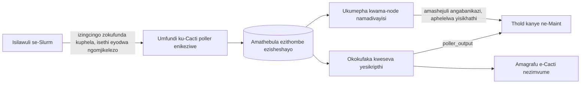

<!-- Source: README.md; SHA256: 16caa3e34c4d150a7fb1018f637e200a7580330f033b485047d8413bce09abba -->

<!-- translations:start -->
[English](../../../README.md) | [简体中文](../zh-CN/README.md) | [हिन्दी](../hi-IN/README.md) | [Español (España)](../es-ES/README.md) | [Español (Latinoamérica)](../es-419/README.md) | [العربية (السعودية)](../ar-SA/README.md) | [Afrikaans](../af-ZA/README.md) | [አማርኛ](../am-ET/README.md) | [العربية (مصر)](../ar-EG/README.md) | [العربية (المغرب)](../ar-MA/README.md) | [বাংলা](../bn-BD/README.md) | [Bosanski](../bs-BA/README.md) | [Deutsch](../de-DE/README.md) | [فارسی](../fa-IR/README.md) | [Filipino](../fil-PH/README.md) | [Français](../fr-FR/README.md) | [Français (Maroc)](../fr-MA/README.md) | [Français (Sénégal)](../fr-SN/README.md) | [Hausa](../ha-NG/README.md) | [עברית](../he-IL/README.md) | [Hrvatski](../hr-HR/README.md) | [Bahasa Indonesia](../id-ID/README.md) | [Igbo](../ig-NG/README.md) | [Italiano](../it-IT/README.md) | [日本語](../ja-JP/README.md) | [한국어](../ko-KR/README.md) | [Malagasy](../mg-MG/README.md) | [मराठी](../mr-IN/README.md) | [Bahasa Melayu](../ms-MY/README.md) | [Nederlands](../nl-NL/README.md) | [Polski](../pl-PL/README.md) | [Português (Brasil)](../pt-BR/README.md) | [Русский](../ru-RU/README.md) | [Kinyarwanda](../rw-RW/README.md) | [Soomaali](../so-SO/README.md) | [Српски](../sr-RS/README.md) | [Svenska](../sv-SE/README.md) | [Kiswahili](../sw-KE/README.md) | [தமிழ்](../ta-IN/README.md) | [తెలుగు](../te-IN/README.md) | [ไทย](../th-TH/README.md) | [Türkçe](../tr-TR/README.md) | [Українська](../uk-UA/README.md) | [اردو](../ur-PK/README.md) | [Tiếng Việt](../vi-VN/README.md) | [isiXhosa](../xh-ZA/README.md) | [Yorùbá](../yo-NG/README.md) | [繁體中文](../zh-TW/README.md) | [isiZulu](README.md)
<!-- translations:end -->

# plugin_hpcsched

I-plugin ye-Cacti 1.2 edweba amagrafu esimo somhleli wemisebenzi ye-HPC eceleni kwamadivayisi i-Cacti eseyiqaphile kakade: ukujula kolayini, imisebenzi elindile uma iqhathaniswa nesebenzayo, ukuthi kungani imisebenzi ilindile, izimo zama-node, kanye nokusetshenziswa kwama-partition. I-Slurm iyi-backend yokuqala. I-Thold ikhipha izexwayiso emithonjeni yedatha evelayo, futhi i-Maint ingaqhutshwa ama-node akhishiwe kanye nokubhukha kokulungisa.

> **Isimo: kusesekuthuthukisweni, akukho okukhishiwe okwamanje.** Ingqophamlando 2 (isisekelo) ihlanganiswe ku-`main`, futhi leli gatsha lengeza ingqophamlando 3 (amagrafu e-cluster kanye nezizathu zokulinda). Ikhodi iyafakwa, iyathuthukiswa, futhi iyasuswa nge-plugin API ye-Cacti futhi yenqaba i-PHP engaphansi kuka-8.2. Igcina irejista yama-cluster e-Slurm, ngalinye labelwe i-Cacti poller eyodwa. Umfundi ongemuva ku-poller eyinhloko uqoqa isithombe sesimo esisodwa nge-cluster ngayinye ngesikhawu ngasinye, kungaba ngokusebenzisa i-`squeue`, i-`scontrol`, ne-`sshare` nge-`--json` noma ngokufunda i-`slurmrestd` nge-HTTPS, futhi agcine izibalo zemisebenzi ngesimo nangokwesizathu sokulinda, izimo zama-node, ama-partition, ukubhukha, kanye nokusetshenziswa kwe-fair-share kanye nokusha kwakho. I-plugin ihambisa amathempulethi e-Cacti futhi, ngemvume yomlawuli, idala noma imephe idivayisi ye-Cacti eyodwa nge-cluster ngayinye enamagrafu emisebenzi ngesimo, imisebenzi elindile ngohlobo lwesizathu, ama-node ngesimo, ama-CPU, nokusetshenziswa, kwe-cluster kanye ne-partition ngayinye, kanye nobudala besithombe sesimo. Ikhasi lokubuka konke lokufunda kuphela libonisa izibalo nge-cluster ngayinye nokusha kwazo kanye nokubukwa kwezizathu zokulinda nge-cluster ngayinye, futhi ikhasi lempilo labalawuli kuphela libonisa okubuyiswe ukuqoqwa ngakunye nokuthi amathempulethi afakiwe yini. Wonke amakhasi nezenzo zilandela izimvume zamadivayisi ze-Cacti. Imithombo yedatha iyilena i-Thold engaxwayisa ngayo, kodwa akukho kuhlanganiswa kwe-Thold noma kwe-Maint okuhloliwe okwamanje; lokho kuyingqophamlando 4 nakamuva. Uhlelo lokuhlola luhlanganisa imiyalo ye-Slurm yokuzenzisa nezimpendulo ze-`slurmrestd`, futhi i-CI iphinde ihlole i-cluster yangempela ye-Slurm enama-node ayisithupha kuma-container njengoba kuchaziwe ngezansi. Umfundi akakaze asebenze ku-cluster yokukhiqiza. Ngaphansi kwamanothi omsebenzisi wokulawula, le README ichaza umklamo, hhayi ukuziphatha okukhishiwe.

Lena iphrojekthi ezimele futhi ayihlangene nephrojekthi ye-Cacti.

## Izindima zokufinyelela

| Indawo (Realm) | Ukufinyelela |
| --- | --- |
| HPC Scheduler View | Amakhasi okuqapha akhona. |
| HPC Scheduler Operator | Ukuqapha kanye nekhasi le-Operations kanye nokuqinisekisa kwethriyaji yomuntu siqu. |
| HPC Scheduler Admin | Ukufinyelela kwe-Operator kanye nokumiswa okukhona nezenzo zokuphatha. |

Ngemuva kokukopisha amafayela okuthuthukisa, vula ikhasi le-Plugins njengomlawuli ukuze ubhalise
indawo entsha. Yabela indawo ye-Operator ngokucacile ngaphansi kwe-**Configuration > Users** noma amaqembu abasebenzisi.
Ukuthuthukiswa kugcina ama-ID endawo ye-View ne-Admin akhona kanye nezimvume zawo. Ukufinyelela kwe-Admin
kuthatha ukufinyelela kwe-Operator, futhi ukufinyelela kwe-Operator kuthatha ukufinyelela kwe-View esicelweni ngasinye;
lokhu akungezi izimvume ezigciniwe kubasebenzisi noma emaqenjini. Izilungiselelo ze-plugin nazo zidinga
ukufinyelela kwe-HPC Scheduler Admin ngaphezu kwemvume ye-Settings ye-Cacti.

Izimvume zamadivayisi ze-Cacti zisalinganisela imigqa nezenzo ezitholakala kumsebenzisi ngamunye; i-cluster engenayo idivayisi ibhalwe emakhasini okuphatha kubo bonke abasebenzisi abanendawo ye-plugin, kodwa hhayi ekubukeni kwe-operator, okubala kuphela ama-cluster amephwe kudivayisi.
Iziqinisekiso, ukumiswa, ukumepha, ukususa nezinye iziguquko zokuphatha
zihlala emakhasini okuphatha. Ukuqinisekisa kuhlala kuphela kusikhathi seseshini
yomsebenzisi wamanje, okungenani ihora elilodwa kuphela futhi kuphela uma okubonwayo okufanayo kuhlala
kusha. Okubonwayo okusha noma okushintshile kuyakwenqaba. Akukaze kumake isilinganiso esehlulekile
njengesiphilile noma kuvimbele izexwayiso.

## Amanothi omsebenzisi wokulawula engqophamlando 2

**Ilungelo elincane kunazo zonke.** I-plugin iyafunda kuphela. Yinikeze umsebenzisi we-Slurm ozinikele ongenayo indima yomlawuli noma ye-operator (`AdminLevel=None` ku-`sacctmgr`). Nge-`PrivateData=jobs` (noma `nodes`, `reservations`, `usage`) ku-`slurm.conf`, lowo msebenzisi ubona amarekhodi akhe kuphela, ngakho izibalo aziphelele futhi i-plugin ayikwazi ukukubona lokho. Ukuphakamisa lokho kwe-akhawunti kusho izinga le-operator noma lomlawuli, okuphinde kuvumele iziguquko; lokho kuhwebelana kuyisinqumo sesayithi. Kumiyalo yeklayenti, umsebenzisi we-Cacti poller udinga ama-binary eklayenti ye-Slurm kanye ne-`slurm.conf` efinyelela isilawuli; izindlela zama-binary ziyizilungiselelo eziphelele ngaphansi kwe-Configuration > Settings > HPC Scheduler. Kwe-`slurmrestd`, i-URL kufanele ibe yi-`https://`, noma i-`http://` kukheli le-loopback kuphela. Izitifiketi ze-TLS ziyaqinisekiswa futhi ukudluliselwa akulandelwa. Uhlu olungakhethwa lwamahost e-slurmrestd ngaphansi kwe-Configuration > Settings > HPC Scheduler lukhawulela amahost namachweba i-cluster engawaqamba.

**Ama-poller akude.** Lokhu kukhishwa kuqoqa kuphela ku-Cacti poller eyinhloko. I-cluster eyabelwe umqoqi wedatha okude ayiqoqwa: umfundi lapho uyenqaba ngesizathu esibhalwe ku-log futhi ikhasi lempilo liyayiqamba i-cluster. Ukuqoqa okukude kuyisigaba 3.

**Imemori.** Ukugijima ngakunye kokuqoqa kudikoda impendulo eyodwa yomhleli wemisebenzi ngesikhathi, okuthatha cishe izikhathi eziyi-12 zobukhulu bempendulo kumemori ye-PHP (kulinganiswe cishe izikhathi eziyi-10 kumarekhodi emisebenzi amise okwe-Slurm, kanye nombhalo uqobo). Ukugijima kuphakamisa umkhawulo wememori ye-PHP uye kusilungiselelo se-Collection Memory (1024 MiB ngokuzenzakalelayo) futhi kuvumela izimpendulo ezifika ku-(Collection Memory - 64) / 12 MiB, 80 MiB ngokuzenzakalelayo, ngisho noma i-Maximum Answer Size ibekwe phezulu; ikhasi lempilo liyaxwayisa uma kunjalo. Impendulo enkulu kakhulu yehluleka isigaba sayo njengenkulu kakhulu, futhi ukugijima okusaphelelwa yimemori kubhalwa njengokwehlulekile. I-cluster enkulu ingase idinge ukuphakanyiswa kwezilungiselelo zombili; amarekhodi emisebenzi angempela ayi-100,000 awakalinganiswa.

**Amafayela ethokheni.** I-cluster ye-`slurmrestd` iqamba ifayela lethokheni; ithokheni uqobo ayikaze igcinwe kusizindalwazi, iboniswe ekhasini, noma ibhalwe ku-log. Ifayela kufanele libe ngaphakathi kwenye yezinkomba zamafayela ethokheni ezibekwe ngaphansi kwe-Configuration > Settings > HPC Scheduler, lifinyelelwe ngaphandle kwesixhumanisi esingokomfanekiso, futhi libe yifayela elivamile elingelomsebenzisi we-poller elingabhalwa yilowo msebenzisi kuphela, elinomugqa owodwa: ithokheni, noma i-`SLURM_JWT=<token>` njengoba i-`scontrol token` ikuphrinta. Uma kungekho zinkomba zethokheni ezibekiwe, ayikho i-cluster engasebenzisa i-`slurmrestd`. Lezi zilungiselelo ezimbili zisekhasini le-Settings le-Cacti, ngakho indawo ye-Admin ye-plugin iyodwa ayikwazi ukuzishintsha; gcina inkomba ngayinye yethokheni ibhalwa kuphela yi-root kanye nomsebenzisi we-poller. Ifayela elingafundwa yiqembu noma abanye abasebenzisi lisasetshenziswa, futhi ikhasi lempilo liyaxwayisa. Ikhasi lempilo liphinde lixwayise uma ithokheni liphelelwa yisikhathi ngaphakathi kwesikhathi sesexwayiso esimisiwe.

Ukuze ujikelezise ithokheni ngaphandle kwesikhathi lapho umfundi ebona khona ifayela elingaphelele, bhala ithokheni entsha eceleni kwendala bese uyiqamba kabusha endaweni yayo:

```sh
dir=/etc/cacti/hpcsched
tmp=$(mktemp "$dir/.token.XXXXXX")
scontrol token username=cactiread lifespan=2592000 > "$tmp"
chown cacti:cacti "$tmp"
chmod 0600 "$tmp"
mv -f "$tmp" "$dir/cluster1.token"
```

Ukuqoqwa okulandelayo kufunda ifayela elisha. Ukukhiqiza amathokheni nge-`scontrol token` kudinga umlawuli we-Slurm; kusebenzise lapho lokho kuvunyelwe khona bese ukopisha ifayela ku-poller.

## Amanothi omsebenzisi wokulawula engqophamlando 3

**Amathempulethi.** Ukufaka nokuthuthukisa kungenisa idivayisi ye-HPC Scheduler, idatha, kanye namathempulethi egrafu futhi kukopisha umbuzo wedatha ye-partition ohlwini lwemibhalo lwe-Cacti `resource/script_server/`. Uma lolo hla lwemibhalo lungabhaleki ngumsebenzisi ofaka i-plugin, elinye ifayela elinegama elifanayo selivele likhona futhi lingabhalwanga yi-plugin, noma igama liyisixhumanisi esingokomfanekiso, ukungenisa kuyama, ifayela liyashiywa njengoba linjalo, futhi ikhasi lempilo lisho okufanele kwenziwe; i-Install Templates ekhasini lempilo izama futhi. Ikhophi efanayo eyenziwe ngesandla iyasetshenziswa kodwa ihlala ingeyakho. Ukukhipha kususa ifayela lombuzo kuphela uma i-plugin ilibhalile futhi lingashintshiwe, futhi kugcina amathempulethi, amadivayisi, namagrafu.

**Amadivayisi e-cluster.** I-HPC Clusters > Device ibonisa lokho idivayisi ezokwengeza (amagrafu, imithombo yedatha, amafayela e-RRD, kanye nezingcingo zeseva yesikripthi nge-poll ngayinye) ngaphambi kokuba kudaliwe noma yini. I-Create Device yenza idivayisi enegama le-host esizindeni esigodliwe se-`.invalid` futhi ngaphandle kokuhlolwa kokutholakala; esikhundleni salokho i-Map Device inamathisela amagrafu kudivayisi ekhona futhi ishiya izilungiselelo zayo zinjalo. Igrafu ngayinye ye-cluster negrafu ngayinye ye-partition inomthombo wayo wedatha: eyisithupha ye-cluster kanye neyisihlanu nge-partition ngayinye, ucingo olulodwa lweseva yesikripthi ngomthombo wedatha we-cluster ngamunye kanye nolulodwa ngenani ngalinye le-partition (32) nge-poll ngayinye. Ama-partition angezwa kamuva afakwa ku-index lapho umfundi ewabona futhi athola amagrafu ekhasini le-New Graphs le-Cacti; i-partition esusiwe iyeka uku-poll-wa futhi igcina amagrafu ayo. Ukususa idivayisi kususa ukumepha kwe-cluster futhi kuyayigcina.

**Lokho amagrafu akubalayo.** Okulindile akubandakanyi imisebenzi ebanjiwe, enochungechunge lwayo. I-array elindile ibala imisebenzi yayo esele. Umsebenzi noma i-node kuma-partition amaningana kubalwa kanye kumagrafu e-cluster kanye nakanye ku-partition ngayinye, ngakho amagrafu ama-partition akudingeki ahlangane abe ngawe-cluster. Izizathu zokulinda zihlukaniswe ngemindeni eyishumi nanye ([ADR 0011](../../decisions/0011-pending-reason-families-and-counting.md)); ukubukwa kwezizathu zokulinda kubala izizathu ezingahluziwe, kubandakanya lezo eziku-Other. Umsebenzi ngamunye ubika kuphela isizathu sokugcina umhleli wemisebenzi asihlolile. Isihlukanisi sokusetshenziswa sihlanganisa ama-node akhishiwe, aphansi, namanye angatholakali. Idatha endala noma ehlulekile ingu-`U`, ayikaze ibe nguziro; i-`age` ihlala iyizinombolo.

**Ukuxwayisa.** I-Thold ingaxwayisa nganoma yimuphi kule mithombo yedatha; setha ubude besikhathi be-Thold okungenani bube isikhawu esisodwa sokuqoqwa, futhi uxwayise ku-`age` ukuze ubambe umfundi omile. Ukuhlolwa kwe-Thold kusukela ekuqaleni kuze kube sekugcineni kuyingqophamlando 4.

**Kuhlolwe ngokumelene nomphumela wangempela we-Slurm.** I-CI iqala i-cluster ye-Slurm enama-node ayisithupha kuma-container (26.05.5 kuguquko ngalunye, 25.11.8 eyakhiwe kusukela kukhodi yomthombo ekuphusheni ku-`main`, masonto onke, nangesicelo) futhi ihlola izimo zama-node, ukubhukha kokulungisa, izizathu zokulinda, nama-array njengoba i-plugin iwahlaziya, bese iqoqa kuleyo cluster ngezinto zokuthutha zomiyalo we-plugin uqobo neze-`slurmrestd`. Izinguqulo ezindala zimbozwe kuphela ngama-fixture okuzenzisa. Umfundi akakaze asebenze ku-cluster yokukhiqiza.

**Izimvume.** I-cluster ekudivayisi iyaboniswa, iyathunyelwa ngaphandle, futhi ishintshwa kuphela kubasebenzisi i-Cacti ebavumela leyo divayisi, kuwo wonke amakhasi e-plugin; ukumepha idivayisi nakho kudinga imvume yedivayisi eqondiwe. I-cluster engenayo idivayisi ibonakala kuwo wonke umuntu onendawo ye-plugin. I-cluster esamephwe kudivayisi eyasuswa ngenkathi i-plugin ikhutshaziwe iboniswa kuphela kubasebenzisi abanendawo ye-HPC Scheduler Admin, abangadala noma bamephe idivayisi yayo. Ukufinyelela kwamagrafu okwe-Cacti uqobo.

## Kungani

Abalawuli abasebenzisa i-Cacti sebevele badweba amagrafu ama-node abo okubala. Umbono womhleli wemisebenzi uyashoda kulawo magrafu, okushiya izikhala ezimbili:

- **Akukho "kungani umsebenzi ungaqali".** I-Slurm irekhoda isizathu somsebenzi ngamunye olindile. Ulayini ogcwele eceleni kwamagrafu ama-node angenzi lutho awusho ukuthi imbangela yinto ebaluleke kakhulu, imikhawulo yezinsiza, ukubanjwa, ukuncika, noma ama-node akhishiwe.
- **Akukho kuxhumana phakathi kwesimo somhleli wemisebenzi nokuxwayisa.** I-Thold ixwayisa ngedivayisi umlawuli aseyikhiphile kakade, futhi abalawuli badala amashejuli e-Maint ngesandla.

I-plugin iqoqa isithombe sesimo esisodwa esilondoloziwe nge-cluster ngayinye, ikushicilele njengemithombo yedatha yamagrafu e-Cacti evamile, imephe ama-node omhleli wemisebenzi kumadivayisi e-Cacti akhona, futhi ingabeka ama-node akhishiwe nokubhukha kokulungisa ku-Maint. Iphinda isebenzise izimvume ze-Cacti, abaqoqi bedatha abakude, i-Thold, kanye ne-Maint, futhi ingeyokufunda kuphela ngasohlangothini lomhleli wemisebenzi.

## Ububanzi obuhleliwe

| Isigaba | Ububanzi | Izingqophamlando |
|---|---|---|
| 0, ucwaningo | Imatrikisi yokukhishwa kwe-Slurm, ukuqinisekiswa kokuziphatha okungasenhla, umthwalo wesilawuli, ama-fixture okuqamba ama-node | [M1](https://github.com/somethingwithproof/plugin_hpcsched/milestone/1) |
| 1, amagrafu e-cluster | Ukujula kolayini, imisebenzi elindile nesebenzayo, izizathu zokulinda, izimo zama-node, ukusetshenziswa kwama-partition, ukuxwayisa kwe-Thold, ikhasi lempilo, ukukhishwa | [M2](https://github.com/somethingwithproof/plugin_hpcsched/milestone/2), [M3](https://github.com/somethingwithproof/plugin_hpcsched/milestone/3), [M4](https://github.com/somethingwithproof/plugin_hpcsched/milestone/4) |
| 2, ama-node nokulungisa | Ukumepha kwe-node kudivayisi, isimo se-node ngayinye, amawindi e-Maint azenzakalelayo ama-node akhishiwe nokubhukha kokulungisa | [M5](https://github.com/somethingwithproof/plugin_hpcsched/milestone/5) |
| 3, ukubalwa kwezimali | Ukusetshenziswa kwe-fair-share, izibalo zokubalwa kwezimali ezikhawulelwe, abaqoqi bedatha abakude | [M6](https://github.com/somethingwithproof/plugin_hpcsched/milestone/6) |

Ngaphandle kobubanzi: noma iyiphi indlela yokubhala yomhleli wemisebenzi (thumela, khansela, bamba, khipha, qala kabusha), injini yokuxwayisa ephethwe yi-plugin, injini yokubika noma yokukhokhisa, uchungechunge lomsebenzisi ngamunye nomsebenzi ngamunye. Ama-backend e-PBS Pro, i-OpenPBS, ne-LSF ayicwaningo.

## Izinjongo zokuhambisana

| Ingxenye | Injongo |
|---|---|
| Cacti | 1.2.31 noma kamuva, akukho mapheshi engqikithi |
| PHP | 8.2 noma kamuva; i-`setup.php` ihlala ifundeka ku-8.0 ukuze isikhathi sokusebenza esingasekelwe sithole ukwenqatshwa esikhundleni se-UI ye-Cacti ephukile |
| Slurm | 25.05, 25.11, kanye no-26.05, ukukhishwa okuthathu kwakamuva ([ADR 0013](../../decisions/0013-three-latest-slurm-releases.md)); u-25.11 no-26.05 bahlolwa ku-cluster ephilayo, u-25.05 kuma-fixture kuphela. Imiyalo yeklayenti iyindlela yokuthutha ezenzakalelayo ([ADR 0012](../../decisions/0012-client-commands-default-transport.md)) futhi isebenzisa isilungiselelo sesihlaziyi sedatha: i-v0.0.43 ngokuzenzakalelayo, i-SchedMD eyisusayo ku-27.05, noma i-v0.0.44 noma i-v0.0.45 ekukhishweni okukulethayo. Ama-cluster e-slurmrestd athola isihlaziyi esisha kunazo zonke esikhonzwa yi-daemon |
| Thold, Maint | Akukho shintsho ku-Thold; ukuhlanganiswa kwe-Maint kuyisiphakamiso esidinga ukuvumelana kwabagcini be-Maint |

## Umklamo

- [docs/PLAN.md](../../PLAN.md) iyipulani egcwele: ukwakheka, amaqiniso angasenhla ethembele kuwo (nemithombo nohlu olucacile lwezinto ezicatshangwayo ezingaqinisekisiwe), ukumepha kwama-node, imodeli yesimo, imingcele yezokuphepha, izibalo zokusebenza, ukuhlola, kanye nezingozi.
- [docs/decisions/](../../decisions) igcina amarekhodi ezinqumo zokwakha.
- [docs/REQUIREMENTS.md](../../REQUIREMENTS.md) imepha yonke i-ID yemfuneko endabeni yayo.



## Indlela umsebenzi olandelelwa ngayo

- **Izingqophamlando** zilandela izingqophamlando zepulani. Ngayinye inendaba enkulu ebala izindaba zayo ezingaphansi kanye nobufakazi bokuphuma.
- **Izindaba** zihlukaniswe ngelebula: `type: requirement`, `type: research`, `type: decision`, `type: epic`. Izindaba zezimfuneko zisho izimfuneko ezinenombolo, ezihlolwayo (`REQ-AREA-NNN`) kanye nemibandela yokwamukela.
- **Amalebula** aphinde aphathe `area:`, `phase:`, `priority:`, kanye no-`status:`. Bheka [CONTRIBUTING.md](../../../CONTRIBUTING.md#labels).
- [Ibhodi lephrojekthi](https://github.com/users/somethingwithproof/projects/10) libonisa zonke izindaba kuzo zonke izingqophamlando.

## Ukufaka isandla

Funda [CONTRIBUTING.md](../../../CONTRIBUTING.md). Ama-commit adinga ukusayina kwe-DCO. Ingxoxo yomklamo yenzeka ezindabeni; izinqumo ezivuliwe ziphethe ilebula ye-`type: decision`.

## Ezokuphepha

Bika ubungozi ngasese; bheka [SECURITY.md](../../../SECURITY.md).

## Ilayisensi

GNU General Public License v2.0, ilayisensi efanayo neye-Cacti nama-plugin ayo. Bheka [LICENSE](../../../LICENSE).
