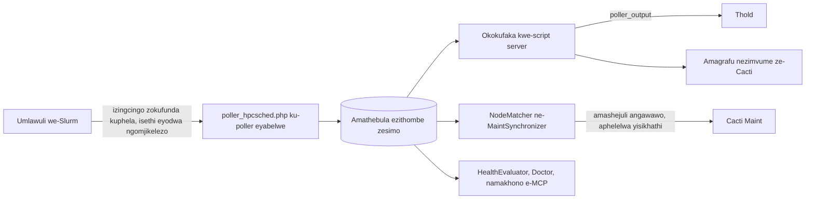

<!-- Source: README.md; SHA256: 938114d41dbd516f9dfcd94619c4fc73ef56b4da1dd693010588a93cce250534 -->

<!-- translations:start -->
[English](../../../README.md) | [简体中文](../zh-CN/README.md) | [हिन्दी](../hi-IN/README.md) | [Español (España)](../es-ES/README.md) | [Español (Latinoamérica)](../es-419/README.md) | [العربية (السعودية)](../ar-SA/README.md) | [Afrikaans](../af-ZA/README.md) | [አማርኛ](../am-ET/README.md) | [العربية (مصر)](../ar-EG/README.md) | [العربية (المغرب)](../ar-MA/README.md) | [Български](../bg-BG/README.md) | [বাংলা](../bn-BD/README.md) | [Bosanski](../bs-BA/README.md) | [Deutsch](../de-DE/README.md) | [Ελληνικά](../el-GR/README.md) | [فارسی](../fa-IR/README.md) | [Filipino](../fil-PH/README.md) | [Français](../fr-FR/README.md) | [Français (Maroc)](../fr-MA/README.md) | [Français (Sénégal)](../fr-SN/README.md) | [Hausa](../ha-NG/README.md) | [עברית](../he-IL/README.md) | [Hrvatski](../hr-HR/README.md) | [Bahasa Indonesia](../id-ID/README.md) | [Igbo](../ig-NG/README.md) | [Italiano](../it-IT/README.md) | [日本語](../ja-JP/README.md) | [ქართული](../ka-GE/README.md) | [한국어](../ko-KR/README.md) | [Latviešu](../lv-LV/README.md) | [Malagasy](../mg-MG/README.md) | [मराठी](../mr-IN/README.md) | [Bahasa Melayu](../ms-MY/README.md) | [Nederlands](../nl-NL/README.md) | [Polski](../pl-PL/README.md) | [Português (Brasil)](../pt-BR/README.md) | [Português (Portugal)](../pt-PT/README.md) | [Русский](../ru-RU/README.md) | [Kinyarwanda](../rw-RW/README.md) | [Soomaali](../so-SO/README.md) | [Српски](../sr-RS/README.md) | [Svenska](../sv-SE/README.md) | [Kiswahili](../sw-KE/README.md) | [தமிழ்](../ta-IN/README.md) | [తెలుగు](../te-IN/README.md) | [ไทย](../th-TH/README.md) | [Türkçe](../tr-TR/README.md) | [Українська](../uk-UA/README.md) | [اردو](../ur-PK/README.md) | [Tiếng Việt](../vi-VN/README.md) | [isiXhosa](../xh-ZA/README.md) | [Yorùbá](../yo-NG/README.md) | [繁體中文](../zh-TW/README.md) | [isiZulu](README.md)
<!-- translations:end -->

# plugin_hpcsched

I-plugin ye-Cacti 1.2 (`hpcsched`, inguqulo `0.1.0-dev`) edweba amagrafu esimo somhleli wemisebenzi ye-HPC eceleni kwamadivayisi i-Cacti eseyiqaphile kakade: ukujula kolayini, imisebenzi elindile uma iqhathaniswa nesebenzayo, ukuthi kungani imisebenzi ilindile, izimo zama-node, ukusetshenziswa kwama-partition, kanye nokusetshenziswa kwe-fair-share ezingeni le-akhawunti. I-Slurm iyi-backend esetshenzisiwe. I-Thold ikhipha izexwayiso emithonjeni yedatha evelayo, futhi umvumelanisi we-Maint wokuzikhethela uqhuba amawindi e-Cacti Maint kusuka kuma-node okubala e-Slurm akhishiwe (drained), aphansi (down), kanye nabhukhelwe ukulungiswa.

> **Isimo: kusesekuthuthukisweni, akukho okukhishiwe okwamanje.** Leli gatsha lisebenzisa isisekelo se-plugin, amagrafu e-cluster nama-partition, imindeni yezizathu zokulinda, ukufaniswa kwe-node yokubala ye-Slurm nedivayisi ye-Cacti, ukuvumelaniswa kwewindi le-Cacti Maint lokuzikhethela, izifinyezo ze-fair-share ezingeni le-akhawunti, ukusebenza nokuphindaphindwa kwabaqoqi bedatha abakude, i-CLI ye-Configuration-as-Code (CasC) neyokusebenza, kanye nama-hook e-ecosystem ye-Cacti (CasC, Doctor, ne-MCP / Abilities API v2). Uhlelo lokuhlola luhlanganisa imiyalo ye-Slurm yokuzenzisa nezimpendulo ze-`slurmrestd`, futhi i-CI ihlola i-cluster ye-Slurm ephilayo enama-node ayisithupha kuma-container. Umfundi akakaze asebenze ku-cluster yokukhiqiza, futhi ukuhlola okuphelele kokudlala kabusha kwe-Thold akukabi ku-CI.

Lena iphrojekthi ezimele futhi ayihlangene nephrojekthi ye-Cacti.

## Okusetshenzisiwe

- **Umjikelezo wempilo neskimu (v3)**: ukufaka, ukuthuthukisa okungenamthelela ophindaphindekayo (idempotent), ukukhipha (kugcinwa amathebula e-plugin ngokuzenzakalelayo), kanye nomkhawulo we-PHP 8.2 ngenkathi izindawo zokungena zigcinwa zihlaziyeka ku-PHP 8.0. Iskimu v3 sengeza i-`plugin_hpcsched_node_map` ne-`plugin_hpcsched_maint_link` eceleni kwamathebula e-cluster, run, section, job-count, node-count, node, partition, reservation, ne-share.
- **Ukuqoqwa kwe-Slurm kokufunda kuphela kuma-poller amakhulu nakude**: i-`poller_bottom` iqalisa i-`poller_hpcsched.php --cluster=N` ngemuva ku-poller ngayinye (`poller_id`) yama-cluster ayo avuliwe abelwe yona. Ukusebenza ngakunye kuqoqa isithombe sesimo esisodwa esigciniwe nge-cluster ngayinye ngemiyalo yeklayenti (`squeue`, `scontrol`, `sshare` nge-`--json`) noma i-`slurmrestd` nge-HTTPS (i-HTTP ye-loopback ivunyelwe ngesexwayiso sempilo). I-`INFO` imemezela `remote_collect:1, remote_poller:1`, futhi i-`replicate_out` iphindaphinda izincazelo ezingezona eziyimfihlo ze-`plugin_hpcsched_cluster` kubaqoqi abakude (`poller_id >= 2`); okuqukethwe kwefayela le-token akufundwa noma kuphindaphindwe nanini.
- **Amathempulethi e-Cacti namagrafu e-cluster**: ihambisa amathempulethi edivayisi, edatha, nawamagrafu (`templates/hpcsched-templates.xml`) kanye nombuzo wedatha we-script-server wama-partition (`scripts/ss_hpcsched_cluster.php`, `scripts/ss_hpcsched_partitions.php`). Ngemvume yomlawuli, idala noma imephe idivayisi ye-Cacti eyodwa nge-cluster ngayinye enamagrafu emisebenzi ngesimo, imisebenzi elindile ngohlobo lwesizathu, ama-node ngesimo, ama-CPU, ukusetshenziswa (kwe-cluster nakwi-partition ngayinye), kanye nobudala besithombe sesimo.
- **Ukufaniswa kwe-node ye-Slurm nedivayisi nokuvumelaniswa kwe-Cacti Maint**: isifanisi sesikhathi esiqondile samazinga amane (`NodeMatcher`) sifanisa ama-node okubala e-Slurm namarekhodi akhona e-`host` e-Cacti (igama le-host eliqondile, ikheli eliqondile, incazelo/igama lesiteketiso eliqondile, noma ilebula yokuqala ye-DNS yamagama angewona ama-IP) futhi simaka ukufana okuningi noma izimangalo zedivayisi eziphindaphindiwe njenge-`ambiguous` kunokuqagela. I-`HostList::expand()` yandisa uhlu lwama-host lokubhukha lwe-Slurm (kufika kuma-node ayi-10,000). I-`MaintSynchronizer` idala, ivuselele, futhi isuse amashejuli e-Cacti Maint esikhathi esisodwa okungawe-plugin alandelwa ku-`plugin_hpcsched_maint_link` kuma-node amephiwe aku-`DRAIN`, `DRAINING`, `DOWN`, noma ekubhukheni okusebenzayo kwe-`MAINT`/`MAINTENANCE` ngaphandle kokushintsha amashejuli e-Maint adalwe umlawuli.
- **Izifinyezo ze-fair-share ezingeni le-akhawunti**: lapho i-`collect_shares` ivuliwe, iqoqa imigqa yobudlelwano be-akhawunti ye-Slurm ku-`plugin_hpcsched_share` (ishiya imigqa yabasebenzisi ngokwe-[ADR 0010](../../decisions/0010-bound-series-cardinality.md)). I-`ShareSummary` ne-`ShareRepository` zibala izibalo zama-akhawunti/zama-partition, ingqikithi yokusetshenziswa okungahluziwe nokusebenzayo, izici eziphansi/eziphezulu/ezijwayelekile ze-fair-share, kanye nama-akhawunti ahamba phambili; izibalo zama-akhawunti zivezwa ku-`hpcsched-get-queue-summary`.
- **I-CLI ye-CasC neyokusebenza (`cli/hpcsched.php`)**: ukukhipha ukumiswa kwe-YAML/XML, ukuqinisekisa, ukuhlela umehluko we-dry-run, ukusebenzisa okugadwe ngokuqinisekiswa, umphumela wempilo ohlelekile, kanye nokuvumelanisa kwe-Maint kokuzikhethela (`sync-maint --dry-run` / `--apply`).
- **Ama-hook e-ecosystem (`setup.php`)**: `casc_register_providers`, `doctor_register_checks`, ne-`abilities_register`.

## Izindima zokufinyelela

| Indawo (Realm) | Ukufinyelela |
| --- | --- |
| HPC Scheduler View | Ukubuka konke kwe-cluster kokufunda kuphela nezizathu zokulinda (`hpcsched.php`). |
| HPC Scheduler Operator | Ukufinyelela kwe-View kanye nekhasi le-Operations (`hpcsched_operator.php`) kanye nokuqinisekisa kwethriyaji yomuntu siqu. |
| HPC Scheduler Admin | Ukufinyelela kwe-Operator kanye nokuphathwa kwama-cluster (`hpcsched_clusters.php`) nekhasi lempilo (`hpcsched_health.php`). |

Ngemuva kokukopisha amafayela okuthuthukisa, vula ikhasi le-Plugins njengomlawuli ukuze ubhalise izindawo ezintsha nama-hook. Yabela indawo ye-Operator ngokucacile ngaphansi kwe-**Configuration > Users** noma amaqembu abasebenzisi. Ukuthuthukiswa kugcina ama-ID endawo ye-View ne-Admin akhona kanye nezimvume zawo. Ukufinyelela kwe-Admin kudla ifa lokufinyelela kwe-Operator, futhi ukufinyelela kwe-Operator kudla ifa lokufinyelela kwe-View esicelweni ngasinye; lokhu akungezi izimvume ezigciniwe kubasebenzisi noma kumaqembu. Izilungiselelo ze-plugin zidinga futhi ukufinyelela kwe-HPC Scheduler Admin ngaphezu kwemvume ye-Settings ye-Cacti.

Izimvume zamadivayisi ze-Cacti zikhawulela imigqa nezenzo ezitholakalayo kumsebenzisi ngamunye. I-cluster emephelwe kudivayisi ye-Cacti iyaboniswa, ikhishwe, futhi ishintshwe kuphela kubasebenzisi i-Cacti ebavumela leyo divayisi; ukumepha idivayisi nakho kudinga imvume yedivayisi okuhloswe ngayo. I-cluster engenadivayisi ibhalwa emakhasini okuphatha kubasebenzisi abanendawo ye-plugin, kodwa hhayi ekubukeni kwabasebenzisi bokusebenza okubala kuphela ama-cluster amephelwe kudivayisi. I-cluster edivayisi yayo emephiwe yasulwa ngenkathi i-plugin ikhutshaziwe iboniswa kuphela kubasebenzisi abanokufinyelela kwe-HPC Scheduler Admin. Ukuqinisekisa kuhlala kuphela eseshinini yamanje yomsebenzisi, okungenani ihora elilodwa kuphela futhi kuphela uma lokho kubuka okufanayo kusesekusha. Ukubuka okusha noma okushintshiwe kuyakuqeda. Akukaze kumake isilinganiso esihlulekile njengesiphilile noma kuvimbele izexwayiso.

## Amanothi omsebenzisi wokulawula

### Ukuvikeleka, ilungelo elincane kakhulu, namafayela e-token

I-plugin ifunda kuphela. Yinikeze umsebenzisi okhethekile we-Slurm ongenayo indima yomlawuli noma yomsebenzisi wokusebenza (`AdminLevel=None` ku-`sacctmgr`). Nge-`PrivateData=jobs` (noma `nodes`, `reservations`, `usage`) ku-`slurm.conf`, lowo msebenzisi ubona amarekhodi akhe kuphela, ngakho-ke izibalo aziphelele futhi i-plugin ayikwazi ukukubona lokho. Ukususa lokho ku-akhawunti kudinga izinga lomsebenzisi wokusebenza noma lomlawuli, okubuye kuvumele nezinguquko; leso sinqumo sisesizeni.

Emiyalweni yeklayenti, umsebenzisi we-poller ye-Cacti udinga ama-binary eklayenti ye-Slurm (`squeue`, `scontrol`, kanye ne-`sshare` ngokuzikhethela) kanye ne-`slurm.conf` efinyelela kumlawuli; izindlela zama-binary ziyizilungiselelo eziphelele ngaphansi kwe-**Configuration > Settings > HPC Scheduler**.

Ku-`slurmrestd`, i-URL kufanele ibe yi-`https://`, noma i-`http://` ekhelini le-loopback kuphela. Izitifiketi ze-TLS ziyaqinisekiswa futhi ukudlulisela kabusha akulandelwa. Uhlu lwama-host e-`slurmrestd` lokuzikhethela ngaphansi kwe-**Configuration > Settings > HPC Scheduler** lukhawulela ukuthi yimaphi ama-host nezimbobo i-cluster engaziqamba.

I-cluster ye-`slurmrestd` iqamba ifayela le-token; i-token uqobo ayigcinwa kudathabheyisi nanini, ayiboniswa ekhasini, ayikhishwa yi-CasC, futhi ayibhalwa ku-log. Ifayela kufanele libe ngaphakathi kwenye ye-Token File Directories emisiwe ngaphansi kwe-**Configuration > Settings > HPC Scheduler**, lifinyelelwe ngaphandle kwesixhumanisi esingumfanekiso (symbolic link), futhi libe yifayela elijwayelekile elingelomsebenzisi we-poller elingabhalwa yilowo msebenzisi kuphela, eliphethe umugqa owodwa: i-token noma i-`SLURM_JWT=<token>` njengoba i-`scontrol token` ikuphrinta. Ngaphandle kwezikhombi ze-token ezimisiwe, akukho cluster engasebenzisa i-`slurmrestd`. Gcina isikhombi ngasinye se-token sibhaleka kuphela ngu-root nomsebenzisi we-poller. Ifayela elifundeka iqembu noma abanye abasebenzisi lisasetshenziswa, futhi ikhasi lempilo liyaxwayisa; liyaxwayisa futhi lapho i-token iphelelwa yisikhathi ngaphakathi kwewindi lesexwayiso elimisiwe.

Ukujikelezisa i-token ngendlela ye-athomu:

```sh
dir=/etc/cacti/hpcsched
tmp=$(mktemp "$dir/.token.XXXXXX")
scontrol token username=cactiread lifespan=2592000 > "$tmp"
chown cacti:cacti "$tmp"
chmod 0600 "$tmp"
mv -f "$tmp" "$dir/cluster1.token"
```

Ukuqoqwa okulandelayo kufunda ifayela elisha. Ukukhiqiza ama-token nge-`scontrol token` kudinga umlawuli we-Slurm; kusebenzise lapho kuvumelekile khona bese ukopisha ifayela ku-poller.

### Abaqoqi bedatha abakude

I-`INFO` imemezela `remote_collect:1, remote_poller:1`. I-`hpcsched_poller_bottom()` iqalisa i-`poller_hpcsched.php` ku-poller ngayinye yama-cluster avuliwe abelwe leyo `poller_id`, futhi i-`hpcsched_replicate_out()` iphindaphinda imigqa engeyona eyimfihlo ye-`plugin_hpcsched_cluster` kuma-poller akude (`poller_id >= 2`). Amafayela e-token nama-binary eklayenti ye-Slurm kufanele abe khona endaweni ku-poller ekude eyabelwe; okuqukethwe kwe-token akuphindaphindwa nanini.

### Imikhawulo yememori

Ukusebenza ngakunye kokuqoqa kuhumusha impendulo eyodwa yomhleli ngesikhathi, okuthatha cishe izikhathi eziyi-12 zobukhulu bempendulo kumemori ye-PHP (kulinganiswe cishe izikhathi eziyi-10 kumarekhodi emisebenzi akheke njengeze-Slurm, kanye nombhalo uqobo). Umfundi uphakamisa umkhawulo wawo wememori ye-PHP uye kusilungiselelo se-Collection Memory (1024 MiB ngokuzenzakalelayo) futhi uvumela izimpendulo ezifika ku-`(Collection Memory - 64) / 12` MiB (80 MiB ngokuzenzakalelayo), noma ngabe i-Maximum Answer Size ibekwe phezulu; ikhasi lempilo liyaxwayisa lapho i-Maximum Answer Size yeqa lowo mkhawulo ofanele. Impendulo enkulu kunalokho yehluleka esigabeni sayo njengenkulu kakhulu, futhi ukusebenza okusaqeda imemori kurekhoda ukwehluleka kwememori bese kukhulula ukuqasha kwako nesikhala senqubo ngesiphathi sokuvala. Ama-cluster amakhulu angadinga ukuthi zombili izilungiselelo ziphakanyiswe; amarekhodi emisebenzi wangempela ayi-100,000 awakalinganiswa.

### Amathempulethi, amadivayisi e-cluster, nokubalwa kwamagrafu

Ukufaka nokuthuthukisa kungenisa amathempulethi edivayisi, edatha, nawamagrafu e-HPC Scheduler futhi kukopishe umbuzo wedatha wama-partition kusikhombi se-Cacti se-`resource/script_server/`. Uma leso sikhombi singabhaleki, kukhona elinye ifayela elinegama elifanayo lapho, noma okuhlosiwe kuyisixhumanisi esingumfanekiso, ukungenisa kuyama, kushiye ifayela lingathintwanga, bese kubika leso simo ekhasini lempilo lapho i-**Install Templates** izama khona futhi. Ukukhipha kususa ifayela lombuzo kuphela uma libhalwe i-plugin futhi lingashintshiwe, bese kugcina amathempulethi, amadivayisi, namagrafu.

I-**HPC Clusters > Device** ihlola kuqala amagrafu, imithombo yedatha, amafayela e-RRD, nezingcingo ze-script server ngesivoti ngasinye ngaphambi kokudala noma yini. I-**Create Device** yenza idivayisi enegama le-host esizindeni esigodliwe se-`.invalid` futhi ngaphandle kokuhlolwa kokutholakala; i-**Map Device** inamathisela amagrafu kudivayisi ekhona ngaphandle kokushintsha izilungiselelo zayo. Igrafu ngayinye ye-cluster negrafu ye-partition inomthombo wayo wedatha: ayisithupha e-cluster kanye nayisihlanu nge-partition ngayinye. Ama-partition engezwa kamuva aphinde abhaliswe ngokuzenzakalelayo lapho umfundi ethola ushintsho; ama-partition asusiwe ayeka ukuvotwa bese egcina amagrafu awo. Ukususa idivayisi kususa ukumephwa kwe-cluster (futhi kusule noma iyiphi imigqa ehambisanayo ye-`plugin_hpcsched_node_map`) ngenkathi kugcinwa irekhodi ye-cluster.

Okulindile akufaki imisebenzi ebanjiwe (held), enochungechunge lwayo. Uhlu lwemisebenzi elindile lubala imisebenzi yalo eseleyo. Umsebenzi noma i-node kuma-partition amaningi ibalwa kanye kumagrafu e-cluster nakanye ku-partition ngayinye, ngakho-ke ingqikithi yama-partition akudingeki ilingane nengqikithi ye-cluster. Izizathu zokulinda zihlukaniswe ngemindeni eyishumi nanye ([ADR 0011](../../decisions/0011-pending-reason-families-and-counting.md)); ukubukwa kwezizathu zokulinda kubala izizathu ezingahluziwe kubandakanya lezo eziku-`Other`. Isahlukanisi sokusetshenziswa sihlanganisa ama-node akhishiwe, aphansi, namanye angatholakali. Idatha endala noma ehlulekile ibikwa njenge-`U`, ayibi nguziro nanini; i-`age` ihlala iyinani.

Ukuze uthole izexwayiso, misa i-Thold kunoma iyiphi imithombo yedatha ye-cluster noma ye-partition ngesikhathi okungenani sesikhawu esisodwa sokuqoqa, bese uxwayisa ku-`age` ukuze ubone umfundi omile.

## I-CLI nama-hook e-ecosystem

### Indawo yokungena yomfundi

I-`hpcsched_poller_bottom()` iqalisa i-`poller_hpcsched.php` ngokuzenzakalelayo; ingaphinde isetshenziswe mathupha ku-poller eyabelwe i-cluster:

```sh
php /path/to/cacti/plugins/hpcsched/poller_hpcsched.php --cluster=N [--force] [--debug]
```

I-`--force` isebenza noma ngenkathi i-plugin ikhutshaziwe, ukuze kuxilongwe ngomugqa womyalo.

### I-CLI ye-Configuration-as-Code, impilo, nokuvumelanisa kwe-Maint

```sh
php /path/to/cacti/plugins/hpcsched/cli/hpcsched.php export [--format=yaml|xml] [--file=PATH]
php /path/to/cacti/plugins/hpcsched/cli/hpcsched.php validate --file=PATH [--format=yaml|xml]
php /path/to/cacti/plugins/hpcsched/cli/hpcsched.php plan --file=PATH [--format=yaml|xml]
php /path/to/cacti/plugins/hpcsched/cli/hpcsched.php apply --file=PATH --confirm=PLAN_HASH [--format=yaml|xml]
php /path/to/cacti/plugins/hpcsched/cli/hpcsched.php health [--format=text|json]
php /path/to/cacti/plugins/hpcsched/cli/hpcsched.php sync-maint [--dry-run | --apply] [--cluster=ID] [--format=text|json]
```

- I-`export` ibhala amafayela amasha ngemodi ye-`0600` (noma i-stdout) futhi ibuyisela izindlela ze-`token_file` ezimisiwe nge-`[REDACTED]`. I-`plan` ne-`apply` ziyenqaba izinkambu ezingaphakathi emugqeni ze-`jwt`, `secret`, ne-`password`, futhi zigcina izindlela zendawo ezikhona ze-`token_file` lapho kunikezwa i-`[REDACTED]`. I-`apply` idinga i-`--confirm=PLAN_HASH` eqondile ephrintwe yi-`plan`.
- I-`health` ihlola ubusha beskimu, ubusha be-cluster, imiphumela yokusebenza, ukutholakala kwe-Maint, kanye nezexwayiso ngaphandle kokuthinta abahleli noma ukufunda amafayela e-token.
- I-`sync-maint` izenzakalela ku-`--dry-run` futhi ihlola kuqala noma isebenzise amashejuli e-Cacti Maint kuma-node e-Slurm amephiwe aku-`DRAIN`, `DRAINING`, `DOWN`, noma ekubhukheni okusebenzayo kwe-`MAINT`/`MAINTENANCE` (umkhawulo ozenzakalelayo we-drain/down imizuzwana engama-3600, umngcele wokuvuselela imizuzwana engama-600). Yenqaba i-`--apply` uma i-`plugin_maint_schedules` ne-`plugin_maint_hosts` zingekho, futhi ibuyekeza noma isuse kuphela amashejuli aqoshwe ku-`plugin_hpcsched_maint_link`.

### Ama-hook e-ecosystem

Lapho ama-plugin e-Cacti ahambisanayo noma ukuhlanganiswa kwe-host kukhona, i-`setup.php` ibhalisa:

- `casc_register_providers`: ikhipha, iqinisekise, ihlele, futhi isebenzise ngokuqinisekiswa ukumiswa kwe-`hpcsched` (`yaml` ne-`xml`, iskimu v1) ngokufihlwa kwezimfihlo.
- `doctor_register_checks`: inikeza ukuhlolwa kokuxilonga kokufunda kuphela okune (`hpcsched.schema`, `hpcsched.cluster_freshness`, `hpcsched.token_health`, `hpcsched.maint_sync`).
- `abilities_register`: ibhalisa amakhono amathathu okufunda kuphela, angalimazi, angenamthelela ophindaphindekayo ngaphansi kwesigaba se-`hpcsched`, agadwe yindawo ye-HPC Scheduler View (kanye nezimvume zamadivayisi zezifinyezo ze-cluster): `hpcsched-list-clusters`, `hpcsched-get-queue-summary`, ne-`hpcsched-get-health`.

## Kungani

Abaphathi abasebenzisa i-Cacti sebebadweba kakade amagrafu ama-node abo okubala. Ukubuka komhleli kuyashoda kulawo magrafu, okushiya izikhala ezimbili:

- **Akukho "kungani umsebenzi ungaqali".** I-Slurm iqopha isizathu somsebenzi ngamunye olindile. Ulayini ogcwele eceleni kwamagrafu ama-node angasebenzi awusho ukuthi imbangela iyinto ehamba phambili, imikhawulo yezinsiza, ukubanjwa, ukuncika, noma ama-node akhishiwe.
- **Akukho ukuxhumana phakathi kwesimo somhleli nezexwayiso.** I-Thold ixwayisa ngedivayisi umlawuli aseyikhiphile kakade, futhi abalawuli badala amashejuli e-Maint ngesandla.

I-plugin iqoqa isithombe sesimo esisodwa esigciniwe nge-cluster ngayinye, isishicilele njengemithombo yedatha evamile ye-Cacti namagrafu, imephe ama-node omhleli kumadivayisi akhona e-Cacti, futhi ivumelanise amawindi e-Maint aphelelwa yisikhathi okungawawe-plugin kuma-node akhishiwe, aphansi, nabhukhelwe ukulungiswa. Isebenzisa kabusha izimvume ze-Cacti, abaqoqi bedatha abakude, i-Thold, ne-Maint, futhi ihlala ifundwa kuphela ngokuqinile kumhleli.

## Ububanzi nemikhawulo

Ngaphandle kobubanzi: noma iyiphi indlela yokubhala kumhleli (submit, cancel, hold, drain, resume), injini yezexwayiso yayo ye-plugin, injini yokubika noma yokukhokhisa, kanye nochungechunge ngomsebenzisi noma ngomsebenzi ngamunye. Ama-backend e-PBS Pro, OpenPBS, ne-LSF awokucwaninga kuphela.

## Izidingo nokuhambisana

| Ingxenye | Okuhlosiwe |
|---|---|
| Cacti | 1.2.31 noma kamuva (`compat = 1.2.31`), akukho ziqephu zomnyombo |
| PHP | 8.2 noma kamuva; izindawo zokungena zihlala zihlaziyeka ku-8.0 futhi zenqaba ukwenziwa kusebenze ku-8.1 ukuze isikhathi sokusebenza esingasekelwe sithole ukwenqatshwa esikhundleni se-UI ye-Cacti ephukile |
| Slurm | 25.05, 25.11, ne-26.05 ([ADR 0013](../../decisions/0013-three-latest-slurm-releases.md)); 26.05.5 ihlolwa ku-CI kulo lonke ushintsho ngokumelene ne-cluster ye-container enama-node ayisithupha, 25.11.8 ku-`main`, masonto onke, nangesicelo, kanye ne-25.05 ngokumelene nezinto zokuhlola kuphela. Imiyalo yeklayenti ngokuzenzakalelayo isebenzisa umhlaziyi wedatha we-`v0.0.43` (i-`v0.0.44` ne-`v0.0.45` ziyakhetheka); ama-cluster e-`slurmrestd` athola umhlaziyi omusha kakhulu ohlinzekwa yidemoni |
| Thold, Maint | Azikho izinguquko ze-Thold ezidingekayo; i-`sync-maint` ihlangana namathebula e-`plugin_maint_schedules` ne-`plugin_maint_hosts` e-Cacti Maint isebenzisa ithebula lesixhumanisi elingele-plugin (`plugin_hpcsched_maint_link`) |

## Ukuthuthukiswa nokuhlolwa

Umsebenzi we-CI (`.github/workflows/plugin-ci-workflow.yml`) uhlola i-PHP 8.2 kuya ku-8.5 ngokumelene ne-Cacti `release/1.2.31` ne-`1.2.x`, ukuhlolwa kwesintaksi yendawo yokungena ye-PHP 8.0, ukwenqatshwa kwe-PHP 8.1, i-PHPStan, ukuqinisekiswa kwe-gettext/ukuhumusha, ilayisensi ye-REUSE, ukuhlolwa komsebenzi, ukugeleza kwedivayisi ye-cluster nokuhlolwa kokuphambuka kokukhipha ithempulethi, kanye ne-cluster ye-Slurm ephilayo enama-node ayisithupha (`slurm-live`).

Ngethuluzi lokuhlola elabiwe elivaliwe le-Pest le-plugin ye-Cacti (`CACTI_PEST_BIN`) kanye nedathabheyisi ye-Cacti elahlayo:

```sh
# Unit tests
"$CACTI_PEST_BIN" --configuration=phpunit.xml

# Lifecycle integration tests (disposable database only)
CACTI_PATH=/path/to/cacti HPCSCHED_TEST_DATABASE=disposable "$CACTI_PEST_BIN" --configuration=phpunit-integration.xml

# Static analysis (against Cacti 1.2.31)
CACTI_PATH=/path/to/cacti phpstan analyse -c phpstan.neon --no-progress

# Translation template, catalogs, and localized README checks
sh locales/build_gettext.sh --check
```

## Umklamo

- I-[docs/PLAN.md](../../PLAN.md) iwuhlelo lwesakhiwo nomklamo: amaqiniso aphezulu anemithombo, ukumephwa kwe-node, imodeli yesimo, imikhawulo yokuvikeleka, izibalo zokusebenza, ukuhlola, nezingozi.
- I-[docs/decisions/](../../decisions/) igcina amarekhodi ezinqumo zesakhiwo.
- I-[docs/REQUIREMENTS.md](../../REQUIREMENTS.md) imepha i-ID ngayinye yedingo endabeni yayo.



## Indlela umsebenzi olandelwa ngayo

- **Izimpawu zomlando (Milestones)** zilandela izimpawu zomlando zohlelo. Ngayinye inendaba enkulu (epic) ebala izindaba zayo ezingaphansi nobufakazi bokuphuma.
- **Izindaba (Issues)** zihlukaniswa ngelebula: `type: requirement`, `type: research`, `type: decision`, `type: epic`. Izindaba zezidingo zisho izidingo ezinenombolo ezihlolekayo (`REQ-AREA-NNN`) nemibandela yokwamukela.
- **Amalebula (Labels)** aphinde aphathe `area:`, `phase:`, `priority:`, ne-`status:`. Bheka i-[CONTRIBUTING.md](../../../CONTRIBUTING.md#labels).
- I-[bhodi lephrojekthi](https://github.com/users/somethingwithproof/projects/10) ibonisa zonke izindaba kuzo zonke izimpawu zomlando.

## Ukufaka isandla

Funda i-[CONTRIBUTING.md](../../../CONTRIBUTING.md). Ama-commit adinga isignesha ye-DCO (`git commit -s`). Ingxoxo yomklamo yenzeka ezindabeni; izinqumo ezivulekile zithwala ilebula ye-`type: decision`.

## Ukuvikeleka

Bika ubuthakathaka ngokuyimfihlo; bheka i-[SECURITY.md](../../../SECURITY.md).

## Ilayisensi

GNU General Public License v2.0, ilayisensi efanayo neye-Cacti nama-plugin ayo. Bheka i-[LICENSE](../../../LICENSE).
